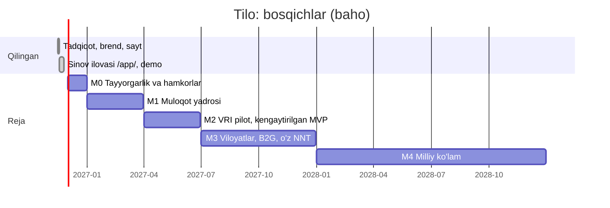

# Tilo roadmap

> Qisqa holat va keyingi qadamlar. To'liq 24 oylik reja, KPI va manbalar:
> [docs/06_Platforma_rejasi/06f_Roadmap_24_oy.md](docs/06_Platforma_rejasi/06f_Roadmap_24_oy.md).
> Bosqichlar va task'lar: [milestones](https://github.com/wonmortech/tilouz/milestones). Qarorlar: [docs/decisions/](docs/decisions/).

**Holat (2026-11-24):** tadqiqot va reja tugagan, sinov ilovasi va konsept demo jonli, 0-bosqich (hamkorlar, intervyular) boshlanishi kerak.
Barcha muddat va KPI baho: ular pilot natijasiga qarab qayta belgilanadi.

## Bosqichlar

Har bosqich oxirida **go/no-go darvozasi** bor. Kar foydalanuvchilar bahosi va hamkor tasdig'i bo'lmasa, keyingi bosqichga o'tilmaydi.

| Bosqich | Muddat (baho) | Asosiy natija | Go/no-go sharti | Task'lar |
|---|---|---|---|---|
| **M0 · Tayyorgarlik** | 2026-12 | Hamkor NNT memorandumi, 15-20 muammo intervyusi, rozilik shabloni, kar hamrais | Kamida 1 NNT hamkorligi va eng og'riqli 3 vaziyat aniq | [M0](https://github.com/wonmortech/tilouz/milestone/1) |
| **M1 · Muloqot yadrosi** | 2027-01 … 03 | Yuzma-yuz subtitr, 50+ karta (kar kengash tekshirgan), video xabar, Telegram bot, STT tanlovi | Kar sinovchilar ko'pchiligi foydali deydi; SUS >= 70; WER <= 15% | [M1](https://github.com/wonmortech/tilouz/milestone/2) |
| **M2 · VRI pilot** | 2027-04 … 06 | Login'siz VRI, tarjimon kabineti, murojaat yordamchisi, AAC, Android | E'lon qilingan soatlarda 80%+ qo'ng'iroq 60 s ichida javob; 1 grant yoki B2G niyat xati | [M2](https://github.com/wonmortech/tilouz/milestone/3) |
| **M3 · Kengayish** | 2027-07 … 12 | 2-4 viloyat, B2G shartnoma, ota-onalar moduli, lug'at 300-500 belgi, o'z NNT | 2+ moliya manbai, 1 to'lovchi institut | [M3](https://github.com/wonmortech/tilouz/milestone/4) |
| **M4 · Milliy** | 2028 | Milliy VRI smenalari, SOS pilot (FVV/112 bilan), statik avatar, MDH | SOS faqat rasmiy hamkorlik bilan; avatar faqat kar baholovchilar roziligi bilan | [M4](https://github.com/wonmortech/tilouz/milestone/5) |

## Hozir nima ishlaydi

| Qism | Holat | Qayerda |
|---|---|---|
| Sayt-prezentatsiya (uz/en/ru) | Jonli | [tilo.wonmor.io](https://tilo.wonmor.io), `site/` |
| Sinov ilovasi: yuzma-yuz subtitr, 8 to'plamda 47 karta, video xabar, favqulodda karta | Jonli, kartalar **qoralama** | [tilo.wonmor.io/app](https://tilo.wonmor.io/app/), `site/app/` |
| Konsept demo: 14 modul, to'qima ma'lumot | Jonli | [wonmor.io/demo/tilo](https://wonmor.io/demo/tilo/), `demo/` |
| Brend kitobi | Jonli | [tilo.wonmor.io/brand](https://tilo.wonmor.io/brand/), `brand/` |
| Telegram kanal va rejali postlar | Ishlaydi | [@tiloapp](https://t.me/tiloapp), `content/telegram/` |
| Tadqiqot va reja (25+ hujjat) | Tugagan | [docs/](docs/) |

## Hozir yo'q (va qachon)

| Narsa | Nega hali yo'q | Qachon |
|---|---|---|
| Jonli tarjimon (VRI) | Hamkor tarjimonlar, stavka va O'zbekistondagi media server kerak | M2 |
| Kar imo-ishorachi videolari | Rozilik shabloni va pullik imo-ishorachilar kerak | M1 |
| Tasdiqlangan karta matnlari | Kar maslahat kengashi hali tuzilmagan | M0-M1 |
| O'z STT serveri | Provayder o'lchovi va huquqiy asos kerak ([ADR 0002](docs/decisions/0002-test-app-runs-on-device.md)) | M1 |
| SOS (112) | Faqat FVV/112 rasmiy hamkorligi bilan | M4 |
| AI imo-ishora tanish, avatar | Ochiq rozilikli dataset va kar kengash veto'si kerak | M3-M4 |

## Qanday yordam berish mumkin

- Kod: [`good first issue`](https://github.com/wonmortech/tilouz/labels/good%20first%20issue) va [`help wanted`](https://github.com/wonmortech/tilouz/labels/help%20wanted).
- Kar jamoa a'zosi, surdotarjimon, lingvist: [`deaf-review`](https://github.com/wonmortech/tilouz/labels/deaf-review) belgili issue'lar.
- Qarorlar: [docs/decisions/](docs/decisions/) (ADR).
- Qo'lda qadamlar (uchrashuv, xat, kelishuv): [`owner-task`](https://github.com/wonmortech/tilouz/labels/owner-task).
