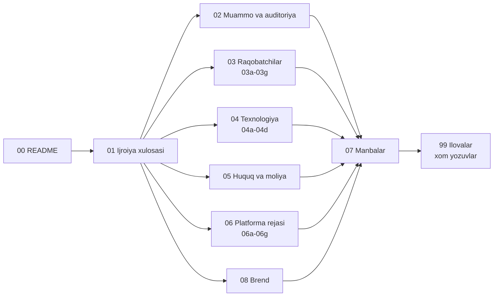

# Tilo — tadqiqot va reja hujjatlari

> **Qisqacha**
> - **Tilo** - O'zbekistonda (keyin MDH da) kar, zaif eshituvchi va gapira olmaydigan odamlar bilan eshituvchilar orasidagi muloqot to'sig'ini yo'qotadigan **bepul, ochiq kodli, notijorat** platforma loyihasi. Founder - o'zbek dasturchi, boshlang'ich mablag' o'zidan.
> - Bu papka - 2026-11-15 dagi tadqiqot sessiyasi natijasi: 22 ta xom tadqiqot yozuvi, oldingi hisobot va ulardan yozilgan 25+ professional hujjat (raqobatchilar, texnologiya, huquq, mahsulot, arxitektura, dataset, byudjet, roadmap, xavflar, brend).
> - Asosiy qaror: mavjud o'zbek o'yinchilari (Surdo AI, imo-ishora.uz, surdo-online, Karlar jamiyati) bilan **raqobat emas, hamkorlik**; MVP - jonli inson tarjimonga videoqo'ng'iroq, yuzma-yuz subtitr, vaziyat kartalari va yana 4 modul.
> - Vaqtingiz 15 daqiqa bo'lsa: [01_Ijroiya_xulosasi.md](01_Ijroiya_xulosasi.md).

---

## 1. Loyiha haqida

| Element | Qiymat |
|---|---|
| Nom | **Tilo** (o'zbekcha "til" + "tillo" - oltin: "har bir til oltinga teng") - [08_Brend_tadqiqoti.md](08_Brend/08_Brend_tadqiqoti.md) |
| Domen | tilo.uz - sotib olinmoqda |
| Vaqtinchalik sayt-prezentatsiya | https://tilo.wonmor.io |
| Telegram kanal | https://t.me/tiloapp |
| Kod ombori | https://github.com/wonmortech/tilouz (wonmortech tashkiloti) |
| Logo | Ondu "To'lqin" belgisi asosida 5 variant; **01 Geometrik tavsiya**, yakuniy tanlov kutilmoqda - [TILO_LOGO.md](08_Brend/tilo_logo/TILO_LOGO.md) |
| Auditoriya | 1-o'rinda O'zbekiston, keyin Qirg'iziston, Tojikiston, Qozog'iston va boshqa MDH |
| Model | Notijorat, ochiq kod (Apache-2.0), kar odamlar boshqaradi ("Nothing about us without us") |
| Holat | Tadqiqot va reja tugagan; 0-bosqich (hamkorlar, intervyular) boshlanishi kerak |

## 2. Papkani qanday o'qish kerak



### O'qish yo'llari

| Yo'l | Kim uchun | Tartib | Vaqt (baho) |
|---|---|---|---|
| **15 daqiqalik** | Har kim, birinchi tanishuv | [01](01_Ijroiya_xulosasi.md) (to'liq) -> [02](02_Muammo_va_auditoriya.md) "Qisqacha" -> [03a](03_Raqobatchilar/03a_Ozbekiston.md) 1-jadval | 15 daq |
| **Founder** | Qaror qabul qiluvchi | [01](01_Ijroiya_xulosasi.md) -> [02](02_Muammo_va_auditoriya.md) -> [03a](03_Raqobatchilar/03a_Ozbekiston.md) -> [06a](06_Platforma_rejasi/06a_Mahsulot_konsepsiyasi_va_funksiyalar.md) -> [06f](06_Platforma_rejasi/06f_Roadmap_24_oy.md) (30/60/90 ro'yxati) -> [06e](06_Platforma_rejasi/06e_Budjet_va_moliya_rejasi.md) -> [06g](06_Platforma_rejasi/06g_Xavflar_va_ochiq_savollar.md) -> [05](05_Huquq_moliya_va_notijorat_model.md) -> [06d](06_Platforma_rejasi/06d_Boshqaruv_jamoa_va_hamkorlar.md) -> [08](08_Brend/08_Brend_tadqiqoti.md) | 2-3 soat |
| **Dasturchi** | Texnik rahbar, hissa qo'shuvchi | [01](01_Ijroiya_xulosasi.md) 3.3 va 5-bo'lim -> [06b](06_Platforma_rejasi/06b_Texnik_arxitektura.md) -> [04b](04_Texnologiya/04b_Ochiq_kod_va_klon_tahlili.md) -> [04c](04_Texnologiya/04c_Nutq_subtitr_va_bigtech.md) -> [04d](04_Texnologiya/04d_Datasetlar_va_modellar.md) -> [06c](06_Platforma_rejasi/06c_Imo_ishora_dataset_strategiyasi.md) -> [04a](04_Texnologiya/04a_Ilmiy_tadqiqotlar.md) -> [03g](03_Raqobatchilar/03g_Global_funksiyalar_matritsasi.md) (funksiya hukmlari) | 3-4 soat |
| **Grant yozuvchi** | Ariza, hamkor xat, taqdimot | [01](01_Ijroiya_xulosasi.md) 12-bo'lim (raqamlar) -> [02](02_Muammo_va_auditoriya.md) (muammo dalillari) -> [05](05_Huquq_moliya_va_notijorat_model.md) 4-5-bo'lim (manbalar, modellar) -> [06e](06_Platforma_rejasi/06e_Budjet_va_moliya_rejasi.md) -> [06d](06_Platforma_rejasi/06d_Boshqaruv_jamoa_va_hamkorlar.md) -> [06f](06_Platforma_rejasi/06f_Roadmap_24_oy.md) KPI -> [07](07_Manbalar.md) (iqtibos uchun) | 1,5-2 soat |

Mintaqaviy tajriba kerak bo'lsa: [03b Rossiya va MDH](03_Raqobatchilar/03b_Rossiya_va_MDH.md), [03c Yevropa](03_Raqobatchilar/03c_Yevropa.md), [03d Amerika](03_Raqobatchilar/03d_Amerika.md), [03e Sharqiy Osiyo](03_Raqobatchilar/03e_Sharqiy_Osiyo_va_Okeaniya.md), [03f Janubiy Osiyo, Yaqin Sharq, Afrika](03_Raqobatchilar/03f_Janubiy_Osiyo_Yaqin_Sharq_Afrika.md) - har birining oxirida "Saboqlar O'zbekiston uchun" bor.

## 3. To'liq mundarija

O'lchamlar fayl tizimidan avtomatik olingan (2026-11-15). Bu jadvaldagi README'ning o'z o'lchami yozish paytidagi taxminiy qiymat.

<!--TOC-START-->
**Asosiy hujjatlar**

| Fayl | Mazmuni | Hajm |
|---|---|---|
| [00_README.md](00_README.md) | Shu fayl: loyiha, o'qish yo'llari, mundarija, sessiya tarixi, qoidalar | 18.8 KB |
| [01_Ijroiya_xulosasi.md](01_Ijroiya_xulosasi.md) | 3 sahifalik xulosa: muammo, landshaft, qaror, klon/qurish hukmi, byudjet, roadmap, xavflar, 10 qadam, asosiy raqamlar | 20.6 KB |
| [02_Muammo_va_auditoriya.md](02_Muammo_va_auditoriya.md) | O'zbekiston: statistika (zid raqamlar bilan), qonunlar, ta'lim, tarjimonlar, UzSL lingvistikasi, onlayn jamiyat, ota-onalar, personalar | 36.9 KB |
| [05_Huquq_moliya_va_notijorat_model.md](05_Huquq_moliya_va_notijorat_model.md) | Yuridik shakl, biometrik lokalizatsiya, talab yaratuvchi qonunlar, moliya manbalari, litsenziya, huquqiy tekshiruv ro'yxati | 42.1 KB |
| [07_Manbalar.md](07_Manbalar.md) | Barcha hujjatlardagi URL'larning yagona indeksi, toifalar va iqtibos qilgan hujjatlar bilan | 157.8 KB |

**03_Raqobatchilar**

| Fayl | Mazmuni | Hajm |
|---|---|---|
| [03a_Ozbekiston.md](03_Raqobatchilar/03a_Ozbekiston.md) | O'zbekiston o'yinchilari: Surdo AI, imo-ishora.uz, Remu, surdo-online, Karlar jamiyati, YouTube, Telegram, prototiplar | 34.1 KB |
| [03b_Rossiya_va_MDH.md](03_Raqobatchilar/03b_Rossiya_va_MDH.md) | Rossiya, Qozog'iston, Qirg'iziston, Tojikiston, Belarus, Ukraina, Ozarbayjon, Gruziya, Armaniston | 112.4 KB |
| [03c_Yevropa.md](03_Raqobatchilar/03c_Yevropa.md) | EU qonuni, relay modellari, 20+ mamlakat profili, EU tadqiqot loyihalari | 153.0 KB |
| [03d_Amerika.md](03_Raqobatchilar/03d_Amerika.md) | AQSh FCC TRS, Kanada CAV, Kolumbiya, Braziliya, Argentina va boshqa Lotin Amerikasi | 134.9 KB |
| [03e_Sharqiy_Osiyo_va_Okeaniya.md](03_Raqobatchilar/03e_Sharqiy_Osiyo_va_Okeaniya.md) | Koreya, Yaponiya, Xitoy, Avstraliya, Yangi Zelandiya | 64.1 KB |
| [03f_Janubiy_Osiyo_Yaqin_Sharq_Afrika.md](03_Raqobatchilar/03f_Janubiy_Osiyo_Yaqin_Sharq_Afrika.md) | Hindiston, Pokiston, Tailand, Turkiya, Isroil, Keniya, JAR va boshqalar | 91.4 KB |
| [03g_Global_funksiyalar_matritsasi.md](03_Raqobatchilar/03g_Global_funksiyalar_matritsasi.md) | ~40 mahsulot jadvali, 48 funksiya hukmi (shart/qo'shimcha/qochish), biznes modellar | 60.0 KB |

**04_Texnologiya**

| Fayl | Mazmuni | Hajm |
|---|---|---|
| [04a_Ilmiy_tadqiqotlar.md](04_Texnologiya/04a_Ilmiy_tadqiqotlar.md) | SOTA (SLT, ISLR), transfer learning, foydalanuvchi tadqiqotlari, etika, annotatsiya narxi | 49.0 KB |
| [04b_Ochiq_kod_va_klon_tahlili.md](04_Texnologiya/04b_Ochiq_kod_va_klon_tahlili.md) | Repo katalogi va 8 repo kod auditi; klon/g'oya/qochish hukmi, litsenziya, mehnat bahosi | 54.3 KB |
| [04c_Nutq_subtitr_va_bigtech.md](04_Texnologiya/04c_Nutq_subtitr_va_bigtech.md) | O'zbek/rus STT, big-tech qo'llovi, mahalliy provayderlar, ochiq ASR modellari, Surdo AI, Telegram Mini App | 27.8 KB |
| [04d_Datasetlar_va_modellar.md](04_Texnologiya/04d_Datasetlar_va_modellar.md) | Imo-ishora datasetlari va litsenziyalari, RSL aktivlari, UzSL holati, o'zbek nutq korpuslari | 32.8 KB |

**06_Platforma_rejasi**

| Fayl | Mazmuni | Hajm |
|---|---|---|
| [06a_Mahsulot_konsepsiyasi_va_funksiyalar.md](06_Platforma_rejasi/06a_Mahsulot_konsepsiyasi_va_funksiyalar.md) | Vizyon, pozitsiya, tamoyillar, personalar, foydalanuvchi yo'llari, 19 modul, UX, KPI | 48.7 KB |
| [06b_Texnik_arxitektura.md](06_Platforma_rejasi/06b_Texnik_arxitektura.md) | Komponentlar diagrammasi, qo'ng'iroq va subtitr quvurlari, rozilik oqimi, hosting, xavfsizlik, CI/CD | 32.1 KB |
| [06c_Imo_ishora_dataset_strategiyasi.md](06_Platforma_rejasi/06c_Imo_ishora_dataset_strategiyasi.md) | O'IIT dataseti: bosqichlar, yozish protokoli, rozilik qatlamlari, metama'lumot, nashr, xarajat | 32.2 KB |
| [06d_Boshqaruv_jamoa_va_hamkorlar.md](06_Platforma_rejasi/06d_Boshqaruv_jamoa_va_hamkorlar.md) | Kar boshqaruvi, rollar, ko'ngilli modeli, hamkorlar xaritasi, maslahat kengashi nomzodlari | 19.9 KB |
| [06e_Budjet_va_moliya_rejasi.md](06_Platforma_rejasi/06e_Budjet_va_moliya_rejasi.md) | Uch ssenariy (A/B/C), xarajat moddalari, tejash taktikalari, barqarorlik rejasi | 16.8 KB |
| [06f_Roadmap_24_oy.md](06_Platforma_rejasi/06f_Roadmap_24_oy.md) | Gantt, 5 bosqich va go/no-go, founder uchun 30/60/90 kun, MDH ga kengayish | 16.9 KB |
| [06g_Xavflar_va_ochiq_savollar.md](06_Platforma_rejasi/06g_Xavflar_va_ochiq_savollar.md) | 24 xavf reestri, xavf xaritasi, birlashtirilgan ochiq savollar | 19.9 KB |

**08_Brend**

| Fayl | Mazmuni | Hajm |
|---|---|---|
| [08_Brend_tadqiqoti.md](08_Brend/08_Brend_tadqiqoti.md) | Nomlash tadqiqoti: ~100 nomzod, skrining metodikasi, 10 yakuniy nom va logo, rubrika | 29.9 KB |
| [brand_board.html](08_Brend/brand_board.html) | 10 nom va logoning jonli taxtasi (yorug'/qorong'i) | 54.5 KB |
| [brand_board.png](08_Brend/brand_board.png) | Taxta skrinshoti | 951.3 KB |
| [logos/](08_Brend/logos/) | 10 rangli + 10 bir rangli SVG logo (20 fayl) | 11.2 KB |
| [TILO_LOGO.md](08_Brend/tilo_logo/TILO_LOGO.md) | Tilo belgi tizimi: 5 yo'nalish, palitra, harakat, 3D, tavsiya (01 Geometrik) | 14.4 KB |
| [tilo_logo_board.html](08_Brend/tilo_logo/tilo_logo_board.html) | 5 variantning jonli taxtasi: animatsiya, lockup, favicon, WCAG | 119.3 KB |
| [tilo_logo_board.png](08_Brend/tilo_logo/tilo_logo_board.png) | Taxta skrinshoti (yorug') | 1363.8 KB |
| [tilo_logo_board_dark.png](08_Brend/tilo_logo/tilo_logo_board_dark.png) | Taxta skrinshoti (qorong'i) | 1357.4 KB |
| [svg/](08_Brend/tilo_logo/svg/) | 5 variant x 6 fayl: mark, mono, icon, favicon, lockup light/dark (30 SVG) | 27.6 KB |
| [src/](08_Brend/tilo_logo/src/) | geo.py, build.py (hamma SVG/HTML ni qayta yaratadi), test.py, test2.py | 59.0 KB |

**99_Ilovalar: oldingi hisobot**

| Fayl | Mazmuni | Hajm |
|---|---|---|
| [Karlar uchun muloqot platformasi.md](99_Ilovalar/oldingi_hisobot/Karlar%20uchun%20muloqot%20platformasi.md) | 1-tadqiqot hisoboti: MVP (subtitr + kartalar + VRI), nimani qurmaslik, roadmap, biznes model | 50.7 KB |

**99_Ilovalar: 1-tadqiqot xom yozuvlari**

| Fayl | Mazmuni | Hajm |
|---|---|---|
| [browser_youtube_google_findings.md](99_Ilovalar/xom_tadqiqot_yozuvlari/1_birinchi_tadqiqot/browser_youtube_google_findings.md) | Founder brauzeri: Surdo AI, imo-ishora.uz, Remu, YouTube darslari, transkript tahlillari | 11.6 KB |
| [deaf_centered_product_ux.md](99_Ilovalar/xom_tadqiqot_yozuvlari/1_birinchi_tadqiqot/deaf_centered_product_ux.md) | Kar-markazli UX: savod, vaziyatlar, favqulodda, AAC, etika | 39.4 KB |
| [global_apps_and_business_models.md](99_Ilovalar/xom_tadqiqot_yozuvlari/1_birinchi_tadqiqot/global_apps_and_business_models.md) | Global ilovalar va biznes modellar (VRS, subtitr, avatar, o'qitish) | 26.8 KB |
| [open_source_tech_stack.md](99_Ilovalar/xom_tadqiqot_yozuvlari/1_birinchi_tadqiqot/open_source_tech_stack.md) | Ochiq texnologiya steki: pose, ISLR, SLT, o'zbek ASR/TTS | 23.8 KB |
| [russia_cis_ecosystem.md](99_Ilovalar/xom_tadqiqot_yozuvlari/1_birinchi_tadqiqot/russia_cis_ecosystem.md) | Rossiya/MDH ekotizimi: RSL datasetlari, mahsulotlar, moliya | 23.3 KB |
| [uzbekistan_landscape.md](99_Ilovalar/xom_tadqiqot_yozuvlari/1_birinchi_tadqiqot/uzbekistan_landscape.md) | O'zbekiston: statistika, tashkilotlar, til, qonun, texnologiya, donorlar, og'riqlar | 37.9 KB |

**99_Ilovalar: 2-tadqiqot xom yozuvlari**

| Fayl | Mazmuni | Hajm |
|---|---|---|
| [academic_research_synthesis.md](99_Ilovalar/xom_tadqiqot_yozuvlari/2_raqobat_va_ochiq_kod/academic_research_synthesis.md) | Ilmiy adabiyot sintezi | 28.8 KB |
| [global_feature_matrix.md](99_Ilovalar/xom_tadqiqot_yozuvlari/2_raqobat_va_ochiq_kod/global_feature_matrix.md) | Global funksiyalar matritsasi (inglizcha manba) | 52.8 KB |
| [hands_on_repo_audit.md](99_Ilovalar/xom_tadqiqot_yozuvlari/2_raqobat_va_ochiq_kod/hands_on_repo_audit.md) | 8 repo kod auditi (fayl:qator) | 47.5 KB |
| [nonprofit_models_funding.md](99_Ilovalar/xom_tadqiqot_yozuvlari/2_raqobat_va_ochiq_kod/nonprofit_models_funding.md) | Notijorat modellar va moliya | 26.7 KB |
| [open_source_clonable.md](99_Ilovalar/xom_tadqiqot_yozuvlari/2_raqobat_va_ochiq_kod/open_source_clonable.md) | Klon qilinadigan ochiq kod katalogi | 25.1 KB |
| [region_americas.md](99_Ilovalar/xom_tadqiqot_yozuvlari/2_raqobat_va_ochiq_kod/region_americas.md) | Amerika mintaqasi | 33.6 KB |
| [region_east_asia_oceania.md](99_Ilovalar/xom_tadqiqot_yozuvlari/2_raqobat_va_ochiq_kod/region_east_asia_oceania.md) | Sharqiy Osiyo va Okeaniya ([BG] belgilari shu yerda) | 24.1 KB |
| [region_europe.md](99_Ilovalar/xom_tadqiqot_yozuvlari/2_raqobat_va_ochiq_kod/region_europe.md) | Yevropa mintaqasi | 47.1 KB |
| [region_south_asia_mena_africa.md](99_Ilovalar/xom_tadqiqot_yozuvlari/2_raqobat_va_ochiq_kod/region_south_asia_mena_africa.md) | Janubiy Osiyo, Yaqin Sharq, Afrika | 32.2 KB |
| [russia_cis_competitors.md](99_Ilovalar/xom_tadqiqot_yozuvlari/2_raqobat_va_ochiq_kod/russia_cis_competitors.md) | Rossiya va MDH raqobatchilari | 46.5 KB |
| [uzbek_speech_bigtech_support.md](99_Ilovalar/xom_tadqiqot_yozuvlari/2_raqobat_va_ochiq_kod/uzbek_speech_bigtech_support.md) | O'zbek nutqi va big-tech qo'llovi | 16.3 KB |
| [uzbekistan_legal_costs.md](99_Ilovalar/xom_tadqiqot_yozuvlari/2_raqobat_va_ochiq_kod/uzbekistan_legal_costs.md) | O'zbekiston huquqi, xarajatlar, grantlar | 24.1 KB |
| [uzsl_linguistics_education_community.md](99_Ilovalar/xom_tadqiqot_yozuvlari/2_raqobat_va_ochiq_kod/uzsl_linguistics_education_community.md) | UzSL lingvistikasi, ta'lim, onlayn jamiyat, ota-onalar | 26.7 KB |

Jami ro'yxatdagi fayllar hajmi: **5.8 MB** (PNG skrinshotlar bilan).
<!--TOC-END-->

## 4. Sessiya tarixi

| # | Qadam | Natija |
|---|---|---|
| 1 | Founder so'rovi: kar va gapira olmaydiganlar uchun ilova, o'zbek auditoriyasi; dunyo, Rossiya, O'zbekiston bo'yicha chuqur tadqiqot, takliflar, reja, roadmap | Tadqiqot doirasi |
| 2 | 1-tadqiqot, 5 yo'nalish: global ilovalar va biznes modellar; Rossiya/MDH; O'zbekiston; ochiq texnologiya; kar-markazli UX | "Karlar uchun muloqot platformasi" hisoboti (MVP: subtitr + kartalar + VRI; avatar, qo'lqop, AI tarjimonni avval qurmaslik) - `99_Ilovalar/oldingi_hisobot/` |
| 3 | Founder brauzeri orqali YouTube, Google, Play, Telegram izlanishi | Surdo AI, imo-ishora.uz, Remu topildi; ZAMONUZ, Sber Ovodov, Kudrat Israilov transkriptlari tahlili |
| 4 | Founder: raqobatchilarni to'liq o'rgan, klon/moslash yoki eng zo'r platforma; maqsad pul emas, ochiq kod, o'z mablag'i | Strategik yo'nalish |
| 5 | 2-tadqiqot: Rossiya/MDH raqobatchilari, O'zbekiston raqobatchilari, global funksiyalar matritsasi, klon qilinadigan ochiq kod, notijorat model va moliya | Xom yozuvlar `2_raqobat_va_ochiq_kod/` |
| 6 | Founder: butun dunyoni o'rgan (Yevropa, Amerika, Hindiston, Koreya...), maqolalar, tajribalar | 5 mintaqaviy + ilmiy tadqiqot yozuvi |
| 7 | Founder: maksimal data va to'liq reja | Kod auditi (8 repo klon qilinib o'qildi), o'zbek nutqi va big-tech, O'zbekiston huquqi va xarajatlari, UzSL lingvistikasi, ta'lim, jamiyat |
| 8 | Founder: hammasini bitta professional hujjat papkasiga yoz | 03-06 hujjatlari |
| 9 | Brend tadqiqoti | ~100 nomzod, 70 avtomatik skrining, 10 yakuniy nom va logo - [08](08_Brend/08_Brend_tadqiqoti.md) |
| 10 | Nom **Tilo** tanlandi; Ondu "To'lqin" logosi asosida 5 belgi varianti | [TILO_LOGO.md](08_Brend/tilo_logo/TILO_LOGO.md), 01 Geometrik tavsiya |
| 11 | GitHub `wonmortech/tilouz` ombori va `tilo.wonmor.io` sayt-prezentatsiyasi; Telegram @tiloapp | Ommaviy ko'rinish; 00-02, 03a, 07 hujjatlari yozildi |

## 5. Hujjat qoidalari

| Qoida | Ma'nosi |
|---|---|
| Til | Butun matn o'zbek tilida, lotin yozuvida; texnik atamalar inglizcha qolishi mumkin. **Kirill harflari yo'q** - rus nomlari transliteratsiya qilingan (Surdo-pomosh, Vserossiyskoe obshchestvo glukhikh, Moi RZhYa) |
| Tuzilma | Har hujjat boshida "Qisqacha" bloki; oxirida "Manbalar" va "Tasdiqlanmagan / bo'shliqlar" |
| Manba | Har faktning yonida havola. Havola xom yozuv faylini ko'rsatsa (`uzbekistan_landscape.md` kabi), asl URL o'sha faylda |
| **baho** | Manbasiz baho, taxmin yoki muallif xulosasi (inferensiya). Fakt deb o'qilmasin |
| **tasdiqlanmagan** | Faqat qidiruv snippetidan yoki ikkilamchi manbadan, birlamchi sahifa o'qilmagan |
| **TBD** | Narx yoki qiymat noma'lum; "Karlar jamiyati/Sharoit Plyus bilan aniqlash" kabi keyingi qadam ko'rsatiladi. Diapazon berilsa - **baho** belgisi bilan |
| **[BG]** | Tadqiqotchining fon bilimi (background knowledge): sessiyada manba bilan **qayta tekshirilmagan**, faqat "bo'shliqlar" qismida turadi va "tekshirish kerak" deb o'qiladi (asosan `region_east_asia_oceania.md` va [03e](03_Raqobatchilar/03e_Sharqiy_Osiyo_va_Okeaniya.md)) |
| Zid raqamlar | Manbalar bir-biriga zid bo'lsa, **ikkalasi ham** ko'rsatiladi va "manbalar zid" deb belgilanadi (masalan, Karlar jamiyati a'zolari 22 000+ va ~30 000; internatlar 18 va 19) |
| Holat belgilari | Faol / Pilot / Prototip / Noma'lum / To'xtagan - raqobatchi jadvallarida |
| Hukmlar | Klon (asos) / Klon, alohida ilova / Faqat g'oya / Qochish - ochiq kod uchun ([04b](04_Texnologiya/04b_Ochiq_kod_va_klon_tahlili.md)); shart / qo'shimcha / qochish - funksiyalar uchun ([03g](03_Raqobatchilar/03g_Global_funksiyalar_matritsasi.md)) |
| Sana | Barcha tadqiqot 2026-11-15 holatiga; do'kon raqamlari o'sha kungi sahifadan |
| Strategik qarorlar | Barcha reja hujjatlari 10 ta qabul qilingan qarorga mos: pozitsiya, MVP yadrosi, keyingi bosqichlar, kanal, ochiq kod asos, litsenziya, huquq, boshqaruv, moliya, noma'lum narxlar ([01](01_Ijroiya_xulosasi.md)) |

## 6. Kirill tekshiruvi

Har yangi hujjatdan keyin (Unicode U+0400 - U+04FF):

```bash
python -c "import io,re,sys;t=io.open(sys.argv[1],encoding='utf-8').read();print(len(re.findall('[\u0400-\u04FF]',t)))" 02_Muammo_va_auditoriya.md
```

Natija `0` bo'lishi shart.

## Manbalar

Bu README faktlari pastdagi hujjatlardan; barcha URL'lar indeksi - [07_Manbalar.md](07_Manbalar.md). Brend ma'lumoti founderdan: https://tilo.wonmor.io ; https://t.me/tiloapp ; https://github.com/wonmortech/tilouz .

## Tasdiqlanmagan / bo'shliqlar

| Mavzu | Holat |
|---|---|
| tilo.uz domeni | Sotib olinmoqda; `TILO_LOGO.md` da "tilo.io" yozilgan - joriy reja tilo.uz |
| Logo | 01 Geometrik tavsiya; kar jamiyati sinovi va yakuniy tanlov kutilmoqda |
| Nom | Kar jamiyati bilan sinovdan o'tmagan ([08](08_Brend/08_Brend_tadqiqoti.md), 8-bo'lim) |
| O'zbekiston raqobatchilari chuqur skaneri | Alohida fayl hali yo'q; [03a](03_Raqobatchilar/03a_Ozbekiston.md) boshqa yozuvlardan tuzilgan |
| `[BG]` bilan belgilangan faktlar | Manba bilan tasdiqlanmagan; qarorda ishlatishdan oldin tekshirish kerak |
