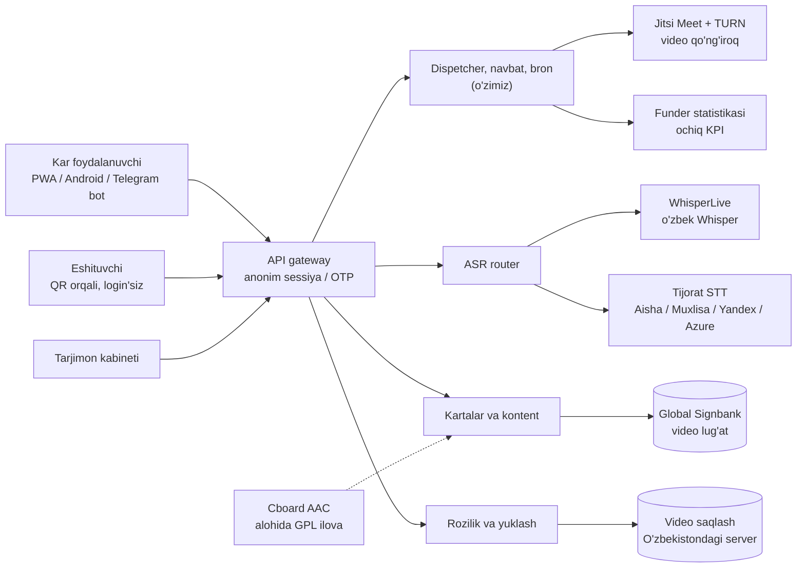

# 01. Ijroiya xulosasi: Tilo

> **Qisqacha**
> - **Tilo** - kar, zaif eshituvchi va gapira olmaydigan odamlarni eshituvchilar bilan bog'laydigan **bepul, ochiq kodli, kar odamlar boshqaradigan** platforma. Avval O'zbekiston, keyin MDH. Maqsad pul emas.
> - Muammo ta'minotda: Toshkentda ~10 malakali tarjimon, ~800 kishiga bitta; Karlar jamiyatida 22 000+ a'zo ([Gazeta.uz 2025](https://www.gazeta.uz/oz/2025/09/30/sign-language/)).
> - Qaror: Surdo AI, imo-ishora.uz, surdo-online va Karlar jamiyati bilan **raqobat emas, hamkorlik**. AI tarjimon yoki avatar bilan boshlamaymiz; MVP - jonli inson tarjimonga videoqo'ng'iroq (VRI), yuzma-yuz subtitr, vaziyat kartalari va yana 4 modul.
> - Texnika tayyor ochiq koddan yig'iladi (Jitsi, Global Signbank, WhisperLive, Cboard...), MVP muhandisligi ~35-60 kishi-hafta (**baho**). Eng katta va noma'lum xarajat - tarjimon soati va imo-ishora yozuvi (**TBD**).
> - Pul: A ssenariy (founder, 6 oy) ~$1,6k-11,5k; B (grant, 12 oy) ~$28k-103k; C (to'liq, 24 oy) ~$355k-990k - hammasi **baho** ([06e](06_Platforma_rejasi/06e_Budjet_va_moliya_rejasi.md)).

Sana: 2026-11-15. Bu hujjat butun papkaning 3 sahifalik xulosasi; har bo'lim batafsil hujjatga havola beradi.

---

## 1. Muammo

| Fakt | Raqam | Manba |
|---|---|---|
| Karlar jamiyati a'zolari | 22 000+ (2025); jamiyat videosida ~30 000 - **zid** | [Gazeta.uz 2025](https://www.gazeta.uz/oz/2025/09/30/sign-language/); [YouTube](https://www.youtube.com/watch?v=zGfIHZnmmHw) |
| Reestrdagi eshitish nuqsoni bor bolalar | ~8 000 | [Gazeta.uz 2025](https://www.gazeta.uz/oz/2025/09/30/sign-language/) |
| Malakali tarjimon, Toshkent | ~10; ~800 kishiga 1 | o'sha; [Yusupov 2020](https://dilmurad.me/expert/uzbek-sign-language-usl-to-be-or-not-to-be/) |
| Muloqotda doim/tez-tez qiyinchilik | 56% (n=102) | [Gazeta.uz 2025](https://www.gazeta.uz/oz/2025/09/30/sign-language/) |
| TV: talab va amal | 5% efir / kuniga 15-20 daqiqa | [norma.uz](https://www.norma.uz/oz/qonunchilikda_yangi/uzbek_imo-ishora_tili_va_brayl_alifbosini_rivojlantirish_buyicha_chora-tadbirlar_belgilandi); [Gazeta.uz 2025](https://www.gazeta.uz/oz/2025/09/30/sign-language/) |

Qonun (O'RQ-641, PQ-407) davlat organlarini tarjimon ta'minlashga majbur qiladi, lekin ishlaydigan ta'minot zanjiri yo'q; tarjimon kasbi va standarti yo'q; favqulodda kanal (JusTalk) va surdo-online planshetlari ishonchsiz. Batafsil - [02_Muammo_va_auditoriya.md](02_Muammo_va_auditoriya.md).

## 2. Landshaft: O'zbekiston va dunyo

| Mintaqa | Nima ishlaydi | Kim to'laydi | Saboq Tilo uchun | Batafsil |
|---|---|---|---|---|
| **O'zbekiston** | Surdo AI (davlat, avatar+kamera, 1k+ yuklanma), imo-ishora.uz (2000+ so'z), surdo-online (14 bo'linma), Karlar jamiyati bepul tarjimonlari, YouTube darslari (150K gacha) | Davlat, xorijiy grant (Stirling $30 120), jamiyat | Bo'sh joy - halol soatli VRI, subtitr, kartalar, ochiq kod; integratsiya | [03a](03_Raqobatchilar/03a_Ozbekiston.md) |
| **Rossiya va MDH** | Inson tarjimon dispetcherlari (Surdo-pomosh, Moi RZhYa), MTS "qo'ng'iroqni chatga" (6 oyda ~496 000), Ozarbayjon WhatsApp/Telegram relay (~1 000 foydalanuvchi) | Davlat soatlari (Rossiya 84 soat/yil, Qozog'iston 60) | Messenjer orqali dispetcher eng arzon; MDHda ochiq kodli relay yo'q | [03b](03_Raqobatchilar/03b_Rossiya_va_MDH.md) |
| **Yevropa** | Telekom yig'imi bilan relay (Tess, Rogervoice, KPN), ARCEP ochiq KPI; EU MT loyihalari xizmatga aylanmadi | Regulyator + operatorlar | SOS uchun EU 2023/444 6 talabi; budjet qatori tugaydi (Islandiya) | [03c](03_Raqobatchilar/03c_Yevropa.md) |
| **Amerika** | FCC daqiqabay to'lov (VRS 2025-26 $660,66M), Kanada CAV notijorat administrator, Kolumbiya Centro de Relevo (2024 da 516 523 qo'ng'iroq) | Telekom fondi | CAV - O'zbekistonga eng yaqin tuzilma | [03d](03_Raqobatchilar/03d_Amerika.md) |
| **Sharqiy Osiyo va Okeaniya** | Qonuniy relay (Yaponiya: 14 000+ foydalanuvchi), shablon kontentda avatar | Telekom yig'imi | Ochiq domenli avatarni karlar tushunmaydi (Xitoy) | [03e](03_Raqobatchilar/03e_Sharqiy_Osiyo_va_Okeaniya.md) |
| **Janubiy Osiyo, Yaqin Sharq, Afrika** | Hindiston ISLRTC WhatsApp video relay (bepul), Turkiya davlat lug'ati (5 000 so'z), Tailand TTRS (2025-06 da to'xtagan) | Davlat | Lug'at -> oddiy video tarjimon -> AI oxirida; bitta budjetga bog'lanmaslik | [03f](03_Raqobatchilar/03f_Janubiy_Osiyo_Yaqin_Sharq_Afrika.md) |
| **Global mahsulotlar** | ~40 mahsulot, 48 funksiya; eng ko'p shikoyat - pul (paywall); AI imo-ishora startaplari $0,1-4M da qolgan | - | Bepullik o'zi ustunlik; ochiq kod deyarli yo'q (Cboard, sign.mt) | [03g](03_Raqobatchilar/03g_Global_funksiyalar_matritsasi.md) |

Manbalar: har bir hujjatning "Qisqacha" bloki; asosiy raqamlar - [FCC DA 25-578](https://docs.fcc.gov/public/attachments/DA-25-578A1.docx), [mobile-review](https://mobile-review.com/all/?p=259570), [MinTIC](https://mintic.gov.co/portal/inicio/Sala-de-prensa/Noticias/399452:Este-ano-el-Centro-de-Relevo-gestiono-516-523-llamadas-relevadas-para-la-pobla), [NFTRS](https://nftrs.or.jp/news/fy2024/files/NFTRSpapers_fy2024-001.pdf), [Prachatai](https://prachataienglish.com/node/11567).

## 3. Qaror

### 3.1 Pozitsiya
- **Hamkorlik, raqobat emas.** Surdo AI bilan o'zaro havola, imo-ishora.uz bilan lug'at, surdo-online uchun ochiq dispetcher, Karlar jamiyati tarjimonlari uchun navbat va bron ([06a, 2-bo'lim](06_Platforma_rejasi/06a_Mahsulot_konsepsiyasi_va_funksiyalar.md)).
- **"Sizni inson tarjimonga tezroq ulaymiz"** - "tarjimonni almashtiramiz" emas. Yuqori xavfli vaziyatda (tibbiyot, sud, politsiya) AI yo'q - WFD/WASLI pozitsiyasi ([WFD/WASLI](https://wfdeaf.org/wp-content/uploads/WFD-and-WASLI-Statement-on-Avatar-FINAL-14032018-Updated-14042018.pdf)).

### 3.2 MVP yadrosi (7 modul)

| # | Modul | Nega |
|---|---|---|
| a | Jonli inson tarjimonga VRI: halol e'lon qilingan soatlar, ro'yxatsiz chaqirish | ~800 kishiga 1 tarjimon; "yagona baza va onlayn xizmat" so'ralgan |
| b | Yuzma-yuz suhbat: o'zbek/rus jonli subtitr + yozish, split-screen, xatoni tuzatish | STT tayyor va arzon (Yandex ~$0,30/soat) |
| c | Vaziyat kartalari (shifoxona, bank, taksi, politsiya, mahalla), kar imo-ishorachi videosi bilan | Savod cheklangan, "video birinchi" |
| d | Idora/murojaat yordamchisi | Byurokratiya bilan muloqot og'rig'i (ZAMONUZ) |
| e | Video xabar (ko'zgu effekti to'g'ri) | Imo-ishorada yozishma |
| f | AAC gapira olmaydiganlar uchun (Cboard asosida, alohida GPL ilova) | Alohida auditoriya, tayyor ochiq asos |
| g | Ota-onalar uchun o'rganish moduli | 90-95% kar bola eshituvchi oilada |

Keyingi bosqichlar: SOS (FVV/112 bilan, EU 2023/444), operator zero-rating va "qo'ng'iroqni chatga", statik kontent uchun avatar, AI yordamchi tanish (Logos pretrain + o'zbek fine-tune), MDH. Batafsil - [06a](06_Platforma_rejasi/06a_Mahsulot_konsepsiyasi_va_funksiyalar.md).

### 3.3 Klon yoki o'zimiz quramiz: komponentlar bo'yicha hukm

| Komponent | Hukm | Vazifasi | pw (**baho**) |
|---|---|---|---|
| Jitsi Meet (Apache-2.0); LiveKit muqobil | **Klon (asos)** | Tarjimon video qo'ng'irog'i, subtitr overlay | 9-16 |
| Global Signbank (BSD-3) | **Klon (asos)** | O'IIT lug'at bazasi (gloss, video, dialekt) | 7-12 + suratga olish |
| spoken-to-signed-translation + pose (MIT) | **Klon (asos)** | Matn -> imo-ishora gloss -> pose | 9-18 |
| WhisperLive (MIT) | **Klon (asos)** | O'zbek/rus oqimli subtitr | 2,5-4,5 |
| Cboard (GPL-3.0) | **Klon, alohida ilova** | AAC | 9-15 |
| upf-gti/performs (MIT) | **Klon, 2-faza** | Brauzer avatar (faqat statik kontent) | 4-8 + animator |
| SignON, VLibras, yandex/deaf | **Faqat g'oya** | Arxitektura va UX naqshlari | - |
| sign/translate (CC BY-NC-SA) | **Qochish** | NC litsenziya | - |
| Tarjimon dispetcheri/navbat, rozilik va yuklash servisi, suhbat ilovasi, glosser, transliteratsiya, funder statistikasi | **O'zimiz yozamiz** | Bo'sh joy | dispetcher Jitsi ichida 6-10; rozilik 4-6; suhbat ilovasi 6-10 |

Manba: kod auditi (8 repo klon qilinib o'qilgan) - [04b](04_Texnologiya/04b_Ochiq_kod_va_klon_tahlili.md).

## 4. Mahsulot va brend

| Element | Holat |
|---|---|
| Nom | **Tilo** (o'zbekcha "til" + "tillo"/oltin; brend tadqiqotida 62/80, "eng kuchli hikoya") - [08](08_Brend/08_Brend_tadqiqoti.md) |
| Domen | tilo.uz - sotib olinmoqda; vaqtinchalik sayt-prezentatsiya: https://tilo.wonmor.io |
| Telegram | https://t.me/tiloapp |
| Kod | https://github.com/wonmortech/tilouz (wonmortech tashkiloti) |
| Logo | Ondu "To'lqin" belgisi asosida 5 variant; **01 Geometrik tavsiya etilgan, yakuniy tanlov kutilmoqda** - [TILO_LOGO.md](08_Brend/tilo_logo/TILO_LOGO.md) |
| Kanal | PWA veb-ilova + Android birinchi; Telegram bot - eslatma, bron, kartalar (Mini App'da kamera/WebRTC API yo'q); iOS keyin ([04c](04_Texnologiya/04c_Nutq_subtitr_va_bigtech.md)) |
| Tamoyillar | Kar odamlar boshqaradi; bepul; ochiq; maxfiylik (qo'ng'iroq yozilmaydi); halol ish soatlari; video birinchi |

## 5. Arxitektura (bitta diagramma)

Yuz videosi (biometrik) O'zbekistondagi serverda; qo'ng'iroqlar default yozilmaydi; subtitr xotirada. Batafsil - [06b](06_Platforma_rejasi/06b_Texnik_arxitektura.md).

## 6. Dataset

Hozir ochiq, litsenziyali O'IIT dataseti **yo'q** ([04d](04_Texnologiya/04d_Datasetlar_va_modellar.md)). Reja - birinchi ochiq, rozilik asosidagi dataset ([06c](06_Platforma_rejasi/06c_Imo_ishora_dataset_strategiyasi.md)):

| Bosqich | Hajm | Usul |
|---|---|---|
| D0 | 50 belgi | Protokol sinovi |
| D1 | 300 yadro belgi | Kar imo-ishorachilar, pullik |
| D2 | 2 000 belgi | Hududiy va avlod variantlari, kirill va lotin daktil alohida |
| D3 | Gaplar | Sber retsepti: lemmalardan LLM bilan ko'p kontekstli gap -> kar imo-ishorachi yozadi -> kar ekspert tekshiradi ([YouTube, Ovodov](https://www.youtube.com/watch?v=Z6jNuB4CBVY)) |

Rozilik qatlamli (lug'atda ko'rsatish / ochiq dataset / ML o'qitish - alohida); pose anonim deb va'da qilinmaydi; ochiq qism CC BY-SA 4.0 yoki CC BY 4.0.

## 7. Huquqiy yo'l

1. **Darhol:** mavjud NNT (Sharoit Plyus yoki Karlar jamiyati) bilan yozma hamkorlik (IP, Apache-2.0, ma'lumot egaligi, chiqish sharti); pullik hissa qo'shuvchilar uchun kerak bo'lsa IT Park MChJ (JShDS 7,5%, imtiyozlar 2028 gacha) ([it-park.uz](https://www.it-park.uz/uz/itpark/news/o-zbekiston-it-sohasidagi-startaplar-va-xorijiy-investorlar-uchun-soliq-imtiyozlari)).
2. **Parallel:** o'z NNT'ini ro'yxatdan o'tkazish - 7-10+ oy ([anhor.uz](https://anhor.uz/society/pochemu-v-uzbekistane-slozhno-otkrity-npo)).
3. **Ma'lumot:** yuz videosi biometrik - O'zbekistonda saqlash, Davlat reyestri, yozma/elektron rozilik (ZRU-547, 20, 21, 26, 27-1-moddalar) ([lex.uz](https://lex.uz/docs/4396419)); ZRU-1115 (AI javobgarligi).
4. **Boshqaruv:** kengashda kar ko'pchilik, kar hamrais veto huquqi ([06d](06_Platforma_rejasi/06d_Boshqaruv_jamoa_va_hamkorlar.md)).

Batafsil - [05_Huquq_moliya_va_notijorat_model.md](05_Huquq_moliya_va_notijorat_model.md).

## 8. Pul: uch ssenariy (USD, **baho**)

| Modda | A: Founder, 6 oy | B: Grant bilan, 12 oy | C: To'liq ko'lam, 24 oy |
|---|---|---|---|
| Muhandislik | $0-6 000 | $15 000-40 000 | $100 000-300 000 |
| Tarjimon soatlari (VRI) | $500-2 000 (100 soat) | $2 500-30 000 | $170 000-460 000 |
| Dataset / kartalar yozuvi | $500-1 500 | $3 000-10 000 | $30 000-80 000 |
| Boshqa (hosting, STT, yuridik, jamiyat, kar hamrais) | $600-2 000 | $7 500-23 000 | $55 000-150 000 |
| **Jami** | **~$1 600-11 500** | **~$28 000-103 000** | **~$355 000-990 000** |
| so'mda | ~20-150 mln | ~0,35-1,3 mlrd | ~4,5-12,5 mlrd |

Tarjimon soati narxi O'zbekiston uchun **TBD, Karlar jamiyati/Sharoit Plyus bilan aniqlash** (Rossiya, Yaroslavl ~5 000 RUB/soat taqqoslash uchun). Mahalliy grant o'rtacha ~130 mln so'm (~$10k) ([UzA](https://uza.uz/ar/posts/fuqarolik-jamiyati-institutlari-tashabbuslarini-amalga-oshirishga-116-milliard-som-yonaltiriladi_925975)). Qoida: bitta manba 50% dan oshmasin; foydalanuvchi to'lamaydi. "Boshqa" qatori 06e jadvalidagi qolgan moddalar yig'indisi (yaxlitlangan). Batafsil - [06e](06_Platforma_rejasi/06e_Budjet_va_moliya_rejasi.md).

## 9. Roadmap (24 oy, boshlanish 2026-12-01 - **baho**)

| Bosqich | Muddat | Asosiy natija | Go/no-go sharti |
|---|---|---|---|
| 0 | 0-1 oy | Hamkor NNT memorandumi, 15-20 intervyu, rozilik shabloni, NNT arizasi, GitHub | 1 NNT hamkori + 3 eng og'riqli vaziyat aniq |
| 1 | 1-3 oy | PWA: yuzma-yuz subtitr, 50 karta, video xabar, Telegram bot | Kar sinovchilar foydali deb baholaydi; STT WER <= 15% (baho) |
| 2 | 3-6 oy | VRI pilot (Jitsi/LiveKit), murojaat yordamchisi, AAC, Android | Ishonchlilik va kutish KPI; 1 grant yoki B2G niyat xati |
| 3 | 6-12 oy | 2-4 viloyat, B2G shartnoma, ota-onalar moduli, lug'at 300-500, o'z NNT'i, DPGA | 2+ moliya manbai, 1 to'lovchi institut |
| 4 | 12-24 oy | Milliy VRI, SOS pilot (FVV/112), zero-rating, statik avatar, AI tadqiqot, iOS, MDH | Rasmiy hamkorlik; kar baholovchilar tasdig'i |

Batafsil - [06f](06_Platforma_rejasi/06f_Roadmap_24_oy.md).

## 10. Eng katta xavflar

| # | Xavf | Kamaytirish |
|---|---|---|
| X1 | Tarjimon tanqisligi - e'lon qilingan soatlarni ta'minlab bo'lmaydi | Kam, halol soatlar; hamkor NNT tarjimonlari; TDPU/TMA talabalari |
| M1 | Bitta grant yoki budjetga bog'lanish | Bitta manba <= 50%; 06e barqarorlik rejasi |
| H1 | Yuz videosi chet el serverida (27-1-modda buziladi) | Asosiy nusxa O'zbekistonda; qo'ng'iroq yozilmaydi |
| J1 | Kar jamiyati "biz haqimizda, bizsiz" deb qabul qiladi | Kar ko'pchilikli kengash, pullik ishtirok, veto |
| H3 | Rozilik yetarli emas (voyaga yetmaganlar, qaytarib olish) | Qatlamli elektron rozilik, UzSL video tushuntirish |
| X3 | VRI qo'ng'iroq ishonchliligi past | TURN, past tarmoq rejimi, KPI monitoring |
| R1 | Davlat loyihalari bizni raqobatchi deb ko'radi | Integratsiya, o'zaro havola, avatar bilan boshlamaslik |

24 xavf va ochiq savollar - [06g](06_Platforma_rejasi/06g_Xavflar_va_ochiq_savollar.md).

## 11. Founder uchun 10 ta keyingi qadam

| # | Qadam | Muddat | Manba |
|---|---|---|---|
| 1 | Sharoit Plyus bilan uchrashuv (info@sharoitplus.uz, +998 55 500-50-60) va Karlar jamiyatiga rasmiy xat | 30 kun | [06f](06_Platforma_rejasi/06f_Roadmap_24_oy.md) |
| 2 | Memorandum loyihasi: IP, Apache-2.0, ma'lumot egaligi, to'lov, chiqish sharti | 30 kun | [05](05_Huquq_moliya_va_notijorat_model.md) |
| 3 | Pullik, yarim stavkali kar mahsulot hamraisini topish | 30 kun | [06d](06_Platforma_rejasi/06d_Boshqaruv_jamoa_va_hamkorlar.md) |
| 4 | 15-20 muammo intervyusi (@uzsduz, @deaf_gluxoyy orqali), har biriga haq | 30 kun | [06f](06_Platforma_rejasi/06f_Roadmap_24_oy.md) |
| 5 | Yurist: ZRU-547, ZRU-1115, NNT ustavi; o'z NNT arizasi | 30 kun | [05](05_Huquq_moliya_va_notijorat_model.md) |
| 6 | wonmortech/tilouz omborida LICENSE (Apache-2.0), o'zbekcha CONTRIBUTING; tilo.uz domenini yakunlash | 30 kun | [06b](06_Platforma_rejasi/06b_Texnik_arxitektura.md) |
| 7 | O'zbekistondagi server provayderlaridan narx so'rash (dicloud.uz, Pro-Data, Uztelecom) | 30 kun | [06e](06_Platforma_rejasi/06e_Budjet_va_moliya_rejasi.md) |
| 8 | STT test to'plami (2-3 soat o'zbek/rus) va 3-4 provayder WER o'lchovi | 60 kun | [04c](04_Texnologiya/04c_Nutq_subtitr_va_bigtech.md) |
| 9 | Tarjimon soati narxini Karlar jamiyati/Sharoit Plyus bilan aniqlash; 1-2 grant arizasi (hamkor NNT nomidan) | 60 kun | [06e](06_Platforma_rejasi/06e_Budjet_va_moliya_rejasi.md) |
| 10 | Logo: 01/02/04 variantlarni kar jamoasi vakillariga ko'rsatib qisqa sinov, yakuniy tanlov | 30 kun | [TILO_LOGO.md](08_Brend/tilo_logo/TILO_LOGO.md) |

## 12. Asosiy raqamlar

| Ko'rsatkich | Qiymat | Manba |
|---|---|---|
| Karlar jamiyati a'zolari | 22 000+ (yoki ~30 000) | [Gazeta.uz 2025](https://www.gazeta.uz/oz/2025/09/30/sign-language/); [YouTube](https://www.youtube.com/watch?v=zGfIHZnmmHw) |
| Reestrdagi bolalar | ~8 000 | [Gazeta.uz 2025](https://www.gazeta.uz/oz/2025/09/30/sign-language/) |
| Barcha nogironligi borlar (2025-08) | 1 055 770 | [Daryo 2025](https://daryo.uz/2025/07/11/ozbekistonda-aholining-necha-foizini-nogironlar-tashkil-qilishi-malum-boldi/) |
| Malakali tarjimon (Toshkent) | ~10 (1:800) | [Gazeta.uz 2025](https://www.gazeta.uz/oz/2025/09/30/sign-language/) |
| Kar/zaif eshituvchi internatlari | 18-19 (manbalar zid), ~5 000 o'quvchi (2019) | [uzedu.uz](https://www.uzedu.uz/uz/news/130); [Wikipedia](https://en.wikipedia.org/wiki/Deafness_in_Uzbekistan) |
| Koxlear implant ehtiyoji | yiliga 300-350 chaqaloq | [Gazeta.uz 2015](https://www.gazeta.uz/ru/2015/11/16/operations/) |
| Surdo AI | 1 ming+ yuklanma (3 oyda) | [Google Play](https://play.google.com/store/apps/details?id=com.ihma.surdoai) |
| imo-ishora.uz | 2000+ so'z; grant $30 120 | [imo-ishora.uz](https://imo-ishora.uz/); [Sharoit Plus](https://sharoitplus.uz/category/loyihalar/) |
| Eng arzon o'zbek STT | Yandex ~$0,30-0,32/soat | [Yandex](https://yandex.cloud/en-ru/docs/speechkit/pricing) |
| Aisha STT | 425 so'm/daqiqa (~$2/soat) | [Aisha](https://aisha.group/en/pricing) |
| MVP muhandislik | 35-60 kishi-hafta (baho) | [04b](04_Texnologiya/04b_Ochiq_kod_va_klon_tahlili.md) |
| O'z NNT ro'yxati | 7-10+ oy | [anhor.uz](https://anhor.uz/society/pochemu-v-uzbekistane-slozhno-otkrity-npo) |
| Mahalliy davlat granti (o'rtacha) | ~130 mln so'm (~$10k) | [UzA](https://uza.uz/ar/posts/fuqarolik-jamiyati-institutlari-tashabbuslarini-amalga-oshirishga-116-milliard-som-yonaltiriladi_925975) |
| Kar xodim uchun subsidiya | 50 mln so'mgacha | [anhor.uz](https://anhor.uz/uzl/news/1-iyundan-nogironligi-bo-lgan-shaxslarni-ishga-qabul-qilgan-tadbirkor/) |
| BHM / MHEKM (2026) | 440 000 / 1 360 000 so'm | [gov.uz](https://gov.uz/oz/bv/news/view/182984) |
| AQSh VRS fondi (2025-26) | $660,66M | [FCC DA 25-578](https://docs.fcc.gov/public/attachments/DA-25-578A1.docx) |
| MTS "qo'ng'iroqni chatga" | 6 oyda ~496 000 qo'ng'iroq | [mobile-review](https://mobile-review.com/all/?p=259570) |
| Byudjet ssenariylari | A $1,6-11,5k; B $28-103k; C $355-990k (baho) | [06e](06_Platforma_rejasi/06e_Budjet_va_moliya_rejasi.md) |

---

## Manbalar

Bu hujjatdagi har raqam batafsil hujjatdan olingan; to'liq indeks - [07_Manbalar.md](07_Manbalar.md). Asosiylari:

- https://www.gazeta.uz/oz/2025/09/30/sign-language/
- https://dilmurad.me/expert/uzbek-sign-language-usl-to-be-or-not-to-be/
- https://www.norma.uz/oz/qonunchilikda_yangi/uzbek_imo-ishora_tili_va_brayl_alifbosini_rivojlantirish_buyicha_chora-tadbirlar_belgilandi
- https://lex.uz/docs/4396419 ; https://lex.uz/acts/-5049511
- https://play.google.com/store/apps/details?id=com.ihma.surdoai ; https://imo-ishora.uz/ ; https://sharoitplus.uz/category/loyihalar/
- https://www.youtube.com/watch?v=zGfIHZnmmHw ; https://www.youtube.com/watch?v=Z6jNuB4CBVY
- https://yandex.cloud/en-ru/docs/speechkit/pricing ; https://aisha.group/en/pricing
- https://anhor.uz/society/pochemu-v-uzbekistane-slozhno-otkrity-npo ; https://www.it-park.uz/uz/itpark/news/o-zbekiston-it-sohasidagi-startaplar-va-xorijiy-investorlar-uchun-soliq-imtiyozlari
- https://uza.uz/ar/posts/fuqarolik-jamiyati-institutlari-tashabbuslarini-amalga-oshirishga-116-milliard-som-yonaltiriladi_925975
- https://wfdeaf.org/wp-content/uploads/WFD-and-WASLI-Statement-on-Avatar-FINAL-14032018-Updated-14042018.pdf
- https://docs.fcc.gov/public/attachments/DA-25-578A1.docx ; https://mobile-review.com/all/?p=259570
- Brend (founder ma'lumoti): https://tilo.wonmor.io ; https://t.me/tiloapp ; https://github.com/wonmortech/tilouz

## Tasdiqlanmagan / bo'shliqlar

| Mavzu | Holat |
|---|---|
| Tarjimon soati, imo-ishorachi stavkasi, studiya, mahalliy server va GPU narxi | **TBD** - Karlar jamiyati/Sharoit Plyus va provayderlar bilan aniqlash |
| Dasturchi oyligi ($1 000-2 500/oy) | Baho, manbasiz |
| Barcha byudjet, pw va KPI raqamlari | Baho; pilot natijasiga qarab qayta belgilanadi |
| Karlar jamiyati a'zolari soni | 22 000+ va ~30 000 - zid |
| Internatlar soni | 18 va 19 - zid |
| Surdo AI sifati va kar jamiyati qabuli | Mustaqil baho topilmadi |
| UNDP / EU kichik grant miqdori | Topilmadi |
| Sber (Logos, Slovo) bilan ishlash: litsenziya va sanksiya | Yuridik tekshiruv kerak |
| Brend: tilo.uz domeni | Sotib olinmoqda (yakunlanmagan). `TILO_LOGO.md` da "tilo.io" yozilgan - joriy reja tilo.uz; nom va logo kar jamiyati sinovidan o'tmagan |
| O'zbekiston raqobatchilarining chuqur skaneri | Kutilmoqda ([03a](03_Raqobatchilar/03a_Ozbekiston.md)) |
