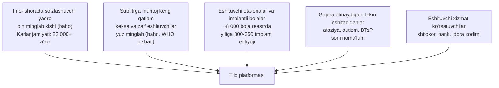

# 02. Muammo va auditoriya: O'zbekiston

> **Qisqacha**
> - Eshitish nogironligi bo'yicha rasmiy milliy son yo'q. Ko'p tilga olinadigan "22 ming" - Karlar jamiyati reestri a'zolari, tarqalish darajasi emas ([Gazeta.uz 2025](https://www.gazeta.uz/oz/2025/09/30/sign-language/)). Manbalar 18 303 dan ~30 000 gacha turli raqam beradi - hammasi quyidagi jadvalda.
> - Asosiy muammo texnologiyada emas, **ta'minotda**: Toshkentda ~10 malakali tarjimon, ya'ni ~800 kishiga bitta ([Gazeta.uz 2025](https://www.gazeta.uz/oz/2025/09/30/sign-language/); [Yusupov 2020](https://dilmurad.me/expert/uzbek-sign-language-usl-to-be-or-not-to-be/)). Tarjimon kasbi, standarti va kafolatlangan bepul soatlar yo'q.
> - Qonun bor, ijro sust: O'RQ-641 (2020), CRPD (2021), PQ-407 (2022). TV efirining 5% qulay bo'lishi kerak, amalda "O'zbekiston 24" da kuniga 15-20 daqiqa; davlat lug'ati muddati (2024-06-01) o'tib ketgan ([norma.uz](https://www.norma.uz/oz/qonunchilikda_yangi/uzbek_imo-ishora_tili_va_brayl_alifbosini_rivojlantirish_buyicha_chora-tadbirlar_belgilandi); [Gazeta.uz 2025](https://www.gazeta.uz/oz/2025/09/30/sign-language/)).
> - O'zbek imo-ishora tili (O'IIT, UzSL) - rus imo-ishora tili (RZhYa, RSL) varianti; daktil alifbo kirill va lotin o'rtasida, maktabdan maktabga farq qiladi ([Gazeta.uz 2022](https://www.gazeta.uz/oz/2022/04/22/sign-language/)).
> - Auditoriya uch qatlam: imo-ishorada so'zlashuvchi yadro (o'n minglab), subtitrga muhtoj keng qatlam (yuz minglab - **baho**), eshituvchi ota-onalar va implantli bolalar (~8 000 bola reestrda).

Manba fayllar: `99_Ilovalar/xom_tadqiqot_yozuvlari/1_birinchi_tadqiqot/uzbekistan_landscape.md`, `.../2_raqobat_va_ochiq_kod/uzsl_linguistics_education_community.md`, `.../2_raqobat_va_ochiq_kod/uzbekistan_legal_costs.md`, `.../1_birinchi_tadqiqot/browser_youtube_google_findings.md`, `99_Ilovalar/oldingi_hisobot/Karlar uchun muloqot platformasi.md`. Sana: 2026-11-15.

---

## 1. Statistika: nechta odam

### 1.1 Eshitish nogironligi bo'yicha raqamlar (manbalar zid - hammasi ko'rsatildi)

| Yil | Raqam | Nimani sanaydi | Manba |
|---|---|---|---|
| 2019 | **21 212** | Karlar jamiyatida ro'yxatdagi eshitish nuqsoni bor odamlar | [Yusupov 2020](https://dilmurad.me/expert/uzbek-sign-language-usl-to-be-or-not-to-be/); [Wikipedia](https://en.wikipedia.org/wiki/Deafness_in_Uzbekistan) |
| sana yo'q (~2019-2020, baho) | **18 303 kar + 3 875 zaif eshituvchi = 22 178** | Hukumatning OHCHR'ga javobi, jamiyat bo'limlari ma'lumoti | [OHCHR](https://www.ohchr.org/sites/default/files/Documents/Issues/Disability/ProvisionSupport/States/Permanent_Mission_of_Uzbekistan.doc) (snippet) |
| 2020 | ~**10 000** (16+ yosh, ro'yxatdagilarning ~47%) | Jamiyat a'zolari | [Gazeta.uz 2020-06](https://www.gazeta.uz/oz/2020/06/30/deaf-and-dumb/) (snippet) |
| 2020 | **1 500 dan kam** | Faol a'zolar (jamiyat a'zosining tanqidiy maqolasi) | [Hook.report](https://old.hook.report/2020/11/bizsiz-biz-haqimizda-hech-narsa/) |
| 2021 | **23 000+** | Norasmiy baho; Statistika qo'mitasi aniq hisob yuritmaydi | [Daryo 2021](https://daryo.uz/2021/10/07/jamiyat-bizni-oziga-ogay-sanaydi-eshitish-va-gapirish-imkoniyati-cheklanganlar-ham-sifatli-talim-yaxshi-sharoit-izlab-toshkentga-kelishga-majbur-shifoko/) |
| 2025 | **22 000+** a'zo va reestrda **~8 000 bola** | Karlar jamiyati | [Gazeta.uz 2025-09 (oz)](https://www.gazeta.uz/oz/2025/09/30/sign-language/) |
| 2025 | 22 000+ kishi, "**faqat Toshkent viloyatida ~8 000**" | Xuddi shu maqolaning rus nashri (snippet) - "8 000" bu yerda bola emas, hudud | [Gazeta.uz 2025-09 (ru)](https://www.gazeta.uz/ru/2025/09/28/sign-language/) |
| 2025-03-11 | **~30 000** a'zo | Karlar jamiyatining o'z rasmiy YouTube videosi | [YouTube](https://www.youtube.com/watch?v=zGfIHZnmmHw) |
| sana yo'q | **3 000+** | Toshkent DXM'larida surdotarjima joriy qilingan maqolada eshitish va nutq nuqsoni borlar | [anhor.uz](https://anhor.uz/news/23398-2/) |
| 2023 | Navoiy viloyatida **~1 698**, ulardan ~1 300 ga davlat xizmati kerak | Surdo-online maqolasi | [yuz.uz 2023](https://yuz.uz/ru/news/tsentr-gosuslug-otdela-yustitsii-goroda-navoi-vvel-novy-vid-servisa-dlya-lyudey-s-invalidnostyu-so-sluxom) |

**Ziddiyat izohi.** "8 000" o'zbekcha nashrda bolalar, ruscha snippetda Toshkent viloyati deb berilgan. Toshkent uchun "5 000 kar" ([Yusupov 2020](https://dilmurad.me/expert/uzbek-sign-language-usl-to-be-or-not-to-be/)) va "8 000" ([Gazeta.uz 2025-07](https://www.gazeta.uz/ru/2025/07/15/sign-language/)) ham turlicha. Reja hujjatlarida "22 000+ a'zo (Gazeta 2025)" asosiy, "~30 000 (jamiyat videosi)" yuqori chegara sifatida ishlatiladi.

### 1.2 Barcha nogironlik va kontekst raqamlari

| Ko'rsatkich | Qiymat | Manba |
|---|---|---|
| Nogironligi bor shaxslar, 2025 I chorak oxiri | **1 031 609** (aholining 2,7%), shundan 18 yoshgacha **173 285** | [Gazeta.uz 2025-04](https://www.gazeta.uz/oz/2025/04/15/disability/) |
| 2025-07-01 / 2025-08-01 | 1 050 218 / **1 055 770** | [Daryo 2025](https://daryo.uz/2025/07/11/ozbekistonda-aholining-necha-foizini-nogironlar-tashkil-qilishi-malum-boldi/); [Qalampir](https://qalampir.uz/uz/news/uzbekistondagi-nogironligi-bor-shakhslar-soni-ochik-landi-117480) |
| Eng ko'p / eng kam viloyat | Samarqand 110 189 / Sirdaryo 38 123 | [Gazeta.uz 2025-04](https://www.gazeta.uz/oz/2025/04/15/disability/) |
| Nogironlik qanday hisoblanadi | Faqat I/II/III guruh bo'yicha, turi (eshitish) bo'yicha emas | [Gazeta.uz 2025-09](https://www.gazeta.uz/oz/2025/09/30/sign-language/) |
| Maxsus karlar maktablarida o'quvchilar (2019) | ~**5 000** | [Wikipedia](https://en.wikipedia.org/wiki/Deafness_in_Uzbekistan); [CREID WP8](https://opendocs.ids.ac.uk/opendocs/bitstream/handle/20.500.12413/16710/CREID_Working_Paper_8.pdf) |
| Koxlear implantga ehtiyoj | Yiliga **300-350** chaqaloq (eski xabarlarda 300-400); 2020 rejasi 320 bola | [Gazeta.uz 2015](https://www.gazeta.uz/ru/2015/11/16/operations/); [anhor.uz](https://anhor.uz/ru/news/fond-zamin-nachal-rabotu-po-programme-besplatnoy-kohlearnoy-implantacii-dlya-detey-s-narusheniyami-s) |
| Bitta internatda eshitish apparatiga muhtoj (2021) | **239** tarbiyalanuvchi | [ombudsman.uz](https://ombudsman.uz/oz/news/2021/04/16/bola-huquqlari-boyicha-vakil-ixtisoslashtirilgan-maktab-internatida-239-nafar-tarbiyalanuvchi-eshitish-apparatlariga-muhtoj) |

### 1.3 Auditoriya qatlamlari

Keng qatlam bahosi: WHO global nisbati (~5% aholida nogironlikka olib keluvchi eshitish pasayishi) 37-38 mln aholiga qo'llansa, imo-ishora bilmaydigan, asosan keksa zaif eshituvchilar soni reestrdan ancha ko'p chiqadi. Bu **manbali raqam emas, xulosa** (`uzbekistan_landscape.md`, 1-bo'lim, Inferences).

---

## 2. Qonunchilik va davlat xizmatlari

### 2.1 Huquqiy asos

| Hujjat | Sana | Asosiy mazmun | Manba |
|---|---|---|---|
| **O'RQ-641** "Nogironligi bo'lgan shaxslarning huquqlari to'g'risida" | 15.10.2020 | Davlat organlari kar odam bilan muloqot uchun zarur bo'lganda surdotarjimonni shartnoma asosida jalb qiladi. 28-modda imo-ishora tilini faqat "shaxslararo muloqot vositasi" deb tan oladi | [lex.uz](https://lex.uz/acts/-5049511); [lex.uz 2024](https://lex.uz/docs/-5049511?ONDATE=09.09.2024) |
| BMT CRPD | 2009 imzolangan, **2021** ratifikatsiya | Nogironlar huquqlari konvensiyasi | [Yusupov 2020](https://dilmurad.me/expert/uzbek-sign-language-usl-to-be-or-not-to-be/); [Gazeta.uz 2025](https://www.gazeta.uz/oz/2025/09/30/sign-language/) |
| **PQ-407** "O'zbek imo-ishora tili va Brayl alifbosini rivojlantirish bo'yicha qo'shimcha chora-tadbirlar to'g'risida" | 20.10.2022 (kuchga 21.10.2022) | 2.2-bo'limdagi ro'yxat | [norma.uz](https://www.norma.uz/oz/qonunchilikda_yangi/uzbek_imo-ishora_tili_va_brayl_alifbosini_rivojlantirish_buyicha_chora-tadbirlar_belgilandi) |
| VMQ 256-son | 13.09.2011 | Internatlar I tur (kar) va II tur (zaif eshituvchi, keyin kar bo'lgan) | [lex.uz](https://lex.uz/docs/-1866997) |
| "Imo-ishora tilini rivojlantirish to'g'risida" VMQ loyihasi | 1-loyiha 2020-12-02, regulation.gov.uz ID 56302 | O'IIT ni muloqot tili deb tan olish, lotin daktil alifbosini 3 oyda ishlab chiqish. **Qabul qilingani tasdiqlanmagan** | [Gazeta.uz 2022](https://www.gazeta.uz/oz/2022/04/22/sign-language/); [Kun.uz](https://kun.uz/27059463) |
| Monomarkazlarda 3 oylik kurslar qarori | 2022 | "Ishga marhamat" monomarkazlarida imo-ishora kurslari | [lex.uz](https://lex.uz/mact/-6248467) |
| Fuqarolar qabulida surdotarjimon | sana tasdiqlanmagan | Qabul va sayyor qabullarda tarjimon ishtiroki majburiy | [UzDaily](https://www.uzdaily.uz/ru/pri-provedenii-priema-grazhdan-v-obiazatelnom-poriadke-budet-obespechivatsia-uchastie-surdoperevodchika/); [anhor.uz](https://anhor.uz/uzl/news/fuqarolar-qabuli-va-sayyor-qabullarni-otkazishda-surdotarjimon-ishtiroki/) |
| Notarial yo'riqnoma 3113-son | 04.01.2019 | Kar odam savodsiz bo'lsa notariusda surdotarjimon shart | [nrm.uz](https://nrm.uz/contentf?doc=578912_&products=1_vse_zakonodatelstvo_uzbekistana) |
| Kar va nutqsizlar dispetcherlik xizmati (FVV) | 2019-07-01 dan | 24/7 video, SMS, maxsus dastur (JusTalk) | [Yusupov 2020](https://dilmurad.me/expert/uzbek-sign-language-usl-to-be-or-not-to-be/) |
| Yagona 112 | 25.03.2025 dan butun mamlakatda | IIV, FVV, tez yordam va boshqalar; karlar uchun SMS/video kirish **topilmadi** | [kun.uz](https://kun.uz/en/news/2025/03/25/uzbekistans-unified-112-emergency-system-now-fully-operational-nationwide); [xs.uz](https://xs.uz/en/post/112-unified-dispatch-service-now-fully-operational-across-uzbekistan) |
| Mansabdorlar qabuliga navbatsiz kirish | 2023 | Nogironligi bor shaxslar uchun | [kun.uz](https://kun.uz/news/2023/02/27/nogironlar-mansabdor-shaxslar-qabuliga-navbatsiz-kirish-prezident-qarori) |
| Ish beruvchi subsidiyasi | 01.06.2025 dan | I/II guruh xodim uchun 50 mln so'mgacha (surdotarjimon xarajatini ham qoplashi mumkin) | [anhor.uz](https://anhor.uz/uzl/news/1-iyundan-nogironligi-bo-lgan-shaxslarni-ishga-qabul-qilgan-tadbirkor/) |
| Imtihonlarda surdotarjimon | 2027/2028 o'quv yilidan | Kirish va sertifikat imtihonlarida qo'shimcha vaqt, Brayl, tarjimon | [infoedu.uz](https://infoedu.uz/nogironligi-bolgan-shaxslarga-imtihonlarda-qoshimcha-vaqt-beriladi) |
| Koxlear implant tanlov nizomi 2648-son | 08.01.2015 | 5 yoshgacha bepul implant | [lex.uz](https://lex.uz/docs/-2534269) |
| ZRU-547 (shaxsiy ma'lumotlar), ZRU-1125 o'zgartirishi | 26.03.2026 | Biometrik ma'lumot O'zbekistonda saqlanadi (27-1-modda) | [lex.uz](https://lex.uz/docs/4396419) |
| ZRU-1115 | 21.01.2026 | AI yordamida shaxsiy ma'lumotni noqonuniy qayta ishlash uchun javobgarlik | [anhor.uz](https://anhor.uz/ru/news/uzbekistan-criminalizes-illegal-ai-use-of-personal-data) |

Mas'ul organ: **Prezident huzuridagi Ijtimoiy himoya milliy agentligi** (2023), har tumanda "Inson" markazlari, 2023-07-01 dan ijtimoiy xodim guruhlari ([gov.uz](https://gov.uz/oz/advice/720/document/3119); [Kun.uz 2023](https://kun.uz/kr/news/2023/06/02/ijtimoiy-himoya-milliy-agentligi-rejalari-va-vazifalari-belgilandi)). Huquqiy tafsilot va platformaga ta'siri - [05_Huquq_moliya_va_notijorat_model.md](05_Huquq_moliya_va_notijorat_model.md).

### 2.2 PQ-407 (2022) talablari

| # | Talab (2023-01-01 dan) | Manba |
|---|---|---|
| 1 | Maktablar va "Ishga marhamat" monomarkazlarida nogironligi borlar va voyaga yetmaganlar qarindoshlari uchun bepul imo-ishora va Brayl kurslari, onlayn ro'yxat | [norma.uz](https://www.norma.uz/oz/qonunchilikda_yangi/uzbek_imo-ishora_tili_va_brayl_alifbosini_rivojlantirish_buyicha_chora-tadbirlar_belgilandi) |
| 2 | Davlat TV haftalik efirining **kamida 5%** imo-ishora, yopiq subtitr yoki yuguruvchi satr bilan | o'sha |
| 3 | OTM kirish imtihonlarida kar abituriyentga surdotarjimon | o'sha |
| 4 | Magistraturaga chet tili sertifikatidan ozod qilish | o'sha |
| 5 | 2023/24 da surdopedagogika va tiflopedagogika grant kvotasi +25% | o'sha |
| 6 | 2024/25 dan karlar maktablariga faqat imo-ishorani biladigan o'qituvchi | o'sha |
| 7 | Har sentyabrda "Eng yaxshi surdotarjimon" tanlovi (100/65/50 BHM) | o'sha |
| 8 | O'IIT lingvistik lug'ati va o'quv materiallari **2024-06-01 gacha** (norma.uz xulosasida bu band yo'q, ilovada bo'lishi mumkin - kichik ziddiyat) | [Gazeta.uz 2025](https://www.gazeta.uz/oz/2025/09/30/sign-language/) |

### 2.3 Qonun va amaliyot orasidagi farq

| Qonun nima deydi | Amalda nima | Manba |
|---|---|---|
| TV efirining 5% qulay | ~25 kanal; "O'zbekiston 24" da imo-ishorali yangiliklar faqat 14:00 va 15:00, jami 15-20 daqiqa; boshqa kanallar vaqti-vaqti bilan; subtitr TV, YouTube va ijtimoiy tarmoqda deyarli yo'q; tarjimon oynasi xalqaro standartdan (ekranning 25-30%) kichik | [Gazeta.uz 2025 (oz)](https://www.gazeta.uz/oz/2025/09/30/sign-language/); [Gazeta.uz 2025 (ru)](https://www.gazeta.uz/ru/2025/09/28/sign-language/) |
| Lug'at 2024-06-01 gacha | Muddat o'tdi; lug'atni Sharoit Plyus NNT qildi (imo-ishora.uz, 2000+ so'z) | [Gazeta.uz 2025](https://www.gazeta.uz/oz/2025/09/30/sign-language/); [imo-ishora.uz](https://imo-ishora.uz/) |
| Davlat organlari tarjimon jalb qiladi | Toshkentda ~10 malakali tarjimon; jamiyatda oliy ma'lumotli tarjimon bitta | [Gazeta.uz 2025](https://www.gazeta.uz/oz/2025/09/30/sign-language/); [yuz.uz](https://yuz.uz/ru/news/inklyuzivnoe-obrazovanie-kak-obespechivaetsya-ravenstvo-prav-i-vozmojnostey-dlya-lits-s-invalidnostyu) |
| Favqulodda 24/7 dispetcher (2019) | JusTalk ilovasi tez-tez ishlamaydi, mahalliy ilova yo'q; COVID davrida 1197 liniyasiga yetib bo'lmagan | [Yusupov 2020](https://dilmurad.me/expert/uzbek-sign-language-usl-to-be-or-not-to-be/); [Gazeta.uz 2025](https://www.gazeta.uz/oz/2025/09/30/sign-language/) |
| Surdo-online planshetlari (2020 dan) | Bir bankda xodim qo'ng'iroqni ulay olmagan | [Gazeta.uz 2025](https://www.gazeta.uz/oz/2025/09/30/sign-language/) |
| 2017 prezident topshirig'i: viloyatlarda kurslar | "Hech qachon tashkil etilmagan"; PQ-407 qayta yaratdi | [Gazeta.uz 2020](https://www.gazeta.uz/ru/2020/09/23/sign-language/) |
| Sudda tarjimon | Oldindan so'rash kerak, ko'pincha kar odam o'zi to'laydi | [World Bank](https://documents1.worldbank.org/curated/en/099052223112035849/pdf/P1783520faee9f09d0a46307d56768f9126.pdf) |

Xulosa (inferensiya): **davlat organlari qonun bo'yicha xizmatni sotib olishga majbur, lekin ishlaydigan ta'minot zanjiri yo'q** - bu B2G (davlatga xizmat) yo'lini ochadi (oldingi hisobot; [lex.uz O'RQ-641](https://lex.uz/acts/-5049511)).

---

## 3. Ta'lim

### 3.1 Maktablar

| Ko'rsatkich | Qiymat | Manba |
|---|---|---|
| Kar va zaif eshituvchi bolalar uchun ixtisoslashgan muassasalar | **18** (86 maxsus muassasadan, jami 28 159 o'quvchi; sana aniq emas) | [uzedu.uz](https://www.uzedu.uz/uz/news/130) |
| Xuddi shu, ilmiy maqolada | **19 maktab-internat + 15 maktabgacha muassasa va guruh** (~2025) | [ResearchGate](https://www.researchgate.net/publication/391882672_ESHITISHIDA_NUQSONI_BO'LGAN_BOLALAR_TA'LIMINING_RIVOJLANISH_TARIXI) (snippet) |
| 2000/01 | 13 kar + 5 zaif eshituvchi internati | [lex.uz 256](https://lex.uz/docs/-1866997) |
| Sinf to'ldirish me'yori | Qisman eshituvchilar 10 (boshlang'ich) / 12 (yuqori); ko'p nuqsonli 6 / 8 | [gendermadad.uz](https://gendermadad.uz/oz/document/1740) (snippet) |
| Misol | Toshkent, Olmazor, 102-son internat (zaif eshituvchilar); 2022-04 prezident tashrifi, 2 600+ bolani tekshirish topshirig'i | [president.uz](https://president.uz/oz/lists/view/5117) (snippet) |

**O'qitish usuli - oralizm.** Ko'p o'qituvchi imo-ishorani bilmaydi, lab o'qish va artikulyatsiyaga urg'u beriladi, o'quvchilarning imo-ishorasi cheklanadi; o'quvchilar oddiy maktabdan bir yil keyin bitiradi ([Gazeta.uz 2020](https://www.gazeta.uz/ru/2020/09/23/sign-language/); [Wikipedia](https://en.wikipedia.org/wiki/Deafness_in_Uzbekistan)). PQ-407 2024/25 dan faqat imo-ishorani biladigan o'qituvchini yollashni talab qiladi; bajarilishi bo'yicha ma'lumot topilmadi.

### 3.2 Oliy ta'lim va tarjimon tayyorlash

| Fakt | Manba |
|---|---|
| 2023 dan "Maxsus pedagogika: surdotarjimonlik faoliyati" bakalavriati (Milliy pedagogika universiteti, sobiq Nizomiy TDPU, va boshqa OTMlar); **birinchi bitiruvchilar 2026** | [Gazeta.uz 2025-09](https://www.gazeta.uz/ru/2025/09/28/sign-language/) |
| Yo'nalish kodi manbalarda zid: **60110300** yoki **60110305**; kirish: kasbiy (ijodiy) imtihon + ona tili va adabiyoti | [oliygoh.uz](https://oliygoh.uz/post/20252026-yil-bakalavriat-yonalishlari-boyicha-fanlar-majmuasi-tasdiqlandi); [oliygoh.uz TDPU](https://oliygoh.uz/oliygohlar/toshkent-davlat-pedagogika-universiteti) |
| TMA 2026 qabulida 4 yillik "Surdotarjimonlik" | [admissions.tma.uz](https://admissions.tma.uz/2026/06/inson-qalbiga-yol-imo-ishora-tili-orqali-%F0%9F%91%90/) |
| TDPU o'quv majmualari (Z.N. Mamarajabova): daktilologiya, o'zbek imo-ishora nutqi | [devedu.uz PDF](https://devedu.uz/wp-content/uploads/2024/05/3-Daktilologiya-va-imo-ishora-nutqi.pdf); [devedu.uz PDF 2](https://devedu.uz/wp-content/uploads/2024/05/2-Ozbek-imo-ishora-nutqi-yangi-majmua.pdf) |
| Birinchi International Sign kursi (International Inclusive Hub, 2025 yanvar-iyun, 72 akademik soat): 52 ariza, 15 tanlangan (7 tarjimon + 8 eshitish nuqsoni bor) | [Gazeta.uz 2025-07](https://www.gazeta.uz/ru/2025/07/15/sign-language/) |
| Surdotarjimonlarni tayyorlash davlat markazi tashkil etiladi (2022) | [kun.uz](https://kun.uz/news/2022/02/09/surdotarjimonlarni-tayyorlash-davlat-markazi-tashkil-etiladi) |
| Surdogidlar tayyorlash kengaytirilmoqda (2026-05) | [nuz.uz](https://nuz.uz/2026/05/16/v-uzbekistane-rasshiryayut-podgotovku-surdogidov-dlya-turistov-s-narusheniem-sluha/) |
| Kar talabalar uchun 2% kvota; oddiy guruhlarda tarjimonsiz o'qiydi (masalan, bitta sport guruhida 4 kar talaba) | [Gazeta.uz 2022](https://www.gazeta.uz/oz/2022/04/22/sign-language/) |

---

## 4. Tarjimonlar

| Ko'rsatkich | Qiymat | Manba |
|---|---|---|
| Toshkent shahri va viloyati | ~**10 tarjimon ~5 000 kar odamga** (~2 / 1 000) | [Yusupov 2020](https://dilmurad.me/expert/uzbek-sign-language-usl-to-be-or-not-to-be/) |
| Poytaxt, 2025 | **10 dan kam** malakali tarjimon, ~**800 kishiga 1** | [Gazeta.uz 2025](https://www.gazeta.uz/oz/2025/09/30/sign-language/) |
| Taqqoslash | Rossiya ~3 / 1 000, Finlyandiya ~300 / 1 000 | [Yusupov 2020](https://dilmurad.me/expert/uzbek-sign-language-usl-to-be-or-not-to-be/) |
| Kim | Asosan CODA (kar ota-onaning eshituvchi farzandi), kam maosh, ortiqcha yuk | [Yusupov 2020](https://dilmurad.me/expert/uzbek-sign-language-usl-to-be-or-not-to-be/); [Gazeta.uz 2025-09](https://www.gazeta.uz/ru/2025/09/28/sign-language/) |
| Kasb, standart, sertifikat | **Yo'q**: rasmiy kasb, milliy xizmat standarti, kafolatlangan bepul soat yo'q | [Gazeta.uz 2025](https://www.gazeta.uz/oz/2025/09/30/sign-language/) |
| Kafolatlangan soatlar, qo'shnilar - **manbalar zid** | Gazeta 2025: Rossiya 40 soat/yil, Qozog'iston 30 soat/yil. Boshqa manbalar: Rossiya IPRA bo'yicha **84 soat** (kar-ko'rlarga 240), Qozog'iston **60 soat** (2029 gacha muzlatilgan) | [Gazeta.uz 2025](https://www.gazeta.uz/oz/2025/09/30/sign-language/); [SFR Yaroslavl](https://sfr.gov.ru/branches/yaroslavl/news/~2026/09/25/285016); [03b](03_Raqobatchilar/03b_Rossiya_va_MDH.md) |
| Karlar jamiyati a'zolari uchun | Notarius, sud, militsiya, shifoxona, davlat idoralarida **bepul** surdotarjima, ariza yozishga yordam; kirish badali 2 000 so'm, yillik 20 000 so'm | [YouTube 2025-03-11](https://www.youtube.com/watch?v=zGfIHZnmmHw) |
| Narx | **TBD** - xarid.uzex.uz, hh.uz, olx.uz da ochiq narx topilmadi; vaqtincha o'rtacha ish haqi 7,3 mln so'm/oy proksi sifatida | [anhor.uz](https://anhor.uz/uzl/news/uzbekistonda-ortacha-ish-haqi-7-3-million); `uzbekistan_legal_costs.md`, 4-bo'lim |

Xulosa (inferensiya): 500-800 kishiga bitta tarjimon va davlat to'laydigan soat yo'qligida **talab bo'yicha masofaviy video tarjima (VRI) va bron tizimi** eng katta hujjatlashtirilgan bo'shliqni yopadi. 2026 dan chiqadigan bitiruvchilar platformaga tarjimon havzasi bo'ladi.

---

## 5. O'zbek imo-ishora tili (O'IIT, UzSL): lingvistika

| Mavzu | Fakt | Manba |
|---|---|---|
| RSL bilan aloqasi | Wikipedia RSL maqolasida "Uzbek Sign Language" RSL dialekti (ISO 639-3 `rsl`, Glottolog `russ1270`); Qirg'iziston, Tojikiston, O'zbekiston imo-ishorasi RSL dan "kam farq qiladi" | [Wikipedia RSL](https://en.wikipedia.org/wiki/Russian_Sign_Language); [Gazeta.uz 2020](https://www.gazeta.uz/ru/2020/09/23/sign-language/) |
| Mahalliy fikr | O'IT - "RIT shevasi", o'zbekcha belgilar qo'shilgan; kam ma'lumotli karlar orasida "ko'cha imo-ishora tili" | [Gazeta.uz 2022](https://www.gazeta.uz/oz/2022/04/22/sign-language/) |
| Leksika ulushi (UzSL vs RSL) | **Raqam topilmadi** | - |
| Daktil alifbo | Kirill (rus) daktil keng ishlatiladi; lotin daktil notekis o'qitiladi; faqat Surxondaryo internati lotin daktilni "to'liq" o'rganadi; "L" va "D" harflari ikki tizimda ancha farq qiladi | [Gazeta.uz 2022](https://www.gazeta.uz/oz/2022/04/22/sign-language/); [CyberLeninka](https://cyberleninka.ru/article/n/o-zbek-ishora-tili-harflarini-tanib-olish-algoritmi/pdf) |
| Lotin alifbo noaniqligi | 2021-03 dan Sh, Ch, G', O' o'zgarishi muhokamasi daktilning yakuniy shaklini noaniq qildi | [Gazeta.uz 2022](https://www.gazeta.uz/oz/2022/04/22/sign-language/) |
| Hududiy va avlod farqi | Jizzax, Surxondaryo, Buxoro, Samarqand, Olmaliq maktablarida **turli daktil alifbolar**; keksa va yosh imo-ishorachilar orasida muloqot buzilishi mumkin | [Gazeta.uz 2022](https://www.gazeta.uz/oz/2022/04/22/sign-language/) |
| Lug'atlar | 2005: birinchi O'IT lug'ati "O'zbekiston karlarining imo-ishorali nutqi" (Karlar jamiyati + JICA, kichik tiraj), keyin 17+ yil tizimli ish yo'q. 2025-2026: imo-ishora.uz (2000+ so'z, lotin daktil) | [Gazeta.uz 2022](https://www.gazeta.uz/oz/2022/04/22/sign-language/); [imo-ishora.uz](https://imo-ishora.uz/) |
| Ilmiy tavsif | Kichik maqolalar: bir qo'l shaklida harakat yo'nalishi va sifati bilan ma'noni farqlash | [econfseries](https://econfseries.com/index.php/4/article/view/788); [phoenixpublication](https://phoenixpublication.net/index.php/TANQ/article/view/4499) |
| Mouthing (lab harakati o'zbekcha yoki ruscha) | **Manba topilmadi** | - |
| Rossiya modelini to'g'ridan ishlatish | Sber Logos dataseti asosan Moskva dialekti; "O'zbek SL uchun Rossiya modelini to'g'ridan-to'g'ri ishlatish xavfli" | [YouTube, Ovodov](https://www.youtube.com/watch?v=Z6jNuB4CBVY) |

Platforma uchun oqibat (inferensiya): har bir video yozuvida **daktil tizimi (kirill/lotin)**, **imo-ishorachi avlodi** va **o'qigan maktabi/hududi** belgilanadi; maktab kelib chiqishi geografiyadan ko'ra ko'proq ta'sir qiladi. Batafsil - [06c_Imo_ishora_dataset_strategiyasi.md](06_Platforma_rejasi/06c_Imo_ishora_dataset_strategiyasi.md).

---

## 6. Onlayn jamiyat va uning talablari

### 6.1 Kanallar (tasdiqlangan)

| Kanal | Hajm | Mazmun | Manba |
|---|---|---|---|
| Telegram @uzsduz, Karlar jamiyati blogi | 854 obunachi (indeksda 981), 849 video | Ikki tilli (o'zbek lotin + rus), imo-ishora videolari, tadbirlar, statistika, onlayn ma'ruzalar, implantdan voz kechganlar haqida tadqiqot chaqiruvi; ish e'lonlari yo'q | [t.me/s/uzsduz](https://t.me/s/uzsduz); [telemetr.io](https://telemetr.io/en/channels/1481074705-uzsduz/posts) |
| Telegram @imo_ishora_uz | 11 obunachi, deyarli bo'sh | imo-ishora.uz rasmiy kanali | [t.me/s/imo_ishora_uz](https://t.me/s/imo_ishora_uz) |
| Telegram @deaf_gluxoyy ("DEAF....GLUKHOY") | ~2,1K obunachi | Yangiliklar; rasmiy maqomi noma'lum | [TGStat](https://uz.tgstat.com/en/channel/@deaf_gluxoyy) |
| YouTube, Karlar jamiyati rasmiy kanali | 169 obunachi | Yig'ilishlar, a'zolik shartlari | [YouTube](https://www.youtube.com/watch?v=zGfIHZnmmHw) |
| YouTube o'quv kanallari | eng yaxshi dars 150K ko'rish | To'liq ro'yxat - [03a](03_Raqobatchilar/03a_Ozbekiston.md) | [IBRAT pleylisti](https://www.youtube.com/playlist?list=PLkREkayoYCyIbxC-s0cOABSwdhkdbcbgz) |

Instagram va TikTok'dagi kar bloggerlar o'rganilmagan. Kar bloger yangilik kanali (Rossiyadagi Oleg Larionov, 61,3K kabi) O'zbekistonda topilmadi (`browser_youtube_google_findings.md`, 3-bo'lim).

### 6.2 So'rov: muloqotdagi qiyinchilik

Yuksalish harakati, 2024, n=102 ([Gazeta.uz 2025](https://www.gazeta.uz/oz/2025/09/30/sign-language/)):

| Javob | Ulush |
|---|---|
| Imo-ishora tilidan foydalanishda doim yoki tez-tez qiyinchilik | **56%** |
| Muntazam yoki vaqti-vaqti bilan | ~**90%** |
| Hech qachon | **6%** |

### 6.3 Jamiyat talablari (Gazeta.uz 2025 mualliflari - Yusupov, Ahliddinov)

| # | Talab | Tilo javobi (rejadan) |
|---|---|---|
| 1 | O'IIT ni qonunda tan olish (28-moddani o'zgartirish) | Advokatlik, KPI va ochiq statistika bilan ([05](05_Huquq_moliya_va_notijorat_model.md)) |
| 2 | Kafolatlangan yillik tarjima soatlari | Daqiqalarni hisoblaydigan dispetcher - kelajakdagi vaucherga tayyor ([06a](06_Platforma_rejasi/06a_Mahsulot_konsepsiyasi_va_funksiyalar.md)) |
| 3 | **Yagona tarjimonlar bazasi va onlayn bron** | M1 VRI + M17 tarjimon kabineti |
| 4 | Milliy tarjimon standarti va sertifikati | Ichki baholash, kar foydalanuvchi reytingi |
| 5 | Kar tarjimonlar | Pullik kar imo-ishorachilar ([06d](06_Platforma_rejasi/06d_Boshqaruv_jamoa_va_hamkorlar.md)) |
| 6 | TV'da majburiy tarjima va subtitr | Bevosita emas; statik kontent moduli (M14) |
| 7 | Davlat xizmati markazlarida ishlaydigan surdo-online planshetlari | Dispetcher tomoni uchun ochiq kodli backend taklifi |
| 8 | Lug'atni tugatish | imo-ishora.uz bilan Global Signbank asosida birga yuritish |

Manba: [Gazeta.uz 2025 (ru)](https://www.gazeta.uz/ru/2025/09/28/sign-language/); "Tilo javobi" ustuni - reja hujjatlaridan, fakt emas.

### 6.4 Kundalik hayotdan dalillar

| Dalil | Manba |
|---|---|
| Tarjimon qimmat, oldindan bron kerak, shoshilinch holatda yo'q; bank, maktab, shifoxonada tarjimon-operator yo'q | [Gazeta.uz 2025](https://www.gazeta.uz/oz/2025/09/30/sign-language/) |
| Ba'zi karlarning savodi cheklangan, yozma muloqot yetarli emas | o'sha |
| II guruh nogironi: "imo-ishora mening ona tilim, tarjima uchun to'lash adolatsiz" | o'sha |
| Kar surdolimpiadachilar: mukofot puli ota-onalar internetga chiqqunicha to'lanmagan; "organga kiraman desa - nogiron deydi"; idorada yo'l topa olmaslik | [ZAMONUZ, YouTube](https://www.youtube.com/watch?v=Z0UcdGWCS8s) |
| Ish: kar erkaklar Toshkentda yo'l bo'yida savdo, kar ayollar tarozibon; teatr aktyorlari farrosh yoki taksichi; ~10 o'quv korxonasi atigi 240-250 kishiga xizmat qiladi | [Wikipedia](https://en.wikipedia.org/wiki/Deafness_in_Uzbekistan); [Gazeta.uz 2026](https://www.gazeta.uz/oz/2026/09/29/theater-of-mimicry-and-gesture/) |
| Ish beruvchi tashabbusi: Yandex Lavka eshitish nuqsoni bor ombor xodimlarini yollaydi, Sharoit Plyus tarjimon beradi | [Gazeta.uz 2026-06](https://www.gazeta.uz/oz/2026/06/03/yandex-lavka-disabled/) |
| Kar rassom Kudrat Israilov (Toshkent madrasasi, 34 yil): kar talabalarga norasmiy tarjimon-mentor | [VOGinfo, YouTube](https://www.youtube.com/watch?v=V2RWeGu9hmY) |
| Shifokor xatosi bilan eshitishni yo'qotgan dizayner: "jamiyat bizni o'gay sanaydi"; karlar ta'lim uchun Toshkentga ko'chadi | [Daryo 2021](https://daryo.uz/2021/10/07/jamiyat-bizni-oziga-ogay-sanaydi-eshitish-va-gapirish-imkoniyati-cheklanganlar-ham-sifatli-talim-yaxshi-sharoit-izlab-toshkentga-kelishga-majbur-shifoko/) |
| Surdolimpiada Tokio 2025: taekvondochilar 10 medal (1 oltin, 4 kumush, 5 bronza, UzA); sportchining o'z so'zi bilan "to'qqizta medal" - **manbalar zid** | [UzA](https://uza.uz/en/posts/uzbekistans-taekwondo-athletes-completed-the-tokyo-2025-deaflympics-with-10-medals_788172); [ZAMONUZ](https://www.youtube.com/watch?v=Z0UcdGWCS8s) |

---

## 7. Ota-onalar va koxlear implant

| Fakt | Manba |
|---|---|
| Kar bolalarning **90-95%** eshituvchi ota-onalarda tug'iladi (AQSh ma'lumoti) | [BU 2017](https://www.bu.edu/articles/2017/asl-language-acquisition) |
| Davlat: aqli zaif bo'lmagan **5 yoshgacha** bolalarga bepul implant; kattalar o'zi to'laydi (~130 mln so'm, 2018); navbat (Xorazmlik oila 2 yil kutgan) | [Kun.uz 2018](https://kun.uz/news/2018/10/06/uzbekistonda-kohlear-implantat-muammosiga-ecim-topadimi-2-jillik-navbatda-turgan-horazmlik-ota-ona-tasvisi) |
| 2015: implantni davlat sotib olgan, 5 yoshgacha bepul, 18 yoshgacha operatsiya bepul (eski, qayta tekshirish kerak) | [Gazeta.uz 2015](https://www.gazeta.uz/ru/2015/11/16/operations/) |
| Zamin fondi: 4 626 kishi tekshirilgan, 122 koxlear va suyak o'tkazuvchi implant operatsiyasi | [uz.wikipedia](https://uz.wikipedia.org/wiki/Zamin_fondi) |
| 2020 - **manbalar zid**: 23 bola eshitishi tiklandi (Gazeta, sentyabr-noyabr) / 36 operatsiya (Kun.uz) | [Gazeta.uz 2020](https://www.gazeta.uz/oz/2020/12/19/zamin/); [Kun.uz 2020](https://kun.uz/news/2020/12/18/zamin-fondi-dasturi-doirasida-jami-23ta-jarrohlik-amaliyoti-otkazilib-bolalarning-eshitish-qobiliyati-tiklandi) |
| 2022: 45 rejali operatsiya, "Men eshitishni xohlayman!" doirasida ~300 eshitish apparati | [Sputnik](https://oz.sputniknews.uz/20221202/men-eshitishni-xohlayman---loyihasi-doirasida-300ga-yaqin-eshitish-apparati-tarqatildi-30455331.html) |
| Zamin: internat o'quvchilari uchun maktab yoshidagi bolalarga implant dasturi (10 va 12 operatsiyali partiyalar) | [UzDaily](https://www.uzdaily.uz/ru/fond-zamin-10-operatsii-v-ramkakh-programmy-kokhlearnaia-implantatsiia-dlia-detei-shkolnogo-vozrasta/); [UzDaily 12](https://www.uzdaily.uz/ru/provedeny-12-operatsii-v-ramkakh-programmy-fonda-zamin/) |
| PARDA podkasti: implant xarajati ("uyini sotib bolasini davolatdi"), ota-onalar bir-birini ayblashi, erta aniqlash, Nigoram fondi | [YouTube](https://www.youtube.com/watch?v=tz8fFsK8SVs) |
| Xususiy reabilitatsiya bozori: audiolog, "Sehrli Quloq" akademiyasi, "Rivoj Incenter" ("Quloq borki eshitish lozim", 2026-06, 6K ko'rish) | `browser_youtube_google_findings.md`, 4.4 (video havolasi yozuvda yo'q) |
| PQ-407: voyaga yetmagan nogiron bolalar qarindoshlari uchun bepul O'IIT kurslari | [norma.uz](https://www.norma.uz/oz/qonunchilikda_yangi/uzbek_imo-ishora_tili_va_brayl_alifbosini_rivojlantirish_buyicha_chora-tadbirlar_belgilandi) |

Ota-onalar Telegram yoki Instagram guruhlari hajmi bilan topilmadi. Inferensiya: oila segmenti ta'siri katta, xizmat bilan deyarli qamrab olinmagan; boshlang'ich lug'at (oila, salomlashish, sonlar), implant va reabilitatsiya bo'yicha ma'lumot kerak.

---

## 8. Og'riq nuqtalari: ustuvorlik

Dalil zichligi bo'yicha tartib (xom yozuv inferensiyasi, `uzbekistan_landscape.md`, 7-bo'lim):

| # | Vaziyat | Og'riq | Dalil | MVP moduli |
|---|---|---|---|---|
| 1 | Bank, shifoxona, davlat qabuli, politsiya, notarius | Tarjimon yo'q yoki qimmat | Gazeta 2025, World Bank | M1 VRI, M3 kartalar |
| 2 | Favqulodda holat | JusTalk ishlamaydi, 112 da kar kanali yo'q | Yusupov 2020, kun.uz 2025 | MVP da faqat karta; SOS 4-bosqichda |
| 3 | Ma'ruza, TV, yuzma-yuz suhbat | Subtitr yo'q | Gazeta 2025 | M2 yuzma-yuz subtitr |
| 4 | Tarjimon topish | Yagona baza va bron yo'q | Gazeta 2025 | M17 tarjimon kabineti |
| 5 | Ariza, murojaat, ish beruvchi | Byurokratiya bilan muloqot | ZAMONUZ | M4 murojaat yordamchisi |
| 6 | Savod cheklangan | Matn yetarli emas | Gazeta 2025 | Video birinchi UX |
| 7 | Oila | Ota-ona imo-ishorani bilmaydi | BU 2017, Zamin | M7 o'rganish moduli |
| 8 | Gapira olmaydiganlar | Ovozsiz javob | UNICEF/Cboard | M6 AAC |

To'lov qobiliyati (inferensiya): karlar to'lashni adolatsiz deb biladi, shuning uchun to'lovchi - O'RQ-641 bo'yicha majbur davlat organlari, banklar, klinikalar va donorlar ([06e](06_Platforma_rejasi/06e_Budjet_va_moliya_rejasi.md)).

---

## 9. Personalar (qisqa)

To'liq tavsif - [06a, 4-bo'lim](06_Platforma_rejasi/06a_Mahsulot_konsepsiyasi_va_funksiyalar.md). Ismlar va yoshlar tasvir uchun (**baho**).

| # | Persona | Til | Asosiy og'riq | Modullar |
|---|---|---|---|---|
| P1 | Dilshod, 34, kar imo-ishorachi, Samarqand | O'IIT (kirill daktil), yozuv zaif | Idorada yo'l, tarjimon kam | VRI, kartalar, murojaat, video xabar |
| P2 | Malika opa, 68, keksa zaif eshituvchi, Toshkent | O'zbek/rus | Shifokor va bankni eshitmaydi | Yuzma-yuz subtitr (katta shrift), kartalar |
| P3 | Nodira, 31, implantli 4 yoshli bolaning onasi, Namangan | O'zbek | Bola bilan til ko'prigi yo'q | O'rganish moduli, lug'at |
| P4 | Jasur, 22, eshitadi, gapira olmaydi | O'zbek | Ovoz bilan javob bera olmaydi | AAC (Cboard fork) |
| P5 | Shifokor / bank xodimi | O'zbek/rus | Ilova o'rnatishni xohlamaydi | QR orqali login'siz qo'shilish |
| P6 | Gulnora, 40, tarjimon | O'IIT, o'zbek, rus | Ortiqcha yuk, tartibsiz jadval | Tarjimon kabineti, navbat, to'lov |

---

## 10. Platforma uchun xulosalar

1. **Ta'minot bo'shlig'i**: tarjimonni almashtirmaymiz, unga yo'lni qisqartiramiz (VRI, bron, halol soatlar).
2. **Subtitr bugun tayyor**: o'zbek/rus STT mavjud va arzon ([04c](04_Texnologiya/04c_Nutq_subtitr_va_bigtech.md)) - eng keng qatlamga darhol yetadi.
3. **Ikki tilli kontent**: o'zbek lotin + rus (jamiyat kanali shunday ishlaydi); interfeysda kirill o'zbek ham.
4. **Daktil va hududiy farq** - kontent va datasetda alohida maydon.
5. **Tarqatish tashkilotlar orqali**: Telegram auditoriyasi kichik (yuzlab - 2K), shuning uchun Karlar jamiyati, Sharoit Plyus, 18-19 internat, sport federatsiyasi orqali.
6. **To'lovchi - institut**, foydalanuvchi emas.

---

## Manbalar

Asosiy manbalar (to'liq ro'yxat - [07_Manbalar.md](07_Manbalar.md)):

- Gazeta.uz 2025-09 (oz): https://www.gazeta.uz/oz/2025/09/30/sign-language/ ; (ru): https://www.gazeta.uz/ru/2025/09/28/sign-language/
- Gazeta.uz 2025-07: https://www.gazeta.uz/ru/2025/07/15/sign-language/
- Gazeta.uz 2022: https://www.gazeta.uz/oz/2022/04/22/sign-language/ ; Gazeta.uz 2020: https://www.gazeta.uz/ru/2020/09/23/sign-language/
- Dilmurad Yusupov 2020: https://dilmurad.me/expert/uzbek-sign-language-usl-to-be-or-not-to-be/
- Wikipedia: https://en.wikipedia.org/wiki/Deafness_in_Uzbekistan ; CREID WP8: https://opendocs.ids.ac.uk/opendocs/bitstream/handle/20.500.12413/16710/CREID_Working_Paper_8.pdf
- OHCHR: https://www.ohchr.org/sites/default/files/Documents/Issues/Disability/ProvisionSupport/States/Permanent_Mission_of_Uzbekistan.doc
- lex.uz O'RQ-641: https://lex.uz/acts/-5049511 ; ZRU-547: https://lex.uz/docs/4396419 ; VMQ 256: https://lex.uz/docs/-1866997 ; 2648: https://lex.uz/docs/-2534269
- norma.uz PQ-407: https://www.norma.uz/oz/qonunchilikda_yangi/uzbek_imo-ishora_tili_va_brayl_alifbosini_rivojlantirish_buyicha_chora-tadbirlar_belgilandi
- Gazeta.uz 2025-04: https://www.gazeta.uz/oz/2025/04/15/disability/ ; Daryo 2025: https://daryo.uz/2025/07/11/ozbekistonda-aholining-necha-foizini-nogironlar-tashkil-qilishi-malum-boldi/
- uzedu.uz: https://www.uzedu.uz/uz/news/130 ; ResearchGate: https://www.researchgate.net/publication/391882672_ESHITISHIDA_NUQSONI_BO'LGAN_BOLALAR_TA'LIMINING_RIVOJLANISH_TARIXI
- Karlar jamiyati YouTube: https://www.youtube.com/watch?v=zGfIHZnmmHw ; ZAMONUZ: https://www.youtube.com/watch?v=Z0UcdGWCS8s
- Telegram: https://t.me/s/uzsduz ; https://t.me/s/imo_ishora_uz ; https://uz.tgstat.com/en/channel/@deaf_gluxoyy
- Kun.uz 2018 (implant): https://kun.uz/news/2018/10/06/uzbekistonda-kohlear-implantat-muammosiga-ecim-topadimi-2-jillik-navbatda-turgan-horazmlik-ota-ona-tasvisi ; Zamin: https://uz.wikipedia.org/wiki/Zamin_fondi
- anhor.uz (subsidiya): https://anhor.uz/uzl/news/1-iyundan-nogironligi-bo-lgan-shaxslarni-ishga-qabul-qilgan-tadbirkor/ ; infoedu.uz: https://infoedu.uz/nogironligi-bolgan-shaxslarga-imtihonlarda-qoshimcha-vaqt-beriladi
- kun.uz 112: https://kun.uz/en/news/2025/03/25/uzbekistans-unified-112-emergency-system-now-fully-operational-nationwide

## Tasdiqlanmagan / bo'shliqlar

| Mavzu | Holat |
|---|---|
| Eshitish nogironligi bo'yicha 2024-2026 rasmiy son (Ijtimoiy himoya agentligi, Statistika agentligi) | Topilmadi |
| WHO'ning O'zbekiston uchun alohida bahosi | Topilmadi; "yuz minglab" - xulosa |
| 2024-2026 milliy koxlear implant jami | Topilmadi; Zamin'ning 2022 dan keyingi jami ham yo'q |
| OHCHR javobining sanasi | Ko'rsatilmagan (~2019-2020, baho) |
| "8 000" - bola yoki Toshkent viloyati | O'zbek va rus nashrlari zid |
| Karlar jamiyati a'zolari: 22 000+ yoki ~30 000 | Zid; 2026 rahbariyati va viloyat bo'limlari ro'yxati topilmadi |
| 18 yoki 19 internat; har birining joyi va o'quvchilar soni | To'liq ro'yxat topilmadi |
| PQ-407 o'qituvchi talabi (2024/25) bajarilishi | Ma'lumot yo'q |
| Surdotarjimonlik yo'nalishi kodi (60110300 / 60110305) va qabul soni | Zid / topilmadi |
| Rossiya (40 / 84 soat) va Qozog'iston (30 / 60 soat) kafolatlangan soatlari | Manbalar zid |
| Imo-ishora tili maqomi VMQ loyihasi qabul qilinganmi | lex.uz'da qabul yozuvi topilmadi |
| Lotin daktil alifbosi rasman tasdiqlanganmi | Dalil topilmadi |
| UzSL leksika ulushi, viloyat variantlari (Toshkent, Farg'ona, Xorazm, Qoraqalpog'iston), mouthing | Manba topilmadi |
| Instagram, TikTok kar bloggerlari; ota-onalar guruhlari | O'rganilmagan |
| FVV kar dispetcher liniyasining 2026 holati (raqam, ilova, 112 bilan integratsiya) | Noma'lum |
| Kar odamlar bandligi / ishsizlik darajasi | Raqam topilmadi |
| Tarjimon soati narxi | TBD, Karlar jamiyati/Sharoit Plyus bilan aniqlash |
| Nigoram fondi | Faqat podkastda tilga olingan, manba topilmadi |
| Surdolimpiada medallari: 9 yoki 10 | Zid (UzA 10, sportchi 9) |
