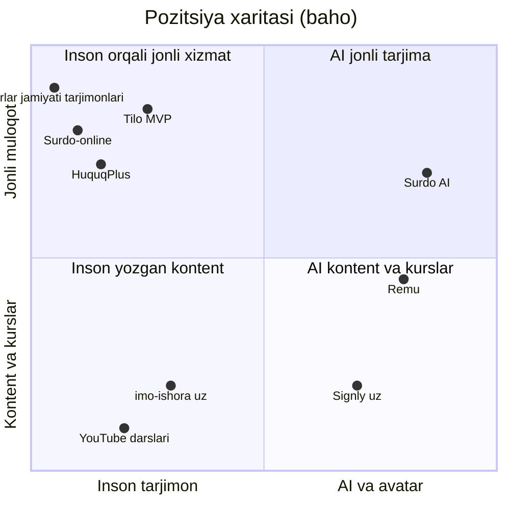

# 03a. O'zbekiston: mavjud o'yinchilar, xizmatlar va kontent

> **Qisqacha**
> - O'zbekistonda bo'sh maydon yo'q: davlat **Surdo AI** ilovasi (kamera + 3D avatar, 1000+ so'z, Google Play'da 1 ming+ yuklanma), **imo-ishora.uz** lug'ati (Sharoit Plyus, 2000+ so'z), Adliya vazirligining **surdo-online** planshetlari (14 hududiy bo'linma) va **Karlar jamiyatining** a'zolarga bepul tarjimonlari allaqachon ishlaydi ([Google Play](https://play.google.com/store/apps/details?id=com.ihma.surdoai); [imo-ishora.uz](https://imo-ishora.uz/); [yuz.uz](https://yuz.uz/ru/news/tsentr-gosuslug-otdela-yustitsii-goroda-navoi-vvel-novy-vid-servisa-dlya-lyudey-s-invalidnostyu-so-sluxom); [YouTube](https://www.youtube.com/watch?v=zGfIHZnmmHw)).
> - Hammasining umumiy zaifligi: qamrov kichik, ishonchlilik past (planshet ulanmaydi, JusTalk ishlamaydi), mustaqil sifat bahosi yo'q, ochiq kod yo'q, grant tugashi bilan to'xtash xavfi (imo-ishora.uz granti 2026-05-14 da tugagan).
> - O'quv kontenti YouTube'da bor va talab katta (IBRAT 1-dars 150K ko'rish), lekin keyingi darslarda 4-7K ga tushadi; vaziyat lug'atlari (tibbiyot, huquq, biznes) allaqachon yozilgan.
> - Ilmiy ishlar va GitHub prototiplari - 50-500 belgi, imo-ishorachidan mustaqil baho yo'q, ochiq litsenziyali dataset yo'q.
> - Qaror: **raqobat emas, integratsiya**. Tilo avatar/kamera tarjimoni bilan boshlamaydi; VRI, yuzma-yuz subtitr, vaziyat kartalari va dispetcher backend bilan mavjud o'yinchilarni to'ldiradi.

Manba fayllar: `99_Ilovalar/xom_tadqiqot_yozuvlari/1_birinchi_tadqiqot/browser_youtube_google_findings.md` (asosiy, founder brauzeri, 2026-11-15), `.../1_birinchi_tadqiqot/uzbekistan_landscape.md`, `.../2_raqobat_va_ochiq_kod/uzsl_linguistics_education_community.md`, `.../2_raqobat_va_ochiq_kod/russia_cis_competitors.md` (9-bo'lim), `.../2_raqobat_va_ochiq_kod/uzbek_speech_bigtech_support.md`, `04_Texnologiya/04c` (5-bo'lim). Alohida chuqur "O'zbekiston raqobatchilari" skaneri hali kelmagan - pastdagi "Tasdiqlanmagan" bo'limiga qarang. Sana: 2026-11-15.

**Belgilar:** Faol = 2025-2026 da ishlayotgani manbada ko'rindi; Pilot = cheklangan sinov; Noma'lum = holat tasdiqlanmagan; Prototip = ilmiy yoki talaba ishi. "Bizning munosabat" ustuni - reja qarori (fakt emas).

---

## 1. Umumiy jadval

| # | O'yinchi | Egasi | Tur | Nima qiladi | Miqyos / dalil | Holat | Bizning munosabat |
|---|---|---|---|---|---|---|---|
| 1 | **SURDO AI** | Ijtimoiy himoya milliy agentligi huzuridagi AT markazi (davlat) | Ilova (Android, iOS), Chrome kengaytmasi | Kamera: imo-ishora -> matn/ovoz; matn/ovoz -> 3D avatar; 1000+ so'z + daktil; o'rganish moduli; uz/ru | Google Play 1 ming+ yuklanma; Telegram posti 21,5K ko'rish | Faol (2026-08-01 dan) | Raqobat qilmaymiz; lug'at/dataset hamkorligi, o'zaro havola |
| 2 | **imo-ishora.uz** | "Sharoit Plyus" NNT | Veb lug'at + mobil ilova | 2000+ so'z video, 20 kategoriya, kurs, "so'z tavsiya qiling" | Grant $30 120 (Stirling Foundation), 2025-05-14 - 2026-05-14 | Faol, grant tugagan | Asosiy lug'at hamkori; Global Signbank'da birga yuritish |
| 3 | **HuquqPlus video-qo'ng'iroq markazi** | Sharoit Plyus (UNDP/Finlyandiya, Adliya vazirligi orqali) | Video-call tarjima markazi + huquqiy kontent | Imo-ishora tarjimonli video qo'ng'iroq; 12 huquqiy maqola + 50 video rolik (2026); avval 72+ maqola | 2025: $9 000; 2026-08-01 - 12-31: 238,25 mln so'm | Faol (loyiha) | Dispetcher moduli ularning markazi uchun ochiq vosita |
| 4 | **Remu** (remu.uz) | Qarshi Prezident maktabi o'quvchilari | Veb + (Play havolasi o'lik) | "Surdo Tarjimon": matn/nutq -> imo-ishora (sinovda harfma-harf daktil rasmlari); "imo-ishoradan matnga" tab | O'zi "rivojlanish 65%" deydi | Prototip | Talabalar hamkorligi, kod ochiq bo'lsa hissa |
| 5 | **Surdo-online planshetlari** | Adliya vazirligi davlat xizmatlari markazlari (operator noma'lum) | Planshet -> dispetcher-tarjimon | Xodim planshet orqali tarjimonga ulanadi | 2020-11 pilot 11 Toshkent markazida, keyin 14 hududiy bo'linma; reja: barcha DXM va FHDYo | Faol, ishonchlilik muammosi | Dispetcher tomoni uchun ochiq kodli backend taklifi |
| 6 | **Karlar jamiyati (O'zKJ) xizmatlari** | O'zbekiston Karlar jamiyati (STIR 200849599, ~1929) | Jamoat birlashmasi | A'zolarga notarius, sud, militsiya, shifoxona, davlat idorasida bepul surdotarjima; ariza yozish; moddiy yordam | 22 000+ (yoki ~30 000) a'zo | Faol | Birinchi foydalanuvchilar va tarjimonlar; boshqaruvda ishtirok |
| 7 | **FVV kar va nutqsizlar dispetcheri** | Favqulodda vaziyatlar vazirligi | 24/7 video, SMS, JusTalk | Favqulodda chaqiruv | 2019-07-01 dan | Noma'lum (2026) | 4-bosqichda SOS pilot faqat FVV/112 bilan |
| 8 | **DXM surdotarjima** | Davlat xizmatlari markazlari (Toshkent) | Joyida/masofaviy tarjima | DXM'da surdotarjima | Maqolada 3 000+ eshitish/nutq nuqsoni bor | Noma'lum | B2G mijoz nomzodi |
| 9 | **"O'zbekiston 24" imo-ishorali yangiliklar** | Davlat TV | TV | 14:00 va 15:00, jami 15-20 daqiqa | PQ-407 talabi 5% | Faol | Bevosita emas; statik kontent moduli |
| 10 | **YouTube o'quv kanallari** | Turli mualliflar (2-bo'lim) | Video darslar | Daktil, mavzuli lug'at, vaziyatlar | 150K gacha ko'rish | Faol | Imo-ishorachi va o'qituvchi nomzodlari; kontent faqat ruxsat bilan |
| 11 | **Telegram kanallari** | Jamiyat, NNT (3-bo'lim) | Kanal | Yangilik, tadbir, video | 11 dan ~2,1K gacha obunachi | Faol | Tarqatish va intervyu kanali |
| 12 | **Signly.uz** | Jasurbek Ergashev (talaba, 2026-09) | Flutter + Firebase ilova | UzSL va ASL o'yinli o'rganish, oflayn TFLite tanish | 10 kursdoshda pilot, aniqlik yo'q | Prototip | Muallif bilan aloqa; dataset almashish |
| 13 | **GitHub prototiplari** | khdbeck, umid-weeb | Ochiq repo | 50 belgi CNN-Transformer; RTMPose + Random Forest | Real vaqt demo | Prototip | Litsenziya tekshirib, g'oya sifatida |
| 14 | **Ilmiy ishlar (IEEE, Zenodo, CyberLeninka)** | Akhmedov, Umarov, Urinov, Turgunov va boshq. | Maqola | YOLO daktil; MediaPipe + RF; CNN-LSTM 87% vs Transformer 91% | Imo-ishorachidan mustaqil baho yo'q | Prototip | Tadqiqot hamkorligi |
| 15 | **O'zbek nutq provayderlari** | Aisha, Muxlisa (UZINFOCOM), UzbekVoice, Tilmoch AI | STT/TTS API | O'zbek, rus, qoraqalpoq STT/TTS | Narx va WER 4-bo'limda | Faol | Tilo'ning subtitr yetkazib beruvchilari (raqobatchi emas) |
| 16 | **Mimika va imo-ishora teatri** | Karlar va kar-ko'rlar madaniyat markazi | Teatr | 15 kishilik truppa, 400 o'rinli zal, chipta ~30 000 so'm | Moliyaviy zaif | Faol | Kar aktyorlar - pullik imo-ishorachi nomzodlari |
| 17 | **International Inclusive Hub** | Ijtimoiy himoya milliy agentligi | Kurs | Birinchi International Sign kursi (72 soat) | 52 ariza, 15 tanlangan | Faol (2025) | Hukumat bilan aloqa nuqtasi |
| 18 | **Zamin fondi** | Birinchi xonim fondi | Implant, eshitish apparati | Koxlear implant, skrining | 4 626 tekshiruv, 122 operatsiya | Faol | Ota-onalar moduli hamkori |
| 19 | **Xususiy reabilitatsiya** | "Sehrli Quloq", "Rivoj Incenter" | Audiolog, nutq terapiyasi | Eshitish-nutq reabilitatsiyasi | Hajm noma'lum | Faol | Ota-onalar moduli uchun ma'lumot manbasi |
| 20 | **Eski "Surdo Online Uzbekistan"** | Noma'lum | Masofaviy tarjima loyihasi | Video tarjima | YouTube'da 40-73 ko'rish (2019, 2020) | Noma'lum | Saboq: targ'ibotsiz xizmat ko'rinmaydi |

Manbalar (qatorlar bo'yicha): 1 - [Google Play](https://play.google.com/store/apps/details?id=com.ihma.surdoai), [Telegram](https://t.me/s/ijtimoiyhimoya_agentligi/9540), [podrobno.uz](https://podrobno.uz/cat/tehnp/v-uzbekistane-razrabotali-ii-platformu-dlya-perevoda-rechi-i-teksta-na-yazyk-zhestov/), [surxontongi.uz](https://surxontongi.uz/2026/08/03/surdo-ai-milliy-yechim/); 2, 3 - [imo-ishora.uz](https://imo-ishora.uz/), [Sharoit Plus](https://sharoitplus.uz/category/loyihalar/); 4 - [remu.uz](https://www.remu.uz/), [remu.uz/about](https://www.remu.uz/about/); 5 - [yuz.uz](https://yuz.uz/ru/news/tsentr-gosuslug-otdela-yustitsii-goroda-navoi-vvel-novy-vid-servisa-dlya-lyudey-s-invalidnostyu-so-sluxom), [Gazeta.uz 2025](https://www.gazeta.uz/oz/2025/09/30/sign-language/); 6 - [YouTube](https://www.youtube.com/watch?v=zGfIHZnmmHw), [orginfo.uz](https://orginfo.uz/en/organization/97f86baf947b/); 7 - [Yusupov 2020](https://dilmurad.me/expert/uzbek-sign-language-usl-to-be-or-not-to-be/); 8 - [anhor.uz](https://anhor.uz/news/23398-2/); 9 - [Gazeta.uz 2025 (ru)](https://www.gazeta.uz/ru/2025/09/28/sign-language/); 12 - [Zenodo](https://zenodo.org/records/24003015), [reandpub.uz](https://reandpub.uz/konferensiya/article/view/598); 13 - [khdbeck](https://github.com/khdbeck/uzslr-sign-language-prototype), [umid-weeb](https://github.com/umid-weeb/uzbek-sign-language-ai); 14 - [IEEE 10956783](https://ieeexplore.ieee.org/document/10956783/), [IEEE 10544372](https://ieeexplore.ieee.org/document/10544372/), [Zenodo 22840569](https://zenodo.org/records/22840569); 15 - [aisha.group](https://aisha.group/en/pricing), [muxlisa.uz](https://muxlisa.uz/en), [awesome-uzbek-ai](https://github.com/braindiggeruz/awesome-uzbek-ai), [startupbase.uz](https://startupbase.uz/en/news/tilmoch-ai-an-uzbek-startup-changing-the-future-of); 16 - [Gazeta.uz 2026](https://www.gazeta.uz/oz/2026/09/29/theater-of-mimicry-and-gesture/); 17 - [Gazeta.uz 2025-07](https://www.gazeta.uz/ru/2025/07/15/sign-language/); 18 - [uz.wikipedia](https://uz.wikipedia.org/wiki/Zamin_fondi); 19, 20 - `browser_youtube_google_findings.md`, 4.4.

### 1.1 Pozitsiya xaritasi (baho)

Tilo MVP "inson orqali jonli xizmat" choragida (VRI, yuzma-yuz subtitr), lekin u yerda o'yinchilar bilan raqobat emas, ularga infratuzilma beradi (dispetcher, navbat, statistika). AI choragiga faqat 4-bosqichda va yordamchi rolda kiradi ([06f](../06_Platforma_rejasi/06f_Roadmap_24_oy.md)).

---

## 2. YouTube o'quv kontenti

| Kanal / pleylist | Hajm | Ko'rish | Mazmun | Havola / ID |
|---|---|---|---|---|
| IBRAT FARZANDLARI - "Imo-ishora tilini 0 dan o'rganish" | 17 video, 9-26 daq | 201K jami; 1-dars **150K** | Tanishuv, sonlar, oila, uy, oziq-ovqat, meva, kiyim, fasllar, vaqt, hayvonlar, sport, shahar va transport, maktab, sayohat | `PLkREkayoYCyIbxC-s0cOABSwdhkdbcbgz` - [pleylist](https://www.youtube.com/playlist?list=PLkREkayoYCyIbxC-s0cOABSwdhkdbcbgz) |
| Ijtimoiy inspeksiya - "Imo-ishora kursi" | 23 dars, 4-12 daq | 33,5K | Daktil, sonlar, viloyatlar, hafta/oylar, ranglar, oila, lavozimlar, transport, uy, his-tuyg'ular, **biznes, tibbiyot, huquq** | `PL2T-j53zsYyPK9PciDuM0hKTlEC2yC-YY` - [pleylist](https://www.youtube.com/playlist?list=PL2T-j53zsYyPK9PciDuM0hKTlEC2yC-YY) |
| Qizlar akademiyasi - "Surdotarjimonlik" | 10 dars (2025) | 2,6K | Tarix, odob, kundalik harakatlar, ovqat, joylar, vaqt, his-tuyg'u, savol so'zlar, oddiy gaplar | `PL50GpPWEeykOmiz5AcoewaJePKI_Dmf5p` - [pleylist](https://www.youtube.com/playlist?list=PL50GpPWEeykOmiz5AcoewaJePKI_Dmf5p) |
| Ismigul Sayfullayeva | 9 qisqa video | 11K; "Munosabat" 51K | Alifbo, tanishuv, madhiya, mevalar, kiyim, oshxona | `PL7i9BkmiEhFQ4IeSeZn05BL5mhIL9aTar` - [pleylist](https://www.youtube.com/playlist?list=PL7i9BkmiEhFQ4IeSeZn05BL5mhIL9aTar) |
| "Imo-ishorani o'rganamiz" kanali | qisqa | daktil 57K, so'zlar 73K | O'zbek daktil alifbosi | [video](https://www.youtube.com/watch?v=pcNfOQZbyZs) |
| Abdulxoliq | qisqa | 12-40K | Ranglar; kasblar, huquq va qonun (40K) | [video](https://www.youtube.com/watch?v=OvzesYTuKZM) |
| CyberQiz (UzSL) | pleylist | ma'lumot yo'q | STEAM darslari o'zbek imo-ishora tarjimasi bilan (uz/ru/qq/tj/UzSL) | YouTube qidiruvi "imo-ishora tili darslari" (havola yozilmagan) |
| Toshkent shahar IIBB | qisqa | 160-190 | Huquqiy targ'ibot surdotarjima bilan (MJTK 184-2, 184-3) | [video](https://www.youtube.com/watch?v=Xv8cx-EiuTA) |
| Boshqalar | - | - | Ozoda Turgunova (844 obunachi), Dilfuza Mamatova, surdoway, WorldSignLanguageTeacher (shorts 160K, pullik kurs reklamasi), Zamin Foundation (UNDP bilan rolik, 29K), "Shkola Surdo" (4,2K obunachi) | havolalar yozuvda yo'q |
| Ommaviy blogerlar | - | 664K va 706K | Noir Nabiev "KAR, SOQO'V, KO'R bo'lib pizza tayyorlaymiz" va "ovqat": empatiya kanali, lekin "kar-soqov" so'zi stigma | havola yozuvda yo'q |
| INTV "O'zbekistonda surdo tarjimonlar ko'paymoqda" | 1 video (2021, Yoshlar ishlari agentligi) | 17K | Tarjimonlar haqida syujet | havola yozuvda yo'q |

Manba: `browser_youtube_google_findings.md`, 2-bo'lim va 4.4 (founder brauzeri, YouTube ytInitialData, 2026-11-15).

**Kuzatuvlar (yozuvdagi xulosa):**
- Talab bor, ushlab qolish qiyin: 150K dan keyingi darslarda 4-7K - interaktiv va o'yin elementlari kerak.
- Tibbiyot, huquq, biznes, transport, mahalla **vaziyat lug'atlari** allaqachon yozilgan (Ijtimoiy inspeksiya, imo-ishora.uz) - M3 vaziyat kartalari uchun hamkorlik nuqtasi.
- Videolar mualliflik huquqi ostida: dataset sifatida faqat egalarining ruxsati bilan. Ular **imo-ishorachilar va o'qituvchilar ro'yxati** sifatida qimmatli.
- Ko'p videolar rus va o'zbek imo-ishorasini birga ko'rsatadi - UzSL va RSL yaqinligini tasdiqlaydi.

---

## 3. Telegram kanallari

| Kanal | Egasi | Hajm | Mazmun | Manba |
|---|---|---|---|---|
| @uzsduz | Karlar jamiyati blogi | 854 obunachi (indeksda 981), 849 video | Ikki tilli (o'zbek lotin + rus), imo-ishora videolari (madhiya), Xalqaro karlar haftaligi (21-27 sentyabr), statistika, onlayn ma'ruzalar, implant tadqiqoti chaqiruvi | [t.me/s/uzsduz](https://t.me/s/uzsduz); [telemetr.io](https://telemetr.io/en/channels/1481074705-uzsduz/posts) |
| @imo_ishora_uz | imo-ishora.uz | 11 obunachi | Deyarli bo'sh | [t.me/s/imo_ishora_uz](https://t.me/s/imo_ishora_uz) |
| @deaf_gluxoyy ("DEAF....GLUKHOY") | Noma'lum | ~2,1K | Yangiliklar | [TGStat](https://uz.tgstat.com/en/channel/@deaf_gluxoyy) |
| @sharoitplus | Sharoit Plyus | ma'lumot yo'q | Loyihalar, tenderlar | [t.me/s/sharoitplus](https://t.me/s/sharoitplus) |
| @ijtimoiyhimoya_agentligi | Ijtimoiy himoya milliy agentligi | Surdo AI posti 21,5K ko'rish | Rasmiy yangiliklar | [post 9540](https://t.me/s/ijtimoiyhimoya_agentligi/9540) |

Imo-ishora tarjimasi qiladigan o'zbek yoki rus tilidagi Telegram bot topilmadi (`russia_cis_competitors.md`, 9-bo'lim). Telegram Mini App'da kamera/WebRTC API yo'q, shuning uchun Tilo'da bot - faqat eslatma, bron, kartalar ([Telegram](https://core.telegram.org/bots/webapps)).

---

## 4. O'zbek nutq va matn provayderlari (Tilo uchun yetkazib beruvchi)

| Provayder | Fakt | Manba |
|---|---|---|
| Aisha (Toshkent) | STT 425 so'm/daqiqa (~$2/soat), TTS 1 so'm/belgi; uz/en/ru; spiker identifikatsiyasi; enterprise on-prem | [aisha.group/pricing](https://aisha.group/en/pricing); [aisha.group](https://aisha.group/en/uzbek-speech-recognition) |
| Muxlisa (UZINFOCOM, davlat) | O'zbek va qoraqalpoq STT/TTS, aralash o'zbek-rus; o'zi e'lon qilgan WER 11,39% (call-center) / 13,42% (YouTube); narx **zid**: 350 so'm STT / 650 so'm TTS 1 000 belgiga yoki ochiq narx topilmadi | [muxlisa.uz](https://muxlisa.uz/en); [UZINFOCOM](https://uzinfocom.uz/en/news/522) |
| UzbekVoice | STT, TTS (Shoira, Jasur), Studio subtitr va dublyaj; vendor tasdig'i yo'q | [awesome-uzbek-ai](https://github.com/braindiggeruz/awesome-uzbek-ai) |
| Tilmoch AI | O'zbek tarjima startapi | [startupbase.uz](https://startupbase.uz/en/news/tilmoch-ai-an-uzbek-startup-changing-the-future-of) |
| Voice AI Challenge (2021) | MITC, IT Park, UNDP hakatoni; uzbekvoice.ai korpusi | [IT Park](https://www.it-park.uz/en/itpark/news/in-uzbekistan-mitc-it-park-and-undp-organize-hackathon-called-voice-ai-challenge-uzbekistan); [corpus.uzbekvoice.ai](https://corpus.uzbekvoice.ai/en-US/yangilik/1) |

Batafsil taqqoslash (Yandex, Azure, Google, ochiq Whisper modellari) - [04c](../04_Texnologiya/04c_Nutq_subtitr_va_bigtech.md).

---

## 5. Batafsil profillar

### 5.1 SURDO AI

| Bo'lim | Mazmun |
|---|---|
| Egasi | Ijtimoiy himoya milliy agentligi huzuridagi Axborot texnologiyalari markazi (davlat) |
| Chiqarilgan | 2026-08-01, bepul; Android `com.ihma.surdoai` va iOS; oxirgi yangilanish 2026-08-04 |
| Funksiyalar | Kamera: imo-ishora -> matn/ovoz; matn/ovoz -> 3D avatar; 1000+ so'z lug'at + daktil; o'rganish moduli; Chrome plagini; o'zbek va rus |
| Ma'lumot | Baza maxsus maktab o'qituvchi va o'quvchilari bilan yig'ilgan |
| Miqyos | Google Play: 1 ming+ yuklanma (3 oyda); agentlik Telegram posti 21,5K ko'rish; "Uzbekistan 24" syujeti (2026-08-20) |
| Kuchli | Davlat qo'llovi, bepul, ikki yo'nalish, o'qituvchilar bilan yig'ilgan baza |
| Zaif | Qamrov kichik; mustaqil sifat bahosi, reyting yoki sharh topilmadi; 1 000 so'z - to'liq tarjima emas, lug'at qidiruviga yaqin (inferensiya); Chrome Web Store'da "Surdo AI" kengaytmasi topilmadi |
| Manbalar zid | `uzbek_speech_bigtech_support.md` do'kon sahifasini topmagan; founder brauzeri Google Play sahifasini (1k+) ko'rgan |
| Tilo munosabati | Avatar/kamera tarjimonida raqobat qilmaymiz. Tilo'da Surdo AI'ga havola; lug'at va dataset bo'yicha hamkorlik taklifi; Tilo'ning VRI va subtitri uni to'ldiradi |
| Manba | [Google Play](https://play.google.com/store/apps/details?id=com.ihma.surdoai); [podrobno.uz](https://podrobno.uz/cat/tehnp/v-uzbekistane-razrabotali-ii-platformu-dlya-perevoda-rechi-i-teksta-na-yazyk-zhestov/); [surxontongi.uz](https://surxontongi.uz/2026/08/03/surdo-ai-milliy-yechim/); [Telegram](https://t.me/s/ijtimoiyhimoya_agentligi/9540); [04c, 5-bo'lim](../04_Texnologiya/04c_Nutq_subtitr_va_bigtech.md) |

### 5.2 imo-ishora.uz va Sharoit Plyus

| Bo'lim | Mazmun |
|---|---|
| Egasi | "SHAROIT PLYUS" nogironlar jamoat birlashmasi (Toshkent); aloqa: info@sharoitplus.uz, +998 55 500-50-60, t.me/sharoitplus |
| Odamlar (ommaviy rollar) | Dilmurod Yusupov (PhD, IDS Sussex; loyiha rahbari), Mamur Axlidinov (kar faol, bloger, ekspert), Gulnora Mahkamova va E'zoza Axmedova (tarjimonlar), Saida Turabekova (sayt muallifi) |
| Lug'at | 2000+ so'z video; 20 kategoriya: lotin alifbo (daktil), sonlar, fasllar, kunlar, oylar, ranglar, salomlashish, oila, **shifoxona, mahalla, bozor, huquq, transport**, tez-tez ishlatiladigan so'zlar; kurs; "so'z tavsiya qiling" (rasm yuklash); uz/ru/en; "ilova o'rnatish" havolasi (PWA ga o'xshash) |
| Hamkorlar | Deaf Reach, Family Educational Services Foundation (FESF, Pokiston - dasturlash), The Stirling Foundation |
| Moliya | Stirling Foundation (AQSh) $30 120, 2025-05-14 - 2026-05-14; milliy hamkor - Ijtimoiy himoya milliy agentligi; maqsadli guruh ~5 000 internat o'quvchi va xodimi, ota-onalar |
| Tender | O'IIT onlayn lug'ati veb-sayti va mobil ilovasi uchun tender (11 haftalik muddat), natijalar e'lon qilingan |
| Boshqa loyihalar | HuquqPlus: video-call tarjima markazi (2025, $9 000; 2026-08-01 - 12-31, 238,25 mln so'm); 12 huquqiy maqola + 50 video (2026); Yandex Lavka bilan kar xodimlar uchun tarjimon |
| Zaif | Grant tugagan; hududiy variant belgilari ko'rinmaydi; Telegram kanali 11 obunachi; ilova yuklanma soni topilmadi |
| Tilo munosabati | Asosiy hamkor: lug'atni Global Signbank asosida birga yuritish, ochiq kod va hosting bilan uzaytirish; HuquqPlus uchun dispetcher vositasi; boshlang'ich yuridik "soyabon" NNT nomzodi ([05](../05_Huquq_moliya_va_notijorat_model.md)) |
| Manba | [imo-ishora.uz](https://imo-ishora.uz/); [imo-ishora.uz/dictionary](https://imo-ishora.uz/dictionary); [Sharoit Plus loyihalar](https://sharoitplus.uz/category/loyihalar/); [tender natijalari](https://sharoitplus.uz/ozbek-imo-ishora-tili-oiit-onlayn-lugati-uchun-veb-sayt-va-mobil-ilovani-ishlab-chiqish-boyicha-tender-natijalari/); [Gazeta.uz 2026-06](https://www.gazeta.uz/oz/2026/06/03/yandex-lavka-disabled/) |

### 5.3 Remu

| Bo'lim | Mazmun |
|---|---|
| Egasi | Qarshi Prezident maktabi jamoasi (M. Abdirashidova, R. Sultonova, R. Sodiqov) |
| Funksiya | "Surdo Tarjimon": matn/nutq -> imo-ishora; "imo-ishoradan matnga" tab; maqsad 2030 - ikki tomonlama tarjimon |
| Sinov | "Assalomu alaykum, men shifokorga boraman" matni **harfma-harf daktil rasmlari** bilan ko'rsatildi (so'z darajasida emas) |
| Holat | O'zi "rivojlanish 65%" deydi; Google Play havolasi (`learn.remu.uzsl`) "Sahifa topilmadi" |
| Tilo munosabati | Yosh jamoa - ko'ngilli hissa qo'shuvchi yoki stajyor nomzodi; daktil-faqat yondashuvdan qochamiz |
| Manba | [remu.uz](https://www.remu.uz/); [remu.uz/about](https://www.remu.uz/about/) |

### 5.4 Surdo-online (Adliya vazirligi)

| Bo'lim | Mazmun |
|---|---|
| Mexanizm | Davlat xizmatlari markazida xodim planshet orqali dispetcher-tarjimonga ulanadi, u jonli tarjima qiladi; planshetlar dorixona, bank, temir yo'l kassasida ham (shartnoma bo'yicha) |
| Tarix | 2020-11 da 11 Toshkent tuman markazida; keyin barcha 14 hududiy bo'linma; reja - barcha DXM va FHDYo (ZAGS) |
| Navoiy | ~1 698 eshitish/nutq nuqsoni bor aholi, ~1 300 ga davlat xizmati kerak |
| Muammo | Ba'zi planshetlar ishlamaydi: bir bankda xodim qo'ng'iroqni ulay olmagan |
| Noma'lum | Operator (vendor), ish soatlari, tarjimonlar soni; Rossiyadagi "Surdo-online" bilan bir vendor ekani tasdiqlanmagan |
| Tilo munosabati | Takrorlamaymiz. Adliya vazirligiga taklif: dispetcher tomoni uchun statistika bilan ochiq kodli backend ([03b, 10-bo'lim](03b_Rossiya_va_MDH.md)) |
| Manba | [yuz.uz 2023](https://yuz.uz/ru/news/tsentr-gosuslug-otdela-yustitsii-goroda-navoi-vvel-novy-vid-servisa-dlya-lyudey-s-invalidnostyu-so-sluxom); [Gazeta.uz 2025](https://www.gazeta.uz/oz/2025/09/30/sign-language/); [Yusupov 2020](https://dilmurad.me/expert/uzbek-sign-language-usl-to-be-or-not-to-be/) |

### 5.5 Karlar jamiyati (O'zKJ) xizmatlari

| Bo'lim | Mazmun |
|---|---|
| Yuridik shaxs | "O'ZBEKISTON KARLAR JAMIYATI", STIR 200849599; 2024 da 95 yilligi (~1929 asos) |
| A'zolik | Kirish badali 2 000 so'm, yillik 20 000 so'm; a'zolar soni - 22 000+ (Gazeta 2025) yoki ~30 000 (jamiyat videosi) |
| Xizmatlar | A'zolarga **bepul** surdotarjima: notarius, sud, militsiya, shifoxona, davlat idoralari; ariza/shikoyat yozishga yordam; moddiy yordam; viloyat bo'limlari va o'quv-ishlab chiqarish korxonalari |
| Madaniyat | Madaniyat saroyi (1973), 2001 dan Karlar va kar-ko'rlar madaniyat markazi; Mimika va imo-ishora teatri (15 kishilik truppa, 400 o'rin, chipta ~30 000 so'm, barqaror maosh yo'q); JICA qo'llovi (2014 mukofot) |
| Boshqaruv muammolari | 2017 da qarzlar sababli WFD a'zoligi to'xtatilgan; "imo-ishora tilini rivojlantirishga mablag' yo'q"; 2020 tanqidi: "nega eshituvchilar karlarni boshqaradi?" |
| Kanallar | Telegram @uzsduz (854-981), YouTube rasmiy kanali (169 obunachi) |
| Tilo munosabati | Birinchi foydalanuvchilar va tarjimonlar; Tilo ularning bepul tarjimonlari ishini osonlashtiradi (navbat, bron, statistika), yangi shtat ochmaydi; boshqaruvda ishtirok |
| Manba | [orginfo.uz](https://orginfo.uz/en/organization/97f86baf947b/); [YouTube 2025-03](https://www.youtube.com/watch?v=zGfIHZnmmHw); [YouTube 2025-12](https://www.youtube.com/watch?v=xggsSLBX4fo); [Gazeta.uz 2026](https://www.gazeta.uz/oz/2026/09/29/theater-of-mimicry-and-gesture/); [Hook.report](https://old.hook.report/2020/11/bizsiz-biz-haqimizda-hech-narsa/); [Yusupov 2020](https://dilmurad.me/expert/uzbek-sign-language-usl-to-be-or-not-to-be/) |

### 5.6 Favqulodda aloqa (FVV dispetcheri va 112)

| Bo'lim | Mazmun |
|---|---|
| Fakt | 2019-07-01 dan FVV huzurida eshitish va nutq nuqsoni borlar uchun 24/7 dispetcher: video qo'ng'iroq, SMS, maxsus dastur |
| Muammo | Foydalanuvchilar JusTalk video ilovasi tez-tez ishlamasligini aytadi; mahalliy ilova yo'q; COVID davrida 1197 liniyasiga yetib bo'lmagan |
| 112 | 2025-03-25 dan butun mamlakatda ishlaydi; karlar uchun SMS/video kirish topilmadi |
| Tilo munosabati | MVP'da SOS yo'q (faqat karta va 112/FVV raqamlari). 4-bosqichda FVV/112 bilan rasmiy pilot: EU 2023/444 6 talabi, Gruziya 112 SMS + video namunasi ([06f](../06_Platforma_rejasi/06f_Roadmap_24_oy.md)) |
| Manba | [Yusupov 2020](https://dilmurad.me/expert/uzbek-sign-language-usl-to-be-or-not-to-be/); [Gazeta.uz 2025](https://www.gazeta.uz/oz/2025/09/30/sign-language/); [kun.uz](https://kun.uz/en/news/2025/03/25/uzbekistans-unified-112-emergency-system-now-fully-operational-nationwide); [MIA Georgia](https://mia.police.ge/en/112-gkhedavt-sms-da-video-zaris-servisi-mkholod-kru-da-smenadaqveitebuli-pirebistvis/7938?print=1) |

### 5.7 Ilmiy ishlar va prototiplar

| Ish | Usul | Natija / cheklov | Manba |
|---|---|---|---|
| IEEE "An Algorithm of Recognition Uzbek Sign Language" (~2024-11) | YOLO, o'z rasm dataseti | Daktil alifbo | [IEEE 10956783](https://ieeexplore.ieee.org/document/10956783/); [ResearchGate](https://www.researchgate.net/publication/390790430_An_Algorithm_of_Recognition_Uzbek_Sign_Language) |
| Akhmedov, Umarov, Urinov, Turgunov | BiLSTM + MediaPipe | "100%" test aniqligi - kichik test to'plami belgisi (shubhali) | o'sha |
| IEEE "Assistance to Uzbek people with speaking disabilities..." | MediaPipe + Random Forest | Dataset yaratish qiyin | [IEEE 10544372](https://ieeexplore.ieee.org/document/10544372/) |
| Zenodo 2026 | CNN-LSTM 87% vs Squeezeformer uslubidagi Transformer 91% | Yopiq landmark dataseti, imo-ishorachidan mustaqil emas | [Zenodo 22840569](https://zenodo.org/records/22840569) |
| CyberLeninka "O'zbek ishora tili harflarini tanib olish algoritmi" | Lotin daktil dataseti | Kirill va lotin ikkalasi ishlatilishini qayd etadi | [CyberLeninka](https://cyberleninka.ru/article/n/o-zbek-ishora-tili-harflarini-tanib-olish-algoritmi/pdf) |
| Sharh va klassifikator | HMM, SVM, k-NN, DL sharhi; ML klassifikator | - | [Zenodo 10093343](https://zenodo.org/records/10093343); [eipublication](https://eipublication.com/index.php/eijmrms/article/view/1885) |
| khdbeck/uzslr-sign-language-prototype | 50 belgi, CNN-Transformer (PyTorch), real vaqt | Litsenziya tekshirilmagan | [GitHub](https://github.com/khdbeck/uzslr-sign-language-prototype) |
| umid-weeb/uzbek-sign-language-ai | RTMPose + Random Forest, real vaqt | Litsenziya tekshirilmagan | [GitHub](https://github.com/umid-weeb/uzbek-sign-language-ai) |
| leverow/uzsl (2026-11-15 dan) | Ikki tomonlama yordamchi: MediaPipe landmark -> TCN/kichik Transformer -> "unknown/retry" rad etish; teskari yo'l faster-whisper -> aniq matn resolver -> inson jumla videosi. Bitta vaziyat (ma'lumot peshtaxtasi), 50 ta xabar ma'nosi | 2026-11-17 holati: skelet va sintetik testlar (React PWA, FastAPI, PostgreSQL, S3); model, dataset va tasdiqlangan video yo'q; LICENSE fayli yo'q (issue #2 ochiq). Rozilik, signer bo'yicha split va kar reviewer qoidalari Tilo 06c bilan deyarli bir xil | [GitHub](https://github.com/leverow/uzsl); [architecture.md](https://github.com/leverow/uzsl/blob/dev/docs/architecture.md) |
| Signly.uz | Flutter + Firebase + TFLite, "500+ sign" hamroh dataseti | 10 kishida pilot, aniqlik yo'q | [Zenodo 24003015](https://zenodo.org/records/24003015) |

Umumiy xulosa: ochiq, litsenziyali UzSL dataseti GitHub, Kaggle va Hugging Face'da topilmadi (`uzbekistan_landscape.md`, 5-bo'lim; Kaggle'da faqat o'zbek nutq/matn datasetlari bor - [Kaggle](https://www.kaggle.com/datasets/javokhirraimov/uzbek-language-dataset-sentence-and-audio)). Mualliflarning OTM (TATU, Inha va boshq.) bog'liqligi tasdiqlanmagan. Batafsil - [04d](../04_Texnologiya/04d_Datasetlar_va_modellar.md).

---

## 6. Funksiyalar taqqoslamasi: kim nimani beradi

| Funksiya | Surdo AI | imo-ishora.uz | Surdo-online | Karlar jamiyati | HuquqPlus | YouTube | **Tilo MVP** |
|---|---|---|---|---|---|---|---|
| Jonli inson tarjimon (video) | - | - | Ha (planshet) | Ha (joyida) | Ha | - | **Ha (VRI, halol soatlar, login'siz)** |
| Yuzma-yuz o'zbek/rus subtitr | ma'lumot yo'q | - | - | - | - | - | **Ha** |
| Imo-ishora -> matn (AI) | Ha (kamera) | - | - | - | - | - | Yo'q (v2, yordamchi) |
| Matn -> imo-ishora | Ha (3D avatar) | - | - | - | - | - | Yo'q (v2, faqat statik) |
| Video lug'at | 1000+ so'z | 2000+ so'z | - | - | - | mavzuli | Ichki baza (kartalar), lug'at hamkor orqali |
| Vaziyat kartalari (kar imo-ishorachi videosi) | - | kategoriya bor | - | - | - | qisman | **Ha** |
| Idora/murojaat yordami | - | - | qisman | Ha (ariza) | huquqiy kontent | - | **Ha** |
| AAC (gapira olmaydiganlar) | - | - | - | - | - | - | **Ha (Cboard fork)** |
| Ota-onalar o'rganish | o'rganish moduli | kurs | - | - | - | darslar | **Ha (yadro darslar)** |
| Ochiq kod | - | - | - | - | - | - | **Ha (Apache-2.0)** |
| Ochiq KPI / statistika | - | - | - | - | - | - | **Ha (oylik hisobot)** |

"-" = manbada ko'rsatilmagan. Manbalar - 1 va 5-bo'limlar; Tilo ustuni - [06a](../06_Platforma_rejasi/06a_Mahsulot_konsepsiyasi_va_funksiyalar.md).

---

## 7. Saboqlar O'zbekiston uchun

### Nusxa olamiz
- **Vaziyat lug'ati tuzilmasi** (imo-ishora.uz va Ijtimoiy inspeksiya: shifoxona, mahalla, bozor, huquq, transport) - M3 kartalar uchun tayyor toifalar.
- **"So'z tavsiya qiling" formasi** (imo-ishora.uz) - jamiyat hissasi naqshi, M15 dataset hissa ilovasiga.
- **Ikki tilli kontent** (@uzsduz: o'zbek lotin + rus).
- **Jamiyatning bepul tarjimon modeli** (a'zolarga bepul) - Tilo'da ham kar foydalanuvchi to'lamaydi.

### Moslashtiramiz
- **Surdo-online dispetcher g'oyasi** - ochiq kod, ishonchlilik KPI va funder statistikasi bilan.
- **Davlat qo'llovi** (Surdo AI) - raqobat emas, o'zaro havola va lug'at almashish.
- **YouTube o'qituvchilari** - pullik imo-ishorachi va tekshiruvchi sifatida, kontent faqat ruxsat bilan.

### Qochamiz
- **Daktil-faqat "tarjima"** (Remu sinovi) - so'z darajasidagi imo-ishora kerak.
- **Targ'ibotsiz xizmat** (eski "Surdo Online Uzbekistan", 40-73 ko'rish) - tarqatish tashkilotlar orqali.
- **Bitta grantga bog'lanish** (imo-ishora.uz granti 2026-05 da tugagan) - ko'p manbali moliya ([06e](../06_Platforma_rejasi/06e_Budjet_va_moliya_rejasi.md)).
- **Uchinchi tomon ilovasiga tayangan favqulodda kanal** (JusTalk).
- **Stigmali til** ("kar-soqov") - marketingda ishlatilmaydi.

### Hamkorlik nishonlari

| Hamkor | Nima beramiz | Nima olamiz | Birinchi qadam |
|---|---|---|---|
| Sharoit Plyus | Ochiq kod, hosting, Signbank, dispetcher | Lug'at, tarjimonlar, yuridik soyabon | Uchrashuv va memorandum (30 kun) |
| Karlar jamiyati | Navbat va bron vositasi, statistika | Foydalanuvchilar, tarjimonlar, qonuniylik | Rasmiy xat (30 kun) |
| Agentlik AT markazi (Surdo AI) | VRI va subtitr qatlami, ochiq dataset | O'zaro havola, lug'at almashish | O'zaro havola kelishuvi (90 kun) |
| Adliya vazirligi (surdo-online, HuquqPlus) | Ochiq dispetcher backend | B2G pilot | Integratsiya muhokamasi (90 kun) |
| YouTube o'qituvchilari | Pullik ish, kreditlash | Imo-ishorachilar, ruxsatli kontent | Ro'yxat va taklif |
| Talaba jamoalar (Remu, Signly.uz, GitHub mualliflari) | Mentorlik, ochiq repo | Hissa qo'shuvchilar | GitHub orqali taklif |
| UzSL (leverow/uzsl) | VRI, subtitr, kartalar; kar ishtirokchilar bilan aloqa | Tanish tadqiqoti (bizning M16), rozilik/katalog kodi; **bitta yozuv sessiyasi va bitta rozilik protokoli** - kar imo-ishorachilarni ikki loyiha ikki marta jalb qilmasin | Litsenziya (Apache-2.0 mos) va hamkorlik taklifi issue orqali |

Muddatlar - [06f, 3-bo'lim](../06_Platforma_rejasi/06f_Roadmap_24_oy.md).

---

## Manbalar

- SURDO AI: https://play.google.com/store/apps/details?id=com.ihma.surdoai ; https://t.me/s/ijtimoiyhimoya_agentligi/9540 ; https://podrobno.uz/cat/tehnp/v-uzbekistane-razrabotali-ii-platformu-dlya-perevoda-rechi-i-teksta-na-yazyk-zhestov/ ; https://surxontongi.uz/2026/08/03/surdo-ai-milliy-yechim/
- imo-ishora.uz / Sharoit Plyus: https://imo-ishora.uz/ ; https://imo-ishora.uz/dictionary ; https://sharoitplus.uz/category/loyihalar/ ; https://sharoitplus.uz/ozbek-imo-ishora-tili-oiit-onlayn-lugati-uchun-veb-sayt-va-mobil-ilovani-ishlab-chiqish-boyicha-tender-natijalari/ ; https://t.me/s/sharoitplus
- Remu: https://www.remu.uz/ ; https://www.remu.uz/about/
- Surdo-online: https://yuz.uz/ru/news/tsentr-gosuslug-otdela-yustitsii-goroda-navoi-vvel-novy-vid-servisa-dlya-lyudey-s-invalidnostyu-so-sluxom
- Karlar jamiyati: https://orginfo.uz/en/organization/97f86baf947b/ ; https://www.youtube.com/watch?v=zGfIHZnmmHw ; https://www.youtube.com/watch?v=xggsSLBX4fo ; https://t.me/s/uzsduz ; https://telemetr.io/en/channels/1481074705-uzsduz/posts
- Gazeta.uz: https://www.gazeta.uz/oz/2025/09/30/sign-language/ ; https://www.gazeta.uz/ru/2025/09/28/sign-language/ ; https://www.gazeta.uz/ru/2025/07/15/sign-language/ ; https://www.gazeta.uz/oz/2026/09/29/theater-of-mimicry-and-gesture/ ; https://www.gazeta.uz/oz/2026/06/03/yandex-lavka-disabled/
- Yusupov 2020: https://dilmurad.me/expert/uzbek-sign-language-usl-to-be-or-not-to-be/ ; Hook.report: https://old.hook.report/2020/11/bizsiz-biz-haqimizda-hech-narsa/
- YouTube pleylistlari: https://www.youtube.com/playlist?list=PLkREkayoYCyIbxC-s0cOABSwdhkdbcbgz ; https://www.youtube.com/playlist?list=PL2T-j53zsYyPK9PciDuM0hKTlEC2yC-YY ; https://www.youtube.com/playlist?list=PL50GpPWEeykOmiz5AcoewaJePKI_Dmf5p ; https://www.youtube.com/playlist?list=PL7i9BkmiEhFQ4IeSeZn05BL5mhIL9aTar ; https://www.youtube.com/watch?v=pcNfOQZbyZs ; https://www.youtube.com/watch?v=OvzesYTuKZM ; https://www.youtube.com/watch?v=Xv8cx-EiuTA
- Telegram: https://t.me/s/imo_ishora_uz ; https://uz.tgstat.com/en/channel/@deaf_gluxoyy
- Ilmiy: https://ieeexplore.ieee.org/document/10956783/ ; https://ieeexplore.ieee.org/document/10544372/ ; https://zenodo.org/records/22840569 ; https://zenodo.org/records/24003015 ; https://cyberleninka.ru/article/n/o-zbek-ishora-tili-harflarini-tanib-olish-algoritmi/pdf
- GitHub: https://github.com/khdbeck/uzslr-sign-language-prototype ; https://github.com/umid-weeb/uzbek-sign-language-ai ; https://github.com/braindiggeruz/awesome-uzbek-ai
- Nutq: https://aisha.group/en/pricing ; https://muxlisa.uz/en ; https://uzinfocom.uz/en/news/522 ; https://startupbase.uz/en/news/tilmoch-ai-an-uzbek-startup-changing-the-future-of
- 112: https://kun.uz/en/news/2025/03/25/uzbekistans-unified-112-emergency-system-now-fully-operational-nationwide

To'liq indeks - [07_Manbalar.md](../07_Manbalar.md).

## Tasdiqlanmagan / bo'shliqlar

| Mavzu | Holat |
|---|---|
| **Chuqur O'zbekiston raqobatchilari skaneri** | Alohida tadqiqot fayli (`research_notes/Raqobatchilar va ochiq kodli yechimlar/uzbekistan_competitors.md`) hujjat yozilgan paytda **mavjud emas edi**. Bu hujjat boshqa yozuvlardan tuzildi; skaner tugagach yangilanadi |
| s-access.uz | Topshiriqda nomlangan, lekin xom yozuvlarda **birorta ham eslatma yo'q** - nima qilishi, egasi, holati noma'lum |
| Surdo AI sifati | Amalda sinalmagan; reyting, sharh, kar jamiyati qabuli topilmadi; Chrome kengaytmasi do'konda topilmadi; ikki yozuv zid |
| imo-ishora.uz ilovasi | Yuklanma soni va platformasi (PWA yoki do'kon) topilmadi; grantdan keyingi moliya noma'lum |
| Surdo-online | Operator, ish soatlari, tarjimonlar soni, narx - topilmadi; Rossiyadagi Surdo-online bilan bog'liqligi tasdiqlanmagan |
| FVV dispetcheri 2026 holati | Raqam, ilova, 112 bilan integratsiya noma'lum |
| HuquqPlus video markazi | Ish soatlari, qo'ng'iroqlar soni topilmadi |
| CyberQiz, "Boshqalar" qatoridagi kanallar, Noir Nabiev, INTV | Havolalar xom yozuvda berilmagan |
| Remu kodi | Ochiq yoki yopiq ekani noma'lum; Play havolasi o'lik |
| GitHub prototiplari litsenziyasi | Tekshirilmagan |
| Ilmiy ish mualliflarining OTM bog'liqligi | Tasdiqlanmagan |
| Instagram, TikTok kar bloggerlari; IT Park rezidenti bo'lgan karlarga yo'naltirilgan startap | Topilmadi / o'rganilmagan |
| Imo-ishora tarjimasi qiladigan o'zbek Telegram boti | Topilmadi |
| Karlar jamiyati a'zolari soni | 22 000+ va ~30 000 - zid |
