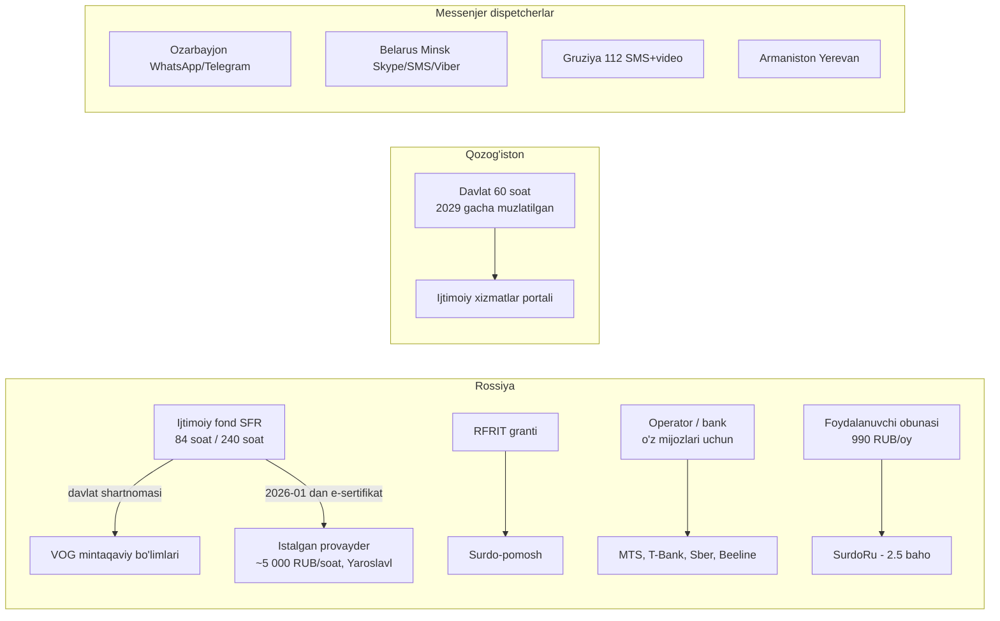
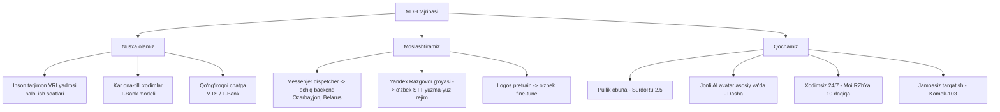

# 03b. Rossiya va MDH: raqobatchilar va tajribalar

> Manba fayllar: `99_Ilovalar/xom_tadqiqot_yozuvlari/2_raqobat_va_ochiq_kod/russia_cis_competitors.md`, `.../1_birinchi_tadqiqot/russia_cis_ecosystem.md`, `.../1_birinchi_tadqiqot/browser_youtube_google_findings.md` (4.2-bo'lim, Sber Ovodov). Tadqiqot sanasi: 2026-11-15. Hujjat sanasi: 2026-11-15. Do'kon ma'lumotlari 2026-11-15 dagi sahifa suratlaridan (boshqa sana ko'rsatilmagan bo'lsa).

## Qisqacha

- **Rossiyada kar foydalanuvchiga yetgan har bir ilova - inson tarjimon dispetcher markazi ustidagi yupqa mijoz.** "AI" (subtitr, avatar) ikkinchi darajali. Eng yuqori baho - inson tarjimonli ilovalarda (Ukraina "Perekladach ZhM" 4.8/71), eng past - pullik "AI tarjimon"da (SurdoRu 2.5, oyiga 990 RUB).
- **Hajm katta kompaniyalardan keladi:** MTS "qo'ng'iroqni chatga" 6 oyda ~496 000 qo'ng'iroq, Yandex Razgovor RuStore'da 200k+ yuklanma, Sber RZhYa tarjimonlari oyiga 1 000+ videoqo'ng'iroq. Bularning hammasi bepul va kompaniyaning o'z mijozlariga bog'langan.
- **Pul davlatdan oqadi:** Rossiyada yiliga 84 soat (karko'rlarga 240) tarjima, 2026-yil yanvardan elektron sertifikat (vaucher bozori); Qozog'istonda yiliga 60 soat va 2029-yilgacha budjet muzlatilgan. Davlat pulidan tashqarida qolgan xususiy servislar o'lgan (Cloud Interpreter, Surdofon) yoki chiqib ketgan (Speakus).
- **Eng arzon isbotlangan davlat modeli - messenjer orqali dispetcher:** Ozarbayjon (WhatsApp/Telegram, ~1 000 foydalanuvchi, JSST eng yaxshi amaliyot), Belarus (Minsk 24/7, Skype/SMS/Viber), Gruziya (112 SMS + video), Armaniston (Yerevan, ish kunlari 09:00-18:00).
- **MDHda ochiq kodli, notijorat, ko'p mamlakatli relay platforma YO'Q.** Raqobatchilar orasida yagona ochiq kod - Yandex Razgovor Android ilovasi (`github.com/yandex/deaf`). Sber ochiq dataset va og'irliklar beradi (Slovo, Bukva, Logos), lekin litsenziyasi cheklangan.
- **Eng yaqin hamkorlik nishonlari:** Qirg'iziston UNDP prototip platformasi (hali ishga tushmagan), Qozog'iston NU/ENU (K-RSL, SignBridge avatar), Sber AI (Logos pretrain).

## Holat belgilari

| Belgi | Ma'nosi (manbadagi ALIVE / UNVERIFIED / DEAD-DORMANT) |
|---|---|
| TIRIK | 2025-2026 yillarda yangilangan yoki ishlashi tasdiqlangan |
| TASDIQLANMAGAN | 2023-yildan keyin dalil yo'q |
| O'LIK / UYQUDA | Oxirgi dalil eski, hozirgi hech narsa topilmadi |

## Umumiy jadval

| # | Mahsulot / xizmat | Mamlakat | Turi | Kim to'laydi | AI / inson | Ochiq kod | Holat | Manba |
|---|---|---|---|---|---|---|---|---|
| 1 | Surdo-pomosh (Sensor-Tekh) | Rossiya | VRI dispetcher + STT + avatar "Dasha" | RFRIT granti, foydalanuvchiga bepul | Inson + AI | Yo'q (GitHub topilmadi) | TIRIK | [hi-tech.mail.ru](https://hi-tech.mail.ru/news/119310-v-rossii-sozdali-pervoe-besplatnoe-prilozhenie-dlya-obsheniya-s-gluhimi/) |
| 2 | Moi RZhYa (TsKT) | Rossiya | 24/7 VRI dispetcher, 112, relay | Ko'rsatilmagan; foydalanuvchiga bepul | Inson | Yo'q | TIRIK | [RuStore](https://www.rustore.ru/catalog/app/com.interpreter_android.ru) |
| 3 | Surdofon | Rossiya | Nutq->imo-ishora, TTS, WebRTC dispetcher, 112 | Venchur (Lomonosov Kapital) | Inson + avtomat | Yo'q | O'LIK / UYQUDA | [ruward 2017](https://ruward.ru/cases/1024/) |
| 4 | SurdoRu | Rossiya | Nutq->RZhYa "AI tarjimon" | Foydalanuvchi obunasi 990-1 000 RUB/oy | AI | Yo'q | TIRIK (past baho) | [RuStore](https://www.rustore.ru/catalog/app/com.SurdoRu.surdoru) |
| 5 | Cloud Interpreter (Oblachnyi perevodchik) | Rossiya | Bulutli VRI | Ma'lumot yo'q (B2B, universitet) | Inson | Yo'q | O'LIK / TASDIQLANMAGAN | [mel.fm](https://mel.fm/novosti/5401872-cloud) |
| 6 | Surdo-online (Makhashev, Melnik) | Rossiya, Qozog'iston | B2B masofaviy tarjima terminali | Biznes (o'rnatish + oylik to'lov) | Inson | Yo'q | 2017-dan keyin TASDIQLANMAGAN | [Vedomosti 2017](https://www.vedomosti.ru/management/articles/2017/12/01/743808-programmist-veteran-afganets-surdoperevodchik) |
| 7 | VOG mintaqaviy masofaviy tarjima | Rossiya | Video tarjima (Skype va b.) | Davlat (SFR) | Inson | Yo'q | TIRIK, parchalangan | [SFR Omsk](https://sfr.gov.ru/branches/omsk/news~2023/12/19/258395) |
| 8 | Moskva viloyati 112 (Skype "Help112mo", SMS) | Rossiya | Favqulodda relay | Davlat | Inson | Yo'q | Yil ko'rsatilmagan | [riamo.ru](https://riamo.ru/news/obschestvo/funktsiyu-priema-vyzovov-ot-invalidov-po-rechi-v-sisteme-112-oblasti-zapustyat-v-2016-g-xl/) |
| 9 | MTS "Sekretar dlya glukhikh" + "Zvonok v chat" | Rossiya | AI qo'ng'iroq->matn (STT+TTS) | Operator, abonentga bepul | AI | Yo'q (MTS VoiceTech) | TIRIK | [iphones.ru](https://www.iphones.ru/iNotes/teper-pozvonit-smogut-dazhe-gluhie-mts-zapustil-zapustil-sekretarya-dlya-gluhih-i-slaboslyshashchih) |
| 10 | MTS KION (imo-ishorali filmlar) | Rossiya | Kontent | Operator | Inson | Yo'q | Hisobot paytida 14 film | [mobile-review](https://mobile-review.com/all/?p=136951) |
| 11 | T-Bank AI kotib (karlar uchun) | Rossiya | AI qo'ng'iroq->matn + spam bloklash | Bank, bepul | AI | Yo'q (Yandex AI Studio ustida) | TIRIK | [kod.ru](https://kod.ru/ii-sekretar-dlya-glukhikh-i-slaboslyshashchikh) |
| 12 | T-Bank RZhYa qo'llab-quvvatlash liniyasi | Rossiya | Kar xodimlar bilan video konsultatsiya | Bank, bepul | Inson (kar xodimlar) | Yo'q | TIRIK (2025) | [Habr](https://habr.com/ru/post/901868) |
| 13 | Sber RZhYa video konsultatsiyalari | Rossiya | Bankda video tarjima | Bank, bepul | Inson | Yo'q | TIRIK | [Habr](https://habr.com/ru/post/901868) |
| 14 | Beeline + Sber RZhYa konsultatsiyasi | Rossiya | Operator ofisida video tarjima | Sber/Beeline, bepul | Inson | Yo'q | TIRIK (2025-12) | [gazeta.ru](https://www.gazeta.ru/business/news/2025/12/03/27328525.shtml) |
| 15 | Tele2 kar tarifi (Moskva VOG bilan) | Rossiya | Ijtimoiy tarif | Foydalanuvchi, 250 RUB/oy | - | - | Hozir topilmadi | [mobile-review 2017](https://mobile-review.com/articles/2017/oper-news-07-2017.shtml) |
| 16 | MegaFon | Rossiya | - | - | - | - | Kar xizmati topilmadi | [russia_cis_competitors.md, 2-bo'lim] |
| 17 | VTB chat-bot RZhYa avatari (Adaptis, NGTU NETI) | Rossiya | Tayyorlangan avatar tarjima | Bank | AI avatar (oldindan render) | Yo'q | 2026-da TASDIQLANMAGAN | [Habr](https://habr.com/p/733914) |
| 18 | Yandex Razgovor: pomoshch glukhim | Rossiya, Belarus | Yuzma-yuz STT + TTS | Yandex, bepul | AI | HA (Android kodi, `yandex/deaf`) | TIRIK | [RuStore](https://www.rustore.ru/catalog/app/ru.yandex.subtitles) |
| 19 | Yandex Go kar haydovchi rejimi | Belarus, Qirg'iziston | Ish joyi moslashuvi | Yandex | - | Yo'q | TIRIK | [myfin.by](https://myfin.by/article/blogi/v-belarusi-adaptirovali-16-servisov-dla-ludej-s-osobennostami-zrenia-sluha-reci-i-mobilnosti-45731) |
| 20 | Kinopoisk SDH subtitr | Belarus (raqam) | Kontent | Yandex | Inson | Yo'q | 78 film | [myfin.by](https://myfin.by/article/blogi/v-belarusi-adaptirovali-16-servisov-dla-ludej-s-osobennostami-zrenia-sluha-reci-i-mobilnosti-45731) |
| 21 | Kontur.Tolk (SKB Kontur) | Rossiya | Videokonferensiya + transkripsiya | Tijorat | AI + inson tarjimon ko'rinishi | Yo'q | TIRIK (2026-05) | [kontur.ru](https://kontur.ru/press/news/85605-gluxie_polzovateli_proveli_vebinar_v_konturtolke) |
| 22 | signflow.ru (Sber + SberDevices + ANO DPO) | Rossiya | Video lug'at (~400 imo-ishora) | Sber | Inson video | Yo'q | TIRIK | [Habr Sber](https://habr.com/ru/companies/sberbank/news/846240) |
| 23 | SignLab (Zuzex) | Rossiya | Video->matn prototip | Kompaniya ichki | AI | Yo'q | Prototip | [ruward 2025](https://ruward.ru/cases/8432/) |
| 24 | Russkiy Zhestovyy Yazyk (Razeeman) | Rossiya | O'rganish ilovasi | Ma'lumot yo'q | - | Yo'q | 3k+ yuklanma | [BlueStacks](https://www.bluestacks.com/campaign/com.razeeman.study.russiansignlanguage/en) |
| 25 | Davay zhestami | Rossiya | Video lug'at + kurslar | Ma'lumot yo'q | - | Yo'q | Ma'lumot yo'q | [mwm.ai](https://mwm.ai/apps/app/6761060993) |
| 26 | Muzey na RZhYa: detyam (Garage muzeyi) | Rossiya | Bolalar uchun san'at lug'ati | Muzey | - | Yo'q | Ma'lumot yo'q | [App Store](https://apps.apple.com/it/app/%D0%BC%D1%83%D0%B7%D0%B5%D0%B9-%D0%BD%D0%B0-%D1%80%D0%B6%D1%8F-%D0%B4%D0%B5%D1%82%D1%8F%D0%BC/id1478126901) |
| 27 | Repka-RZhYa | Rossiya | 3-7 yoshli kar bolalar uchun ikki tilli ilova | Bepul | - | Yo'q | Ma'lumot yo'q | [App Store](https://apps.apple.com/us/app/%D1%80%D0%B5%D0%BF%D0%BA%D0%B0-%D1%80%D0%B6%D1%8F/id1186916447) |
| 28 | NGTU NETI RZhYa->tovush tizimi | Rossiya | Tanish tadqiqoti | Universitet | AI | Ma'lumot yo'q | Tadqiqot | [Habr](https://habr.com/ru/amp/publications/773624) |
| 29 | Slovo dataset (SberDevices) | Rossiya | Dataset + modellar | Sber | - | Dataset: "variant" CC BY-SA 4.0 | Ochiq yuklanadi | [hukenovs/slovo](https://github.com/hukenovs/slovo) |
| 30 | Bukva dataset (SberDevices) | Rossiya | Daktil alifbosi dataseti | Sber | - | "variant" CC BY-SA 4.0 | Ochiq yuklanadi | [ai-forever/bukva](https://github.com/ai-forever/bukva) |
| 31 | Logos dataset (SaluteDevices) | Rossiya | Eng katta RZhYa dataseti | Sber | - | Repo Apache-2.0, dataset faqat akademik | So'rov bo'yicha | [ai-forever/logos](https://github.com/ai-forever/logos) |
| 32 | TheRuSLan (SPIIRAS) | Rossiya | Akademik korpus (Kinect) | Akademiya | - | Litsenziya topilmadi | Yuklash joyi topilmadi | [LREC 2020](https://aclanthology.org/2020.lrec-1.746) |
| 33 | SberDevices SmartSpeech Telegram bot | Rossiya | Ovozli xabar transkripsiyasi | Bepul | AI | Yo'q | Ma'lumot yo'q | [Habr](https://habr.com/ru/articles/658575) |
| 34 | Silero bot | Rossiya | Nutq->matn bot | Bepul | AI | Ma'lumot yo'q | Ma'lumot yo'q | [vc.ru](https://vc.ru/324877-telegram-bot-silero-besplatno-perevodit-rech-v-tekst) |
| 35 | aiogram transkripsiya boti (GitVerse) | Rossiya | Ovoz/video-xabar transkripsiyasi | - | AI | HA | Ma'lumot yo'q | [GitVerse](https://gitverse.ru/integer/voice-to-text-telegram-recognition) |
| 36 | Yandex Cloud SpeechKit bot qo'llanmasi | Rossiya | Qo'llanma | - | AI | Qo'llanma | Ma'lumot yo'q | [Yandex Cloud](https://yandex.cloud/en/docs/speechkit/tutorials/recognizer-bot) |
| 37 | 60 soat davlat xizmati (eGov) | Qozog'iston | Davlat tarjimon vaucheri | Davlat | Inson | - | TIRIK, 2029-gacha muzlatilgan | [TengriHealth](https://tengrihealth.kz/article//daze-zapis-vracu-kvest-kazaxstancy-naruseniem-sluxa-4136/) |
| 38 | Komek-103 Telegram bot | Qozog'iston | Tez yordamga matn | Davlat (SSV) | - | Yo'q | 11 mintaqa, deyarli ishlatilmaydi | [TengriHealth](https://tengrihealth.kz/article//daze-zapis-vracu-kvest-kazaxstancy-naruseniem-sluxa-4136/) |
| 39 | Jibek Joly + SignBridge (ENU) | Qozog'iston | TV multfilmlariga AI 3D avatar | Davlat TV / universitet | AI avatar | Ma'lumot yo'q | TIRIK (2025-05 dan) | [silkwaytv](https://silkwaytv.kz/en/kazakhstan-to-air-cartoons-with-kazakh-sign-language-translation-using-ai_55102) |
| 40 | Khabar + Satbayev universiteti AI avatar | Qozog'iston | TV avatar | Davlat TV / universitet | AI | Ma'lumot yo'q | 2026 ishga tushirilmoqda | [economist.kg](https://economist.kg/society/2026/06/16/kazakhstan-zhestovyy-yazyk-status.md) |
| 41 | ISSAI TilSync (NU) | Qozog'iston | Jonli STT + tarjima + subtitr qatlami | Universitet | AI | Ko'rsatilmagan | TIRIK (2025-09) | [ISSAI](https://issai.nu.edu.kz/?p=62139) |
| 42 | NU K-RSL avatar (Imashev, Alizadeh) | Qozog'iston | Tarjimon avatar tadqiqoti | Ilmiy grantlar | AI avatar | Ko'rsatilmagan | ~6 yil, 4 versiya | [ACL 2026](https://aclanthology.org/2026.signlang-1.23/) |
| 43 | FluentSigners-50 (K-RSL dataset) | Qozog'iston | Dataset | Universitet | - | Maqola CC BY, fayllar cheklangan | Cheklangan | [Zenodo](https://zenodo.org/record/6043739) |
| 44 | Astana IT University 3D avatar prototipi | Qozog'iston | Matn->imo-ishora prototip | Universitet | AI | Ma'lumot yo'q | Prototip (2024-06) | [DOAJ](https://doaj.org/article/96e0e09cba3b4fb9ad29c3f8d1cc7103) |
| 45 | Word2Sign (iPad) | Qozog'iston | Matn->avatar | Yakka dasturchi | AI | Ma'lumot yo'q | Ma'lumot yo'q | [App Store](https://apps.apple.com/ca/app/word2sign/id6478667698) |
| 46 | AI-YM (NU) | Qozog'iston | K-RSL o'qitish uchun ishora tanish | Universitet | AI | Ma'lumot yo'q | Loyiha | [nur.nu.edu.kz](https://nur.nu.edu.kz/bitstreams/9ef0b977-2c24-4605-9e54-154208bcd966/download) |
| 47 | ISSAI nutq vositalari (Dauys, Soyle, Umay) | Qozog'iston | TTS / nutq / og'zaki avatar | Universitet | AI | Ma'lumot yo'q | TIRIK | [ISSAI](https://issai.nu.edu.kz/?p=51729) |
| 48 | Saran eGov burchagi konsultatsiyalari | Qozog'iston | Yuzma-yuz tarjimon | Davlat | Inson | - | 2023 | [gov.kz](https://www.gov.kz/memleket/entities/social-saran/press/article/details/121818) |
| 49 | "Zhansoo tilinin kotormochusu" (UNDP prototip) | Qirg'iziston | Onlayn masofaviy tarjima platformasi | UNDP / donor | Inson | Ma'lumot yo'q | Prototip (2026-06) | [UNDP](https://www.undp.org/ru/node/588326) |
| 50 | Dilgir ilovasi | Qirg'iziston | 1-sinf kar bolalar uchun ta'lim | UNDP + Technoland | Inson kontent, AI emas | Ma'lumot yo'q | Ma'lumot yo'q | [UNDP](https://www.undp.org/node/122981) |
| 51 | (mahsulot yo'q) | Tojikiston | - | - | - | - | Faqat qonun (2025-12) | [WFD](https://wfdeaf.org/?p=19272) |
| 52 | BelOG Minsk 24/7 dispetcher markazi | Belarus | Skype/SMS/Viber relay | Minsk shahar ijroiya qo'mitasi | Inson | Yo'q | TIRIK (2016 dan) | [pravo.by 2016](https://pravo.by/novosti/obshchestvenno-politicheskie-i-v-oblasti-prava/2016/september/21065/) |
| 53 | Perekladach ZhM | Ukraina | 24/7 VRI + SOS (DSNS) | Ma'lumot yo'q; foydalanuvchiga bepul | Inson | Yo'q | TIRIK | [App Store UA](https://apps.apple.com/ua/app/%D0%BF%D0%B5%D1%80%D0%B5%D0%B2%D0%BE%D0%B4%D1%87%D0%B8%D0%BA-%D0%B6%D1%8F/id1303476708?l=uk) |
| 54 | BeWarned / Connect / Connect PRO | Ukraina | Tovush monitori, matn<->TTS, terminal | Ma'lumot yo'q (B2B terminal) | Avtomat | Ma'lumot yo'q | Ma'lumot yo'q (2022 eslatma) | [DOU](https://dou.ua/lenta/articles/dou-projector-bewarned/) |
| 55 | PrivatBank Privat24 imo-ishora konsultatsiyasi | Ukraina | Bankda video konsultatsiya | Bank | Inson (o'qitilgan xodim) | Yo'q | TIRIK (2024-10 dan) | [vikna.tv](https://vikna.tv/styl-zhyttya/pryvatbank-zaprovadyv-videokonsultacziyi-zhestovoyu-movoyu-yak-skorystatys-poslugoyu/) |
| 56 | Diia onlayn nikoh tarjimoni | Ukraina | Davlat xizmatida tarjimon | Davlat (Shveytsariya ko'magi) | Inson | Yo'q | Ma'lumot yo'q | [kyivpost](https://www.kyivpost.com/uk/post/87911) |
| 57 | Yoshlar va sport vazirligi vositasi | Ukraina | Onlayn xizmat moslashuvi | Davlat | Ma'lumot yo'q | Ma'lumot yo'q | 2025-12 | [mms.gov.ua](https://mms.gov.ua/news/minmolodsport-rozshyriuie-tsyfrovu-bezbariernist-onlain-servisy-staly-dostupnishymy-dlia-liudei-z-porushenniamy-slukhu) |
| 58 | UkrSL-Annot, daktil dataseti, Roboflow, ConnectAbility | Ukraina | Dataset / o'rganish ilovasi | Akademiya / xakaton | AI | Qisman | Tadqiqot | [ACL UNLP 2026](https://aclanthology.org/2026.unlp-1.6.pdf) |
| 59 | "Let Us Be Your Voice" | Ozarbayjon | WhatsApp/Telegram video relay | Davlat (Mehnat vazirligi) | Inson | Yo'q | TIRIK, ~1 000 foydalanuvchi | [sosial.gov.az](https://sosial.gov.az/en/media/news/nearly-1000-people-have-benefited-from-the-let-us-be-your-voice-online-sign-language-interpretation-service-9584) |
| 60 | Birbank imo-ishora videoqo'ng'irog'i | Ozarbayjon | Bank ilovasida video | Bank | Inson (o'qitilgan xodim) | Yo'q | TIRIK (2025-09 dan) | [AZERTAG](https://azertag.az/en/xeber/__birbank_revolutionizes_barrier_free_banking_launching_sign_language_video_call_service-3763259) |
| 61 | Nar: jestdili.az + JestPlus | Ozarbayjon | Lug'at + o'rganish ilovasi | Mobil operator | Inson video | Ma'lumot yo'q | Ma'lumot yo'q | [nar.az](https://www.nar.az/en/news/jest-dili-mobil-tetbiqi/) |
| 62 | 112 SMS + video (karlar uchun) | Gruziya | Favqulodda relay | Davlat + UNDP + Shveytsariya | Inson | Yo'q | TIRIK (EENA 2016) | [GovInsider](https://govinsider.asia/intl-en/article/exclusive-georgia-using-video-chat-sign-language-inclusive-services-emergency-service-112) |
| 63 | Davlat xizmatlarini rivojlantirish agentligi video | Gruziya | Pasport/ID uchun video | Davlat | Inson | Yo'q | Ma'lumot yo'q | [GovInsider](https://govinsider.asia/intl-en/article/exclusive-georgia-using-video-chat-sign-language-inclusive-services-emergency-service-112) |
| 64 | Yerevan videoqo'ng'iroq tarjima markazi | Armaniston | Video relay | Munitsipalitet | Inson | Yo'q | TIRIK | [yerevan.am](https://www.yerevan.am/en/news/tesazangov-t-argmanowt-yown-lsoghowt-yan-khndirner-ownets-ogh-k-aghak-ats-ineri-hamar) |
| 65 | Armaniston Karlar jamiyati masofaviy markazi | Armaniston | Video relay | YeI ko'magi | Inson | Yo'q | Ma'lumot yo'q | [EU Neighbours East](https://euneighbourseast.eu/news/stories/breaking-the-barriers-to-build-an-inclusive-society-for-the-deaf-in-armenia/) |
| 66 | "Surdo-online" planshetlari (Adliya vazirligi) | O'zbekiston (bazaviy holat) | Davlat xizmatlari markazida video tarjima | Davlat | Inson | Yo'q | TIRIK (2020-11 dan) | [yuz.uz](https://yuz.uz/ru/news/tsentr-gosuslug-otdela-yustitsii-goroda-navoi-vvel-novy-vid-servisa-dlya-lyudey-s-invalidnostyu-so-sluxom) |

### Kim to'laydi: MDHdagi moliya oqimlari

---

## 1. Rossiya

### 1.1 Huquq va moliya

| Element | Fakt | Manba |
|---|---|---|
| 2012-yil qonuni | 296-FZ (30.12.2012) 181-FZ "Nogironlarni ijtimoiy himoya qilish to'g'risida"ning 14 va 19-moddalarini o'zgartirdi (Duma 18.12.2012, Federatsiya Kengashi 26.12.2012) | [Wikisource 296-FZ](https://ru.wikisource.org/wiki/%D0%A4%D0%B5%D0%B4%D0%B5%D1%80%D0%B0%D0%BB%D1%8C%D0%BD%D1%8B%D0%B9_%D0%B7%D0%B0%D0%BA%D0%BE%D0%BD_%D0%BE%D1%82_30.12.2012_%E2%84%96_296-%D0%A4%D0%97); [pravo.ru](https://pravo.ru/news/view/79071/) |
| 14-modda mazmuni | Hukumat RZhYa tarjima xizmati (surdo- va tiflosurdo-perevod) tartibini belgilaydi; davlat RZhYa o'qituvchi va tarjimonlarini tayyorlaydi va "RZhYa rivojini" ta'minlaydi | [Consultant.ru](https://www.consultant.ru/document/cons_doc_LAW_165919/b004fed0b70d0f223e4a81f8ad6cd92af90a7e3b/) |
| Maqom bo'yicha ziddiyat | Bir akademik manba RZhYa "rasmiy tillardan biri" bo'ldi deydi; qonun matni faqat tarjima xizmati va rivojlanish tili maqomini beradi. Davlat tili EMAS | [Consultant.ru](https://www.consultant.ru/document/cons_doc_LAW_165919/b004fed0b70d0f223e4a81f8ad6cd92af90a7e3b/) |
| Yillik soat (2026) | Arizadan 12 oy ichida 84 soatgacha surdotarjima yoki 240 soatgacha tiflosurdotarjima (karko'rlar); xizmat IPRA (individual reabilitatsiya dasturi)da bo'lishi shart; ishlatilmagan soat pulga almashtirilmaydi | [SFR Yaroslavl 25.09.2026](https://sfr.gov.ru/branches/yaroslavl/news/~2026/09/25/285016); [SFR Amur 24.09.2026](https://sfr.gov.ru/branches/amur/news/~2026/09/24/284968) |
| Eskirgan 40 soat | 40 soat faqat oldingi reabilitatsiya dasturlari haqidagi eski garant.ru yozuvida uchraydi | [garant.ru](https://garant.ru/news/11083) |
| Elektron sertifikat qarori | 25.11.2025 dagi 1879-son qaror (04.12.2025 dan kuchda): surdo- va tiflosurdotarjimani elektron sertifikat bilan to'lash mumkin | [ppt.ru](https://ppt.ru/amp/obzory/vstupaet-v-silu/postanovlenie-pravitelstva-rf-25-11-2025-1879) |
| Sertifikat qoidalari | 2026-yil yanvardan; 5 ish kunida beriladi, 12 oy amal qiladi, butun Rossiyada ishlatiladi; ilgari faqat mintaqaviy SFRning ixtisoslashgan tashkilot bilan davlat shartnomasi orqali | [SFR Yaroslavl](https://sfr.gov.ru/branches/yaroslavl/news/~2026/09/25/285016) |
| Yaroslavl 2026 raqamlari | 103 sertifikat berilgan; 248 kishi 302 soat uchun to'lov olgan, 1,5 mln RUBdan ortiq (soatiga ~5 000 RUB - yozuv muallifi hisobi) | [SFR Yaroslavl](https://sfr.gov.ru/branches/yaroslavl/news/~2026/09/25/285016) |
| Ariza yo'li | SFR mijozlar ofisi, Gosuslugi, MFC yoki pochta; SFR 5 ish kunida vakolatli tashkilotga (mintaqaviy VOG bo'limi) yo'llanma beradi; kontakt markaz 8-800-100-00-01 | [SFR Amur](https://sfr.gov.ru/branches/amur/news/~2026/09/24/284968) |
| Xizmat standarti | GOST R 57636-2024 "Uslugi po perevodu russkogo zhestovogo yazyka. Osnovnye polozheniya" (RZhYa tarjima xizmatlari: asosiy qoidalar) | [tiflocentre.ru](https://tiflocentre.ru/documents/gost-r-57636-2024.php) |
| Moskva portali | Nogiron RZhYa tarjima xizmatini qanday olishini tushuntiradi | [mos.ru](https://www.mos.ru/otvet-zdorovie/kak-invalidu-poluchit-uslugi-po-perevodu-russkogo-zhestovogo-yazyka/) |
| 2017 davlat kanali | Davlat yiliga 358 000 bepul tarjima soati uchun soatiga 700 RUB to'lagan (yiliga ~250 mln RUB); 09.11.2016 hukumat buyrug'i VOGni yuzma-yuz tarjimaning yagona provayderi qildi; VOG mintaqaviy dispetcher markazlari Skype ishlatgan | [Vedomosti 2017](https://www.vedomosti.ru/management/articles/2017/12/01/743808-programmist-veteran-afganets-surdoperevodchik) |
| Masofaviy bozor bahosi | Cloud Interpreter Rossiya va MDHda masofaviy video tarjima bozorini yiliga 300-400 mln RUB deb baholagan | [Vedomosti 01.12.2017](https://www.vedomosti.ru/management/articles/2017/12/01/743808-programmist-veteran-afganets-surdoperevodchik) |
| Tarjimon kadrlari | Rossiyada ~1 000 tarjimon, ehtiyoj ~5 000 (HSE'da joylashgan tijorat taqdimotidan; zaif manba); rasmiy lavozim nomi 2012-dan beri "perevodchik russkogo zhestovogo yazyka" | [olymp.hse.ru PDF](https://olymp.hse.ru/mirror/pubs/share/879758297.pdf); [hh.ru](https://hh.ru/article/30955) |

**Xulosalar (manbadagi inferens):**
- 2026 sertifikat islohoti davlat pulini vaucher bozoriga aylantiradi va xususiy masofaviy tarjima platformalariga davlat pulini ochadi. O'zbekiston uchun advokatlik namunasi: belgilangan soatli vaucher, istalgan litsenziyali provayderda ishlatiladi ([russia_cis_ecosystem.md](https://sfr.gov.ru/branches/yaroslavl/news/~2026/09/25/285016)).
- O'qilgan matnlarda masofaviy tarjima alohida ajratilmagan, lekin sertifikatni yuzma-yuz xizmat bilan cheklovchi narsa ham yo'q - 1879-qaror matnida tekshirish kerak (tasdiqlanmagan).

### 1.2 Masofaviy inson tarjimon ilovalari (VRS / VRI dispetcher markazlari)

**Mintaqa xulosasi:** kar foydalanuvchiga yetgan har bir rus ilovasi inson tarjimon dispetcher markazi ustidagi yupqa mijoz: videoqo'ng'iroq, keyin tarjimon telefon yoki yuzma-yuz suhbatni ovozlashtiradi. Do'kon izi kichik: ikki tirik ilovada ~9k Android yuklanma (Moi RZhYa) va 19 iOS baho (Surdo-pomosh). Shikoyatlar funksiya emas, ishonchlilik va kutish vaqti haqida ([russia_cis_competitors.md, 1-bo'lim](https://www.rustore.ru/catalog/app/com.interpreter_android.ru)).

#### Surdo-pomosh (Surdo-pomoshch)

| Maydon | Qiymat |
|---|---|
| Egasi | Laboratoriya "Sensor-Tekh" (OOO "Sensor-Tekh"), direktor Denis Kuleshov |
| Yil | 2024-12 da RFRIT (Rossiya IT rivojlantirish fondi) bilan taqdim etilgan; App Store 1.0 versiyasi 22.05.2024 |
| Platforma | Veb-sayt + iOS + Android; iOS 16+, 126,9 MB; VK yoki Apple ID orqali kirish |
| Yuklanma / reyting | App Store 4.2 (19 baho); oldingi surat 4.1 (9 baho). Google Play / RuStore soni topilmadi |
| Versiyalar | 1.0 (22.05.2024), 1.0.1 (03.10.2024), 1.0.2 (24.09.2025), keyin 1.0.3 va 1.0.4 (push bildirishnomalar, "19 Oct") |
| Asosiy funksiyalar | Imo-ishora tarjima call-markaziga videoqo'ng'iroq; nutq->matn; virtual yordamchi "Dasha" (imo-ishora<->nutq), 150 000 imo-ishorada motion capture bilan o'qitilgan; kerak bo'lsa jonli mutaxassis videoga qo'shiladi; shifokor xonalari va MFC uchun mo'ljallangan |
| Maqsadlar | 2025 gacha so'rovlarning 80%+ ini algoritm hal qilishi, yiliga kamida 1 mln so'rov, keyin rusiyzabon MDHga kengayish |
| AI ulushi (da'vo) | "Foydalanuvchi so'rovlarining yarmidan ko'pi AI algoritmlari bilan ishlanadi"; imo-ishora bazasi bir yilda 150k ga o'sgan; tarmoq imo-ishorani harakat trayektoriyasi bo'yicha taniydi; "Sdelano v Rossii 2024" mukofoti nomzodi |
| Kim to'laydi | Foydalanuvchiga bepul; RFRIT qo'llovi. Tarjimonlarga qanday to'lanishi (grant yoki davlat sertifikati) topilmadi |
| AI yoki inson | Gibrid: inson tarjimon + AI avatar + STT |
| Ochiq kod | Yo'q (GitHub topilmadi) |
| Ish vaqti | App Store: jonli tarjimonlar faqat "ish soatlarida", jadval e'lon qilinmagan. 2023 RIA xabari (qidiruv xulosasi) 24/7 degan - ZIDDIYAT, 24/7 tasdiqlanmagan |
| Qo'llov iqtiboslari | RFRIT bosh direktori Aleksandr Pavlov: "noyob, to'liq rossiyalik"; press-relizni karko'rlar fondi "So-edinenie" tarqatgan |
| Sharhlar | Maqtov inson tarjimonlarga: "Prekrasnoe prilozhenie! Blagodaryu perevodchikov RZhYa, pomogayut v lyubykh situatsiyakh!" (Ajoyib ilova, RZhYa tarjimonlariga rahmat, har vaziyatda yordam berishadi); bir foydalanuvchi MFC va do'konlarda ishlatgan. Avatar nosozligi: "zhesty" bosilgandan keyin "Dasha" "shunchaki turadi", keyin o'chadi. Uzilish: ishlayotgan internetga qaramay bir hafta "net soedineniya s internetom" (internet ulanishi yo'q) |
| Holat | TIRIK |
| Manba | [hi-tech.mail.ru 12.12.2024](https://hi-tech.mail.ru/news/119310-v-rossii-sozdali-pervoe-besplatnoe-prilozhenie-dlya-obsheniya-s-gluhimi/); [snob.ru 11.10.2024](https://snob.ru/made-in-russia/surdo-pomoshch-nominatsiia-nauka-i-tekhnologiis-premiia-sdelano-v-rossii-2024/); [www1.ru 17.12.2024](https://www1.ru/news/2024/12/17/v-rossii-razrabotali-po-dlia-sozdaniia-subtitrov-v-realnom-vremeni-servis-surdo-pomoshh.html); [App Store](https://apps.apple.com/ru/app/%D1%81%D1%83%D1%80%D0%B4%D0%BE-%D0%BF%D0%BE%D0%BC%D0%BE%D1%89%D1%8C/id6445996571?l=en-GB); [App Store US](https://apps.apple.com/us/app/%D1%81%D1%83%D1%80%D0%B4%D0%BE-%D0%BF%D0%BE%D0%BC%D0%BE%D1%89%D1%8C/id6445996571) ("birinchi rossiya yagona platformasi") |

- **Nimani olamiz:** inson tarjimon + STT birga bitta ilovada; MFC/shifokor/do'kon vaziyatlariga yo'naltirish; VK/Apple ID kabi tez kirish (bizda - ro'yxatdan o'tmasdan chaqirish).
- **Nimadan qochamiz:** jonli AI avatarni asosiy va'da qilish ("Dasha turib qoladi"); e'lon qilinmagan ish soatlari va 24/7 ziddiyati; "80% AI" kabi tekshirib bo'lmaydigan da'volar.

#### Moi RZhYa (Moi RZhYa, paket `com.interpreter_android.ru`)

| Maydon | Qiymat |
|---|---|
| Egasi | OOO "Tsentr Kommunikatsionnykh Tekhnologiy" (TsKT); egalari noma'lum. Birinchi tadqiqotda dasturchi va mamlakat aniqlanmagan |
| Yil | Ma'lumot yo'q; oxirgi yangilanish v5.1.0, 04.11.2026 ("texnik yangilanish, yangi funksiya yo'q") |
| Platforma | Android (RuStore) |
| Yuklanma / reyting | RuStore: 9k+ yuklanma, 4.3 (29 baho). Oldingi surat: 7k+ yuklanma, 4.2 (26 baho) - sekin o'sish |
| Asosiy funksiyalar | 24/7 imo-ishora tarjimonlari dispetcher markazi; favqulodda xizmatlarga qo'ng'iroq; foydalanuvchi nomidan telefon qo'ng'iroqlari; matnli hujjatlarni imo-ishora videoga moslash; "ikki qavatli shifrlash" |
| Kim to'laydi | Foydalanuvchiga bepul; to'lov modeli va tarjimonlar soni ko'rsatilmagan |
| AI yoki inson | Inson |
| Ochiq kod | Yo'q |
| Sharhlar | Favqulodda vaziyatda: "Odnazhdy ya zvonila 10 minut" (bir marta 10 daqiqa qo'ng'iroq qildim - hech kim javob bermadi); yangilanish xatolari ("obnovit ni kak" - yangilab bo'lmaydi); qisqa ijobiy ("Da nravitsya" - ha, yoqadi) |
| Holat | TIRIK |
| Gipoteza | Funksiyalar ro'yxati Ukraina "Perekladach ZhM"ga juda o'xshash; bitta white-label platforma ikki bozorga xizmat qilishi mumkin (TASDIQLANMAGAN) |
| Manba | [RuStore](https://www.rustore.ru/catalog/app/com.interpreter_android.ru); [RuStore tavsiya sahifasi](https://www.rustore.ru/catalog/app/com.interpreter_android.ru/recommendation) |

- **Nimani olamiz:** hujjatni imo-ishora videoga moslash; foydalanuvchi nomidan qo'ng'iroq; favqulodda tugma.
- **Nimadan qochamiz:** xodimsiz 24/7 va'da qilish - favqulodda vaziyatda 10 daqiqa kutish e'lon qilingan ish soatlaridan yomonroq.

#### Surdofon (Surdophone)

| Maydon | Qiymat |
|---|---|
| Egasi | OOO "Surdofon", menejer Andrey Starkov; i20 Group agentligi qurgan, venchur fondi "Lomonosov Kapital" |
| Yil | Keys-stadi 14.02.2017 |
| Platforma | Android (Google Play) |
| Yuklanma / reyting | ~40k Google Play yuklanma, 4.3 (2017) |
| Asosiy funksiyalar | 4 rejim: nutq->imo-ishora, TTS, "Surdofon" dispetcher markaziga WebRTC videoqo'ng'iroq, 112 |
| Kim to'laydi | Narx topilmadi; venchur moliyalashi |
| AI yoki inson | Inson dispetcher + avtomat rejimlar |
| Ochiq kod | Yo'q |
| Holat | O'LIK / TASDIQLANMAGAN: 2026 qidiruvida 2017-dan keyin do'kon sahifasi, yangilik, yangilanish topilmadi; o'lim sanasi noma'lum |
| Manba | [ruward.ru 2017](https://ruward.ru/cases/1024/) |

- **Nimani olamiz:** 4 rejimni bitta ekranda (nutq, TTS, video, 112) birlashtirish g'oyasi.
- **Nimadan qochamiz:** barqaror to'lovchisiz (davlat yoki donor) venchur modeli - 40k yuklanmaga qaramay o'chgan.

#### SurdoRu

| Maydon | Qiymat |
|---|---|
| Egasi | Yakka dasturchi Vitaliy Pegov (`com.SurdoRu.surdoru`) |
| Yil | Ma'lumot yo'q; v13.0, 03.08.2026 ("kirish xatolari tuzatildi") |
| Platforma | Android 6+ |
| Yuklanma / reyting | 1k+ yuklanma, 2.5 (8 baho) |
| Asosiy funksiyalar | Atrofdagi odamlar nutqini RZhYa ga aylantirish |
| Kim to'laydi | Foydalanuvchi: 30 kunlik sinov, keyin oylik obuna; sharhlar 990-1 000 RUB/oy deydi; "kirish uchungina 990 RUB to'lashga majbur bo'ldik" |
| AI yoki inson | AI |
| Ochiq kod | Yo'q |
| Sharhlar | "Uzhasno" (dahshat); "Ne rabotaet" (ishlamaydi); kirish sikli; "buzilgan tasvir", imo-ishora sifati past. Dasturchi 2026-06 da sharhga himoyaviy javob bergan ("u hech qachon kirmagan") |
| Holat | TIRIK, lekin past baholangan |
| Manba | [RuStore](https://www.rustore.ru/catalog/app/com.SurdoRu.surdoru) |

- **Nimani olamiz:** hech narsa - faqat salbiy namuna sifatida.
- **Nimadan qochamiz:** pullik obuna, kirishdan oldin to'lov, "AI imo-ishora tarjima" va'dasi, sharhlarga himoyaviy javob.

#### Cloud Interpreter (Oblachnyi perevodchik)

| Maydon | Qiymat |
|---|---|
| Egasi | Ma'lumot yo'q (rus bulutli servis) |
| Yil | Maqola 25.03.2016; 2016-04 da AQShda taqdimot rejalashtirilgan |
| Platforma | Veb, iOS, Android |
| Yuklanma / reyting | Ma'lumot yo'q |
| Asosiy funksiyalar | Professional tarjimonlar "istalgan daqiqada", sinxron tarjima; Bauman MDTU kar talabalari uchun ishlatilgan |
| Kim to'laydi | Ma'lumot yo'q; narx topilmadi |
| AI yoki inson | Inson |
| Ochiq kod | Yo'q |
| Bozor bahosi | Rossiya va MDH masofaviy video tarjima bozori yiliga 300-400 mln RUB (2017) |
| Holat | O'LIK / TASDIQLANMAGAN: 2017-dan keyin dalil yo'q |
| Manba | [mel.fm](https://mel.fm/novosti/5401872-cloud); [Vedomosti 01.12.2017](https://www.vedomosti.ru/management/articles/2017/12/01/743808-programmist-veteran-afganets-surdoperevodchik) |

- **Nimani olamiz:** universitet (talaba) holatini alohida vaziyat sifatida.
- **Nimadan qochamiz:** davlat tenderlari VOG ga ketganda o'z daromadi qolmagan model.

#### Surdo-online (Surdo-onlain) - B2B terminallar

| Maydon | Qiymat |
|---|---|
| Egasi | Asoschilar Sergey Makhashev va Aleksey Melnik |
| Yil | Sotuv 2016-yil kuzidan |
| Platforma | Masofaviy tarjima terminallari (biznes nuqtalarida) |
| Daromad | Oyiga ~500k RUB (2017) |
| Tarjimonlar | Rossiyada 2 ta (uydan, oyiga 45k RUB) va Qozog'istonda 8 ta (ofisda, 100k tenge, ~17,5k RUB) |
| Kim to'laydi | Biznes: o'rnatish 30-100k RUB + oylik to'lov; dorixona tarmog'i 5 dorixona uchun oyiga 20k RUB; birinchi shartnoma (Gemotest) 600k RUB |
| Raqobat | Raqib Speakus davlat tenderlari VOG ga ketgani uchun bozordan chiqqan |
| AI yoki inson | Inson |
| Ochiq kod | Yo'q |
| O'zbekiston aloqasi | Xuddi shu "surdo-online" planshet nomi O'zbekiston davlat xizmatlari markazlarida uchraydi; ehtimol bir xil yetkazib beruvchi - TASDIQLANMAGAN |
| Holat | 2017-dan keyin TASDIQLANMAGAN |
| Manba | [Vedomosti 2017](https://www.vedomosti.ru/management/articles/2017/12/01/743808-programmist-veteran-afganets-surdoperevodchik) |

- **Nimani olamiz:** B2B "tashkilot to'laydi" oqimi (dorixona, laboratoriya) - bizda bank/operator CSR va idoralar uchun.
- **Nimadan qochamiz:** tarjimon narxini mamlakatlar arbitrajiga qurish; davlat kanaliga bog'lanmagan yolg'iz B2B.

#### VOG mintaqaviy masofaviy tarjima (davlat to'laydi)

| Maydon | Qiymat |
|---|---|
| Egasi | Vserossiyskoe obshchestvo glukhikh (VOG) mintaqaviy bo'limlari, SFR to'laydi |
| Platforma | Telefon videoqo'ng'irog'i, Skype |
| Faktlar | Omsk SFR: tarjimani "onlayn, telefon videoqo'ng'irog'i orqali" olish mumkin, soatlarni Fond to'laydi (19.12.2023). Amur SFR: 5 ish kunida mintaqaviy VOG ga yo'llanma, yiliga 84 soatgacha (24.09.2026). Sverdlovsk VOG 2019-dan beri video onlayn konsultatsiya. Yaroslavl SFR kar aholiga imo-ishora uchun videoqo'ng'iroqli smartfonlar beradi (25.09.2026). Moskva "Moi Dokumenty" markazlarida xodimlar noutbuk orqali dispetcher RZhYa tarjimonini ulaydi (2020; sahifa olinmagan, qidiruv xulosasi) |
| Milliy markaz | Milliy 24/7 VOG video relay markazi topilmadi; har mintaqa o'zinikini yuritadi |
| Holat | TIRIK, parchalangan |
| Manba | [SFR Omsk](https://sfr.gov.ru/branches/omsk/news~2023/12/19/258395); [SFR Amur](https://sfr.gov.ru/branches/amur/news/~2026/09/24/284968); [Oblastnaya Gazeta PDF](https://old.oblgazeta.ru/media/newspaperpdf/2026/og/55/2026-03-19_og_55_5.pdf); [SFR Yaroslavl](https://sfr.gov.ru/branches/yaroslavl/news/~2026/09/25/285016); [mos.ru](https://www.mos.ru/news/item/81874073/) |

#### Favqulodda 112 (Rossiya mintaqalari)

| Element | Fakt | Manba |
|---|---|---|
| Moskva viloyati 112 | 4 imo-ishora tarjimoni; kar qo'ng'iroqchilar Skype "Help112mo" ishlatishi mumkin (yil ko'rsatilmagan) | [riamo.ru](https://riamo.ru/news/obschestvo/funktsiyu-priema-vyzovov-ot-invalidov-po-rechi-v-sisteme-112-oblasti-zapustyat-v-2016-g-xl/) |
| Moskva viloyati SMS | 112 ga 190k dan ortiq SMS murojaat kelgan (sana tasdiqlanmagan) | [riamo.ru](https://riamo.ru/news/obschestvo/bolee-190-tys-vyzovov-po-sms-postupilo-v-sistemu-112-moskovskoj-oblasti-xl/) |
| Mari El 2019 | 112 ga "faqat matn" deb SMS yozish; kodlar: 01 yong'in, 02 politsiya, 03 tez yordam, 04 gaz | [mari-el.gov.ru PDF](https://mari-el.gov.ru/upload/sovetsk/ronga/DocLib22/20191203_1.pdf) |
| Federal daraja | Karlar uchun federal SMS yoki video 112 topilmadi | [russia_cis_competitors.md, 1-bo'lim] |

**1.2 xulosalari (manba inferensi):** to'siq ilova emas, tarjimon ta'minoti va kim to'lashi. Rossiyada pul SFR va VOG orqali oqadi; xususiy ilovalar grantda yashaydi (Surdo-pomosh - RFRIT), B2B sotadi (Surdo-online) yoki o'ladi (Cloud Interpreter, Surdofon). Sharhlardagi eng qimmatli funksiya - tez javob beradigan inson tarjimon va MFC/do'kon vaziyatlari; avatar yagona salbiy funksiya sharhlarini oladi.

### 1.3 Telekom operatorlar, banklar va Big Tech

**Mintaqa xulosasi:** 2024-2026 da yirik o'yinchilar AI "qo'ng'iroqni matnga" kotiblarini (T-Bank 2024-11, MTS 2026-03) va bank ilovalari ichida inson RZhYa video konsultatsiyalarini (Sber, T-Bank, Sber orqali Beeline) chiqardi. Bular bepul va kompaniyaning o'z mijozlariga bog'langan; har qanday kar startapdan qamrovi ancha katta.

#### MTS: "Sekretar dlya glukhikh i slaboslyshashchikh" + "Zvonok v chat"

| Maydon | Qiymat |
|---|---|
| Egasi | MTS (mobil operator) |
| Yil | Ishga tushirish 10.03.2026 |
| Platforma | Operator tarmog'i ichida, "Moi MTS" ilovasi |
| Qanday ishlaydi | AI qo'ng'iroqchiga abonent eshitishi zaifligini aytadi; abonent "Moi MTS"da push oladi va chat ochiladi; qo'ng'iroqchi nutqi real vaqtda matnga aylanadi, abonent yozgan javob TTS bilan ovozlashtiriladi |
| Yuklanma / foydalanish | 2026 mart-avgust: 496 000 dan ortiq qo'ng'iroq. Tipik foydalanuvchi: 35-44 yoshli erkak, Moskva yoki yirik shahar. Mintaqalar: Moskva va viloyat 19%, Yekaterinburg 9%, Krasnodar 7%. Asosiy holatlar: qarindoshlar, banklar, yetkazib berish |
| Kim to'laydi | Operator; barcha mintaqalarda barcha MTS abonentlariga bepul |
| AI yoki inson | AI (MTS VoiceTech, xususiy) |
| Cheklov | Tavsifga ko'ra faqat kiruvchi qo'ng'iroqlar |
| Ochiq kod | Yo'q |
| Boshqa aktivlar | KION onlayn kinoteatri imo-ishora tarjimali filmlar (hisobot paytida 14 nom) |
| Holat | TIRIK |
| Manba | [iphones.ru](https://www.iphones.ru/iNotes/teper-pozvonit-smogut-dazhe-gluhie-mts-zapustil-zapustil-sekretarya-dlya-gluhih-i-slaboslyshashchih); [mobile-review](https://mobile-review.com/all/?p=259570); [mobile-review KION](https://mobile-review.com/all/?p=136951) |

- **Nimani olamiz:** "qo'ng'iroqni chatga" naqshi - tarjimon xarajatisiz yuqori hajm (6 oyda ~500k). O'zbekistonda operator integratsiyasi (Uzmobile, Beeline UZ, Ucell, Mobiuz) yoki SIP/virtual raqam yo'li kerak - strategiyaning 3-bosqichi.
- **Nimadan qochamiz:** faqat kiruvchi qo'ng'iroq bilan cheklanish; bitta operator mijozlariga bog'lanish.

#### T-Bank: karlar uchun AI telefon kotibi

| Maydon | Qiymat |
|---|---|
| Egasi | T-Bank; T-Bank AI markazi, T-Mobile va kar servisi **DEAFON** bilan, **Yandex AI Studio** ustida |
| Yil | 08.11.2024 |
| Platforma | Istalgan mobil operator, butun Rossiya |
| Asosiy funksiyalar | Kiruvchi qo'ng'iroqlarga (noma'lum raqamlar ham) javob beradi, transkripsiya qiladi, T-Zashchita orqali spamni bloklaydi |
| Yoqish | Qo'llab-quvvatlash chatiga "Sekretar dlya glukhikh" deb yozish; RZhYa da video yo'riqnoma |
| Kim to'laydi | Bank; bepul |
| AI yoki inson | AI |
| Ochiq kod | Yo'q |
| Holat | TIRIK |
| Manba | [kod.ru](https://kod.ru/ii-sekretar-dlya-glukhikh-i-slaboslyshashchikh); [Habr](https://habr.com/ru/news/857050) |

#### T-Bank: RZhYa qo'llab-quvvatlash liniyasi

| Maydon | Qiymat |
|---|---|
| Egasi | T-Bank |
| Yil | 14.04.2025 |
| Platforma | Ilova va veb |
| Asosiy funksiyalar | Mijoz chatga "RZhYa" deb yozadi va videoqo'ng'iroq havolasini oladi; xodimlar faqat RZhYa ona tili bo'lgan kar va zaif eshituvchilar |
| Ish vaqti | Dushanba-juma, 10:00-19:00 (Moskva vaqti). Undan oldin kar mijozlar faqat yozishi mumkin edi |
| Kim to'laydi | Bank |
| AI yoki inson | Inson (kar xodimlar) |
| Ochiq kod | Yo'q |
| Holat | TIRIK (2025 holatida tekshirilgan) |
| Manba | [Habr 17.04.2025](https://habr.com/ru/post/901868); [T-Bank yangiligi](https://www.tbank.ru/about/news/14042025-t-bank-launches-support-service-in-russian-sign-language) (sahifa SSL xatosi bilan olinmagan, qidiruv xulosasi) |

- **Nimani olamiz:** kar ona-tilli imo-ishorachilarni xodim qilish - ishonch va kar odamlarga ish. Notijorat nusxasi: kar operatorlar "kar<->tashkilot" vazifalari uchun, eshituvchi tarjimonlar faqat ovozli relay uchun. Halol e'lon qilingan ish soatlari.
- **Nimadan qochamiz:** chatda maxfiy kalit so'z bilan yashirin yoqish (topilishi qiyin) - baho / tasdiqlanmagan.

#### Sber: RZhYa video konsultatsiyalari

| Maydon | Qiymat |
|---|---|
| Egasi | Sber |
| Yil | Habr qidiruv xulosasiga ko'ra "besh yil oldin" (~2020); aniq sana topilmadi |
| Platforma | Filiallarda (xodim plansheti orqali) va kontakt markazida |
| Yuklanma / foydalanish | 16 shtatdagi RZhYa tarjimoni; oyiga 1 000 dan ortiq videoqo'ng'iroq (gazeta.ru 03.12.2025, qidiruv xulosasi); Sverdlovsk: 180 Sber ofisida RZhYa video konsultatsiya (2022) |
| Kim to'laydi | Bank; bepul |
| AI yoki inson | Inson |
| Ochiq kod | Xizmat yopiq (Sber model va datasetlarni alohida e'lon qiladi, 1.5-bo'lim) |
| Holat | TIRIK |
| Inklyuziya dasturi | 2025-04: Sber nogironligi bor odamlarni AI asosidagi inklyuziv xizmatlar ishlab chiqishga jalb qilishini aytgan; imo-ishora bilan aloqasi tasdiqlanmagan |
| Manba | [Habr](https://habr.com/ru/post/901868); [eanews 2022](https://www.eanews.ru/ekaterinburg/20220922171400/videokonsultatsii-na-zhestovom-yazyke-teper-dostupny-v-180-ofisah-sbera-v-sverdlovskoy-oblasti); [gazeta.ru](https://www.gazeta.ru/business/news/2025/12/03/27328525.shtml); [ComNews 14.04.2025](https://www.comnews.ru/digital-economy/content/238797/2025-04-14/2025-w16/1012/sber-privlechyot-lyudey-invalidnostyu-dlya-razrabotki-novykh-inklyuzivnykh-servisov-baze-ii) |

#### Beeline + Sber (2025-12)

| Maydon | Qiymat |
|---|---|
| Egasi | Beeline (operator) + Sber tarjimonlari |
| Yil | 03.12.2025 |
| Asosiy funksiyalar | Butun mamlakatdagi Beeline ofislariga kelgan kar mijozlar Sber tarjimonlaridan bepul RZhYa konsultatsiyasi oladi; Beeline xodimi planshet orqali ulaydi; mijoz SberBank Online'da "videozvonok" ni qidiradi, keyin "Prodolzhit na zhestovom yazyke" (imo-ishora tilida davom etish); Beeline tarjimonlarga telekom glossariysi va tipik so'rov skriptlarini bergan |
| Kim to'laydi | Kompaniyalar; mijozga bepul |
| AI yoki inson | Inson (birinchi tadqiqotda format noma'lum edi; 2-tadqiqot qidiruv xulosasi inson tarjimon deydi) |
| Holat | TIRIK |
| Manba | [gazeta.ru 03.12.2025](https://www.gazeta.ru/business/news/2025/12/03/27328525.shtml) (qidiruv xulosasi, matn olinmagan) |

- **Nimani olamiz:** bir kompaniya tarjimonlarini boshqa kompaniya ofisida "ulash" (tarjimon hovuzini bo'lishish); sohaviy glossariy va skriptlar - bizning vaziyat kartalarimizga mos.

#### MegaFon va Tele2 (T2)

| Maydon | Qiymat |
|---|---|
| Tele2 2017 | Moskva VOG bilan kar tarifi: oyiga 250 RUB, 10 GB va 500 SMS, faqat Moskva |
| Tele2 2019 | Xayriya tashkilotlari bilan ijtimoiy tariflar, jumladan karlar uchun |
| Hozir | Hozirgi T2 kar tarifi topilmadi; MegaFon kar xizmati topilmadi |
| Manba | [mobile-review 2017](https://mobile-review.com/articles/2017/oper-news-07-2017.shtml); [ComNews 2019](https://www.comnews.ru/content/119429/2019-04-30/vympelkom-napolnil-socialnyy-paket) |

- **Nimani olamiz:** operator bilan ijtimoiy tarif - strategiyadagi zero-rating g'oyasi uchun pretsedent.

#### VTB: RZhYa avatarli chat-bot

| Maydon | Qiymat |
|---|---|
| Egasi | VTB, NGTU NETI va "Adaptis" kompaniyasi bilan (Adaptis direktori Maksim Nechay) |
| Yil | 2023-05 |
| Asosiy funksiyalar | Sinxron emas, **tayyorlangan** (oldindan render qilingan) tarjima - pul mavzularida aniqlik uchun; avatar lug'ati 5 000+ imo-ishora |
| Kontekst | NGTU 2022 da materialshunoslik kursini tarjima qilganda uni "birinchi sinxron RZhYa avatari" deb atagan; NGTU RZhYa->nutq ni ham nishonga olgan: ~90% aniqlik uchun ~5 000 imo-ishora kerak |
| Kim to'laydi | Bank |
| AI yoki inson | AI avatar |
| Ochiq kod | Yo'q |
| Holat | 2026 da TASDIQLANMAGAN |
| Manba | [Habr](https://habr.com/p/733914); [NSTU 06.05.2023](https://nstu.ru/reliz_get?id=147801); [NSTU 2022](https://www.nstu.ru/reliz_get?id=142801); [rbc.ru](https://www.rbc.ru/life/news/654e03b99a794740e24f93a9) |

- **Nimani olamiz:** avatarni faqat qat'iy kontent uchun (bank FAQ, davlat blankalari) tayyorlangan tarjima bilan - strategiyamizdagi "statik kontent uchun avatar".
- **Nimadan qochamiz:** jonli avatar tarjima.

#### Yandex Razgovor: pomoshch glukhim (`ru.yandex.subtitles`)

| Maydon | Qiymat |
|---|---|
| Egasi | OOO Yandex |
| Yil | Ma'lumot yo'q; v27.2, 05.11.2026 |
| Platforma | iOS, Android (RuStore) |
| Yuklanma / reyting | RuStore: 200k+ yuklanma, oxirgi oyda 44k+, 4.0 (89 baho). Belarus: bir yilda 30k dan ortiq suhbat boshlangan |
| Asosiy funksiyalar | Nutq->matn, yozilgan javob->TTS, tayyor iboralar, saqlangan dialoglar; v27.2: oflayn tanish, "Dialog" va "Monolog" rejimlari, papkalar, shrift/mavzu sozlamalari |
| Cheklovlar | Faqat rus tili, bitta suhbatdosh, tinch joylar |
| Sharhlar | "Ideya ochen khoroshaya, no syraya, chasto ne raspoznaet s pervogo raza" (g'oya juda yaxshi, lekin xom, ko'pincha birinchi urinishda tanimaydi); katta shrift so'rovi takror-takror; "kak ya zhil ranshe bez nego" (usiz qanday yashaganman) |
| Kim to'laydi | Yandex; bepul |
| AI yoki inson | AI |
| Ochiq kod | HA: [github.com/yandex/deaf](https://github.com/yandex/deaf) "Android App for Deaf" - Yandex.Talk (Razgovor) Android Studio loyihasi; 23 commit, 34 yulduz, 10 fork; litsenziya LICENSE faylida (turi yozib olinmagan); alohida shartli SpeechKit SDK ga bog'liq |
| Holat | TIRIK |
| Manba | [App Store](https://apps.apple.com/my/app/%D1%8F%D0%BD%D0%B4%D0%B5%D0%BA%D1%81-%D1%80%D0%B0%D0%B7%D0%B3%D0%BE%D0%B2%D0%BE%D1%80-%D0%BF%D0%BE%D0%BC%D0%BE%D1%89%D1%8C-%D0%B3%D0%BB%D1%83%D1%85%D0%B8%D0%BC/id6443816148?l=ms); [RuStore](https://www.rustore.ru/catalog/app/ru.yandex.subtitles); [myfin.by 22.05.2026](https://myfin.by/article/blogi/v-belarusi-adaptirovali-16-servisov-dla-ludej-s-osobennostami-zrenia-sluha-reci-i-mobilnosti-45731); [GitHub](https://github.com/yandex/deaf) |

- **Nimani olamiz:** yuzma-yuz rejim (Dialog/Monolog), oflayn tanish, katta shrift sozlamasi, tayyor iboralar - MVP (b) yuzma-yuz subtitr rejimiga to'g'ridan-to'g'ri. Ochiq Android kodi boshlang'ich nuqta bo'lishi mumkin (litsenziya va SpeechKit bog'liqligi tekshiriladi, ASR ochiq o'zbek ASR ga almashtiriladi). Strategiyaga ko'ra yandex/deaf - faqat g'oya manbai.
- **Nimadan qochamiz:** bitta til va bitta suhbatdosh cheklovi; xato tanishni tuzatish imkoniyatining yo'qligi ("birinchi urinishda tanimaydi").

#### Yandex Go, Kinopoisk va Yandex imo-ishora mahsuloti

| Element | Fakt | Manba |
|---|---|---|
| Yandex Go kar haydovchi rejimi | Tovush o'rniga yorug'lik signali; Belarusda 2025 da 186 kar haydovchi | [myfin.by](https://myfin.by/article/blogi/v-belarusi-adaptirovali-16-servisov-dla-ludej-s-osobennostami-zrenia-sluha-reci-i-mobilnosti-45731) |
| Yandex Go Qirg'iziston (2025-10) | Haydovchi o'quvi imo-ishora tiliga tarjima qilingan, matnli onboarding | [kaktus.media](https://kaktus.media/doc/532547_iandeks_go_adaptiroval_servis_taksi_dlia_glyhih_voditeley.html) |
| Kinopoisk | SDH subtitrli 78 film (Belarus raqami) | [myfin.by](https://myfin.by/article/blogi/v-belarusi-adaptirovali-16-servisov-dla-ludej-s-osobennostami-zrenia-sluha-reci-i-mobilnosti-45731) |
| Imo-ishora tarjima | Yandex imo-ishora tarjima mahsuloti topilmadi | [russia_cis_competitors.md, 2-bo'lim] |

#### Kontur.Tolk (SKB Kontur videokonferensiyasi)

| Maydon | Qiymat |
|---|---|
| Fakt | 2026-05 da kar foydalanuvchilar unda vebinar o'tkazgan va eng muhimi - onlayn transkripsiya va RZhYa tarjimonlarini ko'rish ekanini aytgan |
| Manba | [kontur.ru](https://kontur.ru/press/news/85605-gluxie_polzovateli_proveli_vebinar_v_konturtolke) |

- **Nimani olamiz:** qo'ng'iroq ekranida transkripsiya + tarjimon videosini birga ko'rsatish (Jitsi/LiveKit asosidagi VRI uchun talab).

**1.3 xulosalari:** MTS va T-Bank "qo'ng'iroqni chatga" naqshi - yuqori hajm, arzon, tarjimon xarajatisiz. T-Bank kar xodim modeli ishonch qozonadi. Yandex Razgovor ochiq kodi o'zbek STT suhbat ilovasi uchun boshlang'ich nuqta.

### 1.4 AI, avatar va o'rganish mahsulotlari

**Mintaqa xulosasi:** Rossiyadagi AI imo-ishora mahsulotlari prototip yoki tor avatar joriy etishlari bo'lib qolmoqda: SignLab (Zuzex, ichki prototip), VTB/Adaptis avatar (tayyorlangan tarjima), Surdo-pomosh "Dasha" (qotib qolishi haqida sharhlar), signflow.ru (tarjimon emas, lug'at). O'rganish ilovalari kichik, yakka dasturchi yoki muzey loyihalari. 2026 holatida ommaviy AI RZhYa tarjimoni ishlab chiqarishda topilmadi ([russia_cis_ecosystem.md](https://habr.com/ru/companies/sberbank/news/846240)).

#### signflow.ru

| Maydon | Qiymat |
|---|---|
| Egasi | Sber + SberDevices + ANO DPO "Imo-ishora tili ta'limi va tadqiqoti markazi" |
| Platforma | Veb |
| Asosiy funksiyalar | RZhYa o'rganuvchilar uchun ~400 imo-ishora (~660 so'z) video lug'ati |
| Pozitsiya | Rossiyada bloklangan spreadthesign.com ning yaxshilangan o'rnini bosuvchi |
| Bog'liq | AI Journey'da Sber 2 500 dan ortiq imo-ishorani (daktil va murakkab imo-ishoralar bilan) taniydigan ichki modelni ko'rsatgan - ommaviy model emas |
| Kim to'laydi | Sber |
| Ochiq kod | Yo'q |
| Holat | TIRIK |
| Manba | [Habr Sber](https://habr.com/ru/companies/sberbank/news/846240); [iXBT](https://www.ixbt.com/live/comments/3274281) |

- **Nimani olamiz:** yaxshi ochiq video lug'at hali yo'q (spreadthesign bloklangan, signflow ~400 ta). O'zbek uchun ochiq, CC litsenziyali, mintaqaviy variant maydoni bor lug'at - arzon, yuqori ishonchli birinchi modul (strategiyada Global Signbank asosida).

#### SignLab (Zuzex)

| Maydon | Qiymat |
|---|---|
| Egasi | Zuzex (Novosibirsk/Barnaul autsorsing kompaniyasi) |
| Yil | 2022 dan ichki loyiha |
| Funksiya | Imo-ishora videosini matnga aylantirish; kompaniyaning o'z keys-stadisi "ishlaydigan prototip" deydi; da'vo qilingan yo'nalishlar: mobil versiya, imo-ishora trenajyori, matn->avatar |
| Mijozlar / metrikalar | Yo'q |
| Manba | [ruward 2025](https://ruward.ru/cases/8432/); [zuzex.com](https://www.zuzex.com/projects/sign-language-interpreter) |

#### RZhYa o'rganish ilovalari

| Ilova | Egasi / platforma | Raqamlar | Funksiya | Kim to'laydi | Manba |
|---|---|---|---|---|---|
| Russkiy Zhestovyy Yazyk | Razeeman, Android | 4.9 (14 baho), RuStore'da 3k+ yuklanma (qidiruv xulosasi) | RZhYa o'rganish | Ma'lumot yo'q | [BlueStacks](https://www.bluestacks.com/campaign/com.razeeman.study.russiansignlanguage/en) |
| Davay zhestami | iOS | Ma'lumot yo'q | RZhYa video lug'ati, mavzuli kurslar, grammatika | Ma'lumot yo'q | [mwm.ai](https://mwm.ai/apps/app/6761060993) |
| Muzey na RZhYa: detyam | Garage muzeyi, iOS | Ma'lumot yo'q | Bolalar uchun san'at atamalari lug'ati | Muzey | [App Store](https://apps.apple.com/it/app/%D0%BC%D1%83%D0%B7%D0%B5%D0%B9-%D0%BD%D0%B0-%D1%80%D0%B6%D1%8F-%D0%B4%D0%B5%D1%82%D1%8F%D0%BC/id1478126901) |
| Repka-RZhYa | iOS | Ma'lumot yo'q | 3-7 yoshli kar bolalar uchun ikki tilli ilova | Bepul | [App Store](https://apps.apple.com/us/app/%D1%80%D0%B5%D0%BF%D0%BA%D0%B0-%D1%80%D0%B6%D1%8F/id1186916447) |

- Rasmiy VOG onlayn kursi yoki ilovasi topilmadi.
- Mahsulot sifatida topilmadi: "Zhestoved", "Govoryashchie ruki", "Yasno", "Zhest", "SignRu", "ZhestLab", Signum.
- **Nimani olamiz:** ota-onalar uchun o'rganish moduli (MVP g) uchun Repka-RZhYa (3-7 yosh, ikki tilli) g'oyasi.

#### Karko'rlar ("Ladon") va boshqa tadqiqotlar

| Element | Fakt | Manba |
|---|---|---|
| "Ladon" ilovasi | Topilmadi. "So-edinenie" fondi dam olish markazlari va YouTube o'quv videolarini yuritadi, "pod ladon" (kaftga daktil) usulini tasvirlaydi; Surdo-pomosh press-relizini tarqatgan | [sostav.ru](https://www.sostav.ru/publication/fond-so-edinenie-zapustil-onlajn-proekt-o-zhizni-na-oshchup-35630.html); [www1.ru](https://www1.ru/news/2024/12/17/v-rossii-razrabotali-po-dlia-sozdaniia-subtitrov-v-realnom-vremeni-servis-surdo-pomoshh.html) |
| NGTU NETI | RZhYa imo-ishoralarini taniydigan va tovushga aylantiradigan tizim | [Habr](https://habr.com/ru/amp/publications/773624) |
| RUDN jurnali | AI asosida RZhYa tanish va tarjima tizimi arxitekturasi haqida maqola | [journals.rudn.ru](https://journals.rudn.ru/linguistics/article/view/52496/ru_RU) |
| TV avatarlar | Rossiya TVda avatar joriy etilishi topilmadi (Qozog'istonda bor, 2-bo'lim) | [russia_cis_competitors.md, 3-bo'lim] |

### 1.5 RZhYa datasetlari va modellari (Slovo, Bukva, Logos, TheRuSLan)

**Mintaqa xulosasi:** SberDevices / SaluteDevices (ai-forever GitHub) - qayta ishlatiladigan RZhYa ma'lumoti va og'irliklarining asosiy manbai. Slovo (1 000 imo-ishora) va Bukva (daktil alifbosi) **o'zgartirilgan** CC BY-SA 4.0 bilan ochiq yuklanadi. Logos (~200k klip, 2 863 gloss, eng katta RZhYa to'plami) faqat akademik tadqiqot uchun, so'rov bo'yicha; kod reposi Apache-2.0. Tijorat foydalanishi litsenziya tekshiruvi yoki Sber bilan to'g'ridan-to'g'ri kelishuv talab qiladi.

#### Taqqoslash jadvali

| Dataset | Egasi, yil | Hajm | Imo-ishorachilar | Litsenziya | Kirish | Manba |
|---|---|---|---|---|---|---|
| Slovo | SberDevices, 2023 | 20 400 RGB video, 1 000 klass, klassga 20 namuna, ~9,2 soat | 194 | CC BY-SA 4.0 "varianti" (`license/en_us.pdf`); maqola CC BY-SA 4.0 | To'g'ridan-to'g'ri yuklash | [hukenovs/slovo](https://github.com/hukenovs/slovo) |
| Bukva | SberDevices, 2024 | 3 757 RGB video, har alifbo belgisiga 101+ namuna (dinamik harflar bilan), ~4 soat, ~27 GB | 155 (maqola) | Xuddi shu "variant" CC BY-SA 4.0 | SberCloud OBS dan to'g'ridan-to'g'ri | [ai-forever/bukva](https://github.com/ai-forever/bukva) |
| Logos | SaluteDevices, 2025 | 199 668 video, 221,4 soat (104,7 soat imo-ishora), 720p+, 30 fps; 2 863 gloss, 2 004 VSSign klass | 381 | Repo Apache-2.0; dataset faqat universitet va ilmiy institutlarga akademik tadqiqot uchun | Email: vision_rnd_ml@sberbank.ru | [ai-forever/logos](https://github.com/ai-forever/logos) |
| TheRuSLan | SPIIRAS / SPC RAS (Karpov, Kagirov, Ivanko, Ryumin, Axyonov), LREC 2020 | Bitta soha: "supermarketdagi oziq-ovqat mahsulotlari"; Kinect 2.0 (Full HD + chuqurlik) | Ma'lumot yo'q | Topilmadi | Ommaviy yuklash joyi topilmadi | [LREC 2020](https://aclanthology.org/2020.lrec-1.746) |
| FluentSigners-50 (K-RSL) | Nazarbayev universiteti / krslproject, 2022 | Hajmi olinmagan | Ma'lumot yo'q | Maqola CC BY; Zenodo "Dataset Restricted" | Faqat ruxsat berilganlarga | [Zenodo 6043739](https://zenodo.org/record/6043739) |

#### Slovo tafsilotlari

| Maydon | Qiymat |
|---|---|
| Bo'linish | Imo-ishorachi bo'yicha: 15 300 train, 5 100 test |
| Yuklamalar | Kesilgan ~16 GB, asl ~105 GB, 360p ~13 GB, MediaPipe nuqtalari ~1,2 GB |
| Litsenziya noaniqligi | Repo sahifasi tijorat foydalanishiga ruxsat bor-yo'qligini aytmaydi; arXiv 2305.14527 (CC BY-SA 4.0) "taklif qilingan ma'lumot va oldindan o'qitilgan modellar ommaviy" deydi |
| Modellar (ONNX, TorchScript) | MViTv2-small eng yaxshi 64.09 (32 kadr); Swin-large 55.66; ResNet-i3d 43.91; SignFlow-A: WLASL-2000 da 63.3 top-1, 36M parametr; SignFlow-R: ~50k namunada pretrain, 267 klass, 37M parametr, "GigaChat bilan sinalgan" |
| Ko'zgu | GitVerse (rus GitHub muqobili) |
| E'lon | 2023-06 da "eng katta RZhYa tanish dataseti"; SignFlow - Rossiyada izolyatsiyalangan imo-ishorani real vaqtda so'zga tarjima qilgan birinchi; GigaChat prototipi "dunyoda birinchi" RZhYa da AI bilan gaplashish deb da'vo qilingan |
| Manba | [hukenovs/slovo](https://github.com/hukenovs/slovo); [ai-forever/slovo](https://github.com/ai-forever/slovo); [arXiv 2305.14527](https://arxiv.org/abs/2305.14527); [gitverse.ru](https://gitverse.ru/ai-forever/slovo); [developers.sber.ru](https://developers.sber.ru/portal/products/slovo); [Sber news 06.06.2023](https://developers.sber.ru/portal/news/dataset_dlya_rjya-06-06-2023); [Habr SberDevices](https://habr.com/ru/companies/sberdevices/articles/737018) |

#### Bukva tafsilotlari

| Maydon | Qiymat |
|---|---|
| Bo'linish | user_id bo'yicha: 3 097 train, 660 test |
| Bazaviy model | MobileNetV2_TSM (9,1 MB, metrika 83.6, ONNX) |
| O'zbek uchun ahamiyat | O'zbek kar daktili kirill asosida bo'lgani uchun to'g'ridan-to'g'ri tegishli - bu taxmin, o'zbek tadqiqotchi bilan tekshiriladi |
| Manba | [ai-forever/bukva](https://github.com/ai-forever/bukva); [arXiv 2410.08675](https://arxiv.org/html/2410.08675v1) |

#### Logos tafsilotlari (+ Ilya Ovodov ma'ruzasi)

| Maydon | Qiymat |
|---|---|
| Og'irliklar | Ommaviy, to'g'ridan-to'g'ri: `logos_autsl_wlasl_model.pth`, `logos_stage1_model.pth`; top-1: Logos 0.9792, AUTSL 0.9781, WLASL 0.6682 |
| Pozitsiya | Eng katta RZhYa dataseti va imo-ishorachilar soni bo'yicha eng keng ISLR dataseti; boshqa imo-ishora tillari uchun tillararo pretrain |
| Ovodov ma'ruzasi (Sber, "Ponyat bez slov", Data Fest 2025) | ~200 000 izolyatsiyalangan video; o'z datasetida 98%; ko'p tilli o'qitish bilan ASL benchmarkida 66,8%; ko'rinishi bir xil imo-ishoralarni bitta klassga birlashtirish pretrain sifatini oshirgan |
| Uzluksiz nutq muammosi | 98% li izolyatsiyalangan model gaplarda ishlamaydi, imo-ishoralar qo'shilib ketadi; TV surdotarjimasi matndan 4 soniyagacha kechikadi va mazmuni mos kelmaydi; vaqt bo'yicha belgilash juda qimmat; dunyoda ochiq gloss-belgilangan uzluksiz datasetlar deyarli 2 ta |
| Ma'lumot yig'ish usuli | Rus korpusidan gaplar + GigaChat bilan kerakli lemmalardan gap generatsiyasi + Toloka crowdsourcing orqali kar imo-ishorachilarga yozdirish; birinchi urinish "to'liq fiasko" (lug'at katta, kontekst kam); yechim: lug'atni minimal o'stirib, so'zlarni ko'p kontekstda takrorlaydigan korpus (~50% optimum). Bosqichlar: 300 lemma / 15 000 video -> 2 000 lemma / 115 000 video |
| Baholash | Professional tarjimonlar ham shu videolarda past metrika olgan - baholash usuli muammo |
| Dialekt | Datasetni Moskva ekspertlari tekshirgan, asosan Moskva dialekti. O'zbek SL uchun rus modelini to'g'ridan-to'g'ri ishlatish xavfli |
| Texnik tanlov | RGB yondashuvi, chunki tez daktilda skelet nuqtalari xato beradi |
| Manba | [ai-forever/logos](https://github.com/ai-forever/logos); [arXiv 2505.10481](https://arxiv.org/html/2505.10481v2); [YouTube Ovodov](https://www.youtube.com/watch?v=Z6jNuB4CBVY) |

#### TheRuSLan tafsilotlari

| Maydon | Qiymat |
|---|---|
| Natijalar | 2022 davomi TheRuSLan da 91,14% tanish aniqligi; 2023 ISPRS maqolasi uni turk AUTSL bilan transfer learning uchun birlashtiradi; RZhYa uchun shu turdagi birinchi baza |
| Manba | [LREC 2020](https://aclanthology.org/2020.lrec-1.746); [sotaverified](https://sotaverified.org/papers/theruslan-database-of-russian-sign-language); [ISPRS 2023](https://isprs-archives.copernicus.org/articles/XLVIII-2-W3-2023/209/2023/isprs-archives-XLVIII-2-W3-2023-209-2023.pdf) |

#### Qayta ishlatish xaritasi

| Aktiv | Kirish | Bizga qo'llanishi |
|---|---|---|
| Slovo ma'lumoti + ONNX/TorchScript og'irliklar | To'g'ridan-to'g'ri | Pretrain / xususiyat bazasi, MediaPipe nuqtalari tayyor |
| Bukva ma'lumoti + ONNX | To'g'ridan-to'g'ri | Daktil modeli (Bukva uslubida) |
| Logos `.pth` og'irliklar | To'g'ridan-to'g'ri (litsenziyasi alohida aytilmagan) | Logos pretrain + o'zbek fine-tune (strategiya 3-bosqich) |
| Logos dataseti | So'rov, faqat akademik | Faqat universitet hamkorligi orqali |
| FluentSigners-50 fayllari | Cheklangan | NU hamkorligi orqali |

**Manba tavsiyasi (inferens):** MediaPipe nuqtalari + Logos-pretrain bazasi kichik o'zbek to'plamida fine-tune; Bukva uslubidagi daktil modeli; ishonchlilik uchun gibrid inson tarjimon video markazi. Hamkorlar: Sber AI / SaluteDevices (tijorat litsenziyasi, GigaChat uslubidagi LLM integratsiyasi; aloqa: vision_rnd_ml@sberbank.ru, developers.sber.ru), Nazarbayev universiteti (K-RSL avatar va baholash), VOG (tarjimon o'quv dasturlari, GOST R 57636-2024 sifat shabloni) ([russia_cis_ecosystem.md](https://github.com/ai-forever/logos)).

**Litsenziya xavflari:** Slovo/Bukva "variant" CC BY-SA PDF to'liq o'qilmagan - tasdiqlanmagan deb hisoblanadi; ShareAlike tijoratga ruxsat bersa ham hosila datasetlarni shu litsenziyaga majburlaydi (bizning CC BY-SA 4.0 / CC BY 4.0 tanlovimizga ta'sir qiladi); Logos ma'lumoti faqat akademik, og'irliklar holati noaniq. Sber sanksiya ostidagi tashkilot - o'zbek tashkiloti uchun eksport/sanksiya masalasi o'rganilmagan.

### 1.6 Telegram botlar

| Bot / manba | Funksiya | Manba |
|---|---|---|
| SberDevices SmartSpeech bot | Rus ovozli xabar va 20 MB gacha fayllarni bepul transkripsiya, guruhlarda ishlaydi | [Habr SberDevices](https://habr.com/ru/articles/658575) |
| Silero bot | Bepul nutq->matn | [vc.ru](https://vc.ru/324877-telegram-bot-silero-besplatno-perevodit-rech-v-tekst) |
| Ochiq aiogram boti | Ovozli/video-xabar transkripsiyasi, ochiq kod | [GitVerse](https://gitverse.ru/integer/voice-to-text-telegram-recognition) |
| Yandex Cloud qo'llanmasi | SpeechKit tanish boti qo'llanmasi | [Yandex Cloud docs](https://yandex.cloud/en/docs/speechkit/tutorials/recognizer-bot) |

- Imo-ishora tarjima qiladigan rus tilidagi Telegram bot topilmadi. Yagona kar-maxsus bot - Qozog'iston Komek-103 (2-bo'lim).
- **Nimani olamiz:** Telegram-birinchi o'zbek bot MDHda bo'sh joy: matnli kirish, ovozli xabar->matn javob, "tarjimon chaqir" tugmasi WebRTC havolaga uzatadi. Strategiyaga ko'ra bot - eslatma, bron, kartalar; qo'ng'iroq PWA/Android da (Mini App kamera/WebRTC ishonchsiz).

---

## 2. Qozog'iston

**Mintaqa xulosasi:** davlat yiliga 60 soat imo-ishora mutaxassisi xizmatini moliyalaydi (eGov orqali ariza). Bu Rossiyaning 84 soatidan kam, va xarajat moratoriyi 2029-gacha oshirishni muzlatadi. Komek-103 Telegram boti 11 mintaqada tez yordamga matn yuboradi, lekin tarjimonlar uni hech kim ishlatmasligini aytadi. Jibek Joly telekanali AI avatarli qozoq imo-ishora tilidagi multfilmlarni efirga uzatadi (SignBridge, ENU, 2025-05). Iste'molchi video relay ilovasi topilmadi.

### 2.1 Davlat xizmati, huquq va raqamlar

| Element | Fakt | Manba |
|---|---|---|
| 60 soat | Yillik limit tarjimon uyidan chiqqan paytdan hisoblanadi (yo'l va onlayn vaqt bilan); tarjimon: "Nuzhno khotya by na 10 chasov bolshe" (kamida 10 soat ko'proq kerak); tarjimonlar ijtimoiy xizmatlar portali orqali tayinlanadi va to'lanadi; masofaviy tarjima faqat videoqo'ng'iroq | [TengriHealth 10.06.2026](https://tengrihealth.kz/article//daze-zapis-vracu-kvest-kazaxstancy-naruseniem-sluxa-4136/) |
| eGov | 2024-09 dan muomalaga layoqatsiz kattalarning vasiylari 8 xizmatga onlayn ariza bera oladi, jumladan "imo-ishora tili mutaxassisi xizmati, yiliga 60 soat"; yo'l: eGov.kz -> "Sotsialnoe obespechenie" -> "Podderzhka lits s invalidnostyu", EDS (ERI) bilan imzolanadi | [bizmedia.kz 25.09.2024](https://bizmedia.kz/2024-09-25-novaya-usluga-dlya-lyudej-s-ogranichennymi-sposobnostyami-poyavilas-na-egov/md/) |
| Huquqiy asos | 2023 yil individual habilitatsiya/reabilitatsiya dasturi doirasida imo-ishora mutaxassisi xizmatlari qoidalari | [zakon.uchet.kz](https://zakon.uchet.kz/rus/docs/V2300032992) |
| Favqulodda | Karlar uchun 103 qo'ng'iroqlarining ~90% ini tarjimonlar qiladi; bir tarjimon 7 yilda 30+ qo'ng'iroq qilgan. Damumed sog'liqni saqlash ilovasi qiyin (murakkab kirish, byurokratik atamalar) | [TengriHealth](https://tengrihealth.kz/article//daze-zapis-vracu-kvest-kazaxstancy-naruseniem-sluxa-4136/) |
| Aholi raqamlari | Tibbiy kuzatuvdagi eshitish yoki nutq zaifligi bor 21 103 kishi (SSV); NNTlar 30k dan ortiq, ulardan ~5k bola deydi; 221 surdopedagog | [TengriHealth](https://tengrihealth.kz/article//daze-zapis-vracu-kvest-kazaxstancy-naruseniem-sluxa-4136/) |
| Bolalar va talabalar | Eshitish zaifligi tashxisli 4 576 bola (2026 boshi); 185 kar universitet talabasi | [economist.kg 16.06.2026](https://economist.kg/society/2026/06/16/kazakhstan-zhestovyy-yazyk-status.md) |
| 2017 qamrov | ~30k kar odamdan faqat 3 600 tasi tarjima olgan | [Vedomosti 2017](https://www.vedomosti.ru/management/articles/2017/12/01/743808-programmist-veteran-afganets-surdoperevodchik) |
| Qonun loyihasi | Majilis qozoq imo-ishora tiliga davlat tili maqomini berishni ma'qullagan, Senat ham shunday pozitsiyada; loyiha moliya sababli hukumatga yuborilgan; parlament muddati 01.07.2026 da tugagan; Bosh vazir Bektenov yangi ijtimoiy xarajatlarga moratoriyni (24.09.2025 qaror) 31.12.2028 gacha keltirgan - 60 soatni qayta ko'rish eng erta 2029 | [economist.kg](https://economist.kg/society/2026/06/16/kazakhstan-zhestovyy-yazyk-status.md) |
| Saran (2023) | Shahar ijtimoiy bo'limining eGov o'z-o'ziga xizmat burchagida yuzma-yuz imo-ishora mutaxassisi konsultatsiyalari | [gov.kz](https://www.gov.kz/memleket/entities/social-saran/press/article/details/121818) |
| Surdo-online (2017) | Qozog'istonda ofisda 8 tarjimon, oyiga 100k tenge (~17,5k RUB) | [Vedomosti 2017](https://www.vedomosti.ru/management/articles/2017/12/01/743808-programmist-veteran-afganets-surdoperevodchik) |
| Topilmadi | "Saryn" nomli ilova; qozoq iste'molchi video relay ilovasi; masofaviy tarjima provayderlari nomlari; imo-ishora qo'llovli davlat e-xizmatlari | [russia_cis_competitors.md, 4-bo'lim] |

### 2.2 Mahsulotlar

#### Komek-103 Telegram boti

| Maydon | Qiymat |
|---|---|
| Egasi | Sog'liqni saqlash vazirligi ma'lumotiga ko'ra "Komek-103" bilan bog'langan |
| Platforma | Telegram |
| Funksiya | Tez yordamga matn |
| Qamrov | 11 mintaqa |
| Foydalanish | Intervyu bergan tarjimon "u haqda hech eshitmagan"; bot nomi va foydalanish statistikasi topilmadi |
| Holat | Mavjud, lekin auditoriyaga yetmagan |
| Manba | [TengriHealth](https://tengrihealth.kz/article//daze-zapis-vracu-kvest-kazaxstancy-naruseniem-sluxa-4136/) |

- **Nimadan qochamiz:** jamoa orqali tarqatmasdan kanal qurish. Tarqatish kar jamiyatlari va tarjimonlar orqali kanal texnologiyasidan muhimroq.

#### Jibek Joly + SignBridge (ENU)

| Maydon | Qiymat |
|---|---|
| Egasi | Jibek Joly telekanali + L.N. Gumilyov nomidagi Yevroosiyo milliy universiteti (ENU) AI agentlari; loyiha rahbari dr. Nurzada Amangeldy (ENU AI bo'limi) |
| Yil | 19.05.2025 dan |
| Funksiya | Multfilmlarga (birinchisi "Fiksiki") AI 3D avatar bilan qozoq imo-ishora tili tarjimasi; konveyer: nutq -> matn -> imo-ishora, real vaqtda. SignBridge: matn -> qozoq imo-ishora tili, 3D avatar |
| Sabab | Astanada bir nechta kanalga atigi 5-6 imo-ishora mutaxassisi; kanal AI "faqat yordamchi vosita" deydi; auditoriya ~5k kar bola |
| AI yoki inson | AI avatar |
| Ochiq kod | Kod ochiqligi va imo-ishoralar soni noma'lum |
| Holat | TIRIK |
| Manba | [inform.kz](https://www.inform.kz/ru/na-telekanale-jibek-joly-zapushen-ii-surdoperevodchik-dlya-detey-ce881b) (403, qidiruv xulosasi); [tengrinews](https://tengrinews.kz/kazakhstan_news/kazahskiy-surdoperevod-pomoschi-ii-zapustili-detey-570512/); [silkwaytv](https://silkwaytv.kz/en/kazakhstan-to-air-cartoons-with-kazakh-sign-language-translation-using-ai_55102); [aisana.enu.kz](https://aisana.enu.kz/en/page/our-ai-agents/signbridge) |

- **Nimani olamiz:** avatarni statik/oldindan ma'lum kontent (bolalar multfilmi) uchun "yordamchi" sifatida - strategiyaning 3-bosqichi.

#### Khabar + Satbayev universiteti

| Maydon | Qiymat |
|---|---|
| Fakt | Avtomatlashtirilgan imo-ishora tarjimasi uchun AI avatarlarni ishga tushirmoqda (2026) |
| Manba | [economist.kg](https://economist.kg/society/2026/06/16/kazakhstan-zhestovyy-yazyk-status.md) |

#### ISSAI TilSync (Nazarbayev universiteti)

| Maydon | Qiymat |
|---|---|
| Yil | 05.09.2025 |
| Funksiya | Jonli nutq->matn, tarjima va doim ustda turuvchi subtitr qatlami; qozoq, rus, ingliz; qisman eshitish zaif auditoriyaga mo'ljallangan |
| Ochiq kod | Ko'rsatilmagan |
| Boshqa ISSAI mahsulotlari | Nutq vositalari: Dauys TTS (2024-02), Soyle (2024-11), og'zaki qozoq uchun Umay avatar; 2025 ISSAI imo-ishora mahsuloti topilmadi; GitHub'da `lightweight_avatar` reposi (maqsadi tekshirilmagan); K-RSL ishlari ISSAI emas, NU / krslproject nomida |
| Manba | [ISSAI TilSync](https://issai.nu.edu.kz/?p=62139); [ISSAI](https://issai.nu.edu.kz/?p=51729); [NU news](https://nu.edu.kz/?p=6778); [lightweight_avatar ko'zgusi](https://git.huazai-net.workers.dev/IS2AI/lightweight_avatar) |

- **Nimani olamiz:** ko'p tilli (o'zbek/rus) jonli subtitr qatlami - MVP (b) va idora yordamchisi uchun.

#### Akademik avatar va dataset loyihalari

| Loyiha | Egasi | Fakt | Ochiq kod | Manba |
|---|---|---|---|---|
| K-RSL tarjimon avatari | Imashev va Alizadeh (NU), 2026 imo-ishora seminari | ~6 yilda 4 asosiy versiya, 2 ilmiy grant, kar foydalanuvchi baholashlari; yozma matnga tayanmaydigan kar imo-ishorachilar uchun baholash vositasi | Ko'rsatilmagan | [ACL 2026.signlang-1.23](https://aclanthology.org/2026.signlang-1.23/); [LREC PDF](https://www.sign-lang.uni-hamburg.de/lrec/pub/26040.pdf) |
| FluentSigners-50 | NU / krslproject | PLOS ONE 2022, "imo-ishorachidan mustaqil benchmark"; Zenodo v1 (11.02.2022) "Dataset Restricted"; loyiha sahifasi krslproject.github.io/FluentSigners-50 (litsenziya tekshirilmagan) | Maqola CC BY | [PMC9467305](https://www.ncbi.nlm.nih.gov/pmc/articles/PMC9467305/); [NU repo](https://nur.nu.edu.kz/handle/123456789/9864); [Zenodo](https://zenodo.org/record/6043739) |
| Astana IT University | AITU, 2024-06 | Matn->imo-ishora uchun baza, tahlil algoritmi va prototip 3D avatar | Ma'lumot yo'q | [DOAJ](https://doaj.org/article/96e0e09cba3b4fb9ad29c3f8d1cc7103); [jurnal](https://journal.astanait.edu.kz/index.php/ojs/article/view/553) |
| Word2Sign (iPad) | Yakka dasturchi | Matn->imo-ishora avatari; ISSAI bilan aloqasi tasdiqlanmagan | Ma'lumot yo'q | [App Store](https://apps.apple.com/ca/app/word2sign/id6478667698) |
| AI-YM | NU | K-RSL o'qitish uchun AI ishora tanish (qidiruv xulosasi) | Ma'lumot yo'q | [nur.nu.edu.kz](https://nur.nu.edu.kz/bitstreams/9ef0b977-2c24-4605-9e54-154208bcd966/download) |

- **Nimani olamiz:** avatar baholash metodikasi (kar imo-ishorachilar yozma matnsiz baholaydi) - o'zbek avatar foydalanuvchi sinovi uchun to'g'ridan-to'g'ri. K-RSL ekotizimi - O'zbekiston uchun eng yaxshi hamkorlik analogi: rusdan kelib chiqqan imo-ishora tili, ikki tilli davlat, universitet boshchiligidagi avatar va dataset. Aniq aloqalar: NU (Imashev, krslproject jamoasi), ENU (SignBridge).

**Qozog'iston xulosalari:** davlat soatlariga tayanish xavfi - budjet 2029-gacha muzlatilgan. Notijorat o'zbek platformasi yashash uchun davlat vaucheriga bog'liq bo'lmasligi, lekin unga ulanishga tayyor bo'lishi kerak.

---

## 3. Qirg'iziston

**Mintaqa xulosasi:** UNDP qo'llovidagi **prototip** onlayn platforma "Zhansoo tilinin kotormochusu" (Imo-ishora tili tarjimoni) 2026-06 da ko'rsatilgan. Eng yaqin hamtovoq va ochiq kod hamkorligining eng tabiiy nishoni: bir xil til oilasi (RZhYa), donor moliyasi, hali ishga tushmagan.

#### "Zhansoo tilinin kotormochusu" (UNDP prototipi)

| Maydon | Qiymat |
|---|---|
| Egasi | Mehnat, ijtimoiy ta'minot va migratsiya vazirligi, Qirg'iziston Ko'zi ojizlar va karlar jamiyati, UNDP |
| Yil | 2026-06, Bishkek uchrashuvi |
| Funksiya | Masofaviy tarjima uchun onlayn platforma prototipi |
| Iqtibos | Jamiyat raisi Kanat Zhaparov: texnologiya tarjimon maqomini kuchaytirish bilan birga kelishi kerak |
| Texnologiya, URL, ochiq kod | Noma'lum |
| Holat | Prototip |
| Manba | [UNDP ru](https://www.undp.org/ru/node/588326); [UNDP ky](https://www.undp.org/ky/node/588326) (qidiruv xulosasi, 403) |

#### Dilgir ilovasi

| Maydon | Qiymat |
|---|---|
| Egasi | Technoland jamoat fondi + kar bolalar maxsus internat maktabi, UNDP bilan |
| Funksiya | Kar birinchi sinf o'quvchilari uchun Dilgir-1 darsligini to'ldiruvchi ilova: so'zlar, rasmlar, daktil tasvirlari, tovush. AI emas |
| Manba | [UNDP](https://www.undp.org/node/122981); [UNDP mobil ilovalar hikoyasi](https://www.undp.org/kyrgyzstan/news/how-mobile-applications-have-opened-doors-children-hearing-loss) |

#### Kontekst

| Element | Fakt | Manba |
|---|---|---|
| Qonun | 2018 nogironlik qonuniga o'zgartirishlar imo-ishora tarjimonlari uchun huquqiy qoidalar yaratdi; UNDP 2016 dan tarjimon kurslarini o'tkazadi | [UNDP](https://www.undp.org/ru/node/498191) |
| Sud | Ombudsmanning 2024 hisoboti: yuridik tayyorgarlikli tarjimonlar yetishmasligi sud jarayonlarini sekinlashtiradi | [kaktus.media](https://kaktus.media/doc/531826_v_kyrgyzstane_nehvatka_syrdoperevodchikov_s_uridicheskim_yklonom_zatiagivaet_processy_v_sydah.html) |
| Til | Asosan RZhYa ishlatiladi | [UNDP](https://www.undp.org/ru/node/498191) |
| Yandex Go (2025-10) | Haydovchi o'quvi imo-ishora tiliga tarjima qilingan, matnli onboarding | [kaktus.media](https://kaktus.media/doc/532547_iandeks_go_adaptiroval_servis_taksi_dlia_glyhih_voditeley.html) |
| AI / avatar ishi | Topilmadi | [russia_cis_ecosystem.md] |

- **Nimani olamiz:** UNDP bilan kichik grant modeli; huquqiy tarjimonlar yetishmasligi -> idora/sud vaziyat kartalari.
- **Hamkorlik:** bizning ochiq dispetcher backend'imizni shu prototipga taklif qilish (manba inferensi).

---

## 4. Tojikiston

| Element | Fakt | Manba |
|---|---|---|
| Qonun | 17.12.2025 til qonuniga o'zgartirishlar imo-ishora tilini muloqot vositasi sifatida tan oldi va mutaxassislar tayyorlashni ko'zda tutdi | [WFD](https://wfdeaf.org/?p=19272) |
| Raqamlar (2018) | 30k dan ortiq kar odam; internat maktablarida 1 112 kar bola | [avesta.tj 2018](https://avesta.tj/2018/10/17/v-dushanbe-obsuzhdayut-problemy-vnedreniya-i-obucheniya-zhestovogo-yazyka) |
| Mahsulot | Ilova yoki xizmat topilmadi; tojik karlar jamiyatining raqamli xizmati topilmadi | [russia_cis_competitors.md, 5-bo'lim] |

- **Saboq:** bo'sh bozor; MDHga kengayishda o'zbek platformasining tojik tiliga moslangan versiyasi uchun nishon (baho / tasdiqlanmagan).

---

## 5. Belarus

**Mintaqa xulosasi:** davlat moliyasidagi BelOG 24/7 dispetcher markazi Minskda 2016 dan ishlaydi (Skype, SMS, Viber). Tarjima hududiy ijtimoiy markazlar orqali bepul: 2025 da 2 700 foydalanuvchi, 5 yilda 12 200. Milliy tarjimon kasb standarti loyihasi 2025-12 da tayyorlangan. Maxsus ilova topilmadi; matn bo'shlig'ini Yandex Razgovor to'ldiradi.

#### BelOG Minsk 24/7 dispetcher markazi

| Maydon | Qiymat |
|---|---|
| Egasi | Minsk viloyat BelOG (Belarus karlar jamiyati), Minsk shahar ijroiya qo'mitasi moliyalaydi |
| Yil | 2016-09 |
| Platforma | Skype video, SMS, Viber |
| Funksiya | Foydalanuvchi tarjimon-operatorga murojaat qiladi, operator xizmatlarga qo'ng'iroq qiladi va javobni qaytaradi; ishga tushganda faqat Minsk aholisiga |
| Foydalanish | 2025 da eshitish nogironligi bor 2 700 kishi tarjimonlardan foydalangan; 5 yilda 12 200 |
| Kim to'laydi | Shahar budjeti; hududiy ijtimoiy xizmat markazlari tarjimani bepul beradi (2018), maqsad - har bir aholi punktida qamrov |
| AI yoki inson | Inson |
| Holat | TIRIK; Skype 2025-05 da Microsoft tomonidan yopilgan - o'rnini bosgan kanal noma'lum |
| Manba | [pravo.by 05.09.2016](https://pravo.by/novosti/obshchestvenno-politicheskie-i-v-oblasti-prava/2016/september/21065/); [pravo.by 10.12.2025](https://www.pravo.by/novosti/obshchestvenno-politicheskie-i-v-oblasti-prava/2025/december/91329/); [NLB digest 2018](https://press.nlb.by/upload/iblock/64c/resp06122018.pdf) |

| Boshqa element | Fakt | Manba |
|---|---|---|
| Kasb standarti | "Imo-ishora tili tarjimoni" kasb standarti loyihasi jamoatchilik muhokamasi 27.11-27.12.2025 | [pravo.by](https://pravo.by/novosti/obshchestvenno-politicheskie-i-v-oblasti-prava/2025/december/91506/) |
| Yandex xizmatlari | Razgovor: bir yilda 30k+ suhbat; Yandex Go: 186 kar haydovchi (2025); Kinopoisk: 78 SDH film; jami 16 servis moslashtirilgan | [myfin.by 22.05.2026](https://myfin.by/article/blogi/v-belarusi-adaptirovali-16-servisov-dla-ludej-s-osobennostami-zrenia-sluha-reci-i-mobilnosti-45731) |
| BSUIR | Minskdagi BSUIR imo-ishora bilan bog'liq nashr (mazmuni tekshirilmagan) | [libeldoc.bsuir.by](https://libeldoc.bsuir.by/handle/123456789/62427) |

- **Nimani olamiz:** minimal davlat xizmati namunasi - bitta 24/7 shahar moliyalagan dispetcher tayyor messenjerlar ustida. Ilova qurishdan oldin Telegram/Viber + tarjimonlar bilan boshlash mumkinligini isbotlaydi.
- **Nimadan qochamiz:** bitta yopiq tashqi kanalga (Skype) bog'lanish - yopilish xavfi. Bizda ochiq WebRTC (Jitsi/LiveKit).

---

## 6. Ukraina

**Mintaqa xulosasi:** mintaqadagi eng yetuk **xususiy** video relay ilovasi - "Perekladach ZhM": 24/7, Favqulodda vaziyatlar davlat xizmatiga (DSNS) SOS yorlig'i, iOS da 4.8 (71 baho), 2021 dan uzluksiz yangilanadi. Shuningdek BeWarned/Connect, PrivatBank imo-ishora video konsultatsiyasi, Diia onlayn nikohda tarjimon.

#### Perekladach ZhM (App Store id1303476708)

| Maydon | Qiymat |
|---|---|
| Egasi | App Store: "Interactive Group FZC" (BAA erkin zona tashkiloti). dev.ua (04.12.2023): Vitaliy Potapchuk'ning "Tekhnologii dlya lyudey" tashkiloti yaratgan - ZIDDIYAT. App Store URL slug "perevodchik-zhya" ilova asli ruscha "Perevodchik ZhYa" nomli bo'lganini ko'rsatadi |
| Yil | Versiyalar 3.2.1 (17.09.2021) dan 4.6.9 (11.06.2025) va 4.6.12 ("22 Sep") gacha |
| Platforma | iOS (Google Play soni topilmadi) |
| Yuklanma / reyting | 4.8 (71 baho) |
| Asosiy funksiyalar | So'rov bo'yicha 24/7 tarjimon; favqulodda qo'ng'iroqlar; davlat va tijorat tashkilotlariga qo'ng'iroq; yuzma-yuz foydalanish; ish suhbati va o'qish; matn va video kontentni imo-ishoraga tarjima; tadbirlar, guruh uchrashuvlari; SOS bo'limida DSNS yorlig'i, tarjimon qutqaruvchilarga "mutlaqo bepul" yetkazadi |
| Kim to'laydi | Foydalanuvchiga bepul; moliya manbai (davlat, donor yoki operator), tarjimonlar soni, qo'ng'iroq hajmi noma'lum |
| AI yoki inson | Inson |
| Ochiq kod | Yo'q |
| Sharhlar | "Super, duzhe klasnyi dodatok" (super, juda zo'r ilova); "Eto prilozhenie realno pomogaet lyudyam..." (bu ilova odamlarga haqiqatan yordam beradi); "Duzhe-duzhe dyakuyu!" (katta rahmat) |
| Holat | TIRIK |
| Manba | [App Store UA](https://apps.apple.com/ua/app/%D0%BF%D0%B5%D1%80%D0%B5%D0%B2%D0%BE%D0%B4%D1%87%D0%B8%D0%BA-%D0%B6%D1%8F/id1303476708?l=uk); [dev.ua](https://dev.ua/news/zastosunok-perekladach-zhm-1701682817) |

- **Nimani olamiz:** MDHdagi eng yaxshi funksional shablon: 24/7 tarjimon, favqulodda xizmatga SOS yorlig'i, qo'ng'iroqdan tashqari holatlar (ish suhbati, tadbir, hujjat->imo-ishora video). 4.8 baho vs Moi RZhYa 4.3 va Surdo-pomosh 4.2 - bahoni xodim soni va javob vaqti belgilaydi (manba inferensi).
- **Nimadan qochamiz:** egalik shaffofligining yo'qligi (do'kon va matbuot ziddiyati); SOS ni favqulodda xizmat bilan rasmiy kelishuvsiz va'da qilish - bizda SOS keyingi bosqich, EU 2023/444 va 112 pilot bilan (baho).

#### BeWarned / Connect

| Maydon | Qiymat |
|---|---|
| Egasi | Vitaliy Potapchuk (kar asoschi), hammuassis Sergey Malyukov |
| Yil | 2013 g'oya; 2014 Sound Monitor prototipi; 2016 platforma; 2017 Connect PRO terminali |
| Platforma | vikna.tv ga ko'ra faqat iOS; Connect PRO - banklar, taksi, do'konlar uchun terminal |
| Funksiyalar | Sound Monitor (tovush ogohlantirish), Connect (yozish -> TTS, javob matn sifatida), Emergency Call, Dance (musiqa -> tebranish va yorug'lik) |
| Kim to'laydi | Ma'lumot yo'q (terminal - B2B) |
| AI yoki inson | Avtomat |
| Ochiq kod | Ma'lumot yo'q |
| Holat | Ma'lumot yo'q (oxirgi eslatma 2022) |
| Manba | [DOU](https://dou.ua/lenta/articles/dou-projector-bewarned/); [life.pravda 2017](https://life.pravda.com.ua/society/2017/06/27/224992/); [vikna.tv 2022](https://vikna.tv/styl-zhyttya/bezbaryerne-spilkuvannya-mobilni-zastosunky-yaki-dopomagayut-lyudyam-z-porushennyam-movlennya-sluhu-ta-zoru/) |

- **Nimani olamiz:** kar asoschi boshqargan mahsulot; Connect PRO kabi idora/do'kon peshtaxtasi rejimi (MVP d idora yordamchisi).

#### PrivatBank: Privat24 imo-ishora video konsultatsiyasi

| Maydon | Qiymat |
|---|---|
| Yil | 01.10.2024 |
| Yo'l | Privat24 -> Komunikatsii -> Konsultatsiya zhestovoyu movoyu |
| Xodimlar | Butun Ukraina imo-ishora tarjimonlari assotsiatsiyasi bilan ~3 oy imo-ishora o'rganishgan |
| Foydalanish | Birinchi 2 sinov kunida 18 mijoz |
| Kontekst | ~2,1 mln ukrainalik eshitish zaifligi bilan (JSST), ~230k asosiy imo-ishorachi |
| Kim to'laydi | Bank |
| AI yoki inson | Inson (o'qitilgan xodim) |
| Manba | [vikna.tv](https://vikna.tv/styl-zhyttya/pryvatbank-zaprovadyv-videokonsultacziyi-zhestovoyu-movoyu-yak-skorystatys-poslugoyu/) |

#### Davlat va boshqa elementlar

| Element | Fakt | Manba |
|---|---|---|
| Diia | So'rov bo'yicha bepul imo-ishora tarjimonli onlayn nikoh; Adliya vazirligi va Raqamli transformatsiya vazirligi, Shveytsariya ko'magi (qidiruv xulosasi) | [kyivpost](https://www.kyivpost.com/uk/post/87911) |
| Yoshlar va sport vazirligi (19.12.2025) | Onlayn xizmatlarni eshitish zaif foydalanuvchilarga moslash vositasi; tafsilot olinmagan | [mms.gov.ua](https://mms.gov.ua/news/minmolodsport-rozshyriuie-tsyfrovu-bezbariernist-onlain-servisy-staly-dostupnishymy-dlia-liudei-z-porushenniamy-slukhu) |
| Ombudsman | Ukraina imo-ishora tili hali yaxshiroq huquqiy tartibga muhtoj | [lb.ua](https://lb.ua/blog/dmytro_lubinets/768326_zalishiti_nikogo_bik.html) |
| UkrSL-Annot | Annotatsiyalangan uzluksiz Ukraina imo-ishora tili dataseti, 1 456 klip, kengaytirilmoqda (UNLP 2026) | [ACL 2026.unlp-1.6](https://aclanthology.org/2026.unlp-1.6.pdf) |
| Daktil tadqiqoti (2023) | Qayta ishlatiladigan dataset bilan Ukraina daktilini tanish | [NAS Ukraine](https://harvester.nas.gov.ua/Record/oai:ojs2.jais.net.ua:article-101/Details?lng=en) |
| Roboflow | "ukraine sign languages" to'plami | [Roboflow](https://universe.roboflow.com/sign-languages/ukraine-sign-languages) |
| ConnectAbility | Kiyev jamoasi, Teens in AI xakatoni g'olibi: imo-ishora o'rganish uchun AI ilova | [UNN](https://www.unn.com.ua/en/news/kyiv-team-wins-the-national-ai-hackathon-with-an-app-for-the-hearing-impaired) |
| Topilmadi | Brifdagi Xarkov 2021 ilovasi; "Spilno" | [russia_cis_competitors.md, 7-bo'lim] |

- **Saboq:** Ukraina imo-ishora tili qarindosh, lekin siyosiy va lingvistik jihatdan ajralib bormoqda; ma'lumoti o'zbek uchun RZhYa yoki K-RSL dan kamroq foydali (manba inferensi).

---

## 7. Ozarbayjon

**Mintaqa xulosasi:** davlat video relay xizmati maxsus ilova emas, oddiy messenjerlar ustida; ishga tushirishdan ~1 000 foydalanuvchigacha maxsus ilovasiz yetgan va JSST eng yaxshi amaliyoti deb tan olingan. Banklar (Birbank) ilova ichida imo-ishora videoqo'ng'irog'ini qo'shmoqda.

#### "Let Us Be Your Voice" / "Be Our Voice"

| Maydon | Qiymat |
|---|---|
| Egasi | Davlat tibbiy-ijtimoiy ekspertiza va reabilitatsiya agentligi, Mehnat va aholini ijtimoiy muhofaza qilish vazirligi |
| Yil | Ishga tushirish sanasi tasdiqlanmagan (sayt ulanishni rad etgan) |
| Platforma | WhatsApp yoki Telegram, 055 213 19 97 |
| Qanday ishlaydi | Fuqaro operatorga videoqo'ng'iroq yoki xabar orqali murojaat qiladi, operator-tarjimon uchinchi tomon bilan bog'lanadi |
| Ish vaqti | Dushanba-shanba 09:00-16:00 |
| Foydalanish o'sishi | Vazirlik hisobotlari ketma-ket: 30 dan ortiq -> ~300 -> 400 dan ortiq -> 650 dan ortiq -> ~1 000 foydalanuvchi |
| Tan olinish | JSST eng yaxshi amaliyoti |
| Kim to'laydi | Davlat |
| AI yoki inson | Inson |
| Ochiq kod | Yo'q (tayyor messenjerlar) |
| Holat | TIRIK |
| Manba | [sosial.gov.az ishga tushirish](https://sosial.gov.az/en/media/news/for-the-first-time-in-our-country-an-online-sign-language-interpretation-service-based-on-video-communication-has-been-launched-8300); [~1000](https://sosial.gov.az/en/media/news/nearly-1000-people-have-benefited-from-the-let-us-be-your-voice-online-sign-language-interpretation-service-9584); [JSST](https://sosial.gov.az/en/media/news/ministrys-online-sign-language-interpretation-service-recognised-as-best-practice-by-the-world-health-organization-8794) (qidiruv xulosalari) |

- **Nimani olamiz:** halol e'lon qilingan ish soatlari; messenjer orqali kirish (bizda Telegram bot -> WebRTC havola); funder uchun foydalanish statistikasi hisobotlari.
- **Moslashtiramiz:** dispetcher backend (navbat, tarjimon jadvali, qo'ng'iroq jurnali, rozilik, funder statistikasi) - ochiq kodli o'zbek platformasining yadrosi bo'lib, Ozarbayjonga ham taklif qilinishi mumkin.

#### Birbank imo-ishora videoqo'ng'irog'i

| Maydon | Qiymat |
|---|---|
| Yil | 24.09.2025 |
| Ish vaqti | Ish kunlari 09:00-18:00 |
| Xodimlar | Professional tarjimon emas, 3 oylik 72 soatlik imo-ishora kursidan o'tgan bank xodimlari |
| Kim to'laydi | Bank |
| Manba | [AZERTAG](https://azertag.az/en/xeber/__birbank_revolutionizes_barrier_free_banking_launching_sign_language_video_call_service-3763259) |

#### Nar: jestdili.az va JestPlus

| Maydon | Qiymat |
|---|---|
| Egasi | Nar (mobil operator) qo'llaydi |
| Funksiya | jestdili.az - Ozarbayjon imo-ishora tili onlayn lug'ati; JestPlus - o'rganish ilovasi |
| Manba | [nar.az](https://www.nar.az/en/news/jest-dili-mobil-tetbiqi/) |

- **Nimani olamiz:** operator CSR orqali lug'at va o'rganish ilovasini moliyalash (strategiyadagi operator/bank CSR).

---

## 8. Gruziya

#### 112 SMS + video xizmati (faqat karlar uchun)

| Maydon | Qiymat |
|---|---|
| Egasi | Ichki ishlar vazirligi 112 xizmati; UNDP va Shveytsariya hukumati bilan; Gruziya Karlar ittifoqi birga loyihalagan |
| Yil | EENA Innovative Service mukofoti 2016 |
| Platforma | SMS va Skype uslubidagi video (qimmatroq apparat o'rniga tanlangan) |
| Xodimlar | 112 da shtatdagi imo-ishora tarjimonlari |
| Kim to'laydi | Davlat; foydalanuvchiga bepul |
| AI yoki inson | Inson |
| Holat | TIRIK; Skype yopilgandan keyin kanal o'zgargani noma'lum |
| Manba | [MIA](https://mia.police.ge/en/112-gkhedavt-sms-da-video-zaris-servisi-mkholod-kru-da-smenadaqveitebuli-pirebistvis/7938?print=1) (qidiruv xulosasi); [GovInsider](https://govinsider.asia/intl-en/article/exclusive-georgia-using-video-chat-sign-language-inclusive-services-emergency-service-112) |

| Boshqa element | Fakt | Manba |
|---|---|---|
| Davlat xizmatlarini rivojlantirish agentligi | Fuqarolar pasport va ID uchun video orqali ariza bera oladi | [GovInsider](https://govinsider.asia/intl-en/article/exclusive-georgia-using-video-chat-sign-language-inclusive-services-emergency-service-112) |

- **Nimani olamiz:** SOS bosqichi uchun Gruziya namunasi (strategiyada qayd etilgan): kar jamiyati bilan birga loyihalash, arzon video, shtatdagi tarjimonlar, donor (UNDP/Shveytsariya) qo'llovi.

---

## 9. Armaniston

| Xizmat | Egasi | Fakt | Ish vaqti | Manba |
|---|---|---|---|---|
| Yerevan videoqo'ng'iroq tarjima markazi | Yerevan munitsipaliteti | Eshitish zaifligi bor odamlar uchun bepul | Ish kunlari 09:00-18:00 | [yerevan.am](https://www.yerevan.am/en/news/tesazangov-t-argmanowt-yown-lsoghowt-yan-khndirner-ownets-ogh-k-aghak-ats-ineri-hamar) |
| Armaniston Karlar jamiyati masofaviy tarjima markazi | Armaniston Karlar jamiyati, YeI qo'llovi | Davlat muassasalari, klinikalar, banklar va ijtimoiy xizmatlar bilan muloqot uchun | Ma'lumot yo'q | [EU Neighbours East](https://euneighbourseast.eu/news/stories/breaking-the-barriers-to-build-an-inclusive-society-for-the-deaf-in-armenia/) (403, qidiruv xulosasi) |

- **Nimani olamiz:** shahar hokimligi + karlar jamiyati ikki parallel xizmati - bizda Karlar jamiyati bilan hamkorlik va hokimlik/mahalla integratsiyasi.

---

## 10. O'zbekiston bazaviy holati (MDH taqqoslash uchun)

| Element | Fakt | Manba |
|---|---|---|
| "Surdo-online" planshetlari | Adliya vazirligi davlat xizmatlari markazlarida xodim planshet orqali dispetcher-tarjimonga ulanadi, u jonli tarjima qiladi | [yuz.uz 25.04.2023](https://yuz.uz/ru/news/tsentr-gosuslug-otdela-yustitsii-goroda-navoi-vvel-novy-vid-servisa-dlya-lyudey-s-invalidnostyu-so-sluxom) |
| Pilot va qamrov | 2020-11 da Toshkentdagi 11 markazda pilot, hozir barcha 14 mintaqaviy bo'linmada | [yuz.uz](https://yuz.uz/ru/news/tsentr-gosuslug-otdela-yustitsii-goroda-navoi-vvel-novy-vid-servisa-dlya-lyudey-s-invalidnostyu-so-sluxom) |
| Navoiy viloyati | ~1 698 eshitish yoki nutq zaif aholi, ulardan ~1 300 tasiga davlat xizmatlari kerak | [yuz.uz](https://yuz.uz/ru/news/tsentr-gosuslug-otdela-yustitsii-goroda-navoi-vvel-novy-vid-servisa-dlya-lyudey-s-invalidnostyu-so-sluxom) |
| Reja | Barcha davlat xizmatlari markazlari va FHDYo (ZAGS) bo'limlariga kengaytirish | [yuz.uz](https://yuz.uz/ru/news/tsentr-gosuslug-otdela-yustitsii-goroda-navoi-vvel-novy-vid-servisa-dlya-lyudey-s-invalidnostyu-so-sluxom) |
| Noma'lum | Operator (yetkazib beruvchi), ish soatlari, tarjimonlar soni; rus Surdo-online bilan bir xil vendor ekani tasdiqlanmagan | [russia_cis_competitors.md, 9-bo'lim] |

- **Pozitsiya:** platforma bu davlat relayini takrorlamaydi, balki unga integratsiya qiladi yoki to'ldiradi (strategiya 1-qaror). Adliya vazirligiga taklif: dispetcher tomoni uchun statistika bilan ochiq kodli almashtiruvchi (manba inferensi). Batafsil - shu papkadagi O'zbekiston raqobatchilari hujjati.

---

## 11. Bozorlararo dalillar (raqam bilan)

| Dalil | Raqam | Manba |
|---|---|---|
| Eng yuqori baho - inson tarjimonli ilovalar | Perekladach ZhM 4.8 (71); Surdo-pomosh maqtovi "perevodchikov RZhYa" ga | [App Store UA](https://apps.apple.com/ua/app/%D0%BF%D0%B5%D1%80%D0%B5%D0%B2%D0%BE%D0%B4%D1%87%D0%B8%D0%BA-%D0%B6%D1%8F/id1303476708?l=uk); [App Store](https://apps.apple.com/ru/app/%D1%81%D1%83%D1%80%D0%B4%D0%BE-%D0%BF%D0%BE%D0%BC%D0%BE%D1%89%D1%8C/id6445996571?l=en-GB) |
| Eng past baho - pullik AI tarjima | SurdoRu 2.5, 990 RUB/oy | [RuStore](https://www.rustore.ru/catalog/app/com.SurdoRu.surdoru) |
| Hajm - yirik operator AI qo'ng'iroq->matn | MTS ~496k qo'ng'iroq / 6 oy; Yandex Razgovor 200k+ yuklanma | [mobile-review](https://mobile-review.com/all/?p=259570); [RuStore](https://www.rustore.ru/catalog/app/ru.yandex.subtitles) |
| Davlat puli VOG ga ketganda xususiy servislar o'ldi | Speakus chiqdi; Cloud Interpreter jim | [Vedomosti 2017](https://www.vedomosti.ru/management/articles/2017/12/01/743808-programmist-veteran-afganets-surdoperevodchik) |
| Raqobatchilar orasida ochiq kod | Faqat Yandex Razgovor (Android); Sber model va ma'lumot e'lon qiladi; mintaqada birorta relay ilova ochiq kodli emas | [github.com/yandex/deaf](https://github.com/yandex/deaf) |
| Davlat soatlari | Rossiya 84 (karko'r 240) + e-sertifikat 2026; Qozog'iston 60, 2029-gacha muzlatilgan | [SFR Yaroslavl](https://sfr.gov.ru/branches/yaroslavl/news/~2026/09/25/285016); [economist.kg](https://economist.kg/society/2026/06/16/kazakhstan-zhestovyy-yazyk-status.md) |

### Ish vaqti va'dalari taqqoslanishi

| Xizmat | E'lon qilingan ish vaqti | Haqiqat / shikoyat |
|---|---|---|
| Moi RZhYa | 24/7 | Favqulodda vaziyatda 10 daqiqa javob yo'q |
| Surdo-pomosh | "Ish soatlarida" (jadval yo'q); 2023 xabari 24/7 | Ziddiyat |
| Perekladach ZhM | 24/7 | 4.8 baho |
| T-Bank RZhYa | Du-Ju 10:00-19:00 | Halol, cheklangan |
| Ozarbayjon | Du-Sha 09:00-16:00 | ~1 000 foydalanuvchi, JSST |
| Birbank | Ish kunlari 09:00-18:00 | - |
| Yerevan | Ish kunlari 09:00-18:00 | - |
| BelOG Minsk | 24/7 | 2025 da 2 700 foydalanuvchi |

---

## Saboqlar O'zbekiston uchun

### Nusxa olamiz

| # | Nima | Qayerdan | Bizdagi joyi (strategiya) | Dalil |
|---|---|---|---|---|
| 1 | Inson tarjimon video relay yadrosi, tez javob | Perekladach ZhM, Surdo-pomosh, Moi RZhYa | MVP (a) VRI | Eng yuqori baholar inson tarjimonga ([App Store UA](https://apps.apple.com/ua/app/%D0%BF%D0%B5%D1%80%D0%B5%D0%B2%D0%BE%D0%B4%D1%87%D0%B8%D0%BA-%D0%B6%D1%8F/id1303476708?l=uk)) |
| 2 | Halol e'lon qilingan ish soatlari | Ozarbayjon, T-Bank, Yerevan | MVP (a) | Ozarbayjon ~1 000 foydalanuvchi, JSST ([sosial.gov.az](https://sosial.gov.az/en/media/news/nearly-1000-people-have-benefited-from-the-let-us-be-your-voice-online-sign-language-interpretation-service-9584)) |
| 3 | Kar ona-tilli imo-ishorachilar xodim sifatida (kar<->tashkilot vazifalari), eshituvchi tarjimon faqat ovozli relayga | T-Bank RZhYa liniyasi | Boshqaruv (8-qaror), pullik kar hissa qo'shuvchilar | [Habr](https://habr.com/ru/post/901868) |
| 4 | MFC / shifokor / do'kon / bank vaziyatlari | Surdo-pomosh sharhlari, Beeline glossariysi | MVP (c) vaziyat kartalari | [App Store](https://apps.apple.com/ru/app/%D1%81%D1%83%D1%80%D0%B4%D0%BE-%D0%BF%D0%BE%D0%BC%D0%BE%D1%89%D1%8C/id6445996571?l=en-GB); [gazeta.ru](https://www.gazeta.ru/business/news/2025/12/03/27328525.shtml) |
| 5 | Hujjat/matnni imo-ishora videoga moslash | Moi RZhYa, Perekladach ZhM | MVP (d) idora yordamchisi | [RuStore](https://www.rustore.ru/catalog/app/com.interpreter_android.ru) |
| 6 | Qo'ng'iroqni chatga (AI STT + TTS) | MTS, T-Bank | 3-bosqich: operatorlar bilan | ~496k qo'ng'iroq / 6 oy ([mobile-review](https://mobile-review.com/all/?p=259570)) |
| 7 | Yuzma-yuz Dialog/Monolog rejimi, katta shrift, oflayn, tayyor iboralar | Yandex Razgovor | MVP (b) | [RuStore](https://www.rustore.ru/catalog/app/ru.yandex.subtitles) |
| 8 | Qo'ng'iroq ekranida transkripsiya + tarjimon videosi birga | Kontur.Tolk | MVP (a)+(b) | [kontur.ru](https://kontur.ru/press/news/85605-gluxie_polzovateli_proveli_vebinar_v_konturtolke) |
| 9 | Kar baholovchilar yozma matnsiz baholaydigan avatar sinov metodikasi | NU K-RSL avatar | 3-bosqich avatar | [ACL 2026](https://aclanthology.org/2026.signlang-1.23/) |
| 10 | Dataset retsepti: 300 so'z yadro -> LLM bilan ko'p kontekstli gaplar -> kar imo-ishorachilarga pullik yozdirish -> kar ekspert tekshiruvi | Sber Logos (Ovodov) | 3-bosqich AI tanish | [YouTube](https://www.youtube.com/watch?v=Z6jNuB4CBVY) |

### Moslashtiramiz

| # | Nima | Qayerdan | Qanday moslaymiz | Dalil |
|---|---|---|---|---|
| 1 | Messenjer asosidagi davlat dispetcheri | Ozarbayjon, Belarus, Gruziya, Armaniston | Ochiq kodli dispetcher backend: navbat, tarjimon jadvali, qo'ng'iroq jurnali, rozilik, funder statistikasi; Telegram/veb front; Qirg'iziston UNDP, Ozarbayjon, Belarusga taklif | [sosial.gov.az](https://sosial.gov.az/en/media/news/for-the-first-time-in-our-country-an-online-sign-language-interpretation-service-based-on-video-communication-has-been-launched-8300); [pravo.by](https://pravo.by/novosti/obshchestvenno-politicheskie-i-v-oblasti-prava/2016/september/21065/) |
| 2 | Yandex Razgovor ochiq Android kodi | `yandex/deaf` | Faqat g'oya / tuzilma manbai (strategiya 5-qaror); ASR - o'zbek Whisper yoki tijorat STT; litsenziya va SpeechKit tekshiruvi | [GitHub](https://github.com/yandex/deaf) |
| 3 | Rossiya vaucher tizimi (84 soat, e-sertifikat, ~5 000 RUB/soat) | SFR | Har foydalanuvchi uchun hisoblanadigan tarjimon daqiqalarini jurnalga yozish - kelajakdagi o'zbek vaucheri yoki donorga hisob berish; lekin avval donor/operator pulida ishlash | [SFR Yaroslavl](https://sfr.gov.ru/branches/yaroslavl/news/~2026/09/25/285016) |
| 4 | Avatar faqat tayyorlangan tarjima bilan | VTB/Adaptis, Jibek Joly | Statik kontent (FAQ, blanka, multfilm) uchun 2-faza (performs / sign stitching) | [Habr](https://habr.com/p/733914); [silkwaytv](https://silkwaytv.kz/en/kazakhstan-to-air-cartoons-with-kazakh-sign-language-translation-using-ai_55102) |
| 5 | Sber Slovo/Bukva/Logos og'irliklari | ai-forever | Prototip va transfer learning uchun; prodakshn - o'z o'zbek ma'lumoti + litsenziya/hamkorlik; Moskva dialekti xavfi | [ai-forever/logos](https://github.com/ai-forever/logos) |
| 6 | Bir kompaniya tarjimonlari boshqa kompaniya ofisida | Beeline + Sber | O'zbek banklari/operatorlari uchun umumiy tarjimon hovuzi (CSR moliyasi) | [gazeta.ru](https://www.gazeta.ru/business/news/2025/12/03/27328525.shtml) |
| 7 | Operator ijtimoiy tarifi va lug'at qo'llovi | Tele2 (2017), Nar (jestdili.az) | Zero-rating va lug'at uchun operator CSR | [mobile-review 2017](https://mobile-review.com/articles/2017/oper-news-07-2017.shtml); [nar.az](https://www.nar.az/en/news/jest-dili-mobil-tetbiqi/) |
| 8 | Ochiq video lug'at bo'shlig'i | signflow (~400), spreadthesign bloklangan | Ochiq CC litsenziyali o'zbek lug'ati, mintaqaviy variant maydoni bilan (Global Signbank asosida) | [Habr Sber](https://habr.com/ru/companies/sberbank/news/846240) |
| 9 | Kasb standarti / xizmat standarti | GOST R 57636-2024, Belarus 2025 loyihasi | Tarjimon sifat shabloni sifatida | [tiflocentre.ru](https://tiflocentre.ru/documents/gost-r-57636-2024.php); [pravo.by](https://pravo.by/novosti/obshchestvenno-politicheskie-i-v-oblasti-prava/2025/december/91506/) |

### Qochamiz

| # | Xato | Kimda | Dalil |
|---|---|---|---|
| 1 | Pullik obuna, kirishdan oldin to'lov | SurdoRu (2.5, 990 RUB/oy) | [RuStore](https://www.rustore.ru/catalog/app/com.SurdoRu.surdoru) |
| 2 | Jonli AI avatar asosiy va'da sifatida | Surdo-pomosh "Dasha" | [App Store](https://apps.apple.com/ru/app/%D1%81%D1%83%D1%80%D0%B4%D0%BE-%D0%BF%D0%BE%D0%BC%D0%BE%D1%89%D1%8C/id6445996571?l=en-GB) |
| 3 | Xodimsiz 24/7 va'dasi | Moi RZhYa (10 daqiqa favqulodda kutish) | [RuStore](https://www.rustore.ru/catalog/app/com.interpreter_android.ru) |
| 4 | Jamoa orqali tarqatmasdan kanal qurish | Komek-103 bot | [TengriHealth](https://tengrihealth.kz/article//daze-zapis-vracu-kvest-kazaxstancy-naruseniem-sluxa-4136/) |
| 5 | Bitta davlat budjetiga bog'liqlik | Qozog'iston 60 soat muzlatilgan; Rossiya xususiy servislari VOG tenderidan keyin o'lgan | [economist.kg](https://economist.kg/society/2026/06/16/kazakhstan-zhestovyy-yazyk-status.md); [Vedomosti 2017](https://www.vedomosti.ru/management/articles/2017/12/01/743808-programmist-veteran-afganets-surdoperevodchik) |
| 6 | Barqaror to'lovchisiz venchur model | Surdofon (40k yuklanma, o'chgan) | [ruward 2017](https://ruward.ru/cases/1024/) |
| 7 | Yopiq tashqi kanalga bog'lanish | Skype (2025-05 yopildi): Belarus, Gruziya, VOG | [russia_cis_competitors.md, 6-8 bo'limlar] |
| 8 | Murakkab kirish, byurokratik atamalar | Damumed | [TengriHealth](https://tengrihealth.kz/article//daze-zapis-vracu-kvest-kazaxstancy-naruseniem-sluxa-4136/) |
| 9 | Tekshirib bo'lmaydigan AI ulushi da'volari | Surdo-pomosh ("yarmidan ko'pi AI") | [snob.ru](https://snob.ru/made-in-russia/surdo-pomoshch-nominatsiia-nauka-i-tekhnologiis-premiia-sdelano-v-rossii-2024/) |
| 10 | Egalik shaffofligining yo'qligi | Perekladach ZhM (do'kon vs matbuot) | [dev.ua](https://dev.ua/news/zastosunok-perekladach-zhm-1701682817) |
| 11 | Rus RZhYa modelini o'zbek imo-ishora tiliga to'g'ridan-to'g'ri qo'llash | Logos (Moskva dialekti) | [YouTube Ovodov](https://www.youtube.com/watch?v=Z6jNuB4CBVY) |

### Pozitsiya bo'shlig'i va hamkorlik nishonlari

- **Bo'shliq:** MDHda ochiq kodli, notijorat, ko'p mamlakatli relay platforma yo'q. Har bir relay yo xususiy (Surdo-pomosh, Moi RZhYa, Perekladach ZhM), yo Skype/WhatsApp ustidagi davlat xizmati. Ochiq dispetcher backend + Telegram va veb front + o'zbek va rus ASR noyob bo'ladi (manba inferensi, [russia_cis_competitors.md, 10-bo'lim](https://github.com/yandex/deaf)).

| Hamkor | Nima uchun | Aloqa / manba | Xavf |
|---|---|---|---|
| Qirg'iziston UNDP platformasi | RZhYa oilasi, donor, hali ishga tushmagan - ochiq kod hamkorligi | [UNDP](https://www.undp.org/ru/node/588326) | Texnologiyasi noma'lum |
| Nazarbayev universiteti (Imashev, krslproject) | K-RSL avatar, baholash, FluentSigners-50 | [ACL 2026](https://aclanthology.org/2026.signlang-1.23/) | Dataset cheklangan |
| ENU SignBridge | Matn->qozoq imo-ishora avatari | [aisana.enu.kz](https://aisana.enu.kz/en/page/our-ai-agents/signbridge) | Ochiqligi noma'lum |
| Sber AI / SaluteDevices | Logos pretrain, tijorat litsenziyasi | vision_rnd_ml@sberbank.ru; [developers.sber.ru](https://developers.sber.ru/portal/products/slovo) | Sanksiya masalasi o'rganilmagan |
| VOG | Tarjimon o'quv dasturlari, GOST R 57636-2024 | [tiflocentre.ru](https://tiflocentre.ru/documents/gost-r-57636-2024.php) | - |
| O'zbekiston Adliya vazirligi (surdo-online) | Mavjud davlat relayi - integratsiya | [yuz.uz](https://yuz.uz/ru/news/tsentr-gosuslug-otdela-yustitsii-goroda-navoi-vvel-novy-vid-servisa-dlya-lyudey-s-invalidnostyu-so-sluxom) | Operator noma'lum |

---

## Manbalar

**Rossiya - ilovalar va xizmatlar**
1. https://hi-tech.mail.ru/news/119310-v-rossii-sozdali-pervoe-besplatnoe-prilozhenie-dlya-obsheniya-s-gluhimi/
2. https://snob.ru/made-in-russia/surdo-pomoshch-nominatsiia-nauka-i-tekhnologiis-premiia-sdelano-v-rossii-2024/
3. https://www1.ru/news/2024/12/17/v-rossii-razrabotali-po-dlia-sozdaniia-subtitrov-v-realnom-vremeni-servis-surdo-pomoshh.html
4. https://apps.apple.com/ru/app/%D1%81%D1%83%D1%80%D0%B4%D0%BE-%D0%BF%D0%BE%D0%BC%D0%BE%D1%89%D1%8C/id6445996571?l=en-GB
5. https://apps.apple.com/us/app/%D1%81%D1%83%D1%80%D0%B4%D0%BE-%D0%BF%D0%BE%D0%BC%D0%BE%D1%89%D1%8C/id6445996571
6. https://www.rustore.ru/catalog/app/com.interpreter_android.ru
7. https://www.rustore.ru/catalog/app/com.interpreter_android.ru/recommendation
8. https://ruward.ru/cases/1024/
9. https://www.rustore.ru/catalog/app/com.SurdoRu.surdoru
10. https://mel.fm/novosti/5401872-cloud
11. https://www.vedomosti.ru/management/articles/2017/12/01/743808-programmist-veteran-afganets-surdoperevodchik
12. https://sfr.gov.ru/branches/omsk/news~2023/12/19/258395
13. https://sfr.gov.ru/branches/amur/news/~2026/09/24/284968
14. https://sfr.gov.ru/branches/yaroslavl/news/~2026/09/25/285016
15. https://old.oblgazeta.ru/media/newspaperpdf/2026/og/55/2026-03-19_og_55_5.pdf
16. https://www.mos.ru/news/item/81874073/
17. https://riamo.ru/news/obschestvo/funktsiyu-priema-vyzovov-ot-invalidov-po-rechi-v-sisteme-112-oblasti-zapustyat-v-2016-g-xl/
18. https://riamo.ru/news/obschestvo/bolee-190-tys-vyzovov-po-sms-postupilo-v-sistemu-112-moskovskoj-oblasti-xl/
19. https://mari-el.gov.ru/upload/sovetsk/ronga/DocLib22/20191203_1.pdf

**Rossiya - telekom, bank, Big Tech**
20. https://www.iphones.ru/iNotes/teper-pozvonit-smogut-dazhe-gluhie-mts-zapustil-zapustil-sekretarya-dlya-gluhih-i-slaboslyshashchih
21. https://mobile-review.com/all/?p=259570
22. https://mobile-review.com/all/?p=136951
23. https://kod.ru/ii-sekretar-dlya-glukhikh-i-slaboslyshashchikh
24. https://habr.com/ru/news/857050
25. https://habr.com/ru/post/901868
26. https://www.tbank.ru/about/news/14042025-t-bank-launches-support-service-in-russian-sign-language
27. https://www.eanews.ru/ekaterinburg/20220922171400/videokonsultatsii-na-zhestovom-yazyke-teper-dostupny-v-180-ofisah-sbera-v-sverdlovskoy-oblasti
28. https://www.gazeta.ru/business/news/2025/12/03/27328525.shtml
29. https://www.comnews.ru/digital-economy/content/238797/2025-04-14/2025-w16/1012/sber-privlechyot-lyudey-invalidnostyu-dlya-razrabotki-novykh-inklyuzivnykh-servisov-baze-ii
30. https://mobile-review.com/articles/2017/oper-news-07-2017.shtml
31. https://www.comnews.ru/content/119429/2019-04-30/vympelkom-napolnil-socialnyy-paket
32. https://habr.com/p/733914
33. https://nstu.ru/reliz_get?id=147801
34. https://www.nstu.ru/reliz_get?id=142801
35. https://www.rbc.ru/life/news/654e03b99a794740e24f93a9
36. https://apps.apple.com/my/app/%D1%8F%D0%BD%D0%B4%D0%B5%D0%BA%D1%81-%D1%80%D0%B0%D0%B7%D0%B3%D0%BE%D0%B2%D0%BE%D1%80-%D0%BF%D0%BE%D0%BC%D0%BE%D1%89%D1%8C-%D0%B3%D0%BB%D1%83%D1%85%D0%B8%D0%BC/id6443816148?l=ms
37. https://www.rustore.ru/catalog/app/ru.yandex.subtitles
38. https://myfin.by/article/blogi/v-belarusi-adaptirovali-16-servisov-dla-ludej-s-osobennostami-zrenia-sluha-reci-i-mobilnosti-45731
39. https://github.com/yandex/deaf
40. https://kaktus.media/doc/532547_iandeks_go_adaptiroval_servis_taksi_dlia_glyhih_voditeley.html
41. https://kontur.ru/press/news/85605-gluxie_polzovateli_proveli_vebinar_v_konturtolke

**Rossiya - AI, avatar, o'rganish, kadrlar**
42. https://habr.com/ru/companies/sberbank/news/846240
43. https://www.ixbt.com/live/comments/3274281
44. https://ruward.ru/cases/8432/
45. https://www.zuzex.com/projects/sign-language-interpreter
46. https://www.bluestacks.com/campaign/com.razeeman.study.russiansignlanguage/en
47. https://mwm.ai/apps/app/6761060993
48. https://apps.apple.com/it/app/%D0%BC%D1%83%D0%B7%D0%B5%D0%B9-%D0%BD%D0%B0-%D1%80%D0%B6%D1%8F-%D0%B4%D0%B5%D1%82%D1%8F%D0%BC/id1478126901
49. https://apps.apple.com/us/app/%D1%80%D0%B5%D0%BF%D0%BA%D0%B0-%D1%80%D0%B6%D1%8F/id1186916447
50. https://www.sostav.ru/publication/fond-so-edinenie-zapustil-onlajn-proekt-o-zhizni-na-oshchup-35630.html
51. https://olymp.hse.ru/mirror/pubs/share/879758297.pdf
52. https://hh.ru/article/30955
53. https://habr.com/ru/amp/publications/773624
54. https://journals.rudn.ru/linguistics/article/view/52496/ru_RU

**Rossiya - datasetlar**
55. https://github.com/hukenovs/slovo
56. https://github.com/ai-forever/slovo
57. https://arxiv.org/abs/2305.14527
58. https://gitverse.ru/ai-forever/slovo
59. https://developers.sber.ru/portal/products/slovo
60. https://developers.sber.ru/portal/news/dataset_dlya_rjya-06-06-2023
61. https://habr.com/ru/companies/sberdevices/articles/737018
62. https://github.com/ai-forever/bukva
63. https://arxiv.org/html/2410.08675v1
64. https://github.com/ai-forever/logos
65. https://arxiv.org/html/2505.10481v2
66. https://www.youtube.com/watch?v=Z6jNuB4CBVY
67. https://aclanthology.org/2020.lrec-1.746
68. https://sotaverified.org/papers/theruslan-database-of-russian-sign-language
69. https://isprs-archives.copernicus.org/articles/XLVIII-2-W3-2023/209/2023/isprs-archives-XLVIII-2-W3-2023-209-2023.pdf

**Rossiya - huquq va moliya**
70. https://ru.wikisource.org/wiki/%D0%A4%D0%B5%D0%B4%D0%B5%D1%80%D0%B0%D0%BB%D1%8C%D0%BD%D1%8B%D0%B9_%D0%B7%D0%B0%D0%BA%D0%BE%D0%BD_%D0%BE%D1%82_30.12.2012_%E2%84%96_296-%D0%A4%D0%97
71. https://pravo.ru/news/view/79071/
72. https://www.consultant.ru/document/cons_doc_LAW_165919/b004fed0b70d0f223e4a81f8ad6cd92af90a7e3b/
73. https://garant.ru/news/11083
74. https://ppt.ru/amp/obzory/vstupaet-v-silu/postanovlenie-pravitelstva-rf-25-11-2025-1879
75. https://tiflocentre.ru/documents/gost-r-57636-2024.php
76. https://www.mos.ru/otvet-zdorovie/kak-invalidu-poluchit-uslugi-po-perevodu-russkogo-zhestovogo-yazyka/

**Telegram botlar**
77. https://habr.com/ru/articles/658575
78. https://vc.ru/324877-telegram-bot-silero-besplatno-perevodit-rech-v-tekst
79. https://gitverse.ru/integer/voice-to-text-telegram-recognition
80. https://yandex.cloud/en/docs/speechkit/tutorials/recognizer-bot

**Qozog'iston**
81. https://tengrihealth.kz/article//daze-zapis-vracu-kvest-kazaxstancy-naruseniem-sluxa-4136/
82. https://bizmedia.kz/2024-09-25-novaya-usluga-dlya-lyudej-s-ogranichennymi-sposobnostyami-poyavilas-na-egov/md/
83. https://zakon.uchet.kz/rus/docs/V2300032992
84. https://economist.kg/society/2026/06/16/kazakhstan-zhestovyy-yazyk-status.md
85. https://www.inform.kz/ru/na-telekanale-jibek-joly-zapushen-ii-surdoperevodchik-dlya-detey-ce881b
86. https://tengrinews.kz/kazakhstan_news/kazahskiy-surdoperevod-pomoschi-ii-zapustili-detey-570512/
87. https://silkwaytv.kz/en/kazakhstan-to-air-cartoons-with-kazakh-sign-language-translation-using-ai_55102
88. https://aisana.enu.kz/en/page/our-ai-agents/signbridge
89. https://issai.nu.edu.kz/?p=62139
90. https://issai.nu.edu.kz/?p=51729
91. https://nu.edu.kz/?p=6778
92. https://git.huazai-net.workers.dev/IS2AI/lightweight_avatar
93. https://www.gov.kz/memleket/entities/social-saran/press/article/details/121818
94. https://aclanthology.org/2026.signlang-1.23/
95. https://www.sign-lang.uni-hamburg.de/lrec/pub/26040.pdf
96. https://www.ncbi.nlm.nih.gov/pmc/articles/PMC9467305/
97. https://nur.nu.edu.kz/handle/123456789/9864
98. https://zenodo.org/record/6043739
99. https://doaj.org/article/96e0e09cba3b4fb9ad29c3f8d1cc7103
100. https://journal.astanait.edu.kz/index.php/ojs/article/view/553
101. https://apps.apple.com/ca/app/word2sign/id6478667698
102. https://nur.nu.edu.kz/bitstreams/9ef0b977-2c24-4605-9e54-154208bcd966/download

**Qirg'iziston va Tojikiston**
103. https://www.undp.org/ru/node/588326
104. https://www.undp.org/ky/node/588326
105. https://www.undp.org/ru/node/498191
106. https://kaktus.media/doc/531826_v_kyrgyzstane_nehvatka_syrdoperevodchikov_s_uridicheskim_yklonom_zatiagivaet_processy_v_sydah.html
107. https://www.undp.org/kyrgyzstan/news/how-mobile-applications-have-opened-doors-children-hearing-loss
108. https://www.undp.org/node/122981
109. https://wfdeaf.org/?p=19272
110. https://avesta.tj/2018/10/17/v-dushanbe-obsuzhdayut-problemy-vnedreniya-i-obucheniya-zhestovogo-yazyka

**Belarus**
111. https://pravo.by/novosti/obshchestvenno-politicheskie-i-v-oblasti-prava/2016/september/21065/
112. https://www.pravo.by/novosti/obshchestvenno-politicheskie-i-v-oblasti-prava/2025/december/91329/
113. https://pravo.by/novosti/obshchestvenno-politicheskie-i-v-oblasti-prava/2025/december/91506/
114. https://press.nlb.by/upload/iblock/64c/resp06122018.pdf
115. https://libeldoc.bsuir.by/handle/123456789/62427

**Ukraina**
116. https://apps.apple.com/ua/app/%D0%BF%D0%B5%D1%80%D0%B5%D0%B2%D0%BE%D0%B4%D1%87%D0%B8%D0%BA-%D0%B6%D1%8F/id1303476708?l=uk
117. https://dev.ua/news/zastosunok-perekladach-zhm-1701682817
118. https://dou.ua/lenta/articles/dou-projector-bewarned/
119. https://life.pravda.com.ua/society/2017/06/27/224992/
120. https://vikna.tv/styl-zhyttya/bezbaryerne-spilkuvannya-mobilni-zastosunky-yaki-dopomagayut-lyudyam-z-porushennyam-movlennya-sluhu-ta-zoru/
121. https://vikna.tv/styl-zhyttya/pryvatbank-zaprovadyv-videokonsultacziyi-zhestovoyu-movoyu-yak-skorystatys-poslugoyu/
122. https://www.kyivpost.com/uk/post/87911
123. https://mms.gov.ua/news/minmolodsport-rozshyriuie-tsyfrovu-bezbariernist-onlain-servisy-staly-dostupnishymy-dlia-liudei-z-porushenniamy-slukhu
124. https://lb.ua/blog/dmytro_lubinets/768326_zalishiti_nikogo_bik.html
125. https://aclanthology.org/2026.unlp-1.6.pdf
126. https://harvester.nas.gov.ua/Record/oai:ojs2.jais.net.ua:article-101/Details?lng=en
127. https://universe.roboflow.com/sign-languages/ukraine-sign-languages
128. https://www.unn.com.ua/en/news/kyiv-team-wins-the-national-ai-hackathon-with-an-app-for-the-hearing-impaired

**Ozarbayjon, Gruziya, Armaniston**
129. https://sosial.gov.az/en/media/news/for-the-first-time-in-our-country-an-online-sign-language-interpretation-service-based-on-video-communication-has-been-launched-8300
130. https://sosial.gov.az/en/media/news/nearly-1000-people-have-benefited-from-the-let-us-be-your-voice-online-sign-language-interpretation-service-9584
131. https://sosial.gov.az/en/media/news/ministrys-online-sign-language-interpretation-service-recognised-as-best-practice-by-the-world-health-organization-8794
132. https://azertag.az/en/xeber/__birbank_revolutionizes_barrier_free_banking_launching_sign_language_video_call_service-3763259
133. https://www.nar.az/en/news/jest-dili-mobil-tetbiqi/
134. https://mia.police.ge/en/112-gkhedavt-sms-da-video-zaris-servisi-mkholod-kru-da-smenadaqveitebuli-pirebistvis/7938?print=1
135. https://govinsider.asia/intl-en/article/exclusive-georgia-using-video-chat-sign-language-inclusive-services-emergency-service-112
136. https://www.yerevan.am/en/news/tesazangov-t-argmanowt-yown-lsoghowt-yan-khndirner-ownets-ogh-k-aghak-ats-ineri-hamar
137. https://euneighbourseast.eu/news/stories/breaking-the-barriers-to-build-an-inclusive-society-for-the-deaf-in-armenia/

**O'zbekiston bazaviy holati**
138. https://yuz.uz/ru/news/tsentr-gosuslug-otdela-yustitsii-goroda-navoi-vvel-novy-vid-servisa-dlya-lyudey-s-invalidnostyu-so-sluxom

---

## Tasdiqlanmagan / bo'shliqlar

### Ziddiyatlar (ikkala qiymat)

| Mavzu | 1-qiymat | 2-qiymat | Manba |
|---|---|---|---|
| Surdo-pomosh ish vaqti | App Store: faqat ish soatlarida, jadval yo'q | 2023 RIA xabari (qidiruv xulosasi): 24/7 | [App Store](https://apps.apple.com/ru/app/%D1%81%D1%83%D1%80%D0%B4%D0%BE-%D0%BF%D0%BE%D0%BC%D0%BE%D1%89%D1%8C/id6445996571?l=en-GB) |
| Surdo-pomosh reytingi | 4.2 (19 baho) | Oldingi surat 4.1 (9 baho) | [App Store](https://apps.apple.com/ru/app/%D1%81%D1%83%D1%80%D0%B4%D0%BE-%D0%BF%D0%BE%D0%BC%D0%BE%D1%89%D1%8C/id6445996571?l=en-GB) |
| Moi RZhYa | 9k+ yuklanma, 4.3 (29) | Oldingi surat 7k+, 4.2 (26) | [RuStore](https://www.rustore.ru/catalog/app/com.interpreter_android.ru) |
| Perekladach ZhM egasi | App Store: Interactive Group FZC (BAA) | dev.ua: Vitaliy Potapchuk, "Tekhnologii dlya lyudey" | [App Store UA](https://apps.apple.com/ua/app/%D0%BF%D0%B5%D1%80%D0%B5%D0%B2%D0%BE%D0%B4%D1%87%D0%B8%D0%BA-%D0%B6%D1%8F/id1303476708?l=uk); [dev.ua](https://dev.ua/news/zastosunok-perekladach-zhm-1701682817) |
| RZhYa huquqiy maqomi | Qonun matni: tarjima xizmati va rivojlanish tili | Bir akademik manba: "rasmiy tillardan biri" | [Consultant.ru](https://www.consultant.ru/document/cons_doc_LAW_165919/b004fed0b70d0f223e4a81f8ad6cd92af90a7e3b/) |
| Rossiya yillik soatlari | 84 soat (2026, SFR) | 40 soat (eski garant.ru, eskirgan) | [SFR Yaroslavl](https://sfr.gov.ru/branches/yaroslavl/news/~2026/09/25/285016); [garant.ru](https://garant.ru/news/11083) |
| Cloud Interpreter maqola sanasi | 1-tadqiqot: sana noma'lum | 2-tadqiqot: 25.03.2016 | [mel.fm](https://mel.fm/novosti/5401872-cloud) |
| Beeline + Sber formati | 1-tadqiqot: inson yoki AI noma'lum | 2-tadqiqot qidiruv xulosasi: Sber inson tarjimonlari | [gazeta.ru](https://www.gazeta.ru/business/news/2025/12/03/27328525.shtml) |
| Qozog'iston kar aholisi | SSV: 21 103 (eshitish yoki nutq) | NNTlar: 30k+ (2017 da ham ~30k) | [TengriHealth](https://tengrihealth.kz/article//daze-zapis-vracu-kvest-kazaxstancy-naruseniem-sluxa-4136/) |

### Faqat qidiruv xulosasidan olingan (sahifa olinmagan)

- gazeta.ru Sber/Beeline matni; T-Bank yangiligi (SSL xatosi); mos.ru "Moi Dokumenty" (2020); inform.kz (403); UNDP Qirg'iziston (403); sosial.gov.az (ulanish rad etilgan, sanalar tasdiqlanmagan); MIA Gruziya (rad etilgan); EU Neighbours East (403); Sber "besh yil oldin" (~2020) ishga tushirish; Razeeman RuStore raqamlari; Diia nikoh tarjimoni.

### Bo'shliqlar

| Mavzu | Nima yo'q |
|---|---|
| Surdo-pomosh | Google Play / RuStore soni, tarjimonlar soni, tarjimon to'lovi (grant yoki sertifikat), ochiq kod |
| Moi RZhYa | TsKT egalari, Google Play soni, to'lov modeli, tarjimonlar soni; 2026 e-sertifikatni qabul qilish-qilmasligi (Surdo-pomosh uchun ham) |
| Surdofon | O'lim sanasi, narx |
| Narxlar | Surdo-pomosh, Cloud Interpreter, Surdofon narxlari topilmadi |
| VOG | Milliy video relay markazi va federal subsidiya topilmadi |
| 1879-qaror | Masofaviy/video tarjimani qamraydimi, sertifikatning soatlik qiymati |
| 84 soat | Uni belgilagan qaror va 40 soat o'rnini qachon egallagani |
| MegaFon | Ma'lumot yo'q |
| VTB avatar | 2026 da tirikmi |
| DEAFON | Alohida servis sifatida qanday ishlashi (sahifa topilmadi) |
| yandex/deaf | Litsenziya turi va oxirgi commit sanasi |
| Sber/Slovo/Bukva | "variant CC BY-SA" PDF ning tijorat bandi o'qilmagan; Logos og'irliklari litsenziyasi alohida aytilmagan; sanksiya/eksport masalasi o'rganilmagan |
| Boshqa korpuslar | Novosibirsk RSL Corpus (Burkova/Kimmelman), Spreadthesign RZhYa litsenziyasi, "RuSLan" alohida dataseti topilmadi; o'zbek imo-ishora ma'lumoti bor MDH dataseti topilmadi |
| O'rganish ilovalari | Ko'pchiligining do'kon raqamlari |
| Karko'rlar | Rus karko'rlar muloqot ilovasi topilmadi |
| Gosuslugi | Imo-ishora qulayligi (xizmatga ariza berishdan tashqari) topilmadi |
| Qozog'iston | SignBridge kod ochiqligi va imo-ishoralar soni; Komek-103 bot nomi va foydalanishi; masofaviy tarjima provayderlari nomlari; FluentSigners-50 hajmi va loyiha sahifasi litsenziyasi; ISSAI o'z imo-ishora datasetlari tasdiqlanmagan |
| Qirg'iziston | Platforma texnologiyasi, URL, ochiq kodmi; AI/avatar ishi |
| Tojikiston | Tojik karlar jamiyati raqamli xizmati; hech qanday loyiha |
| Belarus | Minsk markazi milliy bo'ldimi, Skype'dan keyin qaysi kanal; 2024-2026 ilovalari |
| Ukraina | Perekladach ZhM moliyasi, tarjimonlar soni, qo'ng'iroq hajmi, Google Play soni; Xarkov 2021 ilovasi; "Spilno" |
| Ozarbayjon, Gruziya, Armaniston | Aniq ishga tushirish sanalari va tarjimonlar soni; Gruziya 112 Skype'dan ko'chdimi |
| O'zbekiston surdo-online | Operator (vendor), soatlar, tarjimonlar soni |
| Telegram | Imo-ishora kontentli o'zbek yoki rus kar boti topilmadi |
| Sharhlar | Google Play sahifalari olinmagan - sharh mavzulari faqat App Store va RuStore'dan; hech bir provayder tarjimon kutish vaqti statistikasini e'lon qilmagan |
