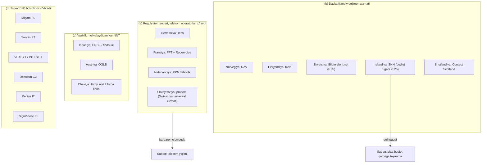

# 03c. Yevropa: raqobatchilar va tajribalar

> **Manba fayllar:** `2_raqobat_va_ochiq_kod/region_europe.md` (asosiy), `2_raqobat_va_ochiq_kod/global_feature_matrix.md` (Yevropaga oid bandlar), qo'shimcha ravishda `1_birinchi_tadqiqot/global_apps_and_business_models.md`, `2_raqobat_va_ochiq_kod/open_source_clonable.md` va `2_raqobat_va_ochiq_kod/nonprofit_models_funding.md` dagi Yevropaga oid faktlar. **Sana:** 2026-11-15.
>
> **Belgilar:** har bir fakt yonida manba havolasi bor. "Nimani olamiz / Nimadan qochamiz" bandlari va "Saboqlar" bo'limi tadqiqot yozuvlaridagi xulosalarga (Inferences) yoki muallif fikriga asoslangan: ular fakt emas, **baho / tasdiqlanmagan** deb o'qilsin. "ma'lumot yo'q" = yozuvlarda bu haqda hech narsa yo'q.

## Qisqacha

- **EU qonuni relay, Total Conversation (TC) va RTT ni "mavjud va arzon" qilishni talab qiladi**, ammo 24/7 majburiyati va yagona sifat standarti yo'q. Natijada har mamlakatda boshqacha holat: video relay (VRS) 30 mamlakatdan 25 tasida bor, lekin faqat 8 tasida 24/7 ([netzwoche](https://www.netzwoche.ch/news/2026-10-16/schweiz-ermoeglicht-gehoerlosen-telefonate-rund-um-die-uhr-aber-nicht-per-video)).
- **Uchta ishlash modeli ustun:** (a) regulyator tender o'tkazadi, telekom operatorlar to'laydi (Germaniya Tess, Fransiya FFT + Rogervoice, Niderlandiya KPN Teletolk, Shveytsariya procom); (b) davlat ijtimoiy tarjimon xizmati (Norvegiya NAV, Finlyandiya Kela, Shvetsiya Bildtelefoni.net, Islandiya SHH); (c) vazirlik moliyalaydigan kar NNT xizmati (Ispaniya SVIsual, Avstriya OGLB, Chexiya Ticha linka) ([BNetzA](https://www.bundesnetzagentur.de/1052216); [NAV](https://www.nav.no/no/nav-og-samfunn/statistikk/flere-statistikkomrader/tolking-for-dovblinde-og-horselshemmede); [CNSE](https://fundacioncnse.org/pdf/memoria-2025.pdf)).
- **Telekom yig'imi bilan moliyalangan relay barqaror o'smoqda, budjet qatoridagi xizmatlar puli tugaydi:** Islandiyada 2025-yil 24-31-mart video relay pul tugagani uchun yopildi ([SHH](https://island.is/s/shh/frett/lokad-fyrir-endurgjaldslausa-tulkathjonustu-ut-mars)).
- **Fransiya ARCEP har chorakda ochiq KPI e'lon qiladi:** LSF (fransuz imo-ishora tili) qo'ng'irog'iga 3 daqiqada javob 24% dan 71% gacha o'sdi; avtomatik transkripsiya foydalanuvchilari +50,6%, inson matn relaysi qisqarmoqda ([ARCEP](https://www.arcep.fr/fileadmin/user_upload/observatoire/indicateurs-accessibilite/t4-2024/indicateurs-accessibilite-T4-2024_avril2025.pdf)).
- **EU o'n millionlab yevro sarflagan imo-ishora MT loyihalari (SignON, EASIER, Content4All, SiMAX) xizmatga aylanmadi**; yagona foydali ochiq kod: SignON ning 29 ta Apache-2.0 reposi, 2024 dan beri muzlagan ([github.com/signon-project](https://github.com/signon-project)). Nemis kar tashkilotlari avatarlarga qarshi ([DGB 01/2024](https://dglb.de/wp-content/uploads/2024/05/01_2024-Pressemitteilung_Gebaerdensprach-Avatare.pdf)).
- **SOS uchun tayyor spetsifikatsiya:** Delegated Regulation (EU) 2023/444 ning 6 talabi: ikki tomonlama, ro'yxatdan o'tmasdan, bepul, to'g'ri PSAP ga, teng joylashuv aniqligi, ommaga e'lon ([EUD hisoboti](https://eud.eu/wp-content/uploads/2025/06/Report-on-the-implementation-of-the-European-Electronic-Communications-Code.pdf)).

## Umumiy jadval

Qisqartmalar: **VRS** = video relay (masofaviy tarjimon orqali telefon qo'ng'irog'i); **VRI** = masofaviy video tarjima (bir xonadagi suhbat yoki tashkilot bilan aloqa); **TRS** = matnli relay; **RTT** = real vaqt matni; **TC** = Total Conversation (video + matn + ovoz); **STT** = nutqdan matnga; **AAC** = muqobil kommunikatsiya.

| # | Mahsulot | Mamlakat | Turi | Kim to'laydi | AI / inson | Ochiq kod | Holat | Manba |
|---|---|---|---|---|---|---|---|---|
| 1 | Tess (Sign & Script Relay-Dienste) | Germaniya | VRS + TRS + yozma tarjima | Telefon operatorlari (bozor ulushiga ko'ra) | Inson | Yo'q (ma'lumot yo'q) | Faol, 2029-mart oxirigacha | [BNetzA](https://www.bundesnetzagentur.de/1052216) |
| 2 | AVASAG / Charamel avatar to'plami | Germaniya | Avatar (DGS) | BMBF grant (74%), keyin munitsipalitetlar | AI avatar | Yo'q (tijorat) | Tijorat mahsulotiga aylandi | [it-daily](https://www.it-daily.net/?p=19147) |
| 3 | alangu | Germaniya | Avatar | ma'lumot yo'q | AI avatar | ma'lumot yo'q | DGB tanqidi (2025) | [DGB 01/2025](https://gehoerlosenbund.de/wp-content/uploads/2025/10/Pressemitteilung-01_2025-Gut-gebruellt-Loewen.docx.pdf) |
| 4 | Boehringer Ingelheim qadoq varaqasi avatari | Germaniya | Avatar (statik kontent) | Kompaniya | AI avatar | ma'lumot yo'q | 2021 dan beri | [drweb](https://www.drweb.de/gebaerdensprach-avatar-packungsbeilage-ki/) |
| 5 | nora | Germaniya | SOS (pictogramma, jim chaqiruv) | Davlat (federal yerlar) | Inson operator | Yo'q | Faol | [nora](https://www.nora-notruf.de/google-play-store) |
| 6 | SignDict | Germaniya | Lug'at (kraudsorsing) | ma'lumot yo'q | Inson video | Ha, MPL-2.0 | Faol (push 2026-11-14) | [signdict/website](https://github.com/signdict/website) |
| 7 | Bezirk Schwaben avatari | Germaniya | Avatar | ma'lumot yo'q | AI avatar | ma'lumot yo'q | Tasdiqlanmagan (faqat sarlavha) | [sonntagsblatt](https://sonntagsblatt.de/artikel/epd/bezirk-schwaben-startet-gebaerdensprach-avatar) |
| 8 | SLAIT / SLAIT School | Ispaniya / Germaniya | Tanish (avval) -> o'rganish (ASL) | Investorlar (~$120K) | AI | ma'lumot yo'q | Tarjima mahsuloti o'lik, o'qitishga burildi | [TechCrunch 2023](https://techcrunch.com/2023/05/11/slait-pivots-from-translating-sign-language-to-ai-powered-interactive-lessons/amp/) |
| 9 | OGLB Relay Service (OGS.barrierefrei) | Avstriya | VRS | NNT (davlat qisqartirishlariga qarshi kurash) | Inson | ma'lumot yo'q | Faol, dam olish kunlari yopiq | [OGLB 12/2025](https://www.oeglb.at/wp-content/uploads/2025/12/GebaerdenSache-12_2025.pdf) |
| 10 | Gebardenwelt.tv | Avstriya | Yangiliklar portali (OGS) | OGLB | Inson | ma'lumot yo'q | Faol | [OGLB 12/2025](https://www.oeglb.at/wp-content/uploads/2025/12/GebaerdenSache-12_2025.pdf) |
| 11 | SiMAX (SignTime GmbH) | Avstriya | Avatar (yarim avtomatik) | H2020 SME (~1,09 mln EUR) | AI + kar tuzatuvchi | Yo'q | Uyqu holati / noma'lum | [CORDIS 778421](https://www.cordis.europa.eu/project/id/778421) |
| 12 | HandsUp kutubxonasi | Avstriya | Avatar video kutubxonasi (1 600+ OGS) | ma'lumot yo'q | Avatar | Erkin qayta foydalanish | ma'lumot yo'q | [kulturpool](https://kulturpool.at/en/content/equalizent) |
| 13 | Lingvano | Avstriya | O'rganish (ASL va b.) | Foydalanuvchi (obuna) | Inson (kar o'qituvchilar) | Yo'q | Faol, 3 mln+ | [Apple Developer](https://developer.apple.com/articles/lingvano) |
| 14 | DEC112 | Avstriya | SOS (matnli chat) | Bepul | Inson operator | Kutubxonalar AGPL/GPL/MIT; ilova reposi arxivda | Faol (2019 dan) | [DEC112 App Store](https://apps.apple.com/us/app/-/id1494002697) |
| 15 | procom myPROCOM | Shveytsariya | TRS (24/7) | Telekom universal xizmati (Swisscom) | Inson | ma'lumot yo'q | Faol | [netzwoche](https://www.netzwoche.ch/news/2026-10-16/schweiz-ermoeglicht-gehoerlosen-telefonate-rund-um-die-uhr-aber-nicht-per-video) |
| 16 | procom VideoCom | Shveytsariya | VRS | Telekom universal xizmati | Inson | ma'lumot yo'q | Faol, 24/7 emas, 30 daq cheklov | [netzwoche](https://www.netzwoche.ch/news/2026-10-16/schweiz-ermoeglicht-gehoerlosen-telefonate-rund-um-die-uhr-aber-nicht-per-video) |
| 17 | SWISS TXT (EASIER hamkori) | Shveytsariya | Tadqiqot | EU H2020 | AI | ma'lumot yo'q | Loyiha yopilgan | [swisstxt](https://swisstxt.ch/en/swiss-txt/research-projects/easier) |
| 18 | FFT umumiy relay (Rogervoice) | Fransiya | VRS + TRS (LSF, TTA, TTH, LPC) | Telekom operatorlar (qonun) | Inson + AI | Yo'q | Faol, 2026-10-01 dan 24/7 | [ARCEP](https://www.arcep.fr/fileadmin/user_upload/observatoire/indicateurs-accessibilite/t4-2024/indicateurs-accessibilite-T4-2024_avril2025.pdf) |
| 19 | RogerVoice ilovasi | Fransiya | STT qo'ng'iroq subtitri | Freemium (foydalanuvchi) + AQShda FCC | AI (+ inson "copilot") | Yo'q | Faol | [App Store](https://apps.apple.com/us/app/rogervoice-phone-call-captions/id1033113354) |
| 20 | AccesSourd (Acceo, Deafi, Elioz, Sourdline) | Fransiya | B2B relay / VRI | Kompaniyalar (B2B) | Inson | ma'lumot yo'q | Kollektiv 2021-okt | [handicap.fr](https://informations.handicap.fr/a-accessourd-collectif-pour-accessibilite-telephonique-31595.php) |
| 21 | Lingua Libre / SignIt | Fransiya | Lug'at (LSF video, brauzer qo'shimchasi) | Volontyorlar, Wikimedia France | Inson video | Ha (kod MIT, kontent CC BY-SA 4.0) | Faol (2024-2025 chaqiruv) | [Meta: SignIt](https://meta.wikimedia.org/wiki/SignIt) |
| 22 | CAB (Vlaams Communicatie-Assistentie-Bureau) | Belgiya | Tarjimon dispetcherligi + VRI loyihasi | Hukumat bilan bog'liq notijorat | Inson | ma'lumot yo'q | Faol | [vlaanderen.be](https://www.vlaanderen.be/organisaties/vlaams-communicatie-assistentie-bureau-voor-doven) |
| 23 | 112 BE ilovasi (AI funksiya) | Belgiya | SOS | Davlat | AI (e'lon) | ma'lumot yo'q | E'lon qilingan | [Brussels Times](https://brusselstimes.com/1502102/belgium-launches-ai-application-in-emergency-app-for-deaf-people) |
| 24 | Charleroi "Relais-Signes" | Belgiya | VRI (shahar xizmati) | Shahar | Inson | ma'lumot yo'q | ma'lumot yo'q | [Govlaunch](https://govlaunch.com/projects/charleroi-wht-utilizes-the-relais-signes-system-to-accommodate-deaf-people-using-city-services) |
| 25 | KPN Teletolk (Tolkcontact ilovasi) | Niderlandiya | VRS + TRS + 112 tugmasi | Iqtisodiyot vazirligi tayinlagan (bepul) | Inson | Yo'q | Faol, 2028-okt gacha | [KPN](https://www.kpn.com/overons/nieuws/en/kpn-teletolk-will-continue-to-connect-deaf-and-hearing-impaired-people-with-society/) |
| 26 | GnoSys (Evalk) | Niderlandiya | Tanish (sign -> nutq) | ma'lumot yo'q | AI | ma'lumot yo'q | Mustaqil dalil yo'q | [The Quint/PTI](https://www.thequint.com/pti/new-ai-app-for-deaf-translates-sign-language-into-speech-in-real-time) |
| 27 | Global Signbank (NGT-, FinSL-, BSL-signbank) | Yevropa (Signbank oilasi) | Lug'at bazasi | Tadqiqot grantlari (tekshirilmagan) | Inson video | Ha, BSD-3 | Faol (push 2026-11-13) | [Global-signbank](https://github.com/Signbank/Global-signbank) |
| 28 | NAV tolketjenesten + Bildetolk | Norvegiya | Tarjimon xizmati + VRS | Davlat (ijtimoiy ta'minot) | Inson | Yo'q | Faol | [NAV](https://www.nav.no/no/nav-og-samfunn/statistikk/flere-statistikkomrader/tolking-for-dovblinde-og-horselshemmede) |
| 29 | Bildtelefoni.net | Shvetsiya | VRS | Davlat (PTS xaridi) | Inson | Yo'q | Faol, yangi xarid 2025 | [PTS](https://kampanj2.regionorebrolan.se/siteassets/filer/konferens/2025/pts.pdf) |
| 30 | Texttelefoni.se | Shvetsiya | TRS | Davlat (TED tender 2023) | Inson | Yo'q | ma'lumot yo'q | [TED](https://ted.europa.eu/en/notice/561346-2023/pdf) |
| 31 | nWise (t-meeting.se, Tolkdirekt SIP) | Shvetsiya | TC texnologiya sotuvchisi | Mijoz relaylar (KPN, NAV) | Texnologiya | ma'lumot yo'q | Faol | [nWise](https://nwise.se/kpn-teletolk-continues-to-bridge-the-communication-gap-for-deaf-and-hard-of-hearing-communities/) |
| 32 | Spreadthesign | Shvetsiya (European Sign Language Centre) | Ko'p tilli lug'at | EU loyiha grantlari | Inson video | Yo'q (ochiq kod topilmadi) | Faol | [Spreadthesign](https://spreadthesign.com/en.us/about/) |
| 33 | Kela Vammaisten tulkkauspalvelu | Finlyandiya | Tarjimon xizmati + VRI | Davlat | Inson | Yo'q | Faol, yangi tizim 2027 | [Kela](https://www.kela.fi/ajankohtaista/vammaisten-tulkkauspalvelukeskuksen-etapalvelu-uudistuu-jatkossa-kirjautuminen-tapahtuu-vahvasti-tunnistautuneena) |
| 34 | DNTM / ViTolker | Daniya | Tarjimon ruxsati / VRI bron | Davlat | Inson | Yo'q | 24/7 VRS tasdiqlanmagan | [borger.dk](https://www.borger.dk/handicap/hjaelp-i-hverdagen/tolkning-for-personer-med-hoerehandicap) |
| 35 | SHH (fjartulkun, myndsimatulkun) | Islandiya | VRI + VRS | Davlat budjeti | Inson | Yo'q | 2025-mart pul tugab yopilgan | [SHH](https://island.is/s/shh/frett/lokad-fyrir-endurgjaldslausa-tulkathjonustu-ut-mars) |
| 36 | SVIsual (Fundacion CNSE) | Ispaniya | VRS + chat, 24/7 kanal | Vazirlik + NNT; B2B (Cestel) | Inson | Yo'q | Faol | [CNSE memoria 2025](https://fundacioncnse.org/pdf/memoria-2025.pdf) |
| 37 | Serviin | Portugaliya | VRI (LGP) B2B/B2G | Tashkilotlar | Inson | Yo'q | Faol | [Portal das Financas](https://info.portaldasfinancas.gov.pt/pt/apoio_contribuinte/Pages/at-atendimento-cidadaos-surdos.aspx) |
| 38 | SNS24 LGP video | Portugaliya | VRI (sog'liqni saqlash) | Davlat | Inson (6 tarjimon) | Yo'q | 24/7 | [portugal.gov.pt](https://portugal.gov.pt/gc22/comunicacao/noticias/lingua-gestual-portuguesa-disponivel-para-cidadaos-surdos-atraves-do-sns24) |
| 39 | Telefono Ponte (CESB) | Italiya | TRS (DTS qurilmalari) | Homiylar, jumladan Bosh vazir idorasi | Inson | ma'lumot yo'q | Faol | [disabili.com](https://www.disabili.com/prodotti/sp-29171/) |
| 40 | Abruzzo favqulodda relay | Italiya | SOS relay (DTS, video chat, SMS) | Mintaqa | Inson | ma'lumot yo'q | ma'lumot yo'q | [disabili.com](https://www.disabili.com/ultimora/in-abruzzo-il-tele-soccorso-per-sordi-col-sistema-ponte/) |
| 41 | Pedius | Italiya | STT/TTS qo'ng'iroq | B2B (AXA, BNL) | AI | Yo'q | 2025 holati noma'lum | [economyup](https://www.economyup.it/startup/pedius-la-startup-che-fa-telefonare-i-sordi-nata-guardando-le-iene/) |
| 42 | VEASYT Live! / INTESI | Italiya | VRI (LIS + 15 til) + transkripsiya | Munitsipalitetlar, B2B | Inson + STT | Yo'q | Faol (INTESI 2026) | [App Store INTESI](https://apps.apple.com/it/app/intesi/id6758286094) |
| 43 | Migam | Polsha | VRI (PJM), brauzerda | Tashkilotlar (2 000+) | Inson | Yo'q | Faol | [migam.org](https://migam.org/en/) |
| 44 | Politsiya onlayn tarjimoni | Polsha | VRI | Davlat | Inson | Yo'q | Faol | [policja.gov.pl](https://olsztyn.bip.policja.gov.pl/306/zapewnienie-dostepnosci/43762,Usluga-bezplatnego-tlumacza-PJM-SJM-SKOGN.pdf) |
| 45 | Ticha linka (Tichy svet) | Chexiya | VRI + transkripsiya, 24/7 (tunda faqat SOS) | NNT, Ichki ishlar vazirligi targ'iboti | Inson | Yo'q | Faol | [MV CR](https://mv.gov.cz/soubor/letak-ticha-linka.aspx) |
| 46 | Deafcom | Chexiya | VRI vositachilik dasturi | ma'lumot yo'q | Inson | Yo'q | Faol (ish kunlari 9-17) | [businessinfo.cz](https://www.businessinfo.cz/clanky/cesky-startup-digitalizuje-znakove-tlumoceni-sluzba-pomuze-milionum-neslysicich/) |
| 47 | Ceska sporitelna "Tiche spojeni" | Chexiya | Bank tarjima/transkripsiya liniyasi | Bank | Inson | Yo'q | ma'lumot yo'q | [finance.cz](https://www.finance.cz/clanky/491771-neslysici-tiche-spojeni/) |
| 48 | KONTAKT | Vengriya | VRI | ma'lumot yo'q (operator tasdiqlanmagan) | Inson | ma'lumot yo'q | AccessibleEU ro'yxatida | [AccessibleEU](https://accessible-eu-centre.ec.europa.eu/kontakt-online-sign-language-interpretation-service-hungary_en) |
| 49 | SignAll / Ace ASL | Vengriya / AQSh | Daktil tanish (o'rganish) | Freemium; investorlar ($3,6 mln) | AI | Yo'q | Ehtimol uyqu holatida | [BusinessWire](https://www.businesswire.com/news/home/20210401005516/en/SignAll-Launches-Ace-ASL-App-AI-Will-Help-to-Learn-Sign-Language) |
| 50 | AADE pilot ilovasi (Evenly) | Gretsiya | VRI + subtitr (soliq idorasi) | Davlat | Inson + subtitr | ma'lumot yo'q | Pilot 2025-iyun | [AADE](https://www.aade.gr/sites/default/files/2025-06/pilot_app_deaf_hard-of-hearin_foreign-language-speaking_citizens_manual.pdf) |
| 51 | IRIS (SLIS) | Irlandiya | VRI + "remote relay" | ma'lumot yo'q | Inson | Yo'q | Faol | [SLIS 2021](https://www.citizensinformationboard.ie/downloads/cib/SLIS_Annual_Report_2021.pdf) |
| 52 | Irish Text Relay Service (ITRS) | Irlandiya | TRS | ma'lumot yo'q (ComReg nazorati) | Inson | Yo'q | Faol, kichik hajm | [ComReg](https://www.comreg.ie/publication-download/text-relay-service-take-up-and-usage-statistics-january-to-december-2024) |
| 53 | 112 Ireland RTT (Vodafone) | Irlandiya | SOS (native RTT) | Bepul | Inson operator | n/a | Faol 2025 | [112.ie](https://112.ie/realtimetext/) |
| 54 | SignVideo | Buyuk Britaniya | VRS/VRI, SignDirectory | Tashkilot obunasi (foydalanuvchiga bepul) | Inson | Yo'q | Faol (Sorenson oilasi) | [SignVideo](https://signvideo.co.uk/download/) |
| 55 | Contact Scotland BSL | Buyuk Britaniya (Shotlandiya) | VRS 24/7 | Shotlandiya hukumati | Inson | Yo'q | Faol; provayder ziddiyati | [Contact Scotland](https://contactscotland-bsl.org/faqs/) |
| 56 | 999 BSL (SLI) | Buyuk Britaniya | SOS video relay | Ofcom talabi | Inson | Yo'q | 2022-06-17 dan | [Southampton AIS](https://ais.southampton.ac.uk/emergency-video-relay-bsl-2022/) |
| 57 | InterpretersLive! | Buyuk Britaniya | VRI | Ro'yxatdan o'tgan tashkilot | Inson | Yo'q | ma'lumot yo'q | [App Store](https://apps.apple.com/cy/app/interpreters-live/id1552367696) |
| 58 | Signly | Buyuk Britaniya | Oldindan yozilgan BSL video (veb, bosma) | Sayt egasi | Inson | Yo'q | Faol | [Signly FAQ](https://preview.signly.co/faqs/) |
| 59 | Signapse | Buyuk Britaniya | AI fotorealistik signer (BSL, ASL, DGS) | B2B/B2G; seed GBP 2 mln | AI | Yo'q | Faol | [Signapse ASL](https://signapse.ai/post/introducing-asl-sign-language-translator) |
| 60 | iBSL | Buyuk Britaniya | Onlayn BSL o'rganish | Foydalanuvchi | Inson | Yo'q | **O'lik (2023)** | [Limping Chicken](https://limpingchicken.com/2023/03/07/ibsl-shares-open-letter-detailing-plans-for-current-learners-as-it-confirms-closure-in-next-couple-of-months/) |
| 61 | Sign BSL | Buyuk Britaniya | Milliy lug'at | ma'lumot yo'q | Inson video | ma'lumot yo'q | ma'lumot yo'q | [HearingTracker](https://www.hearingtracker.com/apps/asl-bloom) |
| 62 | JASigning / CWASA (UEA) | Buyuk Britaniya | Avatar (SiGML/HamNoSys) | Litsenziya (tijorat moslash kelishuv bilan) | Avatar | Litsenziya noaniq (BY-SA / BY-NC-ND) | Faol (vhg2025a) | [UEA Conditions](https://vh.cmp.uea.ac.uk/index.php/JASigning_Conditions) |
| 63 | Kaugtolke rakendus | Estoniya | VRI ilova | Davlat (ma'lumot yo'q) | Inson | ma'lumot yo'q | 2024-noyabrdan | [AccessibleEU](https://accessible-eu-centre.ec.europa.eu/estonias-remote-sign-language-interpretation-app-kaugtolke-rakendus_en) |
| 64 | Tartu universiteti avatar "robot" | Estoniya | Avatar prototipi | Universitet | AI avatar | ma'lumot yo'q | Prototip boshlangan | [UT](https://cs.ut.ee/en/news/development-estonias-first-sign-language-interpreter-robot-begins) |
| 65 | 112 Lietuva ilovasi | Litva | SOS | ma'lumot yo'q | ma'lumot yo'q | ma'lumot yo'q | ma'lumot yo'q | [Lexita](https://www.lexita.lt/en/projects/mobile-app-112-lietuva) |
| 66 | Engelsiz 112 | Turkiya | SOS video (imo-ishora biluvchi operator) | Davlat (Ichki ishlar vazirligi) | Inson | Yo'q | Faol | [Paratic](https://paratic.com/cimer-engellerini-kaldirdi-fahrettin-altun-mujdeledi/) |
| 67 | AILEM Engelsiz Iletisim Merkezi | Turkiya | Tarjima markazi (qo'ng'iroqlar) | Davlat (Oila vazirligi) | Inson | Yo'q | Faol | [aile.gov.tr](https://aile.gov.tr/manisa/haberler/ailem-isitme-engelliler-engelsiz-iletisim-merkezi-268-bin-719-cagriya-ceviri-destegi-sagladi/) |
| 68 | SignON | EU (H2020) | Tanish + MT + avatar (tadqiqot) | EU grant (~5,6 mln EUR) | AI | Ha, 29 repo Apache-2.0 (bittasi GPL-3.0) | Tugagan, kod muzlagan | [CORDIS](https://cordis.europa.eu/project/id/101017255) |
| 69 | EASIER ("Paula" avatari) | EU (H2020) | MT + tanish + avatar | EU grant | AI | Tasdiqlanmagan | Yopilgan 2024-02-29 | [CORDIS](https://cordis.europa.eu/project/id/101016982/reporting) |
| 70 | Content4All | EU (H2020) | Virtual signer (inson boshqaradi) | EU grant | Inson + 3D | ma'lumot yo'q | Tugagan 2020, efirda ishlatilmagan | [CORDIS](https://cordis.europa.eu/project/id/762021) |
| 71 | REACH112 | EU | 112 ga TC (tadqiqot) | EU | - | ma'lumot yo'q | 2009-2012, joriy etilmagan | [EUD](https://eud.eu/wp-content/uploads/2025/06/Report-on-the-implementation-of-the-European-Electronic-Communications-Code.pdf) |
| 72 | NEXES | EU (H2020) | Keyingi avlod favqulodda aloqa | EU | - | ma'lumot yo'q | Bo'shliqlar qolgan | [EUD](https://eud.eu/wp-content/uploads/2025/06/Report-on-the-implementation-of-the-European-Electronic-Communications-Code.pdf) |
| 73 | Dicta-Sign | EU (FP7, 2009-2012) | Tadqiqot | EU | AI | Saqlangan kod topilmadi | Tugagan | [CORDIS D3.3](https://cordis.europa.eu/docs/projects/cnect/5/231135/080/deliverables/001-DICTASIGNDeliverableD33Ares2012696081.pdf) |
| 74 | Slovakiya kar ma'lumot tarifi (23 EUR/oy) | Slovakiya | Telekom tarif | Foydalanuvchi (qat'iy narx) | - | - | Faol | [EUD](https://eud.eu/wp-content/uploads/2025/06/Report-on-the-implementation-of-the-European-Electronic-Communications-Code.pdf) |
| 75 | Apple SignTime (BSL, LSF) | Buyuk Britaniya, Fransiya (Apple xizmati) | VRI (AppleCare, do'kon) | Apple | Inson | Yo'q | Faol | [MobiHealthNews](https://www.mobihealthnews.com/news/apple-releases-new-tools-meet-needs-folks-mobility-hearing-and-cognitive-disabilities) |

Model tasnifi `region_europe.md` 3-bo'limidan; asosiy manbalar: [BNetzA](https://www.bundesnetzagentur.de/1052216), [KPN](https://www.kpn.com/overons/nieuws/en/kpn-teletolk-will-continue-to-connect-deaf-and-hearing-impaired-people-with-society/), [NAV](https://www.nav.no/no/nav-og-samfunn/statistikk/flere-statistikkomrader/tolking-for-dovblinde-og-horselshemmede), [SHH](https://island.is/s/shh/frett/lokad-fyrir-endurgjaldslausa-tulkathjonustu-ut-mars), [CNSE](https://fundacioncnse.org/pdf/memoria-2025.pdf). "Barqaror / pul tugadi" xulosasi tadqiqotchi xulosasi (baho).

---

## EU darajasidagi kontekst (qonun, standart, umumiy statistika)

### EU huquqiy asosi

| Hujjat | Nima talab qiladi | Muddat / zaiflik | Manba |
|---|---|---|---|
| EECC 85(4)-modda | TC va relay kabi "teng kirish" uskuna va xizmatlarini mavjud va arzon qilish | 24/7 majburiyati yo'q | [EUD hisoboti, 2025-iyun](https://eud.eu/wp-content/uploads/2025/06/Report-on-the-implementation-of-the-European-Electronic-Communications-Code.pdf) |
| EECC Recital 226 | Relay narxi foydalanuvchi uchun o'rtacha ovozli qo'ng'iroq narxiga teng | - | [EUD](https://eud.eu/wp-content/uploads/2025/06/Report-on-the-implementation-of-the-European-Electronic-Communications-Code.pdf) |
| EECC Recital 227 | RTT va relay ta'rifi ("rejimlar orasida o'girish ... odatda inson operator") | - | [EUD](https://eud.eu/wp-content/uploads/2025/06/Report-on-the-implementation-of-the-European-Electronic-Communications-Code.pdf) |
| EAA 4.3, 31.2-moddalar | Ovoz bilan birga RTT, video bo'lsa TC | **2025-06-28** gacha ishlashi kerak edi | [EUD](https://eud.eu/wp-content/uploads/2025/06/Report-on-the-implementation-of-the-European-Electronic-Communications-Code.pdf) |
| EAA 4.8, 31.3-moddalar | 112 RTT ni, video bo'lsa TC ni qabul qilishi | **2027-06-28** gacha; TC faqat "video taqdim etilsa" (RTT dan zaif) | [EUD](https://eud.eu/wp-content/uploads/2025/06/Report-on-the-implementation-of-the-European-Electronic-Communications-Code.pdf) |
| EAA (umumiy) | 2025-06-28 dan qo'llanadi; RTT/TC muddatini 2027-06-28 gacha cho'zish mumkin | Manbalar zid: qat'iy muddatmi yoki imkoniyatmi (EENA sahifalari farq qiladi) | [EENA](https://eena.org/news/european-accessibility-act-begins-applying-across-the-eu/); [EENA RTT](https://eena.org/?p=33066) |
| EAA Recital 45 | Uchinchi tomon relay kar qo'ng'iroq qiluvchi va PSAP orasida turishi mumkin, lekin faqat *vaqtincha* | PSAP lar RTT/TC ni o'zi qabul qilguncha | [EUD](https://eud.eu/wp-content/uploads/2025/06/Report-on-the-implementation-of-the-European-Electronic-Communications-Code.pdf) |
| Delegated Reg. (EU) 2023/444 | 112 uchun funksional ekvivalentlik (6 talab, quyida) | Faqat 112, milliy raqamlar emas; mobil ilova interoperabellik vositasi sifatida ruxsat (Recital 16) | [EUD](https://eud.eu/wp-content/uploads/2025/06/Report-on-the-implementation-of-the-European-Electronic-Communications-Code.pdf) |
| EECC 96-modda | Yo'qolgan bolalar liniyasi (116000) foydalanish mumkin bo'lsin | Deyarli hech qaysi davlat 116000 ni imo-ishora tilida bermaydi; Ispaniyada faqat VRS orqali | [EUD](https://eud.eu/wp-content/uploads/2025/06/Report-on-the-implementation-of-the-European-Electronic-Communications-Code.pdf) |
| Digital Networks Act (rejada) | EUD va EFHOH: 24/7 relay, bepul va cheksiz qo'ng'iroq, ishonchli favqulodda aloqa majburiy standart bo'lsin | Taklif holati (sana, moddalar) tasdiqlanmagan | [netzwoche](https://www.netzwoche.ch/news/2026-10-16/schweiz-ermoeglicht-gehoerlosen-telefonate-rund-um-die-uhr-aber-nicht-per-video); [EUD/EFHOH BEREC](https://www.berec.europa.eu/system/files/2026-06/3.%20EUD-EFHOH.pdf) |

**Delegated Regulation 2023/444 ning 6 talabi** (kar foydalanuvchiga qo'llanganda) ([EUD](https://eud.eu/wp-content/uploads/2025/06/Report-on-the-implementation-of-the-European-Electronic-Communications-Code.pdf)):

| # | Talab |
|---|---|
| 1 | Ikki tomonlama va interaktiv |
| 2 | Oldindan ro'yxatdan o'tmasdan, rouming paytida ham |
| 3 | Bepul |
| 4 | Kechiktirmasdan to'g'ri PSAP (favqulodda qo'ng'iroqqa javob nuqtasi) ga yo'naltirilgan |
| 5 | Teng joylashuv aniqligi |
| 6 | Ommaga e'lon qilingan |

### 112 ga RTT va TC: hozirgi holat

| Ko'rsatkich | Qiymat | Manba |
|---|---|---|
| EENA yaxshi amaliyot mamlakatlari (matn/RTT orqali 112) | Avstriya, Fransiya, Germaniya, Niderlandiya, Ruminiya, Ispaniya, Shvetsiya | [EUD, COM(2024)575 iqtibosi](https://eud.eu/wp-content/uploads/2025/06/Report-on-the-implementation-of-the-European-Electronic-Communications-Code.pdf) |
| 2025-2027 da RTT ga qodir PSAP va'da qilgan davlatlar (COM(2024) 575) | AT, BE, BG, CZ, DK, EE, EL, FI, HR, IE, LT, MT (ilova ichida), NL (ilova ichida), PL, PT, RO, SE, SI | [EUD](https://eud.eu/wp-content/uploads/2025/06/Report-on-the-implementation-of-the-European-Electronic-Communications-Code.pdf) |
| BEREC (2022): TC xizmati haqida xabar bergan davlatlar | 9 ta a'zo davlat | [EUD](https://eud.eu/wp-content/uploads/2025/06/Report-on-the-implementation-of-the-European-Electronic-Communications-Code.pdf) |
| EENA 2023: 112 ga to'g'ridan-to'g'ri TC (REACH112 ta'rifi bo'yicha) | **Hech qaysi mamlakatda yo'q** | [EUD](https://eud.eu/wp-content/uploads/2025/06/Report-on-the-implementation-of-the-European-Electronic-Communications-Code.pdf) |
| Irlandiya | 112 ga native RTT bergan birinchi EU davlati (2025) | [112.ie](https://112.ie/realtimetext/); [EENA Ireland](https://eena.org/document/real-time-text-in-ireland) |
| EFHOH | 112 kirish imkoniyatida cheklangan o'zgarish | [EFHOH](https://efhoh.org/wp-content/uploads/2025/12/The-European-Accessibility-Act-from-Consultation-to-Implementation-Hard-of-Hearing-Perspective-5_compressed.pdf) |
| EENA accessibility report card | 2026-fevral | [EENA](https://eena.org/wp-content/uploads/2026/02/Accessibility-report-card-abstract.pdf) |
| Chegaralararo | PEMEA tufayli ba'zi milliy SOS ilovalari o'zaro ishlaydi; EN 303 919 uyg'unlashtirilgan standarti hali ishlab chiqilmoqda | [EUD](https://eud.eu/wp-content/uploads/2025/06/Report-on-the-implementation-of-the-European-Electronic-Communications-Code.pdf) |
| Chegaralararo misol | Fransiyadagi xorvat kar mehmonda 112 ga imo-ishora yo'li yo'q: Xorvatiyada VRS yo'q, Fransiya PSAP faqat LSF da ishlaydi | [EUD](https://eud.eu/wp-content/uploads/2025/06/Report-on-the-implementation-of-the-European-Electronic-Communications-Code.pdf) |

### Relay sifati va keng polosali internet

| Ko'rsatkich | Qiymat | Manba |
|---|---|---|
| Relay uchun sifat talablari (javob vaqti, statistika) qo'ygan davlatlar | Faqat **6** a'zo davlat | [EUD, BEREC BoR (22) 172](https://eud.eu/wp-content/uploads/2025/06/Report-on-the-implementation-of-the-European-Electronic-Communications-Code.pdf) |
| Mos yozuvli standart | ETSI ES 202 975 (relay xizmatlari uchun inson omili talablari) | [ETSI](https://www.etsi.org/deliver/etsi_es/202900_202999/202975/02.01.01_60/es_202975v020101p.pdf) |
| Keng polosali universal xizmat majburiyati | 29 davlatdan faqat 10 tasida | [EUD](https://eud.eu/wp-content/uploads/2025/06/Report-on-the-implementation-of-the-European-Electronic-Communications-Code.pdf) |
| Nogironlar uchun bepul yoki chegirmali internet | CY, EL, HU, SI, PT | [EUD](https://eud.eu/wp-content/uploads/2025/06/Report-on-the-implementation-of-the-European-Electronic-Communications-Code.pdf) |
| Video sifati talabi | FI (Finlyandiya) | [EUD](https://eud.eu/wp-content/uploads/2025/06/Report-on-the-implementation-of-the-European-Electronic-Communications-Code.pdf) |
| Slovakiya | Operatorlar karlar uchun qat'iy narxli "hammasi kiritilgan" ma'lumot tarifini sotadi: **23 EUR/oy**, EU rouming cheklovisiz | [EUD](https://eud.eu/wp-content/uploads/2025/06/Report-on-the-implementation-of-the-European-Electronic-Communications-Code.pdf) |

### Umumyevropa relay surati (EUD/EFHOH 2026 so'rovi; EUD 2025 maslahati)

| Ko'rsatkich | Qiymat | Manba |
|---|---|---|
| "Mapping Relay Services in Europe" so'rovi | 2026-04-08 dan 05-22 gacha; 30 mamlakatdan 51 javob | [netzwoche, 2026-10-16](https://www.netzwoche.ch/news/2026-10-16/schweiz-ermoeglicht-gehoerlosen-telefonate-rund-um-die-uhr-aber-nicht-per-video) |
| Video relay (VRS) | 25 mamlakatda; faqat 8 tasida 24/7 | [netzwoche](https://www.netzwoche.ch/news/2026-10-16/schweiz-ermoeglicht-gehoerlosen-telefonate-rund-um-die-uhr-aber-nicht-per-video) |
| Matnli relay (TRS) | 12 mamlakatda tasdiqlangan; 7 tasida 24/7 (Shveytsariya ham) | [netzwoche](https://www.netzwoche.ch/news/2026-10-16/schweiz-ermoeglicht-gehoerlosen-telefonate-rund-um-die-uhr-aber-nicht-per-video) |
| Qo'ng'iroq vaqti cheklovi (asosan VRS da) | 15 daq, 20-30 daq yoki oyiga cheklangan soat | [EUD-EFHOH slaydlari](https://www.berec.europa.eu/system/files/2026-06/3.%20EUD-EFHOH.pdf) |
| Navbat | Keng tarqalgan: 1-4 daq, ba'zan 5 daqdan ortiq | [EUD-EFHOH](https://www.berec.europa.eu/system/files/2026-06/3.%20EUD-EFHOH.pdf) |
| Interoperabellik / chegaralararo / 112 relay orqali | "Juda cheklangan" / "deyarli yo'q" / "cheklangan va nomuvofiq" | [EUD-EFHOH](https://www.berec.europa.eu/system/files/2026-06/3.%20EUD-EFHOH.pdf) |
| Narx | Ikkalasi (VRS, TRS) asosan foydalanuvchiga bepul | [EUD-EFHOH](https://www.berec.europa.eu/system/files/2026-06/3.%20EUD-EFHOH.pdf) |
| TRS moliya modellari | Davlat, telekom moliyalaydigan, NNT moliyalaydigan | [EUD-EFHOH](https://www.berec.europa.eu/system/files/2026-06/3.%20EUD-EFHOH.pdf) |
| Batafsil hisobot | 2026 yil oxirida kutilmoqda | [EUD-EFHOH](https://www.berec.europa.eu/system/files/2026-06/3.%20EUD-EFHOH.pdf) |
| EUD 2025-may: ko'p VRS ish ishlash vaqti | Ish kunlari kuniga 4-10 soat (masalan Slovakiya, Belgiya, Islandiya) | [EUD](https://eud.eu/wp-content/uploads/2025/06/Report-on-the-implementation-of-the-European-Electronic-Communications-Code.pdf) |
| "Kengroq qamrov" | Faqat Ispaniya, Fransiya, Germaniya, Shvetsiya | [EUD](https://eud.eu/wp-content/uploads/2025/06/Report-on-the-implementation-of-the-European-Electronic-Communications-Code.pdf) |
| VRS umuman yo'q | **Xorvatiya va Ruminiya** | [EUD](https://eud.eu/wp-content/uploads/2025/06/Report-on-the-implementation-of-the-European-Electronic-Communications-Code.pdf) |
| RTT yoki TC beruvchi relaylar | Ozchilik (masalan Fransiya, Niderlandiya); ko'pi ETSI talablariga javob bermaydi | [EUD](https://eud.eu/wp-content/uploads/2025/06/Report-on-the-implementation-of-the-European-Electronic-Communications-Code.pdf) |
| Ko'lam | EUD 31 mamlakat milliy kar assotsiatsiyalarini vakillik qiladi; EU/EEA da ~**1 mln** imo-ishora tili foydalanuvchisi | [EUD](https://eud.eu/wp-content/uploads/2025/06/Report-on-the-implementation-of-the-European-Electronic-Communications-Code.pdf) |

---

## Batafsil profillar

### Germaniya

#### Germaniya: mamlakat konteksti

| Mavzu | Fakt | Manba |
|---|---|---|
| Relay qonuniy asosi | Bundesnetzagentur (BNetzA) EU miqyosidagi tenderdan keyin relay xizmatini Tess ga 4 yilga topshirdi (2025-02-28, 2029-mart oxirigacha) | [BNetzA press](https://www.bundesnetzagentur.de/1052216) |
| Moliya | Telefon xizmati provayderlari xarajatni bozor ulushiga mutanosib bo'ladi | [BNetzA Vermittlungsdienst](https://bundesnetzagentur.de/DE/Fachthemen/Telekommunikation/Unternehmenspflichten/VermittlungsdienstfuerGehoerlose/start.html) |
| Hajm hisoboti | BNetzA ulanish daqiqalarini yig'adi; 2025 yil 2027 moliyalash uchun asos yil | [BNetzA (snippet)](https://bundesnetzagentur.de/DE/Vportal/TK/InternetTelefon/Vermittlungsdienst/start.html) |
| Kar jamoasining avatarlarga munosabati (2024-fevral) | Deutscher Gehorlosen-Bund (DGB) va boshqa tashkilotlar hozircha imo-ishora avatarlarini joriy etmaslikni "qat'iy maslahat beradi"; tarjimon o'rnini bosmaydi | [DGB PM 01/2024](https://dglb.de/wp-content/uploads/2024/05/01_2024-Pressemitteilung_Gebaerdensprach-Avatare.pdf); [pozitsiya hujjati 2024-yanvar](https://dglb.de/wp-content/uploads/2024/02/2024_01_24_Wichtige_Informationen_zum_Einsatz_von_Gebaerdensprach.pdf) |
| DGB 2025 (01/2025) | alangu startapini tanqid: avatarlar "faqat qisman tushunarli", o'qitish ma'lumoti kar jamoasidan ko'pincha adolatli haqsiz olingan; karlar reklama figurasi emas, teng hamkor bo'lsin | [DGB PM 01/2025](https://gehoerlosenbund.de/wp-content/uploads/2025/10/Pressemitteilung-01_2025-Gut-gebruellt-Loewen.docx.pdf) |
| Berlin qulaylik idorasi | Qonun bo'yicha majburiy ma'lumot avatar bilan tayyorlanishi **mumkin emas** | [berlin.de](https://www.berlin.de/lb/digitale-barrierefreiheit/anforderungen/gebaerdensprache/) |
| Deutsche Bahn | DB Navigator yoki stansiyalarda avatar joriy etilgani topilmadi; DB AI va yo'lovchi ma'lumoti sahifalari (2027 gacha 50 mln EUR) imo-ishorani tilga olmaydi | [DB AI](https://www.deutschebahn.com/de/ai); [deskmodder](https://www.deskmodder.de/blog/?p=214578) |
| Chalkash maqola | netzwoche (2025-10-27) "KI-Assistent fur Bahnreisende kommuniziert in Gebardensprache" sarlavhasi DB emas, Etihad Rail / Abu-Dabi haqida ko'rinadi | [netzwoche](https://www.netzwoche.ch/news/2025-10-27/ki-assistent-fuer-bahnreisende-kommuniziert-in-gebaerdensprache) |

#### Tess (Sign & Script Relay-Dienste GmbH)

| Maydon | Qiymat |
|---|---|
| Egasi | Tess - Sign & Script - Relay-Dienste GmbH; BNetzA tayinlagan ([BNetzA](https://www.bundesnetzagentur.de/1052216)) |
| Yil | 2009 dan foydalanish mumkin; qayta topshirish 2025-02-28, 2029-mart oxirigacha ([BNetzA](https://www.bundesnetzagentur.de/1052216)) |
| Platforma | ma'lumot yo'q |
| Yuklanma / reyting / foydalanuvchilar | ma'lumot yo'q (yillik daqiqa hajmi olinmagan) |
| Asosiy funksiyalar | DGS yoki yozma matn <-> og'zaki nemis tili, ikki yo'nalishda; so'rov bo'yicha Schriftdolmetschen (yozma tarjima) ([BNetzA](https://bundesnetzagentur.de/DE/Fachthemen/Telekommunikation/Unternehmenspflichten/VermittlungsdienstfuerGehoerlose/start.html)) |
| Kim to'laydi | Telefon operatorlari bozor ulushiga ko'ra. Shaxsiy bepul daqiqalar: 2025 da oyiga 30, 2028 gacha bosqichma-bosqich 60 ([BNetzA snippet](https://bundesnetzagentur.de/DE/Vportal/TK/InternetTelefon/Vermittlungsdienst/start.html)). Bepul daqiqadan keyin eski varaqa: shaxsiy qo'ng'iroq 0,14 EUR/daq; eshituvchi qo'ng'iroq qiluvchi statsionardan 14 sent/daq, mobildan 42 sent/daq gacha ([Uni Kassel, sanasiz](https://uni-kassel.de/uni/files/Studium/Kontakt-Beratung-Termine/Studium_Behinderung/Infoblatt_Telefon-Dolmetschdienst_Tess_74_.pdf)). 2018 da kar assotsiatsiyasi oyiga 5 EUR abonent to'lovi + 0,14-0,28 EUR/daq ni tanqid qilgan ([DGB 2018](https://dglb.de/wp-content/uploads/2024/01/dgb_stellungnahme_2018_06.pdf)). **Joriy tarif tasdiqlanmagan.** |
| AI yoki inson | Inson |
| Ochiq kod | ma'lumot yo'q |
| Holat | Faol |
| Manba | [BNetzA press](https://www.bundesnetzagentur.de/1052216); [BNetzA Vermittlungsdienst](https://bundesnetzagentur.de/DE/Fachthemen/Telekommunikation/Unternehmenspflichten/VermittlungsdienstfuerGehoerlose/start.html) |

**Nimani olamiz:** oylik bepul daqiqa kvotasi (30 -> 60); operatorlar bozor ulushiga ko'ra to'laydigan moliya formulasi; yillik daqiqa hisobotini keyingi yil budjetiga asos qilish.
**Nimadan qochamiz:** abonent to'lovi + daqiqa narxi (2018 dagi DGB tanqidi); narxni noaniq qoldirish.

#### AVASAG / Charamel "Kommunaler Gebardensprach-Avatar-Baukasten"

| Maydon | Qiymat |
|---|---|
| Egasi | BMBF loyihasi, yetakchi **Charamel GmbH** + 6 hamkor ([it-daily](https://www.it-daily.net/?p=19147)) |
| Yil | ma'lumot yo'q (TH Koln tadqiqoti, DFKI 2021 maqolasi) ([DFKI](https://www-live.dfki.de/fileadmin/user_upload/import/11812_nunnari2021AT4SSL-AVASAG.pdf)) |
| Platforma | ma'lumot yo'q |
| Yuklanma / reyting / foydalanuvchilar | ~70 kar sinovchi; TH Koln: avatar "jalb qiluvchi, haqiqiy, hurmatli va tabiiy" deb qabul qilingan ([idw](https://idw-online.de/de/news830493)) |
| Asosiy funksiyalar | DGS avatari, dastlab faqat sayohat ma'lumoti; endi munitsipal avatar to'plami sifatida sotiladi, Kreis Rendsburg-Eckernforde da tavsiya etilgan ([Kreis RD-ECK](https://www.kreis-rendsburg-eckernfoerde.de/politik-verwaltung/politik-und-verwaltung-des-kreises/allris/wicket/resource/org.apache.wicket.Application/doc2096380.pdf)) |
| Kim to'laydi | Budjet **1,98 mln EUR, 74% BMBF**; keyin munitsipalitetlar (tijorat) ([it-daily](https://www.it-daily.net/?p=19147)) |
| AI yoki inson | AI avatar |
| Ochiq kod | Yo'q, tijorat Charamel mahsuloti ([it-daily](https://www.it-daily.net/?p=19147)) |
| Holat | Tijorat mahsulotiga aylangan |
| Manba | [it-daily](https://www.it-daily.net/?p=19147); [idw](https://idw-online.de/de/news830493); [DFKI](https://www-live.dfki.de/fileadmin/user_upload/import/11812_nunnari2021AT4SSL-AVASAG.pdf) |

**Nimani olamiz:** avatarni tor, oldindan yozilgan domen (transport e'lonlari) bilan boshlash; kar foydalanuvchilar bilan sinov.
**Nimadan qochamiz:** davlat grantida yaratilgan narsani yopiq tijorat mahsulotiga aylantirish; DGB qarshiligini e'tiborsiz qoldirish.

#### alangu

| Maydon | Qiymat |
|---|---|
| Egasi | alangu (startap) |
| Yil | ma'lumot yo'q |
| Platforma | ma'lumot yo'q |
| Yuklanma / reyting / foydalanuvchilar | ma'lumot yo'q |
| Asosiy funksiyalar | Imo-ishora avatarlari |
| Kim to'laydi | ma'lumot yo'q |
| AI yoki inson | AI avatar |
| Ochiq kod | ma'lumot yo'q |
| Holat | DGB 2025 da tanqid qilgan: "faqat qisman tushunarli", o'qitish ma'lumoti kar jamoasidan ko'pincha adolatli haqsiz ([DGB PM 01/2025](https://gehoerlosenbund.de/wp-content/uploads/2025/10/Pressemitteilung-01_2025-Gut-gebruellt-Loewen.docx.pdf)) |
| Manba | [DGB PM 01/2025](https://gehoerlosenbund.de/wp-content/uploads/2025/10/Pressemitteilung-01_2025-Gut-gebruellt-Loewen.docx.pdf) |

**Nimani olamiz:** hech narsa (salbiy namuna).
**Nimadan qochamiz:** kar ma'lumot beruvchilarga haq to'lamaslik; avatarni tarjimon o'rniga sotish.

#### Boehringer Ingelheim qadoq varaqasi avatari

| Maydon | Qiymat |
|---|---|
| Egasi | Boehringer Ingelheim |
| Yil | 2021 dan ([drweb](https://www.drweb.de/gebaerdensprach-avatar-packungsbeilage-ki/)) |
| Platforma | ma'lumot yo'q |
| Yuklanma / reyting / foydalanuvchilar | ma'lumot yo'q |
| Asosiy funksiyalar | Tanlangan dori qadoq varaqalari uchun AI imo-ishora avatari |
| Kim to'laydi | Kompaniya (tijorat tor foydalanish) |
| AI yoki inson | AI avatar |
| Ochiq kod | ma'lumot yo'q |
| Holat | Faol (2021 dan) |
| Manba | [drweb](https://www.drweb.de/gebaerdensprach-avatar-packungsbeilage-ki/) |

**Nimani olamiz:** statik, qat'iy matnli kontent (dori yo'riqnomasi) avatar uchun eng xavfsiz joy.
**Nimadan qochamiz:** Berlin qoidasi kabi, qonuniy majburiy ma'lumotni faqat avatar bilan berish.

#### nora (federal yerlarning rasmiy SOS ilovasi)

| Maydon | Qiymat |
|---|---|
| Egasi | Germaniya federal yerlari ([nora](https://www.nora-notruf.de/google-play-store)) |
| Yil | ma'lumot yo'q |
| Platforma | iOS, Android |
| Yuklanma / reyting / foydalanuvchilar | ma'lumot yo'q (reyting va yuklanma topilmadi) |
| Asosiy funksiyalar | Eshitish va nutq nogironligi bo'lganlar uchun; oddiy belgilar va aniq matn bilan gapirmasdan SOS; **"Stiller Notruf"** (jim favqulodda chaqiruv); nora-notruf.de da DGS video yo'riqnomalari ([nora](https://www.nora-notruf.de/google-play-store); [Arzteblatt](https://www.aerzteblatt.de/archiv/notruf-nora-soll-hoergeschaedigten-helfen-387dd7e9-d75f-4408-b75d-65d3f757050f)) |
| Kim to'laydi | Davlat (bepul) |
| AI yoki inson | Inson operator |
| Ochiq kod | Yo'q |
| Holat | Faol. **Oldindan ro'yxatdan o'tish majburiy.** Bir Play sharhi: "joylashuvni qo'shadi, qo'ng'iroqdan tezroq ko'rinadi". netzpolitik.org sarlavhasi: ilova maqsadli foydalanuvchilar ehtiyojiga javob bermaydi (to'liq dalil olinmagan) ([netzpolitik](https://netzpolitik.org/tag/gehoerlose-menschen/)) |
| Manba | [nora](https://www.nora-notruf.de/google-play-store); [Arzteblatt](https://www.aerzteblatt.de/archiv/notruf-nora-soll-hoergeschaedigten-helfen-387dd7e9-d75f-4408-b75d-65d3f757050f) |

**Nimani olamiz:** pictogramma bilan xizmat tanlash; jim SOS; avtomatik joylashuv; imo-ishora video yo'riqnoma.
**Nimadan qochamiz:** favqulodda vaziyatda oldindan ro'yxatdan o'tishni to'siq qilish (EENA va Irlandiya tanqidi).

#### SignDict

| Maydon | Qiymat |
|---|---|
| Egasi | signdict jamoasi (nemis kraudsorsing imo-ishora lug'ati) ([signdict/website](https://github.com/signdict/website)) |
| Yil | ma'lumot yo'q |
| Platforma | Veb (Elixir) |
| Yuklanma / reyting / foydalanuvchilar | GitHub 87 yulduz |
| Asosiy funksiyalar | Kraudsorsing imo-ishora lug'ati |
| Kim to'laydi | ma'lumot yo'q |
| AI yoki inson | Inson video |
| Ochiq kod | Ha, MPL-2.0; DPG nomzodi bo'lgan, hozir reyestr arxiv papkasida ([DPG archive](https://github.com/DPGAlliance/publicgoods-candidates/blob/main/archive/signdict.json)) |
| Holat | Faol (push 2026-11-14) |
| Manba | [signdict/website](https://github.com/signdict/website) |

**Nimani olamiz:** jamoatchilikka ochiq, kraudsorsing lug'at UI si (Global Signbank ustida yengil ommaviy qatlam sifatida).
**Nimadan qochamiz:** DPG maqomini yo'qotish (arxivga tushgan); sababi yozuvlarda yo'q.

#### Bezirk Schwaben avatari (tasdiqlanmagan)

| Maydon | Qiymat |
|---|---|
| Egasi | Bezirk Schwaben |
| Yil | ma'lumot yo'q |
| Platforma | ma'lumot yo'q |
| Yuklanma / reyting / foydalanuvchilar | ma'lumot yo'q |
| Asosiy funksiyalar | Imo-ishora avatari ishga tushirilgani haqida faqat qidiruv natijasi sarlavhasi |
| Kim to'laydi | ma'lumot yo'q |
| AI yoki inson | Avatar |
| Ochiq kod | ma'lumot yo'q |
| Holat | O'qilmagan, tasdiqlanmagan |
| Manba | [sonntagsblatt](https://sonntagsblatt.de/artikel/epd/bezirk-schwaben-startet-gebaerdensprach-avatar) |

#### SLAIT / SLAIT School (Ispaniya / Germaniya)

| Maydon | Qiymat |
|---|---|
| Egasi | SLAIT; Aachen amaliy fanlar universiteti tadqiqotidan chiqqan ([TechCrunch 2021](https://techcrunch.com/2021/04/26/slaits-real-time-sign-language-translation-promises-more-accessible-online-communication)) |
| Yil | 2021 (real vaqt ASL tarjimasi), 2023 da o'qitishga burilish ([TechCrunch 2023](https://techcrunch.com/2023/05/11/slait-pivots-from-translating-sign-language-to-ai-powered-interactive-lessons/amp/)) |
| Platforma | ma'lumot yo'q |
| Yuklanma / reyting / foydalanuvchilar | ma'lumot yo'q |
| Asosiy funksiyalar | Avval real vaqt ASL tarjimasi; hozir AI interaktiv ASL darslari ("SLAIT School") |
| Kim to'laydi | Jami ~$120K jalb qilingan ([CB Insights](https://www.cbinsights.com/company/slait-school)) |
| AI yoki inson | AI |
| Ochiq kod | ma'lumot yo'q |
| Holat | **Tarjima mahsuloti o'lik, o'qitishga burilgan.** Bosh direktor: to'liq tarjima uchun ma'lumot yetarli emas edi ([TechCrunch 2023](https://techcrunch.com/2023/05/11/slait-pivots-from-translating-sign-language-to-ai-powered-interactive-lessons/amp/)) |
| Manba | [TechCrunch 2021](https://techcrunch.com/2021/04/26/slaits-real-time-sign-language-translation-promises-more-accessible-online-communication); [TechCrunch 2023](https://techcrunch.com/2023/05/11/slait-pivots-from-translating-sign-language-to-ai-powered-interactive-lessons/amp/) |

**Nimani olamiz:** dalil: tanish ma'lumotga bog'liq; o'rganish moduli xavfsizroq yo'l.
**Nimadan qochamiz:** UzSL uchun MVP da umumiy sign -> matn tarjimoni va'da qilish.

### Avstriya

#### Avstriya: mamlakat konteksti

| Mavzu | Fakt | Manba |
|---|---|---|
| Kar aholi | ~11 000 kar va ~450 000 eshitish yo'qotishi bo'lgan inson | [OGLB press kit 2025](https://www.oeglb.at/wp-content/uploads/2025/09/Pressemappe_OeGLB_BK25-1.pdf) |
| Moliya xavfi | OGLB 2025-dekabr byulleteni davlat budjeti qisqartirishlariga qarshi kampaniya olib boradi | [OGLB GebardenSache 12/2025](https://www.oeglb.at/wp-content/uploads/2025/12/GebaerdenSache-12_2025.pdf) |

#### OGLB Relay Service (OGS.barrierefrei) va Gebardenwelt.tv

| Maydon | Qiymat |
|---|---|
| Egasi | Avstriya Kar Assotsiatsiyasi (OGLB), NNT; OGS.barrierefrei taklifi ichida, Gebardenwelt.tv yangiliklar portali bilan birga ([OGLB 12/2025](https://www.oeglb.at/wp-content/uploads/2025/12/GebaerdenSache-12_2025.pdf)) |
| Yil | ma'lumot yo'q |
| Platforma | ma'lumot yo'q |
| Yuklanma / reyting / foydalanuvchilar | ma'lumot yo'q |
| Asosiy funksiyalar | Video relay (OGS); imo-ishora yangiliklar portali |
| Kim to'laydi | NNT, davlat budjetiga bog'liq (qisqartirishlarga qarshi kampaniya) |
| AI yoki inson | Inson |
| Ochiq kod | ma'lumot yo'q |
| Holat | Faol; **dam olish va bayram kunlari yopiq, juma 08:00-12:00** ([OGLB 12/2025](https://www.oeglb.at/wp-content/uploads/2025/12/GebaerdenSache-12_2025.pdf)) |
| Manba | [OGLB 12/2025](https://www.oeglb.at/wp-content/uploads/2025/12/GebaerdenSache-12_2025.pdf); [OGLB press kit](https://www.oeglb.at/wp-content/uploads/2025/09/Pressemappe_OeGLB_BK25-1.pdf) |

**Nimani olamiz:** kar tashkiloti o'zi boshqaradigan relay + imo-ishora yangiliklar kanali (kar boshqaruvi).
**Nimadan qochamiz:** bitta davlat budjet qatoriga bog'lanish (qisqartirish xavfi).

#### SiMAX (SignTime GmbH, Vena)

| Maydon | Qiymat |
|---|---|
| Egasi | SignTime GmbH, Vena ([CORDIS 778421](https://www.cordis.europa.eu/project/id/778421)) |
| Yil | Lug'at 2020 gacha 3 000+ belgi; Wiener Linien sinovi 2022-apreldan ([simax.media](https://simax.media/project-overview/?lang=en)) |
| Platforma | WienMobil ilovasi ichida (Wiener Linien) |
| Yuklanma / reyting / foydalanuvchilar | ma'lumot yo'q |
| Asosiy funksiyalar | Yarim avtomatik avatar chiqishi, uni imo-ishorachi (kar bo'lishi mumkin) tuzatadi; Vena jamoat transporti karnay e'lonlari OGS da ko'rsatiladi ([CORDIS maqola](https://cordis.europa.eu/article/id/421525-animated-figure-translates-digital-content-into-sign-language)) |
| Kim to'laydi | H2020 SME Instrument: ~1,09 mln EUR EU hissasi (+ 1-faza uchun 50 ming EUR) ([CORDIS 778421](https://www.cordis.europa.eu/project/id/778421)) |
| AI yoki inson | AI + inson tuzatuvchi |
| Ochiq kod | Yo'q (`open_source_clonable.md`: Simax uchun ommaviy repo topilmadi, tekshirilmagan) |
| Holat | 2024+ yangilik topilmadi: uyqu holati yoki noma'lum |
| Manba | [CORDIS 778421](https://www.cordis.europa.eu/project/id/778421); [CORDIS maqola](https://cordis.europa.eu/article/id/421525-animated-figure-translates-digital-content-into-sign-language); [simax.media](https://simax.media/project-overview/?lang=en) |

**Nimani olamiz:** "avatar + kar tuzatuvchi" yarim avtomatik modeli statik kontent (transport e'lonlari) uchun; 2-faza avatar ishimizga mos.
**Nimadan qochamiz:** grant tugagach jim qolish (operatsion egasi yo'q).

#### HandsUp kutubxonasi

| Maydon | Qiymat |
|---|---|
| Egasi | ma'lumot yo'q (kulturpool / equalizent sahifasi) |
| Yil | ma'lumot yo'q |
| Platforma | Avatar video kutubxonasi |
| Yuklanma / reyting / foydalanuvchilar | 1 600+ OGS belgisi avatar video sifatida ([kulturpool](https://kulturpool.at/en/content/equalizent)) |
| Asosiy funksiyalar | Erkin qayta foydalanish mumkin bo'lgan avatar videolari |
| Kim to'laydi | ma'lumot yo'q |
| AI yoki inson | Avatar |
| Ochiq kod | Erkin qayta foydalanish (litsenziya nomi ko'rsatilmagan) |
| Holat | ma'lumot yo'q |
| Manba | [kulturpool](https://kulturpool.at/en/content/equalizent) |

**Nimani olamiz:** lug'at kontentini ochiq litsenziyada berish (CC BY-SA / CC BY rejamizga mos).

#### Lingvano

| Maydon | Qiymat |
|---|---|
| Egasi | Avstriya startapi ([Zero Project](https://zeroproject.org/view/project/ed68f3cd-30ea-4992-9530-d0a8a3f25506)) |
| Yil | 2018 asos solingan |
| Platforma | iOS, Android, veb (`global_feature_matrix.md` jadvali) |
| Yuklanma / reyting / foydalanuvchilar | 500K o'quvchi (2022) -> 2,5 mln (2024-oktabr) ([eSchool News](https://www.eschoolnews.com/newsline/2024/10/08/sign-language-learning-app-reaches-2-5-million-learners-milestone/)); 2023 yozidan 2025-martgacha +2 mln, jami 3 mln+, 85% AQSh/Kanadada ([Apple Developer](https://developer.apple.com/articles/lingvano)). Sentiment ~61% ijobiy / 39% salbiy ([JustUseApp](https://justuseapp.com/en/app/1547252782/lingvano-sign-language-asl/reviews)); ComplaintsBoard 3,7 yulduz, 19 sharh, 22 shikoyat ([ComplaintsBoard](https://www.complaintsboard.com/lingvano-b148562)) |
| Asosiy funksiyalar | Imo-ishora tili kurslari (ASL va b.), kar boshchiligidagi o'qitish ([marlvel](https://marlvel.ai/apps/com-lingvano-app)) |
| Kim to'laydi | Foydalanuvchi obunasi |
| AI yoki inson | Inson (kar o'qituvchilar) |
| Ochiq kod | Yo'q |
| Holat | Faol. Shikoyatlar: 2 bobdan keyin agressiv paywall, to'lov muammolari, nomuvofiq namoyishlar (AI audit, past ishonchlilik) ([marlvel](https://marlvel.ai/apps/com-lingvano-app)) |
| Manba | [Apple Developer](https://developer.apple.com/articles/lingvano); [eSchool News](https://www.eschoolnews.com/newsline/2024/10/08/sign-language-learning-app-reaches-2-5-million-learners-milestone/) |

**Nimani olamiz:** kar o'qituvchi har videoda; qisqa kunlik darslar (ota-onalar moduli uchun).
**Nimadan qochamiz:** paywall (eng ko'p shikoyat); notijorat sifatida bepul bo'lish ustunlik.

#### DEC112

| Maydon | Qiymat |
|---|---|
| Egasi | DEC112 (Avstriya) |
| Yil | 2019 dan; jim politsiya SOS 2022 da qo'shilgan ([Innovation in Politics](https://app.innovationinpolitics.eu/?p=48026)) |
| Platforma | iOS, Android |
| Yuklanma / reyting / foydalanuvchilar | ma'lumot yo'q |
| Asosiy funksiyalar | Matnli favqulodda chat: o't o'chirish (122), politsiya (133), tez yordam (144), tog' qutqaruvi (140) va 112; jim politsiya SOS; **mashq rejimi** ([App Store DEC112 2.0](https://apps.apple.com/us/app/-/id1494002697); [NGI Navigator](https://ngi-navigator.demo.abilian.com/product/dec112)) |
| Kim to'laydi | Bepul (EU NGI moliyalagani aytilgan, ochiq kod holati tasdiqlanmagan) |
| AI yoki inson | Inson operator |
| Ochiq kod | NG112 kutubxonalari: `ng112-js` (AGPL-3.0, push 2026-10-09), `ng112-js-sip-adapter-jssip` (AGPL-3.0), `viewer` (GPL-3.0, push 2026-11-03), `pidf-lo-javascript` va `vcard-xml-javascript` (MIT); `dec112/app` (MIT) **arxivlangan**, oxirgi push 2022-12-08 ([dec112 org](https://github.com/dec112)) |
| Holat | Faol |
| Manba | [App Store](https://apps.apple.com/us/app/-/id1494002697); [dec112 org](https://github.com/dec112) |

**Nimani olamiz:** mashq rejimi; jim SOS; xizmat raqamiga qarab tanlov (101/102/103/112 ga moslash); `ng112-js` ni SOS keyingi bosqichida ko'rib chiqish (AGPL ekanini hisobga olib).
**Nimadan qochamiz:** mobil ilova kodini arxivda tashlab qo'yish.

### Shveytsariya

#### procom (myPROCOM matnli relay va VideoCom video relay)

| Maydon | Qiymat |
|---|---|
| Egasi | procom fondi (Olten); telekom universal xizmati doirasida, konsessioner Swisscom ([netzwoche](https://www.netzwoche.ch/news/2026-10-16/schweiz-ermoeglicht-gehoerlosen-telefonate-rund-um-die-uhr-aber-nicht-per-video)) |
| Yil | VideoCom avval procom tomonidan sinovdan o'tkazilgan, keyin hukumat buyruqqa imo-ishora relayni kiritgan ([procom PR 2017](https://archiv.taubenschlag.de/cms_pics/Procom%20Pressemitteilung%20VideoCom%20201701%20.pdf)) |
| Platforma | myPROCOM ilovasi (App Store) ([App Store](https://apps.apple.com/ch/app/myprocom/id6636473650)) |
| Yuklanma / reyting / foydalanuvchilar | ma'lumot yo'q |
| Asosiy funksiyalar | **Matnli relay:** 24/7, nemis, fransuz, italyan tillarida, favqulodda qo'ng'iroqlar bilan; chet elda yashovchilar uchun yo'q. **VideoCom:** nemis hududi ish kunlari 08-19, dam olish kunlari 10-16; Romandiya yakshanba yopiq; Ticino butun dam olish kuni yopiq, ish kuni 5 soat; **qo'ng'iroq 30 daqiqa bilan cheklangan** ([netzwoche](https://www.netzwoche.ch/news/2026-10-16/schweiz-ermoeglicht-gehoerlosen-telefonate-rund-um-die-uhr-aber-nicht-per-video)) |
| Kim to'laydi | Telekom universal xizmati (Swisscom) |
| AI yoki inson | Inson |
| Ochiq kod | ma'lumot yo'q |
| Holat | Faol. Shveytsariya kar assotsiatsiyasi (SGB-FSS) 3 Shveytsariya imo-ishora tilida 24/7 VRS talab qilmoqda ("teng muloqot kun vaqtiga bog'liq bo'lmasligi kerak") ([netzwoche](https://www.netzwoche.ch/news/2026-10-16/schweiz-ermoeglicht-gehoerlosen-telefonate-rund-um-die-uhr-aber-nicht-per-video)) |
| Manba | [netzwoche](https://www.netzwoche.ch/news/2026-10-16/schweiz-ermoeglicht-gehoerlosen-telefonate-rund-um-die-uhr-aber-nicht-per-video); [myPROCOM](https://apps.apple.com/ch/app/myprocom/id6636473650) |

**Nimani olamiz:** avval NNT pilot qiladi, keyin davlat uni majburiy qiladi (bizning advokatlik yo'limiz); 24/7 matn + kunduzgi video pog'onasi; 30 daqiqalik cheklov navbatni himoya qiladi.
**Nimadan qochamiz:** video relayni hududga qarab turli soatlarda berish (teng emas).

#### SWISS TXT (EASIER hamkori) va signsuisse lug'ati

| Maydon | Qiymat |
|---|---|
| Egasi | SWISS TXT (SRG sho'ba kompaniyasi) ([swisstxt](https://swisstxt.ch/en/swiss-txt/research-projects/easier)) |
| Yil | EASIER 2021-2023 |
| Platforma | Tadqiqot |
| Yuklanma / reyting / foydalanuvchilar | ma'lumot yo'q |
| Asosiy funksiyalar | EASIER hamkori (quyida EU loyihalari). Alohida: `spoken-to-signed-translation` kutubxonasi `signsuisse` lug'atini yuklab oladi; hozir qo'llanadigan juftliklar Shveytsariya imo-ishora tillari sgg/ssr/slf bilan de/fr/it ([spoken-to-signed-translation](https://github.com/sign-language-processing/spoken-to-signed-translation)) |
| Kim to'laydi | EU H2020 |
| AI yoki inson | AI |
| Ochiq kod | `spoken-to-signed-translation` MIT (signsuisse lug'at litsenziyasi ko'rsatilmagan) |
| Holat | EASIER yopilgan |
| Manba | [swisstxt](https://swisstxt.ch/en/swiss-txt/research-projects/easier) |

**Nimani olamiz:** `spoken-to-signed-translation` pipeline'ining lug'at formati (CSV + .pose) UzSL lug'ati uchun namuna.

### Fransiya

#### Fransiya: mamlakat konteksti

| Mavzu | Fakt | Manba |
|---|---|---|
| Qonun | Loi Republique numerique (2016) 105-modda va CPCE L.33-1 I p): operatorlar kar, eshitishi zaif, ko'r-kar va afazik foydalanuvchilarga qulay qo'ng'iroq berishi shart; **2018-10-08 dan kuchda** | [ARCEP Q4 2024](https://www.arcep.fr/fileadmin/user_upload/observatoire/indicateurs-accessibilite/t4-2024/indicateurs-accessibilite-T4-2024_avril2025.pdf) |
| Minimal soat | 2021-oktabrdan Du-Ju 08:30-21:00, Sha 08:30-13:00 | [ARCEP](https://www.arcep.fr/fileadmin/user_upload/observatoire/indicateurs-accessibilite/t4-2024/indicateurs-accessibilite-T4-2024_avril2025.pdf) |
| "Oqilona foydalanish" cheklovi | Oyiga 3 soat; Bouygues 24/7 ga o'tish bilan 5 soat/oy ga oshirgan | [ARCEP](https://www.arcep.fr/fileadmin/user_upload/observatoire/indicateurs-accessibilite/t4-2024/indicateurs-accessibilite-T4-2024_avril2025.pdf); [bbox-mag](https://www.bbox-mag.fr/mobiles/forfaits-et-services/relais-telephonique-bouygues-telecom/46875374) |
| 24/7 | **2026-10-01 dan** | [ARCEP](https://www.arcep.fr/fileadmin/user_upload/observatoire/indicateurs-accessibilite/t4-2024/indicateurs-accessibilite-T4-2024_avril2025.pdf) |
| Hisobot beruvchi operatorlar | Bouygues, Orange, SFR, Free, La Poste Mobile va dengiz orti operatorlari | [ARCEP](https://www.arcep.fr/fileadmin/user_upload/observatoire/indicateurs-accessibilite/t4-2024/indicateurs-accessibilite-T4-2024_avril2025.pdf) |

**ARCEP Q4 2024 oylik o'rtacha ko'rsatkichlari** ([ARCEP PDF](https://www.arcep.fr/fileadmin/user_upload/observatoire/indicateurs-accessibilite/t4-2024/indicateurs-accessibilite-T4-2024_avril2025.pdf)):

| Rejim | Noyob foydalanuvchi | Yillik o'sish | Oylik suhbat |
|---|---|---|---|
| LSF (fransuz imo-ishora tili) | 3 906 | +16,5% | 29 882 |
| TTA (avtomatik matn transkripsiyasi) | 1 468 | +50,6% | 26 403 |
| TTH (inson matn transkripsiyasi) | 159 | ma'lumot yo'q | 1 071 |
| LPC (cued speech) | 9 | ma'lumot yo'q | ma'lumot yo'q |

| Ko'rsatkich | Qiymat |
|---|---|
| O'rtacha LSF qo'ng'irog'i | 4 daq 22 s; har LSF foydalanuvchiga oyiga ~33,5 daq |
| LSF ga 3 daqiqada javob | 24% (Q4 2023) -> **71%** (Q4 2024) |
| LSF ga 30 soniyada javob | 50% |
| Trend | Inson matn transkripsiyasi qisqarmoqda (suhbatlar -32%), avtomatik transkripsiya o'smoqda (+59%) |

#### FFT umumiy relay (provayder: Rogervoice)

| Maydon | Qiymat |
|---|---|
| Egasi | FFT umumiy relay (Bouygues, Euro-Information, La Poste Mobile, Orange, SFR); provayder **Rogervoice** ([Assemblee nationale QE](https://www.assemblee-nationale.fr/dyn/16/questions/QANR5L16QE3009.pdf); [handicap.fr](https://informations.handicap.fr/a-centre-relais-telephonique-1-an-100000-appels-adaptes-12272.php)) |
| Yil | 2018-10-08 da ishga tushgan |
| Platforma | Rogervoice ilovasi (iOS, Android) |
| Yuklanma / reyting / foydalanuvchilar | Rogervoice 2025 missiya hisoboti: ~35 000 kishi qo'ng'iroq qilgan; oylik faol 7 572; **2 880 228 qo'ng'iroq / 5,76 mln daqiqa**; 65 davlat va xususiy tashkilot integratsiya qilgan; o'rtacha qo'ng'iroq bahosi 4,62/5 ([Rogervoice 2025](https://rogervoice.com/wp-content/uploads/2026/06/Rogervoice-Rapport-Entreprise-a-mission-2025.pdf)) |
| Asosiy funksiyalar | LSF video, LfPC, TTH (inson "copilot"), avtomatik transkripsiya; transkripsiya aniqligi 94%; inson relay 3 daqiqada javob 71%; o'rtacha kutish 2 daqiqadan kam ([Rogervoice 2025](https://rogervoice.com/wp-content/uploads/2026/06/Rogervoice-Rapport-Entreprise-a-mission-2025.pdf)) |
| Kim to'laydi | Telekom operatorlar (qonun majburiyati) |
| AI yoki inson | Inson + AI |
| Ochiq kod | Yo'q |
| Holat | Faol; Rogervoice qonuniy ro'yxatdan o'tgan "entreprise a mission"; 2026 ga tashqi qulaylik auditi va ta'sir tadqiqoti rejalashtirilgan |
| Manba | [Rogervoice 2025](https://rogervoice.com/wp-content/uploads/2026/06/Rogervoice-Rapport-Entreprise-a-mission-2025.pdf); [ARCEP](https://www.arcep.fr/fileadmin/user_upload/observatoire/indicateurs-accessibilite/t4-2024/indicateurs-accessibilite-T4-2024_avril2025.pdf) |

**Nimani olamiz:** har chorakda ochiq KPI (foydalanuvchi, qo'ng'iroq, 30 s / 3 daq ichida javob) notijorat shaffofligi uchun; AI transkripsiya matn relay talabini arzon qoplaydi, inson tarjimon imo-ishora qo'ng'iroqlariga saqlanadi; "missiyali kompaniya" yillik ta'sir hisoboti.
**Nimadan qochamiz:** oyiga 3 soat kabi past "oqilona foydalanish" cheklovi.

#### RogerVoice ilovasi (iste'molchi)

| Maydon | Qiymat |
|---|---|
| Egasi | Rogervoice (Fransiya) |
| Yil | ma'lumot yo'q |
| Platforma | iOS, Android |
| Yuklanma / reyting / foydalanuvchilar | Reytinglar zid: **4,4 (9,5K sharh)** va **4,8 (1,3K)** ([App Store GB](https://apps.apple.com/gb/app/rogervoice/id1033113354); [aiindigo](https://www.aiindigo.com/tool/rogervoice)) |
| Asosiy funksiyalar | Ilova foydalanuvchilari orasida bepul qo'ng'iroq; statsionar/mobilga qo'ng'iroq uchun tarif; ovozli pochta transkripsiyasi ([Neil Squire](https://www.neilsquire.ca/?p=23094)); katta matn, mikrofonni o'chirish ([Kent State](https://sites.google.com/kent.edu/appsfordiverselearningneeds/app-reviews/roger-voice)); tillar: ingliz, fransuz, nemis, italyan, portugal, ispan |
| Kim to'laydi | Freemium. US do'konidagi narxlar: Freedom $5,99, Premium $29,99, to'ldirish krediti $10,99 ([App Store](https://apps.apple.com/us/app/rogervoice-phone-call-captions/id1033113354)). AQShda FCC IP CTS shartli sertifikati 2026-07-16 gacha uzaytirilgan ([FCC DA 26-59](https://docs.fcc.gov/public/attachments/DA-26-59A1.pdf)) |
| AI yoki inson | AI |
| Ochiq kod | Yo'q |
| Holat | Faol. Shikoyatlar: to'lov va kirish muammolari ("It's no use for me now") ([App Store GB](https://apps.apple.com/gb/app/rogervoice/id1033113354)) |
| Manba | [App Store](https://apps.apple.com/us/app/rogervoice-phone-call-captions/id1033113354) |

**Nimani olamiz:** ilova ichidagi qo'ng'iroqlar bepul; ovozli pochta transkripsiyasi.
**Nimadan qochamiz:** murakkab to'lov / tarif tuzilmasi.

#### AccesSourd kollektivi (Acceo, Deafi, Elioz, Sourdline)

| Maydon | Qiymat |
|---|---|
| Egasi | Acceo, Deafi, Elioz va Sourdline (B2B provayderlar) ([handicap.fr](https://informations.handicap.fr/a-accessourd-collectif-pour-accessibilite-telephonique-31595.php)) |
| Yil | 2021-oktabr (kollektiv tuzilgan) |
| Platforma | ma'lumot yo'q |
| Yuklanma / reyting / foydalanuvchilar | ma'lumot yo'q |
| Asosiy funksiyalar | Kompaniyalar mijozlarga xizmat ko'rsatish relaylari; Bouygues mijozlarga xizmat relaysi Acceo dan foydalanadi ([bbox-mag](https://www.bbox-mag.fr/mobiles/forfaits-et-services/relais-telephonique-bouygues-telecom/46875374)) |
| Kim to'laydi | Kompaniyalar (B2B) |
| AI yoki inson | Inson |
| Ochiq kod | ma'lumot yo'q |
| Holat | Operatorlarning umumiy relaysini kutilgan sifatga "umuman javob bermaydi" deb tanqid qilgan ([AccesSourd PR](https://www.yanous.com/wp-content/uploads/211201-CP-AccesSourd-n2.pdf)) |
| Manba | [handicap.fr](https://informations.handicap.fr/a-accessourd-collectif-pour-accessibilite-telephonique-31595.php); [AccesSourd PR](https://www.yanous.com/wp-content/uploads/211201-CP-AccesSourd-n2.pdf) |

**Nimani olamiz:** davlat relaysi yonida B2B (bank, operator mijoz xizmati) bozori mavjud; bu moliya diversifikatsiyasi.
**Nimadan qochamiz:** sifat KPI siz monopol relay (raqobatchilar tanqidi).

#### Lingua Libre / SignIt

| Maydon | Qiymat |
|---|---|
| Egasi | Lingua Libre (Wikimedia); LSF ishi 2017 da Wikimedia France va Signes de Sens assotsiatsiyasi bilan boshlangan ([Meta: Wikimedia France LSF](https://meta.wikimedia.org/wiki/Wikimedia_France/Groupes_de_travail/Groupes_th%C3%A9matiques/Langues/LSF)) |
| Yil | 2017 (LSF ishi) |
| Platforma | Veb; SignIt brauzer qo'shimchasi |
| Yuklanma / reyting / foydalanuvchilar | SignIt 2022 holatida 660 so'z uchun LSF video ([Meta: SignIt](https://meta.wikimedia.org/wiki/SignIt)) |
| Asosiy funksiyalar | Audio va imo-ishora videosini yozish, Wikimedia Commons ga yuklash; SignIt fransuz so'zlari uchun LSF video ko'rsatadi; Signes de Sens Elix lug'at videolarini CC BY-SA da chiqarishga tayyorligini aytgan ([Lingua Libre](https://lingualibre.org)) |
| Kim to'laydi | Volontyorlar; Wikimedia France |
| AI yoki inson | Inson video |
| Ochiq kod | Ha: kontent CC BY-SA 4.0, SignIt kodi MIT |
| Holat | Faol; 2024-2025 da volontyor imo-ishorachilar chaqiruvi ([WikiConference 2023](https://wikiconference.org/wiki/Submissions:2023/Sign_Languages_of_the_world_:_increase_mutual_understanding_with_Lingualibre_SignIt.)) |
| Manba | [Lingua Libre](https://lingualibre.org); [Meta: SignIt](https://meta.wikimedia.org/wiki/SignIt) |

**Nimani olamiz:** kontent CC BY-SA 4.0 + kod MIT (bizning litsenziya qarorimizga mos); mavjud lug'at egasi bilan ochiq litsenziya kelishuvi (Sharoit Plyus bilan imo-ishora.uz uchun namuna).
**Nimadan qochamiz:** faqat volontyorga tayanish (kar hissa qo'shuvchilarga haq to'lash qarorimiz bor).

### Belgiya

#### CAB (Vlaams Communicatie-Assistentie-Bureau voor Doven)

| Maydon | Qiymat |
|---|---|
| Egasi | Hukumat bilan bog'liq notijorat ([vlaanderen.be](https://www.vlaanderen.be/organisaties/vlaams-communicatie-assistentie-bureau-voor-doven)) |
| Yil | ma'lumot yo'q |
| Platforma | ma'lumot yo'q |
| Yuklanma / reyting / foydalanuvchilar | ma'lumot yo'q |
| Asosiy funksiyalar | Flamand imo-ishora tili (VGT) tarjimonlarini muvofiqlashtiradi, shu jumladan bepul ish joyida tarjima. Flandriya masofaviy tarjima xizmati uchun innovatsion xarid loyihasini o'tkazgan; loyiha sahifasiga ko'ra "istalgan vaqtda, istalgan joyda" uchun hali texnik va tashkiliy yaxshilash kerak ([VLAIO PIP](https://vlaio.be/en/vlaio-network/programme-innovation-procurement-pip/remote-interpreting-services)) |
| Kim to'laydi | Davlat bilan bog'liq |
| AI yoki inson | Inson |
| Ochiq kod | ma'lumot yo'q |
| Holat | Faol. Doof Vlaanderen 2020 da CAB masofaviy tarjima xizmati haqida pozitsiya e'lon qilgan ([Doof Vlaanderen 2020](https://www.doof.vlaanderen/sites/default/files/imce/20200707_standpunt_dv_actie_cab_mbt_afstandstolkendienst.pdf)). EUD Belgiyani VRS faqat ish kunlari cheklangan soatda ishlaydigan davlatlar qatorida sanaydi ([EUD](https://eud.eu/wp-content/uploads/2025/06/Report-on-the-implementation-of-the-European-Electronic-Communications-Code.pdf)) |
| Manba | [vlaanderen.be](https://www.vlaanderen.be/organisaties/vlaams-communicatie-assistentie-bureau-voor-doven); [VLAIO PIP](https://vlaio.be/en/vlaio-network/programme-innovation-procurement-pip/remote-interpreting-services) |

**Nimani olamiz:** ish joyida bepul tarjima (ish beruvchilar uchun dastur); innovatsion xarid (davlat ochiq kod platformaga buyurtma beradi).
**Nimadan qochamiz:** texnik tayyor bo'lmagan VRI ni e'lon qilish.

#### 112 BE ilovasi (AI funksiya)

| Maydon | Qiymat |
|---|---|
| Egasi | Belgiya davlati (Ichki ishlar vaziri e'lon qilgan) ([Brussels Times](https://brusselstimes.com/1502102/belgium-launches-ai-application-in-emergency-app-for-deaf-people)) |
| Yil | ma'lumot yo'q |
| Platforma | Mobil ilova + 112 SMS xizmati |
| Yuklanma / reyting / foydalanuvchilar | ma'lumot yo'q |
| Asosiy funksiyalar | Karlar uchun AI funksiya (e'lon); ilova va 112 SMS faqat Belgiya ichida ishlaydi ([112.be](https://112.be/en/SMS)) |
| Kim to'laydi | Davlat |
| AI yoki inson | AI (tafsilot yo'q) |
| Ochiq kod | ma'lumot yo'q |
| Holat | E'lon qilingan |
| Manba | [112.be](https://112.be/en/SMS); [Brussels Times](https://brusselstimes.com/1502102/belgium-launches-ai-application-in-emergency-app-for-deaf-people) |

**Nimadan qochamiz:** faqat mamlakat ichida ishlaydigan SOS (rouming talabi 2023/444 da bor).

#### Charleroi "Relais-Signes"

| Maydon | Qiymat |
|---|---|
| Egasi | Charleroi shahri ([Govlaunch](https://govlaunch.com/projects/charleroi-wht-utilizes-the-relais-signes-system-to-accommodate-deaf-people-using-city-services)) |
| Yil | ma'lumot yo'q |
| Platforma | ma'lumot yo'q |
| Yuklanma / reyting / foydalanuvchilar | ma'lumot yo'q |
| Asosiy funksiyalar | Qo'ng'iroqlar va qisqa peshtaxta suhbatlari uchun masofaviy tarjima |
| Kim to'laydi | Shahar |
| AI yoki inson | Inson |
| Ochiq kod | ma'lumot yo'q |
| Holat | ma'lumot yo'q |
| Manba | [Govlaunch](https://govlaunch.com/projects/charleroi-wht-utilizes-the-relais-signes-system-to-accommodate-deaf-people-using-city-services) |

**Nimani olamiz:** idora peshtaxtasidagi qisqa suhbat uchun VRI (bizning "idora/murojaat yordamchisi" va mahalla stsenariysi).

### Niderlandiya

#### KPN Teletolk (Tolkcontact ilovasi)

| Maydon | Qiymat |
|---|---|
| Egasi | KPN + Berengroep + nWise; 2023 da relay provayderi ("bemiddelingsdienst") etib tayinlangan ([Vazir xati 2025-iyun](https://eerstekamer.nl/9370000/1/j4nvi0xeni9vr2l_j9vvkfvj6b325az/vmoxk0vs8pyy/f=/vmowk0liaczz.pdf)) |
| Yil | 2023 tayinlangan; EZK qayta tayinlagan, **2028-oktabrgacha** ([KPN](https://www.kpn.com/overons/nieuws/en/kpn-teletolk-will-continue-to-connect-deaf-and-hearing-impaired-people-with-society/)) |
| Platforma | Tolkcontact ilovasi |
| Yuklanma / reyting / foydalanuvchilar | Oyiga ~**20 000 daqiqa** ([nWise](https://nwise.se/kpn-teletolk-continues-to-bridge-the-communication-gap-for-deaf-and-hard-of-hearing-communities/)) |
| Asosiy funksiyalar | Matnli relay, imo-ishora tarjimon relay, va **to'g'ridan-to'g'ri 112 tugmasi** (ko'pchilik foydalanuvchi shuni tanlaydi) ([Vazir xati](https://eerstekamer.nl/9370000/1/j4nvi0xeni9vr2l_j9vvkfvj6b325az/vmoxk0vs8pyy/f=/vmowk0liaczz.pdf)); RTT/TC beradigan kam relaylardan biri ([EUD](https://eud.eu/wp-content/uploads/2025/06/Report-on-the-implementation-of-the-European-Electronic-Communications-Code.pdf)) |
| Kim to'laydi | Iqtisodiyot vazirligi (EZK) tayinlagan; xizmat bepul bo'ldi |
| AI yoki inson | Inson |
| Ochiq kod | Yo'q |
| Holat | Faol; soat 07:00-22:00 gacha kengaytirilgan ([KPN](https://www.kpn.com/overons/nieuws/en/kpn-teletolk-will-continue-to-connect-deaf-and-hearing-impaired-people-with-society/)) |
| Manba | [KPN](https://www.kpn.com/overons/nieuws/en/kpn-teletolk-will-continue-to-connect-deaf-and-hearing-impaired-people-with-society/); [nWise](https://nwise.se/kpn-teletolk-continues-to-bridge-the-communication-gap-for-deaf-and-hard-of-hearing-communities/) |

**Nimani olamiz:** relay ilovasi ichida "112 tugmasi" (SOS keyingi bosqich); operator + texnologiya sotuvchisi konsorsiumi.
**Nimadan qochamiz:** 22:00 dan keyin xizmatsiz qolish (Chexiya kabi tungi SOS pog'onasi kerak).

#### GnoSys (Evalk)

| Maydon | Qiymat |
|---|---|
| Egasi | Evalk (Niderlandiya) ([The Quint/PTI](https://www.thequint.com/pti/new-ai-app-for-deaf-translates-sign-language-into-speech-in-real-time)) |
| Yil | ma'lumot yo'q |
| Platforma | Ilova |
| Yuklanma / reyting / foydalanuvchilar | ma'lumot yo'q |
| Asosiy funksiyalar | Neyron tarmoq va kompyuter ko'rish bilan imo-ishora videosini nutqqa aylantirish; har qanday imo-ishora tilida ishlashini da'vo qiladi |
| Kim to'laydi | ma'lumot yo'q |
| AI yoki inson | AI |
| Ochiq kod | ma'lumot yo'q |
| Holat | **Mustaqil aniqlik dalili topilmadi**; qayta tekshirilmagan |
| Manba | [The Quint/PTI](https://www.thequint.com/pti/new-ai-app-for-deaf-translates-sign-language-into-speech-in-real-time) |

**Nimadan qochamiz:** sinov ma'lumotisiz "har qanday imo-ishora tili" da'volari.

#### Niderlandiya tadqiqoti: sog'liqni saqlashda avatar

- HU Utrecht matndan imo-ishoraga avatar tadqiqoti: alohida avatar belgilari inson belgilari kabi tez-tez taniladi, lekin gap tushunilishi va aniqligi ancha past ([HU Utrecht](https://hu.nl/onderzoek/publicaties/exploring-automatic-texttosign-translation-in-a-healthcare-setting)).
- **Xulosa (baho):** avatarni faqat alohida belgi / qisqa statik xabar uchun ishlatish.

### Shimoliy mamlakatlar

#### Norvegiya: NAV tolketjenesten va Bildetolk

| Maydon | Qiymat |
|---|---|
| Egasi | NAV (davlat ijtimoiy ta'minoti) ([NAV statistika](https://www.nav.no/no/nav-og-samfunn/statistikk/flere-statistikkomrader/tolking-for-dovblinde-og-horselshemmede)) |
| Yil | Bildetolk 2008 dan |
| Platforma | Test manzillari t-meeting.se da (nWise/Tolkdirekt SIP platformasi) ([nav.no/skjermtolk](https://www.nav.no/skjermtolk)) |
| Yuklanma / reyting / foydalanuvchilar | 2025: ~2 700 foydalanuvchi; **307 000 tarjima soati** (163 000 norveg imo-ishora tili; 127 000 ko'r-karlar uchun yo'l ko'rsatish bilan tarjima; 17 000 yozma tarjima); 73 000 tarjimon resursi bilan 53 000 topshiriq qoplangan, 7 600 qoplanmagan, qamrov 85-86%; ~250 shtat tarjimon, 50 dispetcher, ~390 frilanser; 12 mintaqaviy xizmat; Oslo buyurtmalarning 34%. **Bildetolk:** 2025 da **28 000 qo'ng'iroq** (o'rtacha ~9 daq), 2021 dan beri yiliga 30 000 dan sal kam darajada barqaror ([NAV](https://www.nav.no/no/nav-og-samfunn/statistikk/flere-statistikkomrader/tolking-for-dovblinde-og-horselshemmede)) |
| Asosiy funksiyalar | Joyida tarjima, ko'r-karlar uchun tarjima, yozma tarjima, spontan video relay (Bildetolk); alohida 24/7 "Akuttvakt" favqulodda tarjimon liniyasi (raqami bo'yicha manbalar zid) ([Bergen kommune](https://www.bergen.kommune.no/hvaskjer/tema/informasjon-til-fastleger/offentlige-pasienttilbud/nav-akuttvakt-tolk)) |
| Kim to'laydi | Davlat |
| AI yoki inson | Inson |
| Ochiq kod | Yo'q |
| Holat | Faol; Du-Ju 08-20, bayramlarda qisqartirilgan |
| Manba | [NAV](https://www.nav.no/no/nav-og-samfunn/statistikk/flere-statistikkomrader/tolking-for-dovblinde-og-horselshemmede); [nav.no/skjermtolk](https://www.nav.no/skjermtolk) |

**Nimani olamiz:** ochiq statistika (soat, qoplanmagan topshiriqlar, qamrov %); kunduzgi VRS + alohida 24/7 favqulodda tarjimon liniyasi; shtat + frilanser aralash havzasi.
**Nimadan qochamiz:** favqulodda liniya raqamini noaniq qoldirish (manbalar zid).

#### Shvetsiya: Bildtelefoni.net, Texttelefoni.se, nWise

| Maydon | Qiymat |
|---|---|
| Egasi | Davlat, PTS xaridi ([PTS 2025](https://kampanj2.regionorebrolan.se/siteassets/filer/konferens/2025/pts.pdf)); texnologiya sotuvchisi nWise (Shvetsiya) TC ni KPN va NAV ga ham beradi ([nWise](https://nwise.se/kpn-teletolk-continues-to-bridge-the-communication-gap-for-deaf-and-hard-of-hearing-communities/)) |
| Yil | Yangi Bildtelefoni.net xaridi 2025 da, EAA ta'sirida; Texttelefoni.se TED da 2023 da tender qilingan ([TED 561346-2023](https://ted.europa.eu/en/notice/561346-2023/pdf)) |
| Platforma | SIP manzili bildtelefontolk@tolk.sip.nu ([Region Orebro](https://kampanj6.regionorebrolan.se/globalassets/media/dokument/halso-och-sjukvard/habilitering-och-hjalpmedel/tolkcentralen/nar-tre-behovs-for-samtal-mellan-tva.pdf)) |
| Yuklanma / reyting / foydalanuvchilar | ma'lumot yo'q (qo'ng'iroq hajmi topilmadi) |
| Asosiy funksiyalar | Video relay (Bildtelefoni.net), matnli relay (Texttelefoni.se); politsiya bilan matn / video telefon / teletal orqali bog'lanish ([Polisen](https://polisen.se/om-polisen/kontakt/polisens-telefonnummer/ring-oss-med-ring-oss-med-texttelefoni-bildtelefoni-eller-teletal/)) |
| Kim to'laydi | PTS: nogironlar uchun elektron aloqa xizmatlari bo'yicha 2025 ga **106,3 mln SEK** davlat ajratmasi ([PTS yillik hisobot 2024](https://pts.se/contentassets/e4f15a123c34463abb36a3baa8923d07/pts-arsredovisning-2024.pdf)) |
| AI yoki inson | Inson |
| Ochiq kod | Yo'q |
| Holat | Faol, bepul. **Ish vaqti ziddiyati:** sanasiz mintaqaviy PDF har kuni 06:00-24:00 deydi; boshqa manba bilan solishtirib bo'lmadi |
| Manba | [PTS](https://kampanj2.regionorebrolan.se/siteassets/filer/konferens/2025/pts.pdf); [Region Orebro](https://kampanj6.regionorebrolan.se/globalassets/media/dokument/halso-och-sjukvard/habilitering-och-hjalpmedel/tolkcentralen/nar-tre-behovs-for-samtal-mellan-tva.pdf) |

**Nimani olamiz:** ochiq standart (SIP) manzil orqali kirish; video va matn relayni alohida tender qilish.
**Nimadan qochamiz:** yangi kontrakt g'olibi va hajmni oshkor qilmaslik.

#### Spreadthesign (European Sign Language Centre, Shvetsiya)

| Maydon | Qiymat |
|---|---|
| Egasi | European Sign Language Centre (notijorat), Shvetsiya (`nonprofit_models_funding.md`; [Univ. Porto](https://sigarra.up.pt/fcup/en/PROJECTOS_GERAL.MOSTRA_PROJECTO?p_id=59915)) |
| Yil | 2006-2008 Leonardo da Vinci pilotidan |
| Platforma | Veb, iOS, Android |
| Yuklanma / reyting / foydalanuvchilar | **Raqamlar zid:** ilova ro'yxatida 600 000+ belgi videosi va ilovada ~23 imo-ishora tili; 2024 postida 36 til va 700K tarjima ([App Store](https://apps.apple.com/us/app/-/id438811366); [outilstice](https://outilstice.com/en/spreadthesign-dictionnaire-international-des-langues-de-signes/)); sayt 400 000 dan ortiq belgi hujjatlashtirilgan deydi ([spreadthesign.com](https://spreadthesign.com/en.au/search/?cls=1)) |
| Asosiy funksiyalar | Bir so'zni imo-ishora tillari bo'ylab solishtirish, misol gaplar, sekin ijro, oflayn saqlash, qo'l alifbolari ([Spreadthesign about](https://spreadthesign.com/en.us/about/)) |
| Kim to'laydi | EU loyiha grantlari: Leonardo da Vinci pilot 2006-2008 (402 313 EUR); Lifelong Learning 2012-2015 (45 479 EUR); Erasmus+ "Sign Language for Beginners in Europe" (2022-fevral - 2025-yanvar); Erasmus+ KA220-VET "SPREADACS" (2025-dekabr - 2028-noyabr, jami 400 000 EUR, shundan Venetsiya universitetiga 77 549 EUR) ([Univ. Porto](https://sigarra.up.pt/fcup/en/PROJECTOS_GERAL.MOSTRA_PROJECTO?p_id=59915); [CIIE Porto](https://ciie.fpce.up.pt/en/project/sign-language-for-beginners-in-europe-spread-the-sign); [Ca' Foscari](https://www.unive.it/pag/fileadmin/user_upload/ateneo/internazionale/europrogettazione_didattica/schede_progetti_finanziati/EKA2-SPREADACS-Cardinaletti.pdf); [IPS](https://investigacao.ips.pt/en/research/projects/spreadacs-vocational-accessibility-for-the-deaf-and-deafblind-with-spreadthesign)). Foydalanuvchi uchun: sayt bepul, ilovada IAP va PRO versiya |
| AI yoki inson | Inson video |
| Ochiq kod | Yo'q (`open_source_clonable.md`: ochiq kod topilmadi, xususiy yoki loyiha sayti; GitHub da tekshirilmagan) |
| Holat | Faol |
| Manba | [Spreadthesign about](https://spreadthesign.com/en.us/about/); [App Store](https://apps.apple.com/us/app/-/id438811366) |

**Nimani olamiz:** tillararo solishtirish (UzSL vs RSL); oflayn saqlash; ketma-ket kichik EU grantlar bilan uzoq yashash. Spreadthesign da o'zbek yoki rus imo-ishora tili bor-yo'qligini tekshirish (tekshirilmagan).
**Nimadan qochamiz:** asosiy lug'atni pullik ilova ichiga qo'yish.

#### Finlyandiya: Kela "Vammaisten tulkkauspalvelu"

| Maydon | Qiymat |
|---|---|
| Egasi | Kela (davlat) ([Kela etapalvelu](https://www.kela.fi/ajankohtaista/vammaisten-tulkkauspalvelukeskuksen-etapalvelu-uudistuu-jatkossa-kirjautuminen-tapahtuu-vahvasti-tunnistautuneena)) |
| Yil | 2025-01-27 yangi masofaviy dastur; 2025-may twoday oy dispetcher tizimi uchun tanlangan, 2027 boshidan ishga tushadi ([Kela twoday](https://www.kela.fi/ajankohtaista/kela-tilaa-uuden-valitysjarjestelman-vammaisten-tulkkauspalveluun-twoday-oy-lta)) |
| Platforma | Masofaviy xizmat dasturi (kuchli ID bilan kirish, chat orqali boshlash) |
| Yuklanma / reyting / foydalanuvchilar | ma'lumot yo'q |
| Asosiy funksiyalar | Masofaviy tarjima ko'p vaziyatda, favqulodda holatlar ham |
| Kim to'laydi | Davlat; joriy kontraktlarning 2027 opsion yili ishlatilmoqda; bozor muloqoti 2025-avgust - 2026-mart ([Kela kilpailutus](https://www.kela.fi/ajankohtaista/vammaisten-tulkkauspalvelun-kilpailutus-siirtyy)) |
| AI yoki inson | Inson |
| Ochiq kod | Yo'q |
| Holat | Faol. Finlyandiya keng polosali universal xizmatda karlar uchun yetarli video sifatini talab qiladi ([EUD](https://eud.eu/wp-content/uploads/2025/06/Report-on-the-implementation-of-the-European-Electronic-Communications-Code.pdf)) |
| Manba | [Kela](https://www.kela.fi/ajankohtaista/vammaisten-tulkkauspalvelukeskuksen-etapalvelu-uudistuu-jatkossa-kirjautuminen-tapahtuu-vahvasti-tunnistautuneena) |

**Nimani olamiz:** chat bilan boshlanadigan VRI (avval yozib vaziyatni tushuntirish); dispetcher tizimini alohida modul qilish.
**Nimadan qochamiz:** kuchli ID ni birinchi qo'ng'iroq uchun majburiy qilish (bizda ro'yxatdan o'tmasdan chaqirish qarori bor) (baho).

**FinSL-signbank:** BSD-3, NGT-signbank fork'i, push 2026-10-29 ([Signbank org](https://github.com/Signbank)).

#### Daniya: DNTM va ViTolker

| Maydon | Qiymat |
|---|---|
| Egasi | Den Nationale Tolkemyndighed (DNTM, Socialstyrelsen ostida) tarjima beradi ([borger.dk](https://www.borger.dk/handicap/hjaelp-i-hverdagen/tolkning-for-personer-med-hoerehandicap)) |
| Yil | Markaziy Daniya mintaqasi 2026-06-01 dan faqat **ViTolker** bronlarini qoplaydi ([sundhed.dk](https://www.sundhed.dk/sundhedsfaglig/information-til-praksis/syddanmark/almen-praksis/klinikadministration/bestillinger/tolkebestilling/tolkning-for-doeve-og-hoerehaemmede/)) |
| Platforma | ma'lumot yo'q |
| Yuklanma / reyting / foydalanuvchilar | ma'lumot yo'q |
| Asosiy funksiyalar | Tarjimon ruxsati va bron |
| Kim to'laydi | Davlat |
| AI yoki inson | Inson |
| Ochiq kod | Yo'q |
| Holat | Daniyada 24/7 VRS tasdiqlanmagan; VRS provayderi tasdiqlanmagan |
| Manba | [borger.dk](https://www.borger.dk/handicap/hjaelp-i-hverdagen/tolkning-for-personer-med-hoerehandicap); [sundhed.dk](https://www.sundhed.dk/sundhedsfaglig/information-til-praksis/syddanmark/almen-praksis/klinikadministration/bestillinger/tolkebestilling/tolkning-for-doeve-og-hoerehaemmede/) |

#### Islandiya: SHH (davlat markazi)

| Maydon | Qiymat |
|---|---|
| Egasi | SHH (davlat markazi) ([island.is fjartulkun](https://island.is/panta-taknmalstulka-thjonustu/fjartulkun)) |
| Yil | SHH qonuni L. 31/2025 va L. 15/2026 bilan o'zgartirilgan ([Althingi](https://www.althingi.is/lagas/nuna/1990129.html)) |
| Platforma | Island.is orqali bron |
| Yuklanma / reyting / foydalanuvchilar | ma'lumot yo'q |
| Asosiy funksiyalar | Joyida tarjima, masofaviy ("fjartulkun") va video relay ("myndsimatulkun") |
| Kim to'laydi | Davlat budjeti |
| AI yoki inson | Inson |
| Ochiq kod | Yo'q |
| Holat | **Kundalik bepul tarjima budjeti 2025 Q1 da tugadi, video relay 2025-03-24 dan 03-31 gacha yopildi** ([SHH yopilish e'loni](https://island.is/s/shh/frett/lokad-fyrir-endurgjaldslausa-tulkathjonustu-ut-mars)). EUD Islandiyani ish kunlari 4-10 soat ishlaydigan VRS lar qatorida sanaydi ([EUD](https://eud.eu/wp-content/uploads/2025/06/Report-on-the-implementation-of-the-European-Electronic-Communications-Code.pdf)) |
| Manba | [SHH](https://island.is/s/shh/frett/lokad-fyrir-endurgjaldslausa-tulkathjonustu-ut-mars) |

**Nimadan qochamiz:** bitta budjet qatoriga bog'lanish (yil o'rtasida xizmat to'xtaydi); bu bizning moliya diversifikatsiyasi qarorining asosiy dalili.

### Ispaniya

#### SVIsual (Fundacion CNSE)

| Maydon | Qiymat |
|---|---|
| Egasi | Fundacion CNSE (kar NNT) ([CNSE memoria 2025](https://fundacioncnse.org/pdf/memoria-2025.pdf)) |
| Yil | 2009 dan; 2025-iyun Ijtimoiy huquqlar vazirligi va CNSE **24/7/365 bepul SVIsual kanali**ni ishga tushirgan ([La Moncloa](https://www.lamoncloa.gob.es/serviciosdeprensa/notasprensa/derechos-sociales-consumo-agenda-2030/Paginas/2025/060625-comunicacion-personas-sordas.aspx); [dsca.gob.es](https://www.dsca.gob.es/es/comunicacion/notas-prensa/derechos-sociales-impulsa-nuevo-servicio-personas-sordas-o-dificultades)) |
| Platforma | Android ilova (qo'llanma v5.2) va b. ([SVIsual manual](https://www.svisual.org/pdf/Manual_SVIsual_Androidv5.2.pdf)) |
| Yuklanma / reyting / foydalanuvchilar | 2025 (noyabr oxirigacha) **148 226 qo'ng'iroq qabul qilingan, 111 600 javob berilgan (75%)**; 2009 dan beri 1,2 mln dan ortiq qo'ng'iroq |
| Asosiy funksiyalar | LSE (ispan imo-ishora tili) video tarjimonlar + chat; **ro'yxatdan o'tish majburiy**; eski qo'llanmada qo'ng'iroqqa 25 daqiqa cheklov; Ispaniyada 116000 liniyasiga faqat VRS orqali kiriladi ([EUD](https://eud.eu/wp-content/uploads/2025/06/Report-on-the-implementation-of-the-European-Electronic-Communications-Code.pdf)) |
| Kim to'laydi | Vazirlik + NNT; B2B: **Ley 10/2025** (mijozlarga xizmat ko'rsatish majburiyatlari: qulay, bepul kanallar) kompaniyalarni **Cestel** orqali SVIsual ni joriy etishga undamoqda ([democrata.es](https://www.democrata.es/en/democrata-pro/statements/svisual-and-cestel-promote-communicative-accessibility-through-video-interpretation-in-sign-language/)) |
| AI yoki inson | Inson |
| Ochiq kod | Yo'q |
| Holat | Faol |
| Manba | [CNSE memoria 2025](https://fundacioncnse.org/pdf/memoria-2025.pdf); [La Moncloa](https://www.lamoncloa.gob.es/serviciosdeprensa/notasprensa/derechos-sociales-consumo-agenda-2030/Paginas/2025/060625-comunicacion-personas-sordas.aspx) |

**Nimani olamiz:** kar NNT boshqaradigan, vazirlik moliyalaydigan VRS (Karlar jamiyati bilan hamkorlik modeli); javob berish foizini ochiq e'lon qilish; qonun majbur qilgan B2B mijozlar (bank, mijoz xizmati) moliya manbai sifatida.
**Nimadan qochamiz:** majburiy ro'yxatdan o'tish (bizda ro'yxatsiz chaqirish); 25% qo'ng'iroqqa javob berilmasligi (navbat shaffofligi kerak).

### Portugaliya

#### Serviin

| Maydon | Qiymat |
|---|---|
| Egasi | Serviin (tijorat LGP video tarjima) ([Portal das Financas](https://info.portaldasfinancas.gov.pt/pt/apoio_contribuinte/Pages/at-atendimento-cidadaos-surdos.aspx)) |
| Yil | ma'lumot yo'q |
| Platforma | ma'lumot yo'q |
| Yuklanma / reyting / foydalanuvchilar | Mijozlar: soliq idorasi (AT); barcha CTT pochta do'konlari (2025-aprel) ([echoboomer CTT](https://echoboomer.pt/ctt-atendimento-lingua-gestual-portuguesa-lojas/)); Samsung PT qo'llab-quvvatlash (ish kunlari 9-20) ([Samsung PT](https://ushl.samsung.com/pt/support/servico-lingua-gestual)) |
| Asosiy funksiyalar | LGP (portugal imo-ishora tili) video tarjima |
| Kim to'laydi | Tashkilotlar (B2B/B2G) |
| AI yoki inson | Inson |
| Ochiq kod | Yo'q |
| Holat | Faol. Alohida: **Millennium bcp** filiallari LGP tarjima beradi (2025-sentabr), provayder manbada nomlanmagan ([echoboomer bcp](https://echoboomer.pt/?p=268106)) |
| Manba | [Portal das Financas](https://info.portaldasfinancas.gov.pt/pt/apoio_contribuinte/Pages/at-atendimento-cidadaos-surdos.aspx); [echoboomer CTT](https://echoboomer.pt/ctt-atendimento-lingua-gestual-portuguesa-lojas/) |

**Nimani olamiz:** pochta, soliq, bank peshtaxtalarida VRI (Uzbekiston pochtasi, soliq, banklar bilan "vaziyat kartalari" + VRI).

#### SNS24 LGP video

| Maydon | Qiymat |
|---|---|
| Egasi | Portugaliya milliy sog'liq liniyasi SNS24 ([portugal.gov.pt](https://portugal.gov.pt/gc22/comunicacao/noticias/lingua-gestual-portuguesa-disponivel-para-cidadaos-surdos-atraves-do-sns24)) |
| Yil | ma'lumot yo'q |
| Platforma | ma'lumot yo'q |
| Yuklanma / reyting / foydalanuvchilar | ma'lumot yo'q |
| Asosiy funksiyalar | LGP video opsiyasi, **6 tarjimon, 24/7** |
| Kim to'laydi | Davlat |
| AI yoki inson | Inson |
| Ochiq kod | Yo'q |
| Holat | Faol |
| Manba | [portugal.gov.pt](https://portugal.gov.pt/gc22/comunicacao/noticias/lingua-gestual-portuguesa-disponivel-para-cidadaos-surdos-atraves-do-sns24) |

**Nimani olamiz:** kichik (6 kishilik) tarjimon havzasi bilan bitta tarmoq (sog'liq) uchun 24/7: MVP uchun realistik o'lcham (baho).

**Portugaliya konteksti:** nogironlar uchun bepul yoki chegirmali internet ([EUD](https://eud.eu/wp-content/uploads/2025/06/Report-on-the-implementation-of-the-European-Electronic-Communications-Code.pdf)); VLibras ga o'xshash davlat avatari topilmadi; "112 para cidadaos surdos" xizmati o'qilmagan ([gov.pt](https://www2.gov.pt/en/noticias/112-para-cidadaos-surdos)).

### Italiya

#### Italiya: mamlakat konteksti

| Mavzu | Fakt | Manba |
|---|---|---|
| Milliy davlat VRS | Topilmadi | [disabili.com](https://www.disabili.com/prodotti/sp-29171/) |
| Telekom regulyatori (AGCOM) | Abonent to'lovidan ozod qilish va chegirmali mobil takliflarni majburiy qiladi (2016 da kuniga 50 bepul SMS; 251/23/CONS qarori bilan uzaytirilgan); 2009 da call-markazlar uchun qulaylik talablari | [AGCOM 2016](https://www.agcom.it/sites/default/files/migration/attachment/Allegato%209-9-2016.pdf); [leggioggi](https://www.leggioggi.it/sconti-disabili-telefonia-2024-proroga-platea/) |

#### Telefono Ponte (CESB, Florensiya) va Abruzzo favqulodda relay

| Maydon | Qiymat |
|---|---|
| Egasi | CESB (Florensiya); Abruzzo mintaqasi alohida ([disabili.com](https://www.disabili.com/prodotti/sp-29171/)) |
| Yil | ma'lumot yo'q |
| Platforma | DTS matnli telefon qurilmalari; Abruzzo: DTS, video chat, SMS ([Abruzzo](https://www.disabili.com/ultimora/in-abruzzo-il-tele-soccorso-per-sordi-col-sistema-ponte/)) |
| Yuklanma / reyting / foydalanuvchilar | ma'lumot yo'q |
| Asosiy funksiyalar | Matnli "telefono ponte" relay; Abruzzo: mintaqaviy favqulodda relay |
| Kim to'laydi | Homiylar, jumladan Bosh vazir idorasi |
| AI yoki inson | Inson |
| Ochiq kod | ma'lumot yo'q |
| Holat | Faol. Soat: Du-Ju 9-15 va 17:30-21:30, Sha 9-15, Ya 13-19 |
| Manba | [disabili.com](https://www.disabili.com/prodotti/sp-29171/) |

#### Pedius

| Maydon | Qiymat |
|---|---|
| Egasi | Pedius (startap) ([economyup](https://www.economyup.it/startup/pedius-la-startup-che-fa-telefonare-i-sordi-nata-guardando-le-iene/)) |
| Yil | ma'lumot yo'q |
| Platforma | Qo'ng'iroq ilovasi |
| Yuklanma / reyting / foydalanuvchilar | 9 mamlakatda ~8 000 foydalanuvchi (sanasiz, ehtimol eski) |
| Asosiy funksiyalar | ASR/TTS qo'ng'iroq ilovasi; AXA Assistance Italia va BNL bilan joriy etilgan |
| Kim to'laydi | B2B; TIM va VEASYT bilan hamkor (ITU WSIS Prize 2025 ishtirokchisi) ([ITU WSIS 2025](https://www.itu.int/net4/wsis/stocktaking/Prizes/2025/Details/16098403635330447); [Zero Project](https://zeroproject.org/view/project/f652dc39-9b17-eb11-a813-0022489b3a6d)) |
| AI yoki inson | AI |
| Ochiq kod | Yo'q |
| Holat | 2025 holati va foydalanuvchi soni noma'lum |
| Manba | [economyup](https://www.economyup.it/startup/pedius-la-startup-che-fa-telefonare-i-sordi-nata-guardando-le-iene/) |

**Nimani olamiz:** sug'urta va bank qo'ng'iroq markazlari uchun AI subtitrli qo'ng'iroq (B2B).

#### VEASYT Live! / INTESI

| Maydon | Qiymat |
|---|---|
| Egasi | VEASYT ([disabili.com](https://www.disabili.com/prodotti/municipi-piu-accessibili-ai-cittadini-sordi-grazie-alla-tecnologia/)) |
| Yil | INTESI 2026 |
| Platforma | INTESI ilovasi (App Store) ([App Store INTESI](https://apps.apple.com/it/app/intesi/id6758286094)) |
| Yuklanma / reyting / foydalanuvchilar | Veneto munitsipalitetlari foydalanadi |
| Asosiy funksiyalar | LIS (italyan imo-ishora tili) + 15 og'zaki til; tarjimon 3 daqiqadan kam vaqtda; INTESI: LIS tarjimon "1 daqiqada", transkripsiya, bron qilinadigan seanslar |
| Kim to'laydi | Munitsipalitetlar, B2B |
| AI yoki inson | Inson + transkripsiya |
| Ochiq kod | Yo'q |
| Holat | Faol (INTESI nomi bilan qayta brendlangan yoki kengaytirilgan) |
| Manba | [disabili.com](https://www.disabili.com/prodotti/municipi-piu-accessibili-ai-cittadini-sordi-grazie-alla-tecnologia/); [App Store INTESI](https://apps.apple.com/it/app/intesi/id6758286094) |

**Nimani olamiz:** VRI + og'zaki til tarjimasi bir ilovada; "hozir" va "bron" rejimlari (halol e'lon qilingan ish soatlari bilan).

### Polsha

#### Polsha: mamlakat konteksti

| Mavzu | Fakt | Manba |
|---|---|---|
| Imo-ishora tili qonuni | Idoralar **3 ish kuni oldin** xabar berilsa bepul tarjimon beradi | [policja.gov.pl](https://olsztyn.bip.policja.gov.pl/306/zapewnienie-dostepnosci/43762,Usluga-bezplatnego-tlumacza-PJM-SJM-SKOGN.pdf) |
| Politsiya | Bepul onlayn PJM/SJM/SKOGN tarjimoni | [policja.gov.pl](https://olsztyn.bip.policja.gov.pl/306/zapewnienie-dostepnosci/43762,Usluga-bezplatnego-tlumacza-PJM-SJM-SKOGN.pdf) |
| Qonun loyihasi | Hukumat o'zgartirish loyihasi 2025-03-27 sanali; qabul qilingani tasdiqlanmagan | [loyiha](https://niepelnosprawni.gov.pl/wp-content/uploads/2025/06/Projekt-z-dnia-27-marca-2025-r-o-zmianie-ustawy-o-jezyku-migowym-.-1743777718.docx) |

#### Migam

| Maydon | Qiymat |
|---|---|
| Egasi | Migam (tijorat) ([migam.org](https://migam.org/en/)) |
| Yil | ma'lumot yo'q |
| Platforma | Brauzerda, o'rnatishsiz |
| Yuklanma / reyting / foydalanuvchilar | 2 000+ mijoz tashkilot (da'vo) |
| Asosiy funksiyalar | O'z sertifikatlangan tarjimonlari bilan PJM (polyak imo-ishora tili) video tarjima; LiveChat bilan integratsiya ([Migam LiveChat](https://migam.org/en/zintegrowalismy-tlumacza-migam-z-livechat/)); Varshava 19115 kontakt markazi va shahar idoralari, Bank BPS foydalanadi ([Warszawa 19115](https://warszawa19115.pl/pl/-/stoleczne-urzedy-z-usluga-tlumacza-migowego-on-line)) |
| Kim to'laydi | Tashkilotlar |
| AI yoki inson | Inson |
| Ochiq kod | Yo'q |
| Holat | Faol |
| Manba | [migam.org](https://migam.org/en/) |

**Nimani olamiz:** brauzerda o'rnatishsiz VRI (PWA qarorimizga mos); mavjud chat vidjetlariga integratsiya (bank, hokimiyat call-markazi).
**Nimadan qochamiz:** faqat B2B: tashkilot obunasi bo'lmagan joyda kar odam xizmatsiz qoladi (baho).

### Chexiya

#### Ticha linka (Tichy svet, NNT)

| Maydon | Qiymat |
|---|---|
| Egasi | Tichy svet (NNT) ([MV CR varaqa](https://mv.gov.cz/soubor/letak-ticha-linka.aspx)) |
| Yil | ma'lumot yo'q |
| Platforma | Onlayn |
| Yuklanma / reyting / foydalanuvchilar | ma'lumot yo'q |
| Asosiy funksiyalar | Onlayn tarjima va qo'ng'iroq transkripsiyasi, bepul; **24/7, lekin 22:00-07:00 faqat favqulodda qo'ng'iroqlar; qo'ng'iroq 20 daqiqa bilan cheklangan**; shifokor qabulida ham ishlatiladi ([nemocnice Beroun](https://www.nemocnice-beroun.cz/en/news/neslysicim-pomaha-u-lekare-ticha-linka-2142)) |
| Kim to'laydi | NNT; Ichki ishlar vazirligi targ'ib qiladi |
| AI yoki inson | Inson |
| Ochiq kod | Yo'q |
| Holat | Faol |
| Manba | [MV CR](https://mv.gov.cz/soubor/letak-ticha-linka.aspx) |

**Nimani olamiz:** pog'onali model: kunduzi to'liq xizmat, tunda faqat SOS navbatchiligi; 20 daqiqalik cheklov. Bu Uzbekiston uchun tavsiya etilgan model (kunduzi inson VRS, 24/7 matn/AI subtitr, tungi SOS) (`region_europe.md` 2-bo'lim xulosasi, baho).

#### Deafcom

| Maydon | Qiymat |
|---|---|
| Egasi | Deafcom (startap) ([businessinfo.cz](https://www.businessinfo.cz/clanky/cesky-startup-digitalizuje-znakove-tlumoceni-sluzba-pomuze-milionum-neslysicich/)) |
| Yil | ma'lumot yo'q |
| Platforma | Dastur |
| Yuklanma / reyting / foydalanuvchilar | 2025 oxirigacha 1 mln foydalanuvchi maqsadi (tasdiqlanmagan) |
| Asosiy funksiyalar | Onlayn tarjima va transkripsiya vositachiligi; umumiy ish vaqti ish kunlari 9-17 |
| Kim to'laydi | ma'lumot yo'q |
| AI yoki inson | Inson |
| Ochiq kod | Yo'q |
| Holat | Faol |
| Manba | [businessinfo.cz](https://www.businessinfo.cz/clanky/cesky-startup-digitalizuje-znakove-tlumoceni-sluzba-pomuze-milionum-neslysicich/) |

#### Ceska sporitelna "Tiche spojeni"

| Maydon | Qiymat |
|---|---|
| Egasi | Ceska sporitelna (bank) ([finance.cz](https://www.finance.cz/clanky/491771-neslysici-tiche-spojeni/)) |
| Yil | ma'lumot yo'q |
| Platforma | ma'lumot yo'q |
| Yuklanma / reyting / foydalanuvchilar | ma'lumot yo'q |
| Asosiy funksiyalar | Bank tarjima va transkripsiya liniyasi |
| Kim to'laydi | Bank |
| AI yoki inson | Inson |
| Ochiq kod | Yo'q |
| Holat | ma'lumot yo'q |
| Manba | [finance.cz](https://www.finance.cz/clanky/491771-neslysici-tiche-spojeni/) |

**Nimani olamiz:** bank CSR / mijoz xizmati liniyasi: moliya va hamkorlik manbai.

### Vengriya

#### KONTAKT

| Maydon | Qiymat |
|---|---|
| Egasi | Operator tasdiqlanmagan ([AccessibleEU](https://accessible-eu-centre.ec.europa.eu/kontakt-online-sign-language-interpretation-service-hungary_en)) |
| Yil | ma'lumot yo'q |
| Platforma | Onlayn |
| Yuklanma / reyting / foydalanuvchilar | ma'lumot yo'q |
| Asosiy funksiyalar | Onlayn imo-ishora tarjima xizmati (EU AccessibleEU markazi ro'yxatida) |
| Kim to'laydi | ma'lumot yo'q |
| AI yoki inson | Inson |
| Ochiq kod | ma'lumot yo'q |
| Holat | ma'lumot yo'q |
| Manba | [AccessibleEU](https://accessible-eu-centre.ec.europa.eu/kontakt-online-sign-language-interpretation-service-hungary_en) |

**Vengriya konteksti:** milliy tarjimonlar reyestri (JTON) oxirgi marta 2025-10-17 da yangilangan ([szocialisportal](https://szocialisportal.hu/wp-content/uploads/2025/10/Jelnyelvi-Tolmacsok-Orszagos-Nevjegyzeke.pdf)); nogironlar uchun chegirmali internet ([EUD](https://eud.eu/wp-content/uploads/2025/06/Report-on-the-implementation-of-the-European-Electronic-Communications-Code.pdf)).

#### SignAll / Ace ASL (Vengriya / AQSh)

| Maydon | Qiymat |
|---|---|
| Egasi | SignAll ([CB Insights](https://www.cbinsights.com/company/signall1)) |
| Yil | 2016 asos solingan; Ace ASL iOS da 2021-04-01 ([BusinessWire](https://www.businesswire.com/news/home/20210401005516/en/SignAll-Launches-Ace-ASL-App-AI-Will-Help-to-Learn-Sign-Language)) |
| Platforma | iOS |
| Yuklanma / reyting / foydalanuvchilar | ma'lumot yo'q |
| Asosiy funksiyalar | Kamera **daktil harflar va raqamlarni** taniydi, real vaqt fikr-mulohaza va testlar; barcha belgilarni madaniy kar ona tili egasi o'rgatadi; Snapchat "ASL Alphabet Lens" hamkorligi |
| Kim to'laydi | Asosiy ilova bepul, to'liq daktil kontenti premium; jami $3,6 mln jalb qilingan ([CB Insights](https://www.cbinsights.com/company/signall1)) |
| AI yoki inson | AI |
| Ochiq kod | Yo'q |
| Holat | Yaqindagi faollik topilmadi: **ehtimol uyqu holatida** |
| Manba | [BusinessWire](https://www.businesswire.com/news/home/20210401005516/en/SignAll-Launches-Ace-ASL-App-AI-Will-Help-to-Learn-Sign-Language) |

**Nimani olamiz:** tanishni faqat daktil / alohida belgi mashqiga cheklash (xato past xavfli).
**Nimadan qochamiz:** keng tanishga katta mablag' tikib, keyin to'xtab qolish.

### Gretsiya

#### AADE pilot ilovasi (Evenly platformasi)

| Maydon | Qiymat |
|---|---|
| Egasi | Soliq idorasi (IAPR/AADE) ([AADE qo'llanma](https://www.aade.gr/sites/default/files/2025-06/pilot_app_deaf_hard-of-hearin_foreign-language-speaking_citizens_manual.pdf)) |
| Yil | 2025-iyun pilot |
| Platforma | **Evenly** platformasi |
| Yuklanma / reyting / foydalanuvchilar | ma'lumot yo'q |
| Asosiy funksiyalar | Yunon imo-ishora tili tarjimoni va/yoki subtitr bilan video qo'ng'iroq (kar, eshitishi zaif va chet tilida so'zlovchi fuqarolar uchun); qo'ng'iroqlar yoziladi |
| Kim to'laydi | Davlat |
| AI yoki inson | Inson + subtitr |
| Ochiq kod | ma'lumot yo'q |
| Holat | Pilot |
| Manba | [AADE](https://www.aade.gr/sites/default/files/2025-06/pilot_app_deaf_hard-of-hearin_foreign-language-speaking_citizens_manual.pdf) |

**Nimani olamiz:** bir idora (soliq) bilan pilot, VRI + subtitr birga (idora/murojaat yordamchisi).
**Nimadan qochamiz:** qo'ng'iroqni yozishni rozilik va saqlash muddatisiz qilish (baho).

**Gretsiya favqulodda aloqa konteksti:** tarixan faks karlar uchun yagona SOS yo'li bo'lgan; Fuqaro muhofazasi munitsipal nogironlik reyestrlari va keyingi avlod 112 ni qurmoqda ([EENA](https://eena.org/news/greeces-civil-protection-plans-112-upgrade-with-accessibility-in-mind/); [tovima](https://www.tovima.com/society/greece-launches-next-generation-112-emergency-system/amp/)).

### Irlandiya

#### IRIS (Irish Remote Interpreting Service, SLIS)

| Maydon | Qiymat |
|---|---|
| Egasi | Sign Language Interpreting Service (SLIS) ([SLIS 2021](https://www.citizensinformationboard.ie/downloads/cib/SLIS_Annual_Report_2021.pdf)) |
| Yil | ma'lumot yo'q |
| Platforma | ma'lumot yo'q |
| Yuklanma / reyting / foydalanuvchilar | 2020 da 7 159 topshiriq; 2021 H1 da 5 614 |
| Asosiy funksiyalar | Irland imo-ishora tili (ISL) masofaviy tarjima, "remote relay" telefon qo'ng'iroqlari bilan |
| Kim to'laydi | ma'lumot yo'q |
| AI yoki inson | Inson |
| Ochiq kod | Yo'q |
| Holat | Faol. **Soat ziddiyati:** bir sahifada Du-Ju 08:30-20:00, boshqasida qisqartirilgan 10-16 ([Irish Deaf Society](https://irishdeafsociety.ie/interpreters/remote-interpreting-services)) |
| Manba | [SLIS 2021](https://www.citizensinformationboard.ie/downloads/cib/SLIS_Annual_Report_2021.pdf) |

#### Irish Text Relay Service (ITRS)

| Maydon | Qiymat |
|---|---|
| Egasi | ma'lumot yo'q (ComReg statistikasi) |
| Yil | ma'lumot yo'q |
| Platforma | ma'lumot yo'q |
| Yuklanma / reyting / foydalanuvchilar | 2024: 3 013 matndan-ovozga va 60 ovozdan-matnga qo'ng'iroq; 2025 H1: 1 423 va 29 ([ComReg](https://www.comreg.ie/publication-download/text-relay-service-take-up-and-usage-statistics-january-to-december-2024)) |
| Asosiy funksiyalar | Matnli relay |
| Kim to'laydi | ma'lumot yo'q |
| AI yoki inson | Inson |
| Ochiq kod | Yo'q |
| Holat | Faol, kichik hajm |
| Manba | [ComReg](https://www.comreg.ie/publication-download/text-relay-service-take-up-and-usage-statistics-january-to-december-2024) |

**Nimadan qochamiz:** klassik matn relayga sarmoya: hajm juda kichik, AI subtitr arzonroq qoplaydi (baho, Fransiya trendiga asoslangan).

#### 112 Ireland RTT (Vodafone pilot)

| Maydon | Qiymat |
|---|---|
| Egasi | Vodafone Ireland + ECAS ([Irish Deaf Society](https://www.irishdeafsociety.ie/vodafone-ireland-has-launched-a-new-emergency-real-time-text-rtt-service/)) |
| Yil | 2025-yanvar pilot |
| Platforma | Telefonning o'z qulaylik sozlamalari (native, ilovasiz) |
| Yuklanma / reyting / foydalanuvchilar | ma'lumot yo'q |
| Asosiy funksiyalar | **Ro'yxatdan o'tmasdan va ilovasiz** RTT; to'g'ridan-to'g'ri favqulodda qo'ng'iroq javob xizmati (ECAS) bilan; SMS dan tezroq ([ComReg](https://www.comreg.ie/real-time-text-rtt-service-launched-in-ireland/); [112.ie RTT](https://112.ie/realtimetext/)). Favqulodda SMS faqat 112 ga ketadi va Irlandiya raqamidan roumingda ishlamaydi ([112.ie](https://112.ie/sending-a-text-to-112/)) |
| Kim to'laydi | Bepul |
| AI yoki inson | Inson operator |
| Ochiq kod | n/a |
| Holat | Faol 2025; operator bilan cheklangan |
| Manba | [112.ie RTT](https://112.ie/realtimetext/) |

**Nimani olamiz:** advokatlik maqsadi sifatida native SMS/RTT ni Uzbek 101/102/103/112 ga; ilova faqat vaqtinchalik vosita.

### Buyuk Britaniya

#### Buyuk Britaniya: mamlakat konteksti

| Mavzu | Fakt | Manba |
|---|---|---|
| 999 BSL | Ofcom SLI ni favqulodda BSL video relay provayderi sifatida 2022-06-17 dan tasdiqlagan | [Southampton AIS](https://ais.southampton.ac.uk/emergency-video-relay-bsl-2022/); [SignHealth](https://signhealth.org.uk/campaign/bsl-999-update-proposal-to-approve-sign-language-interactions-service/) |
| Milliy lug'atlar | Sign BSL; `BSL-signbank` (BSD-3, push 2025-09-10) | [HearingTracker](https://www.hearingtracker.com/apps/asl-bloom); [Signbank org](https://github.com/Signbank) |

#### SignVideo

| Maydon | Qiymat |
|---|---|
| Egasi | Sorenson oilasiga qo'shilgan ([SignVideo our story](https://signvideo.co.uk/our-story)); boshqa manbada SLI (SignVideo va InterpreterNow egasi) deb ko'rsatilgan ([gov.scot](https://www.gov.scot/Topics/People/Equality/remit/projects)) |
| Yil | BSL biznes katalogi 2019 ([SignVideo](https://www.signvideo.co.uk/signvideo-launches-bsl-business-directory/)) |
| Platforma | iOS, Android, macOS, Windows, veb ([SignVideo](https://signvideo.co.uk/download/)) |
| Yuklanma / reyting / foydalanuvchilar | ma'lumot yo'q |
| Asosiy funksiyalar | Ilova **150+ xizmatdan iborat SignDirectory** (banklar, kengashlar, sog'liq, kommunal) bilan ochiladi; bittasini bossa BSL tarjimon chiqib qo'ng'iroqni ulaydi ([Bank of Scotland](https://www.bankofscotland.co.uk/accessibility/signvideo/)); kar tadbirkorlar uchun bepul BSL biznes katalogi |
| Kim to'laydi | Tashkilot obuna bo'lsa kar foydalanuvchiga bepul; haftada 7 kun, 8:00-18:00 ([Bank of Scotland](https://www.bankofscotland.co.uk/contactus/signvideo)) |
| AI yoki inson | Inson |
| Ochiq kod | Yo'q |
| Holat | Faol |
| Manba | [SignVideo](https://signvideo.co.uk/download/) |

**Nimani olamiz:** "imo-ishorada qo'ng'iroq qilsa bo'ladigan tashkilotlar katalogi" bosh ekrani (B2G/B2B hamkorlarga ko'rinish beradi); kar tadbirkorlar katalogi.
**Nimadan qochamiz:** faqat obuna bo'lgan tashkilotlarga qo'ng'iroq (bizda umumiy VRI ham bo'lishi kerak) (baho).

#### Contact Scotland BSL

| Maydon | Qiymat |
|---|---|
| Egasi | Shotlandiya hukumati moliyalaydi; provayder bo'yicha **manbalar zid**: SLI (Sign Language Interactions) ([gov.scot](https://www.gov.scot/Topics/People/Equality/remit/projects); [OSCR](https://www.OSCR.org.uk/british-sign-language/)) yoki 2025-12-01 dan **Sign Solutions** (xususiy pudratchi) ([NHS Grampian](https://www.nhsgrampian.org/about-us/equality-and-diversity/nhs-grampian-british-sign-language-plan/contacting-nhs-24-for-deafbsl-user/); [Orkney](https://orkney.gov.uk/online/web-guide/accessibility/contactscotland-bsl)) |
| Yil | 2014 dan moliyalanadi ([gov.scot FOI 19-01345](https://gov.scot/publications/foi-19-01345)); yangi xizmat va ilova 2025-12-01 |
| Platforma | iOS, Android, Windows, macOS, veb ([download](https://contactscotland-bsl.org/download)) |
| Yuklanma / reyting / foydalanuvchilar | Hajm (qo'ng'iroq/daqiqa) e'lon qilinmagan |
| Asosiy funksiyalar | Har qanday qo'ng'iroq uchun 24/7 BSL relay; **qo'ng'iroq qilish uchun login shart emas**; yo'riqnoma videolari BSL da ([FAQ](https://contactscotland-bsl.org/faqs/)) |
| Kim to'laydi | Shotlandiya hukumati. Yillik moliya: ~254 200 GBP (2016/17) -> 282 215 GBP (2018/19), 2019/20 ga 372 580 GBP ajratilgan ([FOI 19-01345](https://gov.scot/publications/foi-19-01345)). Kontrakt xarajati: 2022/23 jami 1 139 544 GBP (asosiy 596 525 + qo'shimcha daqiqa 542 036, QQS qaytarish bilan); 2023/24 jami 863 447 GBP (asosiy 324 720 + qo'shimcha 541 614; komponentlar yig'indisi 867 447, 4 000 GBP farq); 2024/25 jami 796 369 GBP (asosiy 324 720 + qo'shimcha 471 649) ([FOI 202500459975](https://www.gov.scot/publications/foi-202500459975/)). 2025 da "oylik paket" + cheklangan qo'shimcha daqiqa (yiliga paketning 50% dan oshmasin) bilan qayta tender qilingan ([Find a Tender 058414-2025](https://www.find-tender.service.gov.uk/Notice/058414-2025)) |
| AI yoki inson | Inson |
| Ochiq kod | Yo'q |
| Holat | Faol; provayder ziddiyati hal qilinmagan |
| Manba | [Contact Scotland FAQ](https://contactscotland-bsl.org/faqs/); [FOI 202500459975](https://www.gov.scot/publications/foi-202500459975/) |

**Nimani olamiz:** loginsiz qo'ng'iroq (eng past to'siq); sign tilidagi yo'riqnoma videolari; "paket + cheklangan qo'shimcha daqiqa" kontrakt formati. Yuqori daromadli mamlakatda milliy VRS yiliga ~0,8-1,1 mln GBP turadi: NNT o'z mablag'i bilan qila olmaydi, davlat puli kerak (baho, nonprofit_models_funding xulosasi).
**Nimadan qochamiz:** hajm (daqiqa) ni e'lon qilmaslik; provayder almashganda chalkashlik (platformani NNT o'zi egalik qilsa operator almashsa ham xizmat to'xtamaydi).

#### 999 BSL (SLI)

| Maydon | Qiymat |
|---|---|
| Egasi | Sign Language Interactions (SLI); Ofcom tasdiqlagan ([SignHealth](https://signhealth.org.uk/campaign/bsl-999-update-proposal-to-approve-sign-language-interactions-service/)) |
| Yil | 2022-06-17 dan |
| Platforma | ma'lumot yo'q |
| Yuklanma / reyting / foydalanuvchilar | ma'lumot yo'q |
| Asosiy funksiyalar | Favqulodda xizmatlarga BSL video relay |
| Kim to'laydi | Ofcom talabi asosida (moliya tafsiloti yo'q) |
| AI yoki inson | Inson |
| Ochiq kod | Yo'q |
| Holat | Faol |
| Manba | [Southampton AIS](https://ais.southampton.ac.uk/emergency-video-relay-bsl-2022/) |

**Nimani olamiz:** SOS keyingi bosqichi uchun regulyator tasdiqlagan video relay namunasi.

#### InterpretersLive!

| Maydon | Qiymat |
|---|---|
| Egasi | ma'lumot yo'q ([App Store](https://apps.apple.com/cy/app/interpreters-live/id1552367696)) |
| Yil | ma'lumot yo'q |
| Platforma | iOS |
| Yuklanma / reyting / foydalanuvchilar | ma'lumot yo'q |
| Asosiy funksiyalar | Talab bo'yicha tarjima |
| Kim to'laydi | Tashkilot ro'yxatdan o'tgan bo'lsa bepul |
| AI yoki inson | Inson (professional) |
| Ochiq kod | Yo'q |
| Holat | ma'lumot yo'q |
| Manba | [App Store](https://apps.apple.com/cy/app/interpreters-live/id1552367696) |

#### Signly

| Maydon | Qiymat |
|---|---|
| Egasi | Signly (UK) ([Signly](https://signly.co/)) |
| Yil | ma'lumot yo'q |
| Platforma | Brauzer kengaytmasi, ilova |
| Yuklanma / reyting / foydalanuvchilar | Lloyds Bank nomlangan mijoz |
| Asosiy funksiyalar | Malakali inson tarjimonlar yozgan **oldindan yozilgan BSL**, obuna bo'lgan saytlarda sinxron ko'rsatiladi ([neohear](https://www.neohear.com/?p=4777)); **bosma rejim:** ilova Signly yoqilgan bosma matn yoki shtrix-kodga qaratilsa BSL video o'ynaydi ([Living Made Easy](https://livingmadeeasy.org.uk/product/signly-sign-text-to-bsl)) |
| Kim to'laydi | Sayt egasi; narx topilmadi |
| AI yoki inson | Inson |
| Ochiq kod | Yo'q |
| Holat | Faol. Cheklov: real vaqt emas, faqat ro'yxatdan o'tgan saytlar ([ACL LTEDI 2023](https://preview.aclanthology.org/fix_video/2023.ltedi-1.2.pdf)); "BSL tarjimonlari o'rnini bosmaydi" deb ochiq aytadi ([Signly FAQ](https://preview.signly.co/faqs/)) |
| Manba | [Signly FAQ](https://preview.signly.co/faqs/) |

**Nimani olamiz:** statik kontentga (FAQ, blankalar, davlat xizmati yo'riqnomasi) bog'langan inson-yozgan imo-ishora video + QR / "bosmadan imo-ishoraga" havola: vaziyat kartalari va B2G/B2B hamkorlik mahsuloti; WFD ga mos va arzon.
**Nimadan qochamiz:** narxni yashirish (baho).

#### Signapse

| Maydon | Qiymat |
|---|---|
| Egasi | Signapse (UK) |
| Yil | Seed 2024-iyun; ASL 2026-mart; DGS 2026-sentabrga e'lon qilingan ([Signapse ASL](https://signapse.ai/post/introducing-asl-sign-language-translator); [NatLawReview](https://natlawreview.com/press-releases/real-time-accessibility-signapse-launches-ai-digital-signer-german-sign)) |
| Platforma | Veb, transport ekranlari |
| Yuklanma / reyting / foydalanuvchilar | Zero Project: 2025 dan UK temir yo'l tarmog'ida BSL real vaqt sayohat ma'lumoti; 2025 o'rtasiga ~2 500 UK stansiyasi va yirik AQSh aeroportlari ([Zero Project](https://zeroproject.org/view/project/100ff85a-f64c-f011-8779-7c1e527683f1)) |
| Asosiy funksiyalar | SignStudio, SignStream, Transport, Website Plugin ([Signapse docs](https://docs.signapse.ai/website-translations/overview)); fotorealistik AI BSL/ASL video; BSL uchun "95%+ tushunarlilik" (kompaniya da'vosi) ([Signapse BSL](https://signapse.ai/bsl)) |
| Kim to'laydi | B2B/B2G; **2 mln GBP seed** (2024-iyun; ~1,5 mln GBP investorlar, Soulmates Ventures va Irish Deeptech Seed Fund boshchiligida, + 500K GBP UK hukumati / Innovate UK) ([tech.eu](https://tech.eu/2024/06/05/signapse-secures-ps2m-seed-for-ai-sign-language-tanslation/); [Signapse](https://signapse.ai/new/signapse-closes-seed-funding-round)); narx topilmadi; 2025/2026 raundi topilmadi |
| AI yoki inson | AI |
| Ochiq kod | Yo'q |
| Holat | Faol; Zero Project Award 2026 ([Zero Project](https://zerocon26.zeroproject.org/opportunities/UGFydGljaXBhdGlvbk9wcG9ydHVuaXR5OjIwMTQxNA==)) |
| Manba | [Signapse ASL](https://signapse.ai/post/introducing-asl-sign-language-translator); [tech.eu](https://tech.eu/2024/06/05/signapse-secures-ps2m-seed-for-ai-sign-language-tanslation/) |

**Nimani olamiz:** avatar/AI signerni faqat shablonli e'lonlar (transport, bank xabari) uchun, 2-faza (performs).
**Nimadan qochamiz:** jonli suhbat uchun AI signer.

#### iBSL (o'lik)

| Maydon | Qiymat |
|---|---|
| Egasi | iBSL (UK onlayn BSL o'qitish provayderi) |
| Yil | 2023 da yopilishini tasdiqlagan ([Limping Chicken](https://limpingchicken.com/2023/03/07/ibsl-shares-open-letter-detailing-plans-for-current-learners-as-it-confirms-closure-in-next-couple-of-months/)) |
| Platforma | Onlayn |
| Yuklanma / reyting / foydalanuvchilar | ma'lumot yo'q |
| Asosiy funksiyalar | BSL o'qitish |
| Kim to'laydi | Foydalanuvchi |
| AI yoki inson | Inson |
| Ochiq kod | Yo'q |
| Holat | **O'lik** |
| Manba | [Limping Chicken](https://limpingchicken.com/2023/03/07/ibsl-shares-open-letter-detailing-plans-for-current-learners-as-it-confirms-closure-in-next-couple-of-months/) |

**Nimadan qochamiz:** yopilishda o'quvchilar kontentini yo'qotish; ochiq kontent litsenziyasi bunga qarshi sug'urta (baho).

#### JASigning / CWASA (UEA)

| Maydon | Qiymat |
|---|---|
| Egasi | University of East Anglia (UEA) ([UEA loyiha](https://uea.ac.uk/groups-and-centres/interactive-graphics-and-audio/projects/interactive-graphics-projects/digital-humans/cwa-signing-avatars)) |
| Yil | vhg2025a, vhg2025, vhg2022 relizlari ([vhg2025a](https://vhg.cmp.uea.ac.uk/tech/jas/vhg2025a/)) |
| Platforma | Veb avatar (SiGML/HamNoSys); GitHub da yo'q |
| Yuklanma / reyting / foydalanuvchilar | ma'lumot yo'q |
| Asosiy funksiyalar | HamNoSys notatsiyasidan imo-ishora avatari |
| Kim to'laydi | Tijorat moslashtirish va qo'shimcha avatarlar kelishuv bilan ([UEA Express Licensing](https://expresslicensing.uea.ac.uk/product/cwa-signing-avatars)) |
| AI yoki inson | Avatar (notatsiyaga asoslangan) |
| Ochiq kod | **Litsenziyalar zid:** vhg2025a sahifasida CC BY-NC-ND, vhg2025/vhg2022 sahifalarida BY-SA; shartlar sahifasi: sahifalar BY-SA, lekin dastur o'zgartirilmasdan ishlatilishi kerak (BY-ND ga o'xshash) ([Conditions](https://vh.cmp.uea.ac.uk/index.php/JASigning_Conditions)) |
| Holat | Faol |
| Manba | [Conditions](https://vh.cmp.uea.ac.uk/index.php/JASigning_Conditions) |

**Nimadan qochamiz:** litsenziyasi noaniq komponentni mahsulotga qo'yish; faqat tadqiqot/prototip uchun.

#### Apple SignTime (BSL Buyuk Britaniyada, LSF Fransiyada)

| Maydon | Qiymat |
|---|---|
| Egasi | Apple (batafsil: 03d. Amerika) |
| Yil | ma'lumot yo'q |
| Platforma | AppleCare va do'kon qo'llab-quvvatlash |
| Yuklanma / reyting / foydalanuvchilar | ma'lumot yo'q |
| Asosiy funksiyalar | AQShda ASL, UK da BSL, Fransiyada LSF tarjimoni ([MobiHealthNews](https://www.mobihealthnews.com/news/apple-releases-new-tools-meet-needs-folks-mobility-hearing-and-cognitive-disabilities)) |
| Kim to'laydi | Apple |
| AI yoki inson | Inson |
| Ochiq kod | Yo'q |
| Holat | Faol |
| Manba | [MobiHealthNews](https://www.mobihealthnews.com/news/apple-releases-new-tools-meet-needs-folks-mobility-hearing-and-cognitive-disabilities) |

### Boltiqbo'yi

#### Estoniya: Kaugtolke rakendus va Tartu avatar prototipi

| Maydon | Qiymat |
|---|---|
| Egasi | ma'lumot yo'q (AccessibleEU ro'yxati); avatar: Tartu universiteti ([UT](https://cs.ut.ee/en/news/development-estonias-first-sign-language-interpreter-robot-begins)) |
| Yil | Ilova 2024-noyabrda ishga tushgan ([AccessibleEU](https://accessible-eu-centre.ec.europa.eu/estonias-remote-sign-language-interpretation-app-kaugtolke-rakendus_en)) |
| Platforma | Mobil ilova |
| Yuklanma / reyting / foydalanuvchilar | ma'lumot yo'q |
| Asosiy funksiyalar | Professional tarjimonlar bilan video qo'ng'iroq; alohida, Tartu universiteti estoniya imo-ishora tili avatar/"robot" prototipini boshlagan |
| Kim to'laydi | ma'lumot yo'q |
| AI yoki inson | Ilova: inson; prototip: AI avatar |
| Ochiq kod | ma'lumot yo'q |
| Holat | Ilova faol; avatar prototip bosqichida |
| Manba | [AccessibleEU](https://accessible-eu-centre.ec.europa.eu/estonias-remote-sign-language-interpretation-app-kaugtolke-rakendus_en) |

**Nimani olamiz:** kichik davlat (aholisi kam) milliy VRI ilovasini qisqa muddatda chiqara oladi: mavjud qo'ng'iroq texnologiyasiga tayangan holda (baho).

#### Litva va Latviya

| Mamlakat | Fakt | Manba |
|---|---|---|
| Litva | Axborot qulayligi tizimi 2024 oxirigacha kutilgan (ishga tushgani tasdiqlanmagan) | [CoE](https://rm.coe.int/accessibility-measures-as-implemented-by-avms-providers-for-persons-wi/1680afffef) |
| Litva | "112 Lietuva" ilovasi (tafsilot yo'q) | [Lexita](https://www.lexita.lt/en/projects/mobile-app-112-lietuva) |
| Latviya | Hech narsa topilmadi | - |

### Turkiya

#### Engelsiz 112

| Maydon | Qiymat |
|---|---|
| Egasi | Ichki ishlar vazirligi ([Paratic](https://paratic.com/cimer-engellerini-kaldirdi-fahrettin-altun-mujdeledi/)) |
| Yil | ma'lumot yo'q |
| Platforma | Mobil ilova; Ankarada markazlashgan, milliy qamrov |
| Yuklanma / reyting / foydalanuvchilar | Taqqoslash uchun: 112 jami 2025 da 95 mln qo'ng'iroqni qabul qilgan ([istiklal](https://www.istiklal.com.tr/genel/112-acil-cagri-merkezleri-bu-yil-95-milyon-cagri-yanitladi-1079528h)) |
| Asosiy funksiyalar | Imo-ishora biladigan 112 operatorlariga video qo'ng'iroq; prezident muloqot markazi CIMER ga shikoyat yuborish uchun ham |
| Kim to'laydi | Davlat |
| AI yoki inson | Inson |
| Ochiq kod | Yo'q |
| Holat | Faol |
| Manba | [Paratic](https://paratic.com/cimer-engellerini-kaldirdi-fahrettin-altun-mujdeledi/) |

**Nimani olamiz:** markazlashgan, imo-ishora biladigan SOS operatorlari (bir shaharda) milliy qamrov bilan: FVV/112 pilot uchun namuna; bitta ilovada SOS + davlatga murojaat.

#### AILEM Engelsiz Iletisim Merkezi

| Maydon | Qiymat |
|---|---|
| Egasi | Oila vazirligi (AILEM) ([aile.gov.tr](https://aile.gov.tr/manisa/haberler/ailem-isitme-engelliler-engelsiz-iletisim-merkezi-268-bin-719-cagriya-ceviri-destegi-sagladi/)) |
| Yil | 2026-mart holatiga 3 yillik natija |
| Platforma | Qo'ng'iroq markazi |
| Yuklanma / reyting / foydalanuvchilar | **3 yilda 268 719 qo'ng'iroqqa** turk imo-ishora tili tarjima yordami |
| Asosiy funksiyalar | To'siqsiz muloqot markazi (tarjima) |
| Kim to'laydi | Davlat |
| AI yoki inson | Inson |
| Ochiq kod | Yo'q |
| Holat | Faol |
| Manba | [aile.gov.tr](https://aile.gov.tr/manisa/haberler/ailem-isitme-engelliler-engelsiz-iletisim-merkezi-268-bin-719-cagriya-ceviri-destegi-sagladi/) |

### Yevropa: Signbank oilasi (lug'at bazasi dasturi)

#### Global Signbank

| Maydon | Qiymat |
|---|---|
| Egasi | Signbank GitHub tashkiloti; fork'lar: NGT-signbank (Niderlandiya), FinSL-signbank (Finlyandiya), BSL-signbank (UK), Auslan-signbank (arxiv) ([Signbank org](https://github.com/Signbank)) |
| Yil | Auslan-signbank oxirgi push 2016-01-18; `sign-app` (Dart) 2023-07-08 |
| Platforma | Python / Django, veb |
| Yuklanma / reyting / foydalanuvchilar | 24 yulduz, 30 hissa qo'shuvchi ([Global-signbank](https://github.com/Signbank/Global-signbank)) |
| Asosiy funksiyalar | "Tadqiqot uchun onlayn imo-ishora lug'ati va imo-ishora ma'lumotlar bazasini boshqarish tizimi" (glossa, fonologiya, har belgiga video) |
| Kim to'laydi | Tadqiqot grantlari (tekshirilmagan) |
| AI yoki inson | Inson video |
| Ochiq kod | **Ha, BSD-3-Clause** |
| Holat | Faol (push 2026-11-13) |
| Manba | [Global-signbank](https://github.com/Signbank/Global-signbank) |

**Nimani olamiz:** UzSL lug'at bazasi uchun asos (strategik qaror 5); ustiga SignDict uslubidagi ommaviy dictionary.

---

## EU tadqiqot loyihalari: natija, ochiq kod, nima muvaffaqiyatsiz bo'ldi

**Umumiy xulosa:** EU 2017-2024 da imo-ishora MT ga o'n millionlab yevro sarfladi (Content4All, EASIER, SignON, oldinroq SiMAX va Dicta-Sign). Natija: maqolalar, datasetlar, prototiplar va **bitta foydali ochiq kod: SignON ning 29 ta Apache-2.0 reposi**, 2024 dan muzlagan. Hech biri jamoat xizmatiga aylanmadi. 2024-2026 uchun shunga teng Horizon Europe imo-ishora loyihasi topilmadi ([CORDIS SignON](https://cordis.europa.eu/project/id/101017255)).

#### SignON

| Maydon | Qiymat |
|---|---|
| Egasi | H2020 konsorsiumi: 17 hamkor, 60+ a'zo ([CORDIS](https://cordis.europa.eu/project/id/101017255)) |
| Yil | Grant 101017255, 2021-yanvar - 2023-dekabr |
| Platforma | Bulut freymvorki + mobil ilovalar, kar foydalanuvchilar bilan birga yaratilgan ([ELG expo](https://live.european-language-grid.eu/meta-forum-2022/project-expo/signon)) |
| Yuklanma / reyting / foydalanuvchilar | Repolar 0-1 yulduz |
| Asosiy funksiyalar | Tillar: irland, britan, golland, flamand va ispan imo-ishora tillari; ingliz, irland, golland, ispan og'zaki. Repolar: `wp2-mobile-app`, `wp2-ml-app`, `wp2-orchestrator` (+ OpenAPI/AsyncAPI spec), `wp2-framework-docker-compose`; `wp3-asr-comp`, `wp3-slr-component` / `wp3-slr-pipeline` (imo-ishora tanish); `wp4-text2gloss`, `wp4-text-gloss-mt`, `wp4-slt-component`; `wp5-synthesis` (avatar chiqishi) ([github.com/signon-project](https://github.com/signon-project)) |
| Kim to'laydi | EU grant, ~5,6 mln EUR |
| AI yoki inson | AI |
| Ochiq kod | **29 repo, deyarli hammasi Apache-2.0** (bittasi GPL-3.0: `wp4-elan-processor`) |
| Holat | Oxirgi push 2024 yanvar-avgust: amalda tashlab ketilgan ([EAMT 2024](https://aclanthology.org/2024.eamt-2.25)) |
| Manba | [CORDIS](https://cordis.europa.eu/project/id/101017255); GitHub API `org:signon-project` (2026-11-15) [github.com/signon-project](https://github.com/signon-project) |

**Nimani olamiz:** mikroservis skeleti (orchestrator + OpenAPI/AsyncAPI kontraktlari + docker-compose); faqat g'oya sifatida (strategik qaror 5), modellar UzSL uchun yaroqsiz, yangi ma'lumot kerak.
**Nimadan qochamiz:** grant tugagach operatsion egasi yo'q loyiha; demo yetkazib berish, xizmat emas.

#### EASIER

| Maydon | Qiymat |
|---|---|
| Egasi | H2020; hamkorlar: UZH, Hamburg universiteti, Radboud, SWISS TXT, Martel (EU Innovation Radar e'tirofi) ([UZH](https://cl.uzh.ch/en/research-groups/accessibility/research-projects/past-research-projects/easier.html); [Radboud](https://www.ru.nl/en/research/research-projects/easier-intelligent-automatic-sign-language-translation); [Martel](https://martel-innovate.com/?p=355142)) |
| Yil | Grant 101016982, 2021 - 2023-dekabr; rasmiy yopilish 2024-02-29 ([CORDIS](https://cordis.europa.eu/project/id/101016982/reporting)) |
| Platforma | Tadqiqot |
| Yuklanma / reyting / foydalanuvchilar | Baholash: 7 til jamoasidan 152 kar va eshituvchi ishtirokchi |
| Asosiy funksiyalar | Uch yo'nalishda imo-ishora <-> og'zaki tarjima, ko'p tilli kam resursli MT, fonetik tasvirdan imo-ishora tanish, 2D -> 3D ko'tarish; hissiyotli yaxshilangan "Paula" avatari; Yevropa imo-ishora tillari **Open Multilingual Wordnet** ga qo'shilgan; imo-ishora ma'lumotlari bo'yicha eng yaxshi amaliyotlar e'lon qilingan |
| Kim to'laydi | EU grant |
| AI yoki inson | AI |
| Ochiq kod | GitHub tashkiloti yoki dataset litsenziyasi tasdiqlanmagan |
| Holat | Yopilgan |
| Manba | [CORDIS](https://cordis.europa.eu/project/id/101016982/reporting) |

**Nimani olamiz:** UzSL ma'lumot to'plash uchun EASIER eng yaxshi amaliyotlari (o'qish kerak); 152 ishtirokchili kar baholash metodikasi.

#### Content4All

| Maydon | Qiymat |
|---|---|
| Egasi | H2020; Fraunhofer HHI, VRT va b. ([Fraunhofer HHI](https://hhi.fraunhofer.de/en/departments/vit/projects/content4all.html); [VRT](https://vrtinternational.com/innovation/projects/content4all)) |
| Yil | Grant 762021, 2017-sentabr - 2020-avgust ([CORDIS](https://cordis.europa.eu/project/id/762021)) |
| Platforma | Efir (broadcast) |
| Yuklanma / reyting / foydalanuvchilar | ma'lumot yo'q |
| Asosiy funksiyalar | Masofaviy inson tarjimon boshqaradigan fotorealistik 3D virtual signer (Fraunhofer HHI hajmli studiyasida olingan); signer olish uchun arzon "Remote Studio"; **200 soat efir kontenti, 20 soati annotatsiyalangan**; avtomatik imo-ishora ishlab chiqarish faqat laboratoriya konsepsiyasi darajasiga yetgan |
| Kim to'laydi | EU grant |
| AI yoki inson | Inson boshqaradigan 3D |
| Ochiq kod | ma'lumot yo'q |
| Holat | Tugagan; **jonli efirda joriy etilgani dalili yo'q** |
| Manba | [CORDIS](https://cordis.europa.eu/project/id/762021) |

**Nimani olamiz:** arzon "Remote Studio" g'oyasi (kar imo-ishorachilar vaziyat kartalari videosini uyda yozishi) (baho).

#### Boshqa EU loyihalari

| Loyiha | Fakt | Manba |
|---|---|---|
| SiMAX | H2020 SME (~1,09 mln EUR), Wiener Linien sinovi (2022), keyin jim | [CORDIS 778421](https://www.cordis.europa.eu/project/id/778421) |
| AVASAG | Milliy BMBF (1,98 mln EUR), tijorat Charamel mahsuloti, ochiq kod emas | [it-daily](https://www.it-daily.net/?p=19147) |
| REACH112 (2009-2012) | 112 ga IP asosidagi TC chizmasi; o'n yildan ortiq vaqt o'tib EENA 112 ga to'g'ridan-to'g'ri TC beradigan mamlakat topmadi | [EUD](https://eud.eu/wp-content/uploads/2025/06/Report-on-the-implementation-of-the-European-Electronic-Communications-Code.pdf) |
| NEXES (H2020) | EUD: keyingi avlod favqulodda aloqani ilgari surgan, lekin bo'shliqlar qolgan | [EUD](https://eud.eu/wp-content/uploads/2025/06/Report-on-the-implementation-of-the-European-Electronic-Communications-Code.pdf) |
| Dicta-Sign (FP7, 2009-2012) | Natija hujjatlari CORDIS da; saqlangan kod topilmadi | [CORDIS D3.3](https://cordis.europa.eu/docs/projects/cnect/5/231135/080/deliverables/001-DICTASIGNDeliverableD33Ares2012696081.pdf) |
| Kar tashkilotlari bahosi | Nemis kar tashkilotlari (2024-2025): hozirgi avatarlar asosan yetarli emas; haq to'lanmagan jamoa o'qitish ma'lumotiga qarshi | [DGB 01/2024](https://dglb.de/wp-content/uploads/2024/05/01_2024-Pressemitteilung_Gebaerdensprach-Avatare.pdf); [DGB 01/2025](https://gehoerlosenbund.de/wp-content/uploads/2025/10/Pressemitteilung-01_2025-Gut-gebruellt-Loewen.docx.pdf) |
| "iCompass", "AI4Gov" | Shu nomli imo-ishora bilan bog'liq EU loyihasi topilmadi / tadqiq qilinmadi | - |

**Nima muvaffaqiyatsiz bo'ldi (tadqiqotchi xulosasi, baho):** 3 yillik konsorsium loyihalari moliya tugashi bilan tugaydi; operatsiyaga hech kim egalik qilmagan; kar boshqaruvi "birga yaratish" da to'xtagan; yetkazilgan narsa demo, xizmat emas.

---

## Hajm bo'yicha taqqoslash (Uzbekiston rejasi uchun mezon)

| Mamlakat | Hajm | Aholi (yozuvda) | Manba |
|---|---|---|---|
| Norvegiya | Yiliga ~28k relay qo'ng'iroq | 5,5 mln | [NAV](https://www.nav.no/no/nav-og-samfunn/statistikk/flere-statistikkomrader/tolking-for-dovblinde-og-horselshemmede) |
| Niderlandiya | Yiliga ~240k daqiqa (oyiga ~20 000) | ma'lumot yo'q | [nWise](https://nwise.se/kpn-teletolk-continues-to-bridge-the-communication-gap-for-deaf-and-hard-of-hearing-communities/) |
| Ispaniya | Yiliga ~120-150k qo'ng'iroq | 48 mln | [CNSE](https://fundacioncnse.org/pdf/memoria-2025.pdf) |
| Fransiya | Oyiga ~30k LSF suhbat | 68 mln | [ARCEP](https://www.arcep.fr/fileadmin/user_upload/observatoire/indicateurs-accessibilite/t4-2024/indicateurs-accessibilite-T4-2024_avril2025.pdf) |
| Turkiya (AILEM) | 3 yilda 268 719 qo'ng'iroq | ma'lumot yo'q | [aile.gov.tr](https://aile.gov.tr/manisa/haberler/ailem-isitme-engelliler-engelsiz-iletisim-merkezi-268-bin-719-cagriya-ceviri-destegi-sagladi/) |
| Irlandiya (ITRS) | 2024 da 3 073 matn relay qo'ng'irog'i | ma'lumot yo'q | [ComReg](https://www.comreg.ie/publication-download/text-relay-service-take-up-and-usage-statistics-january-to-december-2024) |
| **Uzbekiston (~37 mln)** | **Yetuk bosqichda yiliga taxminan 50-150k qo'ng'iroq; kunduzgi qamrov uchun ~15-30 tarjimon FTE** | ~37 mln | **baho / tasdiqlanmagan** (yuqoridagi raqamlardan ekstrapolyatsiya, region_europe xulosasi) |

---

## Saboqlar O'zbekiston uchun

Barcha bandlar **baho**: tadqiqot yozuvlaridagi xulosalar va strategik qarorlarga bog'langan; manba havolasi tegishli fakt uchun.

### Nusxa olamiz (copy)

| # | Nima | Qayerdan | Strategiyadagi joyi | Dalil |
|---|---|---|---|---|
| 1 | Ro'yxatdan o'tmasdan / loginsiz qo'ng'iroq | Contact Scotland | VRI (a): ro'yxatsiz chaqirish | [FAQ](https://contactscotland-bsl.org/faqs/) |
| 2 | "Imo-ishorada qo'ng'iroq qilsa bo'ladigan tashkilotlar" katalogi bosh ekranda | SignVideo | VRI + idora yordamchisi (d); hamkor banklar | [SignVideo](https://signvideo.co.uk/download/) |
| 3 | Har chorakda ochiq KPI: foydalanuvchi, qo'ng'iroq, 30 s / 3 daq ichida javob | Fransiya ARCEP, Norvegiya NAV | VRI halol e'lon qilingan ish soatlari; kar boshqaruvi uchun shaffoflik | [ARCEP](https://www.arcep.fr/fileadmin/user_upload/observatoire/indicateurs-accessibilite/t4-2024/indicateurs-accessibilite-T4-2024_avril2025.pdf); [NAV](https://www.nav.no/no/nav-og-samfunn/statistikk/flere-statistikkomrader/tolking-for-dovblinde-og-horselshemmede) |
| 4 | Pog'onali ish vaqti: kunduzi inson VRS, 24/7 matn/AI subtitr, tunda faqat SOS | Chexiya Ticha linka | VRI (a) + yuzma-yuz subtitr (b) + SOS keyingi bosqich | [MV CR](https://mv.gov.cz/soubor/letak-ticha-linka.aspx) |
| 5 | Qo'ng'iroqqa 20-30 daq cheklov (navbatni himoya qilish) | CH, CZ, ES | VRI navbati | [netzwoche](https://www.netzwoche.ch/news/2026-10-16/schweiz-ermoeglicht-gehoerlosen-telefonate-rund-um-die-uhr-aber-nicht-per-video) |
| 6 | Relay ilovasi ichida "112 tugmasi" | NL KPN Teletolk | SOS keyingi bosqich (FVV/112 pilot) | [Vazir xati](https://eerstekamer.nl/9370000/1/j4nvi0xeni9vr2l_j9vvkfvj6b325az/vmoxk0vs8pyy/f=/vmowk0liaczz.pdf) |
| 7 | EU 2023/444 ning 6 talabi SOS spetsifikatsiyasi va regulyatorga advokatlik matni sifatida | EU | SOS keyingi bosqich | [EUD](https://eud.eu/wp-content/uploads/2025/06/Report-on-the-implementation-of-the-European-Electronic-Communications-Code.pdf) |
| 8 | SOS da pictogramma, jim rejim, mashq rejimi, joylashuv | nora, DEC112 | SOS keyingi bosqich | [DEC112](https://apps.apple.com/us/app/-/id1494002697); [nora](https://www.nora-notruf.de/google-play-store) |
| 9 | Statik kontentga bog'langan inson-yozgan imo-ishora video + QR | Signly | Vaziyat kartalari (c) kar imo-ishorachi videosi bilan | [Signly FAQ](https://preview.signly.co/faqs/) |
| 10 | Global Signbank (BSD-3) lug'at bazasi | Signbank oilasi | Ochiq kod asos (lug'at) | [Global-signbank](https://github.com/Signbank/Global-signbank) |
| 11 | Kontent CC BY-SA 4.0, kod MIT | Lingua Libre / SignIt | Litsenziya qarori 6 | [Meta: SignIt](https://meta.wikimedia.org/wiki/SignIt) |
| 12 | Har videoda kar ona tili egasi | Lingvano, Ace ASL | Ota-onalar uchun o'rganish moduli (g); kar boshqaruvi | [marlvel](https://marlvel.ai/apps/com-lingvano-app) |

### Moslashtiramiz (adapt)

| # | Nima | Qayerdan | Qanday moslash | Dalil |
|---|---|---|---|---|
| 1 | Telekom operatorlar bozor ulushiga ko'ra to'laydigan relay fondi | DE, FR, NL, CH | Boshlanishda yo'q; uzoq muddatda Ucell/Beeline/Uzmobile bilan advokatlik (moliya qarori 9) | [BNetzA](https://bundesnetzagentur.de/DE/Fachthemen/Telekommunikation/Unternehmenspflichten/VermittlungsdienstfuerGehoerlose/start.html) |
| 2 | Oylik bepul daqiqa kvotasi (30 -> 60 daq; 3 -> 5 soat) | DE Tess, FR | Bizda bepul; kvota faqat navbat adolati uchun, pul uchun emas | [BNetzA](https://bundesnetzagentur.de/DE/Vportal/TK/InternetTelefon/Vermittlungsdienst/start.html); [bbox-mag](https://www.bbox-mag.fr/mobiles/forfaits-et-services/relais-telephonique-bouygues-telecom/46875374) |
| 3 | Kar NNT boshqaradigan, vazirlik moliyalaydigan VRS | ES CNSE, AT OGLB | Karlar jamiyati / Sharoit Plyus bilan hamkorlik (yuridik yo'l qarori 7); ro'yxatdan o'tish majburiyatisiz | [CNSE](https://fundacioncnse.org/pdf/memoria-2025.pdf) |
| 4 | Qonun majbur qilgan B2B mijozlar (Ley 10/2025, Cestel) | Ispaniya, Polsha Migam, Fransiya AccesSourd | Bank/operator CSR va mijoz xizmati shartnomalari: moliya diversifikatsiyasi | [democrata.es](https://www.democrata.es/en/democrata-pro/statements/svisual-and-cestel-promote-communicative-accessibility-through-video-interpretation-in-sign-language/) |
| 5 | Avval NNT pilot, keyin davlat majburiyatga kiritadi | CH procom VideoCom | Bizning VRI pilotini Adliya / FVV bilan advokatlik dalili sifatida | [procom PR 2017](https://archiv.taubenschlag.de/cms_pics/Procom%20Pressemitteilung%20VideoCom%20201701%20.pdf) |
| 6 | AI transkripsiya matn relay talabini qoplaydi, inson imo-ishoraga qoladi | FR (TTA +50,6%, TTH -32%) | O'zbek/rus STT (o'z test to'plamida tanlab) yuzma-yuz subtitr (b) uchun | [ARCEP](https://www.arcep.fr/fileadmin/user_upload/observatoire/indicateurs-accessibilite/t4-2024/indicateurs-accessibilite-T4-2024_avril2025.pdf) |
| 7 | Yarim avtomatik avatar + kar tuzatuvchi, faqat statik kontent | SiMAX, Boehringer | 2-faza avatar (performs), faqat shablonli e'lonlar | [CORDIS 778421](https://www.cordis.europa.eu/project/id/778421) |
| 8 | SignON mikroservis arxitekturasi (OpenAPI/AsyncAPI) | SignON | Faqat g'oya / skelet; UzSL ma'lumoti yangidan | [signon-project](https://github.com/signon-project) |
| 9 | Ketma-ket kichik EU grantlar bilan uzoq yashash | Spreadthesign | UNDP/EU kichik grantlar (moliya qarori 9), Karlar jamiyati orqali | [Univ. Porto](https://sigarra.up.pt/fcup/en/PROJECTOS_GERAL.MOSTRA_PROJECTO?p_id=59915) |
| 10 | Chegirmali kar ma'lumot tarifi (Slovakiya 23 EUR/oy, rouming cheklovisiz) | Slovakiya, CY/EL/HU/SI/PT | Operatorlar bilan zero-rating (keyingi bosqich) | [EUD](https://eud.eu/wp-content/uploads/2025/06/Report-on-the-implementation-of-the-European-Electronic-Communications-Code.pdf) |
| 11 | "Paket + cheklangan qo'shimcha daqiqa" davlat kontrakti | Contact Scotland | Kelajakdagi B2G kontrakt formati | [Find a Tender](https://www.find-tender.service.gov.uk/Notice/058414-2025) |

### Qochamiz (avoid)

| # | Nima | Kimda kuzatilgan | Nega | Dalil |
|---|---|---|---|---|
| 1 | Bitta budjet qatoriga tayanish | Islandiya SHH (2025-mart yopildi), Avstriya qisqartirishlari | Xizmat yil o'rtasida to'xtaydi; moliya diversifikatsiyasi qarori | [SHH](https://island.is/s/shh/frett/lokad-fyrir-endurgjaldslausa-tulkathjonustu-ut-mars) |
| 2 | Avatarni tarjimon o'rniga, jonli suhbat yoki majburiy ma'lumot uchun ishlatish | alangu, Berlin qoidasi, DGB | Kar jamoasi qarshi; avatar/kamera bilan boshlamaslik qarori | [DGB 01/2024](https://dglb.de/wp-content/uploads/2024/05/01_2024-Pressemitteilung_Gebaerdensprach-Avatare.pdf); [berlin.de](https://www.berlin.de/lb/digitale-barrierefreiheit/anforderungen/gebaerdensprache/) |
| 3 | Kar ma'lumot beruvchilarga haq to'lamaslik | alangu (DGB tanqidi) | Pullik kar hissa qo'shuvchilar qarori 8 | [DGB 01/2025](https://gehoerlosenbund.de/wp-content/uploads/2025/10/Pressemitteilung-01_2025-Gut-gebruellt-Loewen.docx.pdf) |
| 4 | Operatsion egasisiz grant loyihasi (demo, xizmat emas) | SignON, EASIER, Content4All, SiMAX | 3-yildan keyingi operatsiya budjeti kerak | [CORDIS](https://cordis.europa.eu/project/id/101017255) |
| 5 | Favqulodda vaziyatda oldindan ro'yxatdan o'tishni to'siq qilish | nora | 2023/444 "ro'yxatsiz" talabi | [nora](https://www.nora-notruf.de/google-play-store) |
| 6 | Faqat mamlakat ichida ishlaydigan SOS / chegaralararo yo'q | 112 BE, Irlandiya SMS | 2023/444 rouming talabi | [112.be](https://112.be/en/SMS); [112.ie](https://112.ie/sending-a-text-to-112/) |
| 7 | Grant bilan yaratilgan narsani yopiq tijoratga aylantirish | AVASAG / Charamel | Ochiq kod qarori | [it-daily](https://www.it-daily.net/?p=19147) |
| 8 | Agressiv paywall, pullik asosiy lug'at | Lingvano, Spreadthesign ilovasi | Bepul bo'lish = asosiy ustunlik | [marlvel](https://marlvel.ai/apps/com-lingvano-app) |
| 9 | Litsenziyasi noaniq yoki AGPL komponentni o'ylamay qo'shish | JASigning/CWASA, DEC112 ng112-js (AGPL) | Apache-2.0 / MIT kod qarori | [UEA Conditions](https://vh.cmp.uea.ac.uk/index.php/JASigning_Conditions); [dec112](https://github.com/dec112) |
| 10 | Hajm va provayderni oshkor qilmaslik | Contact Scotland, Bildtelefoni.net, Tess | Shaffoflik va kar boshqaruvi | [FOI](https://www.gov.scot/publications/foi-202500459975/) |
| 11 | Yillik tender bilan platforma almashuvi (operator almashsa platforma ham) | (Amerika: Kolumbiya; Yevropada provayder almashuvlari) | Ochiq kod platforma NNT egaligida | [NHS Grampian](https://www.nhsgrampian.org/about-us/equality-and-diversity/nhs-grampian-british-sign-language-plan/contacting-nhs-24-for-deafbsl-user/) |

---

## Manbalar

1. <https://www.netzwoche.ch/news/2026-10-16/schweiz-ermoeglicht-gehoerlosen-telefonate-rund-um-die-uhr-aber-nicht-per-video>
2. <https://www.bundesnetzagentur.de/1052216>
3. <https://www.nav.no/no/nav-og-samfunn/statistikk/flere-statistikkomrader/tolking-for-dovblinde-og-horselshemmede>
4. <https://fundacioncnse.org/pdf/memoria-2025.pdf>
5. <https://island.is/s/shh/frett/lokad-fyrir-endurgjaldslausa-tulkathjonustu-ut-mars>
6. <https://www.arcep.fr/fileadmin/user_upload/observatoire/indicateurs-accessibilite/t4-2024/indicateurs-accessibilite-T4-2024_avril2025.pdf>
7. <https://github.com/signon-project>
8. <https://dglb.de/wp-content/uploads/2024/05/01_2024-Pressemitteilung_Gebaerdensprach-Avatare.pdf>
9. <https://eud.eu/wp-content/uploads/2025/06/Report-on-the-implementation-of-the-European-Electronic-Communications-Code.pdf>
10. <https://www.it-daily.net/?p=19147>
11. <https://gehoerlosenbund.de/wp-content/uploads/2025/10/Pressemitteilung-01_2025-Gut-gebruellt-Loewen.docx.pdf>
12. <https://www.drweb.de/gebaerdensprach-avatar-packungsbeilage-ki/>
13. <https://www.nora-notruf.de/google-play-store>
14. <https://github.com/signdict/website>
15. <https://sonntagsblatt.de/artikel/epd/bezirk-schwaben-startet-gebaerdensprach-avatar>
16. <https://techcrunch.com/2023/05/11/slait-pivots-from-translating-sign-language-to-ai-powered-interactive-lessons/amp/>
17. <https://www.oeglb.at/wp-content/uploads/2025/12/GebaerdenSache-12_2025.pdf>
18. <https://www.cordis.europa.eu/project/id/778421>
19. <https://kulturpool.at/en/content/equalizent>
20. <https://developer.apple.com/articles/lingvano>
21. <https://apps.apple.com/us/app/-/id1494002697>
22. <https://swisstxt.ch/en/swiss-txt/research-projects/easier>
23. <https://apps.apple.com/us/app/rogervoice-phone-call-captions/id1033113354>
24. <https://informations.handicap.fr/a-accessourd-collectif-pour-accessibilite-telephonique-31595.php>
25. <https://meta.wikimedia.org/wiki/SignIt>
26. <https://www.vlaanderen.be/organisaties/vlaams-communicatie-assistentie-bureau-voor-doven>
27. <https://brusselstimes.com/1502102/belgium-launches-ai-application-in-emergency-app-for-deaf-people>
28. <https://govlaunch.com/projects/charleroi-wht-utilizes-the-relais-signes-system-to-accommodate-deaf-people-using-city-services>
29. <https://www.kpn.com/overons/nieuws/en/kpn-teletolk-will-continue-to-connect-deaf-and-hearing-impaired-people-with-society/>
30. <https://www.thequint.com/pti/new-ai-app-for-deaf-translates-sign-language-into-speech-in-real-time>
31. <https://github.com/Signbank/Global-signbank>
32. <https://kampanj2.regionorebrolan.se/siteassets/filer/konferens/2025/pts.pdf>
33. <https://ted.europa.eu/en/notice/561346-2023/pdf>
34. <https://nwise.se/kpn-teletolk-continues-to-bridge-the-communication-gap-for-deaf-and-hard-of-hearing-communities/>
35. <https://spreadthesign.com/en.us/about/>
36. <https://www.kela.fi/ajankohtaista/vammaisten-tulkkauspalvelukeskuksen-etapalvelu-uudistuu-jatkossa-kirjautuminen-tapahtuu-vahvasti-tunnistautuneena>
37. <https://www.borger.dk/handicap/hjaelp-i-hverdagen/tolkning-for-personer-med-hoerehandicap>
38. <https://info.portaldasfinancas.gov.pt/pt/apoio_contribuinte/Pages/at-atendimento-cidadaos-surdos.aspx>
39. <https://portugal.gov.pt/gc22/comunicacao/noticias/lingua-gestual-portuguesa-disponivel-para-cidadaos-surdos-atraves-do-sns24>
40. <https://www.disabili.com/prodotti/sp-29171/>
41. <https://www.disabili.com/ultimora/in-abruzzo-il-tele-soccorso-per-sordi-col-sistema-ponte/>
42. <https://www.economyup.it/startup/pedius-la-startup-che-fa-telefonare-i-sordi-nata-guardando-le-iene/>
43. <https://apps.apple.com/it/app/intesi/id6758286094>
44. <https://migam.org/en/>
45. <https://olsztyn.bip.policja.gov.pl/306/zapewnienie-dostepnosci/43762,Usluga-bezplatnego-tlumacza-PJM-SJM-SKOGN.pdf>
46. <https://mv.gov.cz/soubor/letak-ticha-linka.aspx>
47. <https://www.businessinfo.cz/clanky/cesky-startup-digitalizuje-znakove-tlumoceni-sluzba-pomuze-milionum-neslysicich/>
48. <https://www.finance.cz/clanky/491771-neslysici-tiche-spojeni/>
49. <https://accessible-eu-centre.ec.europa.eu/kontakt-online-sign-language-interpretation-service-hungary_en>
50. <https://www.businesswire.com/news/home/20210401005516/en/SignAll-Launches-Ace-ASL-App-AI-Will-Help-to-Learn-Sign-Language>
51. <https://www.aade.gr/sites/default/files/2025-06/pilot_app_deaf_hard-of-hearin_foreign-language-speaking_citizens_manual.pdf>
52. <https://www.citizensinformationboard.ie/downloads/cib/SLIS_Annual_Report_2021.pdf>
53. <https://www.comreg.ie/publication-download/text-relay-service-take-up-and-usage-statistics-january-to-december-2024>
54. <https://112.ie/realtimetext/>
55. <https://signvideo.co.uk/download/>
56. <https://contactscotland-bsl.org/faqs/>
57. <https://ais.southampton.ac.uk/emergency-video-relay-bsl-2022/>
58. <https://apps.apple.com/cy/app/interpreters-live/id1552367696>
59. <https://preview.signly.co/faqs/>
60. <https://signapse.ai/post/introducing-asl-sign-language-translator>
61. <https://limpingchicken.com/2023/03/07/ibsl-shares-open-letter-detailing-plans-for-current-learners-as-it-confirms-closure-in-next-couple-of-months/>
62. <https://www.hearingtracker.com/apps/asl-bloom>
63. <https://vh.cmp.uea.ac.uk/index.php/JASigning_Conditions>
64. <https://accessible-eu-centre.ec.europa.eu/estonias-remote-sign-language-interpretation-app-kaugtolke-rakendus_en>
65. <https://cs.ut.ee/en/news/development-estonias-first-sign-language-interpreter-robot-begins>
66. <https://www.lexita.lt/en/projects/mobile-app-112-lietuva>
67. <https://paratic.com/cimer-engellerini-kaldirdi-fahrettin-altun-mujdeledi/>
68. <https://aile.gov.tr/manisa/haberler/ailem-isitme-engelliler-engelsiz-iletisim-merkezi-268-bin-719-cagriya-ceviri-destegi-sagladi/>
69. <https://cordis.europa.eu/project/id/101017255>
70. <https://cordis.europa.eu/project/id/101016982/reporting>
71. <https://cordis.europa.eu/project/id/762021>
72. <https://cordis.europa.eu/docs/projects/cnect/5/231135/080/deliverables/001-DICTASIGNDeliverableD33Ares2012696081.pdf>
73. <https://www.mobihealthnews.com/news/apple-releases-new-tools-meet-needs-folks-mobility-hearing-and-cognitive-disabilities>
74. <https://eena.org/news/european-accessibility-act-begins-applying-across-the-eu/>
75. <https://eena.org/?p=33066>
76. <https://www.berec.europa.eu/system/files/2026-06/3.%20EUD-EFHOH.pdf>
77. <https://eena.org/document/real-time-text-in-ireland>
78. <https://efhoh.org/wp-content/uploads/2025/12/The-European-Accessibility-Act-from-Consultation-to-Implementation-Hard-of-Hearing-Perspective-5_compressed.pdf>
79. <https://eena.org/wp-content/uploads/2026/02/Accessibility-report-card-abstract.pdf>
80. <https://www.etsi.org/deliver/etsi_es/202900_202999/202975/02.01.01_60/es_202975v020101p.pdf>
81. <https://bundesnetzagentur.de/DE/Fachthemen/Telekommunikation/Unternehmenspflichten/VermittlungsdienstfuerGehoerlose/start.html>
82. <https://bundesnetzagentur.de/DE/Vportal/TK/InternetTelefon/Vermittlungsdienst/start.html>
83. <https://dglb.de/wp-content/uploads/2024/02/2024_01_24_Wichtige_Informationen_zum_Einsatz_von_Gebaerdensprach.pdf>
84. <https://www.berlin.de/lb/digitale-barrierefreiheit/anforderungen/gebaerdensprache/>
85. <https://www.deutschebahn.com/de/ai>
86. <https://www.deskmodder.de/blog/?p=214578>
87. <https://www.netzwoche.ch/news/2025-10-27/ki-assistent-fuer-bahnreisende-kommuniziert-in-gebaerdensprache>
88. <https://uni-kassel.de/uni/files/Studium/Kontakt-Beratung-Termine/Studium_Behinderung/Infoblatt_Telefon-Dolmetschdienst_Tess_74_.pdf>
89. <https://dglb.de/wp-content/uploads/2024/01/dgb_stellungnahme_2018_06.pdf>
90. <https://www-live.dfki.de/fileadmin/user_upload/import/11812_nunnari2021AT4SSL-AVASAG.pdf>
91. <https://idw-online.de/de/news830493>
92. <https://www.kreis-rendsburg-eckernfoerde.de/politik-verwaltung/politik-und-verwaltung-des-kreises/allris/wicket/resource/org.apache.wicket.Application/doc2096380.pdf>
93. <https://www.aerzteblatt.de/archiv/notruf-nora-soll-hoergeschaedigten-helfen-387dd7e9-d75f-4408-b75d-65d3f757050f>
94. <https://netzpolitik.org/tag/gehoerlose-menschen/>
95. <https://github.com/DPGAlliance/publicgoods-candidates/blob/main/archive/signdict.json>
96. <https://techcrunch.com/2021/04/26/slaits-real-time-sign-language-translation-promises-more-accessible-online-communication>
97. <https://www.cbinsights.com/company/slait-school>
98. <https://www.oeglb.at/wp-content/uploads/2025/09/Pressemappe_OeGLB_BK25-1.pdf>
99. <https://simax.media/project-overview/?lang=en>
100. <https://cordis.europa.eu/article/id/421525-animated-figure-translates-digital-content-into-sign-language>
101. <https://zeroproject.org/view/project/ed68f3cd-30ea-4992-9530-d0a8a3f25506>
102. <https://www.eschoolnews.com/newsline/2024/10/08/sign-language-learning-app-reaches-2-5-million-learners-milestone/>
103. <https://justuseapp.com/en/app/1547252782/lingvano-sign-language-asl/reviews>
104. <https://www.complaintsboard.com/lingvano-b148562>
105. <https://marlvel.ai/apps/com-lingvano-app>
106. <https://app.innovationinpolitics.eu/?p=48026>
107. <https://ngi-navigator.demo.abilian.com/product/dec112>
108. <https://github.com/dec112>
109. <https://archiv.taubenschlag.de/cms_pics/Procom%20Pressemitteilung%20VideoCom%20201701%20.pdf>
110. <https://apps.apple.com/ch/app/myprocom/id6636473650>
111. <https://github.com/sign-language-processing/spoken-to-signed-translation>
112. <https://www.bbox-mag.fr/mobiles/forfaits-et-services/relais-telephonique-bouygues-telecom/46875374>
113. <https://www.assemblee-nationale.fr/dyn/16/questions/QANR5L16QE3009.pdf>
114. <https://informations.handicap.fr/a-centre-relais-telephonique-1-an-100000-appels-adaptes-12272.php>
115. <https://rogervoice.com/wp-content/uploads/2026/06/Rogervoice-Rapport-Entreprise-a-mission-2025.pdf>
116. <https://apps.apple.com/gb/app/rogervoice/id1033113354>
117. <https://www.aiindigo.com/tool/rogervoice>
118. <https://www.neilsquire.ca/?p=23094>
119. <https://sites.google.com/kent.edu/appsfordiverselearningneeds/app-reviews/roger-voice>
120. <https://docs.fcc.gov/public/attachments/DA-26-59A1.pdf>
121. <https://www.yanous.com/wp-content/uploads/211201-CP-AccesSourd-n2.pdf>
122. <https://meta.wikimedia.org/wiki/Wikimedia_France/Groupes_de_travail/Groupes_th%C3%A9matiques/Langues/LSF>
123. <https://lingualibre.org>
124. <https://wikiconference.org/wiki/Submissions:2023/Sign_Languages_of_the_world_:_increase_mutual_understanding_with_Lingualibre_SignIt.>
125. <https://vlaio.be/en/vlaio-network/programme-innovation-procurement-pip/remote-interpreting-services>
126. <https://www.doof.vlaanderen/sites/default/files/imce/20200707_standpunt_dv_actie_cab_mbt_afstandstolkendienst.pdf>
127. <https://112.be/en/SMS>
128. <https://eerstekamer.nl/9370000/1/j4nvi0xeni9vr2l_j9vvkfvj6b325az/vmoxk0vs8pyy/f=/vmowk0liaczz.pdf>
129. <https://hu.nl/onderzoek/publicaties/exploring-automatic-texttosign-translation-in-a-healthcare-setting>
130. <https://www.nav.no/skjermtolk>
131. <https://www.bergen.kommune.no/hvaskjer/tema/informasjon-til-fastleger/offentlige-pasienttilbud/nav-akuttvakt-tolk>
132. <https://kampanj6.regionorebrolan.se/globalassets/media/dokument/halso-och-sjukvard/habilitering-och-hjalpmedel/tolkcentralen/nar-tre-behovs-for-samtal-mellan-tva.pdf>
133. <https://polisen.se/om-polisen/kontakt/polisens-telefonnummer/ring-oss-med-ring-oss-med-texttelefoni-bildtelefoni-eller-teletal/>
134. <https://pts.se/contentassets/e4f15a123c34463abb36a3baa8923d07/pts-arsredovisning-2024.pdf>
135. <https://sigarra.up.pt/fcup/en/PROJECTOS_GERAL.MOSTRA_PROJECTO?p_id=59915>
136. <https://apps.apple.com/us/app/-/id438811366>
137. <https://outilstice.com/en/spreadthesign-dictionnaire-international-des-langues-de-signes/>
138. <https://spreadthesign.com/en.au/search/?cls=1>
139. <https://ciie.fpce.up.pt/en/project/sign-language-for-beginners-in-europe-spread-the-sign>
140. <https://www.unive.it/pag/fileadmin/user_upload/ateneo/internazionale/europrogettazione_didattica/schede_progetti_finanziati/EKA2-SPREADACS-Cardinaletti.pdf>
141. <https://investigacao.ips.pt/en/research/projects/spreadacs-vocational-accessibility-for-the-deaf-and-deafblind-with-spreadthesign>
142. <https://www.kela.fi/ajankohtaista/kela-tilaa-uuden-valitysjarjestelman-vammaisten-tulkkauspalveluun-twoday-oy-lta>
143. <https://www.kela.fi/ajankohtaista/vammaisten-tulkkauspalvelun-kilpailutus-siirtyy>
144. <https://github.com/Signbank>
145. <https://www.sundhed.dk/sundhedsfaglig/information-til-praksis/syddanmark/almen-praksis/klinikadministration/bestillinger/tolkebestilling/tolkning-for-doeve-og-hoerehaemmede/>
146. <https://island.is/panta-taknmalstulka-thjonustu/fjartulkun>
147. <https://www.althingi.is/lagas/nuna/1990129.html>
148. <https://www.lamoncloa.gob.es/serviciosdeprensa/notasprensa/derechos-sociales-consumo-agenda-2030/Paginas/2025/060625-comunicacion-personas-sordas.aspx>
149. <https://www.dsca.gob.es/es/comunicacion/notas-prensa/derechos-sociales-impulsa-nuevo-servicio-personas-sordas-o-dificultades>
150. <https://www.svisual.org/pdf/Manual_SVIsual_Androidv5.2.pdf>
151. <https://www.democrata.es/en/democrata-pro/statements/svisual-and-cestel-promote-communicative-accessibility-through-video-interpretation-in-sign-language/>
152. <https://echoboomer.pt/ctt-atendimento-lingua-gestual-portuguesa-lojas/>
153. <https://ushl.samsung.com/pt/support/servico-lingua-gestual>
154. <https://echoboomer.pt/?p=268106>
155. <https://www2.gov.pt/en/noticias/112-para-cidadaos-surdos>
156. <https://www.agcom.it/sites/default/files/migration/attachment/Allegato%209-9-2016.pdf>
157. <https://www.leggioggi.it/sconti-disabili-telefonia-2024-proroga-platea/>
158. <https://www.itu.int/net4/wsis/stocktaking/Prizes/2025/Details/16098403635330447>
159. <https://zeroproject.org/view/project/f652dc39-9b17-eb11-a813-0022489b3a6d>
160. <https://www.disabili.com/prodotti/municipi-piu-accessibili-ai-cittadini-sordi-grazie-alla-tecnologia/>
161. <https://niepelnosprawni.gov.pl/wp-content/uploads/2025/06/Projekt-z-dnia-27-marca-2025-r-o-zmianie-ustawy-o-jezyku-migowym-.-1743777718.docx>
162. <https://migam.org/en/zintegrowalismy-tlumacza-migam-z-livechat/>
163. <https://warszawa19115.pl/pl/-/stoleczne-urzedy-z-usluga-tlumacza-migowego-on-line>
164. <https://www.nemocnice-beroun.cz/en/news/neslysicim-pomaha-u-lekare-ticha-linka-2142>
165. <https://szocialisportal.hu/wp-content/uploads/2025/10/Jelnyelvi-Tolmacsok-Orszagos-Nevjegyzeke.pdf>
166. <https://www.cbinsights.com/company/signall1>
167. <https://eena.org/news/greeces-civil-protection-plans-112-upgrade-with-accessibility-in-mind/>
168. <https://www.tovima.com/society/greece-launches-next-generation-112-emergency-system/amp/>
169. <https://irishdeafsociety.ie/interpreters/remote-interpreting-services>
170. <https://www.irishdeafsociety.ie/vodafone-ireland-has-launched-a-new-emergency-real-time-text-rtt-service/>
171. <https://www.comreg.ie/real-time-text-rtt-service-launched-in-ireland/>
172. <https://112.ie/sending-a-text-to-112/>
173. <https://signhealth.org.uk/campaign/bsl-999-update-proposal-to-approve-sign-language-interactions-service/>
174. <https://signvideo.co.uk/our-story>
175. <https://www.gov.scot/Topics/People/Equality/remit/projects>
176. <https://www.signvideo.co.uk/signvideo-launches-bsl-business-directory/>
177. <https://www.bankofscotland.co.uk/accessibility/signvideo/>
178. <https://www.bankofscotland.co.uk/contactus/signvideo>
179. <https://www.OSCR.org.uk/british-sign-language/>
180. <https://www.nhsgrampian.org/about-us/equality-and-diversity/nhs-grampian-british-sign-language-plan/contacting-nhs-24-for-deafbsl-user/>
181. <https://orkney.gov.uk/online/web-guide/accessibility/contactscotland-bsl>
182. <https://gov.scot/publications/foi-19-01345>
183. <https://contactscotland-bsl.org/download>
184. <https://www.gov.scot/publications/foi-202500459975/>
185. <https://www.find-tender.service.gov.uk/Notice/058414-2025>
186. <https://signly.co/>
187. <https://www.neohear.com/?p=4777>
188. <https://livingmadeeasy.org.uk/product/signly-sign-text-to-bsl>
189. <https://preview.aclanthology.org/fix_video/2023.ltedi-1.2.pdf>
190. <https://natlawreview.com/press-releases/real-time-accessibility-signapse-launches-ai-digital-signer-german-sign>
191. <https://zeroproject.org/view/project/100ff85a-f64c-f011-8779-7c1e527683f1>
192. <https://docs.signapse.ai/website-translations/overview>
193. <https://signapse.ai/bsl>
194. <https://tech.eu/2024/06/05/signapse-secures-ps2m-seed-for-ai-sign-language-tanslation/>
195. <https://signapse.ai/new/signapse-closes-seed-funding-round>
196. <https://zerocon26.zeroproject.org/opportunities/UGFydGljaXBhdGlvbk9wcG9ydHVuaXR5OjIwMTQxNA==>
197. <https://uea.ac.uk/groups-and-centres/interactive-graphics-and-audio/projects/interactive-graphics-projects/digital-humans/cwa-signing-avatars>
198. <https://vhg.cmp.uea.ac.uk/tech/jas/vhg2025a/>
199. <https://expresslicensing.uea.ac.uk/product/cwa-signing-avatars>
200. <https://rm.coe.int/accessibility-measures-as-implemented-by-avms-providers-for-persons-wi/1680afffef>
201. <https://www.istiklal.com.tr/genel/112-acil-cagri-merkezleri-bu-yil-95-milyon-cagri-yanitladi-1079528h>
202. <https://live.european-language-grid.eu/meta-forum-2022/project-expo/signon>
203. <https://aclanthology.org/2024.eamt-2.25>
204. <https://cl.uzh.ch/en/research-groups/accessibility/research-projects/past-research-projects/easier.html>
205. <https://www.ru.nl/en/research/research-projects/easier-intelligent-automatic-sign-language-translation>
206. <https://martel-innovate.com/?p=355142>
207. <https://hhi.fraunhofer.de/en/departments/vit/projects/content4all.html>
208. <https://vrtinternational.com/innovation/projects/content4all>

## Tasdiqlanmagan / bo'shliqlar

### Ziddiyatlar (ikkala qiymat)

| Mavzu | Qiymat A | Qiymat B | Manbalar |
|---|---|---|---|
| Contact Scotland provayderi | SLI (SignVideo va InterpreterNow egasi) | 2025-12-01 dan Sign Solutions | [gov.scot](https://www.gov.scot/Topics/People/Equality/remit/projects); [NHS Grampian](https://www.nhsgrampian.org/about-us/equality-and-diversity/nhs-grampian-british-sign-language-plan/contacting-nhs-24-for-deafbsl-user/); [Orkney](https://orkney.gov.uk/online/web-guide/accessibility/contactscotland-bsl) |
| SignVideo egasi | Sorenson oilasi | SLI | [SignVideo our story](https://signvideo.co.uk/our-story); [gov.scot](https://www.gov.scot/Topics/People/Equality/remit/projects) |
| RogerVoice reytingi | 4,4 (9,5K sharh) | 4,8 (1,3K) | [App Store GB](https://apps.apple.com/gb/app/rogervoice/id1033113354); [aiindigo](https://www.aiindigo.com/tool/rogervoice) |
| Spreadthesign hajmi | 600 000+ video, ~23 til (ilova) | 36 til, 700K tarjima (2024 post); 400 000+ belgi (sayt) | [App Store](https://apps.apple.com/us/app/-/id438811366); [outilstice](https://outilstice.com/en/spreadthesign-dictionnaire-international-des-langues-de-signes/); [spreadthesign.com](https://spreadthesign.com/en.au/search/?cls=1) |
| Contact Scotland 2023/24 jami | 863 447 GBP (e'lon qilingan) | 867 447 GBP (komponentlar yig'indisi) | [FOI 202500459975](https://www.gov.scot/publications/foi-202500459975/) |
| EAA 2027 RTT sanasi | Qat'iy muddat | Imkoniyat (cho'zish) | [EENA](https://eena.org/news/european-accessibility-act-begins-applying-across-the-eu/); [EENA RTT](https://eena.org/?p=33066) |
| Bildtelefoni.net ish vaqti | Har kuni 06:00-24:00 (sanasiz PDF) | Boshqa manba yo'q | [Region Orebro](https://kampanj6.regionorebrolan.se/globalassets/media/dokument/halso-och-sjukvard/habilitering-och-hjalpmedel/tolkcentralen/nar-tre-behovs-for-samtal-mellan-tva.pdf) |
| IRIS ish vaqti | Du-Ju 08:30-20:00 | Qisqartirilgan 10-16 | [SLIS 2021](https://www.citizensinformationboard.ie/downloads/cib/SLIS_Annual_Report_2021.pdf); [Irish Deaf Society](https://irishdeafsociety.ie/interpreters/remote-interpreting-services) |
| NAV Akuttvakt raqami | Manbalar raqam bo'yicha zid | - | [Bergen kommune](https://www.bergen.kommune.no/hvaskjer/tema/informasjon-til-fastleger/offentlige-pasienttilbud/nav-akuttvakt-tolk) |
| Tess narxi | 0,14 EUR/daq (eski varaqa); eshituvchi 14-42 sent | 2018: 5 EUR/oy + 0,14-0,28 EUR/daq | [Uni Kassel](https://uni-kassel.de/uni/files/Studium/Kontakt-Beratung-Termine/Studium_Behinderung/Infoblatt_Telefon-Dolmetschdienst_Tess_74_.pdf); [DGB 2018](https://dglb.de/wp-content/uploads/2024/01/dgb_stellungnahme_2018_06.pdf) |

### Tasdiqlanmagan

- Tess: joriy 2025-26 daqiqa narxi va yillik daqiqa hajmi olinmagan (tess-relay-dienste.de/kosten ochilmagan); bepul daqiqa ma'lumoti qidiruv snippetidan.
- Digital Networks Act taklifi holati (sana, moddalar) tasdiqlanmagan.
- BEREC BoR (22) 172 ning 2024-2026 mamlakatlar bo'yicha yangilanishi topilmadi; 2022 hisoboti eng so'nggi tizimli NRA so'rovi.
- EUD/EFHOH 2026 so'rovining mamlakat darajasidagi qiymatlari slayddagi rasmlarda, ajratib olinmadi; to'liq hisobot 2026 oxirida.
- Deafcom: 2025 oxirigacha 1 mln foydalanuvchi maqsadi tasdiqlanmagan.
- Polsha imo-ishora qonuni o'zgartirish loyihasi (2025-03-27) qabul qilingani tasdiqlanmagan.
- Litva axborot qulayligi tizimi ishga tushgani tasdiqlanmagan.
- Bezirk Schwaben avatari faqat qidiruv sarlavhasi, o'qilmagan; DB avatar joriy etilgani tasdiqlanmagan.
- SiMAX 2024+ holati noma'lum; DEC112 ochiq kod va NGI moliyasi to'liq tasdiqlanmagan (repolar ko'rilgan, ilova arxivda).
- GnoSys aniqligi: mustaqil dalil yo'q. Signapse "95%+ tushunarlilik" kompaniya da'vosi.
- Lingvano shikoyat tahlili AI-generatsiyali audit (past ishonchlilik).
- EASIER: GitHub tashkiloti va dataset litsenziyalari tasdiqlanmagan. SignON yakuniy hisobotlari (baholash ballari, saboqlar PDF) o'qilmagan.
- 112 BE ilovasidagi AI funksiya tafsilotlari yo'q.

### Bo'shliqlar (ma'lumot yo'q)

- Bildtelefoni.net (Shvetsiya): qo'ng'iroq hajmi va yangi kontrakt g'olibi topilmadi.
- Daniya VRS provayderi tasdiqlanmagan.
- Tadqiq qilinmagan yoki hech narsa topilmagan: Latviya, Litva, Vengriya (KONTAKT operatori), Slovakiya, Sloveniya, Xorvatiya, Ruminiya, Bolgariya, Lyuksemburg, Malta, Kipr (EUD: Xorvatiya va Ruminiyada VRS yo'q).
- Pedius: 2025 holati va foydalanuvchi soni noma'lum.
- Portugaliya "112 para cidadaos surdos" xizmati o'qilmagan.
- SVIsual dan tashqari CNSE ilovalari (lug'atlar, "Alertcops" kabi SOS ilovalari) va Telefonica Ispaniya qulaylik mahsulotlari tadqiq qilinmagan.
- 2024-2026 da boshlangan Horizon Europe imo-ishora loyihasi topilmadi (CORDIS kalit so'z so'rovi tavsiya etiladi).
- nora va DEC112: reyting va yuklanma soni yo'q; nora ning kar foydalanuvchi bahosi olinmagan.
- Signly va Signapse narxlari yo'q.
- Reddit r/deaf / r/asl dan dalil yo'q (global_feature_matrix).
- Spreadthesign da o'zbek yoki rus imo-ishora tili bor-yo'qligi tekshirilmagan.
- Ko'p xizmatlar uchun ilova yuklanma soni va reytingi yo'q (faqat reyting soni mavjud).
