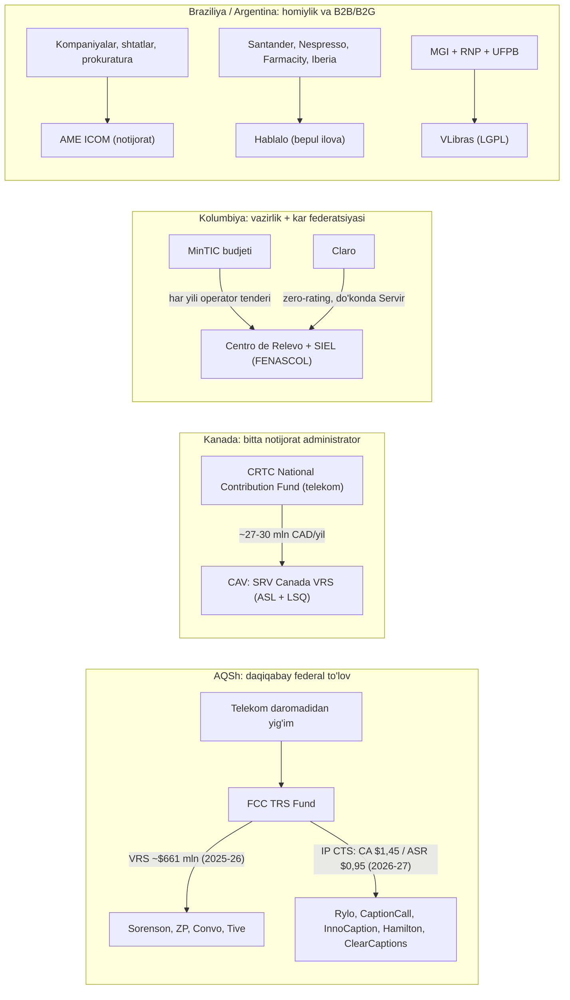

# 03d. Amerika: raqobatchilar va tajribalar (AQSh, Kanada, Lotin Amerikasi)

> **Manba fayllar:** `2_raqobat_va_ochiq_kod/region_americas.md` (asosiy), `1_birinchi_tadqiqot/global_apps_and_business_models.md` va `2_raqobat_va_ochiq_kod/global_feature_matrix.md` dagi AQSh/Kanada/Lotin Amerikasi bandlari; qo'shimcha ravishda `2_raqobat_va_ochiq_kod/open_source_clonable.md` va `2_raqobat_va_ochiq_kod/nonprofit_models_funding.md` dagi Amerikaga oid faktlar. **Sana:** 2026-11-15.
>
> **Belgilar:** har bir fakt yonida manba havolasi bor. "Nimani olamiz / Nimadan qochamiz" bandlari va "Saboqlar" bo'limi tadqiqot yozuvlaridagi xulosalarga (Inferences) yoki muallif fikriga asoslangan: ular fakt emas, **baho / tasdiqlanmagan** deb o'qilsin. "ma'lumot yo'q" = yozuvlarda bu haqda hech narsa yo'q. Ba'zi Kanada raqamlari qidiruv snippetidan olingan (CRTC va CAV sahifalari HTTP 403 qaytargan) va shunday belgilangan.

## Qisqacha

- **AQSh bozori FCC ning daqiqabay to'lovi bilan yuradi va bu pul endi AI ni insondan arzon narxlaydi:** faqat ASR (avtomatik) IP CTS subtitri 2026-27 da $0,95/daq, inson yordamidagi (CA) $1,45/daq, ya'ni AI ~65% ([FCC DA 26-646](https://docs.fcc.gov/public/attachments/DA-26-646A1.pdf)). VRS 2025-26 moliya ehtiyoji $660 660 436 ([FCC DA 25-578](https://docs.fcc.gov/public/attachments/DA-25-578A1.docx)).
- **Katta relay kompaniyalari AI imo-ishorani o'zi quryapti** (Sorenson AST, 2026-04-16; Rylo Sign), Google esa Pixel 11 da **SL2T** (imo-ishoradan matnga, 50+ til da'vosi) ni standart funksiya qildi; Apple ataylab **inson tarjimon**ni tanladi ([Sorenson](https://sorenson.com/newsroom/sorenson-communications-unveils-ai-sign-language-translation-ast-proofs-of-concept/); [RIT](https://www.rit.edu/news/rit-helps-google-develop-new-technology-converts-sign-language-text); [Apple Newsroom](https://apple.com/newsroom/2026/11/apple-tv-introduces-new-sign-language-interpretation-feature/)).
- **Kanada CAV (SRV Canada VRS)**: bitta notijorat administrator, barcha telekom provayderlar CRTC ning National Contribution Fund i orqali to'laydi, ASL + LSQ, yiliga ~27-30 mln CAD, ~10k ro'yxatdagi foydalanuvchi: Uzbekistonga eng yaqin tuzilma ([CRTC 2021-102](https://www.crtc.gc.ca/eng/archive/2021/2021-102.pdf); [SRV Canada VRS](https://srvcanadavrs.ca/en/download/26118)).
- **Kolumbiya Centro de Relevo** (MinTIC + FENASCOL): bepul relay + bir xonadagi suhbat uchun onlayn tarjimon (SIEL), veb va WhatsApp; 2024 da **516 523** relay qo'ng'iroq, 4 500 kishi; Claro zero-rating; lekin har yili operator qayta tanlanadi ([MinTIC](https://mintic.gov.co/portal/inicio/Sala-de-prensa/Noticias/399452:Este-ano-el-Centro-de-Relevo-gestiono-516-523-llamadas-relevadas-para-la-poblacion-con-discapacidad-auditiva); [Xataka](https://www.xataka.com.co/aplicaciones/centro-relevo-plataforma-que-impulsa-conectividad-barreras-para-personas-sordas-colombia)).
- **Braziliya va Argentina:** notijorat AME ning 24 soatlik ICOM tarjimon markazi (140 hamkor) va bepul Hablalo AAC ilovasi (400 000+ kishi, korporativ homiylar) homiylik + B2B/B2G bilan barqaror ([Startupi](https://startupi.com.br/ame-plataforma-de-traducao-de-libras-empresas/); [Emprendedor](https://emprendedor.com/mateo-salvatto-el-nino-que-sono-cambiar-al-mundo-con-la-tecnologia-y-hoy-asiste-a-mas-de-400000-personas-con-discapacidad/)). Braziliya davlat VLibras (LGPL-3.0) yagona to'liq ochiq avatar to'plami ([spbgovbr-vlibras](https://github.com/spbgovbr-vlibras)).
- **Meksika, Chili, Peru, Kosta-Rika:** asosan prototiplar va tarjimon tanqisligi; Kosta-Rikada 2026-oktabrda ham LESCO tarjimonlari yetishmasligi tibbiyotni to'sib qo'ymoqda ([Delfino](https://delfino.cr/2026/10/defensoria-advierte-barreras-para-la-atencion-de-personas-sordas-por-falta-de-interpretes-de-lesco)).

## Umumiy jadval

Qisqartmalar: **VRS** = video relay; **VRI** = masofaviy video tarjima; **DVC** = to'g'ridan-to'g'ri video qo'ng'iroq (imo-ishora biladigan xodimga); **IP CTS** = internet subtitrli telefon; **TRS** = telekom relay; **STT** = nutqdan matnga; **AAC** = muqobil kommunikatsiya.

| # | Mahsulot | Mamlakat | Turi | Kim to'laydi | AI / inson | Ochiq kod | Holat | Manba |
|---|---|---|---|---|---|---|---|---|
| 1 | FCC TRS Fund (dastur) | AQSh | VRS/IP CTS/TRS moliyasi | Telekom daromadidan yig'im | - | - | Faol | [FCC DA 25-571](https://docs.fcc.gov/public/attachments/DA-25-571A1.pdf) |
| 2 | Sorenson ntouch | AQSh | VRS | FCC TRS Fund | Inson | Yo'q | Faol | [HearingTracker](https://www.hearingtracker.com/apps/sorenson-ntouch) |
| 3 | CaptionCall (Sorenson) | AQSh | IP CTS (AI ham) | FCC | AI + inson | Yo'q | Faol | [HearingTracker](https://www.hearingtracker.com/apps/phone-video) |
| 4 | Sorenson AST | AQSh | AI avatar + imo-ishora tanish (PoC) | Sorenson | AI | Yo'q | Yopiq PoC dasturi | [Sorenson](https://sorenson.com/newsroom/sorenson-communications-unveils-ai-sign-language-translation-ast-proofs-of-concept/) |
| 5 | ZP / ZVRS / Purple: Sivo | AQSh | VRS (uch tomonlama video) | FCC TRS Fund | Inson | Yo'q | Faol (Teleperformance) | [App Store](https://apps.apple.com/us/app/sivo/id1524340854) |
| 6 | Convo Call | AQSh (UK, AU ham) | VRS (kar egaligida) | FCC TRS | Inson | Yo'q | Faol; Convo VRS/Link **2026-05-04 o'lik** | [Convo](https://www.convo.io/post/convo-call-generally-available) |
| 7 | GlobalVRS | AQSh | VRS | ma'lumot yo'q | Inson | ma'lumot yo'q | Tadqiq qilinmagan | [global_feature_matrix](https://www.hearingtracker.com/apps/phone-video) |
| 8 | Tive | AQSh | VRS (yangi kiruvchi) | FCC | Inson | ma'lumot yo'q | Shartli sertifikat 2026-07-16 gacha | [FCC DA 26-59](https://docs.fcc.gov/public/attachments/DA-26-59A1.pdf) |
| 9 | Hamilton Relay / CapTel (+ Carceral) | AQSh | IP CTS (CA va ASR) | FCC; qamoqxonalar | AI + inson | Yo'q | To'liq sertifikat 2024-12-17 | [FCC](https://www.fcc.gov:443/hamilton-relay-certified-provide-ip-cts-using-automatic-speech-recognition) |
| 10 | Global Caption | AQSh | IP CTS | FCC | ma'lumot yo'q | ma'lumot yo'q | Shartli sertifikat 2026-06-18 gacha | [FCC DA 26-59](https://docs.fcc.gov/public/attachments/DA-26-59A1.pdf) |
| 11 | Rylo (ex-Nagish) + Rylo Sign | Isroil / AQSh | IP CTS + yuzma-yuz STT + imo-ishora AI | FCC IP CTS; investorlar ($85 mln) | AI | sign.mt egasi | Faol, 2026-iyun rebrend | [BusinessWire](https://www.businesswire.com/news/home/20260604498117/en/) |
| 12 | sign.mt / Rylo Translate | Isroil / AQSh | Matndan imo-ishoraga | Rylo | AI | CC BY-NC-SA 4.0 (notijoratga bepul) | Faol (push 2026-08-11) | [sign/translate](https://github.com/sign/translate) |
| 13 | InnoCaption | AQSh | IP CTS (AI yoki stenograf) | FCC | AI + inson | Yo'q | Faol | [HearingTracker](https://www.hearingtracker.com/apps/phone-video) |
| 14 | ClearCaptions | AQSh | IP CTS | FCC | ma'lumot yo'q | Yo'q | Faol | [HearingTracker](https://www.hearingtracker.com/apps/phone-video) |
| 15 | Ava (Ava App, Ava CC, Ava Scribe) | AQSh / Fransiya | Guruh subtitri | Freemium + B2B | AI + inson tahriri | Yo'q | Faol | [HearingTracker](https://www.hearingtracker.com/apps/ava) |
| 16 | Otter | ma'lumot yo'q (AQSh bozori) | Yig'ilish transkripsiyasi | Freemium (300 daq/oy) | AI | Yo'q | Faol | [livetranscribe.app](https://livetranscribe.app/compare/live-transcribe-vs-ava) |
| 17 | Google Live Transcribe & Sound Notifications | AQSh (Google) | STT + tovush ogohlantirish | Bepul | AI | Engine klienti arxivlangan (Apache-2.0) | Faol | [HearingTracker](https://www.hearingtracker.com/apps/google-live-transcribe) |
| 18 | Google Live Translate | AQSh (Google) | Tarjima (70+ til) | Bepul | AI | Yo'q | Faol, iOS 2026-mart | [MacRumors](https://www.macrumors.com/2026/03/26/google-translate-gemini-ai/) |
| 19 | Google SL2T (Pixel 11) | AQSh (Google) | Imo-ishoradan matnga | Pixel narxi ichida | AI | Yo'q | Faol, 2026-avgust | [RIT](https://www.rit.edu/news/rit-helps-google-develop-new-technology-converts-sign-language-text) |
| 20 | Google SignGemma | AQSh (Google DeepMind) | Imo-ishoradan matnga (ochiq model) | Google | AI | Ochiq vazn va'da qilingan, chiqmagan | E'lon 2025-may, chiqmagan | [Google AI forum](https://discuss.ai.google.dev/t/signgemma-release-date/113794) |
| 21 | Apple Live Captions / Live Listen / Sound Recognition / Music Haptics | AQSh (Apple) | OS ichidagi STT va ogohlantirish | Bepul (OS) | AI (qurilmada) | Yo'q | Faol | [Apple FY25 PDF](https://www.apple.com/government/docs/resources/No_Introduction_FY25_Whats_New_in_Apple_Accessibility.pdf) |
| 22 | Apple TV imo-ishora talqini (ASL, BSL) | AQSh (Apple) | Media qulayligi | Apple | **Inson** | Yo'q | 2026-noyabrdan | [Apple Newsroom](https://apple.com/newsroom/2026/11/apple-tv-introduces-new-sign-language-interpretation-feature/) |
| 23 | Apple FaceTime tarjimon API | AQSh (Apple) | VRI integratsiya API | Apple | Inson | Yo'q | 2026-may oldindan ko'rish | [BornCity](https://borncity.com/news/apple-accessibility-sign-language-api-fuer-facetime-angekuendigt/) |
| 24 | Apple SignTime | AQSh (Apple) | VRI (AppleCare, do'kon) | Apple | Inson | Yo'q | Faol | [MobiHealthNews](https://www.mobihealthnews.com/news/apple-releases-new-tools-meet-needs-folks-mobility-hearing-and-cognitive-disabilities) |
| 25 | Apple Live Translation (AirPods) | AQSh (Apple) | Tarjima (~9 til) | Bepul | AI | Yo'q | iOS 26 | [TravelAwaits](https://www.travelawaits.com/3015964/inside-the-new-live-translation-updates-from-apple-for-airpods-users/) |
| 26 | Microsoft Teams Sign Language View | AQSh (Microsoft) | Yig'ilishda tarjimon plitkasi | Bepul funksiya | Inson tarjimon | Yo'q | Faol | [Microsoft Support](https://support.microsoft.com/en-us/office/use-sign-language-view-in-microsoft-teams-c6c11f67-0747-4598-ac27-c90801b94434) |
| 27 | Zoom sign language interpretation view | AQSh (Zoom) | Yig'ilishda tarjimon kanali | Bepul funksiya | Inson tarjimon | Yo'q | Faol | [UC Today](https://www.uctoday.com/?p=46645) |
| 28 | Google Meet | AQSh (Google) | Subtitr | Bepul / pullik tarjima | AI | Yo'q | Faol; tarjimon ko'rinishi tasdiqlanmagan | [HearingTracker](https://www.hearingtracker.com/apps/phone-video) |
| 29 | NVIDIA Signs | AQSh | ASL o'rganish + dataset | NVIDIA | AI + avatar | Dataset va'da qilingan | Faol; dataset chiqmagan | [NVIDIA blog](https://blogs.nvidia.com/blog/ai-sign-language) |
| 30 | Signapse (Gerald R. Ford aeroporti) | UK kompaniyasi, AQShda | AI ASL ekranlari | Aeroport | AI | Yo'q | Pilot 2023-noyabr, statik xabarlar | [Signapse](https://signapse.ai/post/pioneering-accessibility-enhancements-with-signapse-at-gerald-r-ford-international-airport) |
| 31 | Aira ASL (MKE aeroporti) | AQSh | Talab bo'yicha ASL VRI | Tashkilot / foydalanuvchi | Inson (professional) | Yo'q | Faol | [Aira](https://aira.io/aira-asl-on-demand-interpreting-for-the-deaf-community) |
| 32 | Jeenie | AQSh | Tarjimon marketpleysi (ASL) | ma'lumot yo'q | Inson | Yo'q | ma'lumot yo'q | [MarketScreener](https://in.marketscreener.com/news/latest/Jeenie-Modernizes-Access-to-American-Sign-Language-Communication-with-Mobile-On-Demand-Video-Interpr-29841328) |
| 33 | Talksign (Palm 1.0, Echo 1.0) | Nigeriya / UK (ASL) | ASL <-> matn/nutq | ma'lumot yo'q | AI | ma'lumot yo'q | 2026-may modellar | [TechCabal](https://techcabal.com/2026/05/20/talksign-launches-ai-powered-palm-1-0-and-echo-1-0/) |
| 34 | ChatSign | BAA (NYU Abu Dhabi), ASL | Ikki tomonlama sign <-> nutq, avatar | ma'lumot yo'q | AI | ma'lumot yo'q | 2026-may startap | [NYUAD](https://nyuad.nyu.edu/en/news/latest-news/world-and-societies/2026/may/nyuad-student-co-founds-startup-to-make-sign-language-translatio.html) |
| 35 | Sign-Speak | AQSh (kar boshchiligida) | ASL tanish + avatar API | Grantlar ($1,22 mln) | AI | SDK npm da (litsenziya tekshirilmagan) | Noaniq | [CB Insights](https://www.cbinsights.com/company/sign-speak/financials) |
| 36 | SignAll / Ace ASL | Vengriya / AQSh | Daktil tanish | Freemium | AI | Yo'q | Ehtimol uyqu holatida | [BusinessWire](https://www.businesswire.com/news/home/20210401005516/en/SignAll-Launches-Ace-ASL-App-AI-Will-Help-to-Learn-Sign-Language) |
| 37 | The ASL App (DeafDigits) | AQSh | Lug'at / iboralar | Bepul + $9,99 | Inson (kar egalik) | Yo'q | Faol | [App Store](https://apps.apple.com/app/the-asl-app/id921030207) |
| 38 | DawnSign Press | AQSh | ASL nashriyoti | Xaridor | Inson (kar egalik) | Yo'q | Faol (47 yil) | [DawnSign](https://dawnsign.com/about) |
| 39 | Play With ASL | AQSh | O'yinli ASL platformasi | ma'lumot yo'q | ma'lumot yo'q | ma'lumot yo'q | ma'lumot yo'q | [ASU+GSV](https://asugsvsummit.com/speakers/jon-mowl) |
| 40 | Small Talk ASL | AQSh | Bepul ASL ilova | Bepul | Inson (kar maslahatchilar) | ma'lumot yo'q | ma'lumot yo'q | [TrendHunter](https://www.trendhunter.com/trends/small-talk-asl) |
| 41 | ASL Bloom | ma'lumot yo'q (AQSh bozori) | O'rganish | 2 bepul dars/kun + Premium | Inson video + AI rasmlar | Yo'q | Faol | [HearingTracker](https://www.hearingtracker.com/apps/asl-bloom) |
| 42 | SignSchool | ma'lumot yo'q (ASL) | O'rganish | Bepul | Inson video | Yo'q | Faol | [App Store](https://apps.apple.com/th/app/signschool/id1145529881) |
| 43 | Hands On ASL | ma'lumot yo'q (ASL) | Daktil (3D qo'l) | Bepul + IAP | 3D model | Yo'q | Eskirgan (2019-21) | [AppFollow](https://apps.appfollow.io/ios/hands-on-asl/1450898947?country=us) |
| 44 | Lingvano (ASL kursi) | Avstriya (85% foydalanuvchi AQSh/Kanada) | O'rganish | Obuna | Inson | Yo'q | Faol | [Apple Developer](https://developer.apple.com/articles/lingvano) |
| 45 | SLAIT School | Ispaniya / Germaniya (ASL) | AI ASL repetitor | ~$120K | AI | ma'lumot yo'q | Burilgan | [TechCrunch 2023](https://techcrunch.com/2023/05/11/slait-pivots-from-translating-sign-language-to-ai-powered-interactive-lessons/amp/) |
| 46 | Glide | ma'lumot yo'q | Asinxron video xabar | Bepul | Inson | Yo'q | Faol | [Next Big Idea Club](https://cdn2.nextbigideaclub.com/magazine/nir-eyal-video-messaging-app-found-unexpected-success-thanks-deaf-community/3273/) |
| 47 | Marco Polo | ma'lumot yo'q | Asinxron video xabar | Freemium | Inson | Yo'q | Faol | [Marco Polo support](https://support.marcopolo.me/article/114-accessibility-friendly-features) |
| 48 | Text-to-911 | AQSh | SOS (SMS) | Bepul | Inson operator | n/a | Faol, qamrov notekis | [FCC (arxiv)](https://www.fcc.gov/what-you-need-know-about-text-911) |
| 49 | FCC DVC + ASL Consumer Support Line | AQSh | DVC | Tashkilot | Inson | ACE Direct (litsenziyasiz) | Faol | [FCC DA 24-1266](https://docs.fcc.gov/public/attachments/DA-24-1266A1_Rcd.pdf) |
| 50 | FCC / MITRE ACE Direct | AQSh | DVC kontakt-markaz platformasi | FCC | Inson | GitHub da, litsenziya fayli yo'q | Uyqu holati (2021) | [FCC/ACEDirect](https://github.com/FCC/ACEDirect) |
| 51 | Gallaudet AI, Accessibility and Sign Language Center | AQSh | Tadqiqot / REU | NSF | AI | ma'lumot yo'q | Faol | [Gallaudet](https://gallaudet.edu/research/artificial-intelligence-accessibility-and-sign-language-center/) |
| 52 | ASL-LEX | AQSh (BU, SDSU, Tufts) | Leksik baza | NSF | Inson | Ha (GitHub, litsenziya ko'rsatilmagan) | 3.0 ustida ish | [BU Deaf Center](https://deafcenter.bu.edu/asl-lex) |
| 53 | RIT/NTID Center on Access Technology | AQSh | Sinov / tadqiqot | ma'lumot yo'q | - | - | SL2T ni sinagan | [RIT](https://www.rit.edu/news/rit-helps-google-develop-new-technology-converts-sign-language-text) |
| 54 | PopSign ASL dataset | AQSh (Georgia Tech) | Dataset | ma'lumot yo'q | - | CC BY 4.0 (o'yin kodi tasdiqlanmagan) | v1.0 | [signdata](https://signdata.cc.gatech.edu/view/datasets/popsign_v1_0/) |
| 55 | ASL Citizen (Microsoft) | AQSh | Dataset kodi | Microsoft | AI | MIT (arxivlangan) | Arxiv 2024-07-25 | [microsoft/ASL-citizen-code](https://github.com/microsoft/ASL-citizen-code) |
| 56 | SignAloud | AQSh (UW talabalari) | Qo'lqop | $10K Lemelson-MIT mukofoti | AI | ma'lumot yo'q | Kar jamoasi tanqidi | [NPR 2016](https://www.npr.org/sections/alltechconsidered/2016/05/17/478244421/these-gloves-offer-a-modern-twist-on-sign-language) |
| 57 | Proloquo2Go | ma'lumot yo'q (AQSh/Kanada do'kon narxi) | AAC | ~$249,99 bir martalik | TTS | Yo'q | Faol | [Pratt IXD](https://ixd.prattsi.org/2024/09/assistive-technology-proloquo2go-ios/) |
| 58 | TD Snap (Tobii Dynavox) | ma'lumot yo'q | AAC (ko'z, switch) | Nutq uchun obuna | TTS | Yo'q | Faol | [AlternativeTo](https://alternativeto.net/software/td-snap) |
| 59 | SRV Canada VRS (CAV) | Kanada | VRS (ASL, LSQ) | Telekom provayderlar (NCF) | Inson | Yo'q | Faol | [CRTC 2025-54](https://crtc.gc.ca/eng/archive/2025/2025-54.htm) |
| 60 | Centro de Relevo (Relevo de llamadas + SIEL) | Kolumbiya | VRS + VRI | MinTIC (davlat) | Inson | Topilmadi | Faol, har yil tender | [MinTIC](https://mintic.gov.co/portal/inicio/Sala-de-prensa/Noticias/399452:Este-ano-el-Centro-de-Relevo-gestiono-516-523-llamadas-relevadas-para-la-poblacion-con-discapacidad-auditiva) |
| 61 | Claro "Servir" + zero-rating | Kolumbiya | Do'konda VRI + tarif | Claro | Inson | Yo'q | Faol | [Xataka](https://www.xataka.com.co/aplicaciones/centro-relevo-plataforma-que-impulsa-conectividad-barreras-para-personas-sordas-colombia) |
| 62 | Hand Talk (Hugo, Maya) | Braziliya | Avatar tarjimon + plagin | Bepul ilova; B2B plagin; Google grant $750K | AI avatar | Yo'q | Faol | [Hand Talk](https://www.handtalk.me/en/) |
| 63 | VLibras | Braziliya | Avatar to'plami (vidjet, API, ilova) | Davlat (MGI, RNP) + UFPB | Avatar | Ha, LGPL-3.0 (Unity manbasi yopiq) | Faol | [spbgovbr-vlibras](https://github.com/spbgovbr-vlibras) |
| 64 | ICOM (AME / AME Lab) | Braziliya | 24 soatlik Libras video vositachilik | Kompaniyalar va hukumatlar | Inson | Yo'q | Faol, 140 hamkor | [Startupi](https://startupi.com.br/ame-plataforma-de-traducao-de-libras-empresas/) |
| 65 | CIL-ES (ICOM, QR kodlar) | Braziliya (Espirito Santo) | Davlat idoralarida VRI | Shtat | Inson | Yo'q | 10 000+ murojaat | [Startupi](https://startupi.com.br/socialtech-capixaba-mostra-como-o-uso-de-qr-codes-em-libras-ja-viabilizou-mais-de-10-mil-atendimentos-publicos-no-estado/) |
| 66 | Rybena | Braziliya | Sayt skripti: 3D avatar Libras + TTS | Obuna | AI avatar | Yo'q | Faol | [Rybena](https://rybena.com.br/en/sobre) |
| 67 | SOU.SP.GOV.BR Libras xizmati | Braziliya (San-Paulu shtati) | Davlat xodimlari ilovasida Libras | Shtat | Inson | Yo'q | Faol | [Gazeta SP](https://www.gazetasp.com.br/estado/sp-expande-acessibilidade-em-libras-no-aplicativo-de-servidores/) |
| 68 | Giulia | Braziliya | ma'lumot yo'q | ma'lumot yo'q | ma'lumot yo'q | ma'lumot yo'q | Tadqiq qilinmagan | - |
| 69 | Hablalo (Asteroid Technologies) | Argentina | AAC / STT / TTS / pictogramma | Korporativ homiylar (B2B) | AI (STT/TTS) | Yo'q (topilmadi) | Faol, 400 000+ | [Defonline](https://defonline.com.ar/ciencia-tecnologia/hablalo-una-app-con-voz-propia/) |
| 70 | UNSJ, UNC, UBA (ELDES) tadqiqotlari | Argentina | LSA MT, daktil CNN, o'qitish | Universitetlar | AI | ma'lumot yo'q | Prototip | [WICC 2026](https://wicc2026.uai.edu.ar/posters/agentes%20y%20sistemas%20inteligentes/16460.pdf) |
| 71 | Incluedu | Meksika | AI imo-ishora o'qituvchisi | ma'lumot yo'q | AI | ma'lumot yo'q | TecPrize 2025 finalisti | [Emprendedor](https://emprendedor.com/tag/tecprize/) |
| 72 | Daktilos | Meksika | LSM daktil platformasi | ma'lumot yo'q | ma'lumot yo'q | ma'lumot yo'q | 2024-dekabr | [El Imparcial](https://www.elimparcial.com/tecnologia/2024/12/04/estas-son-dos-plataformas-para-aprender-y-promover-lengua-de-senas-mexicana/) |
| 73 | Sordbo | Meksika | LSM o'rganish / targ'ibot | ma'lumot yo'q | ma'lumot yo'q | ma'lumot yo'q | 2024-dekabr | [El Imparcial](https://www.elimparcial.com/tecnologia/2024/12/04/estas-son-dos-plataformas-para-aprender-y-promover-lengua-de-senas-mexicana/) |
| 74 | IPN LSM qo'lqopi | Meksika | Qo'lqop | IPN | AI | ma'lumot yo'q | 2025-avgust kommyunike | [IPN](https://ipn.mx/assets/files/imageninstitucional/docs/comunicados/2025/08/c-42-guante-lsm-ipn.pdf) |
| 75 | LSM Esencial | Meksika | LSM o'rganish (ish uchun) | ma'lumot yo'q | ma'lumot yo'q | ma'lumot yo'q | 2023 | [Tus Buenas Noticias](https://www.tusbuenasnoticias.com/noticias/mexico/2023/01/30/17892-rafael-verdugo-el-sinaloense-que-creo-una-aplicacion-para-aprender-lenguaje-de-senas) |
| 76 | Sudlar onlayn tarjimon platformasi | Chili | VRI | Sudlar | Inson | ma'lumot yo'q | Faol | [U. Chile CA 284-2025](https://derecho.uchile.cl/dam/jcr:e6d473f4-af65-43d1-9961-9de6c8970d9c/CA%20284-2025.pdf) |
| 77 | Samsung Chile LSCh mijoz xizmati | Chili | VRI | Samsung | Inson | Yo'q | 2021 dan | [Samsung Chile](https://news.samsung.com/cl/samsung-chile-lanza-servicio-de-atencion-a-clientes-en-lengua-de-senas) |
| 78 | Defensoria del Pueblo WhatsApp videoqo'ng'iroq | Peru | Uch tomonlama VRI | Davlat | Inson | Yo'q | COVID davrida; hozir noma'lum | [Andina](https://andina.pe/ingles/noticia-defensoria-atiende-pedidos-personas-sordas-mediante-videollamadas-797762.aspx) |
| 79 | Grupo Mutual planshet tarjimon | Kosta-Rika | VRI (xususiy) | Grupo Mutual | Inson | Yo'q | ma'lumot yo'q | [El Financiero CR](https://www.elfinancierocr.com/tecnologia/conozca-este-servicio-en-linea-para-la-atencion-de/E6Y4GIWPMBBVXIDDA5LUJEFZHE/story/) |
| 80 | GoSign.AI, "Deaf AI", "SignPal", Meksika "Senas" | - | - | - | - | - | Mavjudligi tasdiqlanmagan | - |

Diagramma manbalari: [FCC DA 25-578](https://docs.fcc.gov/public/attachments/DA-25-578A1.docx), [FCC DA 26-646](https://docs.fcc.gov/public/attachments/DA-26-646A1.pdf), [CRTC 2021-102](https://www.crtc.gc.ca/eng/archive/2021/2021-102.pdf), [MinTIC](https://mintic.gov.co/portal/inicio/Sala-de-prensa/Noticias/399452:Este-ano-el-Centro-de-Relevo-gestiono-516-523-llamadas-relevadas-para-la-poblacion-con-discapacidad-auditiva), [Xataka](https://www.xataka.com.co/aplicaciones/centro-relevo-plataforma-que-impulsa-conectividad-barreras-para-personas-sordas-colombia), [Startupi](https://startupi.com.br/ame-plataforma-de-traducao-de-libras-empresas/), [Mercado](https://mercado.com.ar/protagonistas/santander-suma-la-aplicacion-hablalo), [RNP](https://rnp.br/en/news/digital-accessibility-official-version-suite-vlibras-available-deaf).

---

## Batafsil profillar

### AQSh

#### AQSh: mamlakat konteksti (FCC, TRS Fund, bozor tuzilmasi, 911)

**FCC TRS Fund daqiqabay stavkalari:**

| Xizmat | 2025-26 | 2026-27 | Manba |
|---|---|---|---|
| An'anaviy TRS | $7,3512/daq | $9,1713/daq (shtatlararo TRS, STS, CTS) | [FCC DA 25-571](https://docs.fcc.gov/public/attachments/DA-25-571A1.pdf); [FCC DA 26-646](https://docs.fcc.gov/public/attachments/DA-26-646A1.pdf) |
| STS | $8,4822/daq | $9,1713/daq | Shu manbalar |
| CTS | $3,1893/daq | $9,1713/daq | Shu manbalar; [Rolka Loube](https://rolkaloube.com/programs/federal-itrs/news/fcc-releases-2026-27-trs-fund-compensation-and-contribution-formulas-nbsp) |
| IP Relay | ma'lumot yo'q | $2,2710/daq | [FCC DA 26-646](https://docs.fcc.gov/public/attachments/DA-26-646A1.pdf) |
| IP CTS, faqat ASR | $1,05/daq | $0,95/daq (qidiruv xulosasidan, PDF ochilmagan) | [FCC DA 25-571](https://docs.fcc.gov/public/attachments/DA-25-571A1.pdf); [FCC DA 26-646](https://docs.fcc.gov/public/attachments/DA-26-646A1.pdf) |
| IP CTS, CA (inson) | $1,40/daq | $1,45/daq | Shu manbalar |
| IP CTS qo'shimcha CA stavka | $0,22/daq | $0,23/daq | Shu manbalar |
| VRS moliya ehtiyoji | $660 660 436 (~$660,7 mln) | ma'lumot yo'q | [FCC DA 25-578](https://docs.fcc.gov/public/attachments/DA-25-578A1.docx); [Rolka Loube](https://rolkaloube.com/programs/federal-itrs/news/fcc-releases-2025-26-trs-fund-compensation-rates-order) |
| VRS daqiqa tarif pog'onalari | Topilmadi (PDF matni ajratib olinmadi) | Topilmadi | - |

| Mavzu | Fakt | Manba |
|---|---|---|
| IP CTS 5 yillik rejasi (2024-iyul) | Faqat ASR subtitri uchun sirpanish yo'li: 1-yil $1,17, 2-yil $1,05, 3-5-yillar $0,95; 2029-06-30 gacha; CA stavkasi har yili inflyatsiyaga moslanadi | [Kelley Drye](https://www.kelleydrye.com/viewpoints/blogs/commlaw-monitor/fcc-sets-new-rates-for-ip-cts-compensation-and-proposes-new-minimum-service-standards); [FCC IP CTS](https://www.fcc.gov/ipcts) |
| ASR ga ruxsat | FCC 2018 Declaratory Ruling da to'liq avtomatik (ASR) IP CTS ni birinchi marta ruxsat bergan va to'lagan | [FCC IP CTS](https://www.fcc.gov/ipcts) |
| Bozor tuzilmasi | Sorenson va ZP Better Together faqat uchta VRS kompaniyasidan ikkitasi va deyarli butun bozorni egallaydi; ikkalasi xususiy kapital egaligida (advokatlik manbasi) | [PESP](https://pestakeholder.org/reports/lost-in-interpretation-private-equitys-capture-of-a-vital-sign-language-translation-tool/) |
| ZP sotib olinishi | Teleperformance (LanguageLine egasi) ZP Better Together (ZVRS + Purple) ni Kinderhook dan 2024-11-26 da sotib olgan; narx ~$490 mln, ZP 2024 daromadi $230 mln dan ortiq kutilgan; FCC yangi egalikda 2 yillik shartli sertifikat bergan | [Mergr](https://mergr.com/transaction/teleperformance-acquires-zp-better-together); [LanguageLine](https://languageline.com/resources/news/teleperformance-completes-acquisition-of-zp-better-together-expanding-accessibility-solutions); [MultiLingual](https://multilingual.com/?p=221809); [FCC](https://www.fcc.gov/node/267653) |
| Sorenson xaridlari | ZP sotilgandan keyin Sorenson ikkita AI imo-ishora tarjima startapini sotib olgan; shartlar oshkor qilinmagan, nomlari noma'lum (Slator 403) | [Slator](https://tech.slator.com/?p=102822) |
| Shartli IP CTS sertifikatlari | Global Caption va Nagish 2026-06-18 gacha; Rogervoice (IP CTS) va Tive (VRS) 2026-07-16 gacha; keyingi holat topilmadi | [FCC DA 26-59](https://docs.fcc.gov/public/attachments/DA-26-59A1.pdf); [FCC node 267236](https://www.fcc.gov/node/267236) |
| Avvalgi sertifikatlar | ClearCaptions (DA 23-291), CaptionCall ASR (DA 21-1080) | [FCC IP CTS](https://www.fcc.gov/ipcts) |
| DVC | 2024-dekabr FCC ommaviy xabari bizneslar va idoralarni **Direct Video Calling** dan foydalanishga chaqiradi: ASL foydalanuvchi call-markazga qo'ng'iroq qilib, to'g'ridan-to'g'ri imo-ishora biladigan xodimga tushadi, o'rtada relay tarjimoni yo'q | [FCC DA 24-1266](https://docs.fcc.gov/public/attachments/DA-24-1266A1_Rcd.pdf) |
| FCC ASL Consumer Support Line | (844) 432-2275, DVC namunasi | [FCC VRS](https://www.fcc.gov/vrs-speed-of-answer) |
| NG911 qulayligi | 2025-03-31 FCC qo'shimcha taklif (FCC 25-21) qabul qilgan; bu taklif, yakuniy qoida emas; 911 ga to'g'ridan-to'g'ri ASL video qoidasi topilmadi | [Federal Register 2025-03142](https://govinfo.gov/content/pkg/FR-2025-03-12/pdf/2025-03142.pdf) |
| Meta, Amazon, OpenAI | Imo-ishora mahsuloti e'loni topilmadi (bo'shliq, yo'qligining dalili emas) | `region_americas.md` |

#### Sorenson ntouch (VRS)

| Maydon | Qiymat |
|---|---|
| Egasi | Sorenson (xususiy kapital egaligida) ([PESP](https://pestakeholder.org/reports/lost-in-interpretation-private-equitys-capture-of-a-vital-sign-language-translation-tool/)) |
| Yil | ma'lumot yo'q; iOS va Android v9 qo'llanmalari e'lon qilingan ([Sorenson Android guide](https://sorenson.com/wp-content/uploads/2024/08/guide-ntouch-mobile-android-userguide-v9.3.pdf)) |
| Platforma | iOS, Android, desktop |
| Yuklanma / reyting / foydalanuvchilar | App Store 4,1 (510 baho); Google Play 4,3 (6,5K) ([HearingTracker](https://www.hearingtracker.com/apps/phone-video)); Sorenson barcha xizmatlarida yiliga "yuzlab millionlab suhbatlar"ni ta'minlashini aytadi ([Sorenson](https://sorenson.com/newsroom/sorenson-communications-unveils-ai-sign-language-translation-ast-proofs-of-concept/)) |
| Asosiy funksiyalar | VRS; eng katta tarjimon havzasi; ro'yxatdagi Sorenson VRS akkaunti majburiy |
| Kim to'laydi | FCC TRS Fund (foydalanuvchiga bepul) |
| AI yoki inson | Inson |
| Ochiq kod | Yo'q |
| Holat | Faol. Shikoyatlar: o'tkazib yuborilgan yoki muvaffaqiyatsiz qo'ng'iroqlar, tarjimon yo'qligi, qora kamera ekrani; Play da qo'ng'iroq ogohlantirishi, video barqarorligi, kiruvchi qo'ng'iroq, akkauntga kirish ([HearingTracker ntouch](https://www.hearingtracker.com/apps/sorenson-ntouch)) |
| Manba | [HearingTracker ntouch](https://www.hearingtracker.com/apps/sorenson-ntouch) |

**Nimani olamiz:** ishonchli kiruvchi qo'ng'iroq ogohlantirishi (vibratsiya, chiroq, to'liq ekran) va past tarmoqli video funksiyalardan oldin; navbat shaffofligi (kutish vaqti).
**Nimadan qochamiz:** majburiy akkaunt; ishonchsiz push/CallKit.

#### CaptionCall (Sorenson)

| Maydon | Qiymat |
|---|---|
| Egasi | Sorenson |
| Yil | CaptionCall ASR sertifikati DA 21-1080 ([FCC IP CTS](https://www.fcc.gov/ipcts)) |
| Platforma | ma'lumot yo'q |
| Yuklanma / reyting / foydalanuvchilar | App Store 4,8 (3,7K) ([HearingTracker](https://www.hearingtracker.com/apps/phone-video)) |
| Asosiy funksiyalar | Subtitrli telefon qo'ng'iroqlari |
| Kim to'laydi | FCC IP CTS |
| AI yoki inson | AI (ASR) va inson |
| Ochiq kod | Yo'q |
| Holat | Faol |
| Manba | [HearingTracker](https://www.hearingtracker.com/apps/phone-video) |

#### Sorenson AST (AI imo-ishora tarjimasi, PoC)

| Maydon | Qiymat |
|---|---|
| Egasi | Sorenson Communications ([Sorenson newsroom](https://sorenson.com/newsroom/sorenson-communications-unveils-ai-sign-language-translation-ast-proofs-of-concept/)) |
| Yil | 2026-04-16 |
| Platforma | ma'lumot yo'q |
| Yuklanma / reyting / foydalanuvchilar | ma'lumot yo'q |
| Asosiy funksiyalar | Ikki PoC: (1) oldindan yozilgan video yoki matn -> ASL avatar; (2) qisqa ikki tomonlama almashuvlar uchun real vaqt ASL tanish -> ingliz matni (chakana peshtaxta, restoran, aeroport) |
| Kim to'laydi | Sorenson; narx yo'q |
| AI yoki inson | AI |
| Ochiq kod | Yo'q |
| Holat | Yopiq PoC dasturi; narx, muddat, aniqlik ko'rsatkichlari yo'q |
| Manba | [Sorenson newsroom](https://sorenson.com/newsroom/sorenson-communications-unveils-ai-sign-language-translation-ast-proofs-of-concept/) |

**Nimani olamiz:** dalil: AI imo-ishora relay kompaniyalari orqali keladi; ustunlik model emas, tarqatish va moliyalangan foydalanuvchi bazasi. Notijorat model bilan raqobatlasha olmaydi, lekin UzSL ma'lumoti va jamoa ishonchiga egalik qila oladi.

#### ZP / ZVRS / Purple: Sivo

| Maydon | Qiymat |
|---|---|
| Egasi | ZP Better Together (Teleperformance) ([LanguageLine](https://languageline.com/resources/news/teleperformance-completes-acquisition-of-zp-better-together-expanding-accessibility-solutions)) |
| Yil | Sivo qo'llanmasi 2020-dekabr ([ZP how-to PDF](https://zpbettertogether.com/wp-content/uploads/2023/02/Sivo-How-To-PDF-Dec-2020.pdf)) |
| Platforma | iOS, PC, Mac |
| Yuklanma / reyting / foydalanuvchilar | App Store faqat 18 baho (4,5) ([App Store](https://apps.apple.com/us/app/sivo/id1524340854)) |
| Asosiy funksiyalar | Relay qo'ng'iroq paytida eshituvchi va kar tomonlar **bir-birini ko'radi** (uch tomonlama video); ba'zi boshqa provayder ilovalari bilan ishlaydi; telefon raqami + tasdiqlash kodi bilan ro'yxatdan o'tish; Z5/P3 qurilmalarida **video pochtadan to'g'ridan-to'g'ri qayta qo'ng'iroq**, nuqtadan-nuqtaga qo'ng'iroq, VCO Plus ([ZP](https://zpbettertogether.com/z5-p3/)) |
| Kim to'laydi | FCC TRS (bepul) |
| AI yoki inson | Inson |
| Ochiq kod | Yo'q |
| Holat | Faol |
| Manba | [App Store](https://apps.apple.com/us/app/sivo/id1524340854) |

**Nimani olamiz:** uch tomonlama video; video pochta + qayta qo'ng'iroq (video xabar (e) moduli); telefon raqami + kod bilan yengil ro'yxat.

#### Convo Call (kar egaligida)

| Maydon | Qiymat |
|---|---|
| Egasi | Convo (kar egaligidagi, AQSh/UK/AU) ([Convo](https://www.convo.io/post/convo-call-generally-available)) |
| Yil | Convo Call endi standart ilova; **Convo VRS va Convo Link 2026-05-04 da to'xtatilgan** |
| Platforma | Ko'p platforma |
| Yuklanma / reyting / foydalanuvchilar | Eski ilova ~4,1 (280 baho) ([App Store](https://apps.apple.com/us/app/convo-vrs/id423121946?l=fr-FR)); yangi Convo Call sharhlari topilmadi |
| Asosiy funksiyalar | VRS; DeafBlind (ko'r-kar) foydalanuvchi ehtiyojiga javob beradigan yagona VRS deb maqtangan |
| Kim to'laydi | FCC TRS |
| AI yoki inson | Inson |
| Ochiq kod | Yo'q |
| Holat | Faol; eski ilova o'lik. Shikoyat: yangilangan ilova "ancha hamkorlik qilmaydi" (LTE da qo'ng'iroqqa javob bera olmagan) |
| Manba | [Convo](https://www.convo.io/post/convo-call-generally-available) |

**Nimani olamiz:** kar egaligi va ko'r-karlar uchun qulay rejim (kar boshqaruvi).
**Nimadan qochamiz:** ilova almashganda ishonchlilikni yo'qotish.

#### GlobalVRS

| Maydon | Qiymat |
|---|---|
| Egasi | ma'lumot yo'q |
| Yil | ma'lumot yo'q |
| Platforma | ma'lumot yo'q |
| Yuklanma / reyting / foydalanuvchilar | ma'lumot yo'q |
| Asosiy funksiyalar | VRS (funksiya va sharhlar topilmadi) |
| Kim to'laydi | ma'lumot yo'q |
| AI yoki inson | Inson |
| Ochiq kod | ma'lumot yo'q |
| Holat | Tadqiq qilinmagan; 2026 o'zgarishlari tekshirilmagan |
| Manba | `global_feature_matrix.md` 8-bo'lim jadvali |

#### Tive (yangi VRS kiruvchisi)

| Maydon | Qiymat |
|---|---|
| Egasi | Tive |
| Yil | Shartli sertifikat 2026-07-16 gacha uzaytirilgan ([FCC DA 26-59](https://docs.fcc.gov/public/attachments/DA-26-59A1.pdf)) |
| Platforma | ma'lumot yo'q |
| Yuklanma / reyting / foydalanuvchilar | ma'lumot yo'q |
| Asosiy funksiyalar | VRS |
| Kim to'laydi | FCC |
| AI yoki inson | Inson |
| Ochiq kod | ma'lumot yo'q |
| Holat | To'liq sertifikatga o'tgani tasdiqlanmagan |
| Manba | [FCC DA 26-59](https://docs.fcc.gov/public/attachments/DA-26-59A1.pdf); [FCC node 267236](https://www.fcc.gov/node/267236) |

#### Hamilton Relay (CapTel)

| Maydon | Qiymat |
|---|---|
| Egasi | Hamilton Relay ([FCC](https://www.fcc.gov:443/hamilton-relay-certified-provide-ip-cts-using-automatic-speech-recognition)) |
| Yil | To'liq IP CTS sertifikati 2024-12-17 |
| Platforma | CapTel |
| Yuklanma / reyting / foydalanuvchilar | ma'lumot yo'q |
| Asosiy funksiyalar | CA asosidagi va ASR asosidagi IP CTS; qamoqxonalar uchun "Hamilton CapTel Carceral Solutions" ([Hamilton CapTel carceral](https://hamiltoncaptel.com/solutions/hamilton-captel-carceral-solutions/)) |
| Kim to'laydi | FCC; qamoqxona tizimlari |
| AI yoki inson | AI + inson |
| Ochiq kod | Yo'q |
| Holat | Faol |
| Manba | [FCC](https://www.fcc.gov:443/hamilton-relay-certified-provide-ip-cts-using-automatic-speech-recognition) |

**Nimani olamiz:** bir provayderda AI va inson pog'onasi yonma-yon (FCC narx dizayni).

#### Global Caption

| Maydon | Qiymat |
|---|---|
| Egasi | Global Caption |
| Yil | Shartli IP CTS sertifikati 2026-06-18 gacha ([FCC DA 26-59](https://docs.fcc.gov/public/attachments/DA-26-59A1.pdf)) |
| Platforma | ma'lumot yo'q |
| Yuklanma / reyting / foydalanuvchilar | ma'lumot yo'q |
| Asosiy funksiyalar | IP CTS |
| Kim to'laydi | FCC |
| AI yoki inson | ma'lumot yo'q |
| Ochiq kod | ma'lumot yo'q |
| Holat | Keyingi holat topilmadi |
| Manba | [FCC DA 26-59](https://docs.fcc.gov/public/attachments/DA-26-59A1.pdf) |

#### Rylo (ex-Nagish) va Rylo Sign

| Maydon | Qiymat |
|---|---|
| Egasi | Rylo (Isroil/AQSh), avval Nagish ([BusinessWire](https://www.businesswire.com/news/home/20260604498117/en/)) |
| Yil | Rebrend va $85 mln 2026-06-09 da e'lon qilingan; sign.mt ni 2025-10-22 da sotib olgan ([PR Newswire](https://www.prnewswire.com/news-releases/nagish-acquires-signmt-to-drive-research-in-ai-and-sign-language-302591257.html)) |
| Platforma | iOS, Android |
| Yuklanma / reyting / foydalanuvchilar | App Store 4,6 (4,6K); Google Play 4,6 (2,9K) ([HearingTracker](https://www.hearingtracker.com/apps/phone-video)) |
| Asosiy funksiyalar | Subtitrli kiruvchi va chiquvchi qo'ng'iroqlar; **alohida yuzma-yuz jonli transkripsiya rejimi**; eshitish apparati mosligi (ASHA, LE Audio) ([Rylo accessibility](https://rylo.com/legal/accessibility)); ~50+ til, transkriptlar qurilmada saqlanadi (agregator da'vosi) ([startuphub](https://www.startuphub.ai/startups/rylo.md)); "Rylo Sign" imo-ishora AI |
| Kim to'laydi | FCC IP CTS (eligibl AQSh foydalanuvchiga bepul); daromad: eligibl suhbatning har daqiqasiga federal $1-8 qoplama ([runtimewire](https://runtimewire.com/article/nagish-rylo-85-million-general-catalyst)). $85 mln raund: General Catalyst Customer Value Fund boshchiligida, Canaan, Vertex Ventures, Contour; baholash ~$500 mln, jami moliya $100 mln dan ortiq ([MobiHealthNews](https://www.mobihealthnews.com/news/rylo-raises-85m-expand-ai-communication-tools-deaf-and-hard-hearing-users)). Avvalgi Nagish: $5 mln seed + $11 mln Series A (Canaan), jami $16 mln ([Hearing Review](https://hearingreview.com/hearing-products/amplification/amplified-caption-phones/ai-powered-transcription-app-gets-more-funding)). Maqsad: 2026 oxiriga $100 mln ARR, 2028 ga $1 mlrd; foydada ekani aytiladi (kompaniya/matbuot da'vosi) ([lavx](https://news.lavx.hu/article/rylo-raises-85-million-targets-1-billion-in-revenue-by-2028); [AlleyWatch](https://alleywatch.com/2026/07/rylo-ai-communication-accessibility-deaf-hard-of-hearing-real-time-captioning-platform-tomer-aharoni/)) |
| AI yoki inson | AI |
| Ochiq kod | sign.mt egasi (pastda) |
| Holat | Faol. Shikoyatlar: keraksiz qo'ng'iroqlar, akkaunt ma'lumoti talabi (FCC ro'yxati) ([HearingTracker Rylo](https://www.hearingtracker.com/apps/rylo)) |
| Manba | [BusinessWire](https://www.businesswire.com/news/home/20260604498117/en/); [runtimewire](https://runtimewire.com/article/nagish-rylo-85-million-general-catalyst) |

**Nimani olamiz:** qo'ng'iroq subtitri + yuzma-yuz rejim bir ilovada; transkriptni qurilmada saqlash.
**Nimadan qochamiz:** bitta davlat fondiga to'liq bog'liqlik (regulyator stavka o'zgartirishi va audit qilishi mumkin) ([runtimewire](https://runtimewire.com/article/nagish-rylo-85-million-general-catalyst)).

#### sign.mt / Rylo Translate

| Maydon | Qiymat |
|---|---|
| Egasi | Rylo (avval Nagish); asoschisi Dr. Amit Moryossef Head of Research bo'lgan ([Rylo blog](https://rylo.com/post/nagish-acquires-sign-mt)) |
| Yil | 2025-10-22 sotib olingan |
| Platforma | Veb (TypeScript), rylo.com/sign/translate |
| Yuklanma / reyting / foydalanuvchilar | `sign/translate`: 801 yulduz, 4 hissa qo'shuvchi ([sign/translate](https://github.com/sign/translate)) |
| Asosiy funksiyalar | Matndan imo-ishoraga tarjima; MIT kutubxonalari `pose` (116 yulduz, 14 hissa qo'shuvchi, push 2026-09-19), `spoken-to-signed-translation` (105 yulduz, push 2026-10-18), `signwriting` (push 2026-11-02), `segmentation`, `fluent-pose-synthesis`, `signwriting-translation`; NOASSERTION: `signbank-plus`, `sign-vq`, `pose-to-video` ([sign-language-processing](https://github.com/sign-language-processing)) |
| Kim to'laydi | Rylo |
| AI yoki inson | AI |
| Ochiq kod | Ikki pog'onali: shaxslar, notijorat va ta'lim muassasalari uchun CC BY-NC-SA 4.0 bepul; tijorat uchun alohida litsenziya ([LICENSE.md](https://github.com/sign/translate/blob/master/LICENSE.md)) |
| Holat | Faol (push 2026-08-11); sotib olingandan keyin qanchasi ochiq qolishi noma'lum |
| Manba | [sign/translate](https://github.com/sign/translate) |

**Nimani olamiz:** MIT kutubxonalari (`pose`, `spoken-to-signed-translation`) matn -> imo-ishora video uchun (strategik qaror 5).
**Nimadan qochamiz:** BY-NC-SA ilovani fork qilish (tijorat hamkorni to'sadi, GPL bilan aralashmaydi).

#### InnoCaption

| Maydon | Qiymat |
|---|---|
| Egasi | InnoCaption |
| Yil | ma'lumot yo'q |
| Platforma | iOS, Android |
| Yuklanma / reyting / foydalanuvchilar | App Store 4,7 (12,6K); Google Play 4,4 (7,5K) ([HearingTracker](https://www.hearingtracker.com/apps/phone-video)) |
| Asosiy funksiyalar | **AI yoki jonli stenograf** rejimini tanlash; inson subtitri faqat ingliz tilida |
| Kim to'laydi | FCC (AQShda bepul); moliyalash tekshirilmagan |
| AI yoki inson | AI + inson |
| Ochiq kod | Yo'q |
| Holat | Faol |
| Manba | [HearingTracker](https://www.hearingtracker.com/apps/phone-video) |

**Nimani olamiz:** foydalanuvchiga "AI yoki inson" tugmasi (subtitr sifatiga shubha bo'lsa inson fallback).

#### ClearCaptions

| Maydon | Qiymat |
|---|---|
| Egasi | ClearCaptions |
| Yil | Sertifikat DA 23-291 ([FCC IP CTS](https://www.fcc.gov/ipcts)) |
| Platforma | ma'lumot yo'q |
| Yuklanma / reyting / foydalanuvchilar | App Store 4,4 (2,1K) ([HearingTracker](https://www.hearingtracker.com/apps/phone-video)) |
| Asosiy funksiyalar | Subtitrli qo'ng'iroq |
| Kim to'laydi | FCC |
| AI yoki inson | ma'lumot yo'q |
| Ochiq kod | Yo'q |
| Holat | Faol |
| Manba | [HearingTracker](https://www.hearingtracker.com/apps/phone-video) |

#### Ava (AQSh / Fransiya)

| Maydon | Qiymat |
|---|---|
| Egasi | Ava ([Ava blog](https://www.ava.me/blog/ava-1-0-24-7-accessibility-for-deaf-hearing-conversations)) |
| Yil | Asos g'oyasi 2016 (TechCrunch) ([TechCrunch 2016](https://techcrunch.com/2016/11/21/ava-gives-the-hearing-impaired-a-more-present-voice-in-group-conversations)); $4,5 mln 2020-dekabr; $10 mln Series A 2022-may |
| Platforma | iOS, Android, Mac, Windows, veb |
| Yuklanma / reyting / foydalanuvchilar | App Store 4,4 (~4,2K); Google Play 4,3 (761) (AQSh, 2026-11-10) ([HearingTracker](https://www.hearingtracker.com/apps/ava)) |
| Asosiy funksiyalar | Ma'ruzachi yorliqlari va nomlari; **umumiy guruh subtitri: mehmonlar havola yoki QR orqali akkauntsiz qo'shiladi**; tahrirlanadigan transkriptlar; so'kinish filtri; desktopda suzuvchi subtitr oynasi; Zoom/Meet/Teams uchun bot; ~50 til; matn o'lchami, kontrast, joylashuv, qorong'i rejim; mobil oflayn faqat standart tilda; mahsulotlar Ava App, Ava CC, Ava Scribe (AI + inson tahriri) |
| Kim to'laydi | Freemium: bepul daraja asosiy subtitr, seans 40 daqiqa bilan cheklangan; pullik: Premium subtitr, tarjima, nostandart tillar; "Scribe" inson subtitri alohida bron; Smart Recaps 5 ta bepul ([HearingTracker](https://www.hearingtracker.com/apps/ava)); eski ro'yxatda $14,99/oy ([BridgingApps](https://bridgingapps.org/bridgingapps-reviewed-app-ava-24-7-accessible-life/)). Investitsiya: $4,5 mln (2020) ([TechCrunch](https://techcrunch.com/2020/12/10/ava-expands-its-ai-captioning-to-desktop-and-web-apps-and-raises-4-5m-to-scale)), $10 mln Series A, jami $16,5 mln ([Axios](https://www.axios.com/2022/05/04/ava-live-caption-company-scores-10m)) |
| AI yoki inson | AI + inson tahriri |
| Ochiq kod | Yo'q |
| Holat | Faol. Maxfiylik: audio bulutda (AWS, GCP), transkriptlar serverda; iste'molchi ma'lumoti model o'qitishga ishlatilishi mumkin: yordam maqolasida aytilgan, maxfiylik siyosatida "rozilik bersangiz". Shikoyatlar: so'z tushib qolishi, kechikish, subtitr to'xtashi, shovqin, ilova qulashi; yo'qolgan transkriptlar; murakkab guruh sozlash; qayta ulanish halqalari; obuna va bekor qilish chalkashligi (bir foydalanuvchi bekor qilish joyini topa olmagan, boshqasi yillik to'lab eslatmalar saqlanmay qolgan) ([HearingTracker](https://www.hearingtracker.com/apps/ava); [App Store](https://apps.apple.com/us/app/id1030067058)) |
| Manba | [HearingTracker](https://www.hearingtracker.com/apps/ava) |

**Nimani olamiz:** QR orqali akkauntsiz mehmon qo'shilishi; ma'ruzachi yorliqlari; tahrirlanadigan transkript (yuzma-yuz subtitr (b) uchun).
**Nimadan qochamiz:** 40 daqiqalik seans cheklovi; pullik tillar; yashirin bekor qilish; roziliksiz o'qitish (yordam maqolasi va siyosat orasidagi nomuvofiqlik).

#### Otter

| Maydon | Qiymat |
|---|---|
| Egasi | ma'lumot yo'q |
| Yil | ma'lumot yo'q |
| Platforma | Ko'p platforma |
| Yuklanma / reyting / foydalanuvchilar | ma'lumot yo'q |
| Asosiy funksiyalar | Yig'ilish transkripsiyasi, umumiy transkriptlar |
| Kim to'laydi | Freemium, oyiga 300 daqiqa bepul ([livetranscribe.app (sotuvchi, xolis emas)](https://livetranscribe.app/compare/live-transcribe-vs-ava)) |
| AI yoki inson | AI |
| Ochiq kod | Yo'q |
| Holat | Faol; kar foydalanuvchi fikri topilmadi |
| Manba | [livetranscribe.app](https://livetranscribe.app/compare/live-transcribe-vs-ava) |

#### Google Live Transcribe & Sound Notifications

| Maydon | Qiymat |
|---|---|
| Egasi | Google |
| Yil | Oflayn rejim 2022 ([9to5Google](https://9to5google.com/2022/03/10/google-live-transcribe-feature-now-works-when-offline/)) |
| Platforma | Android 12+; Dual Screen Android 14+ ([Google Support](https://support.google.com/accessibility/android/answer/9158064?hl=en)) |
| Yuklanma / reyting / foydalanuvchilar | Google Play 3,8 (276 431 baho, AQSh, 2026-11-10) ([HearingTracker](https://www.hearingtracker.com/apps/google-live-transcribe)) |
| Asosiy funksiyalar | Jonli subtitr (matn o'lchami); yozilgan javobni ovozda o'qish; maxsus lug'at, subtitr pauzasi; qurilma yoki tashqi mikrofon; foldable larda Dual Screen (tashqi ekranda subtitr); ixtiyoriy tarix: yoqilsa 3 kun, aks holda 24 soat, qidiruv va eksport, audio yozilmaydi; tillarni yuklab oflayn; Sound Notifications: signal, sirena, chaqaloq yig'isi |
| Kim to'laydi | Bepul |
| AI yoki inson | AI |
| Ochiq kod | `google/live-transcribe-speech-engine` Apache-2.0, **arxivlangan**, oxirgi push 2022-07-20; bu Google Cloud Speech klienti, oflayn engine emas ([repo](https://github.com/google/live-transcribe-speech-engine)) |
| Holat | Faol. Maqtov: suhbat, qabul, yig'ilishni kuzatish, tez tanish, tovush tavsiflari. Shikoyatlar: noto'g'ri so'zlar, siljiydigan tinish belgilari, miltillash; yangilanishdan keyin aniqlik yomonlashgan; qo'ng'iroq paytida tasodifan yoqilish; oldindan o'rnatilgani; tahrir/eksport, ko'proq til, ma'ruzachi aniqlash so'rovlari ([HearingTracker](https://www.hearingtracker.com/apps/google-live-transcribe)) |
| Manba | [HearingTracker](https://www.hearingtracker.com/apps/google-live-transcribe); [Google Support](https://support.google.com/accessibility/android/answer/9158064?hl=en) |

**Nimani olamiz:** ikki ekranli ko'rinish (oddiy telefonda 180 gradus burilgan yuqori yarmi); TTS bilan yozma javob; oflayn til paketlari; foydalanuvchi boshqaradigan qisqa tarix (3 kun).
**Nimadan qochamiz:** miltillovchi, tuzatib bo'lmaydigan subtitr (bizda xatoni tuzatish); o'zbek tili qo'llovi tasdiqlanmagan.

#### Google Live Translate va Apple Live Translation

| Maydon | Google Live Translate | Apple Live Translation |
|---|---|---|
| Egasi | Google | Apple |
| Yil | iOS ga 2026-mart ([MacRumors](https://www.macrumors.com/2026/03/26/google-translate-gemini-ai/)) | iOS 26 ([TravelAwaits](https://www.travelawaits.com/3015964/inside-the-new-live-translation-updates-from-apple-for-airpods-users/)) |
| Platforma | Translate ilovasi (Android, iOS) | AirPods |
| Yuklanma / reyting / foydalanuvchilar | ma'lumot yo'q | ma'lumot yo'q |
| Asosiy funksiyalar | 70+ til jonli tarjima ([iDropNews](https://www.idropnews.com/news/google-live-translate-released-iphone-70-languages/261713/)) | ~9 til bilan boshlangan; tarjima, subtitr emas |
| Kim to'laydi | Bepul | Bepul |
| AI yoki inson | AI | AI |
| Ochiq kod | Yo'q | Yo'q |
| Holat | Faol | Faol |
| Manba | [MacRumors](https://www.macrumors.com/2026/03/26/google-translate-gemini-ai/) | [TravelAwaits](https://www.travelawaits.com/3015964/inside-the-new-live-translation-updates-from-apple-for-airpods-users/) |

**Xulosa (baho):** big-tech til qamrovining ko'rsatkichi; bepul big-tech vositalarda o'zbek ASR sifati asosiy raqobat o'zgaruvchisi.

#### Google SL2T (Sign Language-to-Text, Pixel 11)

| Maydon | Qiymat |
|---|---|
| Egasi | Google; RIT/NTID Center on Access Technology (direktor Gary Behm, kar) chiqishdan oldin sinagan ([RIT news, 2026-09-15](https://www.rit.edu/news/rit-helps-google-develop-new-technology-converts-sign-language-text)) |
| Yil | Pixel 11 bilan 2026-avgust |
| Platforma | Google Pixel 11 (standart funksiya) |
| Yuklanma / reyting / foydalanuvchilar | ma'lumot yo'q |
| Asosiy funksiyalar | Telefon kamerasi bilan imo-ishorani real vaqtda matnga; qo'l shakli + yuz va tana; faqat bitta bo'sh qo'l kerak; yuborishdan oldin matnni tahrirlash. Google: 100 000+ soat ma'lumotda, "50 dan ortiq xalqaro imo-ishora tili"da o'qitilgan, o'qitish vaqtining ~chorak qismi ASL |
| Kim to'laydi | Pixel narxi ichida |
| AI yoki inson | AI |
| Ochiq kod | Yo'q |
| Holat | Faol. Behm: "yutuq", lekin tibbiy, huquqiy, ta'lim va boshqa yuqori xavfli joylarda malakali tarjimon o'rnini bosmasligi kerak. Qurilmada yoki bulutda ishlashi aytilmagan; tillar ro'yxati topilmadi; SignGemma bilan bog'liqligi tasdiqlanmagan |
| Manba | [RIT news](https://www.rit.edu/news/rit-helps-google-develop-new-technology-converts-sign-language-text) |

**Nimani olamiz:** UzSL tanishini noldan qurishdan oldin SL2T ro'yxatida UzSL yoki rus imo-ishora tili (RSL) bor-yo'qligini tekshirish; kar ekspert sinovi (NTID modeli).
**Nimadan qochamiz:** yuqori xavfli vaziyatda AI tanishga tayanish.

**Google DeepMind AI Sign Language Advisory Committee:** Sam Sepah (RIT/NTID bitiruvchisi, Google AI qulaylik tadqiqot dasturi bosh menejeri) asos solgan ([RIT](https://www.rit.edu/news/rit-helps-google-develop-new-technology-converts-sign-language-text)).

#### Google SignGemma

| Maydon | Qiymat |
|---|---|
| Egasi | Google DeepMind ([TechCrunch](https://techcrunch.com/2025/05/20/the-newest-google-gemma-ai-model-can-run-on-phones)) |
| Yil | Google I/O 2025-may e'lon; birinchi ommaviy demo X orqali 2025-05-27; kengroq chiqish 2025 Q4 kutilgan ([Hans India](https://www.thehansindia.com/tech/google-unveils-signgemma-ai-tool-to-translate-sign-language-into-text-by-year-end-974884); [MultiLingual](https://multilingual.com/google-signgemma-on-device-asl-translation/)) |
| Platforma | Telefonda ishlaydigan ochiq model (e'lon) |
| Yuklanma / reyting / foydalanuvchilar | ma'lumot yo'q |
| Asosiy funksiyalar | Imo-ishora (avval ASL) -> og'zaki til matni |
| Kim to'laydi | Google |
| AI yoki inson | AI |
| Ochiq kod | Ochiq vazn va'da qilingan; chiqmagan |
| Holat | Forumda xodimlar: "hozircha aniq muddat yo'q" ([Google AI forum](https://discuss.ai.google.dev/t/signgemma-release-date/113794)); 2026-08-11 yangilangan agregator: chiqish kutilmoqda, faqat qiziqish formasi (past sifatli manba) ([aixploria](https://www.aixploria.com/en/?p=38909)) |
| Manba | [Google AI forum](https://discuss.ai.google.dev/t/signgemma-release-date/113794) |

**Nimadan qochamiz:** chiqmagan modelga reja qurish.

#### Apple: Live Captions, Live Listen, Sound Recognition, Music Haptics

| Maydon | Qiymat |
|---|---|
| Egasi | Apple ([Apple FY25 PDF](https://www.apple.com/government/docs/resources/No_Introduction_FY25_Whats_New_in_Apple_Accessibility.pdf)) |
| Yil | 2025 yangilanishi ("FY25"; iOS 26 ga bog'lash ikkilamchi manbalardan) ([iGeeksBlog](https://www.igeeksblog.com/accessibility-features-in-ios-26-macos-26/)) |
| Platforma | iOS, iPadOS, macOS, watchOS (ichki) |
| Yuklanma / reyting / foydalanuvchilar | n/a (sharh ma'lumoti yo'q) |
| Asosiy funksiyalar | Live Captions: telefon, FaceTime, veb va yuzma-yuz nutq uchun real vaqt subtitr, qurilmada; 2025 da Apple Watch da Live Captions va Live Listen boshqaruvi. Live Listen: iPhone AirPods yoki MFi eshitish apparatiga uzoq mikrofon. Sound Recognition: qurilmada ~15 tovush; 2025 da "Name Recognition" (ism chaqirilsa ogohlantirish); CarPlay da signal, sirena, chaqaloq yig'isi ([Yahoo Tech](https://tech.yahoo.com/home/articles/apple-expands-accessibility-features-including-120000358.html)). Music Haptics: musiqani tebranish sifatida his qilish |
| Kim to'laydi | Bepul (OS) |
| AI yoki inson | AI (qurilmada) |
| Ochiq kod | Yo'q |
| Holat | Faol |
| Manba | [Apple FY25 PDF](https://www.apple.com/government/docs/resources/No_Introduction_FY25_Whats_New_in_Apple_Accessibility.pdf) |

**Nimani olamiz:** maxfiylik uchun qurilmada qayta ishlash standart; tovush ogohlantirishini qayta qurmasdan OS funksiyasiga havola berish.

#### Apple TV imo-ishora talqini, FaceTime tarjimon API, SignTime

| Maydon | Qiymat |
|---|---|
| Egasi | Apple |
| Yil | Apple TV: 2026-noyabr (*Being Heumann* 13-noyabr, *F1*); FaceTime API: 2026-may (GAAD) oldindan ko'rish ([Apple Newsroom](https://apple.com/newsroom/2026/11/apple-tv-introduces-new-sign-language-interpretation-feature/); [BornCity](https://borncity.com/news/apple-accessibility-sign-language-api-fuer-facetime-angekuendigt/)) |
| Platforma | iOS/tvOS/macOS/visionOS 27.2+ ([MacRumors](https://macrumors.com/2026/11/10/apple-tv-sign-language-interpretation)) |
| Yuklanma / reyting / foydalanuvchilar | ma'lumot yo'q |
| Asosiy funksiyalar | Apple TV ilovasida ekranda ASL va BSL talqini; "Movies & Shows with ASL" to'plami va "with ASL" qidiruvi; FaceTime: imo-ishora tarjima ilovalari faol qo'ng'iroqqa inson tarjimon qo'sha oladigan API; SignTime: AQShda ASL, UK da BSL, Fransiyada LSF, AppleCare va do'kon uchun ([MobiHealthNews](https://www.mobihealthnews.com/news/apple-releases-new-tools-meet-needs-folks-mobility-hearing-and-cognitive-disabilities)) |
| Kim to'laydi | Apple |
| AI yoki inson | **Ataylab inson tarjimon** (Directors of Artistic Sign Language bilan), AI signer emas |
| Ochiq kod | Yo'q |
| Holat | Faol |
| Manba | [Apple Newsroom](https://apple.com/newsroom/2026/11/apple-tv-introduces-new-sign-language-interpretation-feature/) |

**Nimani olamiz:** kontent uchun inson imo-ishorachi (WFD pozitsiyasiga mos); mavjud qo'ng'iroqqa tarjimon qo'shish (bizning VRI ni boshqa ilovalarga ulash g'oyasi).

#### Microsoft Teams, Zoom, Google Meet (yig'ilishlar)

| Maydon | Teams Sign Language View | Zoom interpretation view | Google Meet |
|---|---|---|---|
| Egasi | Microsoft | Zoom | Google |
| Yil | ma'lumot yo'q | ma'lumot yo'q | ma'lumot yo'q |
| Platforma | Ko'p platforma | Ko'p platforma | Ko'p platforma |
| Yuklanma / reyting | Play 4,7 | Play 4,1 | Play 4,4 (`global_feature_matrix.md` jadvali) |
| Asosiy funksiyalar | Foydalanuvchi sozlamasi; tanlangan imo-ishorachilar video yoqilganda markazda qoladi, boshqalar ko'rinishi o'zgarmaydi; bir tashkilotdan bo'lsa oldindan tayinlanadi, tashqi tarjimon yig'ilishda qo'shiladi; Settings > Accessibility da standart yoqish; hammaga spotlight; ishga tushirishda 2 tagacha imo-ishorachi; ekran ulashishda video sifatli qoladi ([Microsoft Support](https://support.microsoft.com/en-us/office/use-sign-language-view-in-microsoft-teams-c6c11f67-0747-4598-ac27-c90801b94434); [Tech Community](https://techcommunity.microsoft.com/blog/microsoftteamsblog/introducing-sign-language-view-for-teams-meetings/3671257); [Petri](https://petri.com/microsoft-teams-meetings-get-new-sign-language-view-and-accessibility-pane/)) | Admin yoqadi; host 20 tagacha tarjimon tayinlaydi, alohida pin/spotlight kanallar; tarjimonni yozish opsiyasi ([UC Today](https://www.uctoday.com/?p=46645); [PCC](https://www.pcc.edu/instructional-support/tools/zoom/technical-guide-zoom-with-asl-interpretation/)) | Jonli subtitr bepul; tarjima subtitri pullik; har ishtirokchi o'zi yoqadi ([HearingTracker](https://www.hearingtracker.com/apps/phone-video)) |
| Kim to'laydi | Bepul funksiya | Bepul funksiya | Bepul / pullik |
| AI yoki inson | Inson tarjimon | Inson tarjimon | AI subtitr |
| Ochiq kod | Yo'q | Yo'q | Yo'q |
| Holat | Faol | Faol; foydalanuvchilar kar tarjimon hammaga ko'rinib turishi uchun bir nechta pin so'raydi ([Zoom Community](https://community.zoom.com/meetings-2/pin-multiple-participants-so-deaf-interpreter-stays-visible-to-other-participants-always-46203)) | Tarjimon ko'rinishi tasdiqlanmagan |
| Manba | [Microsoft Support](https://support.microsoft.com/en-us/office/use-sign-language-view-in-microsoft-teams-c6c11f67-0747-4598-ac27-c90801b94434) | [UC Today](https://www.uctoday.com/?p=46645) | [HearingTracker](https://www.hearingtracker.com/apps/phone-video) |

Izoh: Microsoft, Zoom, Google kompaniyalarining AQShga tegishliligi yozuvlarda aytilmagan (umumiy ma'lum, baho). Hech bir platforma avtomatik imo-ishora tarjimasini bermaydi ([global_feature_matrix](https://support.microsoft.com/en-us/office/use-sign-language-view-in-microsoft-teams-c6c11f67-0747-4598-ac27-c90801b94434)).

**Nimani olamiz:** o'z video qo'ng'iroqlarimizda ekran ulashishda ham qoladigan pinlangan tarjimon plitkasi (Jitsi/LiveKit asosida).

#### NVIDIA Signs

| Maydon | Qiymat |
|---|---|
| Egasi | NVIDIA, American Society for Deaf Children (ASDC) va Hello Monday/DEPT agentligi bilan ([NVIDIA blog](https://blogs.nvidia.com/blog/ai-sign-language)) |
| Yil | 2025-fevral |
| Platforma | Bepul veb platforma |
| Yuklanma / reyting / foydalanuvchilar | ma'lumot yo'q |
| Asosiy funksiyalar | ASL o'rganish; har belgini 3D avatar ko'rsatadi, veb-kamera AI fikr beradi; maqsad: 400 000 video klipni kraudsorsing qilib 100 dan 1 000 tasdiqlangan belgiga o'sish, ravon imo-ishorachilar va tarjimonlar tasdiqlaydi, datasetni ommaga chiqarish ([eWeek](https://www.eweek.com/news/nvidia-signs-platform/)) |
| Kim to'laydi | NVIDIA |
| AI yoki inson | AI + avatar |
| Ochiq kod | Dataset va'da qilingan; 2026-noyabr holatiga chiqqani tasdiqlanmagan, kirish so'rov formasi orqali ko'rinadi ([Thurrott](https://www.thurrott.com/a-i/317519/nvidia-announces-ai-to-help-teach-asl)) |
| Holat | Faol |
| Manba | [NVIDIA blog](https://blogs.nvidia.com/blog/ai-sign-language) |

**Nimani olamiz:** kraudsorsing + kar tasdiqlovchi bilan UzSL dataset yig'ish metodi; o'rganish platformasi bir vaqtda ma'lumot yig'adi.

#### Signapse AQSh aeroportlarida

| Maydon | Qiymat |
|---|---|
| Egasi | Signapse (UK) ([Signapse post](https://signapse.ai/post/pioneering-accessibility-enhancements-with-signapse-at-gerald-r-ford-international-airport)) |
| Yil | Gerald R. Ford International Airport (Grand Rapids, MI) pilot 2023-noyabr |
| Platforma | Aeroport ekranlari |
| Yuklanma / reyting / foydalanuvchilar | 2025 o'rtasiga yirik AQSh aeroportlari (Zero Project) ([Zero Project](https://zeroproject.org/view/project/100ff85a-f64c-f011-8779-7c1e527683f1)) |
| Asosiy funksiyalar | Kechikish va gate o'zgarishi uchun real vaqt AI ASL + subtitr; pilotdan keyin statik Signapse ASL xabarlari (Art of Context bilan), doimiy qilishga "ishlamoqda" |
| Kim to'laydi | Aeroport |
| AI yoki inson | AI |
| Ochiq kod | Yo'q |
| Holat | 2026 da AQSh aeroportida keng joriy etish topilmadi |
| Manba | [Signapse post](https://signapse.ai/post/pioneering-accessibility-enhancements-with-signapse-at-gerald-r-ford-international-airport) |

#### Aira ASL va Jeenie (talab bo'yicha tarjima)

| Maydon | Aira ASL | Jeenie |
|---|---|---|
| Egasi | Aira ([Aira](https://aira.io/aira-asl-on-demand-interpreting-for-the-deaf-community)) | Jeenie ([MarketScreener](https://in.marketscreener.com/news/latest/Jeenie-Modernizes-Access-to-American-Sign-Language-Communication-with-Mobile-On-Demand-Video-Interpr-29841328)) |
| Yil | ma'lumot yo'q | ma'lumot yo'q |
| Platforma | Mobil | Mobil |
| Yuklanma / reyting / foydalanuvchilar | Milwaukee aeroporti (MKE) Aira orqali talab bo'yicha ASL xizmatini ishga tushirgan ([pulse.bot](https://www.pulse.bot/hotels/news/mke-airport-launches-asl-interpeting-service-for-travelers-5039c2da-c12c-47f4-b6ef-eb770888db3e/)) | ma'lumot yo'q |
| Asosiy funksiyalar | Professional (volontyor emas) ASL tarjimonlar bilan talab bo'yicha | ASL opsiyali tarjimon marketpleysi |
| Kim to'laydi | Tashkilot (masalan aeroport) | ma'lumot yo'q |
| AI yoki inson | Inson | Inson |
| Ochiq kod | Yo'q | Yo'q |
| Holat | Faol | ma'lumot yo'q |
| Manba | [Aira](https://aira.io/aira-asl-on-demand-interpreting-for-the-deaf-community) | [MarketScreener](https://in.marketscreener.com/news/latest/Jeenie-Modernizes-Access-to-American-Sign-Language-Communication-with-Mobile-On-Demand-Video-Interpr-29841328) |

Izoh: kar uchun volontyorga asoslangan "Be My Eyes" ekvivalenti topilmadi ([global_feature_matrix](https://aira.io/aira-asl-on-demand-interpreting-for-the-deaf-community)). **Xulosa (baho):** past xavfli yordam uchun volontyor/kar tengdoshlar, tibbiy, huquqiy, favqulodda uchun sertifikatlangan tarjimon (gibrid).

#### Talksign va ChatSign (ASL bozoridagi AQShdan tashqari startaplar)

| Maydon | Talksign | ChatSign |
|---|---|---|
| Egasi | Talksign (Nigeriya/UK) ([TechCabal](https://techcabal.com/2026/05/20/talksign-launches-ai-powered-palm-1-0-and-echo-1-0/)) | NYU Abu Dhabi talabasi asos solgan startap ([NYUAD](https://nyuad.nyu.edu/en/news/latest-news/world-and-societies/2026/may/nyuad-student-co-founds-startup-to-make-sign-language-translatio.html)) |
| Yil | 2025-noyabr asos; 2026-may "Palm 1.0" va "Echo 1.0" | 2026-may |
| Platforma | ma'lumot yo'q | ma'lumot yo'q |
| Yuklanma / reyting | 250 ASL belgisini taniydi, yagona belgi aniqligi 84,7% (xabar qilingan) | ma'lumot yo'q |
| Asosiy funksiyalar | ASL <-> matn va nutq | Ikki tomonlama sign -> nutq, ichki model boshqaradigan avatar |
| Kim to'laydi | ma'lumot yo'q | ma'lumot yo'q |
| AI yoki inson | AI | AI |
| Ochiq kod | ma'lumot yo'q | ma'lumot yo'q |
| Holat | Faol | Faol (AQShda emas, lekin ASL da raqobatlashadi) |
| Manba | [TechCabal](https://techcabal.com/2026/05/20/talksign-launches-ai-powered-palm-1-0-and-echo-1-0/) | [NYUAD](https://nyuad.nyu.edu/en/news/latest-news/world-and-societies/2026/may/nyuad-student-co-founds-startup-to-make-sign-language-translatio.html) |

#### Sign-Speak (kar boshchiligida)

| Maydon | Qiymat |
|---|---|
| Egasi | 2020 da Yami Payano, Nikolas Kelly va Nicholas Wilkins asos solgan; AWS qo'llab-quvvatlagan startap ([AWS Startups](https://aws.amazon.com/blogs/startups/sign-speak-builds-with-ai-on-aws-to-create-accessible-experiences/)) |
| Yil | 2020 |
| Platforma | SDK (React, npm) |
| Yuklanma / reyting / foydalanuvchilar | ma'lumot yo'q |
| Asosiy funksiyalar | React SDK: ASL Recognition (video -> ingliz), ASL Production (ingliz matni -> avatar video), nutq vositalari ([unpkg README](https://app.unpkg.com/@sign-speak/react-sdk@0.7.3/files/README.md)) |
| Kim to'laydi | CB Insights: 10 raundda jami $1,22 mln, investorlar orasida NSF (grant) ([CB Insights](https://www.cbinsights.com/company/sign-speak/financials)); SBIR: 1-faza $256K va 2-faza $1,25M "real vaqt ikki tomonlama ASL aloqa tizimi" uchun, oluvchi tasdiqlanmagan ([SBIR](https://www.sbir.gov/portfolio/2444811)) |
| AI yoki inson | AI |
| Ochiq kod | SDK npm da, litsenziya tekshirilmagan |
| Holat | API cheklangan kirishda, umumiy kirish 2024 Q1 ga mo'ljallangan; hozirgi holat noaniq ([G2](https://www.g2.com/products/sign-speak/discuss)) |
| Manba | [CB Insights](https://www.cbinsights.com/company/sign-speak/financials) |

**Nimadan qochamiz:** MVP da ochiq suhbat uchun imo-ishora tanish (ma'lumotga bog'liq).

#### SignAll / Ace ASL

Batafsil profil: 03c. Yevropa (Vengriya). Qisqacha: 2016 asos, $3,6 mln, Ace ASL iOS 2021-04-01, daktil tanish, ehtimol uyqu holatida ([CB Insights](https://www.cbinsights.com/company/signall1); [BusinessWire](https://www.businesswire.com/news/home/20210401005516/en/SignAll-Launches-Ace-ASL-App-AI-Will-Help-to-Learn-Sign-Language)). Ace ASL "kar ona tili egasi boshchiligida" jonli fikr beradi ([Product Hunt](https://www.producthunt.com/products/ace-asl/makers)).

#### The ASL App (DeafDigits Inc, avval Ink & Salt)

| Maydon | Qiymat |
|---|---|
| Egasi | DeafDigits Inc ("kar odamlar yaratgan", kar egaligidagi kompaniya) ([App Store](https://apps.apple.com/app/the-asl-app/id921030207); [3Play interview](https://3playmedia.com/learn/faces-behind-screen/asl-app)) |
| Yil | ma'lumot yo'q |
| Platforma | iOS, Android |
| Yuklanma / reyting / foydalanuvchilar | ma'lumot yo'q |
| Asosiy funksiyalar | 2 500+ belgi va ibora, sekin ijro, qidiruv, sevimlilar ([Kent State](https://sites.google.com/kent.edu/appsfordiverselearningneeds/app-reviews/the-asl-app)) |
| Kim to'laydi | Bepul to'plamlar + bir martalik $9,99 to'liq paket (reklamani ham o'chiradi) |
| AI yoki inson | Inson |
| Ochiq kod | Yo'q |
| Holat | Faol |
| Manba | [App Store](https://apps.apple.com/us/app/id921030207) |

**Nimani olamiz:** kar egaligi va kar imo-ishorachi; sekin ijro, sevimlilar (lug'at moduli).

#### DawnSign Press

| Maydon | Qiymat |
|---|---|
| Egasi | Kar egaligidagi ASL nashriyoti ([DawnSign](https://dawnsign.com/about)) |
| Yil | "47 yildan beri ishonchli" |
| Platforma | Nashriyot |
| Yuklanma / reyting / foydalanuvchilar | ma'lumot yo'q |
| Asosiy funksiyalar | ASL nashrlari, "biz tomonidan, biz uchun" |
| Kim to'laydi | Xaridor |
| AI yoki inson | Inson |
| Ochiq kod | Yo'q |
| Holat | Faol |
| Manba | [DawnSign](https://dawnsign.com/about) |

#### Play With ASL

| Maydon | Qiymat |
|---|---|
| Egasi | Asoschi Jon Mowl, to'rtinchi avlod kar tadbirkor deb ta'riflangan ([ASU+GSV](https://asugsvsummit.com/speakers/jon-mowl)) |
| Yil | ma'lumot yo'q |
| Platforma | ma'lumot yo'q |
| Yuklanma / reyting / foydalanuvchilar | ma'lumot yo'q |
| Asosiy funksiyalar | O'yinli ASL platformasi |
| Kim to'laydi | ma'lumot yo'q |
| AI yoki inson | ma'lumot yo'q |
| Ochiq kod | ma'lumot yo'q |
| Holat | ma'lumot yo'q |
| Manba | [ASU+GSV](https://asugsvsummit.com/speakers/jon-mowl) |

#### Small Talk ASL

| Maydon | Qiymat |
|---|---|
| Egasi | Animator Josh Staub, kar va eshitishi zaif rassom va maslahatchilar bilan (kar ishtirokida, kar egaligida emas) ([TrendHunter](https://www.trendhunter.com/trends/small-talk-asl)) |
| Yil | ma'lumot yo'q |
| Platforma | Ilova |
| Yuklanma / reyting / foydalanuvchilar | ma'lumot yo'q |
| Asosiy funksiyalar | ASL o'rganish |
| Kim to'laydi | Bepul |
| AI yoki inson | Inson / animatsiya |
| Ochiq kod | ma'lumot yo'q |
| Holat | ma'lumot yo'q |
| Manba | [TrendHunter](https://www.trendhunter.com/trends/small-talk-asl) |

#### ASL Bloom

| Maydon | Qiymat |
|---|---|
| Egasi | ma'lumot yo'q |
| Yil | ma'lumot yo'q |
| Platforma | iOS, Android, veb |
| Yuklanma / reyting / foydalanuvchilar | App Store 4,9 (~38K); Google Play 4,8 (18,1K) ([HearingTracker](https://www.hearingtracker.com/apps/asl-bloom)) |
| Asosiy funksiyalar | Lug'at, darslar, testlar, daktil, sekin video |
| Kim to'laydi | Kuniga 2 bepul dars; Premium reja |
| AI yoki inson | Inson video; AI-generatsiyali rasmlar (3 sharhlovchi e'tiroz bildirgan) |
| Ochiq kod | Yo'q |
| Holat | Faol. Maqtov: qulay darslar, sekin ijro, takrorlash, lug'at. Shikoyatlar: bepul daraja juda cheklangan, qimmat; asoslardan test bilan o'tib ketish istagi; o'rgatilmagan belgilardan test; yo'qolgan/qora/qotgan videolar, qulash, progress yo'qolishi (Google Play 2026) |
| Manba | [HearingTracker](https://www.hearingtracker.com/apps/asl-bloom) |

**Nimani olamiz:** sekin va takroriy video, qisqa kunlik dars.
**Nimadan qochamiz:** paywall; AI-generatsiyali rasmlar; o'rgatilmaganidan test.

#### SignSchool

| Maydon | Qiymat |
|---|---|
| Egasi | ma'lumot yo'q |
| Yil | ma'lumot yo'q |
| Platforma | iOS, veb ([App Store](https://apps.apple.com/th/app/signschool/id1145529881)) |
| Yuklanma / reyting / foydalanuvchilar | ma'lumot yo'q |
| Asosiy funksiyalar | Video darslar, o'yinlar, lug'at |
| Kim to'laydi | Bepul (eski sharh: kelajakda to'lov olishi mumkin) ([TopTenReviews](https://www.toptenreviews.com/signschool-review)) |
| AI yoki inson | Inson video |
| Ochiq kod | Yo'q |
| Holat | Faol |
| Manba | [HearingTracker](https://www.hearingtracker.com/apps/signschool) |

#### Hands On ASL

| Maydon | Qiymat |
|---|---|
| Egasi | ma'lumot yo'q |
| Yil | Yangilanish sanalari 2019/2021 ([AppAdvice](https://appadvice.com/app/hands-on-asl/1450898947)) |
| Platforma | iOS |
| Yuklanma / reyting / foydalanuvchilar | ~4,0, ~74-90 baho ([AppFollow](https://apps.appfollow.io/ios/hands-on-asl/1450898947?country=us)) |
| Asosiy funksiyalar | Faqat daktil; **kattalashtirib aylantiriladigan 3D qo'l modellari**; tezligi o'zgaruvchan testlar |
| Kim to'laydi | Bepul + IAP (qo'l rangi pullik) |
| AI yoki inson | 3D model |
| Ochiq kod | Yo'q |
| Holat | **Eskirgan** |
| Manba | [AppFollow](https://apps.appfollow.io/ios/hands-on-asl/1450898947?country=us) |

**Nimani olamiz:** qo'l shaklini aniq ko'rsatish uchun aylantiriladigan 3D qo'l (o'rganish moduli, ixtiyoriy).

#### Lingvano (ASL kursi) va SLAIT School

Batafsil profil: 03c. Yevropa (Avstriya, Ispaniya/Germaniya). Amerika uchun muhimi: Lingvano 3 mln+ foydalanuvchisining **85% AQSh/Kanadada**; Apple uning ASL jamoasiga yetishini maqola qilgan ([Apple Developer](https://developer.apple.com/articles/lingvano)). SLAIT School: tarjimadan burilgan AI ASL repetitor ([TechCrunch](https://techcrunch.com/2023/05/11/slait-pivots-from-translating-sign-language-to-ai-powered-interactive-lessons/amp/)).

#### Glide va Marco Polo (asinxron video)

| Maydon | Glide | Marco Polo |
|---|---|---|
| Egasi | ma'lumot yo'q | ma'lumot yo'q |
| Yil | ma'lumot yo'q | ma'lumot yo'q |
| Platforma | iOS, Android | iOS, Android |
| Yuklanma / reyting | Yuz minglab kar foydalanuvchi ASL video xabar uchun qabul qilgan ([Next Big Idea Club](https://cdn2.nextbigideaclub.com/magazine/nir-eyal-video-messaging-app-found-unexpected-success-thanks-deaf-community/3273/)) | Sorenson "2025 kar uchun eng yaxshi ilovalar" ro'yxatida ([Sorenson](https://sorenson.com/blog/vrs/the-best-apps-for-deaf-people-in-2025/)) |
| Asosiy funksiyalar | Asinxron video; jamoa menejeri so'rovlarni tushunish uchun ASL o'rgangan | Asinxron video; kar foydalanuvchilar **ko'zgu effekti (teskari imo-ishora)** haqida xabar bergach jamoa kamerani o'zgartirgan; VoiceOver, Voice Control, Reduce Motion, yuqori kontrast ([Marco Polo support](https://support.marcopolo.me/article/114-accessibility-friendly-features)) |
| Kim to'laydi | Bepul | Freemium |
| AI yoki inson | Inson | Inson |
| Ochiq kod | Yo'q | Yo'q |
| Holat | Faol | Faol |
| Manba | [Next Big Idea Club](https://cdn2.nextbigideaclub.com/magazine/nir-eyal-video-messaging-app-found-unexpected-success-thanks-deaf-community/3273/) | [Marco Polo support](https://support.marcopolo.me/article/114-accessibility-friendly-features) |

**Nimani olamiz:** chiquvchi videoni ko'zgusiz yuborish (selfi oldindan ko'rish ko'zguli bo'lishi mumkin) va asinxron imo-ishora xabar: video xabar (e) moduli.

#### Text-to-911

| Maydon | Qiymat |
|---|---|
| Egasi | Mahalliy call-markazlar (PSAP), FCC yo'riqnomasi ([FCC (arxiv)](https://www.fcc.gov/what-you-need-know-about-text-911)) |
| Yil | ma'lumot yo'q |
| Platforma | SMS |
| Yuklanma / reyting / foydalanuvchilar | 2026 qamrov statistikasi topilmadi |
| Asosiy funksiyalar | "Iloji bo'lsa qo'ng'iroq qiling, bo'lmasa yozing"; qamrov mahalliy PSAP ga bog'liq, yo'q joyda bounce-back; **avtomatik joylashuv yo'q**; faqat SMS, rasm/video yo'q; roumingda ishlamaydi ([Orange County FL](https://www.ocfl.net/EmergencySafety/TextTo911.aspx); [No Jitter](https://nojitter.com/contact-centers/call-if-you-can-text-if-you-can-t-an-update)) |
| Kim to'laydi | Bepul |
| AI yoki inson | Inson operator |
| Ochiq kod | n/a |
| Holat | Faol, notekis |
| Manba | [FCC (arxiv)](https://www.fcc.gov/what-you-need-know-about-text-911) |

**Nimadan qochamiz:** joylashuvsiz SOS; SOS ilovasida avtomatik GPS majburiy.

#### FCC / MITRE ACE Direct (DVC platformasi)

| Maydon | Qiymat |
|---|---|
| Egasi | FCC; prototipni MITRE qurgan ([fcc.gov/ace](https://fcc.gov/ace); [MITRE](https://www.mitre.org/news-insights/impact-story/mitre-connects-improving-telecommunications-deaf-community)) |
| Yil | `FCC/ACEDirect` oxirgi push 2021-03-25; boshqa reposlar `ACEConnectLite` (2016), `ACE-Project` (2017), `ACEApp` (2019), `ACEServer` (2018) |
| Platforma | Kontakt-markaz dasturi |
| Yuklanma / reyting / foydalanuvchilar | 13 yulduz; MITRE `mitrefccace`: `ace-quill` (push 2024-06-27, litsenziyasiz), `fcc-vatrp` (C#, push 2022-12-08), `ace-omni` (TypeScript, push 2024-06-03), 0-4 yulduz ([mitrefccace](https://github.com/mitrefccace)) |
| Asosiy funksiyalar | FCC uni bepul, ochiq kodli Direct Video Calling kontakt-markaz platformasi deb ta'riflaydi ([fcc.gov/dvc](https://www.fcc.gov/dvc)) |
| Kim to'laydi | FCC |
| AI yoki inson | Inson (imo-ishora biladigan agent) |
| Ochiq kod | GitHub da, lekin **litsenziya fayli aniqlanmagan** ([FCC/ACEDirect](https://github.com/FCC/ACEDirect)) |
| Holat | Amalda uyqu holatida |
| Manba | [FCC/ACEDirect](https://github.com/FCC/ACEDirect) |

**Nimani olamiz:** DVC g'oyasi: bank va davlat call-markazida imo-ishora biladigan xodim, tarjimon havzasi kerak emas; arzon birinchi qadam. ACE Direct faqat dizayn namunasi; qo'ng'iroq qatlami Jitsi/LiveKit da.

#### Universitet laboratoriyalari va ochiq datasetlar

| Maydon | Gallaudet AI, Accessibility and Sign Language Center | ASL-LEX (BU, SDSU, Tufts) | PopSign ASL (Georgia Tech) | ASL Citizen (Microsoft) |
|---|---|---|---|---|
| Egasi | Gallaudet, aloqa: Raja Kushalnagar ([Gallaudet](https://gallaudet.edu/research/artificial-intelligence-accessibility-and-sign-language-center/)) | Boston University, San Diego State University, Tufts ([BU Deaf Center](https://deafcenter.bu.edu/asl-lex)) | Georgia Tech ([signdata](https://signdata.cc.gatech.edu/view/datasets/popsign_v1_0/)) | Microsoft ([microsoft/ASL-citizen-code](https://github.com/microsoft/ASL-citizen-code)) |
| Yil | ma'lumot yo'q | 2.0 olti yil olgan; 3.0 ustida ikkinchi NSF granti bilan ish | Yig'ish 2022-oktabr - 2023-mart | Arxiv 2024-07-25 |
| Platforma | REU dasturi | Veb leksik baza | Dataset (1,1 TB) | Kod va baseline'lar |
| Ko'lam | Gallaudet, RIT, Cornell talabalari | Chastota va ikoniklik baholari, fonologik xususiyatlar; NSF/Popular Science Vizzies mukofoti; 2025 PNAS maqolasi (Campbell va b., 122(16)) leksikondagi ikoniklik haqida ([SDSU LLCN](https://llcn.sdsu.edu/research-areas/asl-lex/); [Tufts Now](https://now.tufts.edu/articles/visual-dictionary-sign-language)) | 200 686 video, 250 belgi, 47 imo-ishorachi; NeurIPS maqolasida biroz boshqa sonlar ([NeurIPS 2023](https://proceedings.neurips.cc/paper_files/paper/2023/hash/00dada608b8db212ea7d9d92b24c68de-Abstract.html)) | To'liq yig'ish platformasi emas |
| Asosiy funksiyalar | NSF AICT REU yozgi dasturi (PI Kushalnagar, co-PI Christian Vogler); ASL tanish modellarini yaxshilash; videoda ASL borligini MediaPipe bilan aniqlash: sifatli videoda yaxshi, arxiv videoda yomon ([Gallaudet interns](https://gallaudet.edu/research/artificial-intelligence-accessibility-and-sign-language-center/summer-interns-find-ways-to-harness-ai-for-accessibility/)) | Leksik ma'lumotlar bazasi va vizualizatsiya | Izolyatsiyalangan belgi tanish dataseti | Dataset kodi |
| Kim to'laydi | NSF | NSF | ma'lumot yo'q | Microsoft |
| AI yoki inson | AI tadqiqot | Inson (lingvistika) | Dataset | AI |
| Ochiq kod | ma'lumot yo'q | Kod GitHub da ochiq (litsenziya ko'rsatilmagan) | Dataset CC BY 4.0; o'yin manbasi ochiqligi tasdiqlanmagan | MIT (arxiv); yig'ish sayti kodi chop etilmagan |
| Holat | Faol; Motion Light Lab 2025-26 natijasi topilmadi | Faol (3.0) | v1.0 | Arxiv |

**Nimani olamiz:** ASL-LEX uslubidagi ochiq leksik baza UzSL uchun arzon, yuqori qiymatli akademik natija (universitet hamkorligi); PopSign raqamlari (~700 misol/belgi) tanish uchun kerakli ko'lamni ko'rsatadi; kar ekspertlar (Gallaudet, NTID) boshqaruvi.

#### SignAloud (qo'lqop) va qo'lqoplarga tanqid

| Maydon | Qiymat |
|---|---|
| Egasi | University of Washington talabalari ([NPR 2016](https://www.npr.org/sections/alltechconsidered/2016/05/17/478244421/these-gloves-offer-a-modern-twist-on-sign-language)) |
| Yil | 2016 |
| Platforma | Qo'lqop |
| Yuklanma / reyting / foydalanuvchilar | n/a |
| Asosiy funksiyalar | Imo-ishorani tanish (bir yo'nalishli "ko'prik") |
| Kim to'laydi | Lemelson-MIT $10K mukofoti ([MultiLingual](https://multilingual.com/signaloud-gloves/)) |
| AI yoki inson | AI |
| Ochiq kod | ma'lumot yo'q |
| Holat | Kar jamoasi imo-ishora nozikliklarini o'tkazib yuborgani uchun tanqid qilgan; NPR: ko'prik faqat bir tomonga. Michael Erard (The Atlantic, 2017-noyabr): qo'lqoplar "eshituvchi dunyo tashvishlaridan kelib chiqqan", 30 yilda asosan 26 daktil harfni taniydi ([Everand](https://everand.com/article/532432338/Why-Sign-Language-Gloves-Don-t-Help-Deaf-People)); yuz ifodasi va tana grammatikasini o'tkazib yuboradi, "muloqot yukini karlarga yuklaydi" ([FashNerd](https://fashnerd.com/2019/07/is-the-development-of-a-technology-based-on-a-sign-language-still-constituted-as-cultural-appropriation/)); matbuot "99% aniqlik" da'volarini takrorlaydi ([Fox News](https://www.foxnews.com/tech/high-tech-glove-translate-sign-language.amp)); CACM 2018 tanqidiy sharh ([CACM](https://cacm.acm.org/magazines/2018/12/232889-technology-for-the-deaf/fulltext)) |
| Manba | [NPR 2016](https://www.npr.org/sections/alltechconsidered/2016/05/17/478244421/these-gloves-offer-a-modern-twist-on-sign-language) |

**Nimadan qochamiz:** qo'lqop/wearable (butunlay); "99%" da'volari.

#### AAC: Proloquo2Go va TD Snap (mamlakat yozuvlarda ko'rsatilmagan, AQSh/Kanada do'kon narxlari)

| Maydon | Proloquo2Go | TD Snap |
|---|---|---|
| Egasi | ma'lumot yo'q | Tobii Dynavox |
| Yil | ma'lumot yo'q | ma'lumot yo'q |
| Platforma | iOS, Mac | iOS, Windows |
| Yuklanma / reyting | ma'lumot yo'q | ma'lumot yo'q |
| Asosiy funksiyalar | Juda moslashuvchan lug'at va maket, progressiv til, ikki tilli foydalanish, ovozlar bepul kiritilgan ([Common Sense Media](https://www.commonsensemedia.org/app-reviews/proloquo2go)) | Tayyor sahifa to'plamlari; teginish, ko'z nigohi yoki switch bilan kirish ([AlternativeTo](https://alternativeto.net/software/td-snap)) |
| Kim to'laydi | ~$249,99 bir martalik; ba'zi mintaqaviy ro'yxatlarda $349,99 va $199,99 Gateway lug'at xaridi ([Pratt IXD](https://ixd.prattsi.org/2024/09/assistive-technology-proloquo2go-ios/); [App Store CA](https://apps.apple.com/ca/app/id308368164?l=en-ca)) | **1 oylik sinovdan keyin nutq chiqishi uchun oylik obuna** |
| AI yoki inson | TTS | TTS |
| Ochiq kod | Yo'q | Yo'q |
| Holat | Faol. Shikoyat: narx ota-onalar uchun to'siq; o'quv qo'llanmasiz interfeys bosib ketadi, yashirin funksiyalar, papka navigatsiyasi noqulay | Faol; nutq paywalli |

**Nimani olamiz:** harakat rejasi barqaror (tugmalar joyi o'zgarmaydi) to'r, progressiv lug'at, switch va ko'z bilan kirish: Cboard (GPL-3.0) asosidagi AAC modulimizga (f).
**Nimadan qochamiz:** nutq chiqishini pullik qilish; yuqori narx.

### Kanada

#### Kanada: mamlakat konteksti

| Mavzu | Fakt | Manba |
|---|---|---|
| Moliya mexanizmi | **National Contribution Fund (NCF)**: CRTC telekom xizmat provayderlaridan VRS uchun to'lashni talab qiladi | [CRTC 2024-281](https://crtc.gc.ca/eng/archive/2024/2024-281.htm) (403, qidiruv xulosasi); [Cartt.ca](https://cartt.ca/crtc-approves-30m-in-funding-for-cav-for-2022/) |
| Tasdiqlangan moliya | 27 251 477 CAD (2021); 30 mln CAD (2022) | [CRTC 2021-102](https://www.crtc.gc.ca/eng/archive/2021/2021-102.pdf); [Cartt.ca](https://cartt.ca/crtc-approves-30m-in-funding-for-cav-for-2022/) |
| Erta foydalanish (2017) | Mijozga oyiga o'rtacha 32 daq, prognoz 100 edi (ortiqcha mablag' qoldi); ro'yxatdagilar 4 400 (2017-iyun) dan 2018 oxiriga ~6 000 ga o'sishi kutilgan | [CRTC 2017-437](https://crtc.gc.ca/eng/archive/2017/2017-437.htm) |
| 2023 foydalanish tadqiqoti | CAV (2024-yanvar) **9 651 ro'yxatdagi shaxs**ni so'roq qilgan | [SRV Canada VRS](https://srvcanadavrs.ca/en/download/26118) (qidiruv snippeti) |
| Regulyator siyosati | **CRTC 2025-54**: VRS bazaviy telekom xizmati, mavjud qolishi shart, ASL va LSQ asosiy tillar; **2026-72 va 2026-73 qarorlari** ko'rib chiqish arizalarini rad etgan; DHH Coalition 2025 siyosati VRS rivojini va kengayishini cheklaydi deb da'vo qilgan | [CRTC 2025-54](https://crtc.gc.ca/eng/archive/2025/2025-54.htm); [CRTC 2026-72](https://crtc.gc.ca/eng/archive/2026/2026-72.htm); [CRTC ASL summary](https://crtc.gc.ca/eng/phone/acces/rela/pllsrrela/mod.htm) |
| Strategik reja | CAV 2026-fevralda yangi Strategik reja e'lon qilgan (403, mazmuni o'qilmagan) | [CAV Strategic Plan PDF](https://srvcanadavrs.ca/wp-content/uploads/dlm_uploads/2026/02/CAV-Strategic-Plan-EN.pdf) |

#### SRV Canada VRS (Canadian Administrator of VRS, CAV)

| Maydon | Qiymat |
|---|---|
| Egasi | Canadian Administrator of VRS (CAV), bitta notijorat administrator ([CRTC 2025-54](https://crtc.gc.ca/eng/archive/2025/2025-54.htm)) |
| Yil | 2017 da allaqachon ishlagan ([CRTC 2017-437](https://crtc.gc.ca/eng/archive/2017/2017-437.htm)) |
| Platforma | ma'lumot yo'q |
| Yuklanma / reyting / foydalanuvchilar | 4 400 (2017-iyun) -> ~6 000 (2018 prognoz) -> 9 651 ro'yxatdagi (2023 tadqiqoti); ~10k darajasida |
| Asosiy funksiyalar | ASL va LSQ da VRS |
| Kim to'laydi | Barcha telekom provayderlar NCF orqali; ~27-30 mln CAD/yil |
| AI yoki inson | Inson |
| Ochiq kod | Yo'q |
| Holat | Faol; bazaviy xizmat maqomida (2025-54) |
| Manba | [CRTC 2021-102](https://www.crtc.gc.ca/eng/archive/2021/2021-102.pdf); [CRTC 2025-54](https://crtc.gc.ca/eng/archive/2025/2025-54.htm) |

**Nimani olamiz:** bitta notijorat administrator + telekom yig'imi + ikki imo-ishora tili (UzSL va rus ta'siridagi imo-ishora) + regulyator belgilagan "bazaviy xizmat": eng yaxshi tuzilmaviy analog; budjetni prognoz emas, real daqiqaga moslash (dastlab prognozning uchdan biri).
**Nimadan qochamiz:** xizmat doirasini qat'iy qotirish: yangi funksiya, AI, soat uchun regulyator ruxsati kerak bo'lib qoladi (DHH Coalition nizosi); kengayish qoidalarini ustavga boshidan yozish.

### Kolumbiya

#### Centro de Relevo (MinTIC + FENASCOL)

| Maydon | Qiymat |
|---|---|
| Egasi | MinTIC dasturi, milliy kar federatsiyasi FENASCOL bilan alyansda ([Xataka Colombia, 2025-09-27](https://www.xataka.com.co/aplicaciones/centro-relevo-plataforma-que-impulsa-conectividad-barreras-para-personas-sordas-colombia)) |
| Yil | Zero Project mukofoti 2020 ([MinTIC](https://mintic.gov.co/portal/inicio/Sala-de-prensa/Noticias/399452:Este-ano-el-Centro-de-Relevo-gestiono-516-523-llamadas-relevadas-para-la-poblacion-con-discapacidad-auditiva)) |
| Platforma | Veb qo'ng'iroqlar, video qo'ng'iroqlar, chat, WhatsApp video xabarlari |
| Yuklanma / reyting / foydalanuvchilar | 2024: **516 523 relay qo'ng'iroq** (15-dekabrgacha), maqsad 550 000; o'sha yili **4 500 kishi** foydalangan (~115 qo'ng'iroq/kishi/yil); 4 yillik maqsad 2,1 mln dan ortiq ([MinTIC, 2024-12-19](https://mintic.gov.co/portal/inicio/Sala-de-prensa/Noticias/399452:Este-ano-el-Centro-de-Relevo-gestiono-516-523-llamadas-relevadas-para-la-poblacion-con-discapacidad-auditiva)). 2026 MinTIC topshirish (empalme) hujjati: 4 231 846 va 3 224 568 relay aloqa jami, ustunlar nimani anglatishi aniq emas (ehtimol turli davrlar uchun jami), ehtiyot bilan ([MinTIC empalme 2026](https://mintic.gov.co/micrositios/empalme-gobierno/2026/918/articles-439421_respuestas_00003.pdf)) |
| Asosiy funksiyalar | (1) **Relevo de llamadas**: onlayn kolumbiya imo-ishora tili (LSC) tarjimoni orqali kar va eshituvchi orasida ikki tomonlama video relay; (2) **SIEL** (Servicio de Interpretacion en Linea): bir xonadagi kar va eshituvchi uchun virtual tarjimon. Zero Project: "imo-ishora tarjimonlari bilan bepul relay, telefon va WhatsApp da ham" ([Zero Project](https://zeroproject.org/view/project/7c20287f-b012-eb11-a813-0022489b3a6d)) |
| Kim to'laydi | MinTIC (davlat); **barcha xizmatlar bepul** |
| AI yoki inson | Inson |
| Ochiq kod | Topilmadi |
| Holat | Faol. Ish vaqti: har kuni 6:00 dan yarim tungacha (qidiruv xulosasi, to'g'ridan-to'g'ri tasdiqlanmagan) ([MinTIC w3-article-405731](https://www.mintic.gov.co/portal/715/w3-article-405731.html)). Keyingi yil xizmati "shartnoma jarayonida operator tanlashga bog'liq". Ekvador, Peru, Chili, Paragvay uchun namuna bo'lgan |
| Manba | [MinTIC](https://mintic.gov.co/portal/inicio/Sala-de-prensa/Noticias/399452:Este-ano-el-Centro-de-Relevo-gestiono-516-523-llamadas-relevadas-para-la-poblacion-con-discapacidad-auditiva); [Xataka](https://www.xataka.com.co/aplicaciones/centro-relevo-plataforma-que-impulsa-conectividad-barreras-para-personas-sordas-colombia) |

**Nimani olamiz:** raqamli rivojlanish vazirligi to'laydi, milliy kar tashkiloti (Uzbekistonda Karlar jamiyati) birga boshqaradi, bepul, veb + messenjer (bizda Telegram), SIEL = yuzma-yuz VRI (MVP (a) va (b) ga mos).
**Nimadan qochamiz:** har yili operator qayta tanlanishi (uzilish xavfi) va ochiq kod yo'qligi: ochiq kod platforma NNT egaligida bo'lsa, operator almashsa ham platforma o'zgarmaydi.

#### Claro "Servir" va zero-rating

| Maydon | Qiymat |
|---|---|
| Egasi | Claro (mobil operator) ([Xataka](https://www.xataka.com.co/aplicaciones/centro-relevo-plataforma-que-impulsa-conectividad-barreras-para-personas-sordas-colombia)) |
| Yil | ma'lumot yo'q |
| Platforma | Do'konlar + mobil tariflar |
| Yuklanma / reyting / foydalanuvchilar | Olti shahardagi 30 Claro do'koni |
| Asosiy funksiyalar | Do'konlarda "Servir" vositasi orqali LSC tarjima; ma'lumot tugagandan keyin ham Centro Relevo ishlashda davom etadi (zero-rating) |
| Kim to'laydi | Claro. Narx misollari: prepaid 7 000 COP; postpaid 50 900 COP (85 GB) va 59 900 COP (100 GB) |
| AI yoki inson | Inson |
| Ochiq kod | Yo'q |
| Holat | Faol |
| Manba | [Xataka](https://www.xataka.com.co/aplicaciones/centro-relevo-plataforma-que-impulsa-conectividad-barreras-para-personas-sordas-colombia) |

**Nimani olamiz:** Ucell, Beeline, Uzmobile ga arzon, yuqori ta'sirli so'rov: balans yo'q bo'lsa ham relay ilovasi ishlasin (zero-rating, keyingi bosqich); operator do'konlarida VRI.

### Braziliya

#### Braziliya: mamlakat konteksti (shtat qonunlari)

| Hujjat | Mazmun | Manba |
|---|---|---|
| Para Lei 11.185 (2025-09-26) | Karlar uchun qulay xizmat siyosati; jonli tarjimon bo'lmasa shtat boshqa shaklni, jumladan **avtomatik nutq transkripsiyasi**ni berishi shart | [Para qonuni PDF](https://bancodeleis.alepa.pa.gov.br/arquivos/lei11185_2025_44436.pdf); [Diario do Para](https://diariodopara.com.br/para/para-sanciona-lei-que-garante-atendimento-acessivel-e-personalizado-a-pessoas-surdas/) |
| Tocantins Lei 4.792/2025 | "Setembro Azul" | [Diario do Para](https://diariodopara.com.br/para/para-sanciona-lei-que-garante-atendimento-acessivel-e-personalizado-a-pessoas-surdas/) |
| Mato Grosso qonun loyihasi (2025-fevral) | Davlat va xususiy xizmatlarda video qo'ng'iroq tarjimoni | [AL-MT](https://www.al.mt.gov.br/storage/webdisco/cp/20250217111013143100.pdf) |
| Santa Catarina qonun loyihasi | Shtat "Central de Videochamada em Libras" | `region_americas.md` |
| San-Paulu shahar kengashi | Davlat idoralarida Libras xizmati haqida qonun qabul qilgan | [CMSP](https://www.saopaulo.sp.leg.br/blog/e-lei-apos-aprovacao-da-camara-legislacao-garante-atendimento-em-libras-as-pessoas-com-deficiencia-auditiva-em-reparticoes-publicas/) |
| San-Paulu shtati | SOU.SP.GOV.BR ilovasiga ~1 300 kar davlat xizmatchisi uchun Libras xizmati qo'shilgan; Libras markazi politsiya bo'limlariga xizmat ko'rsatadi | [Gazeta SP](https://www.gazetasp.com.br/estado/sp-expande-acessibilidade-em-libras-no-aplicativo-de-servidores/) |

#### Hand Talk (Hugo va Maya)

| Maydon | Qiymat |
|---|---|
| Egasi | Hand Talk (Braziliya, tijorat ijtimoiy-ta'sir kompaniyasi) ([Hand Talk](https://www.handtalk.me/en/)) |
| Yil | 3D avatar Hugo kompaniya bilan birga 2012 da; Maya keyinroq (2020) ([Hand Talk blog](https://www.handtalk.me/en/blog/how-were-hugo-and-maya-created/)) |
| Platforma | iOS, Android, veb; sayt plagini ([plugin](https://acessibilidade.handtalk.me/plugin-asl)) |
| Yuklanma / reyting / foydalanuvchilar | **Ziddiyat:** kompaniya 3 mln+ foydalanuvchi va 4 mln+ yuklanma da'vo qiladi, mukofot ro'yxatida 1 mln+ ([Hand Talk](https://www.handtalk.me/en/blog/meet-the-hand-talk-sign-language-translator-app/); [Pluralism award](https://award.pluralism.ca/?p=961)); deyarli 2 mlrd so'z tarjima qilganini aytadi. App Store ~3,8-3,9 (~498 baho) ([SplitMetrics](https://splitmetrics.com/apps/hand-talk-asl-sign-language/id659816995); [AppFollow](https://apps.appfollow.io/ios/hand-talk-asl-sign-language/659816995?country=us)); sentiment 61,8% ijobiy / 38,2% salbiy ([JustUseApp](https://justuseapp.com/en/app/659816995/hand-talk/reviews)) |
| Asosiy funksiyalar | Portugal -> Libras va ingliz -> ASL 3D avatar tarjimasi; kompaniyalarga sayt plagini |
| Kim to'laydi | Bepul ilova; B2B plagin; 2019-may Google $750K grant ([Briter](https://www.briter.co/companies/handtalk)); narx va daromad topilmadi |
| AI yoki inson | AI avatar |
| Ochiq kod | Yo'q |
| Holat | Faol. Qo'llanmalar: o'rtacha aniqlik, o'rganish va oddiy muloqot uchun, yuqori xavfli emas ([LiveLingo](https://www.livelingo.io/guides/asl-interpreter-app)); ba'zi sharhlar ilova faqat portugal tilida ekanidan shikoyat; uning ASL i Signed Exact English ga o'xshaydi degan anekdot sharh; ko'p kar xodim ishlashini aytadi (kompaniya da'vosi) ([Hand Talk](https://www.handtalk.me/en/)) |
| Manba | [Hand Talk](https://www.handtalk.me/en/); [SplitMetrics](https://splitmetrics.com/apps/hand-talk-asl-sign-language/id659816995) |

**Nimani olamiz:** kar xodimlarni jalb qilish; sayt plagini B2B modeli (lekin avatar emas, inson video bilan).
**Nimadan qochamiz:** umumiy avatar "tarjimon ilovasi"ni kar foydalanuvchilarga sotish (past reyting, aniqlik tanqidi).

#### VLibras

| Maydon | Qiymat |
|---|---|
| Egasi | Braziliya boshqaruv vazirligi (MGI) tashabbusi; UFPB LAVID laboratoriyasi bilan ishlab chiqilgan ([Agencia Gov 2024](https://agenciagov.ebc.com.br/noticias/202407/gestao-apresenta-iniciativas-de-acessibilidade-digital-na-5a-conferencia-nacional-dos-direitos-da-pessoa-com-deficiencia); [A Uniao](https://auniao.pb.gov.br/noticias/caderno_paraiba/ufpb-e-mgi-apresentam-aplicativo)) |
| Yil | Hukumat tarjimonni 2015 da ishga tushirgan ([Teletime 2015](https://teletime.com.br/06/05/2015/tradutor-de-conteudos-digitais-para-surdos-e-lancado-pelo-governo/)) |
| Platforma | Sayt vidjeti, brauzer kengaytmasi, portal, API, mobil; tarjimon yadrosi Python (Ubuntu 22.04, RabbitMQ), API MongoDB 4.2 + RabbitMQ ([vlibras-translator-text-core](https://github.com/spbgovbr-vlibras/vlibras-translator-text-core); [vlibras-translator-api](https://github.com/spbgovbr-vlibras/vlibras-translator-api)) |
| Yuklanma / reyting / foydalanuvchilar | 2025 SBQS maqolasi: kuniga ~40 mln VLibrasWidget kirishi va oyiga o'rtacha ~3 mln tarjima, o'lchov davri ko'rsatilmagan ([SBQS 2025](https://sol.sbc.org.br/index.php/sbqs/article/view/39021)); sanasiz maqola: 10 000+ ilova yuklanmasi va kuniga ~1 000 veb tashrif (ehtimol eski) ([Gazeta do Povo](https://www.gazetadopovo.com.br/vida-e-cidadania/aplicativo-para-deficientes-auditivos-transforma-conteudos-da-internet-em-libras-e5ofz3d3otvw255lyiz1r272w/)) |
| Asosiy funksiyalar | Portugal kontentini Libras ga mintaqaviy 3D avatarlar ("Icaro, Hosana, Guga") bilan ([vlibras-web-browsers](https://github.com/spbgovbr-vlibras/vlibras-web-browsers)); `libraske-*` karaoke/o'rganish o'yini (pleyer C#) |
| Kim to'laydi | Uskuna va materiallarni Rejalashtirish vazirligi va RNP (milliy tadqiqot tarmog'i), Inson huquqlari kotibiyati yordamida to'lagan; RNP akademik prototipni milliy to'plamga aylantirgan ([RNP](https://rnp.br/en/news/digital-accessibility-official-version-suite-vlibras-available-deaf); [InfoEscola](https://www.infoescola.com/noticias/ministerio-do-planejamento-em-parceria-coma-ufpb-lanca-programa-que-traduz-conteudos-para-linguagem-brasileira-de-sinais/)); xodimlar raqamlangan ochiq chaqiruvlar (editais) orqali, masalan "Fase 7" va 3D avatar ishlab chiqishni o'z ichiga olgan 2025 tadqiqotchi chaqiruvi ([UFPB edital 01/2025](https://progep.ufpb.br/ci/noticias/lavid-ufpb-abre-processo-seletivo-para-pesquisadores-e-estudantes-do-vlibras/Edital_VLIBRAS__01_2025__Pesquisadores.pdf); [UFPB edital 04/2024](https://ci.ufpb.br/ci/noticias/lavid-divulga-editais-para-pesquisadores-e-estudantes-do-projeto-vlibras/Edital_VLIBRAS04_2024__Estudantes.pdf)) |
| AI yoki inson | Avatar (qoidaga asoslangan tarjima) |
| Ochiq kod | **Ha, LGPL-3.0**: `vlibras-web-browsers` (TypeScript, 20 yulduz, 16 hissa qo'shuvchi, push 2026-11-12), `vlibras-translator-api` (20 yulduz, push 2026-11-02), `vlibras-portal` (push 2026-11-12), `vlibras-translator-text-core` (v2.5.0, 12 hissa qo'shuvchi, push 2026-08-20), `vlibras-player-webjs` (push 2025-11-11), `vlibras-mobile-cross-platform` (push 2026-08-07); `vlibras-dictionary-*` repolari oxirgi push 2024-03-11 ([spbgovbr-vlibras](https://github.com/spbgovbr-vlibras)). **Avatar pleyer faqat kompilyatsiya qilingan Unity WebGL**; Unity loyihasi, riglar va animatsiya manbasi ochiq emas ([vlibras-player-webjs tree](https://github.com/spbgovbr-vlibras/vlibras-player-webjs/tree/master/src/target)) |
| Holat | Faol. Fundacao Banco do Brasil yozuvi TCU (federal audit sudi) bahosiga havola beradi: VLibras da siyosiy va institutsional barqarorlik yetishmagan (sana noaniq) ([FBB Transforma](https://transforma.fbb.org.br/storage/socialtecnologies/482/files/Avaliacao_Vlibras_TCU.pdf)) |
| Manba | [spbgovbr-vlibras](https://github.com/spbgovbr-vlibras); [RNP](https://rnp.br/en/news/digital-accessibility-official-version-suite-vlibras-available-deaf) |

**Nimani olamiz:** faqat g'oya (strategik qaror 5): davlat + universitet + ochiq kod modeli; vidjet/portal/API skeleti.
**Nimadan qochamiz:** avatar manbasini yopiq saqlash (boshqa til qayta foydalana olmaydi); institutsional barqarorliksiz "eshituvchi boshqargan" avatar-birinchi loyiha (TCU bahosi).

#### ICOM (AME / AME Lab)

| Maydon | Qiymat |
|---|---|
| Egasi | Notijorat AME (Associacao Amigos Metroviarios dos Excepcionais, 1990 da asos solingan), uning ilmiy-tadqiqot bo'limi AME Lab (2019) orqali ([Startupi](https://startupi.com.br/ame-plataforma-de-traducao-de-libras-empresas/)) |
| Yil | AME 1990; AME Lab 2019 |
| Platforma | ICOM ilovasi (App Store) ([App Store: ICOM](https://apps.apple.com/us/app/icom/id1266139375)) |
| Yuklanma / reyting / foydalanuvchilar | 2023-noyabr holatiga **140 hamkor**, jumladan LATAM Airlines |
| Asosiy funksiyalar | Kar mijozlar va kompaniyalar orasida **24 soatlik** video vositachilik, Libras tarjimonlari bilan |
| Kim to'laydi | Kompaniyalar va davlat: Rondonia shtati (fuqarolar uchun bepul ilova), Santa Catarina dagi Federal prokuratura (MPF) fuqaro xizmat xonalari uchun; Globo bilan hamkorlik; Bradesco inovabra hubi hamkori ([Rondonia ao Vivo](https://rondonianoar.com.br/?p=64990); [MPF-SC](https://www.mpf.mp.br/o-mpf/unidades/pr-sc/noticias/mpf-adota-plataforma-para-atendimento-em-libras-em-santa-catarina); [Consumidor Moderno](https://consumidormoderno.com.br/parceria-globo-icom/)); narx va tarjimon soni ommaviy emas |
| AI yoki inson | Inson |
| Ochiq kod | Yo'q |
| Holat | Faol; AME boshqaradigan CIL xizmati 2022 da Zero Project e'tirofiga sazovor |
| Manba | [Startupi](https://startupi.com.br/ame-plataforma-de-traducao-de-libras-empresas/) |

**Nimani olamiz:** notijorat 24/7 tarjimon markazi xizmatni kompaniya va hukumatlarga sotadi: moliya diversifikatsiyasi; QR kod orqali idorada VRI (CIL-ES).

#### CIL-ES (Espirito Santo)

| Maydon | Qiymat |
|---|---|
| Egasi | Espirito Santo shtati, ICOM dan foydalanadi ([Startupi](https://startupi.com.br/socialtech-capixaba-mostra-como-o-uso-de-qr-codes-em-libras-ja-viabilizou-mais-de-10-mil-atendimentos-publicos-no-estado/)) |
| Yil | ma'lumot yo'q |
| Platforma | Davlat idoralaridagi QR kodlar |
| Yuklanma / reyting / foydalanuvchilar | **10 000 dan ortiq** davlat xizmati murojaati |
| Asosiy funksiyalar | QR skanerlab Libras tarjimonga ulanish |
| Kim to'laydi | Shtat |
| AI yoki inson | Inson |
| Ochiq kod | Yo'q |
| Holat | Faol |
| Manba | [Startupi](https://startupi.com.br/socialtech-capixaba-mostra-como-o-uso-de-qr-codes-em-libras-ja-viabilizou-mais-de-10-mil-atendimentos-publicos-no-estado/) |

**Nimani olamiz:** idora/mahalla peshtaxtasida QR -> VRI (ro'yxatsiz chaqirish bilan birga): "idora/murojaat yordamchisi" (d).

#### Rybena

| Maydon | Qiymat |
|---|---|
| Egasi | Rybena ([Rybena](https://rybena.com.br/en/sobre)) |
| Yil | 2019 asos solingan |
| Platforma | Sayt skripti ([Rybena docs](https://docs.rybena.com.br/manual/geral/informacoes)) |
| Yuklanma / reyting / foydalanuvchilar | ~83 mln braziliyalikka yetishini da'vo qiladi (kompaniya da'vosi) |
| Asosiy funksiyalar | Portugal matnini 3D avatar Libras + TTS ga |
| Kim to'laydi | Obuna ([Rybena subscription](https://rybena.com.br/en/assinatura)) |
| AI yoki inson | AI avatar |
| Ochiq kod | Yo'q |
| Holat | Faol |
| Manba | [Rybena](https://rybena.com.br/en/sobre) |

#### Giulia

| Maydon | Qiymat |
|---|---|
| Egasi | ma'lumot yo'q |
| Yil | ma'lumot yo'q |
| Platforma | ma'lumot yo'q |
| Yuklanma / reyting / foydalanuvchilar | ma'lumot yo'q |
| Asosiy funksiyalar | ma'lumot yo'q |
| Kim to'laydi | ma'lumot yo'q |
| AI yoki inson | ma'lumot yo'q |
| Ochiq kod | ma'lumot yo'q |
| Holat | Tadqiq qilinmagan, holati noma'lum |
| Manba | `region_americas.md` (Gaps) |

### Argentina

#### Hablalo (Asteroid Technologies)

| Maydon | Qiymat |
|---|---|
| Egasi | Asteroid Technologies, asoschi Mateo Salvatto ([Defonline](https://defonline.com.ar/ciencia-tecnologia/hablalo-una-app-con-voz-propia/); [Wikipedia](https://www.wikipedia.com/wiki/Mateo_Salvatto)) |
| Yil | 2017 |
| Platforma | Mobil ilova; Iberia uchun maxsus versiya |
| Yuklanma / reyting / foydalanuvchilar | 60 000 (2019) ([Ambito](https://www.ambito.com/ni-bill-gates-ni-elon-musk-el-emprendedor-argentino-que-se-propone-cambiar-el-mundo-n5029450)) -> 65 mamlakatda 350 000+ (2023) ([Infobae](https://www.infobae.com/salud/2023/08/12/la-nueva-era-de-la-accesibilidad-como-funciona-la-plataforma-que-facilita-la-comunicacion-de-personas-con-discapacidades/)) -> 400 000+ (2024) ([Emprendedor](https://emprendedor.com/mateo-salvatto-el-nino-que-sono-cambiar-al-mundo-con-la-tecnologia-y-hoy-asiste-a-mas-de-400000-personas-con-discapacidad/)) |
| Asosiy funksiyalar | Kar, eshitishi zaif, ALS, serebral falaj, autizm, afaziya uchun bepul AAC/muloqot ilovasi: STT, TTS, tarjima, pictogrammalar, oflayn rejim, "ilovani tushuntir" tugmasi, politsiya/o't o'chirish qo'ng'iroq yorliqlari ([TechRadar (homiylik, Iberia)](https://global.techradar.com/es-es/computing/websites-apps/por-que-tu-negocio-pierde-7-por-ciento-de-ventas)) |
| Kim to'laydi | Foydalanuvchiga bepul; do'kon va xizmat peshtaxtalarida korporativ/B2B joriy etish to'laydi: Santander Argentina (birinchi argentina banki), Nespresso butiklari, Farmacity, Iberia ([Mercado: Santander](https://mercado.com.ar/protagonistas/santander-suma-la-aplicacion-hablalo); [Mercado: Nespresso](https://mercado.com.ar/protagonistas/nespresso-suma-hablalo); [Ecosistema Startup](https://ecosistemastartup.com/?p=34140)) |
| AI yoki inson | AI (STT/TTS), imo-ishora AI siz |
| Ochiq kod | Ochiq kod dalili yo'q; Asteroid Technologies ning xususiy mahsuloti ko'rinadi (ommaviy repo topilmadi) |
| Holat | Faol |
| Manba | [Defonline](https://defonline.com.ar/ciencia-tecnologia/hablalo-una-app-con-voz-propia/); [Emprendedor](https://emprendedor.com/mateo-salvatto-el-nino-que-sono-cambiar-al-mundo-con-la-tecnologia-y-hoy-asiste-a-mas-de-400000-personas-con-discapacidad/) |

**Nimani olamiz:** imo-ishora AI siz bepul matn/ovoz/pictogramma ilovasi yuz minglarga yetadi: yuzma-yuz subtitr (b) + AAC (f) + vaziyat kartalari (c) MVP ni tasdiqlaydi; banklar va do'konlar homiyligi; ilova ichida SOS yorliqlari.
**Nimadan qochamiz:** yopiq kod (bizda ochiq kod; Cboard asosida).

#### Argentina universitet tadqiqotlari

| Loyiha | Fakt | Manba |
|---|---|---|
| UNSJ (WICC 2026 posteri) | Ispan va LSA glossa orasida generativ AI tarjima qoidalari: 30 ispan -> glossa va 25 teskari qoida; keyingi qadam tarjimonlar bilan tasdiqlash va 3D animatsiya | [WICC 2026](https://wicc2026.uai.edu.ar/posters/agentes%20y%20sistemas%20inteligentes/16460.pdf) |
| UNC | Argentina daktil alifbosidan subtitrga CNN tarjimon; Argentinada ~750 000 eshitish yo'qotishi bo'lgan inson deb iqtibos keltiradi | [SADIO JAIIO](https://ojs.sadio.org.ar/index.php/JAIIO/article/download/927/759) |
| UBA ELDES | LSA o'qitish uchun AI platformasi (2023) | [Cadena 3](https://www.cadena3.com/noticia/novedades/lanzan-una-plataforma-de-inteligencia-artificial-para-la-ensenanza-de-lsa_368830) |

**Nimadan qochamiz (baho):** universitet prototiplari moliyalangan ma'lumot yig'ish dasturi o'rnini bosmaydi (dataset chiqarilmagan).

### Meksika (LSM)

| Maydon | Incluedu | Daktilos | Sordbo | IPN LSM qo'lqopi | LSM Esencial |
|---|---|---|---|---|---|
| Egasi | ma'lumot yo'q | ma'lumot yo'q | ma'lumot yo'q | Instituto Politecnico Nacional | Rafael Verdugo |
| Yil | TecPrize 2025 finalisti | 2024-dekabr | 2024-dekabr | 2025-avgust kommyunike | 2023 |
| Platforma | ma'lumot yo'q | Interaktiv platforma | Platforma | Qo'lqop | Ilova |
| Yuklanma / reyting | ma'lumot yo'q | ma'lumot yo'q | ma'lumot yo'q | n/a | ma'lumot yo'q |
| Asosiy funksiyalar | "AI asosidagi imo-ishora o'qituvchisi" | LSM daktil alifbosi | LSM o'rganish va targ'ibot | LSM tarjima qo'lqopi | Ish uchun LSM o'rganish |
| Kim to'laydi | ma'lumot yo'q | ma'lumot yo'q | ma'lumot yo'q | IPN | ma'lumot yo'q |
| AI yoki inson | AI | ma'lumot yo'q | ma'lumot yo'q | AI | ma'lumot yo'q |
| Ochiq kod | ma'lumot yo'q | ma'lumot yo'q | ma'lumot yo'q | ma'lumot yo'q | ma'lumot yo'q |
| Holat | Prototip | ma'lumot yo'q | ma'lumot yo'q | Prototip | ma'lumot yo'q |
| Manba | [Emprendedor](https://emprendedor.com/tag/tecprize/) | [El Imparcial](https://www.elimparcial.com/tecnologia/2024/12/04/estas-son-dos-plataformas-para-aprender-y-promover-lengua-de-senas-mexicana/) | [El Imparcial](https://www.elimparcial.com/tecnologia/2024/12/04/estas-son-dos-plataformas-para-aprender-y-promover-lengua-de-senas-mexicana/) | [IPN](https://ipn.mx/assets/files/imageninstitucional/docs/comunicados/2025/08/c-42-guante-lsm-ipn.pdf) | [Tus Buenas Noticias](https://www.tusbuenasnoticias.com/noticias/mexico/2023/01/30/17892-rafael-verdugo-el-sinaloense-que-creo-una-aplicacion-para-aprender-lenguaje-de-senas) |

**Xulosa (baho):** Meksika asosan prototiplar, dataset chiqarilmagan: Uzbekistondagi bo'shliq bilan bir xil. Qo'lqopdan qochamiz. Meksika "Senas" ilovasi topilmadi.

### Chili, Peru, Kosta-Rika (va Kolumbiyadan ilhomlangan mamlakatlar)

| Mamlakat | Kontekst va mahsulotlar | Manba |
|---|---|---|
| Chili | Chili imo-ishora tili (LSCh) Ley 20.422 (2010) bilan tan olingan. 2025 sud ishi: Calama kasalxonasi kar bemorga tarjimon bermagan. Sudlar platforma orqali onlayn imo-ishora tarjimonlarini yollaydi. Samsung Chile 2021 dan LSCh da mijoz xizmati beradi. Milliy relay xizmati topilmadi | [U. Chile CA 284-2025](https://derecho.uchile.cl/dam/jcr:e6d473f4-af65-43d1-9961-9de6c8970d9c/CA%20284-2025.pdf); [Samsung Chile](https://news.samsung.com/cl/samsung-chile-lanza-servicio-de-atencion-a-clientes-en-lengua-de-senas) |
| Peru | COVID davrida Defensoria del Pueblo uch tomonlama WhatsApp video qo'ng'iroqlar o'tkazgan (kar, Defensoria xodimi, tarjimon); hozirgi holat noma'lum | [Andina](https://andina.pe/ingles/noticia-defensoria-atiende-pedidos-personas-sordas-mediante-videollamadas-797762.aspx) |
| Kosta-Rika | Ley 9822 (2020) muassasa va kompaniyalardan Kosta-Rika imo-ishora tili (LESCO) tarjimonini berishni talab qiladi. 2026-oktabrda Defensoria de los Habitantes: LESCO tarjimonlari tanqisligi hali ham xizmatni, ayniqsa sog'liqda, to'sib qo'ymoqda. Grupo Mutual xususiy planshet video-tarjimon xizmatini beradi | [Delfino](https://delfino.cr/2026/10/defensoria-advierte-barreras-para-la-atencion-de-personas-sordas-por-falta-de-interpretes-de-lesco); [El Financiero CR](https://www.elfinancierocr.com/tecnologia/conozca-este-servicio-en-linea-para-la-atencion-de/E6Y4GIWPMBBVXIDDA5LUJEFZHE/story/) |
| Ekvador, Peru, Chili, Paragvay | MinTIC ularni Centro de Relevo dan ilhomlangan deb nomlaydi; joriy sahifalar topilmadi | [MinTIC](https://mintic.gov.co/portal/inicio/Sala-de-prensa/Noticias/399452:Este-ano-el-Centro-de-Relevo-gestiono-516-523-llamadas-relevadas-para-la-poblacion-con-discapacidad-auditiva) |

**Nimani olamiz:** WhatsApp/Telegram orqali uch tomonlama video eng arzon pilot (Peru); planshetli VRI tashkilot peshtaxtasida (Grupo Mutual).
**Nimadan qochamiz:** qonun bor, tarjimon yo'q holati (Kosta-Rika): qonun + tarjimon tayyorlash + masofaviy havza birga kerak (baho).

---

## Saboqlar O'zbekiston uchun

Barcha bandlar **baho**: tadqiqot yozuvlaridagi xulosalar va strategik qarorlarga bog'langan; manba havolasi tegishli fakt uchun.

### Nusxa olamiz (copy)

| # | Nima | Qayerdan | Strategiyadagi joyi | Dalil |
|---|---|---|---|---|
| 1 | Bepul relay + bir xonadagi suhbat uchun onlayn tarjimon (SIEL), veb + messenjer | Kolumbiya Centro de Relevo | VRI (a) + yuzma-yuz (b); Telegram kanali | [MinTIC](https://mintic.gov.co/portal/inicio/Sala-de-prensa/Noticias/399452:Este-ano-el-Centro-de-Relevo-gestiono-516-523-llamadas-relevadas-para-la-poblacion-con-discapacidad-auditiva) |
| 2 | Milliy kar tashkiloti birga boshqaradi (FENASCOL) | Kolumbiya | Kar boshqaruvi; Karlar jamiyati hamkorligi | [Xataka](https://www.xataka.com.co/aplicaciones/centro-relevo-plataforma-que-impulsa-conectividad-barreras-para-personas-sordas-colombia) |
| 3 | DVC: bank/davlat call-markazida imo-ishora biladigan xodim, tarjimon havzasi kerak emas | FCC DA 24-1266, FCC ASL line | Idora/murojaat yordamchisi (d), bank hamkorlari | [FCC DA 24-1266](https://docs.fcc.gov/public/attachments/DA-24-1266A1_Rcd.pdf) |
| 4 | Idoradagi QR -> tarjimon | CIL-ES / ICOM | Vaziyat kartalari (c) va (d) | [Startupi](https://startupi.com.br/socialtech-capixaba-mostra-como-o-uso-de-qr-codes-em-libras-ja-viabilizou-mais-de-10-mil-atendimentos-publicos-no-estado/) |
| 5 | Imo-ishora AI siz bepul matn/ovoz/pictogramma ilova + SOS yorliqlari | Hablalo | Yuzma-yuz (b), AAC (f), vaziyat kartalari (c) | [Defonline](https://defonline.com.ar/ciencia-tecnologia/hablalo-una-app-con-voz-propia/) |
| 6 | QR orqali akkauntsiz mehmon, ma'ruzachi yorlig'i, tahrirlanadigan transkript | Ava | Yuzma-yuz subtitr (b) | [HearingTracker Ava](https://www.hearingtracker.com/apps/ava) |
| 7 | Ikki ekranli ko'rinish, TTS javob, oflayn paketlar, 3 kunlik tarix | Google Live Transcribe | Yuzma-yuz (b), split-screen | [Google Support](https://support.google.com/accessibility/android/answer/9158064?hl=en) |
| 8 | Ko'zgusiz chiquvchi video, asinxron imo-ishora xabar | Marco Polo, Glide | Video xabar (e) | [Marco Polo](https://support.marcopolo.me/article/114-accessibility-friendly-features) |
| 9 | Uch tomonlama video, video pochta + qayta qo'ng'iroq | ZP Sivo | VRI (a), video xabar (e) | [ZP](https://zpbettertogether.com/z5-p3/) |
| 10 | Ekran ulashishda qoladigan pinlangan tarjimon plitkasi | Teams, Zoom | O'z video qo'ng'iroqlarimiz (Jitsi/LiveKit) | [Microsoft Support](https://support.microsoft.com/en-us/office/use-sign-language-view-in-microsoft-teams-c6c11f67-0747-4598-ac27-c90801b94434) |
| 11 | Kraudsorsing + kar tasdiqlovchi dataset; ASL-LEX uslubidagi ochiq leksik baza | NVIDIA Signs, ASL-LEX, PopSign | Lug'at (Global Signbank), universitet hamkorligi | [NVIDIA](https://blogs.nvidia.com/blog/ai-sign-language); [BU](https://deafcenter.bu.edu/asl-lex) |
| 12 | Kontent uchun inson imo-ishorachi, AI emas | Apple TV, SignTime | Vaziyat kartalari kar imo-ishorachi videosi bilan | [Apple Newsroom](https://apple.com/newsroom/2026/11/apple-tv-introduces-new-sign-language-interpretation-feature/) |
| 13 | MIT kutubxonalari `pose`, `spoken-to-signed-translation` | sign.mt (Rylo) | Ochiq kod asos (matn -> imo-ishora video) | [sign-language-processing](https://github.com/sign-language-processing) |

### Moslashtiramiz (adapt)

| # | Nima | Qayerdan | Qanday moslash | Dalil |
|---|---|---|---|---|
| 1 | Bitta notijorat administrator + telekom yig'imi (NCF) + ikki imo-ishora tili | Kanada CAV | Uzoq muddatli advokatlik maqsadi (moliya qarori 9: Kanada, Kolumbiya namunasi); boshlanishda founder + grantlar | [CRTC 2021-102](https://www.crtc.gc.ca/eng/archive/2021/2021-102.pdf) |
| 2 | Budjetni real daqiqaga moslash (dastlab prognozning 1/3) | CAV 2017 | Halol e'lon qilingan soatlar bilan kichik boshlash, o'lchab o'stirish | [CRTC 2017-437](https://crtc.gc.ca/eng/archive/2017/2017-437.htm) |
| 3 | "AI pog'ona + inson pog'ona", AI ~65% narxda | FCC IP CTS ($0,95 vs $1,45) | Davlat/yig'im moliyasi bo'lsa xuddi shunday split; bizda foydalanuvchiga bepul, AI subtitr sukut bo'yicha, inson VRI tanlanadi | [FCC DA 26-646](https://docs.fcc.gov/public/attachments/DA-26-646A1.pdf) |
| 4 | "AI yoki inson" tugmasi | InnoCaption, Hamilton | Subtitrda inson fallback (tarjimon mavjud soatlarda) | [HearingTracker](https://www.hearingtracker.com/apps/phone-video) |
| 5 | Operator zero-rating | Claro (Kolumbiya) | Ucell/Beeline/Uzmobile bilan keyingi bosqich (MTS "qo'ng'iroqni chatga" bilan birga) | [Xataka](https://www.xataka.com.co/aplicaciones/centro-relevo-plataforma-que-impulsa-conectividad-barreras-para-personas-sordas-colombia) |
| 6 | Korporativ homiylar (bank, chakana savdo) | Hablalo (Santander, Nespresso), ICOM (140 hamkor) | Bank/operator CSR: moliya diversifikatsiyasi | [Mercado](https://mercado.com.ar/protagonistas/santander-suma-la-aplicacion-hablalo); [Startupi](https://startupi.com.br/ame-plataforma-de-traducao-de-libras-empresas/) |
| 7 | "Qonun xaridni itaradi": masofaviy tarjima va avtomatik transkripsiyaga ruxsat beruvchi qonun | Para Lei 11.185 | Regulyatorga advokatlik matni; davlat xaridorlari (hokimiyat, prokuratura) | [Para qonuni](https://bancodeleis.alepa.pa.gov.br/arquivos/lei11185_2025_44436.pdf) |
| 8 | Kar ekspert boshqaruvi / maslahat qo'mitasi | Google DeepMind AI Sign Language Advisory Committee, NTID | Kengashda ko'pchilik kar; AI funksiyalarni kar ekspertlar sinaydi | [RIT](https://www.rit.edu/news/rit-helps-google-develop-new-technology-converts-sign-language-text) |
| 9 | SL2T kabi platforma funksiyalari | Google Pixel 11 | Avval UzSL/RSL qo'llovini tekshirish; bo'lsa integratsiya, raqobat emas | [RIT](https://www.rit.edu/news/rit-helps-google-develop-new-technology-converts-sign-language-text) |
| 10 | Davlat + universitet + ochiq kod avatar to'plami | VLibras | Faqat g'oya; 2-faza avatar statik kontent uchun, manbasi to'liq ochiq | [spbgovbr-vlibras](https://github.com/spbgovbr-vlibras) |
| 11 | Mavjud qo'ng'iroqqa tarjimon qo'shish API | Apple FaceTime API | VRI ni Telegram/boshqa ilovalarga havola orqali ulash (texnik tekshiruv kerak) | [BornCity](https://borncity.com/news/apple-accessibility-sign-language-api-fuer-facetime-angekuendigt/) |

### Qochamiz (avoid)

| # | Nima | Kimda kuzatilgan | Nega | Dalil |
|---|---|---|---|---|
| 1 | Har yili operator qayta tanlanib, platforma ham almashishi | Kolumbiya Centro de Relevo | Uzilish xavfi; ochiq kod platforma NNT egaligida bo'lsin | [MinTIC](https://mintic.gov.co/portal/inicio/Sala-de-prensa/Noticias/399452:Este-ano-el-Centro-de-Relevo-gestiono-516-523-llamadas-relevadas-para-la-poblacion-con-discapacidad-auditiva) |
| 2 | Xizmat doirasini regulyator qarori bilan qotirib qo'yish | Kanada CRTC 2025-54 / DHH Coalition | Kengayish qoidalari ustavda boshidan | [CRTC 2026-72](https://crtc.gc.ca/eng/archive/2026/2026-72.htm) |
| 3 | Daqiqabay xususiy bozor, xususiy kapital egallashi | AQSh VRS duopoliyasi, ZP $490 mln | Notijorat, ochiq kod, kar boshqaruvi | [PESP](https://pestakeholder.org/reports/lost-in-interpretation-private-equitys-capture-of-a-vital-sign-language-translation-tool/) |
| 4 | Umumiy avatar "tarjimon ilovasi" kar foydalanuvchiga | Hand Talk (~3,8), Rybena | Past reyting, aniqlik tanqidi; avatar bilan boshlamaslik qarori | [SplitMetrics](https://splitmetrics.com/apps/hand-talk-asl-sign-language/id659816995) |
| 5 | Avatar manbasini yopiq saqlash, institutsional barqarorliksiz loyiha | VLibras (Unity yopiq, TCU bahosi) | Ochiq kod to'liq bo'lsin; operatsion egasi bo'lsin | [FBB/TCU](https://transforma.fbb.org.br/storage/socialtecnologies/482/files/Avaliacao_Vlibras_TCU.pdf) |
| 6 | Qo'lqop/wearable | SignAloud, IPN | Kar jamoasi rad etadi | [NPR](https://www.npr.org/sections/alltechconsidered/2016/05/17/478244421/these-gloves-offer-a-modern-twist-on-sign-language) |
| 7 | MVP da ochiq suhbat uchun imo-ishora tanish | Sign-Speak, SLAIT | Ma'lumotga bog'liq, kichik startaplar miqyosga chiqmagan | [TechCrunch 2023](https://techcrunch.com/2023/05/11/slait-pivots-from-translating-sign-language-to-ai-powered-interactive-lessons/amp/) |
| 8 | Chiqmagan modelga (SignGemma) yoki chiqmagan datasetga (NVIDIA) reja qurish | Google, NVIDIA | Holat noaniq | [Google AI forum](https://discuss.ai.google.dev/t/signgemma-release-date/113794) |
| 9 | Seans cheklovi, pullik tillar, yashirin bekor qilish, roziliksiz ML o'qitish | Ava | Qatlamli rozilik qarori 6; bepul | [HearingTracker Ava](https://www.hearingtracker.com/apps/ava) |
| 10 | Nutq chiqishi yoki asosiy darslarni pullik qilish | TD Snap, ASL Bloom, Lingvano | Pul = eng ko'p shikoyat sinfi | [AlternativeTo](https://alternativeto.net/software/td-snap); [HearingTracker Bloom](https://www.hearingtracker.com/apps/asl-bloom) |
| 11 | Joylashuvsiz, faqat SMS li SOS | AQSh Text-to-911 | SOS da avtomatik GPS | [FCC](https://www.fcc.gov/what-you-need-know-about-text-911) |
| 12 | Majburiy akkaunt va ishonchsiz kiruvchi qo'ng'iroq ogohlantirishi | Sorenson ntouch, Rylo | Ro'yxatsiz chaqirish; push/CallKit ishonchliligi | [HearingTracker ntouch](https://www.hearingtracker.com/apps/sorenson-ntouch) |
| 13 | Litsenziyasiz ochiq kod (foydalanib bo'lmaydi), BY-NC-SA fork | ACE Direct, sign/translate | Apache-2.0 / MIT qarori | [FCC/ACEDirect](https://github.com/FCC/ACEDirect); [LICENSE.md](https://github.com/sign/translate/blob/master/LICENSE.md) |
| 14 | Qonun bor, tarjimon yo'q | Kosta-Rika LESCO | Masofaviy havza + tarjimon tayyorlash birga | [Delfino](https://delfino.cr/2026/10/defensoria-advierte-barreras-para-la-atencion-de-personas-sordas-por-falta-de-interpretes-de-lesco) |

**Ustuvorlik tartibi (region_americas xulosasi, baho):** (a) veb, Telegram, WhatsApp orqali bepul video relay + yuzma-yuz tarjimon (SIEL turi), ochiq kod, Karlar jamiyati bilan; (b) banklar va davlat call-markazlari uchun DVC; (c) imo-ishora AI siz AAC ilova (Hablalo turi); (d) kraudsorsing UzSL dataset va ASL-LEX uslubidagi leksik ma'lumot; (e) AI signer faqat shablonli e'lonlar uchun.

---

## Manbalar

1. <https://docs.fcc.gov/public/attachments/DA-26-646A1.pdf>
2. <https://docs.fcc.gov/public/attachments/DA-25-578A1.docx>
3. <https://sorenson.com/newsroom/sorenson-communications-unveils-ai-sign-language-translation-ast-proofs-of-concept/>
4. <https://www.rit.edu/news/rit-helps-google-develop-new-technology-converts-sign-language-text>
5. <https://apple.com/newsroom/2026/11/apple-tv-introduces-new-sign-language-interpretation-feature/>
6. <https://www.crtc.gc.ca/eng/archive/2021/2021-102.pdf>
7. <https://srvcanadavrs.ca/en/download/26118>
8. <https://mintic.gov.co/portal/inicio/Sala-de-prensa/Noticias/399452:Este-ano-el-Centro-de-Relevo-gestiono-516-523-llamadas-relevadas-para-la-poblacion-con-discapacidad-auditiva>
9. <https://www.xataka.com.co/aplicaciones/centro-relevo-plataforma-que-impulsa-conectividad-barreras-para-personas-sordas-colombia>
10. <https://startupi.com.br/ame-plataforma-de-traducao-de-libras-empresas/>
11. <https://emprendedor.com/mateo-salvatto-el-nino-que-sono-cambiar-al-mundo-con-la-tecnologia-y-hoy-asiste-a-mas-de-400000-personas-con-discapacidad/>
12. <https://github.com/spbgovbr-vlibras>
13. <https://delfino.cr/2026/10/defensoria-advierte-barreras-para-la-atencion-de-personas-sordas-por-falta-de-interpretes-de-lesco>
14. <https://docs.fcc.gov/public/attachments/DA-25-571A1.pdf>
15. <https://www.hearingtracker.com/apps/sorenson-ntouch>
16. <https://www.hearingtracker.com/apps/phone-video>
17. <https://apps.apple.com/us/app/sivo/id1524340854>
18. <https://www.convo.io/post/convo-call-generally-available>
19. <https://docs.fcc.gov/public/attachments/DA-26-59A1.pdf>
20. <https://www.fcc.gov:443/hamilton-relay-certified-provide-ip-cts-using-automatic-speech-recognition>
21. <https://www.businesswire.com/news/home/20260604498117/en/>
22. <https://github.com/sign/translate>
23. <https://www.hearingtracker.com/apps/ava>
24. <https://livetranscribe.app/compare/live-transcribe-vs-ava>
25. <https://www.hearingtracker.com/apps/google-live-transcribe>
26. <https://www.macrumors.com/2026/03/26/google-translate-gemini-ai/>
27. <https://discuss.ai.google.dev/t/signgemma-release-date/113794>
28. <https://www.apple.com/government/docs/resources/No_Introduction_FY25_Whats_New_in_Apple_Accessibility.pdf>
29. <https://borncity.com/news/apple-accessibility-sign-language-api-fuer-facetime-angekuendigt/>
30. <https://www.mobihealthnews.com/news/apple-releases-new-tools-meet-needs-folks-mobility-hearing-and-cognitive-disabilities>
31. <https://www.travelawaits.com/3015964/inside-the-new-live-translation-updates-from-apple-for-airpods-users/>
32. <https://support.microsoft.com/en-us/office/use-sign-language-view-in-microsoft-teams-c6c11f67-0747-4598-ac27-c90801b94434>
33. <https://www.uctoday.com/?p=46645>
34. <https://blogs.nvidia.com/blog/ai-sign-language>
35. <https://signapse.ai/post/pioneering-accessibility-enhancements-with-signapse-at-gerald-r-ford-international-airport>
36. <https://aira.io/aira-asl-on-demand-interpreting-for-the-deaf-community>
37. <https://in.marketscreener.com/news/latest/Jeenie-Modernizes-Access-to-American-Sign-Language-Communication-with-Mobile-On-Demand-Video-Interpr-29841328>
38. <https://techcabal.com/2026/05/20/talksign-launches-ai-powered-palm-1-0-and-echo-1-0/>
39. <https://nyuad.nyu.edu/en/news/latest-news/world-and-societies/2026/may/nyuad-student-co-founds-startup-to-make-sign-language-translatio.html>
40. <https://www.cbinsights.com/company/sign-speak/financials>
41. <https://www.businesswire.com/news/home/20210401005516/en/SignAll-Launches-Ace-ASL-App-AI-Will-Help-to-Learn-Sign-Language>
42. <https://apps.apple.com/app/the-asl-app/id921030207>
43. <https://dawnsign.com/about>
44. <https://asugsvsummit.com/speakers/jon-mowl>
45. <https://www.trendhunter.com/trends/small-talk-asl>
46. <https://www.hearingtracker.com/apps/asl-bloom>
47. <https://apps.apple.com/th/app/signschool/id1145529881>
48. <https://apps.appfollow.io/ios/hands-on-asl/1450898947?country=us>
49. <https://developer.apple.com/articles/lingvano>
50. <https://techcrunch.com/2023/05/11/slait-pivots-from-translating-sign-language-to-ai-powered-interactive-lessons/amp/>
51. <https://cdn2.nextbigideaclub.com/magazine/nir-eyal-video-messaging-app-found-unexpected-success-thanks-deaf-community/3273/>
52. <https://support.marcopolo.me/article/114-accessibility-friendly-features>
53. <https://www.fcc.gov/what-you-need-know-about-text-911>
54. <https://docs.fcc.gov/public/attachments/DA-24-1266A1_Rcd.pdf>
55. <https://github.com/FCC/ACEDirect>
56. <https://gallaudet.edu/research/artificial-intelligence-accessibility-and-sign-language-center/>
57. <https://deafcenter.bu.edu/asl-lex>
58. <https://signdata.cc.gatech.edu/view/datasets/popsign_v1_0/>
59. <https://github.com/microsoft/ASL-citizen-code>
60. <https://www.npr.org/sections/alltechconsidered/2016/05/17/478244421/these-gloves-offer-a-modern-twist-on-sign-language>
61. <https://ixd.prattsi.org/2024/09/assistive-technology-proloquo2go-ios/>
62. <https://alternativeto.net/software/td-snap>
63. <https://crtc.gc.ca/eng/archive/2025/2025-54.htm>
64. <https://www.handtalk.me/en/>
65. <https://startupi.com.br/socialtech-capixaba-mostra-como-o-uso-de-qr-codes-em-libras-ja-viabilizou-mais-de-10-mil-atendimentos-publicos-no-estado/>
66. <https://rybena.com.br/en/sobre>
67. <https://www.gazetasp.com.br/estado/sp-expande-acessibilidade-em-libras-no-aplicativo-de-servidores/>
68. <https://defonline.com.ar/ciencia-tecnologia/hablalo-una-app-con-voz-propia/>
69. <https://wicc2026.uai.edu.ar/posters/agentes%20y%20sistemas%20inteligentes/16460.pdf>
70. <https://emprendedor.com/tag/tecprize/>
71. <https://www.elimparcial.com/tecnologia/2024/12/04/estas-son-dos-plataformas-para-aprender-y-promover-lengua-de-senas-mexicana/>
72. <https://ipn.mx/assets/files/imageninstitucional/docs/comunicados/2025/08/c-42-guante-lsm-ipn.pdf>
73. <https://www.tusbuenasnoticias.com/noticias/mexico/2023/01/30/17892-rafael-verdugo-el-sinaloense-que-creo-una-aplicacion-para-aprender-lenguaje-de-senas>
74. <https://derecho.uchile.cl/dam/jcr:e6d473f4-af65-43d1-9961-9de6c8970d9c/CA%20284-2025.pdf>
75. <https://news.samsung.com/cl/samsung-chile-lanza-servicio-de-atencion-a-clientes-en-lengua-de-senas>
76. <https://andina.pe/ingles/noticia-defensoria-atiende-pedidos-personas-sordas-mediante-videollamadas-797762.aspx>
77. <https://www.elfinancierocr.com/tecnologia/conozca-este-servicio-en-linea-para-la-atencion-de/E6Y4GIWPMBBVXIDDA5LUJEFZHE/story/>
78. <https://mercado.com.ar/protagonistas/santander-suma-la-aplicacion-hablalo>
79. <https://rnp.br/en/news/digital-accessibility-official-version-suite-vlibras-available-deaf>
80. <https://rolkaloube.com/programs/federal-itrs/news/fcc-releases-2026-27-trs-fund-compensation-and-contribution-formulas-nbsp>
81. <https://rolkaloube.com/programs/federal-itrs/news/fcc-releases-2025-26-trs-fund-compensation-rates-order>
82. <https://www.kelleydrye.com/viewpoints/blogs/commlaw-monitor/fcc-sets-new-rates-for-ip-cts-compensation-and-proposes-new-minimum-service-standards>
83. <https://www.fcc.gov/ipcts>
84. <https://pestakeholder.org/reports/lost-in-interpretation-private-equitys-capture-of-a-vital-sign-language-translation-tool/>
85. <https://mergr.com/transaction/teleperformance-acquires-zp-better-together>
86. <https://languageline.com/resources/news/teleperformance-completes-acquisition-of-zp-better-together-expanding-accessibility-solutions>
87. <https://multilingual.com/?p=221809>
88. <https://www.fcc.gov/node/267653>
89. <https://tech.slator.com/?p=102822>
90. <https://www.fcc.gov/node/267236>
91. <https://www.fcc.gov/vrs-speed-of-answer>
92. <https://govinfo.gov/content/pkg/FR-2025-03-12/pdf/2025-03142.pdf>
93. <https://sorenson.com/wp-content/uploads/2024/08/guide-ntouch-mobile-android-userguide-v9.3.pdf>
94. <https://zpbettertogether.com/wp-content/uploads/2023/02/Sivo-How-To-PDF-Dec-2020.pdf>
95. <https://zpbettertogether.com/z5-p3/>
96. <https://apps.apple.com/us/app/convo-vrs/id423121946?l=fr-FR>
97. <https://hamiltoncaptel.com/solutions/hamilton-captel-carceral-solutions/>
98. <https://www.prnewswire.com/news-releases/nagish-acquires-signmt-to-drive-research-in-ai-and-sign-language-302591257.html>
99. <https://rylo.com/legal/accessibility>
100. <https://www.startuphub.ai/startups/rylo.md>
101. <https://runtimewire.com/article/nagish-rylo-85-million-general-catalyst>
102. <https://www.mobihealthnews.com/news/rylo-raises-85m-expand-ai-communication-tools-deaf-and-hard-hearing-users>
103. <https://hearingreview.com/hearing-products/amplification/amplified-caption-phones/ai-powered-transcription-app-gets-more-funding>
104. <https://news.lavx.hu/article/rylo-raises-85-million-targets-1-billion-in-revenue-by-2028>
105. <https://alleywatch.com/2026/07/rylo-ai-communication-accessibility-deaf-hard-of-hearing-real-time-captioning-platform-tomer-aharoni/>
106. <https://www.hearingtracker.com/apps/rylo>
107. <https://rylo.com/post/nagish-acquires-sign-mt>
108. <https://github.com/sign-language-processing>
109. <https://github.com/sign/translate/blob/master/LICENSE.md>
110. <https://www.ava.me/blog/ava-1-0-24-7-accessibility-for-deaf-hearing-conversations>
111. <https://techcrunch.com/2016/11/21/ava-gives-the-hearing-impaired-a-more-present-voice-in-group-conversations>
112. <https://bridgingapps.org/bridgingapps-reviewed-app-ava-24-7-accessible-life/>
113. <https://techcrunch.com/2020/12/10/ava-expands-its-ai-captioning-to-desktop-and-web-apps-and-raises-4-5m-to-scale>
114. <https://www.axios.com/2022/05/04/ava-live-caption-company-scores-10m>
115. <https://apps.apple.com/us/app/id1030067058>
116. <https://9to5google.com/2022/03/10/google-live-transcribe-feature-now-works-when-offline/>
117. <https://support.google.com/accessibility/android/answer/9158064?hl=en>
118. <https://github.com/google/live-transcribe-speech-engine>
119. <https://www.idropnews.com/news/google-live-translate-released-iphone-70-languages/261713/>
120. <https://techcrunch.com/2025/05/20/the-newest-google-gemma-ai-model-can-run-on-phones>
121. <https://www.thehansindia.com/tech/google-unveils-signgemma-ai-tool-to-translate-sign-language-into-text-by-year-end-974884>
122. <https://multilingual.com/google-signgemma-on-device-asl-translation/>
123. <https://www.aixploria.com/en/?p=38909>
124. <https://www.igeeksblog.com/accessibility-features-in-ios-26-macos-26/>
125. <https://tech.yahoo.com/home/articles/apple-expands-accessibility-features-including-120000358.html>
126. <https://macrumors.com/2026/11/10/apple-tv-sign-language-interpretation>
127. <https://techcommunity.microsoft.com/blog/microsoftteamsblog/introducing-sign-language-view-for-teams-meetings/3671257>
128. <https://petri.com/microsoft-teams-meetings-get-new-sign-language-view-and-accessibility-pane/>
129. <https://www.pcc.edu/instructional-support/tools/zoom/technical-guide-zoom-with-asl-interpretation/>
130. <https://community.zoom.com/meetings-2/pin-multiple-participants-so-deaf-interpreter-stays-visible-to-other-participants-always-46203>
131. <https://www.eweek.com/news/nvidia-signs-platform/>
132. <https://www.thurrott.com/a-i/317519/nvidia-announces-ai-to-help-teach-asl>
133. <https://zeroproject.org/view/project/100ff85a-f64c-f011-8779-7c1e527683f1>
134. <https://www.pulse.bot/hotels/news/mke-airport-launches-asl-interpeting-service-for-travelers-5039c2da-c12c-47f4-b6ef-eb770888db3e/>
135. <https://aws.amazon.com/blogs/startups/sign-speak-builds-with-ai-on-aws-to-create-accessible-experiences/>
136. <https://app.unpkg.com/@sign-speak/react-sdk@0.7.3/files/README.md>
137. <https://www.sbir.gov/portfolio/2444811>
138. <https://www.g2.com/products/sign-speak/discuss>
139. <https://www.cbinsights.com/company/signall1>
140. <https://www.producthunt.com/products/ace-asl/makers>
141. <https://3playmedia.com/learn/faces-behind-screen/asl-app>
142. <https://sites.google.com/kent.edu/appsfordiverselearningneeds/app-reviews/the-asl-app>
143. <https://apps.apple.com/us/app/id921030207>
144. <https://www.toptenreviews.com/signschool-review>
145. <https://www.hearingtracker.com/apps/signschool>
146. <https://appadvice.com/app/hands-on-asl/1450898947>
147. <https://sorenson.com/blog/vrs/the-best-apps-for-deaf-people-in-2025/>
148. <https://www.ocfl.net/EmergencySafety/TextTo911.aspx>
149. <https://nojitter.com/contact-centers/call-if-you-can-text-if-you-can-t-an-update>
150. <https://fcc.gov/ace>
151. <https://www.mitre.org/news-insights/impact-story/mitre-connects-improving-telecommunications-deaf-community>
152. <https://github.com/mitrefccace>
153. <https://www.fcc.gov/dvc>
154. <https://llcn.sdsu.edu/research-areas/asl-lex/>
155. <https://now.tufts.edu/articles/visual-dictionary-sign-language>
156. <https://proceedings.neurips.cc/paper_files/paper/2023/hash/00dada608b8db212ea7d9d92b24c68de-Abstract.html>
157. <https://gallaudet.edu/research/artificial-intelligence-accessibility-and-sign-language-center/summer-interns-find-ways-to-harness-ai-for-accessibility/>
158. <https://multilingual.com/signaloud-gloves/>
159. <https://everand.com/article/532432338/Why-Sign-Language-Gloves-Don-t-Help-Deaf-People>
160. <https://fashnerd.com/2019/07/is-the-development-of-a-technology-based-on-a-sign-language-still-constituted-as-cultural-appropriation/>
161. <https://www.foxnews.com/tech/high-tech-glove-translate-sign-language.amp>
162. <https://cacm.acm.org/magazines/2018/12/232889-technology-for-the-deaf/fulltext>
163. <https://www.commonsensemedia.org/app-reviews/proloquo2go>
164. <https://apps.apple.com/ca/app/id308368164?l=en-ca>
165. <https://crtc.gc.ca/eng/archive/2024/2024-281.htm>
166. <https://cartt.ca/crtc-approves-30m-in-funding-for-cav-for-2022/>
167. <https://crtc.gc.ca/eng/archive/2017/2017-437.htm>
168. <https://crtc.gc.ca/eng/archive/2026/2026-72.htm>
169. <https://crtc.gc.ca/eng/phone/acces/rela/pllsrrela/mod.htm>
170. <https://srvcanadavrs.ca/wp-content/uploads/dlm_uploads/2026/02/CAV-Strategic-Plan-EN.pdf>
171. <https://mintic.gov.co/micrositios/empalme-gobierno/2026/918/articles-439421_respuestas_00003.pdf>
172. <https://zeroproject.org/view/project/7c20287f-b012-eb11-a813-0022489b3a6d>
173. <https://www.mintic.gov.co/portal/715/w3-article-405731.html>
174. <https://bancodeleis.alepa.pa.gov.br/arquivos/lei11185_2025_44436.pdf>
175. <https://diariodopara.com.br/para/para-sanciona-lei-que-garante-atendimento-acessivel-e-personalizado-a-pessoas-surdas/>
176. <https://www.al.mt.gov.br/storage/webdisco/cp/20250217111013143100.pdf>
177. <https://www.saopaulo.sp.leg.br/blog/e-lei-apos-aprovacao-da-camara-legislacao-garante-atendimento-em-libras-as-pessoas-com-deficiencia-auditiva-em-reparticoes-publicas/>
178. <https://www.handtalk.me/en/blog/how-were-hugo-and-maya-created/>
179. <https://acessibilidade.handtalk.me/plugin-asl>
180. <https://www.handtalk.me/en/blog/meet-the-hand-talk-sign-language-translator-app/>
181. <https://award.pluralism.ca/?p=961>
182. <https://splitmetrics.com/apps/hand-talk-asl-sign-language/id659816995>
183. <https://apps.appfollow.io/ios/hand-talk-asl-sign-language/659816995?country=us>
184. <https://justuseapp.com/en/app/659816995/hand-talk/reviews>
185. <https://www.briter.co/companies/handtalk>
186. <https://www.livelingo.io/guides/asl-interpreter-app>
187. <https://agenciagov.ebc.com.br/noticias/202407/gestao-apresenta-iniciativas-de-acessibilidade-digital-na-5a-conferencia-nacional-dos-direitos-da-pessoa-com-deficiencia>
188. <https://auniao.pb.gov.br/noticias/caderno_paraiba/ufpb-e-mgi-apresentam-aplicativo>
189. <https://teletime.com.br/06/05/2015/tradutor-de-conteudos-digitais-para-surdos-e-lancado-pelo-governo/>
190. <https://github.com/spbgovbr-vlibras/vlibras-translator-text-core>
191. <https://github.com/spbgovbr-vlibras/vlibras-translator-api>
192. <https://sol.sbc.org.br/index.php/sbqs/article/view/39021>
193. <https://www.gazetadopovo.com.br/vida-e-cidadania/aplicativo-para-deficientes-auditivos-transforma-conteudos-da-internet-em-libras-e5ofz3d3otvw255lyiz1r272w/>
194. <https://github.com/spbgovbr-vlibras/vlibras-web-browsers>
195. <https://www.infoescola.com/noticias/ministerio-do-planejamento-em-parceria-coma-ufpb-lanca-programa-que-traduz-conteudos-para-linguagem-brasileira-de-sinais/>
196. <https://progep.ufpb.br/ci/noticias/lavid-ufpb-abre-processo-seletivo-para-pesquisadores-e-estudantes-do-vlibras/Edital_VLIBRAS__01_2025__Pesquisadores.pdf>
197. <https://ci.ufpb.br/ci/noticias/lavid-divulga-editais-para-pesquisadores-e-estudantes-do-projeto-vlibras/Edital_VLIBRAS04_2024__Estudantes.pdf>
198. <https://github.com/spbgovbr-vlibras/vlibras-player-webjs/tree/master/src/target>
199. <https://transforma.fbb.org.br/storage/socialtecnologies/482/files/Avaliacao_Vlibras_TCU.pdf>
200. <https://apps.apple.com/us/app/icom/id1266139375>
201. <https://rondonianoar.com.br/?p=64990>
202. <https://www.mpf.mp.br/o-mpf/unidades/pr-sc/noticias/mpf-adota-plataforma-para-atendimento-em-libras-em-santa-catarina>
203. <https://consumidormoderno.com.br/parceria-globo-icom/>
204. <https://docs.rybena.com.br/manual/geral/informacoes>
205. <https://rybena.com.br/en/assinatura>
206. <https://www.wikipedia.com/wiki/Mateo_Salvatto>
207. <https://www.ambito.com/ni-bill-gates-ni-elon-musk-el-emprendedor-argentino-que-se-propone-cambiar-el-mundo-n5029450>
208. <https://www.infobae.com/salud/2023/08/12/la-nueva-era-de-la-accesibilidad-como-funciona-la-plataforma-que-facilita-la-comunicacion-de-personas-con-discapacidades/>
209. <https://global.techradar.com/es-es/computing/websites-apps/por-que-tu-negocio-pierde-7-por-ciento-de-ventas>
210. <https://mercado.com.ar/protagonistas/nespresso-suma-hablalo>
211. <https://ecosistemastartup.com/?p=34140>
212. <https://ojs.sadio.org.ar/index.php/JAIIO/article/download/927/759>
213. <https://www.cadena3.com/noticia/novedades/lanzan-una-plataforma-de-inteligencia-artificial-para-la-ensenanza-de-lsa_368830>

## Tasdiqlanmagan / bo'shliqlar

### Ziddiyatlar (ikkala qiymat)

| Mavzu | Qiymat A | Qiymat B | Manbalar |
|---|---|---|---|
| Hand Talk foydalanuvchilari | 3 mln+ foydalanuvchi, 4 mln+ yuklanma (kompaniya) | 1 mln+ (mukofot ro'yxati) | [Hand Talk](https://www.handtalk.me/en/blog/meet-the-hand-talk-sign-language-translator-app/); [Pluralism award](https://award.pluralism.ca/?p=961) |
| Hand Talk Maya yili | "keyinroq qo'shilgan" | 2020 | [Hand Talk blog](https://www.handtalk.me/en/blog/how-were-hugo-and-maya-created/); [Hand Talk](https://www.handtalk.me/en/) |
| VLibras foydalanish | Kuniga ~40 mln vidjet kirishi, oyiga ~3 mln tarjima (2025) | 10 000+ yuklanma, kuniga ~1 000 tashrif (sanasiz, ehtimol eski) | [SBQS 2025](https://sol.sbc.org.br/index.php/sbqs/article/view/39021); [Gazeta do Povo](https://www.gazetadopovo.com.br/vida-e-cidadania/aplicativo-para-deficientes-auditivos-transforma-conteudos-da-internet-em-libras-e5ofz3d3otvw255lyiz1r272w/) |
| Centro de Relevo jami | 4 231 846 | 3 224 568 (ustunlar ma'nosi noaniq) | [MinTIC empalme 2026](https://mintic.gov.co/micrositios/empalme-gobierno/2026/918/articles-439421_respuestas_00003.pdf) |
| PopSign hajmi | 200 686 video, 250 belgi, 47 imo-ishorachi (sayt) | NeurIPS maqolasida biroz boshqa sonlar | [signdata](https://signdata.cc.gatech.edu/view/datasets/popsign_v1_0/); [NeurIPS 2023](https://proceedings.neurips.cc/paper_files/paper/2023/hash/00dada608b8db212ea7d9d92b24c68de-Abstract.html) |
| Proloquo2Go narxi | ~$249,99 | $349,99 (+ $199,99 Gateway) mintaqaviy ro'yxatda | [Pratt IXD](https://ixd.prattsi.org/2024/09/assistive-technology-proloquo2go-ios/); [App Store CA](https://apps.apple.com/ca/app/id308368164?l=en-ca) |
| Ava narxi | Freemium daraja tuzilmasi (2026) | $14,99/oy (eski ro'yxat) | [HearingTracker](https://www.hearingtracker.com/apps/ava); [BridgingApps](https://bridgingapps.org/bridgingapps-reviewed-app-ava-24-7-accessible-life/) |
| Ava ML o'qitish | Yordam maqolasi: o'qitishga ishlatiladi | Maxfiylik siyosati: "rozilik bersangiz" | [HearingTracker](https://www.hearingtracker.com/apps/ava) |
| Apple funksiyalari versiyasi | iOS 26 (ikkilamchi manbalar) | "FY25" (Apple hujjati) | [Apple FY25 PDF](https://www.apple.com/government/docs/resources/No_Introduction_FY25_Whats_New_in_Apple_Accessibility.pdf); [iGeeksBlog](https://www.igeeksblog.com/accessibility-features-in-ios-26-macos-26/) |
| Rylo daromad formulasi | Daqiqasiga federal $1-8 | FCC IP CTS stavkasi 2026-27: ASR $0,95, CA $1,45 (+$0,23) | [runtimewire](https://runtimewire.com/article/nagish-rylo-85-million-general-catalyst); [FCC DA 26-646](https://docs.fcc.gov/public/attachments/DA-26-646A1.pdf) |

### Tasdiqlanmagan

- FCC DA 26-646 dagi 2026-27 IP CTS stavkalari ($0,95 / $1,45 / $0,23) qidiruv xulosasidan; PDF ochilmagan.
- Kanada: NCF talabi (CRTC 2024-281) va 9 651 ro'yxatdagi raqami qidiruv snippetidan (sahifalar 403); CAV 2026 Strategik rejasi mazmuni o'qilmagan.
- Centro de Relevo ish vaqti (6:00 - yarim tun) qidiruv xulosasidan, to'g'ridan-to'g'ri tasdiqlanmagan.
- Global Caption, Nagish va Tive ning 2026 o'rtasidan keyingi to'liq sertifikati tasdiqlanmagan; FCC sertifikatlangan provayderlar ro'yxati (fcc.gov/node/25849) tekshirilmagan.
- NVIDIA Signs dataseti chiqqani tasdiqlanmagan; SignGemma ochiq vazni chiqmagan; SL2T SignGemma dan foydalanishi tasdiqlanmagan.
- Sign-Speak SBIR mukofoti oluvchisi tasdiqlanmagan; SDK litsenziyasi tekshirilmagan; 2025-26 holati noaniq.
- Rylo maqsadlari ($100 mln ARR, $1 mlrd 2028, foydadaligi), Rybena "83 mln" va Hand Talk "2 mlrd so'z" kompaniya da'volari.
- Sorenson sotib olgan ikki startap nomi (Slator 403).
- Talksign 84,7% aniqligi xabar qilingan, mustaqil emas.
- Rylo transkriptlarni qurilmada saqlashi agregator da'vosi.
- Otter qiyoslash manbasi sotuvchi tomonidan yuritiladi (xolis emas).
- Hand Talk ASL i Signed Exact English ga o'xshashi faqat anekdot sharh.

### Bo'shliqlar (ma'lumot yo'q)

- GoSign.AI: qidiruv natija bermadi, mavjudligi tasdiqlanmadi. "Deaf AI" / "SignPal" alohida qidirilmagan. Meksika "Senas" ilovasi topilmadi.
- Purple, GlobalVRS, Convo 2026 o'zgarishlari va InnoCaption moliyasi tekshirilmagan; Convo Call yangi ilova sharhlari yo'q.
- Text-to-911 2026 qamrov statistikasi topilmadi.
- AQSh VRS daqiqa tarif pog'onalari 2025-26 va 2026-27 (PDF matni ajratilmadi); Sorenson daromadi va ulushi.
- SL2T tillar ro'yxati va qurilma/bulut qayta ishlash; UzSL yoki RSL qo'llovi tekshirilmagan.
- PopSign o'yin manba litsenziyasi, Georgia Tech CopyCat holati, CMU, UW va Microsoft Research ning 2025-26 imo-ishora loyihalari, Gallaudet Motion Light Lab 2025-26 natijasi.
- Kanada 2025/2026 moliya, daqiqalar, joriy ro'yxat soni, soatlar va ASL/LSQ ulushi; Kvebek LSQ vositalari va Kanada AI/imo-ishora laboratoriyalari.
- Giulia (Braziliya) tadqiq qilinmagan.
- Centro de Relevo budjeti (COP), 2025/2026 operatori, SIEL seanslari soni, kod ochiqligi.
- ICOM narxlari va tarjimonlar soni ommaviy emas.
- Ekvador, Peru, Chili relay dasturlari ("Kolumbiyadan ilhomlangan") joriy sahifalari topilmadi.
- Kolumbiya yoki Braziliya uchun relay daqiqasining narxi topilmadi (Uzbek budjetini baholash uchun kerak).
- Meta, Amazon, OpenAI imo-ishora mahsulotlari topilmadi (yo'qligining dalili emas).
- VRS/VRI tarjimon soati unit-iqtisodiyoti (maosh, bandlik) topilmadi; Hand Talk plagini va Signapse B2B litsenziya narxlari ommaviy emas.
- Reddit r/deaf / r/asl dan dalil yo'q (global_feature_matrix).
- Live Transcribe va Apple Live Captions da o'zbek tili qo'llovi tasdiqlanmagan.
- Proloquo2Go, TD Snap, ASL Bloom, SignSchool, Hands On ASL, Glide, Marco Polo, Otter mamlakati yozuvlarda ko'rsatilmagan; bu hujjatga AQSh/Kanada do'kon narxi yoki ASL bozori bo'yicha kiritildi.
