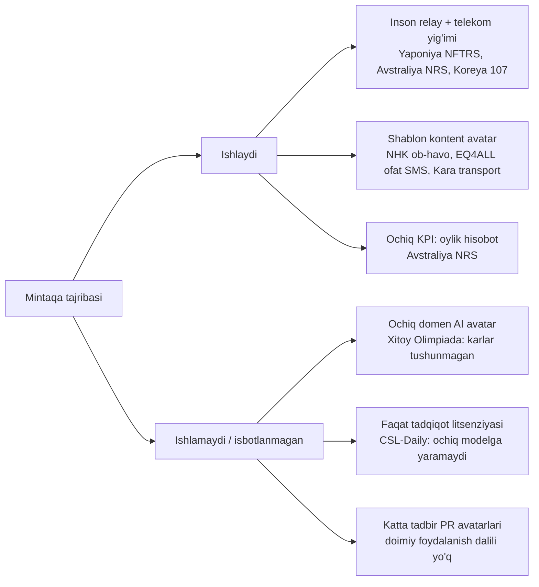

# 03e. Sharqiy Osiyo va Okeaniya: raqobatchilar va tajribalar

> Manba fayllar: `99_Ilovalar/xom_tadqiqot_yozuvlari/2_raqobat_va_ochiq_kod/region_east_asia_oceania.md` (asosiy), `2_raqobat_va_ochiq_kod/global_feature_matrix.md`, `1_birinchi_tadqiqot/global_apps_and_business_models.md` · Sana: 2026-11-15 · Qamrov: Janubiy Koreya, Yaponiya, Xitoy, Tayvan, Gonkong, Mo'g'uliston, Avstraliya, Yangi Zelandiya.

## Qisqacha

- Mintaqada ishlab chiqarishda haqiqatan ishlayotgan narsa ikkita: (1) telekom yig'imi bilan moliyalanadigan, ochiq KPI e'lon qiladigan **inson tarjimonli relay** (Yaponiya, Avstraliya, Koreya), (2) **tuzilgan/shablon kontentdagi avatar** (ob-havo, transport, ofat ogohlantirishi) — [region_east_asia_oceania, 7-bo'lim manbalari](https://www.nhk-fdn.or.jp/es/news/archive/shuwaCG.pdf); [AT](https://at.govt.nz/nzsl-app-alerts); [kjob.news](https://www.kjob.news/news/431732).
- Ochiq domendagi AI avatarlarni karlar yomon tushunadi: Xitoy Olimpiada avatarlarini kar professor teskari tarjima bilan baholagan va asosiy ma'lumot yo'qolganini ko'rsatgan, vendor esa ">90% tushunarlilik" deydi — [Sixth Tone](https://www.sixthtone.com/news/1017316/The%20Promise%20and%20Pitfalls%20of%20China%E2%80%99s%20AI%20Sign%20Language%20Interpreters); [Pandaily](https://pandaily.com/?p=91138).
- Yaponiyada qonun bilan belgilangan telefon relay (2021 dan): 2023-yil dekabr oxirida 14 000+ foydalanuvchi, oyiga ~30 000 qo'ng'iroq — [NFTRS](https://nftrs.or.jp/news/fy2024/files/NFTRSpapers_fy2024-001.pdf).
- Qayta ishlatsa bo'ladigan ochiq aktivlar: `google/shuwa` (o'qitish toolkit), J-Shuwa korpusi (197K juftlik, ~300 soat), CSL-Daily (faqat tadqiqot uchun) — [GitHub](https://github.com/google/shuwa); [ACL 2026](https://aclanthology.org/2026.findings-acl.1821/); [USTC](https://ustc-slr.github.io/datasets/2021_csl_daily).
- Yangi Zelandiya Kara: hamjamiyat nom bergan avatar (Tui), kar hamkorlikdagi dizayn, avval tuzilgan kontent — [AT](https://at.govt.nz/nzsl-app-alerts).
- Tayvan va Mo'g'uliston bo'yicha hech narsa topilmadi; bu kichik imo-ishora tillari uchun O'zbekiston platformasi mintaqaviy namuna bo'lishi mumkinligini ko'rsatadi (baho / tasdiqlanmagan, yozuvlardagi xulosa).

## Umumiy jadval

| # | Mahsulot | Mamlakat | Turi | Kim to'laydi | AI / inson | Ochiq kod | Holat | Manba |
|---|---|---|---|---|---|---|---|---|
| 1 | EQ4ALL AI avatar imo-ishora tarjimasi | Koreya | avatar (B2G/B2B) | davlat/korxona buyurtmasi (baho / tasdiqlanmagan) | AI avatar | yo'q (ma'lumot yo'q) | faol (2025-2026 ko'rgazmalar) | [kjob.news](https://www.kjob.news/news/431732) |
| 2 | KL Cube HandSignVerse | Koreya | 3D avatar (veb-sayt, bank) | korxona/mahalliy hokimiyat (baho / tasdiqlanmagan) | AI avatar | ma'lumot yo'q | faol (2026-05 COEX) | [Seoul Shinmun](https://m.seoul.co.kr/news/economy/2026/05/27/20260527500189) |
| 3 | KT + Korea Deaf Association video qo'ng'iroq (2GB/kun bepul) | Koreya | video qo'ng'iroq + zero-rating | KT (operator) | inson (video) | yo'q | 2020 da ishga tushgan, hozirgi holati ma'lumot yo'q | [Asia Economy](https://view.asiae.co.kr/article/2020030908251195296) |
| 4 | KT AI do'kon agenti (2026) | Koreya | og'zaki til tarjimasi (imo-ishora YO'Q) | KT | AI | yo'q | faol | [Korea Times](https://www.koreatimes.co.kr/business/companies/20260615/kt-rolls-out-ai-store-assistant-to-break-language-barriers-for-intl-customers) |
| 5 | 107 Sonmal-ieum Center | Koreya | davlat relay (imo-ishora/matn, VRS) | davlat (NIA) | inson | yo'q | 2005 dan faol | [futurechosun](https://futurechosun.com/archives/9642) |
| 6 | 119 imo-ishora tarjimasi (3 tomonlama video) | Koreya | favqulodda VRS | davlat (MSIT, Milliy yong'in agentligi) | inson | yo'q | faol | [korea.kr](https://m.korea.kr/news/policyNewsView.do?newsId=148941990) |
| 7 | AI Hub KSL video dataset | Koreya | dataset | davlat | — | litsenziya tasdiqlanmagan | faol | [Korea Univ.](https://aml.korea.ac.kr/research/sign-language-translation) |
| 8 | KBS AI imo-ishora ob-havo/yangilik avatari | Koreya | avatar | ma'lumot yo'q | AI avatar | ma'lumot yo'q | [BG] tasdiqlanmagan, ehtimol to'xtagan | xom yozuv [BG] |
| 9 | Metro/KTX kiosk imo-ishora avatari | Koreya | kiosk avatar | ma'lumot yo'q | AI avatar | ma'lumot yo'q | vendor noma'lum | dailian.co.kr snippet (URL yo'q) |
| 10 | Telefon relay xizmati (NFTRS) | Yaponiya | davlat relay (qonun bilan) | telekom yig'imi (raqam boshiga) | inson | yo'q | 2021 dan faol | [NFTRS](https://nftrs.or.jp/news/fy2024/files/NFTRSpapers_fy2024-001.pdf) |
| 11 | NHK ob-havo imo-ishora CG | Yaponiya | avatar (shablon kontent) | jamoat teleradiosi (NHK) | avtomatik CG | yo'q | 2017-02-20 dan faol | [NHK Foundation](https://www.nhk-fdn.or.jp/es/news/archive/shuwaCG.pdf) |
| 12 | NHK STRL "tarjima AI" (yangilik matni -> imo-ishora) | Yaponiya | avatar R&D | NHK | AI (diffusion) | yo'q | demo (2024) | [Phileweb](https://www.phileweb.com/news/d-av/202405/28/60433.html) |
| 13 | NHK Foundation style-transfer AI | Yaponiya | avatar R&D | NHK Foundation | AI | yo'q | tadqiqot | [NHK Foundation lab](https://www.nhk-fdn.or.jp/es/assets/img/lab/pdf/004.pdf) |
| 14 | Google `shuwa` toolkit | Yaponiya / Gonkong | tanib olish (o'qitish toolkit) | Google + Nippon Foundation | AI | ha (GitHub; litsenziya tasdiqlanmagan) | repo mavjud | [GitHub](https://github.com/google/shuwa) |
| 15 | SignTown (o'rganish o'yini) | Yaponiya / Gonkong | o'rganish | Nippon Foundation | AI (kamera) | ma'lumot yo'q | 2021 da chiqqan | [Nippon Foundation](https://en.nippon-foundation.or.jp/news/articles/2021/20210524-58778.html) |
| 16 | Nippon Foundation qo'llanma ilovasi (JSL, HKSL, Yangon SL) | Yaponiya / Gonkong / Myanma | o'rganish / lug'at | Nippon Foundation | inson video (baho / tasdiqlanmagan) | ma'lumot yo'q | chiqarilgan (2023) | [TNF](https://tnfsa.nippon-foundation.or.jp/news/1736325) |
| 17 | J-Shuwa korpusi | Yaponiya | dataset | akademik | — | kod/ma'lumot GitHub'da, litsenziya tekshirilmagan | 2026 | [ACL Anthology](https://aclanthology.org/2026.findings-acl.1821/) |
| 18 | SoftBank SureTalk | Yaponiya | tanib olish + STT | ma'lumot yo'q | AI | ma'lumot yo'q | [BG] ehtimol to'xtagan | xom yozuv [BG] |
| 19 | Tencent Lingyu (+ Xiaocong) | Xitoy | raqamli inson avatar | Tencent / CCTV | AI avatar | yo'q | 2022 Olimpiada; keyingi holat noma'lum | [Tencent](https://www.tencent.com/en-us/articles/2201380.html) |
| 20 | Baidu Intelligent Cloud imo-ishora raqamli insoni | Xitoy | avatar | Baidu | AI avatar | yo'q | test video; Olimpiada roli tasdiqlanmagan | [besthub.dev](https://www.besthub.dev/articles/ai-sign-language-digital-human-technology-challenges-and-development-by-baidu-intelligent-cloud-0aa012514cf7) |
| 21 | Alibaba DAMO "Xiaomo" | Xitoy | avatar | Alibaba | AI avatar | yo'q | 2022 Hangzhou Osiyo Para o'yinlari | [Sixth Tone](https://www.sixthtone.com/news/1017316/The%20Promise%20and%20Pitfalls%20of%20China%E2%80%99s%20AI%20Sign%20Language%20Interpreters) |
| 22 | China Mobile + Migu Video avatari | Xitoy | avatar (sport sharhi) | China Mobile / Migu | AI avatar | yo'q | 2022 Jahon chempionati | [Sixth Tone](https://www.sixthtone.com/news/1017316/The%20Promise%20and%20Pitfalls%20of%20China%E2%80%99s%20AI%20Sign%20Language%20Interpreters) |
| 23 | XJTLU imo-ishora AI loyihasi | Xitoy | tadqiqot | universitet | AI | ma'lumot yo'q | 2025 | [XJTLU](https://www.xjtlu.edu.cn/en/news/2025/06/breaking-barriers-with-a-sign-language-ai-project) |
| 24 | CSL-Daily | Xitoy | dataset | USTC | — | faqat tadqiqot (shartnoma bilan) | 2021 | [USTC](https://ustc-slr.github.io/datasets/2021_csl_daily) |
| 25 | CSL-News (Uni-Sign) | Xitoy | dataset | akademik | — | ma'lumot yo'q | 2025 | [arXiv 2501.15187](https://arxiv.org/pdf/2501.15187v2) |
| 26 | Huawei StorySign | Xitoy / Yevropa | avatar (bolalar kitobi) | Huawei | AI avatar | ma'lumot yo'q | [BG] ehtimol to'xtagan | xom yozuv [BG] |
| 27 | Milliy umumiy imo-ishora lug'ati (2019) | Xitoy | lug'at | davlat (CDPF) | inson | ma'lumot yo'q | [BG] tasdiqlanmagan | xom yozuv [BG] |
| 28 | Avstraliya National Relay Service (NRS) | Avstraliya | davlat relay (SMS, Chat, video) | Telecommunications Industry Levy | inson | yo'q | faol | [Access Hub](https://www.accesshub.gov.au/sites/default/files/documents/2025-07-monthly-performance-report-july.pdf) |
| 29 | Sign Bridge AI | Avstraliya (uchinchi tomon) | AI jonli tarjima (ASL, BSL, Auslan) | ma'lumot yo'q | AI | ma'lumot yo'q | 2025-11-02 ishga tushgan | [Product Hunt](https://www.producthunt.com/products/sign-bridge-ai-2/launches) |
| 30 | Auslan Signbank | Avstraliya | lug'at | universitet (Macquarie) | inson video | ochiq Signbank dasturi asosida [BG] | [BG] tasdiqlanmagan | xom yozuv [BG] |
| 31 | Kara KAT / avatar "Tui" (Auckland Transport) | Yangi Zelandiya | avatar (transport ogohlantirishi) | Auckland Transport (pilot) | AI avatar | yo'q | pilot | [AT](https://at.govt.nz/nzsl-app-alerts) |
| 32 | Kara real vaqt avatar tarjimasi | Yangi Zelandiya | avatar (real vaqt) | ma'lumot yo'q | AI avatar | yo'q | 2026-05 e'lon qilingan | [1News](https://www.1news.co.nz/2026/05/08/ai-avatars-to-deliver-real-time-nz-sign-language-translations/) |
| 33 | Raqamli NZSL kutubxonasi (Kara + NFDHH) | Yangi Zelandiya | lug'at/kutubxona | National Foundation for Deaf and Hard of Hearing | AI avatar (baho / tasdiqlanmagan) | ma'lumot yo'q | 2025-12 | [SecurityBrief](https://securitybrief.co.nz/story/digital-nzsl-library-to-boost-access-for-deaf-new-zealanders) |
| 34 | Onlayn NZSL bolalar kutubxonasi (Kara, 4 kitob) | Yangi Zelandiya | kontent | NZSL Fund (ODI) / NZSL Board + Ko Taku Reo | AI avatar | ma'lumot yo'q | bajarilgan | [ODI](https://odi.cwp.govt.nz/nzsl/nzsl-fund/nzsl-fund-recipient-news/online-nzsl-childrens-library/) |
| 35 | NZSL Online | Yangi Zelandiya | milliy lug'at | universitet (Victoria Univ. of Wellington) [BG] | inson video | CC litsenziya [BG] | faol (milliy lug'atlar ro'yxatida) | [HearingTracker](https://www.hearingtracker.com/apps/asl-bloom) |

Jami: 35 ta yozuv (mahsulot, xizmat, dataset va tadqiqot loyihalari). Tayvan va Mo'g'uliston uchun yozuv yo'q (topilmadi).

## Batafsil profillar

### Janubiy Koreya

**Mamlakat konteksti**

| Mavzu | Ma'lumot | Manba |
|---|---|---|
| Bozor tuzilishi | 2025-2026 avatar bozori kichik ijtimoiy venchurlar (EQ4ALL, KL Cube) tomonidan boshqariladi, katta telekomlar emas; davlat va korxona nuqtalariga (ofat SMS, kiosk, sayt, bank) sotiladi | [kjob.news](https://www.kjob.news/news/431732); [Seoul Shinmun](https://m.seoul.co.kr/news/economy/2026/05/27/20260527500189) |
| Relay mehnat sharoiti | 2018: relay markazidagi KT New Union filiali rahbari tarjimonlar sharoitini "juda yomon" degan; tarjimonlar NIA tomonidan to'g'ridan-to'g'ri yollanishi kerak edi; barcha imo-ishora tarjimonlarining ~50% Seulda, markazni ko'chirish yollashni qiyinlashtiradi | [Weekly Khan 2018](https://weekly.khan.co.kr/article/201812241411571) |
| Mahalliy tarjimon markazlari | Doimiy kadr tanqisligi, ko'pincha bir markazda atigi 4-5 tarjimon (2023) | [Segye 2023](https://www.segye.com/newsView/20230530514742) |
| Korea imo-ishora tili qonuni (2016) | [BG] 2016-yil avgustdan kuchga kirgan, KSL'ni koreys tili bilan teng rasmiy til qildi; davlat sektorida imo-ishora kontentiga talab va Milliy koreys tili instituti KSL lug'ati/korpusi uchun asos. Bu sessiyada manba olinmagan | xom yozuv [BG] |
| KAIST / ETRI tadqiqoti | Tafsilotlar olinmagan | — |
| Xulosa (yozuvlar) | Koreya modeli = davlat kichik ijtimoiy venchurlardan avatar tarjima sotib oladi; notijorat uchun qayta ishlatiladigan naqsh — jumlalar oldindan ma'lum "shablon kontent" (ofat ogohlantirishi, QR ma'lumot, kiosk), ochiq domen tarjima emas. 107 markazi relay xarajatining asosiy omili texnologiya emas, inson tarjimon va uning sharoiti ekanini ko'rsatadi | yozuvlardagi xulosa (baho / tasdiqlanmagan) |

#### EQ4ALL

| Maydon | Ma'lumot |
|---|---|
| Egasi | EQ4ALL (koreyscha nomi 이큐포올), B Corp sertifikatli ijtimoiy venchur — [seenthis.kr](https://seenthis.kr/newspageeng/4060?page=10); [kjob.news](https://www.kjob.news/news/431732) |
| Yil | ma'lumot yo'q (2025-2026 faoliyati tasdiqlangan) |
| Platforma | Davlat xizmatlari integratsiyasi: Jeju ofat SMS ogohlantirishlari, Oziq-ovqat va dori xavfsizligi vazirligi oziq-ovqat QR xizmati, Milliy pensiya xizmati, Koreya milliy muzeyi — [kjob.news](https://www.kjob.news/news/431732); [seenthis.kr](https://seenthis.kr/newspageeng/4898) |
| Yuklanma / reyting / foydalanuvchilar | ma'lumot yo'q |
| Asosiy funksiyalar | AI asosidagi avatar imo-ishora tarjimasi va boshqa qulaylik yechimlari; AI imo-ishora ofat eshittirish yechimlari. Ko'rgazmalar: AI Festa 2025 (2025-09-30 - 10-02, mavzu "Information for All") — [seenthis.kr](https://seenthis.kr/newspageeng/4060?page=10); Korea Social Value Festa (2025-avgust, COEX) — [seenthis.kr](https://seenthis.kr/newspageeng/4898); World IT Show 2026 (Seul, 2026-04-22) rejalashtirilgan — [venturesquare](https://www.venturesquare.net/en/1125921/) |
| Kim to'laydi (moliya modeli) | Davlat va korxona xaridi (yozuvlardagi xulosa, baho / tasdiqlanmagan) |
| AI yoki inson | AI avatar |
| Ochiq kod | ma'lumot yo'q |
| Holat | Faol |
| Manba | [kjob.news](https://www.kjob.news/news/431732); [seenthis.kr](https://seenthis.kr/newspageeng/4060?page=10); [venturesquare](https://www.venturesquare.net/en/1125921/) |

- **Nimani olamiz:** jumlalari oldindan ma'lum kontent (ofat ogohlantirishi, QR ma'lumot) uchun imo-ishora video; davlat xizmati nuqtalariga integratsiya.
- **Nimadan qochamiz:** avatarni birinchi bosqich mahsuloti qilish (strategiyada avatar faqat statik kontent uchun keyingi bosqich).

#### KL Cube - HandSignVerse

| Maydon | Ma'lumot |
|---|---|
| Egasi | KL Cube (케이엘큐브) — [Seoul Shinmun 2026-05-27](https://m.seoul.co.kr/news/economy/2026/05/27/20260527500189) |
| Yil | AI EXPO KOREA 2025 da namoyish; 2026-may COEX saytida qo'llanilgan — [Seoul Shinmun](https://m.seoul.co.kr/news/economy/2026/05/27/20260527500189) |
| Platforma | Veb-sayt: COEX saytining asosiy yo'riqnomasi (ikonkani bosish -> KSL video o'ynaydi) |
| Yuklanma / reyting / foydalanuvchilar | ma'lumot yo'q |
| Asosiy funksiyalar | "3D avatar AI imo-ishora tarjima xizmati", platforma nomi HandSignVerse (핸드사인버스); KakaoBank imo-ishora maslahati va Seongdong-gu ijtimoiy muassasalar yo'riqnomasi bilan bog'liq — [Seoul Shinmun](https://m.seoul.co.kr/news/economy/2026/05/27/20260527500189); [socialvalue.kr](https://www.socialvalue.kr/news/view/1065600755495883?dt=m) |
| Kim to'laydi (moliya modeli) | Korxona va mahalliy hokimiyat (baho / tasdiqlanmagan) |
| AI yoki inson | AI 3D avatar |
| Ochiq kod | ma'lumot yo'q |
| Holat | Faol (2026) |
| Manba | [Seoul Shinmun](https://m.seoul.co.kr/news/economy/2026/05/27/20260527500189); [socialvalue.kr](https://www.socialvalue.kr/news/view/1065600755495883?dt=m) |

- **Nimani olamiz:** "ikonka bosilsa imo-ishora video" naqshi — sayt/idora sahifasiga joylanadigan vidjet (inson yozgan video bilan).
- **Nimadan qochamiz:** bank maslahatini avatarga topshirish; yuqori xavfli suhbat inson tarjimonda qolishi kerak.

#### KT + Korea Deaf Association video qo'ng'iroq xizmati (2020) va KT AI do'kon agenti (2026)

| Maydon | Ma'lumot |
|---|---|
| Egasi | KT (operator) va Korea Deaf Association — [Asia Economy 2020](https://view.asiae.co.kr/article/2020030908251195296) |
| Yil | 2020 (video qo'ng'iroq); 2026 (AI do'kon agenti) |
| Platforma | Mobil video qo'ng'iroq ("son'mal yeongsang tonghwa" / 손말 영상통화) |
| Yuklanma / reyting / foydalanuvchilar | ma'lumot yo'q |
| Asosiy funksiyalar | Eshitish nogironligi ro'yxatidagi KT mijozlari uchun kuniga 2GB bepul maxsus trafik bilan video qo'ng'iroq — [Asia Economy](https://view.asiae.co.kr/article/2020030908251195296). 2026 AI do'kon agenti 20+ og'zaki tilni qo'llaydi, imo-ishora tilini emas — [Korea Times 2026-06-15](https://www.koreatimes.co.kr/business/companies/20260615/kt-rolls-out-ai-store-assistant-to-break-language-barriers-for-intl-customers) |
| Kim to'laydi (moliya modeli) | Operator (bepul trafik, CSR) |
| AI yoki inson | Video qo'ng'iroq: inson; do'kon agenti: AI |
| Ochiq kod | yo'q |
| Holat | 2020 xizmatining hozirgi holati ma'lumot yo'q; KT'ning imo-ishora bo'yicha tasdiqlangan taklifi shu eski xizmat |
| Manba | [Asia Economy](https://view.asiae.co.kr/article/2020030908251195296); [Korea Times](https://www.koreatimes.co.kr/business/companies/20260615/kt-rolls-out-ai-store-assistant-to-break-language-barriers-for-intl-customers) |

- **Nimani olamiz:** operator bilan **zero-rating** (karlar uchun video trafik bepul) — strategiyadagi "operatorlar bilan zero-rating" bosqichiga to'g'ridan-to'g'ri namuna.
- **Nimadan qochamiz:** operatorning AI agentlari imo-ishorani qamrab oladi deb taxmin qilish.

#### 107 Sonmal-ieum Center (davlat relay) va 119 imo-ishora tarjimasi

| Maydon | Ma'lumot |
|---|---|
| Egasi | NIA (Koreya intellektual axborot jamiyati agentligi, 한국지능정보사회진흥원) — [futurechosun](https://futurechosun.com/archives/9642); [110.go.kr](https://www.110.go.kr/consult/cam.do) |
| Yil | 2005 (2005-noyabrda ishga tushgan) |
| Platforma | Veb-sayt va mobil telefon orqali video relay; imo-ishora/matn telekom relay |
| Yuklanma / reyting / foydalanuvchilar | Bir maqolada ishga tushgandan beri kuniga o'rtacha 2 000+ qo'ng'iroq deyiladi (maqola yili aniq emas, hozirgi raqam emas) — [futurechosun](https://futurechosun.com/archives/9642). 2023-2026 yillik hajm, budjet, tarjimonlar soni topilmadi |
| Asosiy funksiyalar | Imo-ishora/matn relay; 119: MSIT va Milliy yong'in agentligi kar qo'ng'iroqchi, 119 boshqaruv xonasi va relay tarjimonni Sonmal-ieum markazi orqali **3 tomonlama video qo'ng'iroqqa** ulaydigan tizim ochgan — [korea.kr](https://m.korea.kr/news/policyNewsView.do?newsId=148941990) |
| Kim to'laydi (moliya modeli) | Davlat (NIA) |
| AI yoki inson | Inson tarjimon |
| Ochiq kod | yo'q |
| Holat | Faol |
| Manba | [futurechosun](https://futurechosun.com/archives/9642); [110.go.kr](https://www.110.go.kr/consult/cam.do); [korea.kr](https://m.korea.kr/news/policyNewsView.do?newsId=148941990); [Weekly Khan](https://weekly.khan.co.kr/article/201812241411571) |

- **Nimani olamiz:** favqulodda xizmat + kar + tarjimon **3 tomonlama video** (SOS keyingi bosqichi uchun FVV/112 bilan pilot modeli).
- **Nimadan qochamiz:** tarjimonlarning yomon mehnat sharoiti va markazni tarjimonlar yashamaydigan joyga ko'chirish (Seul ~50% omili); VRI'da tarjimonlarga masofadan ishlash imkonini berish.

#### AI Hub KSL video dataset

| Maydon | Ma'lumot |
|---|---|
| Egasi | AI Hub (Koreya davlat platformasi) |
| Yil | ma'lumot yo'q |
| Platforma | Dataset (aihub.or.kr) |
| Yuklanma / reyting / foydalanuvchilar | Koreya akademik ishlarida keng ishlatiladi; bir maqola AI Hub imo-ishora video dataseti bilan tarjimada BLEU-4 34.68 natija beradi; maqolalar uni katta hajmli, ko'p imo-ishorachili, ko'p burchakli deydi — [Korea Univ. AML lab](https://aml.korea.ac.kr/research/sign-language-translation); [koreascience](https://www.koreascience.kr/article/CFKO202023758834200.pdf). Talaba loyihasi "56GB, millionlab namuna" deydi (norasmiy raqam) — [Sookmyung](https://software.sookmyung.ac.kr/bbs/software/722/100761/download.do) |
| Asosiy funksiyalar | KSL video ma'lumotlari, tarjima modelini o'qitish |
| Kim to'laydi (moliya modeli) | Davlat |
| AI yoki inson | — (dataset) |
| Ochiq kod | Rasmiy hajm va litsenziya tasdiqlanmagan. [BG] Koreya fuqarolari/rezidentlari uchun ariza bilan bepul, Koreya ichida tadqiqot va tijorat uchun ruxsat, chet elga o'tkazishda cheklov; xorijliklar kirishi cheklangan — aihub.or.kr'da tekshirish kerak |
| Holat | Faol |
| Manba | [Korea Univ.](https://aml.korea.ac.kr/research/sign-language-translation); [koreascience](https://www.koreascience.kr/article/CFKO202023758834200.pdf); [Sookmyung](https://software.sookmyung.ac.kr/bbs/software/722/100761/download.do) |

- **Nimani olamiz:** davlat tomonidan katta, ko'p imo-ishorachili, ko'p burchakli dataset yig'ish g'oyasi.
- **Nimadan qochamiz:** mamlakatdan tashqariga chiqarishni cheklaydigan litsenziya; strategiyada ochiq qism CC BY-SA 4.0 / CC BY 4.0.

#### KBS AI imo-ishora avatari va metro/KTX kiosk avatari (tasdiqlanmagan)

| Maydon | Ma'lumot |
|---|---|
| Egasi | KBS (EQ4ALL/ETRI bilan bog'liq texnologiya) [BG]; kiosk vendori aniqlanmagan |
| Yil | [BG] taxminan 2020-2022 (KBS pilot) |
| Platforma | Teleko'rsatuv (ob-havo/yangilik); kiosk |
| Yuklanma / reyting / foydalanuvchilar | ma'lumot yo'q |
| Asosiy funksiyalar | KBS: AI imo-ishora ob-havo/yangilik avatari pilot [BG]. Kiosk: eshitmaydigan yo'lovchilar savollariga imo-ishora avatari bilan javob (dailian.co.kr snippet) |
| Kim to'laydi (moliya modeli) | ma'lumot yo'q |
| AI yoki inson | AI avatar |
| Ochiq kod | ma'lumot yo'q |
| Holat | 2025 izlashda KBS/MBC AI imo-ishora yangilik avatari, Samsung, SK Telecom yoki Naver imo-ishora mahsuloti topilmadi; [BG] SKT/Samsung kichik CSR loyihalari bo'lgan; tasdiqlanmagan, ehtimol to'xtagan |
| Manba | xom yozuv [BG]; dailian.co.kr snippet (URL yozuvlarda yo'q) |

- **Nimani olamiz:** hech narsa (dalil yo'q).
- **Nimadan qochamiz:** pilotdan keyin to'xtab qolgan teleko'rsatuv avatarlari naqshi.

### Yaponiya

**Mamlakat konteksti**

| Mavzu | Ma'lumot | Manba |
|---|---|---|
| Relay qonuni | Dunyodagi eng aniq qonun bilan belgilangan jamoat telefon relay xizmati (2021 dan). [BG] 2021 qonuni: Act on Facilitation of Telephone Relay Service for Persons with Hearing Disabilities; yig'im dastlab yiliga raqam boshiga 1 yen, keyin o'zgargan — tekshirish kerak | xom yozuv; [BG] |
| Operatorlar yig'imi | SoftBank, NTT, NTT West, Rakuten relay yig'imi bo'yicha yillik e'lon chiqaradi (2025-mart, 2026-mart) | [SoftBank 2025-03-25](https://www.softbank.jp/corp/news/press/sbkk/2025/20250325_01/); [NTT West 2026-03-26](https://www.ntt-west.co.jp/newscms/info5/15132/oshirase20260326.pdf); [Rakuten Mobile](https://network.mobile.rakuten.co.jp/information/news/service/3314/) |
| Moliya modeli (xulosa) | Raqam boshiga operatorlar orqali yig'iladigan yig'im = "universal xizmat yig'imi" modeli, Avstraliya bilan bir oila (operator e'lonlaridan xulosa, baho / tasdiqlanmagan) | yozuvlardagi xulosa |
| MIC 5 yillik sharh | MIC (Ichki ishlar va kommunikatsiya vazirligi) relay xizmatining 5 yillik sharhini 2025-10-29 da e'lon qilgan | [soumu.go.jp PDF](https://www.soumu.go.jp/main_content/001038069.pdf) |
| MIC seminarlari | 2025 da relay xizmati seminarlari (axborot qulayligi portali) | [soumu.go.jp](https://www.soumu.go.jp/info-accessibility-portal/telecomrelay/seminar/2025/) |
| Foydalanish zichligi (xulosa) | ~14k foydalanuvchiga oyiga ~30k qo'ng'iroq => foydalanuvchiga oyiga ~2 qo'ng'iroq; Yaponiya kar aholisiga nisbatan kichik (baho / tasdiqlanmagan) | yozuvlardagi xulosa |

#### Telefon relay xizmati (Nippon Foundation Telephone Relay Service, NFTRS)

| Maydon | Ma'lumot |
|---|---|
| Egasi | Nippon Foundation Telephone Relay Service — [NFTRS FY2024](https://nftrs.or.jp/news/fy2024/files/NFTRSpapers_fy2024-001.pdf) |
| Yil | 2021 (qonun bilan) |
| Platforma | Telefon relay (imo-ishora/matn), ma'lumot yo'q (aniq ilova tafsiloti) |
| Yuklanma / reyting / foydalanuvchilar | 2023-12 oxiri: 14 000+ foydalanuvchi, oyiga ~30 000 qo'ng'iroq, oyiga 210 000+ daqiqa tarjima — [NFTRS](https://nftrs.or.jp/news/fy2024/files/NFTRSpapers_fy2024-001.pdf). 2026-mart sanoat hujjati: 19 000 foydalanuvchi va yiliga 440 000 qo'ng'iroq (davr ko'rsatilmagan) — [appie.or.jp](https://appie.or.jp/wp-content/uploads/2026/03/20260324keisansyou1-2.pdf) |
| Asosiy funksiyalar | Eshitmaydiganlar uchun telefon relay (inson tarjimon) |
| Kim to'laydi (moliya modeli) | Operatorlar orqali yig'iladigan raqam boshiga yig'im (xulosa); FY2024/FY2025 aniq qo'ng'iroq soni, yig'im miqdori, yillik xarajat MIC PDF'da, ajratib olinmagan |
| AI yoki inson | Inson |
| Ochiq kod | yo'q |
| Holat | Faol |
| Manba | [NFTRS](https://nftrs.or.jp/news/fy2024/files/NFTRSpapers_fy2024-001.pdf); [appie.or.jp](https://appie.or.jp/wp-content/uploads/2026/03/20260324keisansyou1-2.pdf); [soumu.go.jp](https://www.soumu.go.jp/main_content/001038069.pdf) |

- **Nimani olamiz:** qonun + operator yig'imi bilan barqaror moliya (uzoq muddatli advokatlik maqsadi); oylik daqiqa/qo'ng'iroq statistikasini ochiq e'lon qilish.
- **Nimadan qochamiz:** foydalanuvchi soni kar aholisiga nisbatan kichik qolishi — VRI'ni ro'yxatdan o'tmasdan chaqirish va halol ish soatlari bilan kirish to'sig'ini pasaytirish.

#### NHK ob-havo imo-ishora CG va NHK STRL / NHK Foundation tadqiqotlari

| Maydon | Ma'lumot |
|---|---|
| Egasi | NHK, NHK STRL (Science & Technology Research Laboratories), NHK Foundation |
| Yil | 2017-02-20 (ob-havo CG sayti ochilgan); 2022 (NHK Osaka sinovi); 2024 (STRL Open House) |
| Platforma | Veb-sayt (ob-havo CG), teleko'rsatuv |
| Yuklanma / reyting / foydalanuvchilar | ma'lumot yo'q |
| Asosiy funksiyalar | Prefektura ob-havo telegrammalaridan videolarni avtomatik yaratadi, asosan kuniga 3 marta — [NHK Foundation](https://www.nhk-fdn.or.jp/es/news/archive/shuwaCG.pdf); [MIC](https://www.soumu.go.jp/main_content/000509122.pdf). 2022: NHK Osaka oddiy vaqtda ob-havo va favqulodda vaqtda ofat ma'lumotini imo-ishora CG'da yetkazgan — [MIC](https://www.soumu.go.jp/main_content/000843755.pdf). 2024 STRL: yapon yangilik matnini imo-ishora so'zlar ketma-ketligiga aylantiradigan "tarjima AI"; harakat diffusion modellar bilan, yuz ifodasi boshqaruvi bilan — [Phileweb](https://www.phileweb.com/news/d-av/202405/28/60433.html). NHK Foundation: jonli imo-ishorachi videosini anime uslubiga o'tkazadigan style-transfer AI (motion-capture'siz CG); yaponchadan JSL'ga tarjima erkin (so'zma-so'z emas) tarjima talab qiladi va qiyin; ob-havo va sport imo-ishora CG shablonlari — [NHK Foundation lab](https://www.nhk-fdn.or.jp/es/assets/img/lab/pdf/004.pdf); [VIEW2021](https://www.nhk-fdn.or.jp/es/view/pdf/VIEW2021_40_6_11.pdf) |
| Kim to'laydi (moliya modeli) | Jamoat teleradiosi (NHK) |
| AI yoki inson | Ob-havo: avtomatik CG (shablon); yangilik: AI demo |
| Ochiq kod | yo'q |
| Holat | Ob-havo CG faol; ochiq domen yangilik tarjimasi 7+ yildan keyin ham demo bosqichida (xulosa) |
| Manba | [NHK Foundation](https://www.nhk-fdn.or.jp/es/news/archive/shuwaCG.pdf); [MIC 2017](https://www.soumu.go.jp/main_content/000509122.pdf); [MIC 2022](https://www.soumu.go.jp/main_content/000843755.pdf); [Phileweb](https://www.phileweb.com/news/d-av/202405/28/60433.html) |

- **Nimani olamiz:** tuzilgan kirish (ob-havo telegrammasi) -> shablon imo-ishora; 2-faza avatar (sign stitching / performs) uchun eng to'g'ri birinchi foydalanish holati.
- **Nimadan qochamiz:** ochiq domen yangilik tarjimasini va'da qilish (NHK 7+ yilda ham demo).

#### Google `shuwa` toolkit va SignTown

| Maydon | Ma'lumot |
|---|---|
| Egasi | Nippon Foundation + Gonkong Xitoy universiteti (CUHK), Google va Kwansei Gakuin universiteti bilan (KGU JSL so'zlarini tanlagan va JSL ma'lumotini yig'gan) — [Nippon Foundation 2021](https://en.nippon-foundation.or.jp/news/articles/2021/20210524-58778.html); [TNF SignTown](https://tnfsa.nippon-foundation.or.jp/news/531449) |
| Yil | 2021 (SignTown) |
| Platforma | GitHub toolkit; SignTown — onlayn imo-ishora o'rganish o'yini |
| Yuklanma / reyting / foydalanuvchilar | ma'lumot yo'q |
| Asosiy funksiyalar | JSL va HKSL videolaridan imo va yuz ifodalarini tanib olish uchun bazaviy model o'qitish; istalgan imo-ishora tilidagi istalgan imoga o'qitish mumkin — [github.com/google/shuwa](https://github.com/google/shuwa) |
| Kim to'laydi (moliya modeli) | Google va Nippon Foundation (hamkorlik) |
| AI yoki inson | AI |
| Ochiq kod | Ha, GitHub'da; litsenziya bu sessiyada tasdiqlanmagan ([BG] Google repolari odatda Apache-2.0). Asosiy JSL/HKSL video ma'lumoti chiqarilgani tasdiqlanmagan |
| Holat | Repo mavjud (faollik ma'lumot yo'q) |
| Manba | [GitHub](https://github.com/google/shuwa); [Nippon Foundation](https://en.nippon-foundation.or.jp/news/articles/2021/20210524-58778.html) |

- **Nimani olamiz:** o'qitish toolkit'i + SignTown uslubidagi o'rganish o'yini (ota-onalar uchun o'rganish moduliga).
- **Nimadan qochamiz:** litsenziyani tekshirmasdan kodni ko'chirish (strategiya: kod Apache-2.0/MIT, har komponent litsenziyasi tekshiriladi).

#### Nippon Foundation qo'llanma ilovasi (JSL, HKSL, Yangon SL)

| Maydon | Ma'lumot |
|---|---|
| Egasi | Nippon Foundation — [TNF](https://tnfsa.nippon-foundation.or.jp/news/1736325); [Nippon Foundation 2023](https://en.nippon-foundation.or.jp/news/articles/2023/20230922-95355.html) |
| Yil | 2023 (manba sanasi) |
| Platforma | Mobil ilova (aniq platforma ma'lumot yo'q) |
| Yuklanma / reyting / foydalanuvchilar | ma'lumot yo'q |
| Asosiy funksiyalar | Yapon, Gonkong va Yangon imo-ishora tillarini o'rganish qo'llanmasi |
| Kim to'laydi (moliya modeli) | Fond (xayriya) |
| AI yoki inson | ma'lumot yo'q |
| Ochiq kod | ma'lumot yo'q |
| Holat | Chiqarilgan |
| Manba | [TNF](https://tnfsa.nippon-foundation.or.jp/news/1736325); [Nippon Foundation 2023](https://en.nippon-foundation.or.jp/news/articles/2023/20230922-95355.html) |

- **Nimani olamiz:** bitta ilovada bir nechta imo-ishora tili (UzSL + RSL taqqoslash, MDHga kengayish uchun).
- **Nimadan qochamiz:** —

#### J-Shuwa korpusi

| Maydon | Ma'lumot |
|---|---|
| Egasi | Junwen Mo va boshq. (ACL Findings 2026) — [ACL Anthology](https://aclanthology.org/2026.findings-acl.1821/) |
| Yil | 2026 |
| Platforma | Dataset, kod/ma'lumot: github.com/SpaJune/J-Shuwa |
| Yuklanma / reyting / foydalanuvchilar | 197K parallel JSL-yapon jumla juftligi, ~300 soat, vebdan yig'ilgan, "hozirgacha ommaga ochiq eng katta JSL dataseti" |
| Asosiy funksiyalar | Uzluksiz imo-ishora tarjimasi uchun parallel korpus |
| Kim to'laydi (moliya modeli) | Akademik |
| AI yoki inson | — (dataset) |
| Ochiq kod | Kod/ma'lumot GitHub'da; litsenziya tekshirilmagan (vebdan yig'ilgan video ko'pincha qayta tarqatishni cheklaydi) |
| Holat | 2026 nashr. Google Shuwa loyihasi bilan bog'liqlik topilmadi |
| Manba | [ACL Anthology](https://aclanthology.org/2026.findings-acl.1821/) |

- **Nimani olamiz:** TV/onlayn imo-ishorali kontentdan korpus yig'ish metodologiyasi (O'zbek TV imo-ishora tarjimasi + subtitrlar).
- **Nimadan qochamiz:** rozilik va litsenziyasiz vebdan yig'ilgan videoni ochiq dataset sifatida tarqatish (strategiya: qatlamli rozilik).

#### SoftBank SureTalk (tasdiqlanmagan)

| Maydon | Ma'lumot |
|---|---|
| Egasi | SoftBank (Fujitsu bilan) [BG] |
| Yil | [BG] taxminan 2016 |
| Platforma | ma'lumot yo'q |
| Yuklanma / reyting / foydalanuvchilar | ma'lumot yo'q |
| Asosiy funksiyalar | [BG] imo-ishorani tanib olish + nutqdan matnga |
| Kim to'laydi (moliya modeli) | ma'lumot yo'q |
| AI yoki inson | AI |
| Ochiq kod | ma'lumot yo'q |
| Holat | [BG] to'xtatilgan deb taxmin qilinadi — tekshirish kerak. "Tsuyaku"/tarjima ilovalari, Sony, Fujitsu, KDDI olingan manbalarda qamralmagan |
| Manba | xom yozuv [BG] |

- **Nimani olamiz:** —
- **Nimadan qochamiz:** ochiq suhbatda imo-ishorani tanib olishni MVP qilish.

### Xitoy

**Mamlakat konteksti**

| Mavzu | Ma'lumot | Manba |
|---|---|---|
| Eshitish nogironligi aholisi | Xitoyda 20,5 million kishi eshitish nogironligiga ega (milliy so'rov) | [Sixth Tone](https://www.sixthtone.com/news/1017316/The%20Promise%20and%20Pitfalls%20of%20China%E2%80%99s%20AI%20Sign%20Language%20Interpreters) |
| Lingvistik bo'shliq | Wu Ling tadqiqoti: CSL imolarining 50% uchun xitoycha ekvivalent yo'q | [Sixth Tone](https://www.sixthtone.com/news/1017316/The%20Promise%20and%20Pitfalls%20of%20China%E2%80%99s%20AI%20Sign%20Language%20Interpreters) |
| Tarjimonlar | Tarjimon tanqisligi; tarjimonlik mutaxassisligini kam universitetlar taklif qiladi | [Sixth Tone](https://www.sixthtone.com/news/1017316/The%20Promise%20and%20Pitfalls%20of%20China%E2%80%99s%20AI%20Sign%20Language%20Interpreters) |
| Kar boshchiligidagi baho (Sixth Tone, 2025-07-09, muallif Zheng Xuan, kar universitet professori, yirik texnologiya kompaniyasining avatar loyihasi sobiq maslahatchisi) | Olimpiada avatar imo-ishorasini teskari tarjima qilish: asosiy ma'lumotning sezilarli qismi yo'qolgan yoki buzilgan; karlar (video va transkriptlar) tushunishda qiynalgan; qo'l shakli, joylashuv, harakat, yuz ifodasi, og'iz harakati kundalik CSL'dan farq qilgan; xitoycha so'z tartibidagi jumlalarni uddalagan, fazoviy/bir vaqtli konstruksiyalarda ("suvda suzayotgan baliq") xato qilgan; karlar va tarjimonlar asosan shubhali, lug'at cheklangan, ko'p ma'noli so'zlarda muammo; avatarlarni eng yaxshi eshituvchi auditoriya qabul qilgan; ishlab chiquvchilar kar va tarjimonlarni yordamchi rolda saqlagan | [Sixth Tone](https://www.sixthtone.com/news/1017316/The%20Promise%20and%20Pitfalls%20of%20China%E2%80%99s%20AI%20Sign%20Language%20Interpreters) |
| Katta tadbir avatarlari (xulosa) | Olimpiada, Para o'yinlari, Jahon chempionati avatarlari PR joylashtirishlar edi; doimiy kundalik foydalanish dalili topilmadi (baho / tasdiqlanmagan) | yozuvlardagi xulosa |
| Milliy standart | [BG] Milliy umumiy imo-ishora tili (2018 standarti), 2019 da "Milliy umumiy imo-ishora lug'ati" nashr qilingan; Xitoy nogironlar federatsiyasi onlayn versiya/ilova yuritadi — tekshirish kerak. iFlytek imo-ishora mahsulotlari va Xitoy kar ilovalari olinmagan | xom yozuv [BG] |

#### Tencent Lingyu (va Xiaocong)

| Maydon | Ma'lumot |
|---|---|
| Egasi | Tencent — [Tencent](https://www.tencent.com/en-us/articles/2201380.html) |
| Yil | 2022 (Pekin qishki Olimpiadasi) |
| Platforma | CCTV teleko'rsatuvi, cctv.com; hamroh avatar Xiaocong — Tencent Sports uchun |
| Yuklanma / reyting / foydalanuvchilar | Tencent da'vosi: lug'at/jumla qamrovi >1,6 million va imo-ishora tushunarliligi >90% (vendor raqamlari) — [Pandaily](https://pandaily.com/?p=91138) |
| Asosiy funksiyalar | 3D imo-ishora raqamli tarjimoni; Xitoyning birinchi oltini (aralash jamoa shorttrek estafetasi) uchun ishlatilgan; boshlovchilarning yuz ifodasi/og'iz harakatini o'qib eshittirishni imo-ishoraga tarjima qiladi — [Pandaily](https://pandaily.com/?p=91138); [China Daily](https://regional.chinadaily.com.cn/wic/2024-05/23/c_989709_2.htm) |
| Kim to'laydi (moliya modeli) | Tencent / CCTV (korporativ) |
| AI yoki inson | AI avatar |
| Ochiq kod | yo'q (ochiq API tasdiqlanmagan) |
| Holat | 2022 dan keyingi holat (hali CCTV'dami, ochiq API bormi) tasdiqlanmagan |
| Manba | [Pandaily](https://pandaily.com/?p=91138); [Tencent](https://www.tencent.com/en-us/articles/2201380.html); [China Daily](https://regional.chinadaily.com.cn/wic/2024-05/23/c_989709_2.htm); [Sixth Tone](https://www.sixthtone.com/news/1017316/The%20Promise%20and%20Pitfalls%20of%20China%E2%80%99s%20AI%20Sign%20Language%20Interpreters) |

- **Nimani olamiz:** kar imo-ishorachilar tomonidan **teskari tarjima bilan baholash**ni platformaning ochiq, o'rnatilgan sifat metrikasi qilish.
- **Nimadan qochamiz:** vendorning ">90% tushunarlilik" kabi da'volariga tayanish; karlarni yordamchi rolda saqlash (strategiya: kar boshqaruvi).

#### Baidu Intelligent Cloud imo-ishora raqamli insoni

| Maydon | Ma'lumot |
|---|---|
| Egasi | Baidu Intelligent Cloud — [besthub.dev](https://www.besthub.dev/articles/ai-sign-language-digital-human-technology-challenges-and-development-by-baidu-intelligent-cloud-0aa012514cf7) |
| Yil | ma'lumot yo'q |
| Platforma | ma'lumot yo'q |
| Yuklanma / reyting / foydalanuvchilar | Test videodan keyin viral bo'lgan; boshqa raqam yo'q |
| Asosiy funksiyalar | Baidu Intelligent Cloud'ning "birinchi AI boshqaradigan imo-ishora raqamli insoni" |
| Kim to'laydi (moliya modeli) | Korporativ |
| AI yoki inson | AI avatar |
| Ochiq kod | yo'q |
| Holat | Olimpiada roli tasdiqlanmagan |
| Manba | [besthub.dev](https://www.besthub.dev/articles/ai-sign-language-digital-human-technology-challenges-and-development-by-baidu-intelligent-cloud-0aa012514cf7) |

- **Nimani olamiz:** —
- **Nimadan qochamiz:** viral test video = mahsulot sifati degan taxmin.

#### Alibaba DAMO "Xiaomo" va China Mobile + Migu Video avatari

| Maydon | Ma'lumot |
|---|---|
| Egasi | Alibaba DAMO Academy; China Mobile + Migu Video — [Sixth Tone](https://www.sixthtone.com/news/1017316/The%20Promise%20and%20Pitfalls%20of%20China%E2%80%99s%20AI%20Sign%20Language%20Interpreters) |
| Yil | 2022 |
| Platforma | Teleko'rsatuv / video striming |
| Yuklanma / reyting / foydalanuvchilar | ma'lumot yo'q |
| Asosiy funksiyalar | Xiaomo: 2022 Hangzhou Osiyo Para o'yinlari uchun avatar; Migu: 2022 Jahon chempionati imo-ishora sharhi avatari |
| Kim to'laydi (moliya modeli) | Korporativ |
| AI yoki inson | AI avatar |
| Ochiq kod | yo'q |
| Holat | Tadbirga bog'liq; doimiy foydalanish dalili yo'q |
| Manba | [Sixth Tone](https://www.sixthtone.com/news/1017316/The%20Promise%20and%20Pitfalls%20of%20China%E2%80%99s%20AI%20Sign%20Language%20Interpreters) |

- **Nimani olamiz:** —
- **Nimadan qochamiz:** kar bahosisiz katta tadbir "vitrina" avatarlari.

#### XJTLU imo-ishora AI loyihasi

| Maydon | Ma'lumot |
|---|---|
| Egasi | Xi'an Jiaotong-Liverpool University (XJTLU) — [XJTLU](https://www.xjtlu.edu.cn/en/news/2025/06/breaking-barriers-with-a-sign-language-ai-project) |
| Yil | 2025 |
| Platforma | ma'lumot yo'q |
| Yuklanma / reyting / foydalanuvchilar | ma'lumot yo'q |
| Asosiy funksiyalar | Imo-ishora AI tadqiqot loyihasi (tafsilot yozuvlarda yo'q) |
| Kim to'laydi (moliya modeli) | Universitet |
| AI yoki inson | AI |
| Ochiq kod | ma'lumot yo'q |
| Holat | 2025 faol |
| Manba | [XJTLU](https://www.xjtlu.edu.cn/en/news/2025/06/breaking-barriers-with-a-sign-language-ai-project) |

- **Nimani olamiz:** universitet bilan tadqiqot hamkorligi formati.
- **Nimadan qochamiz:** —

#### CSL-Daily va CSL-News (datasetlar)

| Maydon | Ma'lumot |
|---|---|
| Egasi | CSL-Daily: USTC (aloqa: prof. Wengang Zhou va Houqiang Li); CSL-News: Uni-Sign maqolasi mualliflari — [USTC](https://ustc-slr.github.io/datasets/2021_csl_daily); [arXiv 2501.15187](https://arxiv.org/pdf/2501.15187v2) |
| Yil | CSL-Daily: CVPR 2021; CSL-News: 2025 |
| Platforma | Dataset |
| Yuklanma / reyting / foydalanuvchilar | CSL-Daily: kundalik hayot CSL korpusi (hajmi yozuvlarda yo'q); CSL-News: matn annotatsiyali 1 985 soat CSL video |
| Asosiy funksiyalar | Uzluksiz imo-ishora tanib olish/tarjima uchun ma'lumot |
| Kim to'laydi (moliya modeli) | Akademik |
| AI yoki inson | — (dataset) |
| Ochiq kod | CSL-Daily: faqat universitet va tadqiqot institutlariga, imzolangan shartnoma bilan, faqat tadqiqot uchun — [USTC](https://ustc-slr.github.io/datasets/2021_csl_daily); [arXiv 2105.12397](https://arxiv.org/abs/2105.12397v1); [TIB](https://service.tib.eu/ldmservice/dataset/csl-daily). CSL-News litsenziyasi: ma'lumot yo'q |
| Holat | Mavjud |
| Manba | [USTC](https://ustc-slr.github.io/datasets/2021_csl_daily); [arXiv 2105.12397](https://arxiv.org/abs/2105.12397v1); [arXiv 2501.15187](https://arxiv.org/pdf/2501.15187v2) |

- **Nimani olamiz:** CSL-News uslubida veb/TV yangiliklaridan yig'ish — kengayadigan yo'l.
- **Nimadan qochamiz:** faqat tadqiqot shartnomali ma'lumot — ochiq model og'irliklarida chiqarib bo'lmaydi.

#### Huawei StorySign (tasdiqlanmagan)

| Maydon | Ma'lumot |
|---|---|
| Egasi | Huawei, Yevropa karlar ittifoqi (EUD) bilan [BG] |
| Yil | [BG] 2018 |
| Platforma | ma'lumot yo'q |
| Yuklanma / reyting / foydalanuvchilar | ma'lumot yo'q |
| Asosiy funksiyalar | [BG] bolalar kitobini "Star" avatari bilan o'qish, bir nechta Yevropa imo-ishora tillari |
| Kim to'laydi (moliya modeli) | Korporativ (CSR) [BG] |
| AI yoki inson | AI avatar |
| Ochiq kod | ma'lumot yo'q |
| Holat | 2023-2026 manba olinmagan; [BG] ehtimol faol emas — tekshirish kerak |
| Manba | xom yozuv [BG] |

- **Nimani olamiz:** bolalar kitobi + imo-ishora (ota-onalar uchun o'rganish moduli g'oyasi, inson video bilan).
- **Nimadan qochamiz:** korporativ CSR'ga bog'liq, keyin to'xtab qoladigan loyiha.

### Gonkong, Tayvan, Mo'g'uliston

| Maydon | Ma'lumot |
|---|---|
| Gonkong | Asosiy texnologik bog'lanish — CUHK'ning Shuwa/SignTown loyihasidagi roli (HKSL ma'lumoti) va Nippon Foundation'ning HKSL qo'llanma ilovasi — [Nippon Foundation 2021](https://en.nippon-foundation.or.jp/news/articles/2021/20210524-58778.html); [github.com/google/shuwa](https://github.com/google/shuwa); [TNF](https://tnfsa.nippon-foundation.or.jp/news/1736325). Profillar yuqorida (Yaponiya bo'limida) |
| Tayvan | Hech narsa topilmadi (TSL ilovalari, avatarlar, relay) |
| Mo'g'uliston | Hech narsa topilmadi; ingliz tilidagi izlashda ko'rinadigan imo-ishora texnologiya ekotizimi yo'q. Yozuvlar xulosasi: bu O'zbek ochiq platformasi kichik imo-ishora tillari uchun mintaqaviy namuna bo'lishi mumkinligini bildiradi (baho / tasdiqlanmagan) |
| HKSL korpusi | CUHK Centre for Sign Linguistics and Deaf Studies korpusi hajmi/litsenziyasi topilmadi |
| Keyingi izlash | Mahalliy tilda so'rovlar kerak: 台灣手語, 香港手語 語料庫, "Mongol dokhiony khel app" (mo'g'ulcha, transliteratsiya) |

### Avstraliya

**Mamlakat konteksti**

| Mavzu | Ma'lumot | Manba |
|---|---|---|
| Relay moliyasi | NRS Telecommunications Industry Levy orqali moliyalanadi (Telecommunications (Industry Levy) Act 2012), mos operatorlardan; 2025-26 mos daromad bo'yicha qaror | [legislation.gov.au F2025L01137](https://www.legislation.gov.au/F2025L01137/asmade/2025-09-23/es/original/pdf); [F2025L00181](https://legislation.gov.au/F2025L00181/asmade) |
| 2026-27 budjet | Deaf Australia: 2026-27 federal budjet NRS uchun qo'shimcha mablag'ni tasdiqlagan; amalga oshirish tafsilotlari hali e'lon qilinmagan | [Deaf Australia](https://www.deafaustralia.org.au/news/federal-budget-2026-27---advocacy-win) |
| Shaffoflik modeli (xulosa) | Oylik KPI e'lon qilinadi (30 soniyada javob, kanal bo'yicha favqulodda qo'ng'iroqlar) — O'zbek relay pilotida nusxa olishga arziydigan model (baho / tasdiqlanmagan) | yozuvlardagi xulosa |
| Olinmagan | Auslan Anywhere VRI, Expression Australia, Deaf Connect | — |

#### National Relay Service (NRS)

| Maydon | Ma'lumot |
|---|---|
| Egasi | Davlat (Infrastruktura departamenti) shartnomasi; provayder Concentrix — [NRS July 2025](https://www.accesshub.gov.au/sites/default/files/documents/2025-07-monthly-performance-report-july.pdf) |
| Yil | ma'lumot yo'q (Levy Act 2012) |
| Platforma | NRS SMS, NRS Chat, video relay va boshqa kanallar |
| Yuklanma / reyting / foydalanuvchilar | 2025-iyul hisoboti: bitta jadvalda 14 287 favqulodda qo'ng'iroq, qo'ng'iroqlarning 93,88% 30 soniya ichida javob berilgan (qisman snippet ma'lumot) — [NRS July 2025](https://www.accesshub.gov.au/sites/default/files/documents/2025-07-monthly-performance-report-july.pdf). 2026-aprel: chiquvchi ulanishlar, masalan NRS SMS 2 627, NRS Chat 1 778 (qisman) — [NRS April 2026](https://www.accesshub.gov.au/sites/default/files/documents/national-relay-service-monthly-performance-report-april-2026.pdf) |
| Asosiy funksiyalar | Ko'p kanalli relay, favqulodda qo'ng'iroqlar; provayder departamentga oylik hisobot beradi |
| Kim to'laydi (moliya modeli) | Telekom sanoat yig'imi (operatorlar) + federal budjet qo'shimchasi (2026-27) |
| AI yoki inson | Inson |
| Ochiq kod | yo'q |
| Holat | Faol. Video relay soatlari, yillik jami va shartnoma qiymati topilmadi (2026-may PDF vaqt tugadi) |
| Manba | [legislation.gov.au](https://www.legislation.gov.au/F2025L01137/asmade/2025-09-23/es/original/pdf); [NRS July 2025](https://www.accesshub.gov.au/sites/default/files/documents/2025-07-monthly-performance-report-july.pdf); [NRS April 2026](https://www.accesshub.gov.au/sites/default/files/documents/national-relay-service-monthly-performance-report-april-2026.pdf); [Deaf Australia](https://www.deafaustralia.org.au/news/federal-budget-2026-27---advocacy-win) |

- **Nimani olamiz:** VRI uchun **oylik ochiq KPI** (javob vaqti, kutish, kanal bo'yicha) — platforma veb-saytida ochiq panel.
- **Nimadan qochamiz:** xizmatni bitta tijorat provayderiga to'liq bog'lash (provayder o'zgarishi riski; baho / tasdiqlanmagan).

#### Sign Bridge AI

| Maydon | Ma'lumot |
|---|---|
| Egasi | Uchinchi tomon (yozuvlarda Avstraliya bo'limida) — [Product Hunt](https://www.producthunt.com/products/sign-bridge-ai-2/launches) |
| Yil | 2025-11-02 ishga tushgan |
| Platforma | ma'lumot yo'q |
| Yuklanma / reyting / foydalanuvchilar | ma'lumot yo'q |
| Asosiy funksiyalar | ASL, BSL va Auslan'da jonli imo-ishora tarjimasi (da'vo) |
| Kim to'laydi (moliya modeli) | ma'lumot yo'q |
| AI yoki inson | AI |
| Ochiq kod | ma'lumot yo'q |
| Holat | Ishga tushgan (Product Hunt), mustaqil baho yo'q |
| Manba | [Product Hunt](https://www.producthunt.com/products/sign-bridge-ai-2/launches) |

- **Nimani olamiz:** —
- **Nimadan qochamiz:** mustaqil sinovsiz "jonli AI tarjima" da'volari.

#### Auslan Signbank (tasdiqlanmagan)

| Maydon | Ma'lumot |
|---|---|
| Egasi | [BG] Macquarie universiteti, Trevor Johnston |
| Yil | ma'lumot yo'q |
| Platforma | Veb lug'at |
| Yuklanma / reyting / foydalanuvchilar | ma'lumot yo'q |
| Asosiy funksiyalar | [BG] Auslan lug'ati; ochiq kodli Signbank dasturi asosida, NZSL va boshqalar uchun ham ishlatiladi |
| Kim to'laydi (moliya modeli) | ma'lumot yo'q |
| AI yoki inson | Inson video |
| Ochiq kod | [BG] Signbank dasturi ochiq; litsenziyani tekshirish kerak |
| Holat | Bu sessiyada olinmagan |
| Manba | xom yozuv [BG] |

- **Nimani olamiz:** Signbank dasturi oilasi (strategiyada lug'at bazasi = Global Signbank).
- **Nimadan qochamiz:** —

### Yangi Zelandiya

**Mamlakat konteksti**

| Mavzu | Ma'lumot | Manba |
|---|---|---|
| NZSL foydalanuvchilari | Kara bahosi: ~4 500 kar NZSL'ni asosiy til sifatida ishlatadi | [SecurityBrief NZ](https://securitybrief.co.nz/story/digital-nzsl-library-to-boost-access-for-deaf-new-zealanders) |
| NZSL Fund | Office for Disability Issues (ODI) NZSL Fund ilgari Kara'ning 4 ta bolalar kitobini NZSL'ga tarjima loyihasini moliyalagan | [ODI NZSL Fund](https://odi.cwp.govt.nz/nzsl/nzsl-fund/nzsl-fund-recipient-news/online-nzsl-childrens-library/) |
| NZSL Online | Milliy lug'atlar qatorida tilga olinadi — [HearingTracker](https://www.hearingtracker.com/apps/asl-bloom). [BG] Victoria University of Wellington, lug'at ma'lumoti Creative Commons litsenziyasi bilan chiqarilgan — tekshirish kerak | [HearingTracker](https://www.hearingtracker.com/apps/asl-bloom); [BG] |
| Olinmagan | NZ Relay hajmi/moliyasi, NZSL Online ilovasi, NZSL Board 2025 fond miqdorlari | — |

#### Kara Technologies (KAT, avatar "Tui", real vaqt, Maori, raqamli kutubxona)

| Maydon | Ma'lumot |
|---|---|
| Egasi | Kara Technologies, University of Auckland spin-out (2017) — [University of Auckland](https://www.auckland.ac.nz/en/news/2023/01/12/kara-technologies-sign-language-avatar-seed-funding.html) |
| Yil | 2017 (spin-out); 2023-yanvar seed; 2025-noyabr Maori; 2025-dekabr kutubxona; 2026-may real vaqt e'loni |
| Platforma | AT Mobile ilovasi (Auckland Transport) ichidagi NZSL video havolalari; raqamli NZSL kutubxonasi; onlayn bolalar kutubxonasi |
| Yuklanma / reyting / foydalanuvchilar | ma'lumot yo'q |
| Asosiy funksiyalar | KAT tizimi inglizchani bir necha daqiqada NZSL videoga aylantiradi; Auckland Transport pilotida ba'zi poyezd uzilishi ogohlantirishlari NZSL videoga havola beradi; avatarga hamjamiyat "Tui" (Tūī) nom bergan — [Auckland Transport](https://at.govt.nz/nzsl-app-alerts). 2026-may: real vaqt NZSL avatar tarjimasi rejasi, "dunyoda birinchi" deb da'vo (oldindan yozilganga qarshi) — [1News 2026-05-08](https://www.1news.co.nz/2026/05/08/ai-avatars-to-deliver-real-time-nz-sign-language-translations/). 2025-noyabr: avatarlar Maori tushunchalari/imolarini o'z ichiga oladi — [1News/TVNZ 2025-11-26](https://tvnz-1-news-prod.cdn.arcpublishing.com/2025/11/26/sign-language-ai-avatars-to-include-maori-concepts-signs/). 2025-dekabr: National Foundation for Deaf and Hard of Hearing + Kara raqamli NZSL kutubxonasi — [SecurityBrief](https://securitybrief.co.nz/story/digital-nzsl-library-to-boost-access-for-deaf-new-zealanders). Favqulodda imo-ishora xabarlari — [UniServices](https://www.uniservices.co.nz/news/kara-technologies-pioneering-inclusive-emergency-sign-language-success-for-the-deaf-2). NZ/Avstraliya favqulodda xabarlari; o'zini kar hamjamiyati bilan hamkorlikda dizayn qiluvchi sifatida joylashtiradi — [NZ Entrepreneur](https://nzentrepreneur.co.nz/kara-technologies-pioneering-inclusive-emergency-sign-language-success-for-the-deaf/) |
| Kim to'laydi (moliya modeli) | B2G/B2B: bir tomonlama, asosan oldindan yozilgan kontent sotadi (global_apps yozuvidagi sintez, Kara manbalariga tayangan — [NZ Entrepreneur](https://nzentrepreneur.co.nz/kara-technologies-pioneering-inclusive-emergency-sign-language-success-for-the-deaf/)). Moliya: seed 1,3 mln (region yozuvida "$1.3m", global yozuvda "NZ$1.3M"), 2023-yanvar — [University of Auckland](https://www.auckland.ac.nz/en/news/2023/01/12/kara-technologies-sign-language-avatar-seed-funding.html); Red Cross Humanitech Lab granti favqulodda imo-ishora xabarlari uchun (manba sarlavhasi: Humanitech Lab Kara Technologies va Airseed'ni 500 000 grantlar bilan qo'llaydi) — [Startup Daily](https://www.startupdaily.net/topic/funding/red-cross-impact-investor-humanitech-lab-backs-kara-technologies-and-airseed-with-500000-grants/); bolalar kitoblari pilotini moliyalagan: NZSL Board va Ko Taku Reo — [NZ Entrepreneur](https://nzentrepreneur.co.nz/kara-technologies-pioneering-inclusive-emergency-sign-language-success-for-the-deaf/) yoki ODI NZSL Fund — [ODI](https://odi.cwp.govt.nz/nzsl/nzsl-fund/nzsl-fund-recipient-news/online-nzsl-childrens-library/) (ikki manba turlicha nomlaydi) |
| AI yoki inson | AI avatar (kar hamkorlikda dizayn) |
| Ochiq kod | yo'q (ma'lumot yo'q) |
| Holat | Faol; real vaqt tarjima — e'lon, ishlashi tasdiqlanmagan |
| Manba | [AT](https://at.govt.nz/nzsl-app-alerts); [1News](https://www.1news.co.nz/2026/05/08/ai-avatars-to-deliver-real-time-nz-sign-language-translations/); [SecurityBrief](https://securitybrief.co.nz/story/digital-nzsl-library-to-boost-access-for-deaf-new-zealanders); [University of Auckland](https://www.auckland.ac.nz/en/news/2023/01/12/kara-technologies-sign-language-avatar-seed-funding.html) |

- **Nimani olamiz:** avatarga **hamjamiyat nom beradi** (kar ishtiroki); kar hamkorlikdagi dizayn; avval tuzilgan kontent (transport ogohlantirishi, favqulodda xabar, bolalar kitobi); mahalliy madaniy imolarni qo'shish (Maori -> o'zbek/qoraqalpoq mahalliy tushunchalari).
- **Nimadan qochamiz:** "real vaqt avatar tarjima" ni jonli suhbat uchun va'da qilish (WFD/WASLI pozitsiyasi: avatar faqat statik kontent uchun — [WFD](https://wfdeaf.org/wp-content/uploads/WFD-and-WASLI-Statement-on-Avatar-FINAL-14032018-Updated-14042018.pdf)).

#### NZSL Online

| Maydon | Ma'lumot |
|---|---|
| Egasi | [BG] Victoria University of Wellington |
| Yil | ma'lumot yo'q |
| Platforma | Veb lug'at (ilova ma'lumoti olinmagan) |
| Yuklanma / reyting / foydalanuvchilar | ma'lumot yo'q |
| Asosiy funksiyalar | Milliy NZSL lug'ati — [HearingTracker](https://www.hearingtracker.com/apps/asl-bloom) |
| Kim to'laydi (moliya modeli) | ma'lumot yo'q |
| AI yoki inson | Inson video |
| Ochiq kod | [BG] lug'at ma'lumoti Creative Commons litsenziyasida — tekshirish kerak |
| Holat | Faol (milliy lug'at sifatida tilga olinadi) |
| Manba | [HearingTracker](https://www.hearingtracker.com/apps/asl-bloom); xom yozuv [BG] |

- **Nimani olamiz:** milliy lug'at ma'lumotini CC litsenziyasi bilan ochish (strategiya: ochiq qism CC BY-SA 4.0 / CC BY 4.0).
- **Nimadan qochamiz:** —

## Saboqlar O'zbekiston uchun

### Nusxa olamiz

| # | Saboq | Kimdan | Strategiyaga bog'lanish | Manba |
|---|---|---|---|---|
| 1 | VRI xizmati bo'yicha oylik ochiq KPI (30 soniyada javob ulushi, kutish, kanal bo'yicha qo'ng'iroq) | Avstraliya NRS | VRI (MVP a): halol ish soatlari + shaffoflik | [NRS July 2025](https://www.accesshub.gov.au/sites/default/files/documents/2025-07-monthly-performance-report-july.pdf) |
| 2 | Kar imo-ishorachilar tomonidan teskari tarjima — ochiq sifat metrikasi | Xitoy (Zheng Xuan bahosi) | Kar boshqaruvi; 2-faza avatar uchun qabul mezoni | [Sixth Tone](https://www.sixthtone.com/news/1017316/The%20Promise%20and%20Pitfalls%20of%20China%E2%80%99s%20AI%20Sign%20Language%20Interpreters) |
| 3 | Avatarga hamjamiyat nom berishi, kar hamkorlikdagi dizayn | Kara (Tui) | Kar boshqaruvi, "Nothing about us without us" | [AT](https://at.govt.nz/nzsl-app-alerts) |
| 4 | Favqulodda xizmat + kar + tarjimon 3 tomonlama video | Koreya 119 | SOS keyingi bosqich, FVV/112 pilot | [korea.kr](https://m.korea.kr/news/policyNewsView.do?newsId=148941990) |
| 5 | Operator bilan karlar uchun bepul video trafik | KT (2GB/kun) | Operatorlar bilan zero-rating (keyingi bosqich) | [Asia Economy](https://view.asiae.co.kr/article/2020030908251195296) |
| 6 | Imo-ishora o'rganish o'yini (SignTown uslubi) | Nippon Foundation / Google / CUHK | Ota-onalar uchun o'rganish moduli (MVP g) | [Nippon Foundation](https://en.nippon-foundation.or.jp/news/articles/2021/20210524-58778.html) |

### Moslashtiramiz

| # | Saboq | Kimdan | Qanday moslashtiramiz | Manba |
|---|---|---|---|---|
| 1 | Shablon kontent -> imo-ishora (ob-havo telegrammasi, ofat SMS, transport ogohlantirishi) | NHK, EQ4ALL, Kara | Avval **vaziyat kartalari** (shifoxona, bank, taksi, politsiya, mahalla) kar imo-ishorachi yozgan **inson video** bilan; avatar (sign stitching / performs) faqat 2-fazada statik kontent uchun | [NHK Foundation](https://www.nhk-fdn.or.jp/es/news/archive/shuwaCG.pdf); [kjob.news](https://www.kjob.news/news/431732); [AT](https://at.govt.nz/nzsl-app-alerts) |
| 2 | Telekom yig'imi bilan moliyalangan relay | Yaponiya, Avstraliya | Uzoq muddatli advokatlik maqsadi; boshlanishda founder mablag'i + grantlar + CSR (moliya diversifikatsiyasi) | [NFTRS](https://nftrs.or.jp/news/fy2024/files/NFTRSpapers_fy2024-001.pdf); [legislation.gov.au](https://www.legislation.gov.au/F2025L01137/asmade/2025-09-23/es/original/pdf) |
| 3 | `google/shuwa` toolkit | Google | Imo-ishora o'rganish modulida izolyatsiyalangan imo mashqi uchun; litsenziyani avval tekshirish | [GitHub](https://github.com/google/shuwa) |
| 4 | TV/veb imo-ishorali kontentdan korpus (J-Shuwa, CSL-News) | Yaponiya, Xitoy | O'zbek TV imo-ishora tarjimalaridan korpus — faqat qatlamli rozilik va huquq egasi ruxsati bilan | [ACL](https://aclanthology.org/2026.findings-acl.1821/); [arXiv](https://arxiv.org/pdf/2501.15187v2) |
| 5 | Bitta ilovada bir nechta imo-ishora tili | Nippon Foundation qo'llanmasi | UzSL + RSL, keyin MDH tillari | [TNF](https://tnfsa.nippon-foundation.or.jp/news/1736325) |
| 6 | Sayt ikonkasi bosilsa imo-ishora video | KL Cube (COEX) | Idora/murojaat yordamchisi (MVP d) uchun inson yozgan video vidjeti | [Seoul Shinmun](https://m.seoul.co.kr/news/economy/2026/05/27/20260527500189) |

### Qochamiz

| # | Xato | Kimda ko'rilgan | Bizdagi himoya | Manba |
|---|---|---|---|---|
| 1 | Ochiq domen AI avatarni karlar uchun tarjimon sifatida sotish | Xitoy Olimpiada avatarlari | Avatar/kamera tarjimoni bilan boshlamaymiz | [Sixth Tone](https://www.sixthtone.com/news/1017316/The%20Promise%20and%20Pitfalls%20of%20China%E2%80%99s%20AI%20Sign%20Language%20Interpreters) |
| 2 | Vendor da'volariga tayanish (">90% tushunarlilik", ">1,6 mln qamrov") | Tencent | Faqat kar bahosi bilan qabul | [Pandaily](https://pandaily.com/?p=91138) |
| 3 | Faqat tadqiqot litsenziyali ma'lumot (ochiq modelga yaramaydi) | CSL-Daily | Kod Apache-2.0, ma'lumot CC BY / CC BY-SA, qatlamli rozilik | [USTC](https://ustc-slr.github.io/datasets/2021_csl_daily) |
| 4 | Chet elga o'tkazishni cheklaydigan dataset | AI Hub [BG] | Ochiq qismni xalqaro ochiq litsenziyada chiqarish; biometrik xom video O'zbekistondagi serverda | xom yozuv [BG] |
| 5 | Tarjimonlarning yomon mehnat sharoiti, markazni ko'chirish | Koreya 107 | Pullik kar hissa qo'shuvchilar, masofadan VRI, viloyat maslahat kengashi | [Weekly Khan](https://weekly.khan.co.kr/article/201812241411571); [Segye](https://www.segye.com/newsView/20230530514742) |
| 6 | Katta tadbir uchun bir martalik "vitrina" | Xitoy, KBS [BG] | Kundalik foydalanish metrikasi bilan o'lchanadigan xizmatlar | [Sixth Tone](https://www.sixthtone.com/news/1017316/The%20Promise%20and%20Pitfalls%20of%20China%E2%80%99s%20AI%20Sign%20Language%20Interpreters) |
| 7 | Bitta budjet manbaiga bog'lanish | (bu mintaqada to'g'ridan-to'g'ri misol yo'q; Tailand TTRS 2025 to'xtashi — 03f hujjatida) | Moliya diversifikatsiyasi | [Prachatai](https://prachataienglish.com/node/11567) |

## Manbalar

1. https://seenthis.kr/newspageeng/4060?page=10
2. https://www.kjob.news/news/431732
3. https://seenthis.kr/newspageeng/4898
4. https://www.venturesquare.net/en/1125921/
5. https://m.seoul.co.kr/news/economy/2026/05/27/20260527500189
6. https://www.socialvalue.kr/news/view/1065600755495883?dt=m
7. https://view.asiae.co.kr/article/2020030908251195296
8. https://www.koreatimes.co.kr/business/companies/20260615/kt-rolls-out-ai-store-assistant-to-break-language-barriers-for-intl-customers
9. https://futurechosun.com/archives/9642
10. https://www.110.go.kr/consult/cam.do
11. https://m.korea.kr/news/policyNewsView.do?newsId=148941990
12. https://weekly.khan.co.kr/article/201812241411571
13. https://www.segye.com/newsView/20230530514742
14. https://aml.korea.ac.kr/research/sign-language-translation
15. https://www.koreascience.kr/article/CFKO202023758834200.pdf
16. https://software.sookmyung.ac.kr/bbs/software/722/100761/download.do
17. https://nftrs.or.jp/news/fy2024/files/NFTRSpapers_fy2024-001.pdf
18. https://appie.or.jp/wp-content/uploads/2026/03/20260324keisansyou1-2.pdf
19. https://www.soumu.go.jp/main_content/001038069.pdf
20. https://www.softbank.jp/corp/news/press/sbkk/2025/20250325_01/
21. https://www.ntt-west.co.jp/newscms/info5/15132/oshirase20260326.pdf
22. https://network.mobile.rakuten.co.jp/information/news/service/3314/
23. https://www.soumu.go.jp/info-accessibility-portal/telecomrelay/seminar/2025/
24. https://www.nhk-fdn.or.jp/es/news/archive/shuwaCG.pdf
25. https://www.soumu.go.jp/main_content/000509122.pdf
26. https://www.soumu.go.jp/main_content/000843755.pdf
27. https://www.phileweb.com/news/d-av/202405/28/60433.html
28. https://www.nhk-fdn.or.jp/es/assets/img/lab/pdf/004.pdf
29. https://www.nhk-fdn.or.jp/es/view/pdf/VIEW2021_40_6_11.pdf
30. https://github.com/google/shuwa
31. https://en.nippon-foundation.or.jp/news/articles/2021/20210524-58778.html
32. https://tnfsa.nippon-foundation.or.jp/news/531449
33. https://tnfsa.nippon-foundation.or.jp/news/1736325
34. https://en.nippon-foundation.or.jp/news/articles/2023/20230922-95355.html
35. https://aclanthology.org/2026.findings-acl.1821/
36. https://pandaily.com/?p=91138
37. https://www.tencent.com/en-us/articles/2201380.html
38. https://regional.chinadaily.com.cn/wic/2024-05/23/c_989709_2.htm
39. https://www.besthub.dev/articles/ai-sign-language-digital-human-technology-challenges-and-development-by-baidu-intelligent-cloud-0aa012514cf7
40. https://www.sixthtone.com/news/1017316/The%20Promise%20and%20Pitfalls%20of%20China%E2%80%99s%20AI%20Sign%20Language%20Interpreters
41. https://www.xjtlu.edu.cn/en/news/2025/06/breaking-barriers-with-a-sign-language-ai-project
42. https://ustc-slr.github.io/datasets/2021_csl_daily
43. https://arxiv.org/abs/2105.12397v1
44. https://service.tib.eu/ldmservice/dataset/csl-daily
45. https://arxiv.org/pdf/2501.15187v2
46. https://www.legislation.gov.au/F2025L01137/asmade/2025-09-23/es/original/pdf
47. https://legislation.gov.au/F2025L00181/asmade
48. https://www.accesshub.gov.au/sites/default/files/documents/2025-07-monthly-performance-report-july.pdf
49. https://www.accesshub.gov.au/sites/default/files/documents/national-relay-service-monthly-performance-report-april-2026.pdf
50. https://www.deafaustralia.org.au/news/federal-budget-2026-27---advocacy-win
51. https://www.producthunt.com/products/sign-bridge-ai-2/launches
52. https://at.govt.nz/nzsl-app-alerts
53. https://www.1news.co.nz/2026/05/08/ai-avatars-to-deliver-real-time-nz-sign-language-translations/
54. https://tvnz-1-news-prod.cdn.arcpublishing.com/2025/11/26/sign-language-ai-avatars-to-include-maori-concepts-signs/
55. https://securitybrief.co.nz/story/digital-nzsl-library-to-boost-access-for-deaf-new-zealanders
56. https://www.auckland.ac.nz/en/news/2023/01/12/kara-technologies-sign-language-avatar-seed-funding.html
57. https://www.uniservices.co.nz/news/kara-technologies-pioneering-inclusive-emergency-sign-language-success-for-the-deaf-2
58. https://odi.cwp.govt.nz/nzsl/nzsl-fund/nzsl-fund-recipient-news/online-nzsl-childrens-library/
59. https://www.startupdaily.net/topic/funding/red-cross-impact-investor-humanitech-lab-backs-kara-technologies-and-airseed-with-500000-grants/
60. https://nzentrepreneur.co.nz/kara-technologies-pioneering-inclusive-emergency-sign-language-success-for-the-deaf/
61. https://www.hearingtracker.com/apps/asl-bloom
62. https://wfdeaf.org/wp-content/uploads/WFD-and-WASLI-Statement-on-Avatar-FINAL-14032018-Updated-14042018.pdf
63. https://prachataienglish.com/node/11567

## Tasdiqlanmagan / bo'shliqlar

**Zid ma'lumotlar (ikkala qiymat)**

| Mavzu | 1-qiymat | 2-qiymat |
|---|---|---|
| Yaponiya relay hajmi | 2023-12 oxiri: 14 000+ foydalanuvchi, oyiga ~30 000 qo'ng'iroq, oyiga 210 000+ daqiqa — [NFTRS](https://nftrs.or.jp/news/fy2024/files/NFTRSpapers_fy2024-001.pdf) | 2026-mart: 19 000 foydalanuvchi, yiliga 440 000 qo'ng'iroq (davr ko'rsatilmagan) — [appie.or.jp](https://appie.or.jp/wp-content/uploads/2026/03/20260324keisansyou1-2.pdf) |
| Kara seed valyutasi | "$1.3m" (region yozuvi) | "NZ$1.3M" (global yozuv); ikkalasi ham [University of Auckland](https://www.auckland.ac.nz/en/news/2023/01/12/kara-technologies-sign-language-avatar-seed-funding.html) |
| Kara bolalar kitoblari moliyachisi | ODI NZSL Fund — [ODI](https://odi.cwp.govt.nz/nzsl/nzsl-fund/nzsl-fund-recipient-news/online-nzsl-childrens-library/) | NZSL Board va Ko Taku Reo — [NZ Entrepreneur](https://nzentrepreneur.co.nz/kara-technologies-pioneering-inclusive-emergency-sign-language-success-for-the-deaf/) |
| Xitoy avatar sifati | Tencent: tushunarlilik >90% (vendor) — [Pandaily](https://pandaily.com/?p=91138) | Kar bahosi: asosiy ma'lumot yo'qolgan/buzilgan, karlar tushunishda qiynalgan — [Sixth Tone](https://www.sixthtone.com/news/1017316/The%20Promise%20and%20Pitfalls%20of%20China%E2%80%99s%20AI%20Sign%20Language%20Interpreters) |
| 107 markaz kunlik hajmi | "kuniga o'rtacha 2 000+ qo'ng'iroq" — maqola yili aniq emas, hozirgi raqam emas — [futurechosun](https://futurechosun.com/archives/9642) | hozirgi rasmiy raqam yo'q |

**[BG] belgisi: tadqiqotchining fon bilimi, bu sessiyada qayta tekshirilmagan**
- AI Hub litsenziyasi (Koreya ichida bepul, chet elga cheklov).
- KBS AI imo-ishora avatari pilot (2020-2022), SKT/Samsung CSR loyihalari.
- Korea imo-ishora tili qonuni (2016-avgust) va uning texnologik ta'siri.
- Yaponiya relay yig'imi: dastlab yiliga raqam boshiga 1 yen.
- Google `shuwa` litsenziyasi Apache-2.0 bo'lishi ehtimoli.
- SoftBank SureTalk (taxminan 2016, Fujitsu bilan) to'xtatilgani.
- Huawei StorySign (2018, EUD, avatar "Star") faol emasligi.
- Xitoy Milliy umumiy imo-ishora lug'ati (2018 standart, 2019 lug'at, CDPF ilovasi).
- Auslan Signbank (Macquarie, Trevor Johnston, ochiq Signbank dasturi).
- NZSL Online (Victoria University of Wellington, Creative Commons).

**Topilmagan / olinmagan ma'lumot**
- Koreya: 2023-2026 107 relay yillik hajmi, budjeti, tarjimonlar soni (manba: NIA statistikasi / Milliy Assambleya audit materiallari); AI Hub rasmiy hajmi; KAIST/ETRI tafsilotlari; metro/KTX kiosk vendori; 2025 KBS/MBC, Samsung, SKT, Naver imo-ishora mahsuloti topilmadi.
- Yaponiya: FY2024/FY2025 aniq qo'ng'iroq soni, yig'im miqdori, yillik xarajat (MIC 2025-10 PDF'dan ajratilmagan); `shuwa` JSL/HKSL video ma'lumoti chiqarilganmi; J-Shuwa litsenziyasi; "Tsuyaku", Sony, Fujitsu, KDDI qamralmagan.
- Xitoy: Tencent Lingyu 2022 dan keyingi holati (CCTV'da hali bormi, ochiq API); iFlytek; Xitoy kar ilovalari; CSL-Daily hajmi; CSL-News litsenziyasi.
- Gonkong/Tayvan/Mo'g'uliston: HKSL korpusi hajmi/litsenziyasi, Tayvan TSL ilovalari/avatarlari/relay, Mo'g'ul ilovalari — mahalliy tildagi so'rov kerak.
- Avstraliya: NRS video relay soatlari, yillik jami, shartnoma qiymati (2026-may PDF vaqt tugadi); Auslan Anywhere VRI, Expression Australia, Deaf Connect; Sign Bridge AI'ning mustaqil bahosi.
- Yangi Zelandiya: NZ Relay hajmi/moliyasi, NZSL Online ilovasi va litsenziyasi, NZSL Board 2025 fond miqdorlari; Kara real vaqt tarjimasi ishlayotgani.
- Butun mintaqa: relay xizmatlarining daqiqa boshiga xarajat taqqoslamasi tuzib bo'lmadi.
- Uslub eslatmasi: yozuvlar asosiy xulosalari ("Inferences") bu hujjatda "baho / tasdiqlanmagan" yoki "xulosa" deb belgilangan; ular fakt emas.
