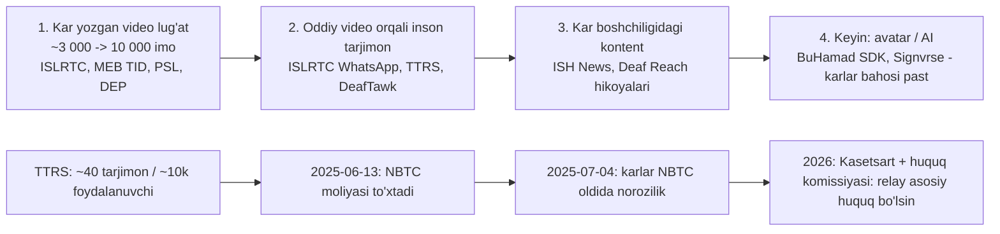

# 03f. Janubiy va Janubi-Sharqiy Osiyo, Yaqin Sharq va Afrika: raqobatchilar va tajribalar

> Manba fayllar: `99_Ilovalar/xom_tadqiqot_yozuvlari/2_raqobat_va_ochiq_kod/region_south_asia_mena_africa.md` (asosiy), `2_raqobat_va_ochiq_kod/global_feature_matrix.md`, `1_birinchi_tadqiqot/global_apps_and_business_models.md` · Sana: 2026-11-15 · Qamrov: Hindiston, Pokiston, Bangladesh, Shri-Lanka, Nepal; Tailand, Indoneziya, Malayziya, Filippin, Vyetnam, Singapur; Qatar, Saudiya Arabistoni, Turkiya, Isroil, Iordaniya (Eron, BAA, Misr — topilmadi); Keniya, JAR, Ruanda, Gana, umumafrika datasetlari.

## Qisqacha

- Kam resursli mamlakatlarda ishlagan har bir joylashtirish bir xil tartibga amal qilgan: (1) kar imo-ishorachi yozgan **~3 000 imodan 10 000 gacha o'sadigan video lug'at** va soha paketlari; (2) **oddiy video orqali inson tarjimon** (Hindistonda WhatsApp, Tailandda oddiy ilova); (3) kar boshchiligidagi kontent. AI va avatar oxirida — [ISLRTC FAQ](https://islrtc.nic.in/faq/); [ISLRTC Annual Report](https://divyangjan.depwd.gov.in/upload/s3wassupload/ISLRTC_New_Delhi_Annual_Report_2023_24.pdf) (yozuvlardagi umumlashma).
- Hindiston ISLRTC 2023-07-18 dan **WhatsApp video qo'ng'iroq** orqali bepul relay yuritadi, maxsus VRS dasturisiz — O'zbek NNT uchun to'g'ridan-to'g'ri nusxa olsa bo'ladi — [ISLRTC Annual Report 2023-24](https://divyangjan.depwd.gov.in/upload/s3wassupload/ISLRTC_New_Delhi_Annual_Report_2023_24.pdf).
- Tailand TTRS — mintaqaning flagman davlat relay'i (~40 tarjimon ~10 000 doimiy foydalanuvchiga), lekin **2025-06-13 da NBTC moliyasi to'xtagani sabab to'xtatildi**; qayta ishga tushgani tasdiqlanmagan — [Thai PBS World](https://www.thaipbsworld.com/science-technology/the-impact-of-technology-on-the-hard-of-hearing); [Prachatai](https://prachataienglish.com/node/11567). Bu bitta budjetga bog'lanmaslik bo'yicha eng kuchli dalil.
- Turkiya — O'zbekistonga eng yaqin analog: MEB lug'ati 2 607 so'zdan (2015) 5 000 so'zgacha, Oila vazirligi lug'ati 150 mamlakatdan 4 mln+ murojaat — [TRT Haber](https://www.trthaber.com/haber/turkiye/isaret-dilini-ogrenmek-artik-daha-kolay-435005.html); [aile.gov.tr](https://aile.gov.tr/haberler/bakanligin-guncel-turk-isaret-dili-sozlugune-150-ulkeden-4-milyondan-fazla-erisim-saglandi/).
- Ochiq litsenziya kam: faqat OpenHands Apache-2.0; AUTSL va CASL-W60 faqat akademik; INCLUDE litsenziyasi ko'rsatilmagan. CC BY o'zbek dataseti ajralib turadi — [GitHub OpenHands](https://github.com/AI4Bharat/OpenHands); [Hamburg](https://www.sign-lang.uni-hamburg.de/lrec/data/autsl.html); [Zenodo CASL-W60](https://zenodo.org/record/14734421).
- Avatar/AI tarjimasi grant beruvchilarni hayratga soladi, karlar esa past baholaydi (Signvrse tanqidi) — [The Star](https://www.the-star.co.ke/health/2025-10-23-kenyan-creates-first-sign-language-app).

## Umumiy jadval

| # | Mahsulot | Mamlakat | Turi | Kim to'laydi | AI / inson | Ochiq kod | Holat | Manba |
|---|---|---|---|---|---|---|---|---|
| 1 | ISLRTC ISL lug'ati (10 000 atama) + SignLearn ilovasi | Hindiston | lug'at | davlat | inson video | yo'q (ma'lumot yo'q) | faol | [ISLRTC FAQ](https://islrtc.nic.in/faq/) |
| 2 | ISLRTC onlayn ISL kursi | Hindiston | o'rganish | davlat | inson video | ma'lumot yo'q | 2023-09 dan | [Onmanorama](https://www.onmanorama.com/career-and-campus/top-news/2023/09/24/online-isl-course-260-new-financial-terms-signs-introduced.html) |
| 3 | ISLRTC video relay (WhatsApp) | Hindiston | VRS/VRI (bepul) | davlat | inson | yo'q | 2023-07-18 dan faol | [ISLRTC AR](https://divyangjan.depwd.gov.in/upload/s3wassupload/ISLRTC_New_Delhi_Annual_Report_2023_24.pdf) |
| 4 | Bhashini / India AI Summit 2026 avatar da'vosi | Hindiston | avatar | davlat (da'vo) | AI avatar | ma'lumot yo'q | tasdiqlanmagan | [startupfeed.in](https://startupfeed.in/pm-modi-ai-sign-language-translation-at-india-ai-summit-2026/) |
| 5 | INCLUDE / INCLUDE-50 | Hindiston | dataset | akademik (AI4Bharat / IIT Madras) | — | ochiq joylashtirilgan, litsenziya ko'rsatilmagan | mavjud | [Zenodo](https://zenodo.org/records/4010759) |
| 6 | OpenHands | Hindiston | tanib olish (ISLR modellar) | akademik | AI | **Apache-2.0** | faol qo'llab-quvvatlanmaydi (uchinchi tomon) | [GitHub](https://github.com/AI4Bharat/OpenHands) |
| 7 | SignAble Communications | Hindiston | VRI (talab bo'yicha) | grant + obuna (VOSAP subsidiyasi) | inson | yo'q | faol | [GSMA](https://www.gsma.com/mobilefordevelopment/digital-grantees-portfolio/signable-communications/) |
| 8 | ISH News (India Signing Hands) | Hindiston | kar boshchiligidagi media | ma'lumot yo'q | inson (kar) | yo'q | faol | [The Core](https://www.thecore.in/business/can-indian-media-make-accessibility-a-business-570830) |
| 9 | Bleetech BleeTV | Hindiston | ISL kontent / o'rganish | ma'lumot yo'q (bepul) | inson video | yo'q | faol | [NITI](https://frontiertech.niti.gov.in/story/innovative-isl-technology-empowers-indias-deaf-community-through-accessible-education/) |
| 10 | DeepVisionTech.AI Let'sTalkSign | Hindiston | nutq/matn <-> imo-ishora | ma'lumot yo'q | AI | ma'lumot yo'q | 2025 | [YourStory](https://yourstory.com/2025/05/deepvisiontech-ai-letstalksign-accessibility-startup) |
| 11 | D.I.T.U (ISL qo'lqop) | Hindiston | wearable | ma'lumot yo'q | AI | ma'lumot yo'q | 2025 | [YourStory](https://yourstory.com/2025/06/sign-language-gesture-tech-ditu-startup) |
| 12 | SignSetu | Hindiston | bolalar savodxonligi (ISL-ingliz) | ma'lumot yo'q | inson (kar asoschi) | ma'lumot yo'q | faol | [Better India](https://thebetterindia.com/changemakers/shraddha-agarwal-signsetu-deaf-literacy-isl-english-learning-platform-for-children-10943790) |
| 13 | Avaz | Hindiston (kelib chiqishi) | AAC | foydalanuvchi (bir martalik yoki obuna) | TTS | yo'q | faol | [Avaz support](https://avazapp.freshdesk.com/support/solutions/articles/1000172730) |
| 14 | PSL (Deaf Reach / FESF) | Pokiston | lug'at + savodxonlik | NNT (bepul) | inson video | ochiq litsenziya topilmadi | faol | [App Store](https://apps.apple.com/app/id1619629318) |
| 15 | PSL SignBank (akademik) | Pokiston | lug'at (300 so'z) | akademik | — | ma'lumot yo'q | mavjud | [CORE](https://core.ac.uk/outputs/739512648) |
| 16 | DeafTawk | Pokiston (+ Shri-Lanka) | VRI (pullik, talab bo'yicha) | foydalanuvchi/B2B (20% komissiya) + grantlar | inson | yo'q | faol | [GSMA](https://www.gsma.com/mobilefordevelopment/digital-grantees-portfolio/triac-deaftawk/) |
| 17 | Dialog DeafTawk lokalizatsiyasi | Shri-Lanka | VRI | foydalanuvchi (talk time) / litsenziya pilot | inson | yo'q | faol / pilot | [Dialog](https://dialog.lk/apps/deaftawk-app) |
| 18 | Mero Sanket (+ Mero Sati) | Nepal | o'rganish (oflayn) | USAID + HI (grant) | inson video | ma'lumot yo'q | chiqarilgan | [HI-US](https://www.hi-us.org/en/news/sign-language-app-opens-new-path-to-learning-for-deaf-children-in-nepal) |
| 19 | UNDP BdSL raqamli lug'ati | Bangladesh | lug'at (ochiq kirish) | UNDP | inson video | ochiq kirish (litsenziya ma'lumot yo'q) | chiqarilgan | [Green Network Asia](https://greennetwork.asia/news/improving-access-to-bangla-sign-language-learning-through-digital-dictionary) |
| 20 | Ruhiy salomatlik imo-ishora banki | Bangladesh | soha lug'ati | akademik (Monash) | inson video | ma'lumot yo'q | chiqarilgan | [Dhaka Tribune](https://www.dhakatribune.com/amp/bangladesh/397898/bangladesh-launches-first-mental-health-sign) |
| 21 | Love to Learn Sign Language | Bangladesh | o'rganish (iOS, oflayn) | bepul | ma'lumot yo'q | ma'lumot yo'q | mavjud | [App Store](https://apps.apple.com/us/app/id6757427283) |
| 22 | TTRS | Tailand | davlat relay (ovoz, matn, video, kiosk) | NBTC USO (2,5% telekom yig'imi) | inson | yo'q | **2025-06-13 dan to'xtatilgan**, qayta ishga tushish tasdiqlanmagan | [Prachatai](https://prachataienglish.com/node/11567) |
| 23 | CMKL "Deaf AI translator" | Tailand | AI tarjimon | universitet | AI | ma'lumot yo'q | ishlab chiqilmoqda | [CMKL](https://cmkl.ac.th/projects-research/deaf-ai-translator) |
| 24 | ThSL raqamli lug'ati (Kasetsart, 2007) | Tailand | lug'at | universitet | inson video | ma'lumot yo'q | eski (legacy) | [KU ThSL](https://pirun.ku.ac.th/~fhumalt/THSL/new_ThSL%20Digital%20Dict_23%20%20May%202007/Eng/preface.htm) |
| 25 | DITE (Deaf In Touch Everywhere) | Malayziya | VRI + tibbiy lug'at | akademik (Monash HEARD) | inson | ma'lumot yo'q | ma'lumot yo'q | [Monash HEARD](https://www.monash.edu/mats/projects/improving-healthcare-access) |
| 26 | Digi "Eddy" | Malayziya | BIM o'rganish | operator CSR (Digi) | inson video | yo'q | DEAD? | [The Star 2017](https://www.thestar.com.my/tech/tech-news/2017/12/21/digi-launches-eddy-sign-language-mobile-app) |
| 27 | BISINDO akademik prototiplari | Indoneziya | tanib olish (alifbo) | akademik | AI | ma'lumot yo'q | prototip (2023-2025) | [USNI](https://ojs-teknik.usni.ac.id/index.php/jsk/article/view/763) |
| 28 | SLEC-D | Filippin | lug'at (Cebuano-ingliz) | ma'lumot yo'q | ma'lumot yo'q | ma'lumot yo'q | ma'lumot yo'q | [qidiruv natijasi](https://www.gadgetmatch.com/hearo-app-sign-language-translate-voice-text-apple-developer-academy/) |
| 29 | Hearo | Filippin | imo-ishora/ovoz/matn tarjima (talaba ilovasi) | Apple Developer Academy | ma'lumot yo'q | ma'lumot yo'q | talaba loyihasi | [GadgetMatch](https://www.gadgetmatch.com/hearo-app-sign-language-translate-voice-text-apple-developer-academy/) |
| 30 | Adley | Vyetnam | AI muloqot ilovasi | ma'lumot yo'q | AI | ma'lumot yo'q | tanlov bosqichi (2026) | [Saigoneer](https://saigoneer.com/saigon-technology/25807-what-creating-a-sign-language-app-taught-me-about-the-hardships-of-vietnam-s-deaf-community) |
| 31 | VSL SignPuddle lug'ati | Vyetnam | lug'at (yozma imo-ishora) | ma'lumot yo'q | — | ma'lumot yo'q | 2018 e'lon | [SW-L](https://listserv.linguistlist.org/pipermail/sw-l/2018-August/062147.html) |
| 32 | SgSL e-kitobi | Singapur | o'rganish | bepul | — | ma'lumot yo'q | mavjud | [theAsianparent](https://sg.theasianparent.com/singapore-sign-language) |
| 33 | BuHamad (3D QSL avatar) | Qatar | avatar (sayt kontenti) | davlat (Mada) | AI avatar | yo'q (xususiy) | 2021 dan faol | [Mada](https://mada.org.qa/mada-center-launches-the-first-qatari-virtual-3d-interpreter-for-qatari-sign-language/) |
| 34 | Jumla Sign Language Kit | Qatar | SDK (saytga joylash) | davlat (Mada) | AI avatar | yo'q | faol | [Jumla](https://jumla.mada.org.qa/services/?lang=en) |
| 35 | Yagona Saudiya imo-ishora lug'ati | Saudiya | lug'at | Saudiya karlar assotsiatsiyasi | inson | ma'lumot yo'q | chiqarilgan | [PMC 2024](https://pmc.ncbi.nlm.nih.gov/articles/PMC11124802) |
| 36 | Tawasol ilovasi | Saudiya | lug'at + darslik + barmoq alifbosi | ma'lumot yo'q | inson video | ma'lumot yo'q | ma'lumot yo'q | [Springer](https://rd.springer.com/chapter/10.1007/978-3-319-20681-3_30) |
| 37 | Tawaasuly | Saudiya | nutq/matn <-> 3D avatar | ma'lumot yo'q (korporativ versiya rejada) | AI avatar | ma'lumot yo'q | 2024-10 | [Arab News](https://arabnews.com/node/2574932) |
| 38 | Efhamni | Saudiya | tanib olish (akademik) | akademik | AI | ma'lumot yo'q | 2024-05 maqola | [DOAJ](https://doaj.org/article/05fe7269c37d488cafc9c023a2cb1c9e) |
| 39 | MEB TID lug'ati + TID ta'lim portali | Turkiya | lug'at / o'rganish | davlat (MEB + TUBITAK) | inson video (kar kattalar) | yopiq bo'lishi ehtimol | faol | [TRT Haber](https://www.trthaber.com/haber/turkiye/isaret-dilini-ogrenmek-artik-daha-kolay-435005.html) |
| 40 | MEB icdep raqamli ta'lim platformasi | Turkiya | ta'lim (darsliklar) | davlat (MEB) | inson video | ma'lumot yo'q | faol | [NTV](https://www.ntv.com.tr/egitim/meb-isitme-engelli-ogrenciler-icin-dijital-egitim-platformu-kurdu,_KbAQ0xUUkGzSt8see9j9w) |
| 41 | Guncel Turk Isaret Dili Sozlugu (Oila vazirligi) | Turkiya | lug'at | davlat | inson video | ma'lumot yo'q | 2017 dan faol | [aile.gov.tr](https://aile.gov.tr/haberler/bakanligin-guncel-turk-isaret-dili-sozlugune-150-ulkeden-4-milyondan-fazla-erisim-saglandi/) |
| 42 | e-Devlet "Engelsiz Cagri" | Turkiya | davlat VRI (aloqa markazi) | davlat | inson | yo'q | faol (yuklanma juda kam) | [App Store](https://apps.apple.com/us/app/id1584651862) |
| 43 | Engelsiz Ceviri | Turkiya | matnni soddalashtirish plagini | TUBITAK BIGG granti | ma'lumot yo'q | ma'lumot yo'q | 2016; foydalanuvchi soni yo'q | [Haberturk](https://www.haberturk.com/isitme-engelli-bireyler-engelsiz-ceviri-ile-okuduklarini-anlayacaklar-2739998) |
| 44 | Turkcell "Isaret Dilim" | Turkiya | tarjima + lug'at + dars | operator CSR | ma'lumot yo'q | yo'q | ma'lumot yo'q | [Tamindir](https://www.tamindir.com/indir/isaret-dilim/) |
| 45 | Sesim Elim | Turkiya | o'rganish + lug'at (iOS) | ma'lumot yo'q | ma'lumot yo'q | ma'lumot yo'q | mavjud | [App Store](https://apps.apple.com/tr/app/sesim-elim/id1596642299?l=tr) |
| 46 | Turkish_Sign_Language_Dictionary (GitHub) | Turkiya | lug'at (hamjamiyat) | ixtiyoriy | — | ha (GitHub; litsenziya ma'lumot yo'q) | mavjud | [GitHub](https://github.com/oncado86/Turkish_Sign_Language_Dictionary) |
| 47 | AUTSL | Turkiya | dataset | akademik (Ankara univ.) | — | faqat akademik, tijoratsiz | mavjud | [arXiv](https://arxiv.org/abs/2008.00932v2) |
| 48 | ISL onlayn lug'ati + "Signs in Crisis" | Isroil | lug'at + inqiroz ilovasi | NNT (Institute for the Advancement of Deaf Persons) | inson video | ma'lumot yo'q | faol | [Algemeiner](https://www.algemeiner.com/?p=292490) |
| 49 | IssieSign | Isroil | lug'at (iOS) | bepul (Beit Issie Shapiro + SAP Labs) | inson video | ma'lumot yo'q | mavjud | [App Store](https://apps.apple.com/de/app/issiesign/id1423489221) |
| 50 | Sign Now | Isroil | VRI (real vaqt va rejali) | bepul (manbaga ko'ra) | inson | ma'lumot yo'q | 2022 | [NoCamels](https://nocamels.com/2022/08/life-changing-app-deaf-people/) |
| 51 | Rylo (sobiq Nagish) | Isroil / AQSh | qo'ng'iroq subtitri + yuzma-yuz STT + imo-ishora AI | AQSh FCC TRS fondi (daqiqa boshiga) | AI | sign.mt (OSS) egasi | faol, 2026-06 rebrend | [BusinessWire](https://www.businesswire.com/news/home/20260604498117/en/) |
| 52 | SignBook | Iordaniya | VRI (tarjimonli video qo'ng'iroq) | ma'lumot yo'q | inson | ma'lumot yo'q | 2017 manba | [Wamda 2017](https://www.wamda.com/en/2017/07/lost-translation-jordanian-startup-helping-deaf) |
| 53 | MarthaEDU | Iordaniya | bolalar uchun arab imo-ishora videolari | operator CSR (Umniah) | inson video | ma'lumot yo'q | ma'lumot yo'q | [Umniah](https://www.umniah.com/?p=41543) |
| 54 | RAMZ | Iordaniya | veb imo-ishora tarjimon / lug'at | universitet | ma'lumot yo'q | ma'lumot yo'q | DEAD? (2013) | [Jordan Times](https://jordantimes.com/node/353421) |
| 55 | Signvrse "Terp 360" | Keniya | 3D avatar (ingliz/suaxili -> KSL) | mukofot/grant | AI avatar | ma'lumot yo'q | veb faol; mobil ilova tasdiqlanmagan | [The Star](https://www.the-star.co.ke/health/2025-10-23-kenyan-creates-first-sign-language-app) |
| 56 | assistALL (Signs Media Kenya) | Keniya | VRI (soniya boshiga to'lov) | foydalanuvchi | inson | ma'lumot yo'q | ma'lumot yo'q | [Kenya News](https://www.kenyanews.go.ke/?p=184673) |
| 57 | Ishara AI | Keniya | AI tarjima (sog'liq, ta'lim) | ma'lumot yo'q | AI | ma'lumot yo'q | sinov (50+ kar) | [iHub](https://futureoflearning.ihub.co.ke/?p=3166) |
| 58 | DEP Dictionary (Deaf eLimu Plus) | Keniya / umumafrika | lug'at (kraudsors) | bepul | inson video | litsenziya noma'lum | faol | [App Store](https://apps.apple.com/us/app/id1437104597) |
| 59 | PanSALB + NID SASL lug'at ilovasi | JAR | lug'at (qo'l shakli bo'yicha qidiruv) | davlat | inson video | ma'lumot yo'q | 2022 dan | [SAnews](https://www.sanews.gov.za/node/59532) |
| 60 | FingerTalk | JAR | o'rganish + lug'at | SAB Foundation + reklama | inson video | yo'q | 2015 | [Zero Project](https://zeroproject.org/view/project/903d6336-9917-eb11-a813-000d3ab9b226) |
| 61 | DEAFinition (Codehesion) | JAR | lug'at ("so'z so'rash") | ma'lumot yo'q | inson video | ma'lumot yo'q | sahifa sanasi ishonchsiz | [Vuk'uzenzele](https://www.vukuzenzele.gov.za/book/export/html/6883) |
| 62 | Kar o'quvchilar kodlagan SASL lug'ati | JAR | lug'at (kar o'quvchilar) | ma'lumot yo'q | inson | ma'lumot yo'q | 2026-09 | [TimesLIVE](https://www.timeslive.co.za/news/south-africa/2026-09-25-deaf-pupils-code-their-own-sign-language-dictionary/) |
| 63 | Maswao | JAR | korpus (TV yangiliklaridan) | akademik | AI | ma'lumot yo'q | 2026 (arXiv) | [AI Weekly](https://aiweekly.co/alerts/maswao-auto-builds-south-african-sign-language-corpus-from-news) |
| 64 | Ruanda imo-ishora lug'ati | Ruanda | lug'at (bosma, raqamli ishlanmoqda) | davlat (NCPD) | inson | ma'lumot yo'q | bosma 2024; raqamli hali yo'q | [New Times](https://newtimes.co.rw/article/20507/news/health/rwanda-starts-distributing-sign-language-dictionary) |
| 65 | SignTalk-Gh | Gana | dataset (sog'liq) | akademik | — | litsenziya noma'lum | nashr (Scientific Reports) | [Maratto](https://www.maratto.africa/research/a-large-scale-multimodal-dataset-for-healthcare-domain-38871736aa) |
| 66 | GhSL Dictionary ilovasi | Gana | lug'at | ma'lumot yo'q | ma'lumot yo'q | ma'lumot yo'q | faqat do'kon yozuvi (tasdiqlanmagan) | URL yozuvlarda yo'q |
| 67 | AfriSign | umumafrika | dataset + model (6 til) | akademik | AI | ma'lumot yo'q | 2025-01 | [DOAJ](https://doaj.org/article/1227439974314eb0a8cb835035127254) |
| 68 | CASL-W60 | Markaziy Afrika | dataset | akademik | — | faqat akademik, tijoratsiz | 2025-08 | [Zenodo](https://zenodo.org/record/14734421) |

Jami: 68 ta yozuv. Eron, BAA, Misr, Nigeriya, Efiopiya, Uganda uchun hech narsa topilmadi.

## Batafsil profillar

### Hindiston

**Mamlakat konteksti**

| Mavzu | Ma'lumot | Manba |
|---|---|---|
| Kar aholi | ~18 mln kar, shundan ~4,5 mln ISL foydalanuvchisi | [The Better India](https://thebetterindia.com/367935/signable-app-for-deaf-people-rupmani-chhetri-startup-bengaluru) (global_apps yozuvi) |
| Sertifikatli tarjimonlar | Manbalar zid: 350 dan 1 000 gacha (global_apps) — [The Better India](https://thebetterindia.com/367935/signable-app-for-deaf-people-rupmani-chhetri-startup-bengaluru); "uch yuzdan kam sertifikatli ISL tarjimoni" (startap manbasi, taxminiy) — [NITI Frontier Tech](https://frontiertech.niti.gov.in/story/innovative-isl-technology-empowers-indias-deaf-community-through-accessible-education/) | ikkala manba |
| Bhashini | Rasmiy Bhashini imo-ishora moduli topilmadi. Kam manbali nashr India AI Summit 2026 da AI avatar Bosh vazir nutqini real vaqtda ISL'ga o'girgan deydi — tasdiqlanmagan | [startupfeed.in](https://startupfeed.in/pm-modi-ai-sign-language-translation-at-india-ai-summit-2026/) |
| Topilmagan | "Talking Hands", "Sign Together", "DeafCan", "Hear Me" (Hindiston), "Deaf Enabled Foundation" — qidiruvda natija yo'q. NIEPMD va telekom relay o'rganilmagan | — |

#### ISLRTC: lug'at, SignLearn ilovasi, onlayn kurs

| Maydon | Ma'lumot |
|---|---|
| Egasi | ISLRTC (Indian Sign Language Research and Training Centre, davlat organi) |
| Yil | 1-nashr 2018-mart (3 000 hindcha/inglizcha so'z) — [NAD India](https://nadindia.org/article/4405/first-indian-sign-language-dictionary-of-3000-words-launched); 10 000 atamali nashr va onlayn mustaqil ISL kursi 2023-sentabr, Xalqaro imo-ishora tillari kunida, moliya atamalari uchun 260 yangi imo bilan — [Onmanorama 2023-09-24](https://www.onmanorama.com/career-and-campus/top-news/2023/09/24/online-isl-course-260-new-financial-terms-signs-introduced.html) |
| Platforma | Veb, SignLearn ilovasi ("hamma uchun imo-ishora lug'ati") — [ISH News](https://ishnews.tv/videos/news/signlearn-app-a-sign-language-dictionary-for-all) |
| Yuklanma / reyting / foydalanuvchilar | ma'lumot yo'q |
| Asosiy funksiyalar | 6 toifada 10 000 atama, video va inglizcha/hindcha ekvivalent; mintaqaviy variantlar (masalan Haydarobod, Mumbay, Kalkutta, Munger, Manipur raqam va ranglari) — [ISLRTC FAQ](https://islrtc.nic.in/faq/) |
| Kim to'laydi (moliya modeli) | Davlat (bepul) |
| AI yoki inson | Inson video |
| Ochiq kod | ma'lumot yo'q |
| Holat | Faol |
| Manba | [ISLRTC FAQ](https://islrtc.nic.in/faq/); [NAD India](https://nadindia.org/article/4405/first-indian-sign-language-dictionary-of-3000-words-launched); [Onmanorama](https://www.onmanorama.com/career-and-campus/top-news/2023/09/24/online-isl-course-260-new-financial-terms-signs-introduced.html) |

- **Nimani olamiz:** bosqichma-bosqich o'sish (yadro ~3 000 imo, keyin moliya/sog'liq paketlari); mintaqaviy variantlarni (viloyatlar) yozib borish; lug'at + onlayn kurs birga.
- **Nimadan qochamiz:** —

#### ISLRTC video relay (WhatsApp orqali)

| Maydon | Ma'lumot |
|---|---|
| Egasi | ISLRTC (davlat) |
| Yil | 2023-07-18 dan bepul onlayn tarjima — [ISLRTC Annual Report 2023-24](https://divyangjan.depwd.gov.in/upload/s3wassupload/ISLRTC_New_Delhi_Annual_Report_2023_24.pdf) |
| Platforma | **WhatsApp video qo'ng'iroq** masofadagi tarjimonlarga, maxsus ilova yo'q (hisobot/qidiruv natijalariga ko'ra) |
| Yuklanma / reyting / foydalanuvchilar | Qo'ng'iroq hajmi, tarjimonlar soni, kutish vaqti hech bir ochiq manbada topilmadi |
| Asosiy funksiyalar | Bepul video relay/tarjima |
| Kim to'laydi (moliya modeli) | Davlat |
| AI yoki inson | Inson |
| Ochiq kod | yo'q (tijorat messenjer ustida) |
| Holat | Faol |
| Manba | [ISLRTC Annual Report 2023-24](https://divyangjan.depwd.gov.in/upload/s3wassupload/ISLRTC_New_Delhi_Annual_Report_2023_24.pdf) |

- **Nimani olamiz:** VRI'ni oddiy video + navbatchi tarjimonlar jadvali bilan boshlash; WhatsApp/Telegram kabi tanish kanal — MVP (a) uchun eng arzon yo'l.
- **Nimadan qochamiz:** statistikani e'lon qilmaslik (hajm, kutish vaqti noma'lum); biometrik video tijorat messenjerida qolishi (strategiya: yuz videosi O'zbekistondagi serverda) — baho / tasdiqlanmagan.

#### INCLUDE dataset va OpenHands

| Maydon | Ma'lumot |
|---|---|
| Egasi | AI4Bharat / IIT Madras — [GitHub INCLUDE](https://github.com/AI4Bharat/INCLUDE); [GitHub OpenHands](https://github.com/AI4Bharat/OpenHands) |
| Yil | ma'lumot yo'q |
| Platforma | Zenodo, Hugging Face, GitHub |
| Yuklanma / reyting / foydalanuvchilar | INCLUDE: 4 287 video, 0,27M kadr, 15 toifada 263 so'z imosi; INCLUDE-50 qism to'plam; imo-ishorachilar — Chennai St. Louis karlar maktabi kar o'quvchilari — [Zenodo](https://zenodo.org/records/4010759); [HF](https://huggingface.co/datasets/ai4bharat/INCLUDE) |
| Asosiy funksiyalar | INCLUDE: izolyatsiyalangan ISL tanib olish dataseti ("ta'lim va ISLR uchun, boshqa maqsadlarda ham ishlatilishi mumkin"). OpenHands: tillar bo'ylab pose asosidagi oldindan o'qitilgan ISLR modellar |
| Kim to'laydi (moliya modeli) | Akademik |
| AI yoki inson | AI |
| Ochiq kod | OpenHands: **Apache-2.0**; README har dataset litsenziyasini tekshirishni aytadi. INCLUDE: **aniq ma'lumot litsenziyasi topilmadi** |
| Holat | Uchinchi tomon OpenHands endi faol qo'llab-quvvatlanmayotganini aytadi — [ecosyste.ms](https://science.ecosyste.ms/projects/12174) |
| Manba | [Zenodo](https://zenodo.org/records/4010759); [HF](https://huggingface.co/datasets/ai4bharat/INCLUDE); [GitHub OpenHands](https://github.com/AI4Bharat/OpenHands); [ecosyste.ms](https://science.ecosyste.ms/projects/12174) |

- **Nimani olamiz:** OpenHands (Apache-2.0) — o'rganish modulidagi izolyatsiyalangan imo mashqi uchun boshlang'ich ISLR kod bazasi; dataset kartasida imo-ishorachilar kimligini ko'rsatish.
- **Nimadan qochamiz:** litsenziyasiz dataset chiqarish (INCLUDE); qo'llab-quvvatlanmaydigan kodga to'liq tayanish.

#### SignAble Communications

| Maydon | Ma'lumot |
|---|---|
| Egasi | SignAble Communications (Bengaluru), asoschi Rupmani Chhetri — [Better India](https://thebetterindia.com/367935/signable-app-for-deaf-people-rupmani-chhetri-startup-bengaluru) |
| Yil | ma'lumot yo'q |
| Platforma | Veb / iOS — [App Store](https://apps.apple.com/ng/app/signable/id6477518760) |
| Yuklanma / reyting / foydalanuvchilar | ma'lumot yo'q (reytinglar yangilanmagan) |
| Asosiy funksiyalar | Talab bo'yicha ISL tarjima; kar foydalanuvchi videoda, eshituvchi audioda — [global_feature_matrix / Better India](https://thebetterindia.com/367935/signable-app-for-deaf-people-rupmani-chhetri-startup-bengaluru); GSMA granti ikki tomonlama qo'ng'iroq ilovasini qurish uchun — [GSMA](https://www.gsma.com/mobilefordevelopment/digital-grantees-portfolio/signable-communications/) |
| Kim to'laydi (moliya modeli) | GSMA Innovation Fund, Prosus Social Impact Challenge for Accessibility (SICA); Voice of SAP (VOSAP) foydalanuvchilarga 11 oylik obunani subsidiyalaydi — [GSMA blog](https://www.gsma.com/mobilefordevelopment/blog/making-sign-language-interpretation-accessible-for-all-through-mobile-assistive-technology/); [VOSAP](https://www.voiceofsap.org/?p=139887) |
| AI yoki inson | Inson |
| Ochiq kod | yo'q |
| Holat | Faol |
| Manba | [GSMA](https://www.gsma.com/mobilefordevelopment/digital-grantees-portfolio/signable-communications/); [VOSAP](https://www.voiceofsap.org/?p=139887); [Better India](https://thebetterindia.com/367935/signable-app-for-deaf-people-rupmani-chhetri-startup-bengaluru) |

- **Nimani olamiz:** "kar videoda, eshituvchi audioda" — eshituvchi tomon ilova o'rnatmasdan qo'shiladi; tarjimon vaqtini grant/homiy subsidiyalaydi, foydalanuvchiga bepul.
- **Nimadan qochamiz:** obuna asosidagi model (notijorat platformada dasturiy ta'minot bepul va ochiq).

#### ISH News (India Signing Hands)

| Maydon | Ma'lumot |
|---|---|
| Egasi | Kar boshchiligida, 2018-noyabr, Alok Kejriwal va Aqil Chinoy (Gallaudet bitiruvchilari) — [Gallaudet](https://gallaudet.edu/alumni-relations/alumni-in-india-make-bollywood-film-accessible-in-indian-sign-language/) |
| Yil | 2018 |
| Platforma | YouTube, Facebook, Instagram |
| Yuklanma / reyting / foydalanuvchilar | 449 000+ YouTube obunachi, FB/YT/IG bo'ylab ~202M ko'rish (2025 profil) — [The Core](https://www.thecore.in/business/can-indian-media-make-accessibility-a-business-570830) |
| Asosiy funksiyalar | Kundalik ISL yangiliklari; Bollivud filmini ISL'ga tarjima qilgan |
| Kim to'laydi (moliya modeli) | ma'lumot yo'q |
| AI yoki inson | Inson (kar) |
| Ochiq kod | yo'q |
| Holat | Faol |
| Manba | [Gallaudet](https://gallaudet.edu/alumni-relations/alumni-in-india-make-bollywood-film-accessible-in-indian-sign-language/); [The Core](https://www.thecore.in/business/can-indian-media-make-accessibility-a-business-570830) |

- **Nimani olamiz:** kar boshchiligidagi kontent kanali — dollar boshiga eng ko'p qamrov (yozuvlar xulosasi, baho / tasdiqlanmagan); vaziyat kartalari videolarini shu kanalda tarqatish.
- **Nimadan qochamiz:** —

#### Bleetech BleeTV

| Maydon | Ma'lumot |
|---|---|
| Egasi | Bleetech Innovations (Pune) |
| Yil | ma'lumot yo'q |
| Platforma | Bepul Android ilova va veb-portal |
| Yuklanma / reyting / foydalanuvchilar | 15 shtatda 12 000+ foydalanuvchi — [NITI](https://frontiertech.niti.gov.in/story/innovative-isl-technology-empowers-indias-deaf-community-through-accessible-education/); 1 000+ ISL video, 12K+ foydalanuvchi — [The Better India](https://thebetterindia.com/206175/apps-tech-for-deaf-start-up-pune-accessible-technology-isl-content-videos) |
| Asosiy funksiyalar | ISL kontent kutubxonasi |
| Kim to'laydi (moliya modeli) | ma'lumot yo'q (foydalanuvchiga bepul) |
| AI yoki inson | Inson video |
| Ochiq kod | yo'q |
| Holat | Faol |
| Manba | [NITI](https://frontiertech.niti.gov.in/story/innovative-isl-technology-empowers-indias-deaf-community-through-accessible-education/); [The Better India](https://thebetterindia.com/206175/apps-tech-for-deaf-start-up-pune-accessible-technology-isl-content-videos) |

- **Nimani olamiz:** bepul ISL video kutubxona formati.
- **Nimadan qochamiz:** —

#### Boshqa 2025 ISL startaplari: Let'sTalkSign, D.I.T.U, SignSetu

| Maydon | Ma'lumot |
|---|---|
| Egasi | DeepVisionTech.AI (Let'sTalkSign); D.I.T.U; SignSetu (kar asoschi Shraddha Agarwal) |
| Yil | 2025 (manbalar) |
| Platforma | ma'lumot yo'q |
| Yuklanma / reyting / foydalanuvchilar | ma'lumot yo'q |
| Asosiy funksiyalar | Let'sTalkSign: nutq/matndan imo-ishoraga va aksincha — [YourStory](https://yourstory.com/2025/05/deepvisiontech-ai-letstalksign-accessibility-startup). D.I.T.U: ISL kiyiladigan qo'lqop — [YourStory](https://yourstory.com/2025/06/sign-language-gesture-tech-ditu-startup). SignSetu: bolalar uchun ikki tilli ISL-ingliz savodxonligi — [Better India](https://thebetterindia.com/changemakers/shraddha-agarwal-signsetu-deaf-literacy-isl-english-learning-platform-for-children-10943790) |
| Kim to'laydi (moliya modeli) | ma'lumot yo'q |
| AI yoki inson | Let'sTalkSign, D.I.T.U: AI; SignSetu: inson (kar) |
| Ochiq kod | ma'lumot yo'q |
| Holat | 2025 da faol (manbalar) |
| Manba | yuqoridagi havolalar |

- **Nimani olamiz:** SignSetu — kar bolalar uchun ikki tilli savodxonlik (ota-onalar moduli).
- **Nimadan qochamiz:** qo'lqop/wearable (global yozuvlarda karlar va lingvistlar rad etadi — [Everand / The Atlantic](https://everand.com/article/532432338/Why-Sign-Language-Gloves-Don-t-Help-Deaf-People)).

#### Avaz (AAC, Hindiston kelib chiqishi)

| Maydon | Ma'lumot |
|---|---|
| Egasi | Avaz (Hindiston kelib chiqishli) — [global_feature_matrix](https://avazapp.freshdesk.com/support/solutions/articles/1000172730) |
| Yil | ma'lumot yo'q |
| Platforma | iOS, Android |
| Yuklanma / reyting / foydalanuvchilar | ma'lumot yo'q |
| Asosiy funksiyalar | Belgili AAC taxtasi, TTS |
| Kim to'laydi (moliya modeli) | Manbalar zid: oyiga $9.99 yoki yiliga $99.99; eski yozuvda umrbod $199.99; keyin $149.99 ga ko'tarilgan; 2 haftalik sinov; bepul Lite versiya da'vo qilinadi — [Avaz support](https://avazapp.freshdesk.com/support/solutions/articles/1000172730); [Avaz blog](https://buzz.avazapp.com/?p=6264) |
| AI yoki inson | TTS (dastur) |
| Ochiq kod | yo'q |
| Holat | Faol |
| Manba | [Avaz support](https://avazapp.freshdesk.com/support/solutions/articles/1000172730); [Avaz blog](https://buzz.avazapp.com/?p=6264); [WorldMetrics (past ishonchli)](https://worldmetrics.org/best/aac-software/) |

- **Nimani olamiz:** arzon AAC narx pozitsiyasi; lekin biz Cboard (GPL-3.0, bepul) asosida bepul qilamiz.
- **Nimadan qochamiz:** maxsus switch scanning kerak bo'lgan foydalanuvchilarga kam mos (past ishonchli manba) — Cboard'da switch kirishini rejalashtirish.

### Pokiston

**Mamlakat konteksti**

| Mavzu | Ma'lumot | Manba |
|---|---|---|
| Lug'at naqshi | NNT maktab tarmog'i (Deaf Reach maktablari) lug'atni o'qitishning qo'shimcha mahsuli sifatida yaratgan; WISE (Qatar Foundation) mukofoti pul va ko'rinish olib kelgan | [WISE](https://wise-qatar.org/?p=13930) |
| imo-ishora.uz bilan hamkorlik | Deaf Reach va imo-ishora.uz (O'zbekiston) hamkorligi **tasdiqlanmadi**; qidiruvda ularni bog'laydigan natija yo'q | yozuvlar, Gaps |

#### PSL (Deaf Reach / Family Educational Services Foundation)

| Maydon | Ma'lumot |
|---|---|
| Egasi | Deaf Reach (Family Educational Services Foundation, FESF, NNT) |
| Yil | ma'lumot yo'q |
| Platforma | Bepul iOS va Android ilova; psl.org.pk — [App Store id1619629318](https://apps.apple.com/app/id1619629318) |
| Yuklanma / reyting / foydalanuvchilar | Lug'at hajmi manbaga qarab: "6 000 so'zli PSL lug'ati" (psl.org.pk) — [psl.org.pk (snippet; fetch'da DNS xatosi)](https://new.psl.org.pk/resources); "7 500+ imo hujjatlashtirilgan va raqamlashtirilgan" — [FESF](https://fesf.org.pk/programs/); "7 000 so'z" — [WISE](https://wise-qatar.org/?p=13930) |
| Asosiy funksiyalar | Har imo videosida og'zaki va yozma ingliz va urdu; animatsion hikoyalar, o'qituvchi darsliklari, sinf namoyishlari, IQRA savodxonlik |
| Kim to'laydi (moliya modeli) | NNT; WISE mukofoti |
| AI yoki inson | Inson video |
| Ochiq kod | Ochiq litsenziya topilmadi |
| Holat | Faol; sayt ochilmadi (DNS) |
| Manba | [App Store](https://apps.apple.com/app/id1619629318); [FESF](https://fesf.org.pk/programs/); [WISE](https://wise-qatar.org/?p=13930) |

- **Nimani olamiz:** maktab tarmog'i orqali kontent ishlab chiqarish + savodxonlik hikoyalari; har imoda ikki til (o'zbek + rus).
- **Nimadan qochamiz:** ma'lumot litsenziyasini noaniq qoldirish.

#### PSL SignBank (akademik)

| Maydon | Ma'lumot |
|---|---|
| Egasi | Akademik — [CORE](https://core.ac.uk/outputs/739512648) |
| Yil | ma'lumot yo'q |
| Platforma | Mashina o'qiy oladigan multimodal lug'at |
| Yuklanma / reyting / foydalanuvchilar | Atigi 300 so'z |
| Asosiy funksiyalar | Multimodal lug'at |
| Kim to'laydi (moliya modeli) | Akademik |
| AI yoki inson | — |
| Ochiq kod | ma'lumot yo'q |
| Holat | Mavjud |
| Manba | [CORE](https://core.ac.uk/outputs/739512648) |

- **Nimani olamiz:** mashina o'qiy oladigan format (keyingi ML uchun).
- **Nimadan qochamiz:** —

#### DeafTawk (Pokiston, Shri-Lankada Dialog orqali)

| Maydon | Ma'lumot |
|---|---|
| Egasi | DeafTawk (TRIAC), startap — [GSMA](https://www.gsma.com/mobilefordevelopment/digital-grantees-portfolio/triac-deaftawk/) |
| Yil | 2018 |
| Platforma | Mobil ilova; Shri-Lankada Dialog lokalizatsiyasi (internet + sotib olingan talk time kerak) — [Dialog](https://dialog.lk/apps/deaftawk-app) |
| Yuklanma / reyting / foydalanuvchilar | GSMA: ~12 900 B2B va ~208 800 B2C mijoz (sanasiz) — [GSMA](https://www.gsma.com/mobilefordevelopment/digital-grantees-portfolio/triac-deaftawk/) |
| Asosiy funksiyalar | Pullik talab bo'yicha tarjima |
| Kim to'laydi (moliya modeli) | 20% komissiya oladi, tarjimonga 80% to'laydi; narx mintaqaviy birlik iqtisodiga qarab — [GSMA 2023 PDF](https://www.gsma.com/get-involved/gsma-foundry/wp-content/uploads/2023/11/DeafTawk-Helping-The-Deaf-To-Communicate.pdf). $250k GSMA Innovation Fund granti (2021-iyul), Jazz va MoITT qo'llovi. Shri-Lankada litsenziya modeli pilot. GSMA 2026 keys-tadqiqoti (ma'lumot 2025-dekabr - 2026-mart) — [GSMA 2026 PDF](https://www.gsma.com/solutions-and-impact/connectivity-for-good/mobile-for-development/wp-content/uploads/2026/07/GSMA_Pakistan-Market-Report—DeafTawk-Case-Study-final.pdf) |
| AI yoki inson | Inson |
| Ochiq kod | yo'q |
| Holat | Faol |
| Manba | [GSMA](https://www.gsma.com/mobilefordevelopment/digital-grantees-portfolio/triac-deaftawk/); [GSMA 2023](https://www.gsma.com/get-involved/gsma-foundry/wp-content/uploads/2023/11/DeafTawk-Helping-The-Deaf-To-Communicate.pdf); [GSMA 2026](https://www.gsma.com/solutions-and-impact/connectivity-for-good/mobile-for-development/wp-content/uploads/2026/07/GSMA_Pakistan-Market-Report—DeafTawk-Case-Study-final.pdf); [Dialog](https://dialog.lk/apps/deaftawk-app) |

- **Nimani olamiz:** operator bilan tarqatish (Jazz, Dialog); tarjimonga adolatli ulush (80%) — pullik kar/tarjimon hissa qo'shuvchilar uchun haq to'lash mezoni.
- **Nimadan qochamiz:** foydalanuvchidan pul olish (80/20 model faqat telekom tarqatish va grant bilan ishlaydi — yozuvlar xulosasi); "talk time sotib olish" to'sig'i.

### Shri-Lanka

| Maydon | Ma'lumot |
|---|---|
| Kontekst | Kolombo universiteti tezisi (2025-aprel): Shri-Lankada karlar uchun "kam yordamchi vositalar mavjud" — [UCSC](https://dl.ucsc.cmb.ac.lk/jspui/bitstream/123456789/4957/1/20020155%2c%2020020262%2c%2020021011%20.pdf) |
| Mahsulot | Dialog (telekom) DeafTawk'ni lokalizatsiya qilgan (profil yuqorida, Pokiston bo'limida) — [Dialog](https://dialog.lk/apps/deaftawk-app) |

### Nepal

#### Mero Sanket (va Mero Sati)

| Maydon | Ma'lumot |
|---|---|
| Egasi | Humanity & Inclusion, National Federation of the Deaf Nepal bilan, USAID qo'llagan dastur doirasida — [HI-US](https://www.hi-us.org/en/news/sign-language-app-opens-new-path-to-learning-for-deaf-children-in-nepal) |
| Yil | ma'lumot yo'q |
| Platforma | Mobil ilova, oflayn |
| Yuklanma / reyting / foydalanuvchilar | ma'lumot yo'q |
| Asosiy funksiyalar | Nepal imo-ishora tilini o'rganish, Nepalda birinchi; 6 dars (unlilar, undoshlar, so'zlar, tinish belgilari). Hamroh ilova Mero Sati imo bilan o'qishni o'rgatadi |
| Kim to'laydi (moliya modeli) | Grant (USAID + HI); USAID'ning 2025 dan keyingi holati uni ishonchsiz qiladi (yozuvlar) |
| AI yoki inson | Inson video |
| Ochiq kod | ma'lumot yo'q |
| Holat | Chiqarilgan, bepul |
| Manba | [HI-US](https://www.hi-us.org/en/news/sign-language-app-opens-new-path-to-learning-for-deaf-children-in-nepal) |

- **Nimani olamiz:** oflayn ishlash; kar federatsiyasi bilan hamkorlikda qurish; savodxonlik uchun alohida hamroh ilova.
- **Nimadan qochamiz:** bitta xorijiy donorga bog'lanish (USAID xavfi).

### Bangladesh

#### UNDP BdSL raqamli lug'ati, ruhiy salomatlik imo-ishora banki, Love to Learn Sign Language

| Maydon | Ma'lumot |
|---|---|
| Egasi | UNDP Bangladesh (lug'at); Monash hamkorlikdagi dizayn (ruhiy salomatlik banki); Love to Learn — ma'lumot yo'q |
| Yil | ma'lumot yo'q |
| Platforma | Raqamli lug'at (ochiq kirish); iOS (Love to Learn, oflayn) |
| Yuklanma / reyting / foydalanuvchilar | ma'lumot yo'q |
| Asosiy funksiyalar | UNDP: ochiq kirishli raqamli Bangla imo-ishora (BdSL) lug'ati — [Green Network Asia](https://greennetwork.asia/news/improving-access-to-bangla-sign-language-learning-through-digital-dictionary). Karlar uchun birinchi ruhiy salomatlik imo-ishora banki, Lancet Psychiatry maqolasi asosida — [Dhaka Tribune](https://www.dhakatribune.com/amp/bangladesh/397898/bangladesh-launches-first-mental-health-sign); [Monash](https://www.monash.edu/mats/projects/co-designing-digital-mental-health-interventions). Love to Learn: bepul, oflayn BdSL qo'llanmasi — [App Store](https://apps.apple.com/us/app/id6757427283) |
| Kim to'laydi (moliya modeli) | UNDP; akademik; bepul |
| AI yoki inson | Inson video |
| Ochiq kod | UNDP lug'ati ochiq kirish (litsenziya ma'lumot yo'q) |
| Holat | Chiqarilgan |
| Manba | yuqoridagi havolalar |

- **Nimani olamiz:** UNDP lug'at grantlari (strategiya: UNDP/EU kichik grantlar); soha paketi (ruhiy salomatlik -> shifoxona vaziyat kartalari).
- **Nimadan qochamiz:** —

### Tailand

**Mamlakat konteksti**

| Mavzu | Ma'lumot | Manba |
|---|---|---|
| Tarjimonlar | Tailandda ~500 imo-ishora tarjimoni, shundan ~40 nafari TTRS'da | [Thai PBS World](https://www.thaipbsworld.com/science-technology/the-impact-of-technology-on-the-hard-of-hearing) |
| Moliya manbai | NBTC'ning loyihaviy USO puli; NBTC budjeti telekom daromadidan 2,5% yig'imdan | [Prachatai](https://prachataienglish.com/node/11567) |
| Huquqiy tavsiya | 2026-iyul va sentabrda Kasetsart universiteti va milliy huquq komissiyasi TRS/TTRS asosiy huquq bo'lishini tavsiya qiluvchi tadqiqot e'lon qilgan | [Bangkok Biznews](https://www.bangkokbiznews.com/news/1237978) |
| Rejalashtirish mezoni (xulosa) | ~40 tarjimon / ~10 000 doimiy foydalanuvchi nisbati — ishlatsa bo'ladigan mezon (baho / tasdiqlanmagan) | yozuvlardagi xulosa |

#### TTRS (Thailand Telecommunication Relay Service)

| Maydon | Ma'lumot |
|---|---|
| Egasi | NBTC (telekom regulyatori) USO dasturi doirasida — [NBTC TTRS](https://nbtc.go.th/Business/commu/telecom/บริการ-USO/TTRS/test.aspx?lang=en-us) |
| Yil | ma'lumot yo'q |
| Platforma | Bepul ilova + jamoat joylaridagi video relay kiosklari — [The Story Thailand](https://www.thestorythailand.com/en/28/04/2021/20524/) |
| Yuklanma / reyting / foydalanuvchilar | ~40 000 obuna bo'lgan kar foydalanuvchi, shundan ~10 000+ doimiy — [Thai PBS World](https://www.thaipbsworld.com/science-technology/the-impact-of-technology-on-the-hard-of-hearing). Eskiroq raqam: yiliga ~160 000 imo-ishora video qo'ng'iroq — [Bangkok Post](https://www.bangkokpost.com/tech/247700/the-new-way-to-talk). Foydalanish 250% oshgan (sana aniq emas) — [nwise](https://nwise.se/?p=1237) |
| Asosiy funksiyalar | Kar, zaif eshituvchi va nutqida nuqsoni borlar uchun ko'p rejimli relay (ovoz, matn, video) |
| Kim to'laydi (moliya modeli) | NBTC USO (2,5% telekom yig'imi), loyihaviy |
| AI yoki inson | Inson |
| Ochiq kod | yo'q |
| Holat | **2025-06-13 da NBTC moliyasi tugagani sabab tanaffus e'lon qilingan**; karlar 2025-07-04 da NBTC oldida norozilik qilgan — [Magzter/Bangkok Post](https://www.magzter.com/en/stories/newspaper/Bangkok-Post/COMMUNICATION-BREAKDOWN); [Prachatai](https://prachataienglish.com/node/11567); [CMKL](https://cmkl.ac.th/projects-research/deaf-ai-translator). WSIS Prizes 2025 loyiha ishtirokchisi — [ITU WSIS](https://www.itu.int/net4/wsis/stocktaking/Prizes/2025/Details/15435411781736025). 2026 da qayta ishga tushgani tasdiqlanmagan (ttrs.or.th yoki NBTC'da tekshirish kerak) |
| Manba | yuqoridagi havolalar |

- **Nimani olamiz:** ko'p rejim (ovoz, matn, video) va jamoat joyidagi kiosk (davlat idoralari, mahalla markazlari) — O'zbek hukumatiga ko'rsatiladigan eng yaxshi davlat modeli.
- **Nimadan qochamiz:** **bitta davlat budjet satriga bog'lanish** — tarjimon mehnatini diversifikatsiyalangan grantlardan moliyalash va dasturni ochiq saqlash, toki moliya uzilishidan omon qolsin (strategiya 9-band).

#### CMKL "Deaf AI translator" va ThSL raqamli lug'ati (Kasetsart, 2007)

| Maydon | Ma'lumot |
|---|---|
| Egasi | CMKL University (Bangkok); Kasetsart universiteti |
| Yil | CMKL: TTRS to'xtagandan keyin (2025+); lug'at: 2007 tadqiqot loyihasi |
| Platforma | ma'lumot yo'q; lug'at — veb |
| Yuklanma / reyting / foydalanuvchilar | ma'lumot yo'q |
| Asosiy funksiyalar | CMKL: TTRS to'xtashiga javob sifatida ochiq e'lon qilingan "kar AI tarjimon" — [CMKL](https://cmkl.ac.th/projects-research/deaf-ai-translator). Lug'at: mintaqaviy ThSL variantlarini qayd etadi — [KU ThSL](https://pirun.ku.ac.th/~fhumalt/THSL/new_ThSL%20Digital%20Dict_23%20%20May%202007/Eng/preface.htm) |
| Kim to'laydi (moliya modeli) | Universitet |
| AI yoki inson | CMKL: AI; lug'at: inson |
| Ochiq kod | ma'lumot yo'q |
| Holat | CMKL: ishlab chiqilmoqda; lug'at: eski (legacy) |
| Manba | [CMKL](https://cmkl.ac.th/projects-research/deaf-ai-translator); [KU ThSL](https://pirun.ku.ac.th/~fhumalt/THSL/new_ThSL%20Digital%20Dict_23%20%20May%202007/Eng/preface.htm) |

- **Nimani olamiz:** —
- **Nimadan qochamiz:** inson relay to'xtaganda AI'ni "o'rinbosar" deb taqdim etish (baho / tasdiqlanmagan).

### Malayziya

#### DITE (Deaf In Touch Everywhere) va Digi "Eddy"

| Maydon | Ma'lumot |
|---|---|
| Egasi | DITE: Monash Malaysia HEARD loyihasi; Eddy: Digi (telekom) |
| Yil | Eddy: 2017 |
| Platforma | Mobil ilovalar |
| Yuklanma / reyting / foydalanuvchilar | ma'lumot yo'q (haqiqiy foydalanish ma'lumoti topilmadi) |
| Asosiy funksiyalar | DITE: tarjimon bilan video qo'ng'iroq + BIM tibbiy atamalar lug'ati — [Monash HEARD](https://www.monash.edu/mats/projects/improving-healthcare-access). Eddy: BIM o'rganish ilovasi, imolarni Malayziya karlar federatsiyasi tekshirgan — [The Star 2017](https://www.thestar.com.my/tech/tech-news/2017/12/21/digi-launches-eddy-sign-language-mobile-app) |
| Kim to'laydi (moliya modeli) | Akademik; operator CSR |
| AI yoki inson | Inson |
| Ochiq kod | ma'lumot yo'q |
| Holat | DITE: ma'lumot yo'q; Eddy: DEAD? "MyBIM" va "Tunjuk" topilmadi |
| Manba | [Monash HEARD](https://www.monash.edu/mats/projects/improving-healthcare-access); [The Star](https://www.thestar.com.my/tech/tech-news/2017/12/21/digi-launches-eddy-sign-language-mobile-app) |

- **Nimani olamiz:** VRI + soha lug'ati (tibbiy) birgalikda — shifoxona vaziyat kartalari; imolarni karlar federatsiyasi tasdiqlashi.
- **Nimadan qochamiz:** CSR ilovasi chiqib, keyin tashlab ketilishi (Eddy).

### Indoneziya, Filippin, Vyetnam, Singapur

| Maydon | Ma'lumot |
|---|---|
| Indoneziya | Topilgan BISINDO ilovalari asosan 2023-2025 akademik prototiplar (TFLite alifbo tanib oluvchilar, CNN veb demolar) — [USNI 2025](https://ojs-teknik.usni.ac.id/index.php/jsk/article/view/763); [WICIDA](https://repository.wicida.ac.id/6370/). Kar hamjamiyati haqiqatda SIBI emas, BISINDO'ni ishlatadi — [Jakarta Post](https://www.thejakartapost.com/news/2015/07/15/including-people-all-abilities-digital-revolution). "Hear Me" topilmadi |
| Filippin | Faqat SLEC-D (eshituvchi ota-onalar uchun Cebuano-ingliz imo-ishora lug'ati) topildi; Filippin imo-ishora tili ilovasi yoki "SignBridge" chiqmadi. Hearo — Apple Developer Academy talaba ilovasi (imo-ishora, ovoz, matn tarjimasi) — [GadgetMatch (qidiruv natijalari)](https://www.gadgetmatch.com/hearo-app-sign-language-translate-voice-text-apple-developer-academy/) |
| Vyetnam | "Adley": 2026 AI ilovasi, karlar muloqoti uchun 3 asosiy funksiya (tanlov bosqichi) — [Saigoneer](https://saigoneer.com/saigon-technology/25807-what-creating-a-sign-language-app-taught-me-about-the-hardships-of-vietnam-s-deaf-community). Vyetnam imo-ishora tili SignPuddle lug'ati 2018 da e'lon qilingan — [SW-L](https://listserv.linguistlist.org/pipermail/sw-l/2018-August/062147.html) |
| Singapur | Faqat bepul SgSL e-kitobi topildi; signbank tasdiqlanmadi — [theAsianparent](https://sg.theasianparent.com/singapore-sign-language) |
| Foydalanish ma'lumoti | Hech bir Indoneziya, Malayziya, Filippin yoki Vyetnam ilovasi uchun haqiqiy foydalanish ma'lumoti topilmadi |

- **Nimani olamiz:** hamjamiyat haqiqatda ishlatadigan tilni tanlash (BISINDO vs SIBI saboqi -> jonli UzSL, "rasmiy" kalka emas); SLEC-D — eshituvchi ota-onalar uchun lug'at (ota-onalar moduli).
- **Nimadan qochamiz:** talaba prototipi darajasidagi alifbo tanib oluvchilar.

### Qatar

#### BuHamad va Jumla Sign Language Kit (Mada Assistive Technology Center)

| Maydon | Ma'lumot |
|---|---|
| Egasi | Mada Assistive Technology Center (davlat) |
| Yil | 2019 dan ishlab chiqilgan, 2021 da "Jumla Sign Language" loyihasi doirasida ishga tushgan — [Mada Nafath](https://nafath.mada.org.qa/nafath-article/mcn-20-01/); [Mada launch](https://mada.org.qa/mada-center-launches-the-first-qatari-virtual-3d-interpreter-for-qatari-sign-language/) |
| Platforma | Veb-saytlar (SDK orqali joylanadi); Ijtimoiy rivojlanish va oila vazirligi sayti — [MSDF](https://www.msdf.gov.qa/en/media-center/news-list/he-minister-social-development-and-family-launches-avatar-bo-hamad-virtual); 2025-26 alohida BuHamad sayti — [BuHamad](https://buhamad.qatarcentral.cloudapp.azure.com/en/about) |
| Yuklanma / reyting / foydalanuvchilar | Foydalanish raqamlari va BuHamad lug'at hajmi topilmadi. Foydalanuvchi tadqiqoti: Qatardagi kar va zaif eshituvchi ishtirokchilar avatarga "asosan ijobiy" — [Mada Edge](https://edge.mada.org.qa/publications/paper40/) |
| Asosiy funksiyalar | 3D Qatar imo-ishora tili (QSL) avatari, sayt kontentini QSL'ga tarjima qiladi; Jumla kit dasturchilarga BuHamad'ni o'z saytiga joylash imkonini beradi — [Jumla services](https://jumla.mada.org.qa/services/?lang=en); [Mada session](https://mada.org.qa/session/jumla-sign-language-the-qatari-sign-language-processing-toolkit/). 2025-26: Qatarning matn va nutqni imo-ishoraga aylantiradigan birinchi AI'si va davlat xizmati yordamchisi sifatida reklama; promo narxlar ko'rsatilgan (tasdiqlanmagan) |
| Kim to'laydi (moliya modeli) | Davlat |
| AI yoki inson | AI avatar |
| Ochiq kod | Ochiq litsenziya topilmadi — xususiy davlat toolkit'i |
| Holat | Faol |
| Manba | yuqoridagi havolalar |

- **Nimani olamiz:** avatar iste'molchi ilovasi emas, **davlat saytlari uchun joylanadigan vidjet** sifatida (keyinroq, 3-bosqich, statik kontent).
- **Nimadan qochamiz:** yopiq/xususiy toolkit; avatarni lug'at va relay'dan oldin qurish.

### Saudiya Arabistoni

#### Yagona Saudiya imo-ishora lug'ati, Tawasol, Tawaasuly, Efhamni

| Maydon | Ma'lumot |
|---|---|
| Egasi | Lug'at: Saudiya karlar assotsiatsiyasi birlashtirishga boshchilik qilgan; Tawasol: Tawasol markazi videolari asosida; Tawaasuly: asoschi Reem Turky; Efhamni: akademik |
| Yil | Tawaasuly: korporativ versiya rejada (2024-oktabr); Efhamni: Sensors, 2024-may |
| Platforma | Mobil ilovalar (Tawasol, Tawaasuly); akademik ilova (Efhamni) |
| Yuklanma / reyting / foydalanuvchilar | ma'lumot yo'q |
| Asosiy funksiyalar | Yagona lug'at chiqarilgan, Saudiya ichidagi mintaqaviy farqlar qayd etilgan — [PMC 2024 (Asharq Al-Awsat'dan)](https://pmc.ncbi.nlm.nih.gov/articles/PMC11124802). Tawasol: lug'at, darslik va barmoq alifbosi muharriri — [Springer](https://rd.springer.com/chapter/10.1007/978-3-319-20681-3_30). Tawaasuly: arabcha nutq/matndan 3D animatsion arab imo-ishorasiga va imo-ishoradan matn/nutqqa — [Arab News](https://arabnews.com/node/2574932). Efhamni: chuqur o'rganishli Saudiya imo-ishora tanib olish — [DOAJ](https://doaj.org/article/05fe7269c37d488cafc9c023a2cb1c9e) |
| Kim to'laydi (moliya modeli) | ma'lumot yo'q |
| AI yoki inson | Lug'at, Tawasol: inson; Tawaasuly, Efhamni: AI |
| Ochiq kod | ma'lumot yo'q |
| Holat | Startaplar kichik va tekshirish qiyin (yozuvlar) |
| Manba | yuqoridagi havolalar |

- **Nimani olamiz:** kar assotsiatsiyasi boshchiligida lug'atni birlashtirish (Karlar jamiyati bilan hamkorlik); barmoq alifbosi muharriri.
- **Nimadan qochamiz:** ikki tomonlama avatar tarjimani da'vo qilish.

### Turkiya

**Mamlakat konteksti**

| Mavzu | Ma'lumot | Manba |
|---|---|---|
| Analog sifatida | Turkiy og'zaki til, kuchli davlat, TUBITAK bilan lug'atni 2 607 dan 5 000 so'zgacha olib borgan vazirliklar — O'zbekistonga eng yaqin analog; 4 mln murojaat bepul, davlat tasdiqlagan veb lug'at keng qamrovga ega bo'lishini ko'rsatadi (yozuvlar xulosasi, baho / tasdiqlanmagan) | yozuvlardagi xulosa |
| 112 imo-ishora video | Manba topilmadi | — |

#### MEB TID lug'ati + TID ta'lim portali va icdep platformasi

| Maydon | Ma'lumot |
|---|---|
| Egasi | MEB (Milliy ta'lim vazirligi) TUBITAK bilan |
| Yil | 1-versiya 2015 (2 607 so'z, har biri kar kattalar tomonidan ko'rsatilgan) |
| Platforma | tid.meb.gov.tr (TID ta'lim portali); orgm.meb.gov.tr/icdep (kar o'quvchilar uchun raqamli ta'lim platformasi, darsliklar bilan) — [NTV](https://www.ntv.com.tr/egitim/meb-isitme-engelli-ogrenciler-icin-dijital-egitim-platformu-kurdu,_KbAQ0xUUkGzSt8see9j9w) |
| Yuklanma / reyting / foydalanuvchilar | ma'lumot yo'q |
| Asosiy funksiyalar | 5 000 so'zli video TID lug'ati — [TRT Haber](https://www.trthaber.com/haber/turkiye/isaret-dilini-ogrenmek-artik-daha-kolay-435005.html); [MEB](https://www.meb.gov.tr/isitme-engelli-ogrenciler-icin-dijital-egitim-platformu/haber/25652/tr) |
| Kim to'laydi (moliya modeli) | Davlat |
| AI yoki inson | Inson video (kar kattalar) |
| Ochiq kod | Litsenziya topilmadi (yopiq bo'lishi ehtimol) |
| Holat | Faol |
| Manba | [TRT Haber](https://www.trthaber.com/haber/turkiye/isaret-dilini-ogrenmek-artik-daha-kolay-435005.html); [MEB](https://www.meb.gov.tr/isitme-engelli-ogrenciler-icin-dijital-egitim-platformu/haber/25652/tr); [NTV](https://www.ntv.com.tr/egitim/meb-isitme-engelli-ogrenciler-icin-dijital-egitim-platformu-kurdu,_KbAQ0xUUkGzSt8see9j9w) |

- **Nimani olamiz:** Maktabgacha va maktab ta'limi vazirligi tasdig'i + davlat ilmiy agentligi hamkorligi; har imo kar kattalar tomonidan ko'rsatiladi.
- **Nimadan qochamiz:** yopiq litsenziya.

#### Guncel Turk Isaret Dili Sozlugu (Oila va ijtimoiy xizmatlar vazirligi)

| Maydon | Ma'lumot |
|---|---|
| Egasi | Oila va ijtimoiy xizmatlar vazirligi — [aile.gov.tr](https://aile.gov.tr/haberler/bakanligin-guncel-turk-isaret-dili-sozlugune-150-ulkeden-4-milyondan-fazla-erisim-saglandi/) |
| Yil | 2017 dan onlayn |
| Platforma | Veb |
| Yuklanma / reyting / foydalanuvchilar | 150 mamlakatdan 4M+ murojaat |
| Asosiy funksiyalar | 116 ona tili imo-ishora bo'lganlardan yig'ilgan lug'at |
| Kim to'laydi (moliya modeli) | Davlat |
| AI yoki inson | Inson video |
| Ochiq kod | ma'lumot yo'q |
| Holat | Faol |
| Manba | [aile.gov.tr](https://aile.gov.tr/haberler/bakanligin-guncel-turk-isaret-dili-sozlugune-150-ulkeden-4-milyondan-fazla-erisim-saglandi/) |

- **Nimani olamiz:** ko'p sonli ona tili imo-ishorachilardan (116) yig'ish; murojaat statistikasini ochiq e'lon qilish.
- **Nimadan qochamiz:** ikki vazirlikda parallel lug'at (MEB va Oila vazirligi) — bitta umumiy baza (baho / tasdiqlanmagan).

#### e-Devlet "Engelsiz Cagri"

| Maydon | Ma'lumot |
|---|---|
| Egasi | e-Devlet (davlat) — [App Store](https://apps.apple.com/us/app/id1584651862); [Tamindir](https://www.tamindir.com/indir/e-devlet-kapisi-engelsiz-cagri/) |
| Yil | ma'lumot yo'q |
| Platforma | Mobil ilova |
| Yuklanma / reyting / foydalanuvchilar | Do'kondagi yuklanma soni juda kichik |
| Asosiy funksiyalar | Kar fuqarolarga e-hukumat aloqa markazidan video yordam |
| Kim to'laydi (moliya modeli) | Davlat |
| AI yoki inson | Inson |
| Ochiq kod | yo'q |
| Holat | Faol, lekin kam ishlatiladi |
| Manba | [App Store](https://apps.apple.com/us/app/id1584651862) |

- **Nimani olamiz:** idora/murojaat yordamchisi (MVP d) davlat aloqa markaziga ulanishi.
- **Nimadan qochamiz:** alohida ilova talab qilib, hamjamiyatga yetkazmaslik — kam yuklanma (baho / tasdiqlanmagan sabab).

#### Engelsiz Ceviri, Turkcell "Isaret Dilim", Sesim Elim, GitHub TID lug'ati

| Maydon | Ma'lumot |
|---|---|
| Egasi | Engelsiz Ceviri: Eskisehir startapi (TUBITAK BIGG granti); Isaret Dilim: Turkcell (telekom CSR); Sesim Elim: ma'lumot yo'q; GitHub: oncado86 |
| Yil | Engelsiz Ceviri: 2016 |
| Platforma | Sayt plagini; mobil ilova; iOS; GitHub repo |
| Yuklanma / reyting / foydalanuvchilar | Engelsiz Ceviri foydalanuvchi soni topilmadi; boshqalar — ma'lumot yo'q |
| Asosiy funksiyalar | Engelsiz Ceviri: kar o'quvchilar uchun matnni qayta yozadi va tushuntiradi, video tarjimon emas — [Haberturk](https://www.haberturk.com/isitme-engelli-bireyler-engelsiz-ceviri-ile-okuduklarini-anlayacaklar-2739998). Isaret Dilim: tarjima, lug'at va darslar — [Tamindir](https://www.tamindir.com/indir/isaret-dilim/). Sesim Elim: TID o'rganish va lug'at — [App Store](https://apps.apple.com/tr/app/sesim-elim/id1596642299?l=tr). GitHub: TID lug'ati repo — [GitHub](https://github.com/oncado86/Turkish_Sign_Language_Dictionary) |
| Kim to'laydi (moliya modeli) | Grant; operator CSR; ma'lumot yo'q; ixtiyoriy |
| AI yoki inson | ma'lumot yo'q |
| Ochiq kod | Faqat GitHub repo ochiq (litsenziya ma'lumot yo'q) |
| Holat | Mavjud |
| Manba | yuqoridagi havolalar |

- **Nimani olamiz:** Engelsiz Ceviri g'oyasi — "oddiy til" (savodxonligi past karlar uchun matnni soddalashtirish) idora/murojaat yordamchisida; operator CSR (Ucell, Beeline UZ, Uzmobile).
- **Nimadan qochamiz:** —

#### AUTSL dataset

| Maydon | Ma'lumot |
|---|---|
| Egasi | Ankara universiteti — [arXiv 2008.00932](https://arxiv.org/abs/2008.00932v2) |
| Yil | ma'lumot yo'q |
| Platforma | Dataset |
| Yuklanma / reyting / foydalanuvchilar | 226 imo, 43 imo-ishorachi, 38 336 izolyatsiyalangan video; Kinect v2 RGB + chuqurlik + skelet |
| Asosiy funksiyalar | Izolyatsiyalangan imo tanib olish uchun mintaqadagi eng katta ochiq tadqiqot dataseti |
| Kim to'laydi (moliya modeli) | Akademik |
| AI yoki inson | — |
| Ochiq kod | **Litsenziya: faqat akademik/tadqiqot, tijorat foydalanish yo'q** — [Hamburg katalogi](https://www.sign-lang.uni-hamburg.de/lrec/data/autsl.html) |
| Holat | Mavjud |
| Manba | [arXiv](https://arxiv.org/abs/2008.00932v2); [Hamburg](https://www.sign-lang.uni-hamburg.de/lrec/data/autsl.html) |

- **Nimani olamiz:** tadqiqot uchun foydalanish (notijorat).
- **Nimadan qochamiz:** tijoratsiz litsenziya pastki oqimda qayta foydalanishni bloklaydi — o'zbek dataseti CC BY 4.0 (yoki kar roziligi bilan CC BY-NC) bo'lsin.

### Isroil

#### ISL onlayn lug'ati + "Signs in Crisis", IssieSign, Sign Now

| Maydon | Ma'lumot |
|---|---|
| Egasi | Institute for the Advancement of Deaf Persons (isl.org.il); IssieSign: Beit Issie Shapiro va SAP Labs Israel; Sign Now: ma'lumot yo'q |
| Yil | Sign Now: 2022 |
| Platforma | Veb lug'at + ilova; iOS (IssieSign); mobil (Sign Now) |
| Yuklanma / reyting / foydalanuvchilar | ISL lug'ati: 3 000 dan sal ko'p klip — [Algemeiner](https://www.algemeiner.com/?p=292490); boshqalar ma'lumot yo'q |
| Asosiy funksiyalar | ISL lug'ati: ibroniy, ingliz, arab va rus tillarida gloss; "Signs in Crisis" ilovasi — [Algemeiner](https://www.algemeiner.com/?p=292490); [Israel365](https://israel365news.com/?p=301948). IssieSign: bepul iOS ISL lug'at ilovasi — [App Store](https://apps.apple.com/de/app/issiesign/id1423489221). Sign Now: bepul real vaqt va rejali tarjima — [NoCamels](https://nocamels.com/2022/08/life-changing-app-deaf-people/) |
| Kim to'laydi (moliya modeli) | NNT; korporativ hamkorlik (SAP Labs); Sign Now — foydalanuvchiga bepul (moliyachi ma'lumot yo'q) |
| AI yoki inson | Inson |
| Ochiq kod | ma'lumot yo'q |
| Holat | Mavjud |
| Manba | yuqoridagi havolalar |

- **Nimani olamiz:** to'rt tilli gloss (O'zbekistonda o'zbek + rus + qoraqalpoq + ingliz); inqiroz uchun maxsus imo to'plami (SOS keyingi bosqich); real vaqt + **rejali** (bron) tarjima (Telegram bot bron funksiyasi).
- **Nimadan qochamiz:** —

#### Rylo (sobiq Nagish), Isroil / AQSh

| Maydon | Ma'lumot |
|---|---|
| Egasi | Rylo (sobiq Nagish), Isroil/AQSh — [BusinessWire](https://www.businesswire.com/news/home/20260604498117/en/) |
| Yil | Rebrend va $85M 2026-06-09 da e'lon qilingan |
| Platforma | iOS, Android |
| Yuklanma / reyting / foydalanuvchilar | App Store 4.6 (4.6K reyting); Google Play 4.6 (2.9K) — [HearingTracker](https://www.hearingtracker.com/apps/phone-video) |
| Asosiy funksiyalar | Kiruvchi va chiquvchi qo'ng'iroqlar subtitri; alohida yuzma-yuz jonli transkripsiya rejimi; eshitish apparati mosligi (ASHA, LE Audio) — [Rylo](https://rylo.com/legal/accessibility); [HearingTracker](https://www.hearingtracker.com/apps/rylo). ~50+ til, transkriptlar lokal saqlanadi (agregator da'vosi) — [startuphub](https://www.startuphub.ai/startups/rylo.md). 2025 da ochiq kodli sign.mt'ni sotib olgan — [runtimewire](https://runtimewire.com/article/nagish-rylo-85-million-general-catalyst); [hearinghealthmatters](https://hearinghealthmatters.org/thisweek/2026/rylo-captions-context/) |
| Kim to'laydi (moliya modeli) | AQShning mos foydalanuvchilariga FCC IP CTS orqali bepul; daromad — mos suhbat daqiqasi uchun federal qoplama $1 dan $8 gacha, stavkalar ko'p yillik sikllarda, regulyator o'zgartirishi va audit qilishi mumkin — [runtimewire](https://runtimewire.com/article/nagish-rylo-85-million-general-catalyst). Raund: General Catalyst Customer Value Fund boshchiligida, Canaan, Vertex Ventures, Contour; baholash ~$500M, jami moliya >$100M — [MobiHealthNews](https://www.mobihealthnews.com/news/rylo-raises-85m-expand-ai-communication-tools-deaf-and-hard-hearing-users). Maqsad: 2026 oxiri $100M ARR, 2028 gacha $1B; foydali deb xabar qilinadi (kompaniya/matbuot da'vosi) — [lavx](https://news.lavx.hu/article/rylo-raises-85-million-targets-1-billion-in-revenue-by-2028); [AlleyWatch](https://alleywatch.com/2026/07/rylo-ai-communication-accessibility-deaf-hard-of-hearing-real-time-captioning-platform-tomer-aharoni/). Oldingi Nagish: $5M seed + Canaan boshchiligida $11M Series A (jami $16M) — [Hearing Review](https://hearingreview.com/hearing-products/amplification/amplified-caption-phones/ai-powered-transcription-app-gets-more-funding) |
| AI yoki inson | AI |
| Ochiq kod | Ilova yopiq; sign.mt (OSS) egasi |
| Holat | Faol. Shikoyatlar: keraksiz qo'ng'iroqlar, akkaunt ma'lumoti talabi (FCC ro'yxati) — [HearingTracker](https://www.hearingtracker.com/apps/rylo) |
| Manba | yuqoridagi havolalar |

- **Nimani olamiz:** qo'ng'iroq subtitri + alohida **yuzma-yuz subtitr rejimi** bitta ilovada (MVP b); transkriptlarni lokal saqlash.
- **Nimadan qochamiz:** davlat qoplama fondiga to'liq bog'liq biznes (O'zbekistonda TRS fondi yo'q); ro'yxatdan o'tish majburiyati (bizda ro'yxatdan o'tmasdan ham chaqirish).

### Iordaniya

#### SignBook, MarthaEDU, RAMZ

| Maydon | Ma'lumot |
|---|---|
| Egasi | SignBook: startap; MarthaEDU: Umniah (telekom) qo'llovi; RAMZ: universitet loyihasi |
| Yil | SignBook: 2017 manba; RAMZ: 2013 |
| Platforma | Video qo'ng'iroq; video darslar; veb |
| Yuklanma / reyting / foydalanuvchilar | ma'lumot yo'q |
| Asosiy funksiyalar | SignBook: tarjimon bilan video qo'ng'iroq orqali nutqdan imo-ishoraga — [Wamda 2017](https://www.wamda.com/en/2017/07/lost-translation-jordanian-startup-helping-deaf). MarthaEDU: 2-5 yoshli bolalar uchun arab imo-ishora o'qitish videolari — [Umniah](https://www.umniah.com/?p=41543). RAMZ: onlayn matn uchun veb imo-ishora tarjimon; 2013 universitet lug'at loyihasi — [Jordan Times](https://jordantimes.com/node/353421); [Wamda 2013](https://www.wamda.com/en/2013/07/meet-the-jordanian-students-workin-on-a-sign-language-dictionnary-wamda-tv) |
| Kim to'laydi (moliya modeli) | ma'lumot yo'q; operator CSR; universitet |
| AI yoki inson | SignBook: inson; MarthaEDU: inson video; RAMZ: ma'lumot yo'q |
| Ochiq kod | ma'lumot yo'q |
| Holat | RAMZ: DEAD?; boshqalari ma'lumot yo'q |
| Manba | yuqoridagi havolalar |

- **Nimani olamiz:** 2-5 yosh bolalar uchun video (ota-onalar moduli).
- **Nimadan qochamiz:** universitet loyihasi tugagach tashlab ketilgan lug'at (RAMZ).

### Eron, BAA, Misr

Qidiruvda hech qanday ilova, relay yoki dataset chiqmadi (Eron ZEI/fors imo-ishora tili, BAA, Misr loyihalari topilmadi). Mada vositalari foydalanish raqamlari ham topilmadi.

### Keniya

**Mamlakat konteksti:** Keniya — mintaqaning eng faol markazi: umumafrika kraudsors lug'at (DEP, 5 000+), Africa Prize olgan avatar startapi (Signvrse, 2 300 KSL imo), soniya boshiga to'lanadigan tarjimon ilovasi (assistALL) — yozuvlar takeaway'i, manbalar quyida.

#### Signvrse "Terp 360"

| Maydon | Ma'lumot |
|---|---|
| Egasi | Signvrse (Keniya startapi) |
| Yil | 2025 (mukofot) |
| Platforma | Veb; mobil ilova 2025-dekabrga rejalashtirilgan (chiqqani tasdiqlanmagan) |
| Yuklanma / reyting / foydalanuvchilar | ~2 000 veb foydalanuvchi (2025-avgust) — [Africanews](https://www.africanews.com/2025/08/11/kenyan-startup-signvrse-pioneers-ai-powered-sign-language-translation/) |
| Asosiy funksiyalar | Ingliz/suaxilidan 3D avatar bilan KSL'ga; kar hamjamiyati bilan 2 300+ mahalliy imo yozib olingan; 2027 o'rtasigacha boshqa Afrika imo-ishora tillari rejada — [The Star 2025-10-23](https://www.the-star.co.ke/health/2025-10-23-kenyan-creates-first-sign-language-app); [Citizen](https://www.citizen.digital/tech/kenyan-ai-app-turning-speech-into-sign-language-wins-african-award-n371770) |
| Kim to'laydi (moliya modeli) | 2025 Africa Prize for Engineering Innovation (GBP 50 000; Royal Academy of Engineering) — [Techsoma](https://techsoma.africa/24-year-old-kenyan-creates-ai-sign-language-app-wins-67k-engineering-prize/) |
| AI yoki inson | AI avatar |
| Ochiq kod | ma'lumot yo'q |
| Holat | Veb faol. Kar trener xatolarni tanqid qilgan va u "asosan eshituvchilarga foyda beradi" degan — [The Star](https://www.the-star.co.ke/health/2025-10-23-kenyan-creates-first-sign-language-app) |
| Manba | yuqoridagi havolalar |

- **Nimani olamiz:** imolarni kar hamjamiyati bilan birga yozib olish.
- **Nimadan qochamiz:** avatar/AI tarjimani grant beruvchi uchun yetakchi mahsulot qilish — inson video va kar yozgan kontent bilan boshlash.

#### assistALL (Signs Media Kenya) va Ishara AI

| Maydon | Ma'lumot |
|---|---|
| Egasi | assistALL: Signs Media Kenya Ltd (Signs TV guruhi); Ishara AI: Nayrobi |
| Yil | ma'lumot yo'q |
| Platforma | Mobil ilova (assistALL); ma'lumot yo'q (Ishara AI) |
| Yuklanma / reyting / foydalanuvchilar | Ishara AI 50+ kar foydalanuvchi bilan sinalgan — [iHub](https://futureoflearning.ihub.co.ke/?p=3166); Signs TV auditoriyasi raqamlari topilmadi |
| Asosiy funksiyalar | assistALL: Keniyaning imo-ishora tarjimasi uchun birinchi mobil ilovasi, soniya boshiga hisoblanadi — [Kenya News (snippet)](https://www.kenyanews.go.ke/?p=184673). Ishara AI: sog'liq va ta'lim uchun imo-ishora tarjimasi |
| Kim to'laydi (moliya modeli) | assistALL: foydalanuvchi (soniya boshiga); Ishara AI: ma'lumot yo'q |
| AI yoki inson | assistALL: inson; Ishara AI: AI |
| Ochiq kod | ma'lumot yo'q |
| Holat | ma'lumot yo'q |
| Manba | yuqoridagi havolalar |

- **Nimani olamiz:** imo-ishora TV kanali + tarjimon ilovasi birlashmasi (ISH News kabi kontent bilan).
- **Nimadan qochamiz:** soniya boshiga foydalanuvchidan to'lov.

#### DEP Dictionary (Deaf eLimu Plus)

| Maydon | Ma'lumot |
|---|---|
| Egasi | Deaf eLimu Plus Ltd (oldingi nomi "KSL Dictionary") — [App Store id1437104597](https://apps.apple.com/us/app/id1437104597) |
| Yil | ma'lumot yo'q |
| Platforma | iOS (App Store) |
| Yuklanma / reyting / foydalanuvchilar | ma'lumot yo'q |
| Asosiy funksiyalar | Bepul, 5 000+ imo, ibora va toifalar videoda; **butun Afrikadagi kar ekspertlarni video qo'shishga taklif qiladi** |
| Kim to'laydi (moliya modeli) | Bepul (moliyachi ma'lumot yo'q) |
| AI yoki inson | Inson video |
| Ochiq kod | Litsenziya noma'lum |
| Holat | Faol |
| Manba | [App Store](https://apps.apple.com/us/app/id1437104597) |

- **Nimani olamiz:** **kar ekspertlarning kraudsors hissasi** — arzon, isbotlangan funksiya (pullik kar hissa qo'shuvchilar bilan).
- **Nimadan qochamiz:** litsenziyani noaniq qoldirish.

### Janubiy Afrika Respublikasi

#### PanSALB + National Institute for the Deaf SASL lug'at ilovasi

| Maydon | Ma'lumot |
|---|---|
| Egasi | PanSALB (davlat til kengashi) va National Institute for the Deaf — [SAnews](https://www.sanews.gov.za/node/59532) |
| Yil | 2022 |
| Platforma | Mobil ilova |
| Yuklanma / reyting / foydalanuvchilar | ma'lumot yo'q |
| Asosiy funksiyalar | Rasmiy ikki tilli ingliz-SASL video lug'ati; **qo'l shakli va tana joylashuvi bo'yicha qidiruv** — [SAnews](https://www.sanews.gov.za/node/59532); [Vuk'uzenzele](https://www.vukuzenzele.gov.za/sa-launches-bilingual-dictionary-deaf-community) |
| Kim to'laydi (moliya modeli) | Davlat |
| AI yoki inson | Inson video |
| Ochiq kod | ma'lumot yo'q |
| Holat | Faol |
| Manba | [SAnews](https://www.sanews.gov.za/node/59532); [Vuk'uzenzele](https://www.vukuzenzele.gov.za/sa-launches-bilingual-dictionary-deaf-community) |

- **Nimani olamiz:** qo'l shakli + tana joylashuvi bo'yicha qidiruv — AI'siz imodan so'zga teskari qidiruv uchun majburiy.
- **Nimadan qochamiz:** —

#### FingerTalk, DEAFinition, kar o'quvchilar lug'ati, Maswao

| Maydon | Ma'lumot |
|---|---|
| Egasi | FingerTalk: SAB Foundation moliyalagan; DEAFinition: Codehesion; kar o'quvchilar (2026); Maswao: akademik |
| Yil | FingerTalk 2015; o'quvchilar lug'ati 2026-09; Maswao — arXiv 2611.02903 |
| Platforma | Mobil ilovalar; korpus |
| Yuklanma / reyting / foydalanuvchilar | FingerTalk: 1 000+ imo — [neohear](https://www.neohear.com/?p=6069) |
| Asosiy funksiyalar | FingerTalk: bepul ilova, imolar, darslar, viktorinalar, reklama bilan qo'llanadi — [Zero Project](https://zeroproject.org/view/project/903d6336-9917-eb11-a813-000d3ab9b226). DEAFinition: so'zlarni o'rganish va ko'rish + **yetishmayotgan so'zni so'rash** (sahifa sanasi ishonchsiz) — [Vuk'uzenzele](https://www.vukuzenzele.gov.za/book/export/html/6883). Kar o'quvchilar o'z SASL lug'atini birga kodlamoqda — [TimesLIVE](https://www.timeslive.co.za/news/south-africa/2026-09-25-deaf-pupils-code-their-own-sign-language-dictionary/). Maswao: tarjimon oynasi bor TV yangiliklaridan avtomatik qurilgan kuchsiz moslashtirilgan SASL tarjima korpusi; eng yaxshi Transformer BLEU-4 1.54 — uzluksiz tarjima hali juda qiyinligini ko'rsatadi — [AI Weekly / arXiv 2611.02903](https://aiweekly.co/alerts/maswao-auto-builds-south-african-sign-language-corpus-from-news) |
| Kim to'laydi (moliya modeli) | Fond + reklama; ma'lumot yo'q; ma'lumot yo'q; akademik |
| AI yoki inson | Inson video (FingerTalk, DEAFinition, o'quvchilar); AI (Maswao) |
| Ochiq kod | ma'lumot yo'q |
| Holat | FingerTalk: 2015 (hozirgi holat ma'lumot yo'q); boshqalari mavjud |
| Manba | yuqoridagi havolalar |

- **Nimani olamiz:** "so'z so'rash" tugmasi (DEAFinition); kar o'quvchilarni lug'at yaratishga jalb qilish (kar boshqaruvi).
- **Nimadan qochamiz:** reklama bilan moliyalash; uzluksiz AI tarjimani va'da qilish (Maswao BLEU-4 1.54).

### Ruanda

#### Ruanda imo-ishora lug'ati

| Maydon | Ma'lumot |
|---|---|
| Egasi | NCPD (National Council of Persons with Disabilities) |
| Yil | 2014 dan ishlangan; bosma nusxalar 2024 da (Xalqaro imo-ishora tillari kuni) tarqatilgan |
| Platforma | Bosma; telefon va kompyuter uchun raqamli versiya qurilmoqda (manbalar paytida ishga tushmagan) |
| Yuklanma / reyting / foydalanuvchilar | ma'lumot yo'q; bir manba "80% tayyor" deydi — [New Times 80%](https://www.newtimes.co.rw/article/169690/News/sign-language-dictionary-80-complete-official-says) |
| Asosiy funksiyalar | Milliy lug'at; Ruanda universiteti o'quv dasturiga kiritgan — [New Times](https://newtimes.co.rw/article/20507/news/health/rwanda-starts-distributing-sign-language-dictionary) |
| Kim to'laydi (moliya modeli) | Davlat |
| AI yoki inson | Inson |
| Ochiq kod | ma'lumot yo'q |
| Holat | Bosma bor, raqamli yo'q |
| Manba | [New Times](https://newtimes.co.rw/article/20507/news/health/rwanda-starts-distributing-sign-language-dictionary); [New Times 80%](https://www.newtimes.co.rw/article/169690/News/sign-language-dictionary-80-complete-official-says) |

- **Nimani olamiz:** universitet o'quv dasturiga kiritish.
- **Nimadan qochamiz:** 10 yillik "avval bosma" yo'l — raqamli birinchi qurish va bosqichma-bosqich nashr qilish.

### Gana

#### SignTalk-Gh va GhSL Dictionary ilovasi

| Maydon | Ma'lumot |
|---|---|
| Egasi | SignTalk-Gh: akademik (Scientific Reports); GhSL Dictionary: ma'lumot yo'q |
| Yil | ma'lumot yo'q |
| Platforma | Dataset; do'kon yozuvi |
| Yuklanma / reyting / foydalanuvchilar | ma'lumot yo'q |
| Asosiy funksiyalar | SignTalk-Gh: Gana imo-ishora tili sog'liqni saqlash (shifokor-bemor) multimodal dataseti; mualliflar oldin ommaviy GSL sog'liq dataseti bo'lmaganini aytadi — [Maratto](https://www.maratto.africa/research/a-large-scale-multimodal-dataset-for-healthcare-domain-38871736aa). GhSL Dictionary: faqat yalang'och do'kon yozuvi (tasdiqlanmagan) |
| Kim to'laydi (moliya modeli) | Akademik; ma'lumot yo'q |
| AI yoki inson | — |
| Ochiq kod | SignTalk-Gh litsenziyasi noma'lum |
| Holat | Nashr qilingan; ilova tasdiqlanmagan |
| Manba | [Maratto](https://www.maratto.africa/research/a-large-scale-multimodal-dataset-for-healthcare-domain-38871736aa) |

- **Nimani olamiz:** shifokor-bemor soha dataseti — shifoxona vaziyat kartalari uchun ssenariy manbasi.
- **Nimadan qochamiz:** —

### Umumafrika datasetlari

#### AfriSign va CASL-W60

| Maydon | Ma'lumot |
|---|---|
| Egasi | AfriSign: Discover AI maqolasi; CASL-W60: Data in Brief |
| Yil | AfriSign: 2025-yanvar; CASL-W60: 2025-avgust |
| Platforma | Dataset / model |
| Yuklanma / reyting / foydalanuvchilar | CASL-W60: Markaziy Afrika imo-ishora tili, 60 so'z, 19 imo-ishorachi, 5 889 video — [Zenodo](https://zenodo.org/record/14734421); [Kabale](https://library.kab.ac.ug/Record/doaj-art-1101a811a36c4ab2a9a28b2e2dcdbfd6) |
| Asosiy funksiyalar | AfriSign: 6 Afrika imo-ishora tilida Injil oyatlari imo-ishorasidan videodan matnga tarjima, bitta ko'p tilli model — [DOAJ](https://doaj.org/article/1227439974314eb0a8cb835035127254) |
| Kim to'laydi (moliya modeli) | Akademik |
| AI yoki inson | AI |
| Ochiq kod | CASL-W60: **faqat akademik, tijoratsiz**; AfriSign: ma'lumot yo'q |
| Holat | Nashr qilingan |
| Manba | yuqoridagi havolalar |

- **Nimani olamiz:** bitta ko'p tilli model (UzSL + RSL + MDH tillari, uzoq muddat).
- **Nimadan qochamiz:** tijoratsiz litsenziya. "Masakhane for sign" hamjamiyati topilmadi.

**Afrika bo'shliqlari:** Nigeriya, Efiopiya, Uganda ilovalari topilmadi.

### Mintaqalararo moliyachilar (yozuvlardagi ro'yxat)

| Moliyachi | Kimni moliyalagan | Manba |
|---|---|---|
| GSMA Innovation Fund for Assistive Tech (FCDO qo'llagan) | DeafTawk ($250k), SignAble | [GSMA](https://www.gsma.com/mobilefordevelopment/digital-grantees-portfolio/triac-deaftawk/) |
| Prosus SICA | SignAble | [GSMA blog](https://www.gsma.com/mobilefordevelopment/blog/making-sign-language-interpretation-accessible-for-all-through-mobile-assistive-technology/) |
| USAID + Humanity & Inclusion | Mero Sanket (USAID'ning 2025 dan keyingi holati ishonchsiz) | [HI-US](https://www.hi-us.org/en/news/sign-language-app-opens-new-path-to-learning-for-deaf-children-in-nepal) |
| UNDP | BdSL lug'ati | [Green Network Asia](https://greennetwork.asia/news/improving-access-to-bangla-sign-language-learning-through-digital-dictionary) |
| WISE / Qatar Foundation | Deaf Reach | [WISE](https://wise-qatar.org/?p=13930) |
| Royal Academy of Engineering Africa Prize | Signvrse | [Techsoma](https://techsoma.africa/24-year-old-kenyan-creates-ai-sign-language-app-wins-67k-engineering-prize/) |
| Telekom CSR | Dialog, Jazz, Digi, Turkcell, Umniah | profillardagi manbalar |
| Voice of SAP | SignAble obunasi (11 oy) | [VOSAP](https://www.voiceofsap.org/?p=139887) |
| TUBITAK BIGG | Engelsiz Ceviri | [Haberturk](https://www.haberturk.com/isitme-engelli-bireyler-engelsiz-ceviri-ile-okuduklarini-anlayacaklar-2739998) |
| SAB Foundation | FingerTalk | [Zero Project](https://zeroproject.org/view/project/903d6336-9917-eb11-a813-000d3ab9b226) |

### Lug'at hajmlari taqqoslamasi

| Lug'at | Hajm | Manba |
|---|---|---|
| ISLRTC (Hindiston) | 10 000 | [FAQ](https://islrtc.nic.in/faq/) |
| PSL Deaf Reach (Pokiston) | 6 000 - 7 500 | [FESF](https://fesf.org.pk/programs/) |
| MEB TID (Turkiya) | 5 000 | [TRT](https://www.trthaber.com/haber/turkiye/isaret-dilini-ogrenmek-artik-daha-kolay-435005.html) |
| DEP (Keniya) | 5 000+ | [App Store](https://apps.apple.com/us/app/id1437104597) |
| Isroil ISL | ~3 000 | [Algemeiner](https://www.algemeiner.com/?p=292490) |
| Signvrse (Keniya) | 2 300 | [The Star](https://www.the-star.co.ke/health/2025-10-23-kenyan-creates-first-sign-language-app) |
| FingerTalk (JAR) | 1 000+ | [neohear](https://www.neohear.com/?p=6069) |
| PSL SignBank (akademik) | 300 | [CORE](https://core.ac.uk/outputs/739512648) |
| INCLUDE (dataset) | 263 imo | [Zenodo](https://zenodo.org/records/4010759) |
| AUTSL (dataset) | 226 imo | [arXiv](https://arxiv.org/abs/2008.00932v2) |
| CASL-W60 (dataset) | 60 so'z | [Zenodo](https://zenodo.org/record/14734421) |

## Saboqlar O'zbekiston uchun

### Nusxa olamiz

| # | Saboq | Kimdan | Strategiyaga bog'lanish | Manba |
|---|---|---|---|---|
| 1 | Oddiy video + navbatchi tarjimonlar jadvali bilan bepul relay | ISLRTC | VRI (MVP a), ro'yxatdan o'tmasdan chaqirish | [ISLRTC AR](https://divyangjan.depwd.gov.in/upload/s3wassupload/ISLRTC_New_Delhi_Annual_Report_2023_24.pdf) |
| 2 | Qo'l shakli + tana joylashuvi bo'yicha qidiruv | PanSALB | Lug'at (Global Signbank asosida) | [SAnews](https://www.sanews.gov.za/node/59532) |
| 3 | Kar ekspertlarning kraudsors hissasi | DEP Dictionary | Pullik kar hissa qo'shuvchilar, kar boshqaruvi | [App Store](https://apps.apple.com/us/app/id1437104597) |
| 4 | "So'z so'rash" tugmasi | DEAFinition | Lug'at va vaziyat kartalari navbati | [Vuk'uzenzele](https://www.vukuzenzele.gov.za/book/export/html/6883) |
| 5 | Kar yangiliklar kanali | ISH News | Hamjamiyat o'sishi, kartalarni tarqatish | [The Core](https://www.thecore.in/business/can-indian-media-make-accessibility-a-business-570830) |
| 6 | Bosqichli lug'at: ~3 000 yadro + soha paketlari (moliya, sog'liq) | ISLRTC, Deaf Reach | Vaziyat kartalari (shifoxona, bank) | [Onmanorama](https://www.onmanorama.com/career-and-campus/top-news/2023/09/24/online-isl-course-260-new-financial-terms-signs-introduced.html) |
| 7 | Ochiq ISLR kod bazasi | OpenHands (Apache-2.0) | Ochiq kod, o'rganish modulidagi mashq | [GitHub](https://github.com/AI4Bharat/OpenHands) |

### Moslashtiramiz

| # | Saboq | Kimdan | Qanday moslashtiramiz | Manba |
|---|---|---|---|---|
| 1 | Ko'p rejimli relay (ovoz, matn, video) + jamoat kiosklari | TTRS | Mahalla/davlat xizmatlari markazlarida planshet (Adliya "surdo-online" bilan integratsiya), lekin **diversifikatsiyalangan moliya** | [Thai PBS](https://www.thaipbsworld.com/science-technology/the-impact-of-technology-on-the-hard-of-hearing) |
| 2 | ~40 tarjimon / ~10k doimiy foydalanuvchi nisbati | TTRS | VRI rejalashtirish mezoni; tarjimon narxi TBD (Karlar jamiyati / Sharoit Plyus bilan aniqlash) | [Thai PBS](https://www.thaipbsworld.com/science-technology/the-impact-of-technology-on-the-hard-of-hearing) |
| 3 | Davlat tasdiqlagan bepul veb lug'at (4M+ murojaat) | Turkiya Oila vazirligi, MEB | imo-ishora.uz (Sharoit Plyus) bilan integratsiya; vazirlik tasdig'i va davlat ilmiy agentligi hamkorligi | [aile.gov.tr](https://aile.gov.tr/haberler/bakanligin-guncel-turk-isaret-dili-sozlugune-150-ulkeden-4-milyondan-fazla-erisim-saglandi/) |
| 4 | Davlat saytlariga joylanadigan imo-ishora vidjeti | Mada Jumla | Keyinroq; avval inson yozgan video, avatar faqat 3-bosqich | [Jumla](https://jumla.mada.org.qa/services/?lang=en) |
| 5 | Telekom CSR — eng ko'p takrorlangan moliya/tarqatish kanali (Pokiston, Shri-Lanka, Malayziya, Turkiya, Iordaniya) | Jazz, Dialog, Digi, Turkcell, Umniah | Ucell, Beeline UZ, Uzmobile bilan zero-rating va CSR | [Dialog](https://dialog.lk/apps/deaftawk-app) |
| 6 | Maktab tarmog'i orqali kontent + savodxonlik hikoyalari | Deaf Reach | Ota-onalar moduli, maxsus maktablar bilan | [FESF](https://fesf.org.pk/programs/) |
| 7 | Grant bilan tarjimon vaqtini moliyalash, dastur bepul | SignAble, DeafTawk | GSMA Innovation Fund, Prosus, WISE ga ariza (moliya diversifikatsiyasi) | [GSMA](https://www.gsma.com/mobilefordevelopment/digital-grantees-portfolio/signable-communications/) |
| 8 | Qo'ng'iroq subtitri + yuzma-yuz subtitr bitta ilovada | Rylo | Yuzma-yuz o'zbek/rus jonli subtitr (MVP b), qo'ng'iroq subtitri keyin | [HearingTracker](https://www.hearingtracker.com/apps/rylo) |

### Qochamiz

| # | Xato | Kimda ko'rilgan | Bizdagi himoya | Manba |
|---|---|---|---|---|
| 1 | Bitta davlat budjet satriga bog'lanish | TTRS (2025-06-13 to'xtadi) | Founder mablag'i + Jamoat fondi + UNDP/EU + operator/bank CSR + DPGA; ochiq kod moliya uzilishidan omon qoladi | [Prachatai](https://prachataienglish.com/node/11567) |
| 2 | Avatar/AI'ni grant uchun yetakchi qilish | Signvrse | Inson video va kar yozgan kontent birinchi | [The Star](https://www.the-star.co.ke/health/2025-10-23-kenyan-creates-first-sign-language-app) |
| 3 | Tijoratsiz/akademik litsenziya | AUTSL, CASL-W60 | Ma'lumot CC BY 4.0 (yoki kar roziligi bilan CC BY-NC), qatlamli rozilik | [Hamburg](https://www.sign-lang.uni-hamburg.de/lrec/data/autsl.html) |
| 4 | Litsenziyasiz dataset | INCLUDE, DEP, Deaf Reach | Har dataset kartasida litsenziya va imo-ishorachi roziligi | [Zenodo](https://zenodo.org/records/4010759) |
| 5 | "Avval bosma" 10 yillik yo'l | Ruanda | Raqamli birinchi, bosqichma-bosqich nashr | [New Times](https://newtimes.co.rw/article/20507/news/health/rwanda-starts-distributing-sign-language-dictionary) |
| 6 | Foydalanuvchidan daqiqa/soniya boshiga to'lov | DeafTawk, assistALL | Foydalanuvchi uchun bepul | [GSMA 2023](https://www.gsma.com/get-involved/gsma-foundry/wp-content/uploads/2023/11/DeafTawk-Helping-The-Deaf-To-Communicate.pdf) |
| 7 | Qo'lqop/wearable | D.I.T.U | Wearable'dan butunlay voz kechish | [YourStory](https://yourstory.com/2025/06/sign-language-gesture-tech-ditu-startup) |
| 8 | CSR ilovasini chiqarib tashlab ketish | Digi Eddy, RAMZ | Ochiq kod + kar boshqaruvi, uzoq muddatli egalik | [The Star 2017](https://www.thestar.com.my/tech/tech-news/2017/12/21/digi-launches-eddy-sign-language-mobile-app) |
| 9 | Yagona xorijiy donor | USAID (Mero Sanket) | Bir nechta donor | [HI-US](https://www.hi-us.org/en/news/sign-language-app-opens-new-path-to-learning-for-deaf-children-in-nepal) |

## Manbalar

1. https://islrtc.nic.in/faq/
2. https://nadindia.org/article/4405/first-indian-sign-language-dictionary-of-3000-words-launched
3. https://www.onmanorama.com/career-and-campus/top-news/2023/09/24/online-isl-course-260-new-financial-terms-signs-introduced.html
4. https://divyangjan.depwd.gov.in/upload/s3wassupload/ISLRTC_New_Delhi_Annual_Report_2023_24.pdf
5. https://ishnews.tv/videos/news/signlearn-app-a-sign-language-dictionary-for-all
6. https://frontiertech.niti.gov.in/story/innovative-isl-technology-empowers-indias-deaf-community-through-accessible-education/
7. https://startupfeed.in/pm-modi-ai-sign-language-translation-at-india-ai-summit-2026/
8. https://zenodo.org/records/4010759
9. https://huggingface.co/datasets/ai4bharat/INCLUDE
10. https://github.com/AI4Bharat/INCLUDE
11. https://github.com/AI4Bharat/OpenHands
12. https://science.ecosyste.ms/projects/12174
13. https://www.gsma.com/mobilefordevelopment/digital-grantees-portfolio/signable-communications/
14. https://www.gsma.com/mobilefordevelopment/blog/making-sign-language-interpretation-accessible-for-all-through-mobile-assistive-technology/
15. https://www.voiceofsap.org/?p=139887
16. https://thebetterindia.com/367935/signable-app-for-deaf-people-rupmani-chhetri-startup-bengaluru
17. https://apps.apple.com/ng/app/signable/id6477518760
18. https://gallaudet.edu/alumni-relations/alumni-in-india-make-bollywood-film-accessible-in-indian-sign-language/
19. https://www.thecore.in/business/can-indian-media-make-accessibility-a-business-570830
20. https://thebetterindia.com/206175/apps-tech-for-deaf-start-up-pune-accessible-technology-isl-content-videos
21. https://yourstory.com/2025/05/deepvisiontech-ai-letstalksign-accessibility-startup
22. https://yourstory.com/2025/06/sign-language-gesture-tech-ditu-startup
23. https://thebetterindia.com/changemakers/shraddha-agarwal-signsetu-deaf-literacy-isl-english-learning-platform-for-children-10943790
24. https://avazapp.freshdesk.com/support/solutions/articles/1000172730
25. https://buzz.avazapp.com/?p=6264
26. https://worldmetrics.org/best/aac-software/
27. https://everand.com/article/532432338/Why-Sign-Language-Gloves-Don-t-Help-Deaf-People
28. https://apps.apple.com/app/id1619629318
29. https://fesf.org.pk/programs/
30. https://wise-qatar.org/?p=13930
31. https://new.psl.org.pk/resources
32. https://core.ac.uk/outputs/739512648
33. https://www.gsma.com/mobilefordevelopment/digital-grantees-portfolio/triac-deaftawk/
34. https://www.gsma.com/get-involved/gsma-foundry/wp-content/uploads/2023/11/DeafTawk-Helping-The-Deaf-To-Communicate.pdf
35. https://www.gsma.com/solutions-and-impact/connectivity-for-good/mobile-for-development/wp-content/uploads/2026/07/GSMA_Pakistan-Market-Report—DeafTawk-Case-Study-final.pdf
36. https://dialog.lk/apps/deaftawk-app
37. https://dl.ucsc.cmb.ac.lk/jspui/bitstream/123456789/4957/1/20020155%2c%2020020262%2c%2020021011%20.pdf
38. https://www.hi-us.org/en/news/sign-language-app-opens-new-path-to-learning-for-deaf-children-in-nepal
39. https://greennetwork.asia/news/improving-access-to-bangla-sign-language-learning-through-digital-dictionary
40. https://www.dhakatribune.com/amp/bangladesh/397898/bangladesh-launches-first-mental-health-sign
41. https://www.monash.edu/mats/projects/co-designing-digital-mental-health-interventions
42. https://apps.apple.com/us/app/id6757427283
43. https://nbtc.go.th/Business/commu/telecom/บริการ-USO/TTRS/test.aspx?lang=en-us
44. https://www.thestorythailand.com/en/28/04/2021/20524/
45. https://www.thaipbsworld.com/science-technology/the-impact-of-technology-on-the-hard-of-hearing
46. https://www.bangkokpost.com/tech/247700/the-new-way-to-talk
47. https://nwise.se/?p=1237
48. https://prachataienglish.com/node/11567
49. https://www.magzter.com/en/stories/newspaper/Bangkok-Post/COMMUNICATION-BREAKDOWN
50. https://cmkl.ac.th/projects-research/deaf-ai-translator
51. https://www.bangkokbiznews.com/news/1237978
52. https://www.itu.int/net4/wsis/stocktaking/Prizes/2025/Details/15435411781736025
53. https://pirun.ku.ac.th/~fhumalt/THSL/new_ThSL%20Digital%20Dict_23%20%20May%202007/Eng/preface.htm
54. https://www.monash.edu/mats/projects/improving-healthcare-access
55. https://www.thestar.com.my/tech/tech-news/2017/12/21/digi-launches-eddy-sign-language-mobile-app
56. https://ojs-teknik.usni.ac.id/index.php/jsk/article/view/763
57. https://repository.wicida.ac.id/6370/
58. https://www.thejakartapost.com/news/2015/07/15/including-people-all-abilities-digital-revolution
59. https://www.gadgetmatch.com/hearo-app-sign-language-translate-voice-text-apple-developer-academy/
60. https://saigoneer.com/saigon-technology/25807-what-creating-a-sign-language-app-taught-me-about-the-hardships-of-vietnam-s-deaf-community
61. https://listserv.linguistlist.org/pipermail/sw-l/2018-August/062147.html
62. https://sg.theasianparent.com/singapore-sign-language
63. https://nafath.mada.org.qa/nafath-article/mcn-20-01/
64. https://mada.org.qa/mada-center-launches-the-first-qatari-virtual-3d-interpreter-for-qatari-sign-language/
65. https://jumla.mada.org.qa/services/?lang=en
66. https://mada.org.qa/session/jumla-sign-language-the-qatari-sign-language-processing-toolkit/
67. https://www.msdf.gov.qa/en/media-center/news-list/he-minister-social-development-and-family-launches-avatar-bo-hamad-virtual
68. https://buhamad.qatarcentral.cloudapp.azure.com/en/about
69. https://edge.mada.org.qa/publications/paper40/
70. https://pmc.ncbi.nlm.nih.gov/articles/PMC11124802
71. https://rd.springer.com/chapter/10.1007/978-3-319-20681-3_30
72. https://arabnews.com/node/2574932
73. https://doaj.org/article/05fe7269c37d488cafc9c023a2cb1c9e
74. https://www.trthaber.com/haber/turkiye/isaret-dilini-ogrenmek-artik-daha-kolay-435005.html
75. https://www.meb.gov.tr/isitme-engelli-ogrenciler-icin-dijital-egitim-platformu/haber/25652/tr
76. https://www.ntv.com.tr/egitim/meb-isitme-engelli-ogrenciler-icin-dijital-egitim-platformu-kurdu,_KbAQ0xUUkGzSt8see9j9w
77. https://aile.gov.tr/haberler/bakanligin-guncel-turk-isaret-dili-sozlugune-150-ulkeden-4-milyondan-fazla-erisim-saglandi/
78. https://apps.apple.com/us/app/id1584651862
79. https://www.tamindir.com/indir/e-devlet-kapisi-engelsiz-cagri/
80. https://www.haberturk.com/isitme-engelli-bireyler-engelsiz-ceviri-ile-okuduklarini-anlayacaklar-2739998
81. https://www.tamindir.com/indir/isaret-dilim/
82. https://apps.apple.com/tr/app/sesim-elim/id1596642299?l=tr
83. https://github.com/oncado86/Turkish_Sign_Language_Dictionary
84. https://arxiv.org/abs/2008.00932v2
85. https://www.sign-lang.uni-hamburg.de/lrec/data/autsl.html
86. https://www.algemeiner.com/?p=292490
87. https://israel365news.com/?p=301948
88. https://apps.apple.com/de/app/issiesign/id1423489221
89. https://nocamels.com/2022/08/life-changing-app-deaf-people/
90. https://www.businesswire.com/news/home/20260604498117/en/
91. https://www.mobihealthnews.com/news/rylo-raises-85m-expand-ai-communication-tools-deaf-and-hard-hearing-users
92. https://runtimewire.com/article/nagish-rylo-85-million-general-catalyst
93. https://hearinghealthmatters.org/thisweek/2026/rylo-captions-context/
94. https://news.lavx.hu/article/rylo-raises-85-million-targets-1-billion-in-revenue-by-2028
95. https://alleywatch.com/2026/07/rylo-ai-communication-accessibility-deaf-hard-of-hearing-real-time-captioning-platform-tomer-aharoni/
96. https://hearingreview.com/hearing-products/amplification/amplified-caption-phones/ai-powered-transcription-app-gets-more-funding
97. https://www.hearingtracker.com/apps/phone-video
98. https://www.hearingtracker.com/apps/rylo
99. https://rylo.com/legal/accessibility
100. https://www.startuphub.ai/startups/rylo.md
101. https://www.wamda.com/en/2017/07/lost-translation-jordanian-startup-helping-deaf
102. https://www.umniah.com/?p=41543
103. https://jordantimes.com/node/353421
104. https://www.wamda.com/en/2013/07/meet-the-jordanian-students-workin-on-a-sign-language-dictionnary-wamda-tv
105. https://www.the-star.co.ke/health/2025-10-23-kenyan-creates-first-sign-language-app
106. https://www.citizen.digital/tech/kenyan-ai-app-turning-speech-into-sign-language-wins-african-award-n371770
107. https://www.africanews.com/2025/08/11/kenyan-startup-signvrse-pioneers-ai-powered-sign-language-translation/
108. https://techsoma.africa/24-year-old-kenyan-creates-ai-sign-language-app-wins-67k-engineering-prize/
109. https://www.kenyanews.go.ke/?p=184673
110. https://futureoflearning.ihub.co.ke/?p=3166
111. https://apps.apple.com/us/app/id1437104597
112. https://www.sanews.gov.za/node/59532
113. https://www.vukuzenzele.gov.za/sa-launches-bilingual-dictionary-deaf-community
114. https://zeroproject.org/view/project/903d6336-9917-eb11-a813-000d3ab9b226
115. https://www.neohear.com/?p=6069
116. https://www.vukuzenzele.gov.za/book/export/html/6883
117. https://www.timeslive.co.za/news/south-africa/2026-09-25-deaf-pupils-code-their-own-sign-language-dictionary/
118. https://aiweekly.co/alerts/maswao-auto-builds-south-african-sign-language-corpus-from-news
119. https://newtimes.co.rw/article/20507/news/health/rwanda-starts-distributing-sign-language-dictionary
120. https://www.newtimes.co.rw/article/169690/News/sign-language-dictionary-80-complete-official-says
121. https://www.maratto.africa/research/a-large-scale-multimodal-dataset-for-healthcare-domain-38871736aa
122. https://doaj.org/article/1227439974314eb0a8cb835035127254
123. https://zenodo.org/record/14734421
124. https://library.kab.ac.ug/Record/doaj-art-1101a811a36c4ab2a9a28b2e2dcdbfd6

## Tasdiqlanmagan / bo'shliqlar

**Zid ma'lumotlar (ikkala qiymat)**

| Mavzu | 1-qiymat | 2-qiymat |
|---|---|---|
| Hindiston sertifikatli tarjimonlari | 350 - 1 000 (manbalar zid) — [The Better India](https://thebetterindia.com/367935/signable-app-for-deaf-people-rupmani-chhetri-startup-bengaluru) | "uch yuzdan kam" (startap manbasi, taxminiy) — [NITI](https://frontiertech.niti.gov.in/story/innovative-isl-technology-empowers-indias-deaf-community-through-accessible-education/) |
| PSL lug'at hajmi | 6 000 (psl.org.pk) — [snippet](https://new.psl.org.pk/resources); 7 000 — [WISE](https://wise-qatar.org/?p=13930) | 7 500+ — [FESF](https://fesf.org.pk/programs/) |
| BleeTV | 15 shtatda 12 000+ foydalanuvchi — [NITI](https://frontiertech.niti.gov.in/story/innovative-isl-technology-empowers-indias-deaf-community-through-accessible-education/) | 1 000+ ISL video, 12K+ foydalanuvchi — [The Better India](https://thebetterindia.com/206175/apps-tech-for-deaf-start-up-pune-accessible-technology-isl-content-videos) |
| TTRS hajmi | ~40 000 obunachi, ~10 000+ doimiy — [Thai PBS](https://www.thaipbsworld.com/science-technology/the-impact-of-technology-on-the-hard-of-hearing) | yiliga ~160 000 video qo'ng'iroq (eskiroq) — [Bangkok Post](https://www.bangkokpost.com/tech/247700/the-new-way-to-talk); 250% o'sish (sana aniq emas) — [nwise](https://nwise.se/?p=1237) |
| Avaz narxi | oyiga $9.99 / yiliga $99.99; eski umrbod $199.99 — [Avaz support](https://avazapp.freshdesk.com/support/solutions/articles/1000172730) | keyin $149.99 — [Avaz blog](https://buzz.avazapp.com/?p=6264) |
| Signvrse mukofoti | GBP 50 000 — [The Star](https://www.the-star.co.ke/health/2025-10-23-kenyan-creates-first-sign-language-app) | Techsoma sarlavhasi "$67k" deydi (URL'dagi sarlavha; ehtimol valyuta konvertatsiyasi, baho / tasdiqlanmagan) — [Techsoma](https://techsoma.africa/24-year-old-kenyan-creates-ai-sign-language-app-wins-67k-engineering-prize/) |
| Signvrse mobil ilovasi | 2025-dekabrga rejalashtirilgan | chiqqani tasdiqlanmagan |

**Tasdiqlanmagan da'volar**
- India AI Summit 2026 da AI avatar Bosh vazir nutqini ISL'ga real vaqtda o'girgani (kam manbali nashr).
- BuHamad promo narxlari; BuHamad lug'at hajmi.
- Deaf Reach va imo-ishora.uz (O'zbekiston) hamkorligi — **tasdiqlanmadi**.
- GhSL Dictionary ilovasi (faqat do'kon yozuvi).
- DEAFinition va bir nechta 2026 sanali JAR sahifalari eski ishga tushirishlarni tasvirlaydi (sana ishonchsiz).
- DeafTawk GSMA mijoz soni (12 900 B2B / 208 800 B2C) sanasiz.
- Rylo moliyaviy maqsadlari va foydaliligi — kompaniya/matbuot da'vosi.
- "DEAD?" belgisi (Digi Eddy, RAMZ) — 2023-2026 faollik topilmagan degani, yopilgani tasdiqlangan emas.

**Topilmagan ma'lumot**
- ISLRTC relay qo'ng'iroq hajmi, tarjimonlar soni, kutish vaqti; Bhashini imo-ishora funksiyasi birlamchi manbasi; NIEPMD vositalari; Hindiston telekom relay; Talking Hands, Sign Together, DeafCan, Hear Me India, Deaf Enabled Foundation.
- Litsenziyalar: INCLUDE video (Zenodo yozuvini tekshirish va AI4Bharat bilan bog'lanish kerak), Deaf Reach (sayt DNS xatosi), DEP Dictionary, SignTalk-Gh, MEB lug'ati (ehtimol yopiq), CSL/AfriSign.
- TTRS 2026 da qayta ishga tushganmi (ttrs.or.th yoki NBTC'da tekshirish).
- Indoneziya, Malayziya, Filippin, Vyetnam ilovalari foydalanish ma'lumoti; FSL, MyBIM, Tunjuk, Hear Me topilmadi.
- Turkiya 112 video imo-ishora xizmati, Engelsiz Ceviri foydalanuvchi soni.
- Eron (ZEI/fors imo-ishora tili), BAA, Misr loyihalari; Mada vositalari foydalanish raqamlari.
- Nigeriya, Efiopiya, Uganda ilovalari; "Masakhane for sign" hamjamiyati; Signs TV auditoriyasi.
- Mintaqa bo'yicha ochiq foydalanish mezonlari (DAU, retention) mavjud emas; ko'p ilovalar yuklanma soni olinmadi.
- SignAble reytinglari va ISLRTC statistikasi global matritsada yangilanmagan.
- Uslub eslatmasi: yozuvlardagi xulosalar ("Inferences") bu hujjatda "xulosa" yoki "baho / tasdiqlanmagan" deb belgilangan; ular fakt emas.
