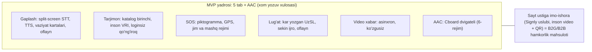

# 03g. Global funksiyalar matritsasi va biznes modellar (MDH'dan tashqari)

> **Qisqacha**
> - Dunyodagi ~40 ta mahsulot (subtitr, qo'ng'iroq subtitri, VRS/VRI, avatar, o'rganish, favqulodda, AAC, video xabar, uchrashuv) bir jadvalda: reyting, narx, asosiy funksiya, maqtov, shikoyat, ochiq kod.
> - 48 ta funksiya 7 toifaga bo'lingan va har biriga hukm berilgan: **shart** (MUST), **qo'shimcha** (NICE), **qochish** (AVOID).
> - Barcha toifalarda eng ko'p takrorlanadigan shikoyat - **pul**: paywall, sessiya cheklovi, obunani bekor qilish chalkashligi, narx. Bepul notijorat platforma buni ustunlikka aylantiradi.
> - Pul ishlaydigan model - **davlat daqiqa uchun to'laydigan xizmat** (AQSh TRS Fund: VRS 2025-26 da ~$661M). AI imo-ishora startaplari $0.1M-$4M darajasida qolib ketgan.
> - Ochiq kod bu sohada deyarli yo'q: matritsada faqat Cboard (GPL-3.0) va sign.mt (endi Rylo'ga tegishli) aniq ochiq.

Manba: `2_raqobat_va_ochiq_kod/global_feature_matrix.md` (2026-11-15, ~30 qidiruv) va `1_birinchi_tadqiqot/global_apps_and_business_models.md` (2026-11-15, ~20 qidiruv).

---

## 1. Manbalar ishonchliligi

| Manba turi | Izoh |
|---|---|
| HearingTracker ilovalar katalogi (8-10 noyabr 2026 tekshirilgan) | Reyting va sharh mavzulari uchun eng tartibli manba. App Store / Google Play sharhlaridan namuna oladi, lekin ilovalarni **o'zi sinab ko'rmagan** |
| Reddit (r/deaf, r/asl) | Hech bir qidiruvda tred chiqmadi - **jamiyat fikri dalili yo'q** |
| Do'kon sharhlaridan iqtiboslar | Agregator snippetlaridan olingan qisqa parchalar, vakillik qilmaydi, misol sifatida |
| Reytinglar | Sanaga bog'langan snapshot, mintaqaga qarab farq qiladi |
| Kompaniya raqamlari (foydalanuvchi, daromad) | Ko'pi o'zi e'lon qilgan (self-reported) |

---

## 2. Mahsulotlar jadvali (mahsulotma-mahsulot)

Belgilar: "-" = topilmadi yoki tegishli emas. "Ochiq kod" = biror qismi ochiq.

### 2.1. Subtitr va qo'ng'iroq subtitri

| # | Mahsulot | Kategoriya | Platforma | Reyting (snapshot) | Narx | Killer funksiya | Maqtovlar | Shikoyatlar | Ochiq kod | Holat 2026 |
|---|---|---|---|---|---|---|---|---|---|---|
| 1 | Google Live Transcribe & Sound Notifications | Yuzma-yuz subtitr + tovush ogohlantirish | Android 12+ | Play 3.8 (276 431 baho, AQSh, 10.11.2026) | Bepul | Oflayn til paketlari; katlanadigan telefonda tashqi ekranda subtitr (Dual Screen, Android 14+); tovush ogohlantirishlari | Suhbat, qabul, uchrashuvni kuzatish; tez tanish; foydali tovush tavsiflari | So'z tushib qolishi, tinish belgisi siljishi, subtitr miltillashi; yangilanishdan keyin aniqlik pasaygan; qo'ng'iroq paytida tasodifan yonishi; majburiy oldindan o'rnatilgan; tahrir/eksport, ko'proq til, so'zlovchini aniqlash so'raladi | Speech-engine kutubxonasi GitHub'da (bu bosqichda qayta tekshirilmagan) | Faol |
| 2 | Apple Live Captions / Live Listen / Sound Recognition | OS ichidagi | iOS, iPadOS, macOS, watchOS | - | Bepul | Qurilmada ishlov; Apple Watch'da subtitr; ism chaqirilganda ogohlantirish (Name Recognition, 2025) | - (sharh ma'lumoti yo'q) | - | Yo'q | Faol |
| 3 | Ava | Guruh subtitri | iOS, Android, Mac, Windows, web | App Store 4.4 (~4.2K), Play 4.3 (761) | Freemium: bepul daraja 40 daqiqalik sessiya; pullik - Premium subtitr, tarjima, qo'shimcha tillar; "Scribe" inson subtitri alohida; Smart Recaps 5 tasi bepul; eski ro'yxatda $14.99/oy | Mehmon QR/havola orqali akkauntsiz qo'shiladi; so'zlovchi belgilari; Zoom/Meet/Teams bot | Oila, hamkasb, tibbiyot xodimi bilan suhbat; o'qiladigan subtitr; saqlangan transkript; overlay | So'z tushishi, kechikish, to'xtab qolish, shovqin, ishdan chiqish; transkript yo'qolishi; guruhni sozlash murakkab, qayta ulanish halqasi; obuna/bekor qilish chalkashligi | Yo'q | Faol |
| 4 | Rylo (sobiq Nagish) | Qo'ng'iroq subtitri + yuzma-yuz | iOS, Android | App Store 4.6 (4.6K), Play 4.6 (2.9K) | Bepul (FCC IP CTS, AQSh) | Bepul AI qo'ng'iroq subtitri | - | Keraksiz qo'ng'iroqlar; akkaunt ma'lumoti talabi (FCC ro'yxati) | sign.mt'ni sotib olgan (ochiq) | Faol, 2026 iyunda rebrend |
| 5 | InnoCaption | Qo'ng'iroq subtitri | iOS, Android | App Store 4.7 (12.6K), Play 4.4 (7.5K) | Bepul (AQSh) | AI yoki jonli stenograf rejimini tanlash (inson subtitri faqat ingliz) | - | - | Yo'q | Faol |
| 6 | CaptionCall (Sorenson) | Qo'ng'iroq subtitri | - | App Store 4.8 (3.7K) | - | - | - | - | Yo'q | Faol |
| 7 | ClearCaptions | Qo'ng'iroq subtitri | - | App Store 4.4 (2.1K) | - | - | - | - | Yo'q | Faol |
| 8 | RogerVoice (Fransiya) | Qo'ng'iroq subtitri | iOS, Android | 4.4 (9.5K) yoki 4.8 (1.3K) - **manbalar zid** | Freemium: ilovadan ilovaga bepul; AQSh do'konida Freedom $5.99, Premium $29.99, kredit $10.99 | Bepul ilova-ilova qo'ng'iroq; ovozli pochta transkripti; 6 til (en, fr, de, it, pt, es); katta shrift, mikrofonni o'chirish | - | Billing va kirish muammolari ("It's no use for me now") | Yo'q | Faol |
| 9 | Otter | Uchrashuv transkripti | Ko'p platforma | - | Freemium, 300 daq/oy | Umumiy transkriptlar | - | - (karlar fikri topilmadi) | Yo'q | Faol |

### 2.2. Relay va tarjimon xizmatlari (VRS / VRI)

| # | Mahsulot | Kategoriya | Platforma | Reyting | Narx / kim to'laydi | Killer funksiya | Maqtovlar | Shikoyatlar | Ochiq kod | Holat 2026 |
|---|---|---|---|---|---|---|---|---|---|---|
| 10 | Sorenson ntouch | VRS (AQSh) | iOS, Android, desktop | App Store 4.1 (510), Play 4.3 (6.5K) | Bepul (AQSh TRS); ro'yxatdan o'tgan VRS akkaunt shart | Eng katta tarjimonlar havzasi; iOS/Android v9 qo'llanmalari | - | O'tkazib yuborilgan/ishlamagan qo'ng'iroq, tarjimon yo'q, qora kamera ekrani; Play'da qo'ng'iroq ogohlantirishi, video barqarorligi, kiruvchi qo'ng'iroq, akkauntga kirish | Yo'q | Faol |
| 11 | Convo Call | VRS (kar egalik qiladi; AQSh/UK/AU) | Ko'p platforma | Eski ilova ~4.1 (280) | Bepul (TRS) | Kar egalik qiladi; DeafBlind foydalanuvchi maqtovi | Bir DeafBlind foydalanuvchi uchun "yagona mos VRS" | Yangilangan ilova "quite uncooperative" (LTE'da javob bermagan) | Yo'q | Convo VRS va Convo Link **2026-05-04 da yopilgan** |
| 12 | ZP Sivo | VRS | iOS, PC, Mac | 4.5 (18 baho) | Bepul (TRS); telefon raqami + kod bilan ro'yxat | Uch tomonlama video (eshituvchi ham karni ko'radi); boshqa provayder ilovalari bilan ishlaydi; Z5/P3 qurilmalarda video pochtadan qayta qo'ng'iroq, VCO Plus | - | - | Yo'q | Faol (Teleperformance) |
| 13 | GlobalVRS | VRS | - | - | - | - | - | - | - | O'rganilmagan |
| 14 | SignVideo (UK) | VRI/VRS | iOS, Android, macOS, Windows, web | - | Tashkilot obuna bo'ladi, kar uchun bepul; 7 kun, 8:00-18:00 | Ilova 150+ xizmatdan iborat **SignDirectory** bilan ochiladi (bank, kengash, sog'liq, kommunal); 2019 dan bepul BSL biznes katalogi | - | - | Yo'q | Faol (Sorenson oilasiga qo'shilgan) |
| 15 | Contact Scotland BSL | Davlat relay | iOS, Android, Windows, macOS, web | - | Davlat moliyalaydi, bepul | 24/7; **qo'ng'iroq uchun login shart emas**; BSL'da yo'riqnoma videolar | - | - | Yo'q | Faol; provayder bo'yicha manbalar zid (3-bo'lim) |
| 16 | ISLRTC relay (Hindiston) | Davlat relay | Web | - | Bepul (2023-07-18 dan) | Bepul video relay + SignLearn lug'ati | - | - | Yo'q | Faol |
| 17 | SignAble (Hindiston) | Xususiy VRI | iOS | - | Pullik | Kar - videoda, eshituvchi - audioda | - | - | Yo'q | Faol |
| 18 | Aira ASL | Talab bo'yicha tarjimon | - | - | Professional (ko'ngilli emas) tarjimonlar | Talab bo'yicha ASL | - | - | - | Faol |
| 19 | Jeenie | Marketplace | - | - | - | ASL opsiyasi bor | - | - | - | Faol |
| 20 | Sign Now (Isroil, 2022) | Tarjimon | - | - | Bepul | Real vaqt va rejalashtirilgan tarjima | - | - | - | - |
| 21 | InterpretersLive! (UK) | Tarjimon | - | - | Tashkilot ro'yxatda bo'lsa bepul | - | - | - | - | - |

### 2.3. Imo-ishora chiqishi (avatar, AI signer, sayt ustiga video) va tanish

| # | Mahsulot | Kategoriya | Platforma | Reyting | Narx | Killer funksiya | Maqtovlar | Shikoyatlar | Ochiq kod | Holat 2026 |
|---|---|---|---|---|---|---|---|---|---|---|
| 22 | Hand Talk (Braziliya) | Avatar tarjimon + plagin | iOS, Android, web | App Store ~3.8-3.9 (~498) | Bepul ilova; B2B plagin | 3D avatarlar Hugo va Maya (Libras, ASL) | Sentiment: 61.8% ijobiy | 38.2% salbiy; ilova faqat portugalcha bo'lgani; o'rta aniqlik - o'rganish va oddiy muloqot uchun, muhim holatlar uchun emas; ASL'i Signed Exact English'ga o'xshaydi (anekdot) | Yo'q | Faol |
| 23 | Signapse (UK) | AI signer B2B | Web, transport | - | B2B | Fotorealistik BSL/ASL; mahsulotlar SignStudio, SignStream, Transport, Website Plugin; ASL 2026-03, DGS 2026-09 ga e'lon qilingan | BSL uchun "95%+ tushunarlilik" (kompaniya da'vosi); Zero Project Award 2026 | - | Yo'q | Faol |
| 24 | Signly (UK) | Saytlarda inson BSL videosi | Brauzer kengaytmasi, ilova | - | Sayt egasi to'laydi | Malakali tarjimonlar oldindan yozgan BSL video sayt matniga sinxron; bosma matn/shtrix-kodni skanerlab BSL video (print mode); mijoz: Lloyds Bank | O'zini "tarjimonlar o'rnini bosmaymiz" deydi | Real vaqtda emas, faqat ro'yxatdagi saytlar | Yo'q | Faol |
| 25 | Sign-Speak (AQSh, kar boshqaradi) | Tanish API | SDK (React) | - | B2B | ASL Recognition (video -> ingliz), ASL Production (matn -> avatar), nutq vositalari | - | - | npm'da SDK (litsenziya tekshirilmagan) | Noaniq (GA Q1 2024 ga mo'ljallangan edi) |
| 26 | SignAll / Ace ASL | Daktil AI repetitor | iOS (2021-04-01) | - | Freemium (to'liq daktil kontenti premium) | Kamera harf va raqamlarni taniydi, real vaqt fikr-mulohaza, viktorina; barcha imo-ishorani madaniy kar ona-tilli o'rgatadi | - | - | Yo'q | Ehtimol uxlab qolgan |
| 27 | GnoSys, Kara | Tanish / avatar | - | - | - | - | - | GnoSys: mustaqil aniqlik dalili yo'q | - | Oldingi yozuvlarga qarang |

### 2.4. Imo-ishora o'rganish

| # | Mahsulot | Kategoriya | Platforma | Reyting | Narx | Killer funksiya | Maqtovlar | Shikoyatlar | Ochiq kod | Holat 2026 |
|---|---|---|---|---|---|---|---|---|---|---|
| 28 | ASL Bloom | O'rganish | iOS, Android, web | App Store 4.9 (~38K), Play 4.8 (18.1K) | Kuniga 2 bepul dars + Premium | Lug'at, dars, viktorina, daktil, sekin video, geymifikatsiya | Oddiy va qiziqarli dars; sekin ijro; takror; lug'at | Bepul daraja juda tor, qimmat; asoslarni o'tkazib yuborib bo'lmaydi; o'rgatilmagan imo-ishora bo'yicha viktorina; yo'qolgan/qora/qotgan video, ishdan chiqish, progress yo'qolishi (Play 2026); 3 ta sharhlovchi **AI chizgan rasmlarga** qarshi | Yo'q | Faol |
| 29 | Lingvano (Avstriya) | O'rganish | iOS, Android, web | ComplaintsBoard 3.7 (19 sharh, 22 shikoyat); sentiment ~61% / 39% | Obuna | Kar boshchiligida o'qitish | - | 2 bobdan keyin agressiv paywall, billing, imo-ishora namoyishlarida nomuvofiqlik (AI audit, past ishonch) | Yo'q | Faol |
| 30 | SignSchool | O'rganish | iOS, web | - | Bepul (eski sharh: kelajakda pullik bo'lishi mumkin) | To'liq bepul platforma: video dars, o'yin, lug'at | - | - | Yo'q | Faol |
| 31 | Hands On ASL | Daktil | iOS | ~4.0 (~74-90) | Bepul + IAP (qo'l rangi pullik) | Aylantirib, kattalashtiriladigan 3D qo'l modellari; tezligi o'zgaradigan viktorina | - | Qo'l rangi uchun IAP | Yo'q | Eskirgan (yangilanish 2019/2021) |
| 32 | The ASL App (Ink & Salt, endi DeafDigits) | Lug'at / iboralar | iOS, Android | - | Bepul to'plamlar + bir martalik $9.99 (reklamani ham o'chiradi) | Kar egalik qiladigan kompaniya; 2 500+ imo-ishora va ibora; sekin ijro, qidiruv, sevimlilar | - | - | Yo'q | Faol |
| 33 | Spreadthesign (European Sign Language Centre, notijorat) | Ko'p tilli lug'at | Web, iOS, Android | - | Sayt bepul; ilovada IAP va PRO | Bir so'zni turli imo-ishora tillarida solishtirish; misol gaplar; sekin ijro; oflayn saqlash; qo'l alifbolari | - | - | Yo'q (NNT) | Faol. Hajm **zid**: ilova ro'yxatida 600 000+ video va ~23 til; 2024 postida 36 til va 700K tarjima |

### 2.5. Favqulodda aloqa

| # | Mahsulot | Kategoriya | Platforma | Reyting | Narx | Killer funksiya | Maqtovlar | Shikoyatlar | Ochiq kod | Holat 2026 |
|---|---|---|---|---|---|---|---|---|---|---|
| 34 | nora (Germaniya, federal yerlar ilovasi) | Favqulodda | iOS, Android | - | Bepul (davlat) | Piktogramma va aniq matn; "Stiller Notruf" (jim chaqiruv); nora-notruf.de da DGS video yo'riqnoma | Bitta Play sharhi: "joylashuvni qo'shadi, qo'ng'iroqdan tezroq" | **Oldindan ro'yxatdan o'tish shart**; netzpolitik.org: ilova maqsadli foydalanuvchilar ehtiyojiga javob bermaydi | Yo'q | Faol |
| 35 | DEC112 (Avstriya, 2019 dan) | Favqulodda | iOS, Android | - | Bepul | Matnli chat: yong'in 122, politsiya 133, tez yordam 144, tog' qutqaruvi 140, 112; jim politsiya chaqiruvi (2022); **mashq rejimi** | - | - | Tasdiqlanmagan (EU NGI moliyalagan) | Faol |
| 36 | 112 Ireland RTT | Favqulodda | Telefonning o'zida | - | Bepul | Vodafone Ireland RTT pilot (2025-01): **ilova ham, oldindan ro'yxat ham kerak emas**, accessibility sozlamasida yoqiladi, ECAS bilan to'g'ridan-to'g'ri | RTT SMS'dan tezroq | Operatorga bog'liq; SMS faqat 112 ga, rouming'da ishlamaydi | - | 2025 dan faol |
| 37 | Text-to-911 (AQSh) | Favqulodda | SMS | - | Bepul | "Imkoning bo'lsa qo'ng'iroq qil, bo'lmasa yoz" | - | Qamrov PSAP'ga bog'liq (yo'q joyda bounce-back); **avtomatik joylashuv yo'q**; faqat SMS (foto/video yo'q); rouming'da yo'q | - | Faol |

### 2.6. AAC (gapira olmaydiganlar)

| # | Mahsulot | Kategoriya | Platforma | Reyting | Narx | Killer funksiya | Maqtovlar | Shikoyatlar | Ochiq kod | Holat 2026 |
|---|---|---|---|---|---|---|---|---|---|---|
| 38 | Proloquo2Go | AAC | iOS, Mac | - | ~$249.99 bir martalik (ba'zi mintaqada $349.99; Gateway lug'ati $199.99) | Moslashtiriladigan lug'at va maket, progressiv til, ikki tilli, ovozlar bepul | - | Narx ota-onalar uchun to'siq; tutorialsiz interfeys bosib ketadi, funksiyalar yashirin, papka navigatsiyasi noqulay | Yo'q | Faol |
| 39 | TD Snap (Tobii Dynavox) | AAC | iOS, Windows | - | Nutq chiqishi 1 oylik sinovdan keyin oylik obuna | Tayyor sahifa to'plamlari; sensor, ko'z bilan boshqarish (eye gaze), switch | - | Nutq paywall ortida | Yo'q | Faol |
| 40 | Avaz (Hindiston) | AAC | iOS, Android | - | **Manbalar zid**: $9.99/oy yoki $99.99/yil; eski ro'yxatda $199.99 umrbod, keyin $149.99; 2 hafta sinov; bepul Lite (da'vo) | Arzon | - | Maxsus switch scanning kerak bo'lganlarga kam mos (past ishonchli manba) | Yo'q | Faol |
| 41 | Cboard | AAC | Web PWA | - | Bepul | Oflayn, ~44 til, UNICEF moliyalagan | - | - | **GPL-3.0** | Faol |

### 2.7. Video xabar va uchrashuvlar

| # | Mahsulot | Kategoriya | Platforma | Reyting | Narx | Killer funksiya | Maqtovlar | Shikoyatlar | Ochiq kod | Holat 2026 |
|---|---|---|---|---|---|---|---|---|---|---|
| 42 | Glide | Asinxron video | iOS, Android | - | Bepul | Karlar uchun yaratilmagan, lekin yuz minglab kar ASL video xabar uchun ishlatgan; jamoa menejeri so'rovlarni tushunish uchun ASL o'rgangan | - | - | Yo'q | Faol |
| 43 | Marco Polo | Asinxron video | iOS, Android | - | Freemium | Karlar "ko'zgudek teskari imo-ishora" deganidan keyin kamera tuzatilgan; VoiceOver, Voice Control, Reduce Motion, yuqori kontrast; Sorenson "2025 eng yaxshi ilovalar" ro'yxatida | - | Ko'zgu muammosi (tuzatilgan) | Yo'q | Faol |
| 44 | Microsoft Teams (Sign Language View) | Uchrashuv | Ko'p platforma | Play 4.7 | Bepul subtitr | Shaxsiy sozlama: tanlangan imo-ishorachilar markazda qoladi, boshqalarga ta'sir qilmaydi; bir tashkilotda oldindan belgilash; ishga tushishda 2 tagacha imo-ishorachi; ekran ulashishda ham sifat saqlanadi | - | Pin cheklovlari | Yo'q | Faol |
| 45 | Zoom (sign language interpretation view) | Uchrashuv | Ko'p platforma | Play 4.1 | Bepul subtitr | Admin yoqadi, host 20 tagacha tarjimon tayinlaydi, alohida pin/spotlight kanallar, tarjimonni yozib olish opsiyasi | - | Foydalanuvchilar bir nechta ishtirokchini hamma uchun pin qilishni so'raydi | Yo'q | Faol |
| 46 | Google Meet | Uchrashuv | Ko'p platforma | Play 4.4 | Jonli subtitr bepul; tarjima qilingan subtitr pullik rejada | Har ishtirokchi subtitrni o'zi yoqadi | - | Imo-ishora tarjimon ko'rinishi tasdiqlanmagan | Yo'q | Faol |

Manbalar (jadvallar uchun): [HearingTracker Live Transcribe](https://www.hearingtracker.com/apps/google-live-transcribe); [Google Support](https://support.google.com/accessibility/android/answer/9158064?hl=en); [9to5Google 2022](https://9to5google.com/2022/03/10/google-live-transcribe-feature-now-works-when-offline/); [Apple FY25 PDF](https://www.apple.com/government/docs/resources/No_Introduction_FY25_Whats_New_in_Apple_Accessibility.pdf); [iGeeksBlog](https://www.igeeksblog.com/accessibility-features-in-ios-26-macos-26/); [Yahoo Tech](https://tech.yahoo.com/home/articles/apple-expands-accessibility-features-including-120000358.html); [HearingTracker Ava](https://www.hearingtracker.com/apps/ava); [BridgingApps](https://bridgingapps.org/bridgingapps-reviewed-app-ava-24-7-accessible-life/); [Ava App Store](https://apps.apple.com/us/app/id1030067058); [TechCrunch 2016](https://techcrunch.com/2016/11/21/ava-gives-the-hearing-impaired-a-more-present-voice-in-group-conversations); [HearingTracker phone/video](https://www.hearingtracker.com/apps/phone-video); [Rylo accessibility](https://rylo.com/legal/accessibility); [HearingTracker Rylo](https://www.hearingtracker.com/apps/rylo); [startuphub](https://www.startuphub.ai/startups/rylo.md); [Neil Squire](https://www.neilsquire.ca/?p=23094); [RogerVoice App Store](https://apps.apple.com/us/app/rogervoice-phone-call-captions/id1033113354); [Kent State RogerVoice](https://sites.google.com/kent.edu/appsfordiverselearningneeds/app-reviews/roger-voice); [aiindigo](https://www.aiindigo.com/tool/rogervoice); [livetranscribe.app (vendor, xolis emas)](https://livetranscribe.app/compare/live-transcribe-vs-ava); [HearingTracker ntouch](https://www.hearingtracker.com/apps/sorenson-ntouch); [Sorenson Android guide](https://sorenson.com/wp-content/uploads/2024/08/guide-ntouch-mobile-android-userguide-v9.3.pdf); [Convo](https://www.convo.io/post/convo-call-generally-available); [Convo App Store](https://apps.apple.com/us/app/convo-vrs/id423121946?l=fr-FR); [Sivo App Store](https://apps.apple.com/us/app/sivo/id1524340854); [ZP PDF](https://zpbettertogether.com/wp-content/uploads/2023/02/Sivo-How-To-PDF-Dec-2020.pdf); [ZP Z5/P3](https://zpbettertogether.com/z5-p3/); [SignVideo](https://signvideo.co.uk/download/); [Bank of Scotland](https://www.bankofscotland.co.uk/contactus/signvideo); [SignVideo biznes katalogi](https://www.signvideo.co.uk/signvideo-launches-bsl-business-directory/); [Contact Scotland FAQ](https://contactscotland-bsl.org/faqs/); [Aira](https://aira.io/aira-asl-on-demand-interpreting-for-the-deaf-community); [MarketScreener Jeenie](https://in.marketscreener.com/news/latest/Jeenie-Modernizes-Access-to-American-Sign-Language-Communication-with-Mobile-On-Demand-Video-Interpr-29841328); [NoCamels](https://nocamels.com/2022/08/life-changing-app-deaf-people/); [InterpretersLive!](https://apps.apple.com/cy/app/interpreters-live/id1552367696); [SplitMetrics Hand Talk](https://splitmetrics.com/apps/hand-talk-asl-sign-language/id659816995); [AppFollow](https://apps.appfollow.io/ios/hand-talk-asl-sign-language/659816995?country=us); [JustUseApp Hand Talk](https://justuseapp.com/en/app/659816995/hand-talk/reviews); [LiveLingo](https://www.livelingo.io/guides/asl-interpreter-app); [neohear Signly](https://www.neohear.com/?p=4777); [Signly FAQ](https://preview.signly.co/faqs/); [Living Made Easy](https://livingmadeeasy.org.uk/product/signly-sign-text-to-bsl); [Signly](https://signly.co/); [ACL LTEDI 2023](https://preview.aclanthology.org/fix_video/2023.ltedi-1.2.pdf); [Signapse ASL](https://signapse.ai/post/introducing-asl-sign-language-translator); [NatLawReview](https://natlawreview.com/press-releases/real-time-accessibility-signapse-launches-ai-digital-signer-german-sign); [Signapse BSL](https://signapse.ai/bsl); [Zero Project](https://zerocon26.zeroproject.org/opportunities/UGFydGljaXBhdGlvbk9wcG9ydHVuaXR5OjIwMTQxNA==); [Signapse docs](https://docs.signapse.ai/website-translations/overview); [unpkg Sign-Speak SDK](https://app.unpkg.com/@sign-speak/react-sdk@0.7.3/files/README.md); [G2 Sign-Speak](https://www.g2.com/products/sign-speak/discuss); [BusinessWire Ace ASL](https://www.businesswire.com/news/home/20210401005516/en/SignAll-Launches-Ace-ASL-App-AI-Will-Help-to-Learn-Sign-Language); [HearingTracker ASL Bloom](https://www.hearingtracker.com/apps/asl-bloom); [marlvel Lingvano](https://marlvel.ai/apps/com-lingvano-app); [JustUseApp Lingvano](https://justuseapp.com/en/app/1547252782/lingvano-sign-language-asl/reviews); [ComplaintsBoard](https://www.complaintsboard.com/lingvano-b148562); [SignSchool App Store](https://apps.apple.com/th/app/signschool/id1145529881); [TopTenReviews](https://www.toptenreviews.com/signschool-review); [HearingTracker SignSchool](https://www.hearingtracker.com/apps/signschool); [AppFollow Hands On ASL](https://apps.appfollow.io/ios/hands-on-asl/1450898947?country=us); [AppAdvice](https://appadvice.com/app/hands-on-asl/1450898947); [Kent State ASL App](https://sites.google.com/kent.edu/appsfordiverselearningneeds/app-reviews/the-asl-app); [The ASL App](https://apps.apple.com/us/app/id921030207); [Spreadthesign about](https://spreadthesign.com/en.us/about/); [Spreadthesign App Store](https://apps.apple.com/us/app/-/id438811366); [outilstice](https://outilstice.com/en/spreadthesign-dictionnaire-international-des-langues-de-signes/); [nora Google Play](https://www.nora-notruf.de/google-play-store); [Aerzteblatt](https://www.aerzteblatt.de/archiv/notruf-nora-soll-hoergeschaedigten-helfen-387dd7e9-d75f-4408-b75d-65d3f757050f); [netzpolitik](https://netzpolitik.org/tag/gehoerlose-menschen/); [DEC112 App Store](https://apps.apple.com/us/app/-/id1494002697); [Innovation in Politics](https://app.innovationinpolitics.eu/?p=48026); [NGI Navigator](https://ngi-navigator.demo.abilian.com/product/dec112); [Irish Deaf Society](https://www.irishdeafsociety.ie/vodafone-ireland-has-launched-a-new-emergency-real-time-text-rtt-service/); [ComReg](https://www.comreg.ie/real-time-text-rtt-service-launched-in-ireland/); [112.ie RTT](https://112.ie/realtimetext/); [112.ie SMS](https://112.ie/sending-a-text-to-112/); [FCC Text-to-911 (arxiv)](https://www.fcc.gov/what-you-need-know-about-text-911); [Orange County FL](https://www.ocfl.net/EmergencySafety/TextTo911.aspx); [No Jitter](https://nojitter.com/contact-centers/call-if-you-can-text-if-you-can-t-an-update); [Pratt IXD](https://ixd.prattsi.org/2024/09/assistive-technology-proloquo2go-ios/); [App Store CA Proloquo2Go](https://apps.apple.com/ca/app/id308368164?l=en-ca); [Common Sense Media](https://www.commonsensemedia.org/app-reviews/proloquo2go); [AlternativeTo TD Snap](https://alternativeto.net/software/td-snap); [Avaz support](https://avazapp.freshdesk.com/support/solutions/articles/1000172730); [Avaz blog](https://buzz.avazapp.com/?p=6264); [WorldMetrics (past ishonch)](https://worldmetrics.org/best/aac-software/); [Next Big Idea Club](https://cdn2.nextbigideaclub.com/magazine/nir-eyal-video-messaging-app-found-unexpected-success-thanks-deaf-community/3273/); [Marco Polo support](https://support.marcopolo.me/article/114-accessibility-friendly-features); [Sorenson 2025 ilovalar](https://sorenson.com/blog/vrs/the-best-apps-for-deaf-people-in-2025/); [Microsoft Support](https://support.microsoft.com/en-us/office/use-sign-language-view-in-microsoft-teams-c6c11f67-0747-4598-ac27-c90801b94434); [Microsoft Tech Community](https://techcommunity.microsoft.com/blog/microsoftteamsblog/introducing-sign-language-view-for-teams-meetings/3671257); [Petri](https://petri.com/microsoft-teams-meetings-get-new-sign-language-view-and-accessibility-pane/); [UC Today](https://www.uctoday.com/?p=46645); [PCC guide](https://www.pcc.edu/instructional-support/tools/zoom/technical-guide-zoom-with-asl-interpretation/); [Zoom Community](https://community.zoom.com/meetings-2/pin-multiple-participants-so-deaf-interpreter-stays-visible-to-other-participants-always-46203).

### 2.8. Qo'shimcha mahsulot faktlari (jadvalga sig'maganlar)

- **Google Live Transcribe tarixi**: ixtiyoriy - yoqilganda 3 kungacha, aks holda 24 soat, qidiruv va eksport bilan; audio yozilmaydi. Kiritish: qurilma yoki tashqi mikrofon. Maxsus lug'at va subtitr pauzasi bor. Yozilgan javob ovoz bilan o'qiladi (TTS). Sound Notifications - signalizatsiya, sirena, chaqaloq yig'isi; bildirishnoma ruxsati kerak.
- **Apple**: Live Captions - telefon, FaceTime, web va yuzma-yuz nutq uchun real vaqt subtitr, qurilmada. 2025 yangilanishi Live Captions va Live Listen boshqaruvini Apple Watch'ga olib keldi. Live Listen - iPhone AirPods yoki MFi eshitish apparatiga uzoq mikrofon. Sound Recognition ~15 tovush; CarPlay ogohlantirishlari: signal, sirena, chaqaloq yig'isi. Music Haptics - musiqani tebranish orqali his qilish. Versiya izohi: iOS 26 ga bog'lash ikkilamchi manbadan, Apple hujjatida "FY25".
- **Ava maxfiyligi**: audio bulutda (AWS va GCP), transkriptlar serverda. Iste'molchi ma'lumoti model o'qitishga ishlatilishi mumkin: yordam maqolasida aytilgan, maxfiylik siyosatida esa "agar rozi bo'lsangiz" - **nomuvofiqlik**. Ava ~50 til, desktopda suzuvchi oyna, tahrir qilinadigan transkript, so'kinish filtri, matn o'lchami/kontrast/joylashuv/qorong'i rejim; mobil oflayn faqat standart tilda. Asoschi g'oyasi: guruh suhbatlarida DHH foydalanuvchiga "a more present voice".
- **Rylo**: alohida yuzma-yuz transkripsiya rejimi; ASHA va LE Audio eshitish apparatlari bilan mos; ~50+ til, transkript lokal saqlanadi (agregator da'vosi).
- **Contact Scotland provayderi** - manbalar zid: NHS Grampian bo'yicha **2025-12-01 dan Sign Solutions**; oldingi yozuvlarda SLI ([NHS Grampian](https://www.nhsgrampian.org/about-us/equality-and-diversity/nhs-grampian-british-sign-language-plan/contacting-nhs-24-for-deafbsl-user/)); 3.3-bo'limda gov.scot/OSCR bo'yicha SLI.
- **Ko'ngilli "Be My Eyes for Deaf"** - topilmadi. Eng yaqin analoglar pullik (Aira, Jeenie).
- **Milliy lug'atlar**: Sign BSL va NZSL Online ([HearingTracker](https://www.hearingtracker.com/apps/asl-bloom)). iBSL 2023 da yopilgan; SLAIT School - AI repetitor.

---

## 3. Toifalar bo'yicha xulosalar (nimani ko'chirish, nimadan qochish)

| Toifa | Asosiy xulosa | Ko'chirish | Qochish |
|---|---|---|---|
| Subtitr | Bepul platforma vositalari (Live Transcribe, Apple) yuzma-yuz subtitrni oddiy tovarga aylantirgan. Pullik ilovalar 4 narsada yutadi: qo'ng'iroq subtitri, guruh/so'zlovchi belgisi, inson tahriri, transkript saqlash | Ikki ekran (oddiy telefonda yuqori yarmi 180 gradus burilgan); yozilgan javob TTS bilan; QR orqali akkauntsiz mehmon; so'zlovchi belgisi; oflayn til paketlari; standart holatda qurilmada ishlov; foydalanuvchi boshqaradigan qisqa lokal tarix (3 kun) | 40 daqiqalik qattiq cheklov; pullik tillar; noaniq bekor qilish; roziliksiz transkriptdan o'qitish |
| VRS/VRI | Faqat **qo'ng'iroq ishonchliligi** bo'yicha baholanadi. UK modeli imo-ishorada qo'ng'iroq qilsa bo'ladigan tashkilotlar katalogini qo'shadi | Katalog bosh sahifa (SignVideo); loginsiz qo'ng'iroq; uch tomonlama video; video pochta + qayta qo'ng'iroq; imo-ishorada yo'riqnoma | Funksiya qo'shishdan oldin push/call-kit ishonchliligi, past tezlikdagi video, navbatda kutish vaqtini ko'rsatish |
| Avatar / tanish | Isbotlangan shakllar: statik kontentga inson videosi (Signly), shablon kontentga AI signer (Signapse), 3D avatar ilova (Hand Talk). Hand Talk reytingi ~3.8-3.9 - avatar chiqishi umidsizlantiradi | Signly naqshi: statik kontentga inson videosi + QR/print-to-sign; Ace ASL naqshi: tanish faqat daktil/izolyatsiyalangan mashq uchun | Karlarga umumiy avatar "tarjimon ilovasi"ni sotish |
| O'rganish | Yetakchilar ASL Bloom (4.9, ~38K) va Lingvano (3M+). Eng katta shikoyat - paywall | Sekin va takroriy video, ko'zgu ko'rinishi, qidiruvli lug'at, oflayn saqlash, qisqa kunlik dars, har videoda kar ona-tilli | AI chizgan rasmlar, o'rgatilmagan imo-ishora bo'yicha viktorina |
| Favqulodda | 3 naqsh: ilovasiz RTT/SMS (Irlandiya), piktogrammali davlat ilovasi + jim rejim (nora, DEC112), AQSh Text-to-911 | Bir bosishda SOS, xizmat tanlash piktogrammasi (101/102/103/112), avtomatik GPS + profil ("Men karman, faqat matn/imo-ishora"), jim rejim, mashq rejimi, imo-ishora video onboarding | Favqulodda paytda oldindan ro'yxatni to'siq qilish. Ilova yolg'iz o'zi teng kirish emas (Irlandiya, EENA) - mahalliy SMS/RTT uchun advokatlik |
| AAC | Tijoriy yetakchilar qimmat; yagona ochiq, oflayn, ko'p tilli asos - Cboard | Cboard fork; tugmasi siljimaydigan grid, progressiv lug'at, switch/eye-gaze | Nutq chiqishini paywall ortiga qo'yish (TD Snap) |
| Video xabar / uchrashuv | Karlar asinxron video xabarni tanladi. Hal qiluvchi tuzatish - **kamerani ko'zgusiz yuborish** | Ko'zgusiz chiquvchi video (preview ko'zgu bo'lishi mumkin); asinxron imo-ishora xabari; ekran ulashishda ham saqlanadigan tarjimon tayli; tarjimonni faqat rozilik bilan yozish | Yangi ijtimoiy tarmoq qurish - mavjud messenjerlarga integratsiya (Telegram/WhatsApp) |

O'zbekiston uchun asosiy farq (subtitr toifasi xulosasi): o'zbek va rus ASR sifati + tuzatiladigan subtitr. Google vositasining eng katta shikoyatlari - miltillash va "yangilanishdan keyin aniqlik pasaydi".

Ko'ngillilar haqida: ko'ngilli tarjimon tarmog'i - ochiq bo'shliq, lekin yuqori xavfli qo'ng'iroqlarda WFD va tarjimon tashkilotlarining professional sifat talabiga zid. Gibrid xavfsizroq: past xavfli yordam ("bu xatda nima yozilgan") uchun ko'ngilli yoki kar tengdoshlar, tibbiy/huquqiy/favqulodda holatda sertifikatli tarjimon.

---

## 4. Master funksiyalar ro'yxati (48 ta) va hukmlar

Izoh: xom yozuvda sarlavha "42 features" deydi, lekin ro'yxatda 48 ta band bor. Bu hujjat 48 tasini to'liq beradi.

Hukm: **shart** = MUST, **qo'shimcha** = NICE, **qochish** = AVOID.

### A. Suhbat (yuzma-yuz)

| # | Funksiya | Kimda bor | Hukm | Dalil / manba |
|---|---|---|---|---|
| 1 | Jonli nutqdan matnga subtitr | Live Transcribe, Apple Live Captions, Ava, Rylo | **shart** | Qabul va uchrashuvni kuzatish maqtovi - [HearingTracker LT](https://www.hearingtracker.com/apps/google-live-transcribe) |
| 2 | Yozilgan javobni TTS bilan o'qish | Live Transcribe | **shart** (gapira olmaydiganlar va karlar) | o'sha manba |
| 3 | Suhbatdoshga qaragan ikki/bo'lingan ekran | Live Transcribe (katlanadigan) | **shart**, oddiy telefonda 180 gradus split | [Google Support](https://support.google.com/accessibility/android/answer/9158064?hl=en) |
| 4 | Matn o'lchami, kontrast, qorong'i rejim | LT, Ava, RogerVoice | **shart** | [HearingTracker Ava](https://www.hearingtracker.com/apps/ava) |
| 5 | Oflayn til paketlari | LT; Ava (faqat standart til) | **shart** (O'zbekistonda narx va qamrov) | [9to5Google](https://9to5google.com/2022/03/10/google-live-transcribe-feature-now-works-when-offline/) |
| 6 | So'zlovchi belgisi / aniqlash | Ava | **qo'shimcha** (LT foydalanuvchilari so'raydi) | [HearingTracker LT](https://www.hearingtracker.com/apps/google-live-transcribe) |
| 7 | Mehmon subtitr sessiyasiga QR orqali, akkauntsiz | Ava | **shart** (guruhlar uchun) | [HearingTracker Ava](https://www.hearingtracker.com/apps/ava) |
| 8 | Maxsus lug'at | LT | **qo'shimcha** (ismlar, o'zbek atamalari) | o'sha manba |
| 9 | Foydalanuvchi boshqaradigan saqlangan, qidiriladigan, eksport qilinadigan transkript | LT (3 kun), Ava | **shart**; transkript yo'qolishi - Ava'ning top shikoyati | [HearingTracker Ava](https://www.hearingtracker.com/apps/ava) |
| 10 | Standart holatda qurilmada ishlov | Apple | **shart** (maxfiylik) | [Apple FY25](https://www.apple.com/government/docs/resources/No_Introduction_FY25_Whats_New_in_Apple_Accessibility.pdf) |
| 11 | Qattiq sessiya cheklovi yoki pullik tillar | Ava | **qochish**; billing - top shikoyat | [HearingTracker Ava](https://www.hearingtracker.com/apps/ava) |
| 12 | Tuzatiladigan subtitr (bosib tuzatish; eshituvchi tuzatadi) | Tadqiqot prototipi EvolveCaptions | **qo'shimcha -> farqlovchi**; "so'z tushishi / miltillash" shikoyatiga javob | oldingi yozuvlar (04a ga qarang) |
| 13 | Vaziyat kartalari (ikonka, matn, imo-ishora video) | Yagona global mahsulot topilmadi; nora piktogramma ishlatadi | **shart** (past savodxonlik) | oldingi yozuvlar |

### B. Telefon qo'ng'irog'i va relay

| # | Funksiya | Kimda bor | Hukm | Dalil / manba |
|---|---|---|---|---|
| 14 | AI qo'ng'iroq subtitri | Rylo, InnoCaption, RogerVoice, CaptionCall | **qo'shimcha**; telekom yoki moliya hamkoriga bog'liq | [HearingTracker list](https://www.hearingtracker.com/apps/phone-video) |
| 15 | Inson subtitrchiga o'tish | InnoCaption, Ava Scribe | **qo'shimcha** | o'sha manba |
| 16 | Talab bo'yicha inson VRI / VRS | ntouch, Convo, Sivo, SignVideo, Contact Scotland, SignAble | **shart** (jamiyat qo'llab-quvvatlagan yadro) | 2.2-bo'lim |
| 17 | Imo-ishorada qo'ng'iroq qilsa bo'ladigan tashkilotlar katalogi | SignVideo (150+) | **shart**; B2G/B2B hamkorlarga ko'rinish beradi | [SignVideo](https://signvideo.co.uk/download/) |
| 18 | Loginsiz qo'ng'iroq | Contact Scotland | **shart** (favqulodda va birinchi foydalanish) | [FAQ](https://contactscotland-bsl.org/faqs/) |
| 19 | Uch tomonlama video (eshituvchi karni ko'radi) | Sivo | **qo'shimcha** | [App Store](https://apps.apple.com/us/app/sivo/id1524340854) |
| 20 | Video pochta + qayta qo'ng'iroq | ZP | **qo'shimcha** | [ZP](https://zpbettertogether.com/z5-p3/) |
| 21 | Ishonchli kiruvchi qo'ng'iroq ogohlantirishi (tebranish, chiroq, to'liq ekran) | ntouch'ning asosiy nosozligi | **shart** | [HearingTracker ntouch](https://www.hearingtracker.com/apps/sorenson-ntouch) |
| 22 | Tarjimonni kutish vaqtini ochiq ko'rsatish | Hech bir mahsulotda topilmadi; "tarjimon yo'q" - shikoyat | **qo'shimcha -> farqlovchi** | 2.2-bo'lim |
| 23 | DeafBlind-qulay rejim | Convo'da maqtalgan | **qo'shimcha** | [App Store](https://apps.apple.com/us/app/convo-vrs/id423121946?l=fr-FR) |

### C. Imo-ishora chiqishi va tanish

| # | Funksiya | Kimda bor | Hukm | Dalil / manba |
|---|---|---|---|---|
| 24 | Statik kontentga inson yozgan imo-ishora video + QR / print-to-sign | Signly | **shart** (arzon, WFD bilan mos) | [Living Made Easy](https://livingmadeeasy.org.uk/product/signly-sign-text-to-bsl) |
| 25 | Shablon e'lonlar uchun AI/avatar signer | Signapse, Kara | **qo'shimcha / keyin**, faqat statik kontent (WFD) | oldingi yozuvlar |
| 26 | Jonli suhbat uchun umumiy avatar "tarjimon" | Hand Talk | **qochish** (karlarga qaratilgan foydalanishda); reyting ~3.8, aniqlik tanqidi | [SplitMetrics](https://splitmetrics.com/apps/hand-talk-asl-sign-language/id659816995) |
| 27 | Ochiq suhbat uchun imo-ishora tanish | Sign-Speak API, GnoSys | **MVP uchun qochish** (ma'lumotga bog'liq) | oldingi yozuvlar |
| 28 | Mashq uchun daktil / izolyatsiyalangan imo-ishora tanish | Ace ASL | **qo'shimcha** | [BusinessWire](https://www.businesswire.com/news/home/20210401005516/en/SignAll-Launches-Ace-ASL-App-AI-Will-Help-to-Learn-Sign-Language) |
| 29 | Aqlli qo'lqop / taqiladigan qurilma | - | **qochish** | 6-bo'lim |

### D. O'rganish

| # | Funksiya | Kimda bor | Hukm | Dalil / manba |
|---|---|---|---|---|
| 30 | Sekin va takroriy ijroli qidiriladigan lug'at | Bloom, The ASL App, Spreadthesign | **shart** | [HearingTracker Bloom](https://www.hearingtracker.com/apps/asl-bloom) |
| 31 | Imo-ishoralarni oflayn saqlash | Spreadthesign | **shart** | [App Store](https://apps.apple.com/us/app/-/id438811366) |
| 32 | Qisqa tartibli kunlik dars va viktorina | Bloom, Lingvano, SignSchool | **shart**, faqat o'rgatilganidan viktorina | [HearingTracker Bloom](https://www.hearingtracker.com/apps/asl-bloom) |
| 33 | Barcha videolarda kar ona-tilli imo-ishorachi | Lingvano, Ace ASL, The ASL App | **shart** | 2.4-bo'lim |
| 34 | Tillararo solishtirish (masalan UzSL va RSL) | Spreadthesign | **qo'shimcha** | [outilstice](https://outilstice.com/en/spreadthesign-dictionnaire-international-des-langues-de-signes/) |
| 35 | Aylanadigan 3D qo'l modellari | Hands On ASL | **qo'shimcha** (qo'l shakli aniqligi) | [AppAdvice](https://appadvice.com/app/hands-on-asl/1450898947) |
| 36 | Agressiv paywall / AI chizgan rasmlar | Lingvano, Bloom | **qochish** | [HearingTracker Bloom](https://www.hearingtracker.com/apps/asl-bloom); [marlvel](https://marlvel.ai/apps/com-lingvano-app) |

### E. Favqulodda

| # | Funksiya | Kimda bor | Hukm | Dalil / manba |
|---|---|---|---|---|
| 37 | Bir bosishda SOS, piktogramma bilan xizmat tanlash, avtomatik joylashuv | nora, DEC112 | **shart** | [nora](https://www.nora-notruf.de/google-play-store) |
| 38 | Jim favqulodda rejim | nora, DEC112 | **shart** | [DEC112](https://app.innovationinpolitics.eu/?p=48026) |
| 39 | Mashq / test rejimi | DEC112 | **shart** (qo'rquv va yolg'on chaqiruvni kamaytiradi) | [NGI Navigator](https://ngi-navigator.demo.abilian.com/product/dec112) |
| 40 | SOS'dan oldin majburiy ro'yxat | nora | **to'siq sifatida qochish** (Irlandiya va EENA) | 2.5-bo'lim |

### F. Media ochiqligi va ogohlantirishlar

| # | Funksiya | Kimda bor | Hukm | Dalil / manba |
|---|---|---|---|---|
| 41 | Tovush tanish ogohlantirishi (eshik qo'ng'irog'i, signal, chaqaloq, o'z ismi) | Google Sound Notifications, Apple Sound Recognition | **qo'shimcha**; OS'da bor - qayta qurmasdan havola berish | [Apple FY25](https://www.apple.com/government/docs/resources/No_Introduction_FY25_Whats_New_in_Apple_Accessibility.pdf) |
| 42 | Uchrashuvda pin qilingan, ekran ulashishda ham qoladigan tarjimon tayli | Teams, Zoom | **shart** (platformaning o'z video qo'ng'irog'ida) | [Microsoft Support](https://support.microsoft.com/en-us/office/use-sign-language-view-in-microsoft-teams-c6c11f67-0747-4598-ac27-c90801b94434) |

### G. AAC va jamiyat

| # | Funksiya | Kimda bor | Hukm | Dalil / manba |
|---|---|---|---|---|
| 43 | TTS'li, oflayn, moslashtiriladigan belgi taxtasi (AAC) | Cboard (OSS), Proloquo2Go, TD Snap, Avaz | **shart**, alohida rejim sifatida; Cboard fork | 2.6-bo'lim |
| 44 | Switch / eye-gaze bilan boshqarish | TD Snap | **qo'shimcha** | [AlternativeTo](https://alternativeto.net/software/td-snap) |
| 45 | Pullik nutq chiqishi | TD Snap | **qochish** | o'sha |
| 46 | Ko'zgusiz asinxron imo-ishora video xabar | Glide, Marco Polo | **shart** | [Next Big Idea Club](https://cdn2.nextbigideaclub.com/magazine/nir-eyal-video-messaging-app-found-unexpected-success-thanks-deaf-community/3273/) |
| 47 | Imo-ishorada yo'riqnoma va yordam videolari | Contact Scotland, nora | **shart** | [Contact Scotland](https://contactscotland-bsl.org/faqs/) |
| 48 | Kar biznes katalogi | SignVideo | **qo'shimcha** (jamiyat va iqtisodiy) | [SignVideo](https://www.signvideo.co.uk/signvideo-launches-bsl-business-directory/) |

### Hukmlar xulosasi

| Hukm | Soni | Bandlar |
|---|---|---|
| shart | 25 | 1, 2, 3, 4, 5, 7, 9, 10, 13, 16, 17, 18, 21, 24, 30, 31, 32, 33, 37, 38, 39, 42, 43, 46, 47 |
| qo'shimcha (shu jumladan "keyin" va "farqlovchi") | 16 | 6, 8, 12, 14, 15, 19, 20, 22, 23, 25, 28, 34, 35, 41, 44, 48 |
| qochish | 7 | 11, 26, 27 (MVP uchun), 29, 36, 40 (to'siq sifatida), 45 |
| **Jami** | **48** | |

Izoh: sonlar jadvaldagi hukmlardan qo'lda sanalgan (xom yozuvda tayyor hisob yo'q).

Xom yozuv xulosasi (inference): "Shveytsariya pichog'i" ilova - 5 tab: **Gaplash**, **Tarjimon**, **SOS**, **Lug'at**, **Video xabar**; AAC oltinchi rejim. Sayt ustiga imo-ishora (Signly uslubi) - B2G/B2B daromad va hamkorlik mahsuloti. Ochiq kod - haqiqiy bo'shliq; OSS notijorat kar platformasi dunyoda deyarli noyob bo'ladi, lekin har komponent litsenziyasi tekshirilishi kerak. Strategik qaror bo'yicha (brif 1-2-band) bizning MVP avatar/kamera tarjimon bilan boshlanmaydi va Surdo AI / imo-ishora.uz bilan raqobat emas, hamkorlik qiladi.

---

## 5. Biznes modellar: kim to'laydi

### 5.1. To'rtta isbotlangan model

| # | Model | Misollar | Raqamlar | Manba |
|---|---|---|---|---|
| 1 | Davlat daqiqa uchun to'laydi (telekom yig'imidan fond) | AQSh TRS: Rylo, Sorenson, ZP | VRS fondi 2025-26: **$660 660 436** (~$661M/yil); Rylo daqiqasiga $1-$8 oladi | [FCC DA 25-578](https://docs.fcc.gov/public/attachments/DA-25-578A1.docx); [runtimewire](https://runtimewire.com/article/nagish-rylo-85-million-general-catalyst) |
| 2 | To'g'ridan-to'g'ri davlat shartnomasi | Contact Scotland BSL, UK 999 BSL, Hindiston ISLRTC | Contact Scotland Shotlandiya hukumati moliyalaydi | [gov.scot](https://www.gov.scot/Topics/People/Equality/remit/projects) |
| 3 | Avatar / sintetik signer kontent litsenziyasi (B2B/B2G) | Signapse (temir yo'l, aeroport), Kara (favqulodda xabar), Hand Talk (sayt plagini) | Narxlar ochiq emas | 5.4-bo'lim |
| 4 | Iste'molchi freemium obuna | Lingvano (o'rganish), Ava (subtitr) | Lingvano 3M+ foydalanuvchi; Ava jami $16.5M | 5.3, 5.6 |
| + | Grant va kichik seed | NSF/SBIR, Innovate UK, Google.org, Red Cross Humanitech | AI tarjima startaplari kam hollarda kattalashadi | 5.5 |

### 5.2. AQSh TRS Fund stavkalari (daqiqasiga)

| Davr / hujjat | Xizmat | Stavka | Manba |
|---|---|---|---|
| 2025-26 (DA 25-571, 2025-07-01) | Traditional TRS | $7.3512 | [FCC DA 25-571](https://docs.fcc.gov/public/attachments/DA-25-571A1.pdf); [Rolka Loube](https://rolkaloube.com/programs/federal-itrs/news/fcc-releases-2025-26-trs-fund-compensation-rates-order) |
| 2025-26 | STS | $8.4822 | o'sha |
| 2025-26 | CTS | $3.1893 | o'sha |
| 2025-26 (DA 25-578) | VRS fondi jami talabi | $660 660 436 | [FCC DA 25-578](https://docs.fcc.gov/public/attachments/DA-25-578A1.docx); [Rolka Loube contribution](https://rolkaloube.com/programs/federal-itrs/news/fcc-releases-2025-26-trs-fund-contribution-factors-order) |
| 2026-27 (DA 26-646) | Interstate traditional TRS, STS, CTS | $9.1713 | [FCC DA 26-646](https://docs.fcc.gov/public/attachments/DA-26-646A1.pdf); [Rolka Loube](https://rolkaloube.com/programs/federal-itrs/news/fcc-releases-2026-27-trs-fund-compensation-and-contribution-formulas-nbsp) |
| 2026-27 | IP Relay | $2.2710 | o'sha |

Order 25-571 qamrovi: traditional TRS, STS, CTS, IP Relay, VRS, IP CTS. VRS daqiqa stavkalari (2025-26, 2026-27) topilmadi - FCC PDF matni chiqarilmadi.

### 5.3. Subtitr va VRS kompaniyalari: pul va bozor

| Kompaniya | Fakt | Manba |
|---|---|---|
| Rylo (sobiq Nagish, Isroil/AQSh) | 2026-06-09: $85M raund va rebrend. General Catalyst Customer Value Fund boshchiligida, Canaan, Vertex Ventures, Contour. Baho ~$500M, jami moliya $100M+ | [BusinessWire](https://www.businesswire.com/news/home/20260604498117/en/); [MobiHealthNews](https://www.mobihealthnews.com/news/rylo-raises-85m-expand-ai-communication-tools-deaf-and-hard-hearing-users); [runtimewire](https://runtimewire.com/article/nagish-rylo-85-million-general-catalyst) |
| Rylo modeli | FCC sertifikatli AI telefon subtitri, foydalanuvchiga bepul. Daromad: mos suhbat daqiqasiga federal kompensatsiya $1-$8; stavka ko'p yillik sikllarda; regulyator stavkani o'zgartirishi va audit qilishi mumkin. Maqsad: 2026 oxirida $100M ARR, 2028 da $1B; foydada (kompaniya/matbuot da'vosi) | [runtimewire](https://runtimewire.com/article/nagish-rylo-85-million-general-catalyst); [lavx](https://news.lavx.hu/article/rylo-raises-85-million-targets-1-billion-in-revenue-by-2028); [AlleyWatch](https://alleywatch.com/2026/07/rylo-ai-communication-accessibility-deaf-hard-of-hearing-real-time-captioning-platform-tomer-aharoni/) |
| Nagish oldingi moliyasi | $5M seed + $11M Series A (Canaan) = $16M | [Hearing Review](https://hearingreview.com/hearing-products/amplification/amplified-caption-phones/ai-powered-transcription-app-gets-more-funding) |
| Rylo + sign.mt | 2025 da sign.mt'ni sotib oldi; endi telefon subtitri, yuzma-yuz transkripsiya va imo-ishora AI | [runtimewire](https://runtimewire.com/article/nagish-rylo-85-million-general-catalyst); [hearinghealthmatters](https://hearinghealthmatters.org/thisweek/2026/rylo-captions-context/) |
| Ava (AQSh/Fransiya) | 2020-12: $4.5M (desktop/web kengayishi); 2022-05: $10M Series A, jami $16.5M. Mahsulotlar: Ava App, Ava CC, Ava Scribe (AI + inson tahriri) | [TechCrunch](https://techcrunch.com/2020/12/10/ava-expands-its-ai-captioning-to-desktop-and-web-apps-and-raises-4-5m-to-scale); [Axios](https://www.axios.com/2022/05/04/ava-live-caption-company-scores-10m); [Ava blog](https://www.ava.me/blog/ava-1-0-24-7-accessibility-for-deaf-hearing-conversations) |
| Big-tech bepul vositalar | Google Live Translate 70+ til, 2026-03 da iOS'ga chiqdi; Apple Live Translation (iOS 26, AirPods) ~9 til bilan (tarjima, subtitr emas - qamrov indikatori) | [MacRumors](https://www.macrumors.com/2026/03/26/google-translate-gemini-ai/); [iDropNews](https://www.idropnews.com/news/google-live-translate-released-iphone-70-languages/261713/); [TravelAwaits](https://www.travelawaits.com/3015964/inside-the-new-live-translation-updates-from-apple-for-airpods-users/) |
| AQSh VRS bozori | Sorenson va ZP Better Together - 3 ta VRS kompaniyasidan 2 tasi, deyarli butun bozor; ikkalasi private equity egaligida (advokatlik manbasi) | [PESP](https://pestakeholder.org/reports/lost-in-interpretation-private-equitys-capture-of-a-vital-sign-language-translation-tool/) |
| ZP sotilishi | Teleperformance (LanguageLine egasi) 2024-11-26 da ZP (ZVRS + Purple)ni Kinderhook'dan oldi; narx ~$490M; ZP 2024 daromadi >$230M kutilgan; FCC yangi egalikka 2 yillik shartli sertifikat berdi | [Mergr](https://mergr.com/transaction/teleperformance-acquires-zp-better-together); [LanguageLine](https://languageline.com/resources/news/teleperformance-completes-acquisition-of-zp-better-together-expanding-accessibility-solutions); [MultiLingual](https://multilingual.com/?p=221809); [FCC](https://www.fcc.gov/node/267653) |
| Sorenson | ZP sotilgandan keyin ikkita AI imo-ishora tarjima startapini sotib oldi; shartlar oshkor emas (sahifa 403, faqat sarlavha) | [Slator](https://tech.slator.com/?p=102822) |

### 5.4. Davlat to'laydigan modellar (UK, Hindiston)

| Mamlakat | Fakt | Manba |
|---|---|---|
| UK, Shotlandiya | Contact Scotland BSL - Shotlandiya hukumati moliyalaydi, Sign Language Interactions (SLI; SignVideo va InterpreterNow egasi) yetkazadi; yangi xizmat va ilova 2025-12-01 da | [gov.scot](https://www.gov.scot/Topics/People/Equality/remit/projects); [OSCR](https://www.OSCR.org.uk/british-sign-language/) |
| UK, 999 BSL | Ofcom 2022-06-17 dan SLI'ni favqulodda BSL video relay provayderi sifatida tasdiqladi | [Southampton AIS](https://ais.southampton.ac.uk/emergency-video-relay-bsl-2022/); [SignHealth](https://signhealth.org.uk/campaign/bsl-999-update-proposal-to-approve-sign-language-interactions-service/) |
| Hindiston | ISLRTC 2023-07-18 da bepul onlayn video relay boshladi; SignAble (Bengaluru) xususiy ISL VRI; ~18M kar, ~4.5M ISL foydalanuvchi, sertifikatli tarjimon 350-1 000 (**manbalar zid**); bepul SignLearn lug'ati | [ISLRTC Annual Report 2023-24](https://divyangjan.depwd.gov.in/upload/s3wassupload/ISLRTC_New_Delhi_Annual_Report_2023_24.pdf); [The Better India](https://thebetterindia.com/367935/signable-app-for-deaf-people-rupmani-chhetri-startup-bengaluru); [App Store SignAble](https://apps.apple.com/ng/app/signable/id6477518760); [ishnews](https://ishnews.tv/videos/news/signlearn-app-a-sign-language-dictionary-for-all) |

### 5.5. Avatar va AI imo-ishora startaplari: moliya va holat

| Kompaniya | Moliya / holat | Manba |
|---|---|---|
| Signapse (UK) | 2024-06: GBP 2M seed (~GBP 1.5M investorlar - Soulmates Ventures, Irish Deeptech Seed Fund boshchiligida + GBP 500K UK hukumati/Innovate UK). Fotorealistik AI BSL/ASL. Zero Project: 2025 dan UK temir yo'lida real vaqt BSL ma'lumoti, 2025 o'rtasida ~2 500 UK stansiyasi va yirik AQSh aeroportlari. 2025/2026 raundi topilmadi | [tech.eu](https://tech.eu/2024/06/05/signapse-secures-ps2m-seed-for-ai-sign-language-tanslation/); [Signapse](https://signapse.ai/new/signapse-closes-seed-funding-round); [Zero Project](https://zeroproject.org/view/project/100ff85a-f64c-f011-8779-7c1e527683f1); [Signapse website](https://register.signapse.ai/website-sign-language) |
| Kara Technologies (NZ) | University of Auckland spin-out (2017); 2023-01 NZ$1.3M seed; Red Cross Humanitech Lab granti (favqulodda imo-ishora xabarlari); NZSL Board va Ko Taku Reo moliyalagan NZSL bolalar kitoblari pilot; kar jamiyati bilan ko'-dizayn | [University of Auckland](https://www.auckland.ac.nz/en/news/2023/01/12/kara-technologies-sign-language-avatar-seed-funding.html); [Startup Daily](https://www.startupdaily.net/topic/funding/red-cross-impact-investor-humanitech-lab-backs-kara-technologies-and-airseed-with-500000-grants/); [NZ Entrepreneur](https://nzentrepreneur.co.nz/kara-technologies-pioneering-inclusive-emergency-sign-language-success-for-the-deaf/) |
| Hand Talk (Braziliya) | Hugo 2012 da kompaniya bilan, Maya keyin; 2019-05 Google $750K grant; foydalanuvchi soni **zid**: kompaniya 3M+ foydalanuvchi va 4M+ yuklanma, mukofot ro'yxati 1M+ | [Hand Talk blog](https://www.handtalk.me/en/blog/how-were-hugo-and-maya-created/); [Briter](https://www.briter.co/companies/handtalk); [Hand Talk](https://www.handtalk.me/en/blog/meet-the-hand-talk-sign-language-translator-app/); [Pluralism award](https://award.pluralism.ca/?p=961) |
| Google SignGemma | Google I/O 2025-05 da ochiq model sifatida e'lon (ASL -> matn); 2025-05-27 X orqali demo; keng chiqish 2025 Q4 kutilgan. Forumda: "We don't have a specific timeline". Agregator (2026-08-11, past sifat): ochiq og'irliklar hali yo'q, faqat qiziqish formasi | [Hans India](https://www.thehansindia.com/tech/google-unveils-signgemma-ai-tool-to-translate-sign-language-into-text-by-year-end-974884); [TechCrunch](https://techcrunch.com/2025/05/20/the-newest-google-gemma-ai-model-can-run-on-phones); [MultiLingual](https://multilingual.com/google-signgemma-on-device-asl-translation/); [Google AI forum](https://discuss.ai.google.dev/t/signgemma-release-date/113794); [aixploria](https://www.aixploria.com/en/?p=38909) |
| SLAIT (Ispaniya/Germaniya) | Aachen amaliy fanlar universiteti tadqiqotidan; 2023 da tarjimadan AI ASL darsiga ("SLAIT School") pivot - CEO: to'liq tarjimaga ma'lumot yetmadi; jami ~$120K. **Tarjima mahsuloti o'lik** | [TechCrunch 2021](https://techcrunch.com/2021/04/26/slaits-real-time-sign-language-translation-promises-more-accessible-online-communication); [TechCrunch 2023](https://techcrunch.com/2023/05/11/slait-pivots-from-translating-sign-language-to-ai-powered-interactive-lessons/amp/); [CB Insights](https://www.cbinsights.com/company/slait-school) |
| Sign-Speak (AQSh) | 2020 da Yami Payano, Nikolas Kelly, Nicholas Wilkins; AWS qo'llagan; CB Insights: 10 raundda $1.22M, NSF investorlar orasida; SBIR: Phase I $256K, Phase II $1.25M ("real-time bidirectional ASL communication system"), lekin oluvchi tasdiqlanmagan | [AWS Startups](https://aws.amazon.com/blogs/startups/sign-speak-builds-with-ai-on-aws-to-create-accessible-experiences/); [CB Insights](https://www.cbinsights.com/company/sign-speak/financials); [SBIR](https://www.sbir.gov/portfolio/2444811) |
| SignAll (Vengriya/AQSh) | 2016, jami $3.6M; Snapchat "ASL Alphabet Lens" hamkorligi; yopilish yoki sotilish yangiligi yo'q, so'nggi faollik dalili yo'q | [CB Insights](https://www.cbinsights.com/company/signall1) |
| GnoSys (Evalk, Niderlandiya) | PTI: neyron tarmoq va CV bilan imo-ishora videosini nutqqa aylantiradi, har qanday imo-ishora tilida ishlaydi deydi; test ma'lumoti yo'q. **Mustaqil aniqlik dalili yo'q** | [The Quint/PTI](https://www.thequint.com/pti/new-ai-app-for-deaf-translates-sign-language-into-speech-in-real-time) |

Moliya bo'shlig'i (xom yozuv xulosasi): davlat kompensatsiyasiga tayangan xizmat biznesi (subtitr/VRS) $100M+ ga yetadi, AI imo-ishora tarjima startaplari $0.1M-$4M da qoladi. Chiqish qiymatlari: ZP ~$490M (>$230M daromad), Rylo ~$500M baho.

### 5.6. O'rganish ilovalari biznesi

| Mahsulot | Fakt | Manba |
|---|---|---|
| Lingvano | 2018 da Avstriyada; 500K o'quvchi (2022) -> 2.5M (2024-10); Apple case study: 2023 yozidan 2025 martgacha +2M, jami 3M+, 85% AQSh/Kanada | [Zero Project](https://zeroproject.org/view/project/ed68f3cd-30ea-4992-9530-d0a8a3f25506); [eSchool News](https://www.eschoolnews.com/newsline/2024/10/08/sign-language-learning-app-reaches-2-5-million-learners-milestone/); [Apple Developer](https://developer.apple.com/articles/lingvano) |
| iBSL (UK) | 2023 da yopilganini tasdiqladi. **O'lik** | [Limping Chicken](https://limpingchicken.com/2023/03/07/ibsl-shares-open-letter-detailing-plans-for-current-learners-as-it-confirms-closure-in-next-couple-of-months/) |
| BleeTV (Hindiston) | 1 000+ ISL video, 12K+ foydalanuvchi (o'zi aytgan) | [The Better India](https://thebetterindia.com/206175/apps-tech-for-deaf-start-up-pune-accessible-technology-isl-content-videos) |

### 5.7. Favqulodda aloqa: huquqiy benchmark (EU)

| Fakt | Manba |
|---|---|
| European Accessibility Act 2025-06-28 dan qo'llanadi; a'zo davlatlar RTT va Total Conversation muddatini 2027-06-28 gacha uzaytirishi mumkin; Total Conversation (video) faqat video qo'ng'iroq allaqachon taklif qilingan joyda majburiy | [EENA](https://eena.org/news/european-accessibility-act-begins-applying-across-the-eu/); [EENA RTT status](https://eena.org/?p=33066) |
| Irlandiya - 112 ga mahalliy RTT bergan birinchi EU davlati (2025) | [112.ie](https://112.ie/realtimetext/); [EENA Ireland](https://eena.org/document/real-time-text-in-ireland) |
| EFHOH: 112 ochiqligida o'zgarish kam; EENA 2026-02 hisobot kartasi | [EFHOH](https://efhoh.org/wp-content/uploads/2025/12/The-European-Accessibility-Act-from-Consultation-to-Implementation-Hard-of-Hearing-Perspective-5_compressed.pdf); [EENA](https://eena.org/wp-content/uploads/2026/02/Accessibility-report-card-abstract.pdf) |
| 2027 RTT sanasi qat'iy muddatmi yoki opsiyami - EENA sahifalari **bir-biriga zid** | yuqoridagi EENA sahifalari |

### 5.8. Qo'lqoplar va karlar tanqidi

| Fakt | Manba |
|---|---|
| Michael Erard (The Atlantic, 2017-11): qo'lqoplar "eshituvchilar dunyosining tashvishlaridan, kar imo-ishorachilar ehtiyojidan emas"; 30 yillik qo'lqoplar asosan faqat 26 daktil harfni taniydi | [Everand](https://everand.com/article/532432338/Why-Sign-Language-Gloves-Don-t-Help-Deaf-People); [kith.org](https://www.kith.org/words/2020/02/29/sign-language-gloves-dont-translate/) |
| SignAloud (UW talabalari, Lemelson-MIT $10K): kar jamiyati tanqidi; NPR - "ko'prik" bir tomonlama | [NPR 2016](https://www.npr.org/sections/alltechconsidered/2016/05/17/478244421/these-gloves-offer-a-modern-twist-on-sign-language); [MultiLingual](https://multilingual.com/signaloud-gloves/) |
| Qo'lqop yuz ifodasi va tana grammatikasini ko'rmaydi; "muloqot yukini karlarga yuklaydi" | [FashNerd](https://fashnerd.com/2019/07/is-the-development-of-a-technology-based-on-a-sign-language-still-constituted-as-cultural-appropriation/); [Wikipedia](https://Www.wikipedia.org/wiki/Sign_language_glove) |
| Matbuotda "99% aniqlik" da'volari (hype naqshi) | [Fox News](https://www.foxnews.com/tech/high-tech-glove-translate-sign-language.amp) |
| CACM 2018-12 "Technology for the Deaf" tanqidiy sharh | [CACM](https://cacm.acm.org/magazines/2018/12/232889-technology-for-the-deaf/fulltext) |
| WFD + WASLI avatar bayonoti (2018-03-14, yangilangan 2018-04): avatar inson signer o'rnini bosmasin; jonli, murakkab, muhim ma'lumot (yangiliklar) bo'yicha eng katta xavotir; oldindan yozilgan statik ma'lumotda maqbul bo'lishi mumkin; avatar faqat bir tomonga ishlaydi | [WFD PDF](https://wfdeaf.org/wp-content/uploads/WFD-and-WASLI-Statement-on-Avatar-FINAL-14032018-Updated-14042018.pdf); [WASLI](https://wasli.org/news/wfd-wasli-statement-use-signing-avatars/) |
| Niderlandiya sog'liqni saqlash tadqiqoti: alohida avatar imo-ishoralari deyarli inson darajasida tanildi, lekin gap tushunilishi va aniqligi sezilarli past | [HU Utrecht](https://hu.nl/onderzoek/publicaties/exploring-automatic-texttosign-translation-in-a-healthcare-setting) |

### 5.9. O'zbekiston uchun xulosalar (xom yozuv inferensiyalari)

- Eng masshtablanadigan kar-texnologiya biznesi - **davlat kompensatsiya qiladigan daqiqa xizmati**, iste'molchi obunasi emas. TRS-ga o'xshash fond bo'lmasa, O'zbekistonda B2G shartnoma yoki telekom yig'imi kerak.
- Tarjimon tanqisligi - texnologiya emas, asosiy cheklov (Hindistonda ~4.5M imo-ishorachiga 350-1 000 tarjimon). Isbotlangan naqsh: umumiy tarjimon havzasi bilan VRI + B2G moliya.
- Daqiqa kompensatsiyasi katta foydali bozor yaratadi, lekin konsolidatsiya va private equity egallab olishi xavfi ham bor.
- Bank, aeroport, temir yo'l, telekom - shablon imo-ishora kontentining isbotlangan B2B xaridorlari (Signapse). Ularni qonun majburiyati (EAA, ADA/FCC, Ofcom) xarid qildiradi - O'zbekistonda shunga o'xshash norma yoki davlat xaridi kerak bo'lishi mumkin.
- Favqulodda modul (112, 101/102/103 ga matn/video) - eng qimmatli B2G komponent, EU qonuni bilan benchmark qilinadi; Favqulodda vaziyatlar vazirligi bilan kirish nuqtasi.
- O'rganish moduli (UzSL lug'ati + oila va xizmat xodimlari uchun dars) kontent va video dataset hosil qiladi, kam bahsli iste'molchi kirish nuqtasi.
- Avatar - faqat shablon/statik xabarlar uchun (WFD "statik ma'lumot" istisnosi). Avatarni tarjimon o'rnini bosuvchi deb sotish kar jamiyati qarshiligini chaqiradi; ko'-dizayn (Kara naqshi) va kar xodimlar shart.
- Qo'lqop va taqiladigan qurilmalardan butunlay qochish; kar tashkilotlarini ochiq jalb qilish.
- Notijorat strategiyamiz (brif 9-band) bilan bog'lanish: AQSh/UK "kim to'laydi" modeli uzoq muddatda davlat yoki telekom yig'imi uchun advokatlik dalili; boshlang'ich bosqichda o'z mablag', grant va CSR.

---

## 6. Manbalar

Asosiy xom yozuvlar:
- `99_Ilovalar/xom_tadqiqot_yozuvlari/2_raqobat_va_ochiq_kod/global_feature_matrix.md`
- `99_Ilovalar/xom_tadqiqot_yozuvlari/1_birinchi_tadqiqot/global_apps_and_business_models.md`

Har bir faktning URL havolasi yuqoridagi jadvallarda berilgan. Eng ko'p ishlatilgan manbalar: [HearingTracker](https://www.hearingtracker.com/apps/phone-video), [FCC DA 25-571](https://docs.fcc.gov/public/attachments/DA-25-571A1.pdf), [FCC DA 25-578](https://docs.fcc.gov/public/attachments/DA-25-578A1.docx), [FCC DA 26-646](https://docs.fcc.gov/public/attachments/DA-26-646A1.pdf), [runtimewire](https://runtimewire.com/article/nagish-rylo-85-million-general-catalyst), [WFD/WASLI bayonoti](https://wfdeaf.org/wp-content/uploads/WFD-and-WASLI-Statement-on-Avatar-FINAL-14032018-Updated-14042018.pdf), [EENA](https://eena.org/news/european-accessibility-act-begins-applying-across-the-eu/).

---

## 7. Tasdiqlanmagan / bo'shliqlar

| Mavzu | Holat |
|---|---|
| Reddit (r/deaf, r/asl) | Hech qanday tred olinmadi; hukmlar do'kon agregatlari, vendor hujjatlari va akademik yozuvlarga tayanadi |
| O'zbek tili Live Transcribe va Apple Live Captions'da | Bu faylda tasdiqlanmagan (04c ga qarang: Apple'da ru/uz yo'q, Live Transcribe ro'yxati ochiq emas) |
| Google Live Transcribe kutubxonasi GitHub'da ochiqmi | Bu faylda qayta tekshirilmagan (04b: `google/live-transcribe-speech-engine` arxivlangan, Apache-2.0) |
| Otter | Karlar fikri topilmadi |
| GlobalVRS, Convo Call (yangi ilova) sharhlari | Topilmadi |
| ISLRTC relay statistikasi, SignAble reytingi | Yangilanmadi |
| Contact Scotland provayderi | SLI yoki Sign Solutions - hal qilinmagan |
| Hand Talk | Karlarning aniqlik bo'yicha so'zma-so'z sharhlari yo'q; narx va daromad topilmadi |
| Signly, Signapse narxlari | Topilmadi |
| Sign-Speak 2025-26 holati, SDK litsenziyasi | Noaniq |
| Google SignGemma | Hali chiqmagan |
| Spreadthesign'da o'zbek yoki rus imo-ishora tili bormi | Tekshirilmagan |
| nora, DEC112 | Reyting/yuklanma yo'q; DEC112 ochiq kod holati bu faylda tasdiqlanmagan; nora bo'yicha karlar bahosi yo'q; netzpolitik maqolasining to'liq matni olinmagan |
| AAC ilovalari natija tadqiqotlari | Mustaqil tadqiqot topilmadi; Cboard 2026 faolligi bu faylda qayta tekshirilmagan (04b: 2026-11-11 commit) |
| Imo-ishora klaviaturalari, ko'ngilli "Be My Ears" modeli | O'rganilmagan / topilmadi |
| Google Meet imo-ishora tarjimon ko'rinishi | Tasdiqlanmagan |
| Yuklanma sonlari | Asosan yo'q, faqat baho sonlari |
| Mahsulotlarning aniqlik da'volari (SignAll, Sign-Speak, GnoSys, SignGemma) | Mustaqil benchmark yo'q |
| Microsoft va Apple imo-ishora tanish ishlari | O'rganilmagan |
| Sorenson sotib olgan 2 startap nomi | Slator bloklagan |
| Simax, MindRove, Signly va sign.mt alohida tafsilotlari | Birinchi tadqiqotda tasdiqlanmagan |
| Ava joriy narx darajalari | ava.me da tekshirish kerak |
| US Text-to-911 statistikasi | Topilmadi |
| AQSh VRS daqiqa stavkalari, EU milliy VRS modellari (Germaniya Tess, Shimoliy davlatlar), Sorenson daromadi | Topilmadi / o'rganilmagan |
| Tarjimon-soat birlik iqtisodiyoti (VRS/VRI) | Topilmadi |
| B2B avatar litsenziya narxi (Signapse, Hand Talk plagini) | Ochiq emas |
| Lingvano narxi va moliyasi; SignSchool, Hands On ASL, The ASL App trafigi | Tasdiqlanmagan |
| Bragg va boshq. 2019 (ASSETS) | Birinchi tadqiqotda o'qilmagan (04a ga qarang) |
| "Hukmlar xulosasi" jadvalidagi sonlar | Xom yozuvda yo'q, hujjat muallifi qo'lda sanagan |
