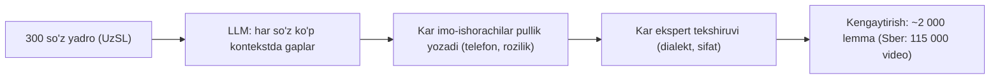
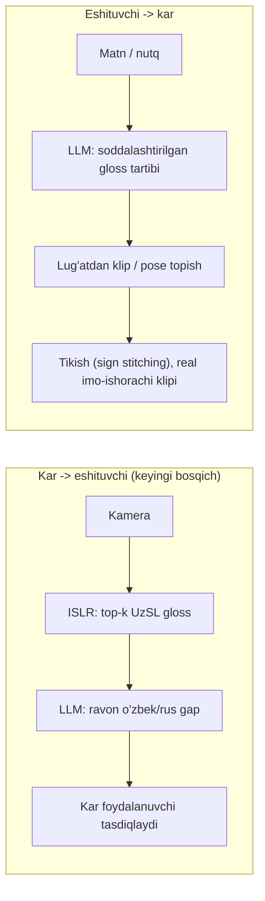

# 04a. Ilmiy tadqiqotlar: SOTA, foydalanuvchi tadqiqotlari, metodologiya (2022-2026)

> **Qisqacha**
> - Uzluksiz imo-ishora -> matn tarjimasi hali tadqiqot darajasida: eng yaxshi gloss-free tizimlar PHOENIX-2014T / CSL-Daily'da ~24-27 BLEU-4, ochiq domenli ASL (How2Sign)da ~15 BLEU-4; yangi imo-ishorachida keskin pasayadi. Ishlab chiqarish uchun real nishon - **yopiq lug'atli izolyatsiyalangan tanish** (telefonda ishlaydi).
> - Kam resursli til uchun eng kuchli natija: **ko'p tilli pretrain** bir til yoki noldan o'qitishdan yaxshi (YouTube-SL-25; Logos - rus imo-ishora tili, UzSL uchun eng yaqin manba). UzSL'ga ko'chirish bo'yicha nazoratli tadqiqot yo'q.
> - Umumiy multimodal LLM'lar (GPT-4o, Gemini, Claude) imo-ishora videosini **tushunmaydi**: FLEURS-ASL'da 0.1-0.4 BLEU, inson 13.0.
> - Karlar inson signerni afzal ko'radi; avatarlar ichida mocap yaxshiroq (n=191); VRI'dan faqat **41%** kar bemor mamnun; subtitrda eshituvchining xatti-harakati aniqlik qadar muhim.
> - Pose skeleti **anonim emas** (pose'dan shaxs aniqlandi, F1 0.31); uzluksiz annotatsiya 1 daqiqa imo-ishoraga 40-300+ daqiqa ish.

Manbalar: `2_raqobat_va_ochiq_kod/academic_research_synthesis.md`, `1_birinchi_tadqiqot/open_source_tech_stack.md`, `1_birinchi_tadqiqot/deaf_centered_product_ux.md`, `1_birinchi_tadqiqot/browser_youtube_google_findings.md` (4.2-bo'lim). "Preprint" = arXiv, peer-review'dan o'tmagan. Ko'p raqamlar abstrakt yoki ikkilamchi xulosadan - belgilangan.

---

## 1. SOTA: imo-ishora tanish (ISLR/CSLR) va tarjima (SLT)

### 1.1. Uzluksiz tarjima (SLT) raqamlari

| Tizim / ish | Benchmark | Natija | Izoh | Manba |
|---|---|---|---|---|
| Uni-Sign (Li va boshq., ICLR 2025, peer-review) | CSL-Daily SLT | test BLEU-4 ~26.36, ~55 BLEU-1 (pose + RGB) | Oldingi eng yaxshi gloss-free (C2RL)dan dev'da +14.02, test'da +4.75 BLEU-4. Barcha vazifalarni (ISLR, CSLR, SLT) bitta tarjima vazifasi sifatida fine-tune; CSL-News korpusida pretrain | [arXiv 2501.15187](https://arxiv.org/abs/2501.15187v2); [ICLR](https://proceedings.iclr.cc/paper_files/paper/2025/hash/260a14acce2a89dad36adc8eefe7c59e-Abstract-Conference.html) |
| Uni-Sign | How2Sign SLT | test BLEU-4 ~14.5 (faqat pose), 14.9 (pose + RGB) | O'sha jadvalda SSVP-SLT (~15.5)dan past | [arXiv 2501.15187](https://arxiv.org/pdf/2501.15187) |
| Uni-Sign | CSL-Daily CSLR | ~26 WER | MS-ASL va WLASL ISLR natijalari ham bor; How2Sign va OpenASL pose-only checkpointlari 2025-12 da chiqqan (GitHub mirror orqali ko'rilgan) | [arXiv 2501.15187](https://arxiv.org/pdf/2501.15187); [mirror](https://github.gg22.workers.dev/ZechengLi19/Uni-Sign) |
| SignMouth (2025) | PHOENIX-2014T gloss-free | BLEU-4 24.71 | Oldingi SOTA SpaMo 24.32 | [arXiv 2509.10266](https://arxiv.org/html/2509.10266v2) |
| Sincan va Bowden (SLTAT 2025), DualAnchor (2026), RVLF | PHOENIX-2014T / CSL-Daily | Har biri "eng yaxshi gloss-free BLEU-4" deydi; RVLF: SFT bilan C2RL'dan +2.7 BLEU-4, GRPO bilan yana +2.4 | Har bir "SOTA" o'z taqqoslash to'plamiga nisbatan | [arXiv 2507.10306](https://arxiv.org/html/2507.10306v1); [DualAnchor](https://www.alphaxiv.org/abs/2607.27614); [arXiv 2512.07273](https://arxiv.org/html/2512.07273v1) |
| GFSLT-VLP | - | - | Kontrastiv vizual-til pretrainidan foydalangan birinchi gloss-free usullardan; hozir standart baseline | [arXiv 2507.10306](https://arxiv.org/html/2507.10306v1) |
| Sign2GPT (Wong, Camgoz, Bowden; ICLR 2024) | PHOENIX-2014T / CSL-Daily | BLEU-4 ~22.5 / 15.4 (ikkilamchi manba) | Pretrain vision encoder + LLM, yengil adapterlar; matndan olingan pseudo-gloss bilan pretrain - gloss annotatsiyasi kerak emas | [ICLR 2024](https://proceedings.iclr.cc/paper_files/paper/2024/hash/4ebba705ffdee81e0a638c99fe066ce2-Abstract-Conference.html); [arXiv 2405.04164](https://arxiv.org/pdf/2405.04164v1.pdf) |
| SignGPT (2026 preprint) | - | - | Gloss-free sign-to-text va text-to-sign; sign-to-sign uchun muzlatilgan LLaMA-3.2-1B-Instruct vositachi; mualliflar: metrikalar faqat diagnostik proksi (baholovchi o'zi SignGPT modeli) | [arXiv 2609.21709](https://arxiv.org/pdf/2609.21709) |
| Maswao (SASL, TV yangiliklaridan avtomatik korpus) | - | Eng yaxshi Transformer BLEU-4 1.54 | Uzluksiz tarjima qanchalik qiyinligini ko'rsatadi | [AI Weekly / arXiv 2611.02903](https://aiweekly.co/alerts/maswao-auto-builds-south-african-sign-language-corpus-from-news) |
| AI Hub KSL ma'lumoti bilan tarjima (Koreya) | - | BLEU-4 34.68 (bitta maqola) | Katta, ko'p imo-ishorachili, ko'p burchakli deb ta'riflanadi | [Korea Univ. AML](https://aml.korea.ac.kr/research/sign-language-translation); [koreascience](https://www.koreascience.kr/article/CFKO202023758834200.pdf) |

**Signer-independent baholash.** EMNLP 2025 Findings: imo-ishorachi bo'yicha ajratilgan splitda SLT natijasi "keskin pasayadi" (misol: PHOENIX14T, GFSLT-VLP). Standart leaderboard raqamlari real dunyo aniqligini oshirib ko'rsatadi - [EMNLP 2025 Findings](https://preview.aclanthology.org/author-page-yu-wang-polytechnic/2025.findings-emnlp.997.pdf).

### 1.2. Google SignGemma va SL2T

| Fakt | Manba |
|---|---|
| Google I/O 2025-05: "eng qobiliyatli sign-language-to-text model", Gemma oilasiga "shu yil oxirida"; ASL -> ingliz uchun optimallashtirilgan, boshqa tillar muddatsiz va'da | [Analytics India Mag](https://analyticsindiamag.com/ai-news-updates/google-deepmind-announces-signgemma-ai-for-sign-language); [OfficeChai](https://officechai.com/ai/google-announces-signgemma-a-model-that-translates-sign-language/) |
| Bitta savdo nashri: preview Google AI Developer portalida, 2025 Q4 da keng chiqish, qurilmada/oflayn, Gemini Nano asosida - **tasdiqlanmagan** marketing | [MultiLingual](https://multilingual.com/google-signgemma-on-device-asl-translation/) |
| Rasmiy HF model kartasi yoki litsenziya topilmadi | [qidiruv natijasi](https://huggingface.co/google/paligemma-3b-mix-224/discussions/7) |
| Arxitektura (matbuot darajasida): vision transformer encoder + Gemma til dekoderi | [Analytics India Mag](https://analyticsindiamag.com/ai-news-updates/google-deepmind-announces-signgemma-ai-for-sign-language) |
| 2026-08-12: DeepMind SL2T, Pixel 11 da Gboard va Live Transcribe'da; faqat ASL (batafsil 04c) | [DeepMind blog](https://deepmind.google/blog/putting-sign-language-ai-into-users-hands/) |

### 1.3. Pose / landmark asboblari va Kaggle baseline'lar

| Fakt | Manba |
|---|---|
| Google Isolated Sign Language Recognition (Kaggle, 2023 fevral-may, $100k): MediaPipe landmarklaridan izolyatsiyalangan ASL'ni tasniflaydigan **TensorFlow Lite** model topshirish shart edi | [TensorFlow blog](https://blog.tensorflow.org/2023/02/a-new-kaggle-competition-to-help-parents-of-deaf-children-learn-sign-language.html?hl=ru) |
| 1-o'rin (hoyso48) va model fayllari HF'da sign-language-processing org ostida | [HF sign/kaggle-asl-signs-1st-place](https://huggingface.co/sign/kaggle-asl-signs-1st-place) |
| 2-o'rin: EfficientNet + ONNX TFLite'dan ~5 marta tez (bitta manba, faqat tezlik) | [2nd place GISLR](https://github.com/ffs333/2nd_place_GISLR) |
| Google ASL Fingerspelling (Kaggle 2023, $50k): Christof Henkel (NVIDIA) - nutq tanishdan moslashtirilgan Squeezeformer encoder + kichik transformer dekoder + buzilgan namunalar uchun ishonch boshi; augmentatsiya: CutMix, FingerDropout, TimeStretch, dekoder kirish maskasi | [1st place repo](https://github.404890603.workers.dev/ChristofHenkel/kaggle-asl-fingerspelling-1st-place-solution); [NVIDIA blog](https://blogs.nvidia.com/blog/2023/10/23/nvidia-life-kaggle-ai-contest-sign-language-recognition/) |
| FSboard daktil dataseti: ko'rilmagan ibora va imo-ishorachida baseline 11.1% CER | [arXiv 2407.15806](https://arxiv.org/pdf/2407.15806v1) |
| pose-format: .pose fayl formati, Python va JS, MIT | [arXiv 2310.09066](https://arxiv.org/pdf/2310.09066) |
| 2026 kam resursli survey: yengil MediaPipe arxitektura, offline-first, maxfiylik uchun pose - lekin v2 arXiv tomonidan sifat uchun **olib tashlangan** | [arXiv 2605.12096](https://arxiv.org/abs/2605.12096) |

### 1.4. Imo-ishora generatsiyasi (eshituvchi -> kar yo'nalishi)

| Ish | Natija | Manba |
|---|---|---|
| Sign Stitching (Walsh, Saunders, Bowden; Surrey; BMVC 2024, peer-review) | Lug'atdagi izolyatsiyalangan imo-ishoralar + o'rganilgan yuz ifodasi kodlar kitobi; 7 qadamli tikish (kanonik pose normalizatsiya, dam olish pozasini kesish, davomiylikni qayta namunalash, interpolyatsiya, past chastotali filtr va h.k.), SignGAN bilan fotorealistik render. Mualliflar SOTA va baseline'lardan afzal ko'rilgan user study'ni aytadi | [arXiv 2405.07663](https://arxiv.org/abs/2405.07663v2); [Surrey PDF](https://personalpages.surrey.ac.uk/r.bowden/publications/2024/WalshBMVA2024.pdf) |
| SLRTP 2025 challenge (CVPR workshop), birinchi text-to-pose | PHOENIX-2014T'da; 33 ishtirokchi, 231 topshiriq; g'olib BLEU-1 31.40 (back-translation) va DTW-MJE 0.0574, retrieval + pretrain til modeli | [arXiv 2508.06951](https://arxiv.org/abs/2508.06951); [CVPR 2025](https://cvpr.thecvf.com/virtual/2025/35711) |
| sign-language-processing org: pose-to-video repo (pose'dan ochiq neyron render) | - | [org](https://github.com/sign-language-processing) |

---

## 2. Kam resursli til va transfer learning

| Ish | Asosiy natija | Manba |
|---|---|---|
| **YouTube-SL-25** (Tanzer va Zhang, ICLR 2025, peer-review) | ~3 200 soat, kamida 15 soatli 25 til. Faqat ASL qismida pretrain pretrainsizdan yaxshi, lekin "doimo to'liq ko'p tilli pretraindan orqada" | [arXiv 2407.11144](https://arxiv.org/html/2407.11144v1); [ICLR 2025](https://iclr.cc/virtual/2025/poster/28414) |
| YouTube-SL-25, Shveytsariya tillari BLEURT (ikkilamchi xulosa, Table 2 ni tekshirish kerak) | Swiss French SL: 11.1 (ASL pretrain) -> 18.8 (to'liq ko'p tilli); Swiss Italian SL: 20.8 -> 25.2; Swiss German SL: 37.7 (ko'p tilli) vs 27.9 (ASL pretrain) va 26.2 (baseline) | [Liner review](https://liner.com/review/youtubesl25-largescale-opendomain-multilingual-sign-language-parallel-corpus) |
| YouTube-SL-25, til aniqlash | FLEURS-ASL'da langid ASL pretrain + How2Sign fine-tune'dan keyin yomonlashdi (pretrainsizdan ham); mualliflar ba'zi datasetlarda train/test imo-ishorachi kesishuvini ayblaydi | [arXiv 2407.11144](https://arxiv.org/html/2407.11144v1) |
| **Logos** (Ovodov va boshq., SaluteDevices, EMNLP 2025, peer-review) | Eng katta RSL dataseti, imo-ishorachilar soni bo'yicha eng katta ISLR; vizual o'xshash imo-ishora guruhlari aniq belgilangan; Logos'da pretrain model boshqa tillar uchun universal encoder (few-shot ham). **Tilga xos klassifikatsiya boshli multi-dataset co-training** kam resursli datasetlarga eng ko'p yordam bergan (oddiy pretrain-then-finetune'dan ko'p). WLASL'da SOTA, AUTSL'da raqobatbardosh (bitta oqimli RGB). Kod, data, model: github.com/ai-forever/logos | [arXiv 2505.10481](https://arxiv.org/html/2505.10481v2); [ACL 2025.emnlp-main.1238](https://aclanthology.org/2025.emnlp-main.1238.pdf) |
| Bir til oilasi ichida transfer (Kindiroglu, Kara, Ozdemir, Akarun; FG 2024) | Manba AUTSL (226 imo-ishora, 43 imo-ishorachi), nishon BosphorusSign22k (745), atigi 57 umumiy imo-ishora; 5 nazoratli transfer usuli temporal graph-conv'da; maxsus transfer usullari oddiy fine-tune'dan yaxshi | [arXiv 2403.14534](https://arxiv.org/html/2403.14534v2) |
| De Coster va Holmes (2023, preprint) | Keypoint embeddinglari tillararo ma'lumot tashiydi, yangi tilda faqat klassifikatorni qayta o'qitish mumkin; lekin "rasmga asoslangan modellar ko'pincha keypoint modellardan yaxshi" | [arXiv 2306.17558](https://arxiv.org/abs/2306.17558) |
| SignBERT+ (TPAMI) | Pose usullari MSASL'da RGB'dan "ancha orqada"; qo'l modelini biladigan self-supervised pretrain farqni qisqartiradi | [arXiv 2305.04868](https://arxiv.org/pdf/2305.04868) |
| OpenHands (ACL 2022) | 6 til uchun pose asosidagi ISLR checkpointlari; pose real vaqt, faqat kamera uchun mos | [ACL 2022.acl-long.150](https://aclweb.org/anthology/2022.acl-long.150.pdf) |
| WSLP 2025 workshop | Tillarni oilalarga klasterlash va har oilaga model - salbiy transferni kamaytiradi, ko'p tillilik foydasini saqlaydi | [2025.wslp-main.5](https://preview.aclanthology.org/ingest-ijcnlp-aacl/2025.wslp-main.5.pdf) |
| Kam resursli survey (arXiv 2605.12096, 2026, ozarbayjon IT misoli) | Ma'lumot sifati va annotatsiya to'liqligi arxitekturadan muhim; MAML-uslub few-shot imo-ishorachi moslashuvi; BLEU va WER muloqot adekvatligi bilan yomon korrelyatsiya. **v2 sifat uchun olib tashlangan**. Xulosa saytida turk -> keniya transferi ~0.42 vs ASL'dan ~0.18 deyiladi - maqolada **tasdiqlanmagan** | [arXiv 2605.12096](https://arxiv.org/pdf/2605.12096); [Moonlight](https://www.themoonlight.io/tw/review/sign-language-recognition-and-translation-for-low-resource-languages-challenges-and-pathways-forward) |
| Kengroq surveylar | ICCV 2023 workshop: ISLR uchun transfer learning (Sarhan, Frintrop, Gamburg); qoida asosidan transformergacha SLT taksonomiyasi; MDPI Electronics 2023 SLT survey | [PDF](https://www.inf.uni-hamburg.de/en/inst/ab/cv/media/sarhan-frintrop-amfg-iccv2023-survey.pdf); [arXiv 2408.14825](https://arxiv.org/pdf/2408.14825); [MDPI](https://www.mdpi.com/2079-9292/12/12/2678/html) |

**UzSL uchun o'qitish retsepti (xom yozuv inferensiyasi):**
1. Logos'da pretrain qilingan RSL encoder'dan boshlash.
2. Slovo, Logos va UzSL ma'lumoti bilan alohida boshlar orqali **co-training** (Logos'ning o'z eng yaxshi kam resursli natijasi) - faqat UzSL'da fine-tune'dan yaxshi.
3. Oila bo'yicha o'qitish (WSLP 2025): UzSL'ni RSL va qozoq-rus IT (FluentSigners/K-RSL) bilan guruhlash, turk IT bilan emas. UzSL sovet/rus IT'dan kelib chiqqan; og'zaki tildagi turkiy qarindoshlik imo-ishoraga o'tmaydi. **UzSL uchun sinalmagan.**
4. Eshituvchi -> kar yo'nalishida erkin generatsiya o'rniga ibora kutubxonasi / retrieval (SLRTP 2025 g'olibi retrieval'ga tayangan).

---

## 3. Sber, Ilya Ovodov "Ponyat bez slov" (Data Fest 2025) tahlili

Manba: [YouTube Z6jNuB4CBVY](https://www.youtube.com/watch?v=Z6jNuB4CBVY) (rus ASR transkripti, founder brauzeri orqali).

| Mavzu | Ma'ruzadagi fakt |
|---|---|
| Logos hajmi | ~200 000 izolyatsiyalangan imo-ishora videosi |
| Aniqlik | O'z datasetida 98%; ko'p tilli o'qitish bilan ASL benchmarkida 66.8% |
| Usul | Ko'rinishi bir xil imo-ishoralarni bitta klassga birlashtirish pretrain sifatini oshirgan |
| Asosiy muammo | Uzluksiz nutq: 98% izolyatsiyalangan model gaplarda ishlamaydi, imo-ishoralar qo'shilib ketadi |
| TV ma'lumoti | TV surdotarjimasi matndan 4 soniyagacha kechikadi va mazmuni mos kelmaydi; vaqt bo'yicha belgilash juda qimmat; ochiq gloss-belgilangan uzluksiz datasetlar dunyoda deyarli 2 ta |
| Ma'lumot yig'ish | Rus korpusidan gaplar + **GigaChat bilan kerakli lemmalardan gap generatsiya** + **crowdsourcing (Toloka)** orqali kar imo-ishorachilarga yozdirish. Birinchi urinish "to'liq fiasko" (lug'at katta, kontekst kam). Yechim: lug'atni minimal o'stirib, so'zlarni ko'p kontekstda takrorlaydigan korpus (~50% optimum) |
| Bosqichlar | 300 lemma / 15 000 video -> 2 000 lemma / 115 000 video |
| Baholash | Professional tarjimonlar ham shu videolarda past metrika olgan - baholash usuli muammo |
| Dialekt | Datasetni Moskva ekspertlari tekshirgan, asosan Moskva dialekti. **O'zbek SL uchun Rossiya modelini to'g'ridan-to'g'ri ishlatish xavfli** |
| Arxitektura tanlovi | RGB, chunki tez daktilda skelet nuqtalari xato beradi |

**Logos repo raqamlari** (boshqa yozuvdan, solishtirish uchun): Top-1 - Logos 0.9792, AUTSL 0.9781, WLASL 0.6682 ([ai-forever/logos](https://github.com/ai-forever/logos)). Ma'ruzadagi "98%" va "66.8%" shu bilan mos.

**O'zbek dataseti retsepti (xom yozuv xulosasi):** 300 so'z yadro -> LLM bilan ko'p kontekstli gaplar -> kar imo-ishorachilarga pullik yozdirish -> kar ekspert tekshiruvi.

---

## 4. Foydalanuvchi tadqiqotlari va dala tajribalari

### 4.1. Avatarlar va AI imo-ishora: karlar qabuli

| Tadqiqot | Usul / n | Natija | Manba |
|---|---|---|---|
| Quandt va boshq. 2022 (Frontiers in Psychology, peer-review) | 191 ASL foydalanuvchi (kar, zaif eshituvchi, eshituvchi): jonli inson vs sintetik/keyframe avatar vs motion-capture avatar | Mocap avatar barcha asosiy o'zgaruvchilarda sintetikdan sezilarli ijobiy. Munosabat eshitish holati, imo-ishorani o'rganish yoshi va avatar turiga qarab farq qiladi | [Frontiers](https://www.frontiersin.org/articles/10.3389/fpsyg.2022.730917); [NSF PAR](https://par.nsf.gov/biblio/10356507-attitudes-toward-signing-avatars-vary-depending-hearing-status-age-signed-language-acquisition-avatar-type) |
| Hansen va boshq. 2018 (Quandt 2022 da) | Kar yoshlar | Hammasi inson signerni afzal ko'rdi, lekin matematika natijasi inson va avatarda teng | [Frontiers 2022](https://www.frontiersin.org/articles/10.3389/fpsyg.2022.730917) |
| Ko'z harakati (LREC 2018 workshop) | Ona-tilli kar tomoshabinlar | Inson signerda yuzga virtual signerdan uzoqroq qaraydi | [sign-lang 18028](https://www.sign-lang.uni-hamburg.de/lrec/pub/18028.pdf) |
| Kacorri/Huenerfauth (TACCESS, DOI 10.1145/3046787; 2022 dan oldin, asosiy metod) | 62 va 57 kar ishtirokchi, 3 avatar platformasi | Internat kar maktablaridan kelganlar tushunishda sezilarli yuqori - ishtirokchi foni nazorat qilinishi shart | [review](https://a11y-paradise.onrender.com/reviews/69a48d565627207a189028f8) |
| Kipp va boshq. (ASSETS 2011) | Fokus guruh + onlayn | Yuz ifodasi, mouthing va qomat qo'l shakli aniqligidan muhimroq (ikkilamchi xulosa) | [review](https://a11y-paradise.onrender.com/reviews/69d7295cc5280b1eb7898be7) |
| Yuz ifodasi xatosi | - | Noto'g'ri ifoda (savol o'rniga g'azab) tushunishga faol zarar | [review](https://a11y-paradise.onrender.com/reviews/69d7e669bfbcd19d27f2318e) |
| Nemis fokus guruhi (Mada/Nafath 2022) | - | Eng muhim sifat omili: yuz ifodalari, keyin tabiiy tana harakati, his-tuyg'u, tashqi ko'rinish, tushunarlilik. Avatar tadqiqotchilarining ko'pi kar jamiyatidan emas | [Nafath PDF](https://nafath.mada.org.qa/wp-content/uploads/2022/05/5-Toward-an-evaluation-model-for-signing-avatars.pdf) |
| Angelini (CHI 2023 EA) | Pozitsiya tahlili | Kar jamiyati avatarlarga "ko'pincha iliq emas": imo-ishora tili murakkabligini tizimli kam baholash, past sifat, kar ishtirokining yo'qligi | [BibBase, DOI 10.1145/3544549.3583946](https://bibbase.org/network/publication/angelini-contrastingtechnologistsandactivistspositionsonsigningavatars-2023) |
| Niderlandiya sog'liqni saqlash, text-to-sign avatar | - | Alohida imo-ishoralar deyarli inson darajasida tanildi, lekin gap tushunilishi va aniqligi sezilarli past | [HU Utrecht](https://hu.nl/onderzoek/publicaties/exploring-automatic-texttosign-translation-in-a-healthcare-setting) |
| Sign Stitching user study | - | Baseline'lardan afzal ko'rilgan; buning tashqarisida avatar qabuli bo'yicha dalil yo'q | [arXiv 2405.07663](https://arxiv.org/abs/2405.07663v2) |

### 4.2. VRI va masofaviy tarjima

| Tadqiqot | Natija | Manba |
|---|---|---|
| Kushalnagar va boshq. 2019 (JMIR Rehab Assist Technol, peer-review) | Faqat **41%** kar ASL VRI foydalanuvchisi mamnun (n=228), 59% (n=327) sifatni qoniqarsiz deb baholagan; deyarli yarmi oxirgi 12 oyda VRI'ga kirish imkoniga ega bo'lmagan; tarjimonning sog'liq ma'lumotini ochishga xalaqit berishi norozilikni **3 baravar** oshirgan; muammolar: yomon video, past tezlik, vizual ishoralar cheklangan; tushunish o'lchanmagan | [PMC6431824](https://www.ncbi.nlm.nih.gov/pmc/articles/PMC6431824/); [PMC9227653](https://pmc.ncbi.nlm.nih.gov/articles/PMC9227653/) |
| VRI scoping review (JMIR 2022, 15 tadqiqot, hammasi yuqori daromadli davlatlardan) | Kar imo-ishorachilar VRI'ni matn, lab o'qish va yozishdan afzal ko'radi, lekin jonli tarjimonni VRI'dan afzal; VRI kritik bo'lmagan yordamda maqbul, kritik/stressli holatda emas (Yabe 2020; Preusse 2016). Muammolar: ekran kichik (kamida 19.5 dyuym / 49.5 sm tavsiya), ulanish, joylashuv (yuzi pastga yotganda yaroqsiz, kar-ko'r va ko'zi zaiflarga mos emas), tarjimon sifati, keksalar yangilanishlarda qiynaladi. Bemorni ogohlantirmay VRI boshlash norozilik uyg'otgan va munosabatni zaiflashtirgan. Myers va boshq. 2021: ochiq muloqot norozilik ehtimolini 81% kamaytiradi. Klinik natija o'lchanmagan | [PMC9227653](https://pmc.ncbi.nlm.nih.gov/articles/PMC9227653/) |
| Mastropierro va boshq. 2024 RCT (Am J Otolaryngology) | 52 eshitishi past bemor (mandarin/kanton, og'zaki til tarjimasi, imo-ishora emas): jonli tarjima yuqori mamnunlik, yaxshi tushunish va arzonroq | [record](https://katalog.lib.cas.cz/KNAV/EdsRecord/cmedm,39163815) |
| Shifokor-kar bemor scoping review | Afzallik: jonli professional tarjimon, keyin yozish, lab o'qish, VRI. To'siqlar: noprofessional tarjimon aniqligi, niqob, yomon video | [ASHA Evidence Maps](https://apps.asha.org/EvidenceMaps/Articles/ArticleSummary/5c158713-f4a7-ed11-8143-005056834e2b) |
| 2026 umbrella review (32 sistematik sharh, 3 749 yozuv; BMC HSR) | Ustuvor: tarjimon ta'minotini kengaytirish va xodimlarga kar xabardorligi treningi; aralashuv samaradorligini ko'rsatgan sharhlar kam; past sog'liq savodxonligi - eng keng tarqalgan individual to'siq | [BMC HSR 2026](https://eprints.whiterose.ac.uk/id/eprint/240360/8/s12913-026-14444-y.pdf) |
| 2025 narrativ sistematik sharh (22 tadqiqot) | 2 mavzu: tarjimon rolidagi qiyinchiliklar va madaniy kompetensiya | [Wiley HSC 2025](https://onlinelibrary-wiley-com-443.webvpn.zafu.edu.cn/doi/10.1155/hsc/8867224) |
| JMIR Rehabilitation 2026 pilot | Google STT asosidagi klinik subtitr tizimi 10 DHH kattada soxta qabulda (usability + intervyu) | [JMIR Rehab 2026](https://rehab.jmir.org/2026/1/e79073) |

### 4.3. Yuzma-yuz ASR subtitr

| Tadqiqot | Natija | Manba |
|---|---|---|
| Seita, Andrew, Huenerfauth (CHI 2020/2021, RIT) | Live Transcribe bilan yuzma-yuz (N=20): eshituvchining talaffuzi va intonatsiyasi kar mamnunligiga sezilarli ta'sir; Zoom'da (N=23) ko'z kontakti eng yuqori; imo va pauza ta'sirsiz | [NSF PAR](https://par.nsf.gov/servlets/purl/10355406); [a11y review](https://a11y-paradise.onrender.com/reviews/69e242fa20c3fe3111584d7d) |
| Seita va Huenerfauth (CHI EA 2020) | ASR aniqligini oshiradigan eshituvchi xatti-harakati DHH tajribasini yomonlashtirishi mumkin | [review](https://a11y-paradise.onrender.com/reviews/69e242fa20c3fe3111584d7d) |
| CHI 2023 kichik guruh subtitri | DHH nutqdan tashqari belgilarni xohlaydi (so'zlovchi, tezlik, ovoz balandligi), qisman eshituvchilarga fikr berish uchun. Oldingi tahlillarda Google ASR WER ~9% | [NSF PAR](https://par.nsf.gov/servlets/purl/10431246) |
| Kang va boshq. (CHI EA), 20 eshituvchi | Eshituvchilar DHH hamkor nimanidir o'tkazib yuborganini ko'pincha sezmaydi - so'zlovchiga fikr berish yordam beradi; eshituvchilar ASR'ni aniq deb o'ylash xavfi | [PDF](https://jennakangg.github.io/assets/pdfs/ChiCaptioning.pdf) |
| Boshga taqiladigan subtitr (Toronto, Epson Moverio) | Suhbatda kechikish maqbul; markazdan tashqari subtitr o'rganilgan | [PDF](https://www.cs.utoronto.ca/~sliaqat/augmented_reality_glasses.pdf) |
| Jain va boshq. (HoloLens) | Yurganda subtitr 4 ishtirokchini chalg'itgan | [NSF PAR](https://par.nsf.gov/servlets/purl/10072841) |
| DIS 2018 | Headset lab va subtitrni birga ko'rish imkonini bergan | [Springer](https://www.springerprofessional.de/doi/10.1145/3234695.3236355) |
| Kafle va Huenerfauth (ASSETS 2017) | DHH uchun avtomatik subtitr usability bahosi | [arXiv 1712.02033](https://arxiv.org/pdf/1712.02033) |
| EvolveCaptions (2025) | Eshituvchilar jonli subtitrni tuzatadi, DHH so'zlovchi maqsadli iboralarni yozib ASR'ni kar nutqiga fine-tune qiladi; 12 DHH + 6 eshituvchi; 1 soat ichida barcha DHH uchun WER tushgan | [arXiv 2510.02181](https://arxiv.org/html/2510.02181v1) |

### 4.4. Savodxonlik va kundalik vositalar

| Tadqiqot | Natija | Manba |
|---|---|---|
| UW HCI so'rovi (ASL imo-ishorachilar; sana tasdiqlanmagan) | Imo-ishora va vizual muloqotni kuchli afzal ko'radi; lekin ochiq lentada post qiluvchilarning 77% yozma ingliz, 51% ASL ishlatgan; asosiy to'siq - video yozish va yuklash uzoq | [Medium](https://medium.com/hci-design-at-uw/social-app-accessibility-for-deaf-signers-9b3f84027c92) |
| Frontiers 2023 | Imo-ishora tilidagi DHH og'zaki tildagi DHH'dan ijtimoiy tarmoqni kamroq ishlatadi; nemis so'rovida yoshlarning 95% uchun WhatsApp asosiy | [Frontiers 2023](https://www.frontiersin.org/journals/communication/articles/10.3389/fcomm.2023.1175461/epub) |
| 2022 sifat tadqiqoti (5 informant + 12 kar) | WhatsApp/Facebook va emotikonlar onlayn muloqot va o'zini ochish uchun | [ITS](https://scholar.its.ac.id/en/publications/emoticons-as-self-disclosure-in-social-media-and-its-meaning-for-/) |
| Janubiy Afrika | Mobil video matn/ovozdan ko'p trafik - karlar o'z tilida ko'proq to'laydi | [UWC](https://repository.uwc.ac.za/handle/10566/3705) |
| GSMA so'rovi (snippet, sahifa 403) | Talab bo'yicha tarjima ilovalariga yuqori talab; tarjimon xizmati qimmat va shaharlarda to'plangan | [GSMA](https://www.gsma.com/mobilefordevelopment/blog/making-sign-language-interpretation-accessible-for-all-through-mobile-assistive-technology/) |
| AQSh milliy ma'lumoti | Kar o'rta maktab bitiruvchilarining median savodxonligi 1900-yillar boshidan ~4-sinf; ~5 dan 1 i 2-sinf yoki past, ~3 dan 1 i 2-4-sinf oralig'ida | [IES / Easterbrooks](https://ies.ed.gov/about/external-person/susan-easterbrooks) |
| Qi va Mitchell (2012) | 18 yoshli DHH o'quvchining median o'qish darajasi eshituvchi 9-10 yoshli bilan teng; ~40 yilda kam o'zgargan | [PMC4280560](https://pmc.ncbi.nlm.nih.gov/articles/PMC4280560) |
| Rochester sog'liq savodxonligi | Yuqori ma'lumotli kar namunasi umumlashtirilmaydi - savodxonlik keng farq qiladi | [URMC poster](https://urmcpublic-lb1.urmc.rochester.edu/MediaLibraries/URMCMedia/ncdhr/publications-presentations/documents/BarnettREALMposterNTID20070219_000.pdf) |

### 4.5. Favqulodda, politsiya, bolalar

| Soha | Natija | Manba |
|---|---|---|
| Favqulodda (EU) | EAA (2025-06-28) va EECC 112 uchun "funksional ekvivalentlik" talab qiladi: RTT va Total Conversation; EENA SMS va ilovani oraliq yechim deb hisoblaydi; ochiq kanallar ko'pincha joylashuvni PSAP'ga yubormaydi | [EENA open letter 2025](https://eena.org/wp-content/uploads/2025_04_23_Open_letter_accessibility_emergency_communications_signed_.pdf); [EDF](https://www.edf-feph.org/publications/open-letter-on-improving-accessibility-in-emergency-communications/) |
| Irlandiya RTT pilot | Ilovaga asoslangan yechim ekvivalentlikka javob bermaydi (oldindan o'rnatish va ro'yxat) | [EENA RTT in Ireland](https://eena.org/document/real-time-text-in-ireland) |
| SMS | Real vaqt matnining tezligi va oldi-berdisi yo'q (vendor manba) | [Accessible.org](https://accessible.org/eaa-emergency-communications/) |
| Politsiya, Texas | 72 imo-ishorachi mahbusdan faqat 27.8% ga hibsda tarjimon berilgan | [JADARA](https://nsuworks.nova.edu/jadara/vol36/iss1/4) |
| JUSTISIGNS (EU) | Politsiya ko'pincha tarjimon kerakligini yoki malakasini bilmagan; karlar soatlab kutgan | [The Conversation](https://theconversation.com/when-dealing-with-the-police-deaf-people-are-at-a-major-disadvantage-62027) |
| Police Scotland 2024 | Mas'uliyat notekis, tarjimon sig'imi cheklangan | [Heriot-Watt](https://researchportal.hw.ac.uk/en/publications/when-he-comes-into-police-custody-he-has-certain-rights-the-burde/) |
| AQSh Miranda | Ogohlantirish va so'roqlar malakasiz odamlar tomonidan tarjima qilinadi | [Project MUSE](https://muse.jhu.edu/article/384115/summary) |
| Tacoma, WA | Kar 911 qo'ng'iroqchisi tarjimonsiz 60 soat qamoqda | [Hearing Health Matters](https://hearinghealthmatters.org/?p=19908) |
| Bolalar | ~90-95% kar bola eshituvchi ota-onada; uyda ko'pi bilan ~40% oila imo-ishora ishlatadi (Gallaudet 2010); ~70% gacha til mahrumligi (taxmin) | [BU 2017](https://www.bu.edu/articles/2017/asl-language-acquisition); [BYU Ballard Brief](https://ballardbrief.byu.edu/issue-briefs/linguistic-neglect-of-deaf-children-in-the-united-states) |
| Koxlear implant | Til natijasini kafolatlamaydi | [PMC6050834](https://pmc.ncbi.nlm.nih.gov/articles/PMC6050834) |
| Erta ASL | Ham ASL, ham og'zaki ingliz lug'ati yoshiga mos - imo-ishora nutqni to'smaydi | [JSLHR](https://pubs.asha.org/doi/pdf/10.1044/2022_JSLHR-22-00505?download=true) |
| Tarjima orqali ta'lim | Til mahrumligini asosan tarjima orqali yengish dalili yo'q | [Caselli, Hall, Henner 2020](https://open.bu.edu/bitstream/handle/2144/41846/CaselliHallHenner2020.pdf?sequence=3) |
| Ikki tilli dasturlar | Dalil bahsli: bitta sharh natijalarni kam topgan, Scott va boshq. (2021) e'tiroz bildirgan; BDA 2025 brifingi uzoq muddatli foydani metodik ko'rsatish qiyin deydi; imo-ishora og'zaki nutqqa xalaqit beradi degan qarash bahsli | [PMC12383669](https://pmc.ncbi.nlm.nih.gov/articles/PMC12383669); [BDA 2025](https://bda.org.uk/wp-content/uploads/2025/11/early-sign-language-benefit-evidence-review-v2.pdf); [Hall 2017](https://comm4child.ulb.be/wp-content/uploads/2021/11/Hall-2017.pdf) |

### 4.6. Bazaviy raqamlar (WHO, WFD)

| Raqam | Manba |
|---|---|
| 430M+ kishida nogironlikka olib keladigan eshitish yo'qotishi, 2050 ga ~700M; 2050 ga ~2.5 mlrd (4 dan 1) qandaydir darajada | [WHO 2021](https://www.who.int/news/item/02-03-2021-who-1-in-4-people-projected-to-have-hearing-problems-by-2050) |
| ~60M og'ir-to'liq eshitish yo'qotishi (WHO hisoboti, Cochlear iqtibosi) | [Cochlear](https://www.gurufocus.com/news/1375922/cochlear-welcomes-landmark-who-report-calling-on-governments-and-societies-to-prioritize-hearing-health) |
| ~70M kar; WFD "200+ imo-ishora tili", boshqa manbalar 300+ (**zid**); 80%+ rivojlanayotgan davlatlarda | [WFD](https://wfdeaf.org/?p=56); [Vikaspedia](https://en.vikaspedia.in/viewcontent/social-welfare/differently-abled-welfare/important-days/international-day-of-sign-languages) |

---

## 5. Kar jamiyati pozitsiyasi va etika (tadqiqot dalili sifatida)

| Hujjat / ish | Mazmun | Manba |
|---|---|---|
| WFD/WASLI avatar bayonoti (2018-03-14, yangilangan 2018-04-14) | Avatar inson signer o'rnini bosmasin (lingvistik sifat farqi); MT jonli tarjimaga yetmagan; jonli, murakkab, muhim ma'lumot (yangiliklar) bo'yicha xavotir; onlayn lug'atlarda to'liq raqamli korpus yo'q; avatar faqat bir tomonlama; 3D avatar yozma/og'zaki ma'lumotni yangi usulda berishi mumkinligini tan oladi. WASLI 2023-07 da qayta joyladi - mazmunan yangilanmagan | [WFD PDF](https://wfdeaf.org/wp-content/uploads/WFD-and-WASLI-Statement-on-Avatar-FINAL-14032018-Updated-14042018.pdf); [WASLI 2023](https://wasli.org/wp-content/uploads/2023/07/WFD-and-WASLI-Statement-on-Avatar-FINAL-14032018-Updated-14042018-1.pdf) |
| WFD/WFDYS - BMT bola huquqlari | Avatar tarjimon o'rnini bosmasin, oldindan yozilgan statik mijoz ma'lumotida mumkin | [WFD & WFDYS](https://wfdeaf.org/wp-content/uploads/WFD-and-WFDYS-input-to-the-General-Comment-on-children-rights-Final-document.pdf) |
| WFD kar ustuvorligi | Karlar milliy imo-ishora tilini rivojlantirishda ishtirok etishi va boshqarishi - AI vositalariga ham tegishli | [WFD](https://wfdeaf.org/?p=18327) |
| WFD Conference 2025 | AI loyihasini baholash checklisti: ma'lumot egaligi, jamiyat ishtiroki, shaffoflik, real dunyo samaradorligi (matni olinmagan) | [WFD](https://wfdeaf.org/?p=12027) |
| SAFE-AI Advisory Group (2023 kuzi, ~50 a'zo) #DeafSafeAI (2024-02) | 3 vebinar diskurs tahlili; 3 tartibga solish sohasi: natija, texnologik sifat, tayyorlik; ijtimoiy va texnik jihatlarga deyarli teng urg'u; kim baseline va standartlarni belgilaydi degan savol | [3Play slides](https://www.3playmedia.com/wp-content/uploads/2024/05/Advocating-for-DeafSafeAI-Regulations-ACCESS-2024.pdf); [Newswire](https://www.newswire.com/view/content/sign-language-interpreting-leaders-chart-a-path-for-ethical-ai-in-sign-22254286); [CoSET notes](https://leg.colorado.gov/sites/default/files/images/lcs/coset_-_laab_notes.pdf) |
| Kar panelistlar (3Play ACCESS 2024) | AI tarjimani yozma tarjima standartlari bilan baholab bo'lmaydi; shifoxonalarda VRI karlar nazoratisiz joriy qilingan va "extremely harmful" bo'lgan | [3Play ACCESS 2024](https://www.3playmedia.com/access/2024-hub/deaf-safe-ai) |
| SAFE-AI Guidance (2024-06-26) | CSA Research so'rovi 9 400+ ma'lumot nuqtasi; imo-ishora foydalanuvchilariga nomutanosib ta'sir | [Newswire](https://www.newswire.com/view/content/first-of-its-kind-ethical-ai-guidance-for-interpreting-released-by-22376003) |
| CoSET | "AI Interpreting Solutions Evaluation Toolkit Part A" va xavf freymvorki, SLxAI Summit (2026-04) | [MultiLingual](https://multilingual.com/coset-safe-ai-task-force-risk-framework-automated-interpreting-slxai-summit/); [NIDG](https://groups.google.com/g/NIDG/c/18CccWT2FJ8) |
| Desai va boshq. 2024 "Systemic Biases" (5 muallifning hammasi DHH) | 2021-2023 dagi 101 maqola: 64 tasi "muloqot to'sig'ini tuzatish" ramkasi; 43 ochiq datasetdan faqat 16 tasida faqat DHH imo-ishorachi; 3 ta faqat-tarjimon datasetni (TV) 60 CSLR ishidan 41 tasi ishlatadi; 51 tasi glossga tayanadi, 30 tasi faqat gloss; 34 tasi imo-ishorada o'qitilmagan pose estimator (yuz grammatikasi yo'qolishi mumkin); kar tadqiqotchilar kun tartibini belgilasin | [arXiv 2403.02563](https://arxiv.org/html/2403.02563v1); [SignLang 2024](https://aclanthology.org/2024.signlang-1.6.pdf) |
| Bragg va boshq. (ASSETS 2019 Best Paper) | Tanish, generatsiya, tarjima fanlararo silo'larda; Deaf studies kiritilishi shart | [Microsoft Research](https://www.microsoft.com/en-us/research/?p=599343) |
| Bragg va boshq. FATE (TACCESS 2021) | Imo-ishora datasetlari "o'ta shaxsiy"; kar jamiyati asosiy manfaatdor | [PDF](https://microsoft.com/en-us/research/uploads/prod/2021/09/3436996.pdf) |
| BDA AI va BSL muhokama hujjati | "Kar imo-ishorachi jamiyatining chuqur ishtiroki" shart | [BDA](https://bda.org.uk/ai-bsl-discussion-paper/) |
| "Deaf in AI" (2025) | AI til texnologiyasi lingvistik huquqlarga tahdid (faqat sarlavha tasdiqlangan) | [fugumt](https://fugumt.com/fugumt/paper_check/2505.02519v1_enmode) |
| Microsoft ASL Citizen | Butun jarayonda kar jamoa a'zolari bilan jamiyatga yo'naltirilgan kuratsiya | [Microsoft Research](https://www.microsoft.com/en-us/research/?p=987693) |
| WCAG 2.x | 1.2.2 Subtitr (oldindan yozilgan) - A; 1.2.4 Subtitr (jonli) - AA; 1.2.6 Imo-ishora (oldindan yozilgan) - faqat AAA. "WCAG AA mos" kar uchun ochiq degani emas. EN 301 549 WCAG 2.1 AA ga tayanadi | [W3C 1.2.6](https://www.w3.org/WAI/WCAG22/Understanding/sign-language-prerecorded.html); [W3C 1.2.4](https://www.w3.org/WAI/WCAG22/Understanding/captions-live.html); [Accessible.org](https://accessible.org/eaa-emergency-communications/) |

---

## 6. Ma'lumot yig'ish metodologiyasi, rozilik va annotatsiya narxi

| Mavzu | Fakt | Manba |
|---|---|---|
| PopSign ASL v1.0 (Starner va boshq., NeurIPS 2023 D&B) | 250 imo-ishorada 210 000+ klip, **47 rozi bo'lgan kar ona-tilli kattalar**, Pixel 4A selfi kamera; namuna soni bo'yicha eng katta izolyatsiyalangan to'plam, bir qo'lli smartfon imo-ishorasiga birinchi; LSTM baseline 84.2% test; DPAN (Deaf Professional Arts Network) orqali, telefonlarni ishtirokchilarga yuborgan - boshqariladigan yig'ish | [NeurIPS 2023](https://proceedings.neurips.cc/paper_files/paper/2023/hash/00dada608b8db212ea7d9d92b24c68de-Abstract.html); [supplement](https://papers.neurips.cc/paper_files/paper/2023/file/00dada608b8db212ea7d9d92b24c68de-Supplemental-Datasets_and_Benchmarks.pdf) |
| ASL Citizen | 52 imo-ishorachidan 2 731 imo-ishorada 83 399 video, uyda rozilik bilan yozish platformasi; imo-ishorachi demografiyasi bo'yicha bias alohida o'rganilgan | [arXiv 2304.05934](https://arxiv.org/abs/2304.05934v2); [arXiv 2410.05206](https://arxiv.org/pdf/2410.05206) |
| DGS Corpus | 1 daqiqa imo-ishorani transkripsiya qilish 1 dan bir necha yuz daqiqagacha; 90.9 soat annotatsiya, 50 soat video+annotatsiya+tarjima iLex, ELAN, SRT formatida ochiq | [WMT-SLT 2022 FAQ](https://sites.google.com/view/wmt-slt-v2022/faq); [DGS compendium](https://www.sign-lang.uni-hamburg.de/lr/compendium/corpus/dgscorpus.html) |
| Polsha IT | Faqat segmentatsiya ~60x real vaqt (malakali annotator); ID-glossing 1 daqiqa videoga 3-4 soat | [SignLang 2022.signlang-1.31](https://aclweb.org/anthology/2022.signlang-1.31.pdf) |
| How2Sign / PHOENIX darajasidagi CSLR glossing | ~40-80 daqiqa / daqiqa (preprint bahosi) | [RAIDAL arXiv 2609.06843](https://arxiv.org/pdf/2609.06843) |
| Pose anonim emas | Shveytsariya nemis IT: faqat pose'dan shaxs aniqlash F1 0.31, til darajasi F1 0.64 | [UZH abstract](https://iict.uzh.ch/dam/jcr:7ca446cb-8c7d-45e7-be31-76774803b91b/Abstract_Paper_Person%20Identification%20from%20Pose%20Estimates.pdf) |
| Anonimlash prototiplari | Lee, Glasser va boshq. (ASSETS 2021) torso bilan/torsosiz; MediaPipe face-mesh avatar niqobi va silhouette filtri 10 kar bilan; DiffSLVA - diffusion + ControlNet (HED) zero-shot, karlar lingvistik mazmunni saqlovchi anonimlashni xohlaydi, oldingi urinishlar cheklangan | [NSF PAR 10335221](https://par.nsf.gov/biblio/10335221); [BU OpenBU](https://open.bu.edu/items/8b9d7ea6-73b0-4593-a32a-39a22a42695d); [NSF PAR DiffSLVA](https://par.nsf.gov/biblio/10475964-diffslva-harnessing-diffusion-models-sign-language-video-anonymization) |
| Filtrlar va ishtirok | Ifodali avatar yoki xira yuz ishtirokka tayyorlikka ta'sir qiladi; filtrlangan ma'lumot qismida o'qitish tanishni yaxshilashi mumkin | [Bragg ASSETS 2020](https://microsoft.com/en-us/research/uploads/prod/2020/10/Exploring_Collection_of_Sign_Language_Datasets.pdf) |
| O'xshash imo-ishora belgisi (Logos) | Vizual o'xshash guruhlarni aniq belgilash pretrain modelni yaxshilagan | [arXiv 2505.10481](https://arxiv.org/html/2505.10481v2) |

**Xulosalar (xom yozuv inferensiyasi):**
- Pullik kar ishtirokchili, qat'iy lug'atli telefon ilovasi - isbotlangan naqsh (PopSign, ASL Citizen). Telefonni kar tashkiloti orqali berish (DPAN) - qurilmasi yo'qlarga yetish usuli; O'zbekistonda analog hamkor - Karlar jamiyati (O'zbekiston uchun o'rganilmagan).
- Avval izolyatsiyalangan kliplar (segmentatsiya kerak emas), keyin uzluksiz. 40-300x real vaqtda 10 soat glosslangan uzluksiz UzSL ~400-3 000 annotator-soat (arifmetik baho).
- Rozilik formasi "faqat pose" deb anonimlik va'da qilmasin; pose - shaxsiy ma'lumot.
- O'lcham bahosi (open_source_tech_stack inferensiyasi, nashr qilingan qoida emas): 500-2 000 imo-ishora x ~20-30 klip x 50+ imo-ishorachi = 10k-60k klip; 2-3 soniyadan ~10-50 soat xom video.

---

## 7. Baholash usullari va metrikalar tanqidi

| Ish | Mazmun | Manba |
|---|---|---|
| Muller, Jiang, Moryossef, Rios, Ebling (ACL 2023 short) | Gloss tarjima maqolalari gloss va dataset cheklovlarini kam muhokama qiladi, umumiy standart yo'q; tavsiya: gloss cheklovidan xabardorlik, realistik dataset, kuchli baseline, ishonchli baholash. Gloss - karlar kundalik o'qimaydigan/yozmaydigan annotatsiya vositasi | [arXiv 2211.15464](https://arxiv.org/abs/2211.15464); [ACL 2023.acl-short.60](https://preview.aclanthology.org/fix_video/2023.acl-short.60.pdf) |
| WMT-SLT22 | Inson baholash protokollari va dasturi; "SLT uchun birinchi ochiq tizim chiqishlari va inson baholari" | [ACL 2022.wmt-1.71](https://aclanthology.org/2022.wmt-1.71) |
| WMT-SLT23 | Yo'nalishlar: DSGS->nemis, nemis->DSGS, fransuz->LSF-CH, italyan->LIS-CH; faqat 4 jamoa, hammasi DSGS->nemis; avtomatik (BLEU, chrF++, BLEURT, bootstrap CI) + Appraise'da inson reytingi; repoda metrika-inson Pearson/Spearman | [ACL 2023.wmt-1.4](https://aclanthology.org/2023.wmt-1.4); [GitHub](https://github.com/WMT-SLT/wmt-slt23) |
| FLEURS-ASL (Tanzer 2024, preprint) | Inson baseline 13.0 BLEU - **inson tarjimonlar ham ~13 BLEU**, BLEU to'g'ri tarjimani qanchalik past baholashini ko'rsatadi | [arXiv 2408.13585](https://arxiv.org/pdf/2408.13585) |
| Avatar baholash | Fokus guruh + onlayn - standart (Heloir va Kipp); natija ishtirokchi foni bo'yicha stratifikatsiya qilinishi kerak; Mada Center baholash modellari sharhi | [SLTAT 2011](https://vhg.cmp.uea.ac.uk/demo/SLTAT2011Dundee/5.html); [review](https://a11y-paradise.onrender.com/reviews/69a48d565627207a189028f8); [Nafath PDF](https://nafath.mada.org.qa/wp-content/uploads/2022/05/5-Toward-an-evaluation-model-for-signing-avatars.pdf) |
| Sber/Ovodov | Professional tarjimonlar ham past metrika olgan (3-bo'lim) | [YouTube](https://www.youtube.com/watch?v=Z6jNuB4CBVY) |

**UzSL uchun (xom yozuv inferensiyasi):** baholash **karlar tomonidan**: ona-tilli UzSL imo-ishorachilari ma'no adekvatligini 0-100 yoki Likert shkalasida (Appraise uslubi) + vazifa muvaffaqiyati ("tibbiy anketani to'g'ri to'ldirdimi"); BLEU ikkinchi darajali. Tanish natijalari signer-independent bo'lishi kerak (YouTube-SL-25 ham kesishuvni ogohlantiradi).

---

## 8. LLM va multimodal LLM'lar imo-ishora uchun

| Ish | Natija | Manba |
|---|---|---|
| FLEURS-ASL (2024 preprint), promptli ASL->ingliz | GPT-4o 0.1 BLEU, Claude 3 Opus 0.4, Gemini 1.5 Pro 0.2; inson 13.0. Hech biri "ASL'ni ma'noli tushunishni" ko'rsatmadi | [arXiv 2408.13585](https://arxiv.org/pdf/2408.13585) |
| CNSL-bench (Xitoy milliy IT; ACL 2026, arXiv 2604.22367) | 21 MLLM; GPT-5 matnda ~90%, rasmda 67%, videoda 57%, inson ~97%; GPT-4o videoda ~28-31% (snippetdan, tekshirish kerak) | [arXiv 2604.22367](https://arxiv.org/pdf/2604.22367); [papernotes](https://en.papernotes.org/ACL2026/multimodal_vlm/cnsl-bench_benchmarking_the_sign_language_understanding_capabilities_of_mllms_on/) |
| Visual Iconicity Challenge (NGT, arXiv 2510.08482) | 13 VLM; eng yaxshisi (Gemini 2.5 Pro, GPT-5) ~17-18%, kar imo-ishorachi 59%, eshituvchi noekspert 42%; 10 variantli formatda ~42-44% | [Emergent Mind](https://www.emergentmind.com/papers/2510.08482) |
| "Sign Language Recognition in the Age of LLMs" (CVPR 2026) | WLASL300 zero-shot: GPT-5 ~30% precision, qo'shimcha ha/yo'q tekshiruv bilan ham (snippet darajasi) | [papernotes](https://en.papernotes.org/CVPR2026/human_understanding/sign_language_recognition_llms/) |
| RVLF, DualAnchor, SignGemma | LLM - SOTA SLT'ning dekoder yarmi; RVLF RL'dan +2.4 BLEU-4; DualAnchor LLM til priorlarini saqlashga qaratilgan | [arXiv 2512.07273](https://arxiv.org/html/2512.07273v1); [DualAnchor](https://www.alphaxiv.org/abs/2607.27614) |

**Xulosa (xom yozuv inferensiyasi):** kamera klipini GPT/Gemini'ga yuborib tarjima qaytaradigan funksiya ishlamaydi; UzSL o'qitish ma'lumotlarida ancha kam - natija yomonroq bo'ladi (inferensiya). Real LLM roli: tanish modeli UzSL imo-ishora ID/gloss beradi -> LLM ravon o'zbek/rus gapga aylantiradi (ishonch ko'rsatkichi bilan) -> foydalanuvchi tasdiqlaydi. Teskari: matn -> LLM soddalashtirilgan gloss -> tikilgan kliplar. Past savodxonlar uchun eshituvchi matnini soddalashtirish.

---

## 9. Laboratoriyalar, anjumanlar, Markaziy Osiyo tadqiqotlari

| Joy / anjuman | Fakt | Manba |
|---|---|---|
| SLRTP 2025 | 3-Workshop on Sign Language Recognition, Translation and Production, CVPR, 2025-06-12 | [CVPR workshop](https://cvpr.thecvf.com/virtual/2025/workshop/32296); [open access](https://openaccess.thecvf.com/CVPR2025_workshops/SLRTP) |
| WMT-SLT tashkilotchilari | UZH (Muller, Ebling), Surrey (Bowden, Camgoz), DFKI (Avramidis), Google (Koller), Moryossef va boshqalar | [ACL 2023.wmt-1.4](https://aclanthology.org/2023.wmt-1.4) |
| Surrey | Sign2GPT (ICLR 2024) | [ICLR](https://proceedings.iclr.cc/paper_files/paper/2024/hash/4ebba705ffdee81e0a638c99fe066ce2-Abstract-Conference.html) |
| Gamburg | DGS-Korpus va LREC imo-ishora workshop arxivi | [DGS Corpus](https://www.sign-lang.uni-hamburg.de/lr/compendium/corpus/dgscorpus.html) |
| SaluteDevices / ai-forever (Sber) | Slovo, Bukva, Logos | [arXiv 2505.10481](https://arxiv.org/html/2505.10481v2) |
| Gallaudet VL2 (Quandt) | Avatar munosabati tadqiqotlari | [Gallaudet VL2](https://vl2.gallaudet.edu/center-papers/596) |
| Nazarbayev University | K-RSL (CoNLL 2020): 10 imo-ishorachi, 28 250 uzluksiz gap, 600 imo-ishora, noqo'l markerlarga e'tibor; FluentSigners-50 (PLOS ONE 2022): 50 imo-ishorachidan 173 gap -> 43 250 video, signer-independent CSLR/CSLT, baseline Stochastic CSLR va TSPNet | [CoNLL 2020.conll-1.51](https://preview.aclanthology.org/moar-dois/2020.conll-1.51.pdf); [PLOS ONE PDF](https://bora.uib.no/bora-xmlui/bitstream/11250/3037546/1/journal.pone.0273649.pdf) |
| Turkiya | AUTSL: 226 imo-ishora, 43 imo-ishorachi, 38 336 klip (RGB, depth, skelet), chiqishda eng yaxshi signer-independent baseline 62.02% | [arXiv 2008.00932](https://arxiv.org/abs/2008.00932) |
| O'zbek IT | Mahalliy jurnal maqolalari: UzSL rasm/video ML klassifikatorlari, DTW va CRF sharhi; dataset hajmi va mavjudligi aytilmagan; Kayumov va Kayumova (2023) iqtibos qilingan, to'liq matn o'qilmagan; olib tashlangan 2026 survey UzSL ishini erta lug'aviy hujjatlash deb ta'riflaydi. ML sharhi UzSL'ni "nisbatan kam o'rganilgan" deydi | [inlibrary 34006](https://inlibrary.uz/index.php/eijmrms/article/view/34006); [inlibrary 25286](https://inlibrary.uz/index.php/computer-engineering/article/view/25286); [arXiv 2605.12096](https://arxiv.org/pdf/2605.12096) |

UzSL datasetlari va prototiplarining to'liq ro'yxati - `04d_Datasetlar_va_modellar.md`.

**Xulosalar (xom yozuv inferensiyasi):**
- UzSL uchun eng qimmatli hamkorlar: ai-forever/Sber (RSL pretrain aktivlari) va NU K-RSL jamoasi (Sandygulova, Kimmelman - eng yaqin Markaziy Osiyo, rus asosidagi imo-ishora). UzSL dataset maqolasini LREC Sign Language workshop'da nashr qilish - tabiiy kirish nuqtasi.
- Ochiq, rozilik asosidagi, signer-independent splitli UzSL izolyatsiyalangan dataseti til uchun birinchi bo'ladi va nashr qilinadi - kredibilite va hamkorlik aktivi.

---

## 10. Platforma uchun mahsulot qarorlariga ta'siri (xulosa)

| Dalil | Platforma qarori | Brif bilan bog'liqlik |
|---|---|---|
| Uzluksiz SLT ~15 BLEU (ochiq domen), MLLM 0.1-0.4 BLEU | MVP'da AI imo-ishora tarjimon yo'q | Strategik qaror 1 (avatar/kamera bilan boshlamaymiz) |
| VRI 41% mamnunlik; video sifati va tezlik o'lchangan omil | VRI'da past tezlik rejimi, katta ekran, rozilik so'rash | MVP (a) |
| Subtitrda eshituvchi xatti-harakati muhim; EvolveCaptions | Eshituvchiga ko'rsatma ("aniq gapiring, qarab turing"), bosib tuzatish | MVP (b) |
| Mocap > sintetik; yuz ifodasi > qo'l aniqligi | Avatar faqat 2-faza, real kar imo-ishorachi yozuvi asosida | Qaror 3 (performs, sign stitching) |
| Pose anonim emas | Rozilikda anonimlik va'dasi yo'q | Qaror 6 |
| Logos co-training eng yaxshi kam resursli natija | AI yordamchi tanish: Logos pretrain + o'zbek fine-tune | Qaror 3 |
| Savodxonlik past (AQSh ~4-sinf) | Video-first, ikonka, imo-ishora video yordam | MVP (c), (e) |

---

## 11. Manbalar

Xom yozuvlar:
- `99_Ilovalar/xom_tadqiqot_yozuvlari/2_raqobat_va_ochiq_kod/academic_research_synthesis.md`
- `99_Ilovalar/xom_tadqiqot_yozuvlari/1_birinchi_tadqiqot/open_source_tech_stack.md` (1, 2, 4, 5, 7-bo'limlar)
- `99_Ilovalar/xom_tadqiqot_yozuvlari/1_birinchi_tadqiqot/deaf_centered_product_ux.md`
- `99_Ilovalar/xom_tadqiqot_yozuvlari/1_birinchi_tadqiqot/browser_youtube_google_findings.md` (4.2)
- Qo'shimcha raqamlar: `russia_cis_ecosystem.md` (Logos top-1), `region_south_asia_mena_africa.md` (Maswao), `region_east_asia_oceania.md` (AI Hub)

Har faktning URL'i jadvallarda.

---

## 12. Tasdiqlanmagan / bo'shliqlar

| Mavzu | Holat |
|---|---|
| Logos aniq aniqlik raqamlari va litsenziyasi (akademik yozuvda) | Olinmagan; repo raqamlari va ma'ruza raqamlari boshqa manbadan (3-bo'lim) |
| Pose vs RGB nazoratli few-shot tillararo taqqoslash | Yo'q |
| UzSL'ga transfer eksperimenti | Nashr qilinmagan; 0.42/0.18 turkiy transfer raqami tasdiqlanmagan, survey olib tashlangan |
| MSKA, Sign2GPT, GFSLT-VLP, SignLLM ning PHOENIX-2014T BLEU raqamlari | Olinmagan (Sign2GPT faqat ikkilamchi) |
| SignGemma 2026-11 holati, og'irliklar, litsenziya | Tasdiqlanmagan |
| Kaggle ISLR 1-o'rin leaderboard aniqligi | Olinmagan |
| MediaPipe Holistic vs Tasks API 2026 holati, MediaPipe/MMPose Apache-2.0 | Tasdiqlanmagan (fon bilim) |
| MediaPipe + klassifikator telefon kechikishi | O'lchov topilmadi |
| WMT-SLT23 inson baholash raqamlari | PDF o'qilmadi; "tizimlar inson darajasidan ancha past" - xotiradan, **tasdiqlanmagan** |
| Karlar baholaydigan standart, validatsiyalangan sign MT so'rovnomasi | Topilmadi |
| 2023-2026 da karlar bilan baholangan uzluksiz tanishning dala joriy etilishi | Topilmadi - faqat laboratoriya |
| Karlar uchun AAC samaradorligi tadqiqoti | Olinmagan |
| MDH mintaqasidan VRI/VRS tadqiqoti | Topilmadi |
| Sign Language Wiki, SignStudio, ASL Citizen ishtirokchi to'lovi va rozilik shablonlari | Birlamchi manba yo'q |
| Har imo-ishoraga nechta imo-ishorachi/takror kerak | Dalilga asoslangan qoida yo'q (datasetlar 43-194 imo-ishorachi) |
| SLRTP / WMT-SLT 2026 sanalari | Tasdiqlanmagan |
| Radboud, ISSAI, Gallaudet AI-lab chiqishlari | Olinmagan |
| Qirg'iz, tojik, turkman IT hisoblash ishlari | Topilmadi |
| FluentSigners-50 va K-RSL litsenziyasi | Akademik yozuvda tasdiqlanmagan (04d: Zenodo "Restricted") |
| SignLLM dizayni; LLM gloss->matn bosqichi kar baholovchilar bilan; Gemini/GPT'ning RSL yoki turkiy IT bo'yicha bahosi | Topilmadi |
| LLM gloss->o'zbek sifati benchmarki; soddalashtirilgan matnni karlar qabul qilishi | Yo'q |
| SAFE-AI to'liq hisoboti, WFD 2025 checklist matni | Olinmagan |
| Markaziy Osiyo/MDH kar savodxonligi va texnologiya ishlatishi | Topilmadi; AQSh raqamlari eski. Sovet oralist maktabi tufayli savodxonlik pastroq bo'lishi mumkin - **tasdiqlanmagan** |
| Ish joyi muloqoti va bandlik statistikasi | Qidirilmagan |
| Past va o'rta daromadli davlatlarda VRI dalili | Topilmadi |
| Sber ma'ruzasi | Rus ASR transkripti orqali o'qilgan; video to'liq tekshirilmagan |
