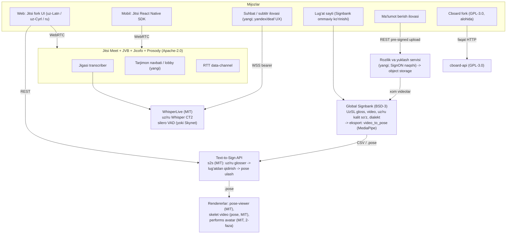

# 04b. Ochiq kod va klon tahlili: nimani fork qilish, nimadan g'oya olish, nimadan qochish

> **Qisqacha**
> - Repolar GitHub API bilan katalogga olindi, so'ng 8 ta asosiysi klon qilinib kodi o'qildi (2026-11-15). Hech narsa o'rnatilmagan, yig'ilmagan, ishga tushirilmagan.
> - **Fork (asos)**: Jitsi Meet (Apache-2.0), Global Signbank (BSD-3), spoken-to-signed-translation + pose (MIT), WhisperLive (MIT), upf-gti/performs (MIT, 2-faza avatar). **Alohida ilova**: Cboard (GPL-3.0).
> - **Faqat g'oya**: SignON (Apache-2.0, 2024 dan muzlagan, tillar yopiq enum), VLibras (LGPL-3.0, avatar faqat kompilyatsiya qilingan Unity binari), yandex/deaf (2016, proprietar SpeechKit). **Qochish**: sign/translate (CC BY-NC-SA).
> - Asos to'liq MIT/BSD/Apache - erkin birlashadi; GPL/LGPL/AGPL alohida servis. Eng zaif joy - **model va ma'lumot litsenziyalari** (SignON checkpointlari, VLibras og'irliklari, sign-mt-poses - litsenziyasiz).
> - MVP muhandislik bahosi: 35-60 person-hafta (pw) (audit) yoki 20-35 pw (katalog) - **ikkalasi ham baho**. Asosiy xarajat kod emas: 2 000+ imo-ishorani pullik kar imo-ishorachilar bilan suratga olish va kar lingvist.

Manbalar: `2_raqobat_va_ochiq_kod/open_source_clonable.md` (katalog) va `2_raqobat_va_ochiq_kod/hands_on_repo_audit.md` (kod auditi). **Barcha person-hafta (pw) raqamlari muallif bahosi, manbasiz.** `fayl:qator` havolalari audit qilingan HEAD bo'yicha.

---

## 1. Metod

| Qadam | Tafsilot |
|---|---|
| Katalog | `gh api repos/<r>`: `pushed_at`, yulduzlar, SPDX litsenziya, asosiy til, hissa qo'shuvchilar (`contributors?per_page=1&anon=1` Link header). Modellar: HF API (`/api/models?search=uzbek&pipeline_tag=automatic-speech-recognition`). DPG holati: `DPGAlliance/publicgoods-candidates`. "push" = istalgan branchga push, har doim kod commit emas |
| Audit | `git clone --depth 1 --filter=blob:limit=400k --no-checkout` + 400 KB gacha sparse checkout; har fayl hajmi bilan ro'yxat (`git ls-tree -r -l`); faqat manba, manifest, Dockerfile, CI va LICENSE o'qildi. Jitsi faqat GitHub contents API orqali (`lang/*.json`, `config.js`, `modules/API/API.js`, transcribing papkasi). "Oxirgi commit" = audit qilingan branchning HEAD sanasi |

---

## 2. Katalog: barcha ko'rib chiqilgan repolar

### 2.1. Text-to-sign va avatar

| Repo | Litsenziya | Oxirgi faollik | Stack / hajm | Holat | Manba |
|---|---|---|---|---|---|
| spbgovbr-vlibras/vlibras-web-browsers | LGPL-3.0 (`LGPL-3.0-or-later`) | push 2026-11-12 | TypeScript, 20 yulduz, 16 hissa qo'shuvchi; v7.12.3 Preact, Zustand, Tailwind/daisyUI, Vite; 473 743 KB | Faol | [org](https://github.com/spbgovbr-vlibras) |
| vlibras-translator-api | LGPL-3.0 | push 2026-11-02; default branch 2023-10-11 (eski), `dev` 2026-08-31 | JS, 20 yulduz; `dev` v3.1.0: Node 24+, Postgres/Sequelize, Jest, Helm; 1 581 KB | Faol (30 branch) | [repo](https://github.com/spbgovbr-vlibras/vlibras-translator-api) |
| vlibras-portal | LGPL-3.0 | push 2026-11-12 | - | Faol | [org](https://github.com/spbgovbr-vlibras) |
| vlibras-translator-text-core | LGPL-3.0 | push 2026-08-20 | Python, v2.5.0, 12 hissa qo'shuvchi; Ubuntu 22.04 + RabbitMQ; 69 588 KB | Faol | [repo](https://github.com/spbgovbr-vlibras/vlibras-translator-text-core) |
| vlibras-player-webjs | LGPL-3.0 | push 2025-11-11 (dev HEAD 2025-09-22) | Faqat kompilyatsiya qilingan Unity WebGL; 528 934 KB | Avatar manbasi yo'q | [tree](https://github.com/spbgovbr-vlibras/vlibras-player-webjs/tree/master/src/target) |
| vlibras-mobile-cross-platform | LGPL-3.0 | push 2026-08-07 | TypeScript | Faol | [org](https://github.com/spbgovbr-vlibras) |
| vlibras-dictionary-api/-repository/-video/-cache/-bundles | LGPL-3.0 | push 2024-03-11 | -bundles/-video/-cache bo'sh | Eskirgan | [org](https://github.com/spbgovbr-vlibras) |
| libraske-* (karaoke/o'rganish o'yini) | Litsenziya aniqlanmagan | 2026 faollik | Player C# | - | [org](https://github.com/spbgovbr-vlibras) |
| sign/translate (sign.mt, endi "Rylo Translate") | Ikki bosqichli: shaxs, notijorat, ta'lim - CC BY-NC-SA 4.0 ("Copyright (c) 2022 Nagish Inc."); tijoriy tashkilot - alohida litsenziya | push 2026-08-11 | TypeScript, 801 yulduz, 4 hissa qo'shuvchi | Faol, Rylo'ga tegishli | [repo](https://github.com/sign/translate); [LICENSE.md](https://github.com/sign/translate/blob/master/LICENSE.md) |
| sign-language-processing/pose | MIT | push 2026-09-19 | 116 yulduz, 14 hissa qo'shuvchi; 16 MB | Faol | [org](https://github.com/sign-language-processing) |
| sign-language-processing/spoken-to-signed-translation | MIT | push 2026-10-18 | 105 yulduz; 131 MB (asosan asset) | Faol | [repo](https://github.com/sign-language-processing/spoken-to-signed-translation) |
| sign-language-processing/signwriting | MIT | push 2026-11-02 | - | Faol | [org](https://github.com/sign-language-processing) |
| segmentation, fluent-pose-synthesis, signwriting-translation | MIT | - | - | Faol | [org](https://github.com/sign-language-processing) |
| signbank-plus, sign-vq, pose-to-video | NOASSERTION (maxsus) | - | - | Litsenziya noaniq | [org](https://github.com/sign-language-processing) |
| JASigning / CWASA (UEA, SiGML/HamNoSys) | **Zid**: vhg2025a - CC BY-NC-ND; vhg2025/vhg2022 - BY-SA; shartlar sahifasi - sahifalar BY-SA, dastur o'zgartirilmasdan (BY-ND kabi), tijoriy moslashtirish kelishuv bo'yicha | GitHub'da yo'q | - | Faqat tadqiqot | [vhg2025a](https://vhg.cmp.uea.ac.uk/tech/jas/vhg2025a/); [Conditions](https://vh.cmp.uea.ac.uk/index.php/JASigning_Conditions); [UEA](https://uea.ac.uk/groups-and-centres/interactive-graphics-and-audio/projects/interactive-graphics-projects/digital-humans/cwa-signing-avatars); [Express Licensing](https://expresslicensing.uea.ac.uk/product/cwa-signing-avatars) |
| ZhengdiYu/SignAvatars (ECCV 2024) | **Litsenziya fayli yo'q** (SPDX null) | push 2025-07-17 | Python, 195 yulduz; 3D sign motion dataset va benchmark, ilova emas | - | [repo](https://github.com/ZhengdiYu/SignAvatars) |
| signon-project (29 repo) | Apache-2.0 (+ NOTICE); `wp4-elan-processor` GPL-3.0; `wp4-text2gloss-models` va `.github` litsenziyasiz | 2024 (yan-avg) | Java/Python/Ionic | Muzlagan | [org](https://github.com/signon-project) |
| upf-gti/performs | MIT | push 2026-10-16 | JavaScript; SiGML/BML va glTF/BVH'ni maxsus avatarda ijro | Faol | [repo](https://github.com/upf-gti/performs) |
| upf-gti/SignON-realizer / SignON-editor | MIT / Apache-2.0 | 2024-01 / 2023-12 | - | Eskirgan | [realizer](https://github.com/upf-gti/SignON-realizer); [editor](https://github.com/upf-gti/SignON-editor) |
| yandex/deaf | Qisqa Apache-2.0 header (GitHub: NOASSERTION) | commit 2016-06-29, push 2017-10-21 | Android, 34 yulduz, 3 ochiq issue, 4.5 MB | Tashlab ketilgan | [repo](https://github.com/yandex/deaf) |

VLibras qabul raqamlari: SBQS 2025 maqolasi kuniga ~40 million VLibrasWidget murojaati va oyiga o'rtacha ~3 million tarjima (o'lchov davri ko'rsatilmagan) - [SBQS 2025](https://sol.sbc.org.br/index.php/sbqs/article/view/39021). Boshqaruv: Braziliya boshqaruv vazirligi (MGI) tashabbusi, UFPB (LAVID lab) bilan - [Agencia Gov 2024](https://agenciagov.ebc.com.br/noticias/202407/gestao-apresenta-iniciativas-de-acessibilidade-digital-na-5a-conferencia-nacional-dos-direitos-da-pessoa-com-deficiencia); [A Uniao](https://auniao.pb.gov.br/noticias/caderno_paraiba/ufpb-e-mgi-apresentam-aplicativo). Hududiy avatarlar "Icaro, Hosana, Guga" - [README](https://github.com/spbgovbr-vlibras/vlibras-web-browsers).

sign.mt sotib olinishi: Nagish (keyin Rylo) 2025-10-22 da e'lon qildi, asoschi Dr. Amit Moryossef Head of Research bo'ldi; 2026-06 Business Wire: Rylo $85M yig'di va "Rylo Sign"ni chiqardi - [PR Newswire](https://www.prnewswire.com/news-releases/nagish-acquires-signmt-to-drive-research-in-ai-and-sign-language-302591257.html); [Rylo blog](https://rylo.com/post/nagish-acquires-sign-mt); [Business Wire](https://www.businesswire.com/news/home/20260604498117/en/).

### 2.2. Lug'at va leksik bazalar

| Repo | Litsenziya | Oxirgi faollik | Stack | Holat | Manba |
|---|---|---|---|---|---|
| Signbank/Global-signbank | BSD-3-Clause | push 2026-11-13 | Python/Django, 24 yulduz, 30 hissa qo'shuvchi | Juda faol | [repo](https://github.com/Signbank/Global-signbank) |
| Signbank/FinSL-signbank | BSD-3 | push 2026-10-29 | NGT-signbank fork | Faol | [org](https://github.com/Signbank) |
| BSL-signbank | BSD-3 | push 2025-09-10 | - | - | [org](https://github.com/Signbank) |
| Auslan-signbank | - | arxiv, 2016-01-18 | - | O'lik | [org](https://github.com/Signbank) |
| Signbank/sign-app | - | 2023-07-08 | Dart | Eskirgan | [org](https://github.com/Signbank) |
| signdict/website | MPL-2.0 | push 2026-11-14 | Elixir, 87 yulduz; nemis crowdsourced lug'at; sobiq DPG nomzodi (arxiv papkada) | Faol | [repo](https://github.com/signdict/website); [DPG archive](https://github.com/DPGAlliance/publicgoods-candidates/blob/main/archive/signdict.json) |
| ODNZSL/nzsl-online | GPL-3.0 | push 2026-11-14 | Ruby, 48 yulduz | Faol | [repo](https://github.com/ODNZSL/nzsl-online) |
| nzsl-dictionary-android / nzsl-dictionary-scripts | MIT | push 2026-11-10 / 2026-11-01 | - | Faol | o'sha |
| sutton-signwriting/core | MIT | push 2025-11-23 | JS | Faol | [repo](https://github.com/sutton-signwriting/core) |
| slevinski/signpuddle | - | 404 | - | Yo'q | - |
| akkomron/uzslr-isolated-dynamic | - | push 2026-03-13 | 5 yulduz; UzSL tanish | Prototip | [repo](https://github.com/akkomron/uzslr-isolated-dynamic) |
| leverow/uzsl | - (LICENSE yo'q, 2026-11-17) | push 2026-11-16 | Python/TS monorepo, 31 commit; intent katalogi, rozilik, ELAN import, landmark preprocessing | Skelet | [repo](https://github.com/leverow/uzsl) |
| bekfurr/UZ_SL_TRSANSLATOR | Apache-2.0 | - | UzSL | Prototip | GitHub qidiruvi |
| khdbeck/uzslr-sign-language-prototype | - | push 2026-10-06 | UzSL | Prototip | GitHub qidiruvi |

UzSL lug'at dasturi yo'q - faqat kichik tanish repolari.

### 2.3. Tanish va ma'lumot yig'ish kodi

| Repo / dataset | Litsenziya | Oxirgi faollik | Izoh | Manba |
|---|---|---|---|---|
| hoyso48/Google---Isolated-Sign-Language-Recognition-1st-place-solution | MIT | push 2024-03-09 | Kaggle ISLR g'olibi, MediaPipe landmarklari | [repo](https://github.com/hoyso48/Google---Isolated-Sign-Language-Recognition-1st-place-solution) |
| microsoft/ASL-citizen-code | MIT | arxiv, 2024-07-25 | Kod va baseline, to'liq yig'ish platformasi emas | [repo](https://github.com/microsoft/ASL-citizen-code) |
| PopSign ASL v1.0 (dataset) | CC BY 4.0 | yig'ilgan 2022-10 - 2023-03 | 1.1 TB, 200 686 video, 250 imo-ishora, 47 imo-ishorachi, Georgia Tech (NeurIPS sonlari biroz farq qiladi); o'yin manbasi ochiqligi tasdiqlanmagan | [signdata.cc.gatech.edu](https://signdata.cc.gatech.edu/view/datasets/popsign_v1_0/) |
| sign-language-processing/segmentation, pose | MIT | - | Segmentatsiya va pose I/O | [org](https://github.com/sign-language-processing) |

### 2.4. Video relay, tarjimon qo'ng'irog'i, RTT

| Repo | Litsenziya | Oxirgi faollik | Hajm/stack | Holat | Manba |
|---|---|---|---|---|---|
| FCC/ACEDirect | Litsenziya aniqlanmagan | push 2021-03-25 | 13 yulduz; boshqa FCC repolari: ACEConnectLite (2016), ACE-Project (2017), ACEApp (2019), ACEServer (2018) | Uxlagan | [repo](https://github.com/FCC/ACEDirect); [fcc.gov/ace](https://fcc.gov/ace); [fcc.gov/dvc](https://www.fcc.gov/dvc); [MITRE](https://www.mitre.org/news-insights/impact-story/mitre-connects-improving-telecommunications-deaf-community) |
| mitrefccace: ace-quill / fcc-vatrp / ace-omni | Litsenziyasiz / - / - | 2024-06-27 / 2022-12-08 (C#) / 2024-06-03 (TS) | 0-4 yulduz | Eskirgan | [org](https://github.com/mitrefccace) |
| jitsi/jitsi-meet | Apache-2.0 | push 2026-11-14 | TypeScript, 30 238 yulduz, 797 hissa qo'shuvchi | Juda faol | [repo](https://github.com/jitsi/jitsi-meet) |
| jitsi/jigasi | Apache-2.0 | push 2026-11-13 | SIP gateway + transkripsiya | Faol | [repo](https://github.com/jitsi/jigasi) |
| jitsi/skynet | Apache-2.0 | push 2026-11-12 | "AI core services" | Faol | [repo](https://github.com/jitsi/skynet) |
| livekit/livekit | Apache-2.0 | - | Go, 22 215 yulduz, 150 hissa qo'shuvchi | Faol | [repo](https://github.com/livekit/livekit) |
| livekit/agents | Apache-2.0 | push 2026-11-15 | 15 233 yulduz | Faol | [repo](https://github.com/livekit/agents) |
| bigbluebutton/bigbluebutton | LGPL-3.0 | push 2026-11-14 | 9 278 yulduz, 352 hissa qo'shuvchi; sobiq DPG nomzodi | Faol | [repo](https://github.com/bigbluebutton/bigbluebutton) |
| linphone-android / linphone-desktop | GPL-3.0 (+ proprietar litsenziya sotiladi) | push 2026-11-14 / 2026-11-13 | 1 339 yulduz (android) | Faol | [repo](https://github.com/BelledonneCommunications/linphone-android) |
| asterisk/asterisk | NOASSERTION (odatda GPL-2.0, fayl tekshirilmagan) | push 2026-11-13 | C, 3 687 yulduz, 444 hissa qo'shuvchi | Faol | [repo](https://github.com/asterisk/asterisk) |
| signalwire/freeswitch | NOASSERTION (odatda MPL-1.1, tekshirilmagan) | push 2026-11-13 | 5 307 yulduz | Faol | [repo](https://github.com/signalwire/freeswitch) |
| RTT (T.140): wkampich/pjsip-rtt-cli, gunnarhm/TotalConversation | - | 2026-07-23 / 2015 | Juda kichik | - | GitHub qidiruvi |

### 2.5. Subtitr va o'zbek ASR/TTS

| Repo / model | Litsenziya | Oxirgi faollik | Hajm | Manba |
|---|---|---|---|---|
| ggml-org/whisper.cpp | MIT | push 2026-11-13 | 55 204 yulduz, 1 140 hissa qo'shuvchi | [repo](https://github.com/ggml-org/whisper.cpp) |
| SYSTRAN/faster-whisper | MIT | - | 26 761 yulduz | [repo](https://github.com/SYSTRAN/faster-whisper) |
| collabora/WhisperLive | MIT | push 2026-11-13 | 4 359 yulduz | [repo](https://github.com/collabora/WhisperLive) |
| QuentinFuxa/WhisperLiveKit | Apache-2.0 | push 2026-11-14 | 11 253 yulduz | [repo](https://github.com/QuentinFuxa/WhisperLiveKit) |
| ufal/whisper_streaming | MIT | push 2025-11-12 | - | katalog |
| alphacep/vosk-api | Apache-2.0 | push 2026-10-15 | 15 257 yulduz; `vosk-model-small-uz-0.22` bor | [repo](https://github.com/alphacep/vosk-api); [models](https://alphacephei.com/vosk/models) |
| google/live-transcribe-speech-engine | Apache-2.0 | **arxiv**, push 2022-07-20 | Google Cloud Speech mijozi, oflayn dvigatel emas | [repo](https://github.com/google/live-transcribe-speech-engine) |
| kaldi-asr/kaldi | - | push 2025-09-22 (sekinlashgan) | 15 515 yulduz | [repo](https://github.com/kaldi-asr/kaldi) |

O'zbek HF modellari, datasetlari va TTS - `04c` va `04d` hujjatlarida.

### 2.6. AAC, favqulodda (112), o'rganish

| Repo | Litsenziya | Oxirgi faollik | Hajm | Holat | Manba |
|---|---|---|---|---|---|
| cboard-org/cboard | GPL-3.0 (`GPL-3.0-only`) | push 2026-11-11; reliz 1.42.5 (2026-09-20) | 768 yulduz, ~95 hissa qo'shuvchi, 283 ochiq issue, 247 MB; `digitalpublicgoods/cboard.json` da (repo 2024-08-19 arxivlangan) | Faol, DPG | [repo](https://github.com/cboard-org/cboard); [DPG](https://github.com/DPGAlliance/publicgoods-candidates/tree/main/digitalpublicgoods) |
| cboard-api, cboard-translate | GPL-3.0 | - | - | Faol | [cboard-api](https://github.com/cboard-org/cboard-api) |
| asterics/Asterics-AAC (sobiq AsTeRICS Grid) | AGPL-3.0 | push 2026-11-14 | 129 yulduz, 17 hissa qo'shuvchi; "oflayn qo'llab-quvvatlovchi bepul AAC" | Faol | [repo](https://github.com/asterics/Asterics-AAC) |
| otsimo-archive/aac | AGPL-3.0 | arxiv, 2021-09-01 | Sobiq DPG nomzodi | O'lik | [repo](https://github.com/otsimo-archive/aac) |
| CoughDrop/coughdrop | - | 404 | Org'da `extra-tts` MIT 2025-09, `coughdrop-websocket` GPL-3.0 2025-08; eski AGPL fork `bcarter/coughdrop` (2016) | Asosiy repo ko'rinmaydi | [org](https://github.com/CoughDrop) |
| dec112/ng112-js | AGPL-3.0 | push 2026-10-09 | NG112 kutubxonasi; `ng112-js-sip-adapter-jssip` AGPL-3.0 | Faol | [org](https://github.com/dec112) |
| dec112/viewer | GPL-3.0 | push 2026-11-03 | Boshqaruv markazi mijozi | Faol | o'sha |
| dec112/pidf-lo-javascript, vcard-xml-javascript | MIT | - | - | - | o'sha |
| dec112/app | MIT | **arxiv**, 2022-12-08 | Mobil ilova | O'lik | o'sha |
| sign-language-processing/lessons-in-signwriting | CC BY 4.0 | - | - | - | [repo](https://github.com/sign-language-processing/lessons-in-signwriting) |

---

## 3. Repo-ma-repo audit natijalari

### 3.1. SignON (github.com/signon-project) - **g'oya, fork emas**

Inventar: 29 repo; audit qilinganlarida to'liq Apache-2.0 matni; `NOTICE`: "Copyright 2021-2023 FINCONS GROUP AG / Universitat Pompeu Fabra ... grant 101017255".

| Repo | Oxirgi commit | Hajm (KB) | Stack (manifestdan) |
|---|---|---|---|
| [wp2-orchestrator](https://github.com/signon-project/wp2-orchestrator) | 2024-06-05 | 38 | Java 11, Spring Boot 2.5.3, spring-amqp, MinIO 8.3.7 |
| [-openapi](https://github.com/signon-project/wp2-orchestrator-openapi) / [-asyncapi](https://github.com/signon-project/wp2-orchestrator-asyncapi) | 2024-04-26 | 22 / 467 | OpenAPI (551 qator), AsyncAPI (134 qator), `@asyncapi/java-spring-template@0.18.3` |
| [wp2-dispatcher-for-wp3/4/5](https://github.com/signon-project/wp2-dispatcher-for-wp4) | 2024-04-26 | 10-14 | Python 3.8, pika 1.2.1, boto3 |
| [wp2-framework-docker-compose](https://github.com/signon-project/wp2-framework-docker-compose) | 2024-08-28 | 11 | compose v3.9, RabbitMQ 3.9, MinIO 2022-03-05 |
| [wp2-mobile-app](https://github.com/signon-project/wp2-mobile-app) | 2024-01-15 | 11 187 | Ionic 6, Angular ~13.2, Capacitor 3.5, ngx-translate 14, three ^0.152 |
| [wp2-ml-app](https://github.com/signon-project/wp2-ml-app) | 2024-01-15 | 163 | Bo'sh Ionic tabs starter |
| [wp3-asr-comp](https://github.com/signon-project/wp3-asr-comp) | 2024-01-22 | 23 179 | Kaldi namuna, wav2vec2 XLS-R, Whisper large-v3 skriptlari |
| [wp3-slr-component](https://github.com/signon-project/wp3-slr-component) / [-pipeline](https://github.com/signon-project/wp3-slr-pipeline) | 2024-01-08 / 2024-01-23 | 34 / 43 | MediaPipe 0.8.11 -> PoseFormer (PyTorch Lightning 1.7.7), Flask |
| [wp3-nlp-pipeline](https://github.com/signon-project/wp3-nlp-pipeline) | 2024-04-26 | 1 948 | Flask, spaCy 3.7.2 (en/es/nl), stanza 1.3.0 (ga), Hunspell, WordNet |
| [wp4-text2gloss](https://github.com/signon-project/wp4-text2gloss) | 2024-01-17 | 1 978 | FastAPI, matn -> AMR (mBART), LaBSE, SQLite `glosses.db` |
| [wp4-text-gloss-mt](https://github.com/signon-project/wp4-text-gloss-mt) | 2024-04-26 | 2 580 | TF 2.4.1 mBART; og'irliklar 1.46 GB Git LFS |
| [wp4-slt-component](https://github.com/signon-project/wp4-slt-component) | 2024-01-08 | 31 773 | SignJoey fork (faqat o'qitish) |
| [wp5-synthesis](https://github.com/signon-project/wp5-synthesis) | 2024-01-15 | 28 369 | three.js "SignON Realizer": SiGML -> BML |

| Audit topilmasi | Dalil |
|---|---|
| CI yo'q (`.github/workflows`, GitLab CI, Jenkinsfile yo'q); testlar faqat Angular "should create" + 2 ad-hoc Python skript; 0-1 yulduz | GitHub API |
| Prod orkestrator javob beradi: `GET https://api.signon-project.eu/orchestrator/version` -> 200 `{"Orchestrator":"13.0.0",...}` (2026-11-15); `api.dev...` -> 404 | to'g'ridan curl |
| Oqim: ilova `/message` -> orkestrator RPC `signon.rpc.requests` -> WP3 dispatcher (ASR, NLU, SLR) -> `signon.wp4.queue` -> `signon.wp5.queue` -> javob. Yuklash MinIO pre-signed URL (`/inference-storage-auth`, `/dataset-storage-auth`) | `config.yml:21-39`; [shared schemas](https://github.com/signon-project/wp2-orchestrator-api-shared-schemas) |
| Konvertda bosqich vaqt belgilari (T0App...T5) - kechikishni kuzatish | `signon-orchestrator-shared-schemas.yml:18-175` |
| **WP5 sintez qilmaydi** - faqat `T4WP5` qo'yib javob beradi; avatar telefonda render | `wp2-dispatcher-for-wp5/src/dispatcher.py:57-82` |
| Tillar yopiq enum: imo-ishora `VGT, SSP, BFI, ISG, DSE`; og'zaki `ENG, GLE, NLD, SPA, DUT`; yana `helper_ASR.py:20-38`, `helper_SLR.py:20-31`, `helper_T2G.py:20-31`, `SignON_NLP.py:31-32` va mobil ilovada (`language.service.ts:10-14` oq ro'yxat `en|ga|es|nl`; `tab1.page.ts:2184-2215`) qayta yozilgan | `signon-orchestrator-shared-schemas.yml:136-150` |
| Text-to-avatar faqat ingliz tilidan (boshqalar avval inglizchaga MT); video-to-text golland orqali | `wp2-dispatcher-for-wp4/src/dispatcher.py:71-123` |
| `text2gloss` faqat `Literal["vgt","ngt"]`, SQL f-string bilan - **injection xavfi** | `wp4-text2gloss/api/main.py:228-245` |
| Checkpointlar Google Drive (`README.md:4`) va HF `signon-project/*`; 11 HF modelning hech biri litsenziya e'lon qilmaydi, kartalar 2 qatorli | [HF signon-project](https://huggingface.co/signon-project) |
| SLR 192-o'lchamli embedding beradi, gloss emas. Izolyatsiyalangan validatsiya aniqligi: NGT 47.26%, VGT 52.37%, ISL 30.10%, BSL 32.78%, LSE 59.40%. Noma'lum til jimgina NGT'ga tushadi | `wp3-slr-pipeline/documentation/inference.md`; `wp3-slr-component/web_service/app.py:9-30` |
| ASR masofaviy Radboud servisini chaqiradi, login/parol literallari commit qilingan (`helper_ASR.py:45-46,66-67`); mobil ilovada Acapela TTS kalitlari (`tab1.page.ts:795`) - qiymatlar ko'chirilmagan | kod |
| Avatar: three.js `EvaHandsEyesFixed.glb` (29.3 MB, Mixamo rig, litsenziya/kelib chiqishi yo'q), 2 206 NGT SiGML/BML fayl; boshqa tillar Azure'dagi 10 demo MP4'ga tushadi, ular endi 409 qaytaradi | `wp5-synthesis/data/`; `tab1.page.ts:105-120,382,626` |
| Buzilgan: `config.yml:16` da `server:` o'rniga `4ewstdserver:`; compose mavjud bo'lmagan `./signon-orchestrator-configuration/` ni mount qiladi; WP3 config'da `asr:` yo'q (audio yo'lida KeyError); imijlar registrda yo'q; `minioadmin` / `guest` parollari commit qilingan; rozilik matni Lorem ipsum; barcha imo-ishora videolari bitta "Rickroll" YouTube ID | `docker-compose.yml:82-196`, `config.yml:59-71` |

**UzSL uchun o'zgartirish bahosi (agar skelet saqlansa):**

| # | O'zgarish | pw (baho) | Xavf |
|---|---|---|---|
| 1 | Enum'ga uz, ru, UzSL qo'shish (UzSL uchun ISO 639-3 kodi tasdiqlanmagan - private-use kod) | 1 | Past |
| 2 | Dispatcherlardagi qattiq xarita va pivotlarni routing jadvaliga aylantirish | 2 | O'rta |
| 3 | Compose xatolari, kalitlarni tozalash, imij nashri, Spring Boot 2.5->3, Java 11->21 | 3-4 | O'rta |
| 4 | ASR'ni lokal o'zbek/rus oqimli servis bilan almashtirish | 2-3 | O'rta |
| 5 | NLU'ni o'zbek morfologiyasi + rus spaCy bilan | 3-5 | Yuqori |
| 6 | Yangi o'zbek/rus -> UzSL gloss qoidalari | 6-10 | Yuqori |
| 7 | Mobil ilovani qayta yozish (Angular 13 / Capacitor 3 EOL; 2 320 qatorli bitta sahifa komponenti) | 8-12 | O'rta |
| 8 | Ma'lumot berish ilovasini noldan (`wp2-ml-app` bo'sh) | 4-6 | O'rta |
| | **Jami** | **~30-50** | Yangi komponent qurishga yaqin |

Ustiga: UzSL SiGML lug'ati (1 animator + 1 kar imo-ishorachi, ~2 000 imo-ishoraga 6-12 oy) va UzSL tanish (juda yuqori xavf).

**Hukm: g'oya olish, fork emas.** Olinadigan: OpenAPI/AsyncAPI kontrakt uslubi; bosqich vaqt belgili konvert; rozilik va dataset yuklash endpointlari; PoseFormer o'qitish kodi (namuna). Avatar uchun `wp5-synthesis` emas, `upf-gti/performs` fork qilinadi.

### 3.2. yandex/deaf (Yandex Razgovor Android, 2016) - **faqat g'oya**

| Topilma | Dalil |
|---|---|
| LICENSE (591 B) - qisqa Apache-2.0 header "Copyright 2016 YANDEX LLC" (to'liq matn emas, shuning uchun NOASSERTION) | [LICENSE](https://github.com/yandex/deaf/blob/master/LICENSE) |
| README `AkmalArtikov/deaf` ga va mavjud bo'lmagan klon URL'ga ishora qiladi | [README](https://github.com/yandex/deaf) |
| Stack: AGP 1.3.0, compileSdk 23, minSdk 16; `jcenter()` va `maven.fabric.io` (ikkalasi yopilgan); Retrofit 1.9, Crashlytics 2.5.2, mobmetricalib 2.21 | [build.gradle](https://github.com/yandex/deaf/blob/master/build.gradle); [app/build.gradle](https://github.com/yandex/deaf/blob/master/app/build.gradle) |
| Proprietar `app/repo/speechkit-2.5.0-SNAPSHOT.aar` (2.55 MB), Yandex SpeechKit shartlari ostida; Maven Central'dagi so'nggi `com.yandex.android:speechkit` 3.12.2 (2018-04-09); eski TTS endpoint `tts.voicetech.yandex.net` javob bermadi (`SpeechKitTtsCloudApi.java:25`) | [SpeechKit terms](https://yandex.ru/legal/speechkit/) |
| 160 Java fayl `ru.yandex.subtitles`: `MessagingService` (tanish), `PhrasesService` (oldindan sintez qilingan `*_ru-RU_ermil.mp3` iboralar), content provider, UI; satrlar faqat `values/` (rus) va `values-uk/`; `Preferences.java:78-87` standart `Recognizer.Language.RUSSIAN` (locale TODO); test va CI yo'q | kod |

Port: SpeechKit'ni Vosk `small-uz`/`small-ru` yoki WhisperLive bilan almashtirish, AGP 8/AndroidX, `values-uz` va `values-b+uz+Cyrl` - **8-12 pw** (baho). Kotlin/Flutter qayta yozish shu narxda, xavfi past. Saqlanadigan UX: oldindan sintez qilingan tayyor iboralar, katta shrift, dialog rejimi, tarix. RuStore'dagi ilova (v27.x, 2026) - boshqa, yopiq kod.

### 3.3. Global Signbank - **fork (UzSL leksik bazasi)**

| Topilma | Dalil |
|---|---|
| `LICENCE.txt` BSD-3: "Copyright (c) 2018, Steve Cassidy ..., Radboud University Nijmegen" | [LICENCE.txt](https://github.com/Signbank/Global-signbank/blob/master/LICENCE.txt) |
| Oxirgi commit 2026-11-13; 22.6 MB; 151 ochiq issue; 2026-05-15 dan beri 100 commit (bitta to'liq sahifa, ko'proq bo'lishi mumkin) | GitHub API |
| Django==6.1.1, django-modeltranslation 0.20.6, django-guardian, mysqlclient/mysql-connector, lxml, nltk, ffmpeg-python, pympi-ling (ELAN); standart DB SQLite `database/signbank.db` (`default.py:32-37`); video ffmpeg bilan (`FFMPEG_OPTIONS = ["-vcodec","h264","-an"]`, `base.py:227-234`) | [requirements.txt](https://github.com/Signbank/Global-signbank/blob/master/requirements.txt) |
| Django ilovalari: `dictionary` (models.py 217 KB, adminviews.py 393 KB, update.py 200 KB), `video`, `feedback`, `attachments`, `pages`, `registration`. Modellar: `Gloss`, `Lemma`, `Dataset`, `SignLanguage`, `Dialect`, `Language`, `Keyword`, `Translation`, `Sense`, `Handshape`, `FieldChoice` (`models.py:196-752`) | kod |
| JSON API (Swagger): `/dictionary/api_create_gloss/{datasetid}/`, `/api_update_gloss/{glossid}/video`, `/upload_zipped_videos_archive/{datasetid}/`, `/get_gloss_data/...` | [signbank-api.json](https://github.com/Signbank/Global-signbank/blob/master/docs/signbank-api.json) |
| Interfeys tillari server sozlamasida; standart faqat ingliz (`default.py:69-88`); Global instansiya `['en','nl','zh-hans','ar','he']` (`global_sb_new_aj.py:30`); `.po`: ar, en_US, he, nl, zh_Hans - **ru va uz yo'q**; `nl/django.po` 1 647 msgid | kod |
| Ma'lumot migratsiyalari tilni qattiq kodlaydi: `0093_add_entymology_to_other_media_choices.py:15-19` `name_nl` va bo'sh DB'da `max()` xatosi (o'qish bo'yicha, ishga tushirilmagan); jami 117 migratsiya | kod |
| `dictionary/tests.py` 213 KB (4 321 qator), 25 TestCase klassi; CI faqat self-hosted deploy (`global`, `vgt` runnerlar) - **test CI yo'q**; `deploy.sh` da test qadami izohga olingan, `git stash`, merge, SQLite nusxa, mashinani qayta yuklash; 143 KB `debug.log` commit qilingan | [deploy.sh](https://github.com/Signbank/Global-signbank/blob/master/deploy.sh) |

| O'zgarish | pw (baho) | Xavf |
|---|---|---|
| MySQL/Postgres'da yangi instansiya; `LANGUAGES = uz, uz-cyrl (custom), ru, en`, `MODELTRANSLATION_LANGUAGES`, 3 harfli kodlar (`uzb`, `rus`); `name_uz` / `name_uz_cyrl` / `name_ru` migratsiyasi; tilga bog'langan migratsiyalarni toza o'rnatish uchun tuzatish | 1-2 | O'rta (Django'da `uz` Latin locale bor; kirill uchun custom kod va `LANG_INFO`) |
| ~1 650 UI satrini uz-Latn va ru ga; uz-Cyrl deterministik transliteratsiya + ona tilli tekshiruv; FieldChoice/Handshape nomlari | 2-3 | Past |
| `SignLanguage` "UzSL", har viloyatga Dataset, `Dialect` qatorlari, UzSL qo'l shakli inventari va fonologiya ro'yxatlari (kar lingvist bilan) | 1-2 + lingvist | O'rta (UzSL fonologiyasi hujjatlanmagan) |
| Lotin so'rov kirill kalit so'zni topadigan qidiruv (transliteratsiya indeksi) | 1 | Past |
| Eksport: Signbank API -> `spoken-to-signed` lug'at CSV (+ har videoga `video_to_pose`) | 1-2 | Past |
| Ops: `deploy.sh` o'rniga konteyner, CI'da test, video backup | 1-2 | Past |
| **Jami** | **~7-12 + kontent** | Kontent: 2 000-5 000 imo-ishorani kar imo-ishorachilar bilan suratga olish |

### 3.4. spoken-to-signed-translation (s2s) va pose - **fork (matn -> imo-ishora)**

| Topilma (s2s) | Dalil |
|---|---|
| MIT, "Copyright (c) 2026 ZurichNLP"; oxirgi commit 2026-10-18 | [repo](https://github.com/sign-language-processing/spoken-to-signed-translation) |
| v0.0.2, Python 3.9+; `pose-format>=0.15.0`, `pose_anonymization`, numpy, scipy, `simplemma>=1.0.0`; extras: `server` (FastAPI, hypercorn), `postgres`, `gpt` (openai), `spacy`, `nmt` (sockeye 3.1.10), `gcs`, `lexicon`; Dockerfile `python:3.12-slim`; CI: lint, test (pytest, uv, 3.9), release, Docker; 21 test fayl | [pyproject.toml](https://github.com/sign-language-processing/spoken-to-signed-translation/blob/main/pyproject.toml) |
| Modullar: `text_to_gloss/{simple,spacylemma,rules,nmt,gpt,asl,senses,rewrites,wordnet}.py`; `gloss_to_pose/{lookup/{csv,sql,fingerspelling}_lookup.py, concatenate.py, smoothing.py, languages.py}`; `pose_to_video` -> `raise NotImplementedError` | kod |
| Pipeline: matn -> gloss -> pose -> video; glosserlar `simple|spacylemma|rules|nmt`; lug'at papkasi (CSV + .pose); `download_lexicon --name signsuisse`; hozirgi juftliklar sgg/ssr/slf + de/fr/it; til kodlari IANA subtag | [README](https://github.com/sign-language-processing/spoken-to-signed-translation) |
| Lug'at bo'lmasa CLI `["de","fr","it","en"]` / `["sgg","gsg","bfi","ase"]` (`bin.py:113-117`); indeks ustunlari `path, spoken_language, signed_language, start, end, segment_start, segment_end, words, glosses, priority` (`download_lexicon.py:16-27`); yagona yuklovchi `signsuisse` (`:117`) | kod |
| `rules.py:10-13` faqat de/fr; `spacylemma.py:4-9` de/fr/it/en; `asl.py` ingliz -> ASL; `simple.py` simplemma bo'lmasa kichik harf + bo'shliq | kod |
| simplemma'da `ru`, `uk`, `tr` bor, **`uz` va `kk` yo'q** | [simplemma data](https://github.com/adbar/simplemma/tree/main/simplemma/strategies/dictionaries/data) |
| Zaxira xarita `slf->ise, ssr->fsl` (`gloss_to_pose/languages.py`) - `uzsl->rsl` uchun qayta ishlatsa bo'ladi | kod |
| NMT glosser `https://archive.cl.uzh.ch/public/archive/2022/easier/dgs_de.tar.gz` (`nmt.py:52`); GPT glosser standart `OPENAI_MODEL` "gpt-5.6-luna" (`gpt.py:140`) | kod |
| Daktil lug'ati: `assets/fingerspelling_lexicon/index.csv` da 22 til (`uk,ukl`, `tr,tsm`, `en,ase`...) - **rsl va o'zbek yo'q**; poselar GCS bucket `sign-mt-poses` dan (`download.py:7-11`), litsenziya ko'rsatilmagan | kod |

| Topilma (pose) | Dalil |
|---|---|
| MIT, "Copyright (c) 2021 Amit Moryossef"; oxirgi commit 2026-09-19, 16 MB | [repo](https://github.com/sign-language-processing/pose) |
| `pose_format` v0.15.0 (numpy, tqdm, simple-video-utils; extras `mediapipe<0.10.30`, mmpose, torch, tensorflow); JS `pose-format` 1.6.2 va `pose-viewer` 1.2.0 (Stencil, MIT); Dart port va `pose-pipelines` submodullari | [pyproject](https://github.com/sign-language-processing/pose/blob/master/src/python/pyproject.toml) |
| Modullar: `pose.py`, `pose_body.py`, `pose_header.py`, `pose_visualizer.py`, `utils/{holistic,openpose,alphapose,mmposewholebody,pose_converter,normalization_3d}.py`; CLI `video_to_pose --format mediapipe`, `visualize_pose`; `utils/holistic.py:18-23` eski `mp.solutions.holistic` | kod |
| CI: Python 3.8-3.12 pytest, JS va Dart workflowlar, Sphinx (ReadTheDocs) | `.github/workflows/python.yaml` |

| O'zgarish (s2s) | pw (baho) | Xavf |
|---|---|---|
| Yangi `text_to_gloss/uz.py`: apostrof normalizatsiyali tokenizer (o', g', ' variantlari), oldinda kirill -> lotin; suffiks olib tashlovchi lemmatizer (yoki Apertium-uzb); UzSL tartib qoidalari (topik/fe'l oxirida, inkor, savol) kar lingvistlar bilan | 4-8 | Yuqori (UzSL grammatika tavsifi yo'q) |
| Rus glosser: `simple` + simplemma `ru` bugun ishlaydi; rus -> UzSL qoidalari (tartib, predlog va bog'lamani tashlash) | 1-2 | O'rta |
| Lug'at: `spoken_language` uz/ru, `signed_language` = UzSL private kod, Signbank videolaridan `video_to_pose`; `download_lexicon --name uzsl` | 1-2 | Past |
| Daktil: o'zbek lotin (o', g', sh, ch, ng) va kirill to'plami - UzSL qo'l alifbosini suratga olish, `index.csv` ga | 1 + suratga olish | O'rta (alifbo tasdiqlanishi kerak) |
| Chiqish: `visualize_pose` skelet video yoki brauzerda `pose-viewer` (MIT), yoki pose/BVH bilan `performs` avatar. `pose_to_video` yo'q, org'dagi `pose-to-video` NOASSERTION | 1-3 | O'rta (skelet/avatar karlar uchun maqbulmi) |
| `mediapipe<0.10.30` cheklovini MediaPipe Tasks API ga o'tib olib tashlash (upstream hissa) | 1-2 | O'rta |
| **Jami** | **~9-18 + lug'at suratga olish** | `gpt` glosser - tashqi API va narx, ixtiyoriy qoldirish |

Eng arzon MVP (katalog inferensiyasi): s2s + o'zbek glosser + suratga olingan imo-ishoralardan MediaPipe .pose lug'ati, skelet yoki pose-to-video bilan render. 3D animator kerak emas, faqat har imo-ishoraga video.

### 3.5. VLibras - **g'oya**

GitHub - LAViD'ning login talab qiladigan GitLab'i (`gitlab.lavid.ufpb.br`) mirrori; CI GitLab'da yopiq shablondan ([AGENTS.md](https://github.com/spbgovbr-vlibras/vlibras-web-browsers/blob/dev/AGENTS.md)). To'rtta LICENSE - so'zma-so'z GNU LGPL v3.

| Repo | Oxirgi commit | Hajm (KB) | Topilma |
|---|---|---|---|
| vlibras-translator-text-core (dev) | 2026-08-20 | 69 588 | `src/worker.py` (~9 KB) `translate.to_text` ni iste'mol qilib `vlibras_translator.translate` ni chaqiradi; ixtiyoriy LLM "refiner" (`gpt-4o` yoki Ollama; `config.py:30-93`). Dockerfile `vlibras-translator[neural]==1.3.3` ni **test.pypi** dan (PyPI 404) va `pt_core_news_md` o'rnatadi; README eski paketlarni aytadi |
| `vlibras-translator` 1.3.3 sdist (test.pypi, 2026-07-31, LGPL-3.0) | - | - | PT qoida pipeline (lemma, ko'plikni olib tashlash, almashtirish, son glossi), 22 509 yozuvli Libras gloss lug'ati, 26 MB PT lemma jadvali; `translate.py:55-66` portugal spaCy talab qiladi; neyron og'irliklar `gitlab.lavid.ufpb.br/vlibras-deeplearning/translator-models.git` dan git-LFS (`model_utils.py:116-119`), **litsenziyasiz** |
| vlibras-translator-api | default 2023-10-11; `dev` 2026-08-31 | 1 581 | `dev` v3.1.0: Node 24+, Postgres/Sequelize, Jest, API-key, rate limit, gloss refinement, Helm; 30 branch (so'nggisi 2026-11-02); queue-RPC `POST /translate` `amq.rabbitmq.reply-to` + Redis kesh; `/review` crowd-reyting halqasi; **til parametri yo'q**; avatarlar `['icaro','hozana']` |
| vlibras-player-webjs (dev) | 2025-09-22 | 528 934 | `src/target/` da faqat `playerweb.data.unityweb` (10.4 MB), `.wasm.code.unityweb`, `UnityLoader.js`; **Unity loyihasi, rig, animatsiya yo'q**; `Player.js:42` `region = "BR"`; bundle'lar `dicionario2-dth.vlibras.gov.br/2018.3.1/WEBGL/` dan (`src/config.js`) |
| vlibras-web-browsers (dev) | 2026-11-12 | 473 743 | v7.12.3; 94 Vitest fayl, Playwright smoke, Biome, commitlint, CHANGELOG; o'z Unity binari (`public/unity/`, 17 MB); Unity kontrakti `src/player/constants/unity.ts:1-31` (playNow, avatar almashtirish, 8 his-tuyg'u, subtitr); **i18n kutubxonasi yo'q** (portugal literallar JSX'da, `about/index.tsx:27`; `src/core/dom/index.ts:25,64` `root.lang="pt-BR"`); endpointlar `src/core/config/index.ts:8-37` da; PostHog analitika |

| O'zgarish | pw (baho) | Xavf |
|---|---|---|
| Vidjetga i18n (~120 .tsx fayl satrlari; uz-Latn, uz-Cyrl, ru), o'z endpointlariga yo'naltirish | 3-4 | Past |
| translator-api: `lang` parametri, rebrend | 1-2 | Past |
| PT dvigatelini o'zbek/rus -> UzSL gloss dvigateli bilan almashtirish (s2s bilan bir xil - ikki marta qilmaslik) | 8-14 | Yuqori |
| `unity.ts` kontraktini bajaradigan yangi avatar (yoki RNP/LAViD'dan Unity manbasini kelishish) | 12-25 + animator | Juda yuqori |
| Animatsiyalangan UzSL bundle lug'ati (1 500-3 000 imo-ishora) | 6-12 oy, animator + kar imo-ishorachi | Juda yuqori |

Katalog bahosi (boshqa yozuv): infratuzilma va UI lokalizatsiyasi 4-8 pw; avatar va lug'at asosiy xarajat (1 animator + 1 kar imo-ishorachi, ~2 000 imo-ishoraga 6-12 oy); foydali qamrov uchun ~1 500-3 000 imo-ishora (baho); o'zbek agglutinativ - morfologiya kerak.

**Hukm: g'oya.** Olinadigan: queue-RPC API, review halqasi, his-tuyg'u kontrakti, brauzer kengaytmasi/vidjet UX. Vidjetni fork qilish faqat avatar paydo bo'lgandan keyin ma'noli.

### 3.6. Jitsi Meet - **fork (tarjimon qo'ng'irog'i)**

| Topilma | Dalil |
|---|---|
| Apache-2.0, TypeScript, push 2026-11-14, 30 238 yulduz; so'nggi reliz `stable/jitsi-meet_11248` (2026-09-14); react 19.2.3, react-native 0.85.2, i18next 17.0.6, node 24+; `lib-jitsi-meet` GitHub reliz tarball'dan | GitHub API |
| `lang/` da 61 `main-*.json`, shu jumladan `main-ru.json`, `main-kk.json`; **`main-uz.json` yo'q, `languages.json` da `uz` yo'q**. `main.json` (1 670 kalit) bo'yicha: ru 1 386 (284 yetishmaydi, ~17%), kk 1 472 (198 yetishmaydi); i18n `react/features/base/i18n/i18next.ts` | olingan fayllardan hisoblangan |
| `config.js` (~576-640 qator) `transcription`: `enabled`, `translationLanguages`, `useAppLanguage`, `preferredLanguage`, `autoCaptionOnTranscribe`, `disableClosedCaptions`, `diarize`, `customLanguages` ("custom transcription backends (e.g. Vosk)") | [config.js](https://github.com/jitsi/jitsi-meet/blob/master/config.js) |
| `transcriber-langs.json` da `ru-RU` bor, **o'zbek yo'q**; `translation-languages.json` (110 yozuv) da `uz` va `ru` bor | kod |
| Jigasi: `WhisperTranscriptionService.java`, `WhisperWebsocket.java`, `VoskTranscriptionService.java`, Google, Oracle + LibreTranslate/Bing/Google tarjima | [jigasi tree](https://github.com/jitsi/jigasi/tree/master/src/main/java/org/jitsi/jigasi/transcription) |
| Skynet: "Live Transcriptions with Faster Whisper via websockets" (`ENABLED_MODULES="streaming_whisper"`, `WHISPER_MODEL_PATH`) | [skynet](https://github.com/jitsi/skynet) |
| `filmstrip.stageFilmstripParticipants` "1 dan 6 gacha", `disableStageFilmstrip` (~2034-2047) | config.js |
| iframe API: `pin-participant` (347), `set-large-video-participant` (452), `set-follow-me` (438), `send-chat-message` (629), `send-endpoint-text-message` (646), `toggle-subtitles`/`set-subtitles` (597/600), `answer-knocking-participant` (221, lobby), `toggle-lobby` (316), `start-recording` (791) | [API.js](https://github.com/jitsi/jitsi-meet/blob/master/modules/API/API.js) |
| Mobil: `android/sdk`, `ios`, `react-native-sdk`; namunalar `jitsi-meet-sdk-samples` (Apache-2.0, push 2026-11-02) | [samples](https://github.com/jitsi/jitsi-meet-sdk-samples) |
| `"sign language"` kod qidiruvi - 0 natija, tarjimon roli yo'q; 2020 issue'lar #6906 (multi-pin), #6151 (language facilitation) yopilgan | GitHub qidiruvi |

| O'zgarish | pw (baho) | Xavf |
|---|---|---|
| `main-uz.json` (lotin) + kirill (`uz-Cyrl`, `zh-CN`/`es-US` uslubida), `languages.json`; 284 ru kalitini to'ldirish | 1-2 | Past (detektor script subtag'ni qabul qiladimi tekshirish) |
| O'zbek subtitr: Jigasi `WhisperTranscriptionService` ni o'zbek Whisper'li WhisperLive/Skynet serverga; `customLanguages: {'uz-UZ': "O'zbek"}` | 1-2 | O'rta (o'zbek WER) |
| Tarjimon funksiyalari: doim pin qilingan "tarjimon" (`set-follow-me` + `pin-participant` yoki custom rol); lobby/navbat; bron UI | 6-10 (Jitsi atrofida yangi kod) | O'rta |
| RTT yon paneli `send-endpoint-text-message` orqali (belgima-belgi) | 1-2 | Past |

Upstream tez: yiliga 2 marta rebase - chuqur patch emas, yupqa fork (config, lang, custom React panel). Katalog bahosi: uz UI 1-2 pw, navbat/rejalashtirish/VRS dispatch 6-10 pw; ACE Direct faqat dizayn namunasi; RTT - Jitsi/LiveKit ichida WebRTC data channel, to'liq SIP T.140 faqat 112 interop uchun.

### 3.7. Cboard - **alohida GPL ilova**

| Topilma | Dalil |
|---|---|
| `LICENSE.txt` to'liq GPL v3, `package.json` `GPL-3.0-only`; backend cboard-api GPL-3.0 | [cboard](https://github.com/cboard-org/cboard) |
| Oxirgi commit 2026-11-11, reliz 1.42.5 (2026-09-20), 283 ochiq issue, ~95 hissa qo'shuvchi, 247 MB | GitHub API |
| React 17, Redux, MUI v4, react-intl v2.9, CRA/craco, Cordova (Android/iOS), PWA, Dockerfile; bundled `@mediapipe/tasks-vision`, Azure Speech SDK, ElevenLabs, `@ctrl/react-adsense`, PayPal, App Insights, Google Analytics | kod |
| CircleCI, CodeQL, 137 Jest test fayl, Playwright e2e, BrowserStack, Crowdin | kod |
| `src/translations/` 65 JSON, har birida ~4 016 kalit (belgi yorliqlari ham); `App.constants.js:16-70` 51 yoqilgan locale (`ru-RU` bor, 16 satri inglizcha bilan bir xil); `tk-TM` tarjima qilingan, lekin yoqilmagan; **uz fayli yo'q** | kod |
| TTS darvozasi: `src/i18n.js:72-103` tillarni mavjud ovozlar bo'yicha filtrlaydi; `voice.lang.substring(0,2)` (~140); serb kirill `sr-SP` alias (~88-89); provayderlar Azure, ElevenLabs, `speechSynthesis` | `SpeechProvider/tts.js` |
| Belgilar: Mulberry CC BY-SA 4.0 (bundled); **ARASAAC CC BY-NC-SA 4.0**; Global Symbols API; "Cboard Symbols" API kalit talab qiladi | README:155-163; `CBOARD_SYMBOLS_INTEGRATION.md` |

| O'zgarish | pw (baho) | Xavf |
|---|---|---|
| `uz-UZ` (lotin) va `uz-Cyrl`: ~4 000 satr (belgi yorliqlari bilan), kirill transliteratsiya, `i18n.js` da alias | 3-4 | Past-o'rta |
| O'zbek TTS: Azure uz-UZ yoki ochiq o'zbek TTS, ovoz adapteri orqali | 1-2 | O'rta |
| O'zbekiston kontekstlari uchun standart taxtalar (poliklinika, davlat idorasi, transport, oila) | 2-3 + dizayner | O'rta |
| Signbank klipini ijro etadigan "UzSL video tayli" | 2-4 | O'rta |
| Reklama, PayPal, telemetriyani olib tashlash; cboard-api'ni self-host | 1-2 | Past |

Katalog bahosi: 3-5 pw; forkdagi ilova GPL bo'lib qoladi. Audit bo'yicha jami 9-15 pw.

### 3.8. collabora/WhisperLive - **fork (oqimli subtitr)**

| Topilma | Dalil |
|---|---|
| MIT, "Copyright (c) 2023 Vineet Suryan, Collabora Ltd."; oxirgi commit 2026-11-13, 6.8 MB, 4 359 yulduz, 14 ochiq issue; 2026-05-15 dan 100 commit | GitHub API |
| `faster-whisper==1.2.0`, websockets, onnxruntime, `openai-whisper==20250625`, `transformers[torch]<5`, OpenVINO-genai, FastAPI/uvicorn; Dockerfile: `cpu`, `gpu`, `openvino`, `rocm`, `tensorrt`; CI (test, Docker, wheel); 17 test fayl (`test_server_extended.py` 56 KB) | [server.txt](https://github.com/collabora/WhisperLive/blob/main/requirements/server.txt) |
| `server.py` (1 283 qator): WebSocket + OpenAI uslubidagi REST streaming; backendlar faster_whisper, trt, openvino, translation; `vad.py`, `diarization.py`, `client.py`; bearer-token auth header, `?token=` yoki subprotocol (`server.py:51-87`); `run_server.py`: `--faster_whisper_custom_model_path`, `--max_clients`, `--max_connection_time`, `--no_single_model`, `--cache_path` | kod |
| Standart model `small.en` (`faster_whisper_backend.py:30`); HF ID `snapshot_download` + `ctranslate2.converters.TransformersConverter` (`:138-180`); VAD `silero_vad.onnx` v5.0 (`vad.py:112`, MIT); ixtiyoriy tarjima `alirezamsh/small100` (MIT, M2M100, `uz` va `ru` bor; `tokenization_small100.py:59`); diarizatsiya `pyannote/wespeaker-voxceleb-resnet34-LM` (`diarization.py:61`) | kod |
| Til mijoz opsiyasi (`options["language"]`, `server.py:313-374`); tarjima nishoni standart `"fr"` (`:287`); Chrome kengaytmasida `<option value="uz">Uzbek</option>` (`popup.html:132`) | kod |
| **Tuzoq**: eng ko'p yuklangan "Uzbek STT" `sarahai/uzbek-stt-3` - **wav2vec2, Whisper emas**, WhisperLive'da ishlamaydi | [HF API](https://huggingface.co/api/models/navai-uz/whisper-medium-uzbek) |

| O'zgarish | pw (baho) |
|---|---|
| GPU/CPU Docker `-fw navai-uz/whisper-medium-uzbek` yoki CT2 turbo; bearer-auth WebSocket'ni Jitsi (Jigasi yoki brauzer mijozi) va mobil subtitr ilovasiga | 1-2 |
| O'zbek (lotin chiqish), rus va o'zbek-rus aralash nutq WER benchmarki | 1-2 |
| Lotin -> kirill chiqish transliteratsiyasi | 0.5 |
| **Jami** | **2.5-4.5** (xavf o'rta: community fine-tune sifati noma'lum, `transformers<5` orqada qolishi mumkin) |

`sarahai/uzbek-stt-3` uchun alohida CTC server yoki Vosk oflayn zaxira. Katalog bahosi: WhisperLiveKit/WhisperLive + o'zbek CT2 + Vosk small-uz - 2-4 pw + WER benchmark.

---

## 4. Hukm: klon / g'oya / qochish

| Komponent | Hukm | Rol | pw (baho) | Xavf |
|---|---|---|---|---|
| jitsi/jitsi-meet (+ Jigasi) | **Klon (asos)** | Tarjimon video qo'ng'irog'i, subtitr overlay, RTT panel, mobil SDK | 9-16 | O'rta |
| Signbank/Global-signbank | **Klon (asos)** | UzSL lug'at bosh bazasi (gloss, video, dialekt, uz/ru kalit so'z) | 7-12 + suratga olish | O'rta |
| spoken-to-signed-translation + pose | **Klon (asos)** | O'zbek/rus matn -> UzSL gloss -> pose ketma-ketligi; video->pose | 9-18 | Yuqori (gloss qoidalari) |
| collabora/WhisperLive | **Klon (asos)** | Qo'ng'iroq va suhbat ilovasi uchun o'zbek/rus oqimli ASR | 2.5-4.5 | O'rta |
| upf-gti/performs | **Klon (2-faza)** | BML/pose yoki keyframe ijro etadigan brauzer avatar | 4-8 + animator | Juda yuqori (karlar qabuli; `region_europe.md` dagi DGB ogohlantirishlari) |
| cboard-org/cboard | **Klon, alohida ilova** | AAC / ibora taxtasi | 9-15 | O'rta |
| LiveKit | Alternativa (Apache-2.0) | Jitsi o'rniga qo'ng'iroq qatlami | - | - |
| WhisperLiveKit, Vosk | Integratsiya servisi | Oqimli ASR, oflayn zaxira | 04c | - |
| SignON | **G'oya** | OpenAPI/AsyncAPI konvert + bosqich vaqtlari; MinIO pre-signed yuklash; rozilik endpointlari; PoseFormer kodi (keyingi UzSL tanish uchun) | - | - |
| VLibras | **G'oya** | Queue-RPC + Redis kesh; `/review` crowd-reyting; avatar his-tuyg'u kontrakti; vidjet/kengaytma UX | - | - |
| yandex/deaf | **G'oya** | Oldindan sintez qilingan tayyor iboralar, dialog rejimi, katta shrift | - | - |
| leverow/uzsl | **G'oya (litsenziya kelguncha)** | Counterexample'li intent katalogi (`data/catalog/intents.bootstrap.json`); rozilik va huquqqa qarab publish (`services/api/src/uzsl_api/governance.py`); `draft -> reviewed -> published -> withdrawn`, yuklagan odam o'zini tasdiqlamaydi; ELAN EAF import va signer bo'yicha split tekshiruvi (`ml/src/uzsl_ml/`); "unknown/retry" rad etish metrikalari. Kod LICENSE'siz: hamma huquq muallifda, ko'chirib bo'lmaydi | - | Litsenziya yo'q |
| FCC ACE Direct | **G'oya** | VRS dizayn namunasi | - | - |
| DEC112 ng112-js (+ viewer) | Ixtiyoriy (keyin) | 112 matn/video oqimi, faqat O'zbekiston 112 dispetcheri hamkor bo'lsa; AGPL - server kodi nashr | - | - |
| Kaggle ISLR 1-o'rin, ASL-citizen-code, MediaPipe | Keyin (tanish) | Hissa qilingan ma'lumotda UzSL tanish | 04d | - |
| sign/translate (Rylo) | **Qochish** | CC BY-NC-SA: fork ham BY-NC-SA bo'lib qoladi, tijoriy hamkorni to'sadi, GPL bilan toza birlashmaydi | - | - |
| SignON modellari, compose, mobil ilova; VLibras tarjimon, Unity playerlar, bundle'lar; yandex/deaf kodi | **Qochish (qayta ishlatmaslik)** | - | - | - |
| JASigning/CWASA | **Faqat tadqiqot/prototip** | Litsenziya noaniq, o'zgartirish cheklangan | - | - |
| NZSL Online | Ehtiyot | Fork GPL-3.0 bo'lishi shart | - | - |
| SignDict | Alternativa | Ommaviy crowdsourced lug'at (MPL-2.0) | - | - |

Yangi yoziladigan kod (fork qiladigan narsa yo'q): o'zbek suhbat va subtitr mobil ilovasi (yandex/deaf UX namunasi) 6-10 pw; ma'lumot berish va rozilik ilovasi (SignON endpoint naqshi) 4-6 pw (katalog: brauzerda yozish, rozilik, review - 4-6 pw); tarjimon dispatch va navbat - Jitsi'ning 6-10 pw ichida.

---

## 5. Tavsiya etilgan modul diagrammasi

Izohlar: Cboard (GPL-3.0) va cboard-api alohida ilova/servis, qolganlari bilan faqat HTTP orqali gaplashadi. Keyin: hissa qilingan ma'lumotda o'qitilgan UzSL tanish (SignON PoseFormer / Kaggle-ISLR kodi namuna). Diagramma audit faylidagi matnli diagrammaning mermaid ko'rinishi.

---

## 6. Litsenziya muvofiqligi

### 6.1. Komponentlar litsenziyasi (LICENSE fayllaridan tasdiqlangan)

| Komponent | Litsenziya | Toifa |
|---|---|---|
| Jitsi Meet / Jigasi / Skynet | Apache-2.0 | Ruxsat beruvchi |
| LiveKit / livekit agents | Apache-2.0 | Ruxsat beruvchi |
| Global Signbank | BSD-3 | Ruxsat beruvchi |
| s2s, pose | MIT | Ruxsat beruvchi |
| WhisperLive, whisper.cpp, faster-whisper | MIT | Ruxsat beruvchi |
| WhisperLiveKit, Vosk | Apache-2.0 | Ruxsat beruvchi |
| performs | MIT (GitHub SPDX) | Ruxsat beruvchi |
| SignON | Apache-2.0 (+ NOTICE) | Ruxsat beruvchi |
| SignDict | MPL-2.0 | Fayl darajasidagi copyleft |
| VLibras, BigBlueButton | LGPL-3.0 | Zaif copyleft |
| Cboard + cboard-api; Linphone; NZSL Online; DEC112 viewer | GPL-3.0 | Copyleft |
| Asterics-AAC, DEC112 ng112-js | AGPL-3.0 | Tarmoq copyleft |
| yandex/deaf | Apache-2.0 header; SpeechKit `.aar` proprietar | Aralash |
| sign/translate | CC BY-NC-SA 4.0 (notijorat uchun), aks holda tijoriy | Dastur litsenziyasi emas |
| CWASA vhg2025a | CC BY-NC-ND | O'zgartirish taqiqlangan |
| SignON HF checkpointlari, VLibras neyron og'irliklari, `sign-mt-poses` daktil ma'lumoti, SignAvatars, FCC ACEDirect | Litsenziya ko'rsatilmagan | Ishlatib bo'lmaydi (aniqlanguncha) |
| ARASAAC belgilari | CC BY-NC-SA 4.0 | Notijorat |
| Mulberry belgilari | CC BY-SA 4.0 | ShareAlike |

### 6.2. Muvofiqlik qoidalari

| Juftlik | Natija | Amal |
|---|---|---|
| MIT + BSD-3 + Apache-2.0 | Bitta kod bazasida erkin birlashadi | Har loyihaning copyright eslatmasini saqlash; SignON kodi ko'chirilsa NOTICE ham |
| Apache-2.0 -> GPL-3.0 (Cboard) | Apache kodi GPL ishga kirishi mumkin; Cboard fork va tarqatilgan hosilalari GPL-3.0 bo'lib qoladi | HTTP orqali muloqot boshqa servislarga ta'sir qilmaydi |
| LGPL-3.0 (VLibras) | Bog'lash mumkin | LGPL fayllaridagi o'zgarishlarni nashr qilish (faqat vidjet fork qilinsa) |
| AGPL-3.0 (Asterics, ng112-js) | Tarmoq bandi server manbasini nashr qilishni talab qiladi | Alohida servis; notijoratga mos |
| CC BY-NC-SA (Rylo ilovasi) | ShareAlike GPL va Apache birikmalari bilan mos emas; NC tijoriy hamkorni to'sadi | Faqat ilhom manbasi |
| CC BY-NC-ND (CWASA) | O'zgartirish taqiqlangan | Faqat tadqiqot |
| Model/ma'lumot litsenziyalari | Eng zaif joy | Har o'zbek ASR checkpoint kartasini tekshirish (HF teglari o'zi e'lon qilingan; ba'zilari Common Voice CC0 dan meros); tijoriy hamkor kutilsa ARASAAC'dan qochish |
| O'z kontentimiz (UzSL video, pose, gloss qoidalari) | Aniq litsenziya, masalan ma'lumot uchun CC BY-SA 4.0, har video uchun imo-ishorachi roziligi | Yuridik tekshiruv kerak (qilinmagan). Brif 6-band: kod Apache-2.0/MIT, video qatlamli rozilik, ochiq qism CC BY-SA 4.0 yoki CC BY 4.0 |

---

## 7. Mehnat bahosi (barchasi **baho**, manbasiz)

| Yo'nalish | Audit bahosi (pw) | Katalog bahosi (pw) |
|---|---|---|
| Jitsi (uz i18n, subtitr, tarjimon funksiyalari, RTT) | 9-16 | uz UI 1-2 + navbat/dispatch 6-10 |
| Global Signbank | 7-12 + kontent | 2-4 (setup va UI tarjima) |
| s2s + pose | 9-18 | - |
| WhisperLive | 2.5-4.5 | 2-4 + WER benchmark |
| performs (2-faza) | 4-8 + animator | - |
| Cboard | 9-15 | 3-5 |
| Suhbat/subtitr ilovasi (yangi) | 6-10 | - |
| Rozilik/ma'lumot ilovasi (yangi) | 4-6 | 4-6 (crowdsourced yig'ish web ilovasi) |
| VLibras moslashtirish (agar tanlansa) | i18n 3-4, API 1-2, dvigatel 8-14, avatar 12-25 + animator | infratuzilma + UI 4-8 |
| yandex/deaf port | 8-12 | - |
| SignON skeletini saqlash | 30-50 | - |
| **MVP jami** (qo'ng'iroq + subtitr + lug'at + matn->pose skelet, avatarsiz) | **35-60** | **20-35** |

Kontent xarajatlari (baho): ~2 000+ imo-ishora suratga olish (lug'at uchun 2 000-5 000); avatar lug'ati 1 animator + 1 kar imo-ishorachi ~2 000 imo-ishoraga 6-12 oy; 250 imo-ishorali UzSL tanish MVP uchun ~50-100 imo-ishorachi x 250 imo-ishora (PopSign ~700 namuna/imo-ishora masshtabidan). Pul narxlari (tarjimon soati, studiya) - **TBD, Karlar jamiyati / Sharoit Plyus bilan aniqlash** (brif 10-band).

---

## 8. Manbalar

Xom yozuvlar:
- `99_Ilovalar/xom_tadqiqot_yozuvlari/2_raqobat_va_ochiq_kod/open_source_clonable.md`
- `99_Ilovalar/xom_tadqiqot_yozuvlari/2_raqobat_va_ochiq_kod/hands_on_repo_audit.md`

Asosiy repolar: [signon-project](https://github.com/signon-project), [upf-gti/performs](https://github.com/upf-gti/performs), [yandex/deaf](https://github.com/yandex/deaf), [Global-signbank](https://github.com/Signbank/Global-signbank), [spoken-to-signed-translation](https://github.com/sign-language-processing/spoken-to-signed-translation), [pose](https://github.com/sign-language-processing/pose), [spbgovbr-vlibras](https://github.com/spbgovbr-vlibras), [jitsi-meet](https://github.com/jitsi/jitsi-meet), [jigasi](https://github.com/jitsi/jigasi), [skynet](https://github.com/jitsi/skynet), [cboard](https://github.com/cboard-org/cboard), [WhisperLive](https://github.com/collabora/WhisperLive), [sign/translate](https://github.com/sign/translate), [livekit](https://github.com/livekit/livekit), [dec112](https://github.com/dec112), [DPG candidates](https://github.com/DPGAlliance/publicgoods-candidates). Boshqa havolalar jadvallarda.

---

## 9. Tasdiqlanmagan / bo'shliqlar

| Mavzu | Holat |
|---|---|
| RNP/LAVID VLibras Unity manbasi va avatar assetlarini beradimi | Ochiq bayonot yo'q; VLibras sayt/foydalanuvchi soni SBQS'dan tashqari yo'q |
| `translator-models.git` anonim klon va og'irliklar litsenziyasi | `info/refs` 200 qaytardi, lekin klon qilinmadi |
| Rylo'ning qancha ishi ochiq qoladi | Bayonot yo'q; `sign/translate` 2026-08 da commit olgan |
| Paula (DePaul), Simax | Ochiq repo topilmadi |
| Dicta-Sign (EU FP7, 2009-2012) | CORDIS'da hujjatlar bor ([D3.3](https://cordis.europa.eu/docs/projects/cnect/5/231135/080/deliverables/001-DICTASIGNDeliverableD33Ares2012696081.pdf)), qo'llab-quvvatlanadigan kod yo'q |
| Faol jamiyatli ochiq three.js imo-ishora avatar rigi | Topilmadi |
| Spreadthesign ochiq kodi | Topilmadi (yopiq/loyiha sayti) |
| UzSL uchun ISO 639-3 kodi | Tasdiqlanmagan |
| PopSign o'yin manbasi | Faqat aloqasiz forklar (`dimitrikosmakos/PopSign`, 2021) |
| ASL Citizen yig'ish sayti kodi | Nashr qilinmagan ko'rinadi |
| Jitsi'da o'rnatilgan tarjimon roli | Yo'q (kod qidiruvi 0) |
| Asterisk, FreeSWITCH LICENSE fayllari | Ochilmagan |
| O'zbek checkpointlarining mustaqil WER taqqoslashi | Topilmadi |
| Taniqli ochiq imo-ishora o'rganish ilova freymvorki | Topilmadi |
| DPG ro'yxatidagi imo-ishora loyihasi | Tasdiqlanmagan; arxiv repoda faqat Cboard va Jellow (AAC) `digitalpublicgoods` da; SignDict, BBB, Otsimo `archive/` da; digitalpublicgoods.net API so'rovi muvaffaqiyatsiz |
| SignON klon qilinmagan repolari | `wp4-embedding2text-translator`, `wp4-text2text-translation`, `wp3-slr-dataset-processing`, `wp4-elan-processor`, `wp2-locust-testing`, `wp2-extractor` |
| SignON HF checkpointlari, NGT SiGML lug'ati, Eva avatar litsenziyasi; `api.signon-project.eu` ni kim va qancha yuritadi | Noma'lum |
| spaCy, Stanza, OMW'da o'zbek yo'qligi | Umumiy bilim, qayta tekshirilmagan |
| Yandex joriy Razgovor kodini ochadimi | Bayonot yo'q |
| Signbank `bin/develop.py migrate` bo'sh DB'da | Ishga tushirilmagan |
| Nashr qilingan UzSL qo'l alifbosi yoki grammatika tavsifi; `sign-mt-poses` litsenziyasi | Topilmadi |
| Jigasi Whisper protokoli WhisperLive bilan mosmi (yoki faqat Skynet) | Tekshirilmagan |
| Jitsi detektori `uz-Cyrl` ni qabul qiladimi | Tekshirilmagan |
| Azure uz-UZ ovozlari va narxi | Tekshirilmagan |
| `qirol4006` modeli asosi va o'qitish ma'lumoti litsenziyasi | Tekshirilmagan |
| performs `.pose` keypointlardan avatar boshqara oladimi (faqat BML/keyframe emas) | Tekshirilmagan |
| Barcha pw raqamlari | Muallif bahosi, manbasiz |
