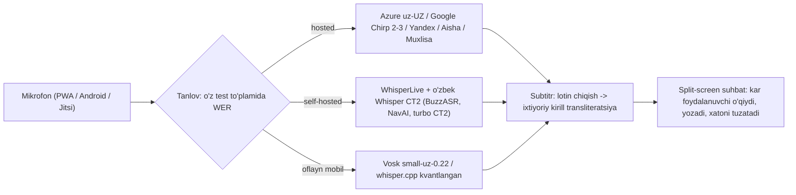

# 04c. O'zbek/rus nutqi, jonli subtitr va big-tech qo'llovi

> **Qisqacha**
> - O'zbek STT bulutda tayyor tovar: Azure `uz-UZ` (real vaqt + batch), Google Chirp / Chirp 2 / Chirp 3 `uz-UZ`, Yandex SpeechKit `uz-UZ` (eng arzon hujjatlangan: ~$0.30-0.32/soat). Rus tili hamma joyda bor.
> - Telefonning tizim subtitrlari o'zbek kar foydalanuvchiga yetmaydi: Apple Live Captions'da ru/uz **yo'q**; Google Live Transcribe'da o'zbek tili tasdiqlanmagan. Subtitrni platformaning o'zi berishi kerak.
> - Ochiq yo'l: fine-tune qilingan Whisper (BuzzASR/uzbek MIT: CV25 WER 11.84, FLEURS 25.64; NavAI medium macro-WER 9.73) yoki CTC model; zero-shot Whisper o'zbekda zaif (~28% CER). Suhbat nutqida WER 16-40% - asosiy xavf.
> - Google'ning yagona rasmiy imo-ishora funksiyasi - Pixel 11 da ASL -> ingliz (SL2T). RSL yoki UzSL yo'q: imo-ishora tanishni o'zimiz qurish yoki hamkorlik.
> - Telegram Mini App'da rasmiy kamera/mikrofon/WebRTC API yo'q - jonli video uchun PWA/Android, Telegram faqat eslatma, bron, kartalar (brif 4-qaror).

Manbalar: `2_raqobat_va_ochiq_kod/uzbek_speech_bigtech_support.md` (birlamchi hujjatlar 2026-11-15 da olingan; snippet bo'lganlari belgilangan), `1_birinchi_tadqiqot/open_source_tech_stack.md` (6-bo'lim), `2_raqobat_va_ochiq_kod/open_source_clonable.md` (5-bo'lim), `2_raqobat_va_ochiq_kod/hands_on_repo_audit.md` (WhisperLive, Jitsi), `1_birinchi_tadqiqot/uzbekistan_landscape.md` (5-bo'lim), `1_birinchi_tadqiqot/browser_youtube_google_findings.md` (Surdo AI, MTS).

---

## 1. Qaror jadvali

Har katak quyidagi bo'limlardagi manbaga bog'langan (xom yozuvdagi sintez jadvali, qo'shimcha ustunlar bilan).

| Imkoniyat | O'zbek uchun eng yaxshi variant | Narx | Oflayn? | Litsenziya | Ishonch |
|---|---|---|---|---|---|
| Jonli nutq -> subtitr (hosted) | Azure `uz-UZ` real vaqt yoki Google Chirp 2/3 `uz-UZ`; eng arzoni Yandex | Yandex ~$0.30-0.32/soat (tasdiqlangan); Azure/Google narxi tasdiqlanmagan | Yo'q | Tijoriy SaaS | Yuqori (qo'llov), past (narx) |
| Mahalliy nutqqa moslashgan o'zbek STT | Aisha (425 so'm/daqiqa) yoki Muxlisa (o'zi e'lon qilgan 11-13% WER) | Aisha ~$2/soat (kurs taxminiy); Muxlisa - **zid** (3-bo'lim) | On-prem faqat enterprise shartnoma | Tijoriy | O'rta |
| Self-hosted / oflayn STT | Fine-tune Whisper (BuzzASR/uzbek MIT; navai-uz/whisper-medium-uzbek Apache-2.0) yoki CTC (GigaAM fine-tune); mobil oflayn zaxira Vosk `small-uz-0.22` | Faqat GPU hosting | Ha (server); mobilga kichikroq model | MIT / Apache-2.0 | O'rta |
| Oqimli server | WhisperLive (MIT) yoki WhisperLiveKit (Apache-2.0) + o'zbek CT2 model; Jitsi'da Jigasi | Hosting | Ha | MIT / Apache-2.0 | O'rta-yuqori |
| Telefon tizim subtitri (iOS) | Yo'q: Apple Live Captions'da ru/uz yo'q | - | - | - | Yuqori |
| Telefon tizim subtitri (Android) | Live Transcribe: o'zbek tasdiqlanmagan, ilovada tekshirish | Bepul | Ba'zi tillar Pixel / Android 12+ da oflayn | Proprietar | Past |
| Uchrashuv subtitri | Google Meet (ru va uz ro'yxatda; beta bo'lishi yoki faqat tarjima ro'yxati bo'lishi mumkin); o'z Jitsi + WhisperLive | Workspace tarifi | Yo'q | Proprietar | O'rta |
| Imo-ishora -> matn (UzSL/RSL) | O'zimiz qurish: Google SL2T faqat ASL -> ingliz, Pixel 11 | Qurish narxi | - | - | Yuqori (yo'qligi aniq) |
| Matn/nutq -> imo-ishora (avatar) | SURDO AI (davlat, 1 000+ so'z) - hamkor; aks holda s2s + Signbank (04b) | Noma'lum | Noma'lum | Noma'lum | Past |
| O'zbek TTS | Aisha TTS 1 so'm/belgi; Muxlisa; ochiq: Qwen3-TTS Uzbek (Apache-2.0), Chatterbox (MIT) | Aisha ~$0.08 / 1 000 belgi (kurs taxminiy) | On-prem faqat enterprise; ochiq modellar - ha | Tijoriy / ochiq | O'rta |
| Jonli videoli kanal | Telegram Mini App: rasmiy kamera/mikrofon API yo'q; WebView `getUserMedia` qurilmada sinov talab qiladi | Bepul | Yo'q | Telegram ToS | Past |
| Qo'ng'iroqni chatga (operator) | MTS "Zvonok v chat" namunasi - operator integratsiyasi (6-bo'lim) | Operator bilan | Yo'q | Proprietar | O'rta |

Brif 5-qaror: provayder **o'z test to'plamida** (klinika, davlat idorasi, suhbat nutqi) tanlanadi - vendor WER da'volari bir-biriga zid (3-bo'lim).

---

## 2. Big-tech iste'molchi qo'llovi

### 2.1. Google

| Mahsulot | Fakt | Manba |
|---|---|---|
| Live Transcribe | Yordam sahifasi tillar ro'yxatini bermaydi - ilovada tekshirish kerak (Settings > Additional settings > Primary/Secondary language). Pixel va ba'zi Android 12+ qurilmalarda tillar oflayn yuklanadi ("multiple languages, like English, French and more"); Android 8-11 da oflayn faqat ingliz | [Google Accessibility Help](https://support.google.com/accessibility/android/answer/9158064?hl=en) |
| Live Transcribe dvigateli (ochiq kod) | `google/live-transcribe-speech-engine` Apache-2.0, **arxiv** (push 2022-07-20); Google Cloud Speech mijozi, oflayn dvigatel emas | [repo](https://github.com/google/live-transcribe-speech-engine) |
| Pixel 11 sign-to-text | Faqat "American Sign Language (ASL)"; blog asosiy modelni "multilingual sign language-to-text (SL2T)" deydi, lekin boshqa imo-ishora tili yoki davlat nomlamaydi | [Google blog](https://blog.google/products-and-platforms/devices/pixel/american-sign-language-sign-to-text-pixel-11/) |
| SL2T e'loni | 2026-08-12, DeepMind; Pixel 11 da Gboard va Live Transcribe ichida | [DeepMind blog](https://deepmind.google/blog/putting-sign-language-ai-into-users-hands/); [SiliconANGLE](https://siliconangle.com/2026/08/12/google-debuts-sl2t-ai-model-thats-designed-understand-sign-language/) (snippet) |
| SL2T o'qitish ma'lumoti (ikkilamchi matbuot) | >100 000 soat, >50 imo-ishora tili, ~chorak qismi ASL; qurilmadan faqat tana landmarklari chiqadi - DeepMind matni bilan **tasdiqlanmagan** | [Notebookcheck](https://www.notebookcheck.net/Google-Pixel-11-turns-American-Sign-Language-into-typed-text.1367397.0.html) (snippet) |
| SignGemma (2025-05 e'lon) | ASL -> ingliz uchun; holati va litsenziyasi tasdiqlanmagan (04a, 1.2) | [Analytics India Mag](https://analyticsindiamag.com/ai-news-updates/google-deepmind-announces-signgemma-ai-for-sign-language) |
| Google Meet | Subtitr tillari ichida rus va o'zbek bor: "Some languages are in beta so translation quality may vary", "gradually rolling out". Olingan ro'yxat tarjima qilingan subtitr bo'limida - nutq tili emas, tarjima nishoni ro'yxati bo'lishi mumkin | [Google Meet Help](https://support.google.com/meet/answer/10964115?hl=en) |

### 2.2. Apple

| Mahsulot | Fakt | Manba |
|---|---|---|
| Live Captions (iOS 26) | Tillar: kanton (Xitoy, Gonkong), ingliz (Avstraliya, Kanada, Hindiston, Singapur, UK, AQSh), fransuz (Kanada, Fransiya), nemis, yapon, koreys, mandarin (Xitoy, Tayvan), ispan (Meksika, Ispaniya, AQSh). **Rus va o'zbek yo'q** | [Apple iOS feature availability](https://www.apple.com/ios/feature-availability/) |
| Live Translation (Messages, Phone/FaceTime, AirPods) | Rus va o'zbek yo'q | o'sha |
| Live Listen | Ovozni kuchaytirish, tilga bog'liq emas - alohida tekshirilmagan | - |

**Xulosa (inferensiya):** O'zbekistondagi iPhone foydalanuvchisi o'z tilida tizim subtitri olmaydi - platforma ilovasi subtitrni o'zi berishi kerak. UzSL/RSL imo-ishora tanish Google'da yo'q - qurish yoki hamkorlik.

---

## 3. Bulut va mahalliy STT/TTS provayderlari

### 3.1. Xalqaro bulutlar

| Provayder | O'zbek qo'llovi | Narx | Manba |
|---|---|---|---|
| Microsoft Azure Speech | `uz-UZ` "Uzbek (Latin, Uzbekistan)": real vaqt va batch, monolingual post-stream refinement | Tasdiqlanmagan; Azure uz-UZ TTS ovozlari va narxi o'qilmagan | [Microsoft Learn](https://learn.microsoft.com/en-us/azure/ai-services/speech-service/language-support?tabs=stt) |
| Google Cloud STT v2 | `uz-UZ`: `chirp` (asia-southeast1, europe-west4), `chirp_2` (asia-southeast1, europe-west4), `chirp_3` (eu); o'qilgan qismda uz-UZ uchun `long`/`short` yo'q. `ru-RU`: chirp, chirp_2, chirp_3, long, short | Olinmagan | [Google Cloud STT](https://docs.cloud.google.com/speech-to-text/v2/docs/speech-to-text-supported-languages) (birinchi 100k belgi; US-region qatorlari o'qilmagan) |
| Yandex SpeechKit | `uz-UZ` "Uzbek (Latin script)"; sahifa tillarni streaming/sync/async rejimlariga bog'lamaydi; o'zbek 2023 da qo'shilgan | QQSsiz: streaming $0.001333 / 15 s (~$0.32/soat), async $0.001245 / 15 s (~$0.30/soat); o'zbekka alohida qator yo'q (snippet) | [Yandex AI Studio](https://aistudio.yandex.ru/docs/en/speechkit/stt/models); [Yandex Cloud blog 2023](https://yandex.cloud/ru/blog/posts/2023/06/speechkit-uzbek-language); [pricing](https://yandex.cloud/en-ru/docs/speechkit/pricing) |
| ElevenLabs Scribe v1 | O'zbek; faqat oldindan mavjud audio ("available upfront"); "A low-latency, real-time version will be released soon". **O'ziga zid**: kirishda "3.1% WER on FLEURS" va "5.5% on Common Voice", o'z jadvalida FLEURS 15.9%; zero-shot Whisper large-v3 ni o'zbekda 96.7% WER deb ko'rsatadi; locale sahifalarida raqamlar farq qiladi - marketing | $0.40 / soat | [ElevenLabs Uzbek STT](https://elevenlabs.io/speech-to-text/uzbek); [ElevenLabs hi](https://elevenlabs.io/hi/speech-to-text/uzbek) |
| OpenAI (gpt-4o-transcribe, whisper-1) | O'zbek sifati tasdiqlanmagan | - | - |

### 3.2. O'zbek mahalliy provayderlar

| Provayder | Fakt | Manba |
|---|---|---|
| Aisha (Toshkent) | Starter (pay-as-you-go): TTS 1 so'm / belgi, STT 425 so'm / daqiqa, oylik to'lov yo'q. Business: maxsus narx + SLA. Enterprise: maxsus narx, "on-premise deployment, custom models". Bepul sinov voicelab.uz/app orqali, kvota ko'rsatilmagan. Narx sahifasida streaming aytilmagan | [Aisha pricing](https://aisha.group/en/pricing) |
| Aisha API | TTS va STT uchun `uz`, `en`, `ru`; o'z LLM evidence xaritasi metodologiyasiz aniqlik raqamini keltirishni taqiqlaydi va hech raqam nashr qilinmagan; STT spiker identifikatsiyasi, bepul daraja | [llms-full.txt](https://aisha.group/llms-full.txt); [API docs](https://aisha.group/en/api-documentation/speech-to-text) (olinmagan); [aisha.group](https://aisha.group/en/uzbek-speech-recognition) |
| Muxlisa (UZINFOCOM, davlat kompaniyasi) | Yangilangan STT (2026-04), o'zi e'lon qilgan: telefoniya call-center audiosida 11.39% WER, ochiq domen YouTube audiosida 13.42%; API (muxlisa.uz) | [UZINFOCOM news 522](https://uzinfocom.uz/en/news/522) (snippet) |
| Muxlisa | ASR, TTS va diarizatsiya; bulut yoki on-prem; dasturchilar uchun ochiq API; o'zbek va qoraqalpoq STT va TTS, jonli va aralash o'zbek-rus nutq | [Anhor.uz](https://anhor.uz/ru/texnologii/speech-tech-technologies-and-products-in-the-uzbek-market) (ikkilamchi); [Spot.uz](https://www.spot.uz/ru/2025/11/12/uzinfocom/) (ikkilamchi); [muxlisa.uz](https://muxlisa.uz/en) |
| Muxlisa narxi - **manbalar zid** | `uzbekistan_landscape.md`: STT 350 so'm, TTS 650 so'm / 1 000 belgi (muxlisa.uz va awesome-uzbek-ai). `uzbek_speech_bigtech_support.md`: ochiq API narxi va hujjati topilmadi | [muxlisa.uz](https://muxlisa.uz/en); [awesome-uzbek-ai](https://github.com/braindiggeruz/awesome-uzbek-ai) |
| UzbekVoice | STT, TTS (Shoira va Jasur ovozlari), Studio subtitr va dublyaj - vendor tasdig'i topilmadi | [awesome-uzbek-ai](https://github.com/braindiggeruz/awesome-uzbek-ai) |

**Xulosalar (inferensiya):**
- Hosted, oflayn bo'lmagan o'zbek subtitri uchun Azure (`uz-UZ` real vaqt) va Google Chirp 2/3 (streaming) integratsiyaga ishonchli; Yandex - eng arzon hujjatlangan (~$0.30-0.32/soat).
- 425 so'm/daqiqa (~$2/soat, 12 000-13 000 so'm/USD **taxminiy** kurs) bilan Aisha soatiga Yandex yoki ElevenLabs'dan ~5-6 baravar qimmat; so'zlashuv o'zbekchasida yaxshiroq bo'lishi mumkin - benchmark kerak.
- Vendor'dan on-prem/oflayn o'zbek STT faqat maxsus enterprise shartnoma bilan (Aisha, Muxlisa). Brif 7-qaror (biometrik ma'lumot O'zbekistonda) bu yerda ham muhim: audio ham shaxsiy ma'lumot - hosting joyi tanlovda hisobga olinsin (baho).
- Mustaqil, provayderlararo o'zbek WER benchmarki (Aisha vs Muxlisa vs Google vs Azure) topilmadi.

---

## 4. Ochiq modellar va oqimli serverlar

### 4.1. O'zbek ASR modellari

| Model | Litsenziya | Natija | Izoh | Manba |
|---|---|---|---|---|
| BuzzASR/uzbek (Whisper-large-v3 fine-tune) | MIT | FLEURS: CER 6.6, WER 25.64; Common Voice 25: CER 2.68, WER 11.84; jami: CER 3.86, WER 16.0. Zero-shot Whisper-large-v3 CER: 28.4 (FLEURS), 28.55 (CV), 28.45 (jami) | Karta Whisper-large-v3, Omnilingual 1B/7B, MMS, Qwen3-ASR va Cohere Transcribe orasida eng past CER deydi, lekin ular uchun raqam bermaydi; maqola arXiv 2609.09554 | [HF BuzzASR/uzbek](https://huggingface.co/BuzzASR/uzbek) |
| navai-uz/whisper-medium-uzbek | Apache-2.0 | FLEURS, Common Voice, USC va FeruzaSpeech bo'yicha macro-WER 9.73 (greedy) | Asos `openai/whisper-medium`; 5 526 yuklanma, o'zgartirilgan 2026-07-19 | [friendli.ai navai-uz](https://friendli.ai/models/navai-uz/whisper-base-uzbek); [HF API](https://huggingface.co/api/models/navai-uz/whisper-medium-uzbek) |
| Abduqayum/whisper-uzbek-medium-callcenter | - | FeruzaSpeech 7.88%, CV17 uz 13.37%, FLEURS uz 14.40% WER | Xuddi shu raqamlar boshqa yozuvda `islomov/rubaistt_v2_medium` ga ham bog'langan - **atributsiya noaniq** | [friendli.ai Abduqayum](https://friendli.ai/models/Abduqayum/whisper-uzbek-medium-callcenter); [HF islomov](https://huggingface.co/islomov/rubaistt_v2_medium/blob/main/README.md) (snippet) |
| BlueRaccoon/whisper-small-uz | - | CV11 23.65, FLEURS 47.15 WER | Eski | [HF](https://huggingface.co/BlueRaccoon/whisper-small-uz) |
| rustam1221/uzbek-asr-gigaam (CTC, Whisper emas; GigaAM - Sber'ning rusga yo'naltirilgan ASR'i) | - | Spontan nutqda 16.1% WER vs whisper-large-v3-turbo-uzbek 39.6% | Boshqa yozuvda: 311 suhbat klipida eng yaxshi ochiq Whisper 39.6%, maxsus model 16.1% - manba aniq emas, **tasdiqlanmagan** | [HF uzbek-asr-gigaam](https://huggingface.co/rustam1221/uzbek-asr-gigaam) (snippet) |
| hostmepanda/whisper-large-v3-turbo-uzbek-ct2 | MIT | - | `qirol4006/Whisper-3-turbo-uzbek` ning CTranslate2 konversiyasi, faster-whisper uchun tayyor; 1 016 yuklanma, 2026-04-08; asos modeli va ma'lumot litsenziyasi tekshirilmagan | [HF](https://huggingface.co/models?pipeline_tag=automatic-speech-recognition&search=uzbek) |
| sarahai/uzbek-stt-3 | Apache-2.0 | - | **wav2vec2** (Whisper emas - WhisperLive'da ishlamaydi); 452 482 yuklanma, 2024-08-13 | [HF API](https://huggingface.co/api/models/navai-uz/whisper-medium-uzbek) |
| Kotib/uzbek_stt_v1; OvozifyLabs/whisper-small-uz-v1 | Apache-2.0 | - | - | [HF qidiruv](https://huggingface.co/models?pipeline_tag=automatic-speech-recognition&search=uzbek) |
| cstr/stt-uz-fastconformer-hybrid-ctc-large-GGUF | CC BY 4.0 | - | - | o'sha |
| Meta Omnilingual ASR (2025-11) | Kod va model Apache-2.0, korpus CC-BY-4.0 | 1 600+ til; 7B LLM-ASR tillarning 78% ida CER<10; kamida 10 soat o'qitish ma'lumotli tillarning 95% i shu darajaga yetadi | O'zbek uchun alohida CER topilmadi | [Meta AI blog](https://ai.meta.com/blog/omnilingual-asr-advancing-automatic-speech-recognition/); [The Decoder](https://the-decoder.com/metas-omnilingual-asr-brings-speech-recognition-to-1600-languages/) |
| Vosk `vosk-model-small-uz-0.22` | Apache-2.0 (vosk-api) | Aniqlik tasdiqlanmagan | Mobil oflayn zaxira | [Vosk models](https://alphacephei.com/vosk/models) |

Umumiy baho (open_source_tech_stack): fine-tune Whisper-medium o'qilgan nutqda (FLEURS, CV) ~10-14% WER, suhbat o'zbekchasi ancha qiyin (~16-40% WER). Raqamlar turli CV versiyalari va normalizatorlardan - qat'iy taqqoslanmaydi. HF litsenziya teglari o'zi e'lon qilingan; ba'zi fine-tune'lar Common Voice ma'lumotidan (CC0) meros oladi - har kartani prod'dan oldin tekshirish ([open_source_clonable.md](https://huggingface.co/models?pipeline_tag=automatic-speech-recognition&search=uzbek)).

### 4.2. O'zbek TTS

| Model | Litsenziya | Izoh | Manba |
|---|---|---|---|
| Meta MMS-TTS Uzbek (kirill, ehtimol lotin ham) | CC-BY-NC 4.0 - **notijoriy** | Tijoriy hamkor bo'lsa ishlatmaslik | [HF mms-tts-uzb-script_cyrillic](https://huggingface.co/facebook/mms-tts-uzb-script_cyrillic/discussions/1/files); [HF mms-tts](https://huggingface.co/facebook/mms-tts) |
| mrmuminov/f5-tts-uzbek | **Zid**: open_source_tech_stack - "litsenziya tekshirilmagan"; open_source_clonable (HF ro'yxati) - CC BY-NC 4.0 | - | [HF](https://huggingface.co/mrmuminov/f5-tts-uzbek) |
| UAzimov/Uzbek-tts-chatterbox | Tekshirilmagan | Chatterbox fine-tune | [HF](https://huggingface.co/UAzimov/Uzbek-tts-chatterbox) |
| Abduqayum/uzbek-tts-natural-speech-chatterbox | MIT | - | [HF TTS](https://huggingface.co/models?pipeline_tag=text-to-speech&search=uzbek) |
| mrmuminov/Qwen3-TTS-12Hz-0.6B-Uzbek | Apache-2.0 | - | o'sha |
| Piper / Coqui / ISSAI TurkicTTS o'zbek ovozlari | Tasdiqlanmagan | - | - |

Tavsiya (xom yozuv inferensiyasi): tijoriy TTS uchun MMS-TTS'dan qochish; to'g'ri litsenziyali korpusda o'qitish (Piper/VITS yoki F5) yoki tijoriy API.

### 4.3. Oqimli serverlar va integratsiya

| Komponent | Fakt | Manba |
|---|---|---|
| whisper.cpp | MIT, 55 204 yulduz, 1 140 hissa qo'shuvchi | [repo](https://github.com/ggml-org/whisper.cpp) |
| faster-whisper | MIT, 26 761 yulduz | [repo](https://github.com/SYSTRAN/faster-whisper) |
| WhisperLive | MIT, 4 359 yulduz, push 2026-11-13; `server.py` 1 283 qator; standart model `small.en`; silero VAD; tarjima `small100` (uz va ru bor); pyannote diarizatsiya; bearer-token auth; Chrome kengaytmasida "Uzbek" opsiyasi. Moslash 2.5-4.5 pw (baho) | [repo](https://github.com/collabora/WhisperLive); 04b 3.8 |
| WhisperLiveKit | Apache-2.0, 11 253 yulduz | [repo](https://github.com/QuentinFuxa/WhisperLiveKit) |
| ufal/whisper_streaming | MIT, push 2025-11-12 | katalog |
| Vosk | Apache-2.0, 15 257 yulduz | [repo](https://github.com/alphacep/vosk-api) |
| kaldi | 15 515 yulduz, push 2025-09-22 (sekinlashgan) | [repo](https://github.com/kaldi-asr/kaldi) |
| Jitsi Jigasi | Whisper (`WhisperTranscriptionService`, `WhisperWebsocket`), Vosk, Google, Oracle transkripsiya servislari; Skynet `streaming_whisper`; `transcriber-langs.json` da o'zbek yo'q, `translation-languages.json` da bor; `customLanguages` orqali qo'shish | [jigasi](https://github.com/jitsi/jigasi/tree/master/src/main/java/org/jitsi/jigasi/transcription); [skynet](https://github.com/jitsi/skynet); 04b 3.6 |

Tavsiya etilgan stack (katalog va audit): WhisperLive yoki WhisperLiveKit + o'zbek CT2 fine-tune (server), rus uchun oddiy Whisper (yuqori resursli til), mobil oflayn uchun whisper.cpp kvantlangan small/medium yoki Vosk small-uz. Fine-tune: USC + Common Voice + soha suhbat ma'lumoti, chunki suhbat WER - real xavf. Joriy etish 2-4 pw + kar foydalanuvchiga tegishli nutqda (klinika, davlat idorasi) WER benchmarki (baho).

---

## 5. SURDO AI (Ijtimoiy himoya milliy agentligi) - nutq va imo-ishora faktlari

| Fakt | Manba |
|---|---|
| Ijtimoiy himoya milliy agentligi huzuridagi Axborot texnologiyalari markazi (davlat) yaratgan, maxsus maktab o'qituvchi va o'quvchilari bilan baza yig'ilgan | [Podrobno.uz](https://podrobno.uz/cat/tehnp/v-uzbekistane-razrabotali-ii-platformu-dlya-perevoda-rechi-i-teksta-na-yazyk-zhestov/) (20.08.2026, "Uzbekistan 24" syujeti) |
| Nutq va matnni imo-ishoraga va teskari real vaqtda; 1 000+ so'z; o'rganish moduli; o'zbek va rus; Chrome plagini | o'sha (snippet) |
| Kamera orqali imo-ishora -> matn/ovoz; matn/ovoz -> **3D avatar**; 1 000+ so'z lug'at + daktil | [Surxon tongi](https://surxontongi.uz/2026/08/03/surdo-ai-milliy-yechim/); founder brauzeri |
| 2026-08-01 e'lon qilingan, bepul; Android `com.ihma.surdoai` va iOS; Google Play'da **1 ming+** yuklanma, oxirgi yangilanish 2026-08-04; agentlik Telegram posti 21,5K ko'rish | [Google Play](https://play.google.com/store/apps/details?id=com.ihma.surdoai); [Telegram](https://t.me/s/ijtimoiyhimoya_agentligi/9540) |
| **Manbalar zid**: `uzbek_speech_bigtech_support.md` qidiruvda do'kon sahifasi, reyting, sharh yoki avatar/tanish texnik tavsifini topmagan; Chrome Web Store'da "Surdo AI" nomli kengaytma topilmagan. `browser_youtube_google_findings.md` esa founder brauzeri orqali Google Play sahifasini (1k+) ko'rgan | ikkala yozuv |
| O'xshash kengaytma "Openhearted Sign Language": tab audiosidan ASL yoki RSL ga real vaqt tarjima da'vosi, kirish kaliti kerak | [chromeboard](https://chromeboard.com/extension/openhearted-sign-language-efhokemfgkpieibngkgbiepgmphlfoei) (snippet) |
| Surdo AI amalda sinalmagan; sharh/reyting topilmadi; qamrov kichik (3 oyda 1k+) | founder brauzeri |

**Xulosa (inferensiya):** 1 000 so'zli lug'at - glossing yoki lug'atdan qidirish, to'liq imo-ishora tarjimasi emas; "teskari" yo'nalish (imo-ishora -> matn) sifati noma'lum. Brif 1-qaror: raqobat emas, hamkorlik - masalan, bizning subtitr/VRI xizmatimiz Surdo AI'ni to'ldiradi (baho).

---

## 6. Telegram Mini App cheklovlari va "qo'ng'iroqni chatga" modeli

### 6.1. Telegram Mini App

| Fakt | Manba |
|---|---|
| Hujjatda: `requestFullscreen` (Bot API 8.0+), `LocationManager`, `BiometricManager`, `DeviceStorage` / `SecureStorage` / `CloudStorage`, `Accelerometer` / `Gyroscope` / `DeviceOrientation`, `showScanQrPopup`, `downloadFile`, `shareToStory`. O'qilgan qismda (115k dan 100k belgi) **kamera, mikrofon, getUserMedia yoki WebRTC API/ruxsati yo'q** | [Telegram Mini Apps docs](https://core.telegram.org/bots/webapps) |
| Android'da Telegram ichki brauzerida file input orqali kamera ishga tushmasligi haqida bug | [bugs.telegram.org/c/44936](https://bugs.telegram.org/c/44936) (snippet) |
| Forum anekdoti: `getUserMedia` ko'p qurilmada ishlaydi, lekin mobil ruxsatlar "weird" (past ishonch) | [Latenode community](https://community.latenode.com/t/how-to-enable-camera-access-through-telegram-web-applications-for-live-streaming/23550) |

**Xulosa:** Telegram - tarqatish, bildirishnoma, lug'at va asinxron video xabar uchun. Jonli video relay va jonli subtitr uchun zaxira: tashqi brauzer, PWA yoki native ilova. Real qurilma sinovi (iOS Telegram, Android Telegram, Desktop) shart.

### 6.2. MTS "Perevod zvonka v chat" / "Sekretar dlya glukhikh i slaboslyshashchikh" + "Zvonok v chat"

| Fakt | Manba |
|---|---|
| AI qo'ng'iroq qiluvchiga abonent eshitishi past ekanini aytadi; abonent "Moi MTS" da push oladi va chat ochiladi; qo'ng'iroq qiluvchi nutqi real vaqtda matnga, abonentning yozgan javobi TTS bilan ovozlanadi | [iphones.ru](https://www.iphones.ru/iNotes/teper-pozvonit-smogut-dazhe-gluhie-mts-zapustil-zapustil-sekretarya-dlya-gluhih-i-slaboslyshashchih) |
| Barcha MTS abonentlariga bepul, barcha mintaqalarda; texnologiya - tarmoq ichidagi proprietar MTS VoiceTech | o'sha |
| 6 oyda ~496 ming qo'ng'iroq; T-Bank analogi 2024-11, MTS 2026-03 | [mobile-review](https://mobile-review.com/all/?p=259570) |
| Sasha Sulim videosi (2026-04, 200K) homiysi MTS - kar abonent kiruvchi qo'ng'iroqqa raqamli ovoz orqali chatda javob beradi | [YouTube qPwahzCB6_8](https://www.youtube.com/watch?v=qPwahzCB6_8) |

**Xulosa (inferensiya):** O'zbekistonda eng tez yutuq, lekin operator integratsiyasi (Uzmobile, Beeline UZ, Ucell, Mobiuz) yoki SIP / virtual raqam yondashuvi kerak. Brif 3-qaror: keyingi bosqich.

---

## 7. O'zbek nutq ekotizimi

| Fakt | Manba |
|---|---|
| "Voice AI Challenge Uzbekistan" hakatoni (2021-12): AKT vazirligi (MITC), IT Park va UNDP; uzbekvoice.ai korpus harakatini boshlagan | [IT Park](https://www.it-park.uz/en/itpark/news/in-uzbekistan-mitc-it-park-and-undp-organize-hackathon-called-voice-ai-challenge-uzbekistan); [UNDP](https://www.undp.org/uzbekistan/stories/young-people-develop-ai-solutions-uzbek-language); [corpus.uzbekvoice.ai](https://corpus.uzbekvoice.ai/en-US/yangilik/1) |
| Ikkinchi milliy AI hakatoni Samarqandda | [outsource.gov.uz](https://www.outsource.gov.uz/en/media/the-second-national-ai-hackathon-will-take-place-in-samarkand) |
| Tilmoch AI - o'zbek tarjima startapi | [startupbase.uz](https://startupbase.uz/en/news/tilmoch-ai-an-uzbek-startup-changing-the-future-of) |
| Inferensiya: o'zbek, rus va aralash nutq subtitri bugun Aisha yoki Muxlisa API'larida quriladi | [uzbekistan_landscape](https://github.com/braindiggeruz/awesome-uzbek-ai) |
| ~300+ tug'ma kar tug'ilish yiliga va koxlear implant dasturi - implantli bolalar imo-ishora emas, subtitr va nutq yordamiga muhtoj bo'ladi (inferensiya) | `uzbekistan_landscape.md` 1-bo'lim |

Datasetlar (USC, FeruzaSpeech, Common Voice, FLEURS, HF datasetlari) - `04d_Datasetlar_va_modellar.md`.

---

## 8. Manbalar

Xom yozuvlar:
- `99_Ilovalar/xom_tadqiqot_yozuvlari/2_raqobat_va_ochiq_kod/uzbek_speech_bigtech_support.md`
- `99_Ilovalar/xom_tadqiqot_yozuvlari/1_birinchi_tadqiqot/open_source_tech_stack.md` (6-bo'lim)
- `99_Ilovalar/xom_tadqiqot_yozuvlari/2_raqobat_va_ochiq_kod/open_source_clonable.md` (5-bo'lim)
- `99_Ilovalar/xom_tadqiqot_yozuvlari/2_raqobat_va_ochiq_kod/hands_on_repo_audit.md` (WhisperLive, Jitsi)
- `99_Ilovalar/xom_tadqiqot_yozuvlari/1_birinchi_tadqiqot/uzbekistan_landscape.md` (5-bo'lim)
- `99_Ilovalar/xom_tadqiqot_yozuvlari/1_birinchi_tadqiqot/browser_youtube_google_findings.md` (1-bo'lim, MTS)
- `99_Ilovalar/xom_tadqiqot_yozuvlari/2_raqobat_va_ochiq_kod/russia_cis_competitors.md` (MTS)

Asosiy birlamchi hujjatlar: [Google Live Transcribe Help](https://support.google.com/accessibility/android/answer/9158064?hl=en), [Google Pixel 11 blog](https://blog.google/products-and-platforms/devices/pixel/american-sign-language-sign-to-text-pixel-11/), [DeepMind SL2T](https://deepmind.google/blog/putting-sign-language-ai-into-users-hands/), [Google Meet Help](https://support.google.com/meet/answer/10964115?hl=en), [Apple feature availability](https://www.apple.com/ios/feature-availability/), [Microsoft Learn](https://learn.microsoft.com/en-us/azure/ai-services/speech-service/language-support?tabs=stt), [Google Cloud STT](https://docs.cloud.google.com/speech-to-text/v2/docs/speech-to-text-supported-languages), [Yandex SpeechKit](https://aistudio.yandex.ru/docs/en/speechkit/stt/models), [ElevenLabs](https://elevenlabs.io/speech-to-text/uzbek), [Aisha pricing](https://aisha.group/en/pricing), [HF BuzzASR/uzbek](https://huggingface.co/BuzzASR/uzbek), [Telegram Mini Apps](https://core.telegram.org/bots/webapps). Qolgan havolalar jadvallarda.

---

## 9. Tasdiqlanmagan / bo'shliqlar

| Mavzu | Holat |
|---|---|
| Live Transcribe va Live Caption (Android/Chrome) tillar ro'yxati | Birlamchi sahifa yo'q - qurilmada sinash |
| Google Translate suhbat rejimida o'zbek ovozi | Tasdiqlanmagan |
| Meet'ning nutq tili ro'yxatida (tarjima emas) o'zbek bormi | Tasdiqlanmagan |
| Apple Translate ilovasida o'zbek | Sahifa qismi kesilgan, tasdiqlanmagan |
| Azure STT soatlik narxi, `uz-UZ` TTS ovozlari; Teams jonli o'zbek subtitri | Tasdiqlanmagan |
| Google Chirp daqiqa narxi | Olinmagan |
| OpenAI transkripsiya modellarining o'zbek sifati | Tasdiqlanmagan |
| Muxlisa narxi va API hujjati | **Zid**: 350 / 650 so'm (landscape) vs "topilmadi" (speech) |
| Aisha streaming/WebSocket; UzbekVoice | Tasdiqlanmagan |
| Mustaqil provayderlararo o'zbek WER benchmarki | Topilmadi - o'z test to'plamini qurish kerak |
| Common Voice o'zbek soatlari va litsenziyasi (CC0 odatiy), FLEURS (CC BY 4.0) | Tasdiqlanmagan |
| Omnilingual ASR o'zbek CER/WER | Maqola jadvallari kerak |
| Vosk o'zbek aniqligi; Piper/Coqui/ISSAI TurkicTTS o'zbek ovozlari va litsenziyasi | Tasdiqlanmagan |
| Google USM/Chirp o'zbek WER; whisper-large-v3-turbo o'zbek raqamlari | Tasdiqlanmagan |
| 39.6% vs 16.1% suhbat WER manbasi | Aniq emas |
| `islomov/rubaistt_v2_medium` vs `Abduqayum/...callcenter` raqam atributsiyasi | Noaniq |
| `qirol4006` asos modeli va o'qitish ma'lumoti litsenziyasi | Tekshirilmagan |
| f5-tts-uzbek litsenziyasi | Zid (tekshirilmagan vs CC BY-NC 4.0) |
| SURDO AI do'kon sahifasi, reyting, sharhlar, avatar texnologiyasi | Zid / topilmadi - do'konlarda to'g'ridan qidirish |
| SL2T o'qitish ma'lumoti (>100k soat, >50 til) | Faqat ikkilamchi matbuot |
| Telegram Mini Apps hujjatining oxirgi 15k belgisi; real qurilma sinovi | O'qilmagan / qilinmagan |
| Jigasi Whisper protokoli WhisperLive bilan mosmi | Tekshirilmagan |
| Narxlarni so'mdan dollarga o'tkazish kursi (12 000-13 000) | Taxminiy |
