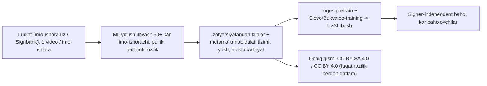

# 04d. Datasetlar va modellar: imo-ishora va o'zbek nutqi

> **Qisqacha**
> - Deyarli barcha yirik imo-ishora datasetlari **faqat tadqiqot yoki notijorat**: WLASL (C-UDA), ASL Citizen (Microsoft notijorat), How2Sign (CC BY-NC), AUTSL, CSL-Daily, Logos (akademik), CASL-W60. YouTube-SL-25 faqat video ID'larni litsenziyalaydi.
> - UzSL uchun eng foydali va eng ochiq manba - Sber/ai-forever'ning RSL aktivlari: **Slovo** va **Bukva** (o'zgartirilgan CC BY-SA 4.0, yuklab olinadi), **Logos** og'irliklari (to'g'ridan yuklanadi; ma'lumot - akademik). UzSL RSL asosida, lekin Moskva dialekti xavfi bor.
> - **Ochiq, litsenziyali UzSL dataseti yo'q.** Mavjudi: daktil alifbo (YOLO), 50-500 imo-ishorali prototiplar, imo-ishora.uz lug'ati (2000+ so'z) - signer-independent baho yo'q.
> - O'zbek nutqi uchun ochiq korpus bor: USC (105 soat, CC BY 4.0, tijoriy ishlatish mumkin), FeruzaSpeech (60 soat), Common Voice, FLEURS. Modellar - `04c`.
> - Platformaning o'z, qatlamli rozilikli UzSL dataseti (brif 6-qaror) - til uchun birinchi bo'ladi va asosiy hamkorlik aktivi.

Manbalar: `1_birinchi_tadqiqot/open_source_tech_stack.md` (3, 5, 6-bo'limlar), `1_birinchi_tadqiqot/russia_cis_ecosystem.md`, `1_birinchi_tadqiqot/uzbekistan_landscape.md` (5-bo'lim), `2_raqobat_va_ochiq_kod/academic_research_synthesis.md`, `2_raqobat_va_ochiq_kod/region_*.md`, `2_raqobat_va_ochiq_kod/nonprofit_models_funding.md`, `2_raqobat_va_ochiq_kod/uzsl_linguistics_education_community.md`, `2_raqobat_va_ochiq_kod/open_source_clonable.md`, `2_raqobat_va_ochiq_kod/hands_on_repo_audit.md`, `2_raqobat_va_ochiq_kod/uzbek_speech_bigtech_support.md`.

"UzSL'ga aloqadorlik" ustuni - **baho** (manbadagi inferensiyalar asosida): Yuqori = RSL oilasi yoki to'g'ridan qayta ishlatiladigan; O'rta = metod/pretrain uchun; Past = faqat benchmark yoki namuna.

---

## 1. Imo-ishora datasetlari

### 1.1. Rus imo-ishora tili (RSL) va MDH

| Dataset | Hajm | Litsenziya | Tijoriy ishlatish | UzSL'ga aloqadorlik | Manba |
|---|---|---|---|---|---|
| **Slovo** (SberDevices, 2023) | 20 400 RGB video, 1 000 klass, har klassga 20 namuna, 194 imo-ishorachi; signer bo'yicha split 15 300 / 5 100; ~9.2 soat. Yuklamalar: kesilgan ~16 GB, original ~105 GB, 360p ~13 GB, MediaPipe landmarklari ~1.2 GB | "A variant of" CC BY-SA 4.0; maxsus shartlar `license/en_us.pdf` da; maqola (arXiv 2305.14527) CC BY-SA 4.0, "data and pre-trained models are publicly available" | Repo sahifasi aytmaydi - PDF o'qilmagan; ShareAlike hosila datasetlarni shu litsenziyaga majbur qilishi mumkin | **Yuqori**: 1 000 imo-ishora UzSL kundalik lug'ati bilan ko'p kesishishi mumkin (kar maslahatchilar bilan tekshirish kerak) | [hukenovs/slovo](https://github.com/hukenovs/slovo); [ai-forever/slovo](https://github.com/ai-forever/slovo); [arXiv 2305.14527](https://arxiv.org/abs/2305.14527); [GitVerse mirror](https://gitverse.ru/ai-forever/slovo) |
| **Bukva** (SberDevices, 2024; RSL daktil alifbosi) | 3 757 RGB video, har harfga 101+ namuna (dinamik harflar bilan), ~4 soat, ~27 GB; user_id bo'yicha 3 097 / 660; maqola: 155 RSL imo-ishorachi | Xuddi shu "variant CC BY-SA 4.0" (license/en_us.pdf); boshqa indeks CC BY-SA 4.0 deydi (rasmiy repoda tasdiqlanmagan); SberCloud OBS'dan to'g'ridan yuklash | Noaniq (PDF o'qilmagan) | **Yuqori**: o'zbek kar daktili kirillga asoslangan (taxmin - tekshirish kerak; lotin daktil ham bor, 3-bo'lim) | [ai-forever/bukva](https://github.com/ai-forever/bukva); [arXiv 2410.08675](https://arxiv.org/html/2410.08675v1); [indeks](https://fugumt.com/fugumt/paper_check/2410.08675v1_enmode) |
| **Logos** (SaluteDevices, 2025) | 199 668 video, 221.4 soat (104.7 soat imo-ishora), kamida 720p, 30 fps; 2 863 gloss -> 2 004 VSSign (vizual o'xshash) klass; 381 imo-ishorachi. Eng katta RSL va imo-ishorachilar soni bo'yicha eng keng ISLR | Repo Apache-2.0, lekin dataset "universities and research institutes for academic research purposes only"; so'rov: vision_rnd_ml@sberbank.ru | Yo'q (dataset); og'irliklar litsenziyasi alohida aytilmagan - noaniq | **Yuqori** (pretrain uchun) | [ai-forever/logos](https://github.com/ai-forever/logos); [arXiv 2505.10481](https://arxiv.org/html/2505.10481v2) |
| TheRuSLan (SPIIRAS / SPC RAS; Karpov, Kagirov, Ivanko, Ryumin, Axyonov; LREC 2020) | Faqat "supermarketdagi oziq-ovqat" domeni; Kinect 2.0 (Full HD + depth); RSL uchun birinchi bunday baza. 2022: 91.14% aniqlik; 2023 ISPRS: AUTSL bilan transfer | Ochiq yuklash/litsenziya topilmadi | Noma'lum | O'rta (tor domen) | [LREC 2020](https://aclanthology.org/2020.lrec-1.746); [sotaverified](https://sotaverified.org/papers/theruslan-database-of-russian-sign-language); [ISPRS 2023](https://isprs-archives.copernicus.org/articles/XLVIII-2-W3-2023/209/2023/isprs-archives-XLVIII-2-W3-2023-209-2023.pdf) |
| **FluentSigners-50** (K-RSL; Nazarbayev University; PLOS ONE 2022) | 50 imo-ishorachidan 173 gap -> 43 250 video; signer-independent CSLR/CSLT benchmark; baseline Stochastic CSLR, TSPNet | Maqola CC BY; Zenodo yozuvi (v1, 2022-02-11) "Dataset Restricted" | Noma'lum (cheklangan) | **Yuqori**: rus asosidagi IT, Markaziy Osiyo imo-ishorachilari; NU bilan hamkorlik kerak | [PMC9467305](https://www.ncbi.nlm.nih.gov/pmc/articles/PMC9467305/); [PLOS PDF](https://bora.uib.no/bora-xmlui/bitstream/11250/3037546/1/journal.pone.0273649.pdf); [Zenodo 6043739](https://zenodo.org/record/6043739); [Zenodo 6043738](https://zenodo.org/record/6043738) |
| **K-RSL korpusi** (CoNLL 2020) | 10 imo-ishorachi, 28 250 uzluksiz gap/video, 600 imo-ishora (~47 takror/imo-ishora); noqo'l markerlarga e'tibor. Grant: NU Faculty Development 110119FD4545, 2019-2021 (36 oy); yig'ish 2015 dan | Tasdiqlanmagan | Noma'lum | **Yuqori** | [CoNLL 2020.conll-1.51](https://preview.aclanthology.org/moar-dois/2020.conll-1.51.pdf); [krsl20](https://krslproject.github.io/krsl20); [SignLang 2022](https://aclweb.org/anthology/2022.signlang-1.24.pdf) |
| K-RSL "online school" korpusi | Pandemiya TV darslaridan: 7 tarjimon, ~890 soat tozalangan video | Tasdiqlanmagan | Noma'lum | Yuqori (uzluksiz) | [K-RSL online school](https://krslproject.github.io/online-school); [SignLang 2024](https://aclanthology.org/2024.signlang-1.12.pdf) |
| signflow.ru (Sber + ta'lim hamkori) | ~400 RSL imo-ishorali video lug'at (o'rganish resursi) | - | - | O'rta | [Habr Sber](https://habr.com/ru/companies/sberbank/news/846240) |
| UkrSL-Annot (UNLP 2026) | Annotatsiyalangan uzluksiz ukrain IT, 1 456 klip, kengaytirilmoqda | - | - | Past (ukrain IT siyosiy va lingvistik uzoqlashmoqda) | [ACL 2026.unlp-1.6](https://aclanthology.org/2026.unlp-1.6.pdf) |

### 1.2. Global imo-ishora datasetlari

| Dataset | Hajm | Litsenziya | Tijoriy | UzSL'ga aloqadorlik | Manba |
|---|---|---|---|---|---|
| WLASL | ASL izolyatsiyalangan; top-100/300/1000/2000 gloss to'plamlari | **C-UDA 1.0, "No commercial usage is allowed."** Bitta katalog noto'g'ri CC BY 4.0 deydi - repoga ishoning | Yo'q | Past (benchmark) | [WLASL GitHub](https://github.com/dxli94/WLASL); [katalog (zid)](https://rudra496.github.io/SignLanguage-Dataset-Hub/DATASETS.html) |
| ASL Citizen (Microsoft) | 83 399 video, 2 731 imo-ishora, 52 imo-ishorachi; birinchi crowdsourced ISLR; IRB va rozilik bilan uyda yozilgan | Microsoft Research litsenziyasi: faqat notijorat, daromadsiz tadqiqot; tadqiqotdan keyin shaxsiy ma'lumotni yo'q qilish. Hissa qo'shuvchi formasi Microsoft'ga keng, abadiy, qaytarilmas litsenziya beradi va **e'lon qilingan ma'lumot o'chirilmaydi** deydi | Yo'q (ASL_Citizen@microsoft.com orqali alohida) | O'rta (yig'ish metodi namunasi); bias tadqiqoti alohida | [arXiv 2304.05934](https://arxiv.org/abs/2304.05934v2); [license](https://www.microsoft.com/en-us/research/project/asl-citizen/dataset-license/); [consent form](https://www.microsoft.com/en-us/research/project/asl-citizen/consent-form/); [arXiv 2410.05206](https://arxiv.org/pdf/2410.05206) |
| How2Sign | Uzluksiz ASL, multimodal | CC BY-NC 4.0 (ikkilamchi katalog) | Yo'q | Past | [CVPR 2021](https://openaccess.thecvf.com/content/CVPR2021/papers/Duarte_How2Sign_A_Large-Scale_Multimodal_Dataset_for_Continuous_American_Sign_Language_CVPR_2021_paper.pdf); [katalog](https://rudra496.github.io/SignLanguage-Dataset-Hub/DATASETS.html) |
| RWTH-PHOENIX-2014 / 2014T | Nemis IT, ob-havo prognozi | Ro'yxatdan o'tib tadqiqot (katalog); 2014T shartlari tasdiqlanmagan | Yo'q | Past (benchmark) | [TIB](https://service.tib.eu/ldmservice/dataset/phoenix-2014t) |
| **YouTube-SL-25** (Google, ICLR 2025) | 3 207 soat (~3 200), 25+ til (har biri kamida 15 soat), 3 000+ imo-ishorachi | **CC BY 4.0 faqat video ID va til kodlariga**; har YouTube videosi o'z shartida | Video uchun yo'q | O'rta (ko'p tilli pretrain metodi); RSL qismi tasdiqlanmagan | [arXiv 2407.11144](https://arxiv.org/abs/2407.11144v1); [ICLR 2025](https://iclr.cc/virtual/2025/poster/28414) |
| PopSign ASL v1.0 (Georgia Tech / NeurIPS 2023) | NeurIPS: 250 imo-ishorada 210 000+ klip, 47 kar ona-tilli; Georgia Tech sahifasi: 200 686 video, 1.1 TB, 2022-10 - 2023-03 (**sonlar biroz farq qiladi**); Pixel 4A; LSTM 84.2% | CC BY 4.0 | Ha (atributsiya bilan) | O'rta (telefon yig'ish metodi: ~700 namuna/imo-ishora) | [NeurIPS 2023](https://proceedings.neurips.cc/paper_files/paper/2023/hash/00dada608b8db212ea7d9d92b24c68de-Abstract.html); [signdata.cc.gatech.edu](https://signdata.cc.gatech.edu/view/datasets/popsign_v1_0/) |
| Kaggle ISLR (Google, 2023) | MediaPipe landmarklari, izolyatsiyalangan ASL | Musobaqa shartlari (tekshirilmagan) | - | O'rta (landmark pipeline namunasi) | [TensorFlow blog](https://blog.tensorflow.org/2023/02/a-new-kaggle-competition-to-help-parents-of-deaf-children-learn-sign-language.html?hl=ru) |
| FSboard | Daktil; baseline 11.1% CER (ko'rilmagan ibora va imo-ishorachi) | Tasdiqlanmagan | - | O'rta (daktil metodi) | [arXiv 2407.15806](https://arxiv.org/pdf/2407.15806v1) |
| DGS Corpus (Gamburg) | 90.9 soat annotatsiya; 50 soat video + annotatsiya + tarjima ochiq (iLex, ELAN, SRT) | Tasdiqlanmagan | - | Past (annotatsiya standarti namunasi) | [DGS compendium](https://www.sign-lang.uni-hamburg.de/lr/compendium/corpus/dgscorpus.html) |
| **AUTSL** (Ankara Univ., turk IT) | 226 imo-ishora, 43 imo-ishorachi, 38 336 izolyatsiyalangan video; Kinect v2 RGB + depth + skelet; signer-independent baseline 62.02% | Akademik/tadqiqot, tijoriy yo'q | Yo'q | Past-o'rta (turkiy og'zaki qarindoshlik imo-ishoraga o'tmaydi - inferensiya) | [arXiv 2008.00932](https://arxiv.org/abs/2008.00932v2); [Hamburg katalog](https://www.sign-lang.uni-hamburg.de/lrec/data/autsl.html) |
| BosphorusSign22k (turk IT) | 745 imo-ishora (AUTSL bilan 57 umumiy) | Tasdiqlanmagan | - | Past | [arXiv 2403.14534](https://arxiv.org/html/2403.14534v2) |
| INCLUDE (AI4Bharat / IIT Madras) | 4 287 video, 0.27M kadr, 15 kategoriyada 263 so'z imo-ishorasi; INCLUDE-50 qism; imo-ishorachilar - St. Louis School for the Deaf (Chennai) kar o'quvchilari | **Aniq litsenziya yo'q**; karta: "for education and ISLR, but may be used for other purposes" | Noaniq - AI4Bharat bilan bog'lanish | Past | [Zenodo 4010759](https://zenodo.org/records/4010759); [HF](https://huggingface.co/datasets/ai4bharat/INCLUDE); [GitHub](https://github.com/AI4Bharat/INCLUDE) |
| J-Shuwa (ACL Findings 2026) | 197K parallel JSL-yapon gap juftligi, ~300 soat, vebdan yig'ilgan; "largest publicly available JSL dataset" | Tekshirilmagan (veb video ko'pincha qayta tarqatishni cheklaydi) | Noma'lum | Past (veb-korpus metodi namunasi) | [ACL 2026.findings-acl.1821](https://aclanthology.org/2026.findings-acl.1821/) |
| CSL-Daily (USTC, CVPR 2021) | Kundalik hayot Xitoy IT | Universitet/institutlarga imzolangan kelishuv bilan faqat tadqiqot | Yo'q | Past | [USTC](https://ustc-slr.github.io/datasets/2021_csl_daily); [arXiv 2105.12397](https://arxiv.org/abs/2105.12397v1) |
| CSL-News (Uni-Sign, 2025) | 1 985 soat CSL video + matn annotatsiyasi | Tasdiqlanmagan | - | Past (TV/veb yig'ish metodi) | [arXiv 2501.15187](https://arxiv.org/pdf/2501.15187v2) |
| AI Hub KSL (Koreya) | Katta, ko'p imo-ishorachi, ko'p burchak; tarjimada BLEU-4 34.68 (bitta maqola); norasmiy "56GB, millions of samples" | Rasmiy hajm va litsenziya tasdiqlanmagan; fon bilim: Koreya rezidentlari uchun, chet elga cheklov | Noaniq | Past | [Korea Univ.](https://aml.korea.ac.kr/research/sign-language-translation); [Sookmyung](https://software.sookmyung.ac.kr/bbs/software/722/100761/download.do) |
| NVIDIA Signs (2025-02, ASDC bilan) | Maqsad: 100 -> 1 000 tasdiqlangan imo-ishora, 400 000 klip crowdsourcing; ochiq e'lon qilish va'dasi | 2026-11 holatiga chiqqani tasdiqlanmagan; so'rov formasi | Noma'lum | O'rta (crowdsourcing metodi) | [NVIDIA blog](https://blogs.nvidia.com/blog/ai-sign-language); [Thurrott](https://www.thurrott.com/a-i/317519/nvidia-announces-ai-to-help-teach-asl) |
| ASL-LEX (BU, SDSU, Tufts) | Leksik baza: chastota, ikoniklik reytinglari, fonologik xossalar; 2.0 olti yil; 3.0 ustida ish (NSF); kod GitHub'da ochiq; PNAS 2025 (122(16)) | Kod ochiq; ma'lumot litsenziyasi tasdiqlanmagan | - | O'rta (UzSL leksik baza namunasi) | [BU](https://deafcenter.bu.edu/asl-lex); [SDSU](https://llcn.sdsu.edu/research-areas/asl-lex/); [Tufts](https://now.tufts.edu/articles/visual-dictionary-sign-language) |
| SignAvatars (ECCV 2024) | 3D sign motion dataset va benchmark | **Litsenziya fayli yo'q** | Ishlatib bo'lmaydi | Past | [repo](https://github.com/ZhengdiYu/SignAvatars) |
| SignON NGT lug'ati | 2 206 NGT SiGML/BML fayl | SignON HF modellari litsenziyasiz; SiGML lug'at litsenziyasi noma'lum | Noma'lum | Past | [wp5-synthesis](https://github.com/signon-project/wp5-synthesis) |
| Content4All (H2020, 762021, 2017-09 - 2020-08) | 200 soat efir kontenti, 20 soat annotatsiya | Tasdiqlanmagan | - | Past | [CORDIS](https://cordis.europa.eu/project/id/762021) |
| EASIER (H2020, 101016982) | Yevropa IT'larini Open Multilingual Wordnet'ga qo'shgan; 7 til jamoasidan 152 kar va eshituvchi baholovchi; ma'lumot best practices | Dataset litsenziyalari tasdiqlanmagan | - | Past | [CORDIS](https://cordis.europa.eu/project/id/101016982/reporting); [UZH](https://cl.uzh.ch/en/research-groups/accessibility/research-projects/past-research-projects/easier.html) |
| CASL-W60 (Data in Brief, 2025-08) | Markaziy Afrika IT, 60 so'z, 19 imo-ishorachi, 5 889 video | Faqat akademik, tijoriy yo'q | Yo'q | Past | [Zenodo 14734421](https://zenodo.org/record/14734421) |
| AfriSign (2025-01) | 6 Afrika IT'da Bibliya oyatlari, bitta ko'p tilli model | - | - | Past | [DOAJ](https://doaj.org/article/1227439974314eb0a8cb835035127254) |
| SignTalk-Gh (Scientific Reports) | Gana IT sog'liqni saqlash (shifokor-bemor) multimodal dataseti | Noma'lum | - | O'rta (shifoxona domeni namunasi) | [Maratto](https://www.maratto.africa/research/a-large-scale-multimodal-dataset-for-healthcare-domain-38871736aa) |
| Maswao (SASL) | TV yangiliklaridan avtomatik zaif tekislangan korpus; BLEU-4 1.54 | - | - | Past | [AI Weekly](https://aiweekly.co/alerts/maswao-auto-builds-south-african-sign-language-corpus-from-news) |
| PSL SignBank (akademik) | 300 so'zli multimodal lug'at | - | - | Past | [CORE](https://core.ac.uk/outputs/739512648) |
| Spreadthesign (European Sign Language Centre) | **Zid**: ilova sahifasi 600 000+ video; ilovada ~23 IT yoki 2024 post: 36 til, 700K tarjima; sayt: 400 000+ hujjatlangan imo-ishora. Rossiyada bloklangan | Ochiq litsenziya topilmadi | - | O'rta (RSL/UzSL bormi - tekshirilmagan) | [about](https://spreadthesign.com/en.us/about/); [search](https://spreadthesign.com/en.au/search/?cls=1) |
| Lingua Libre / SignIt (Wikimedia) | Audio va imo-ishora video; SignIt LSF: 660 so'z (2022) | Kontent CC BY-SA 4.0 (Wikimedia Commons); SignIt kodi MIT | Ha (ShareAlike) | O'rta (ochiq litsenziya precedenti) | [Lingua Libre](https://lingualibre.org); [SignIt](https://meta.wikimedia.org/wiki/SignIt) |
| MS-ASL, OpenASL, BOBSL (BBC) | - | **Tasdiqlanmagan** (BOBSL tadqiqot uchun ekani ma'lum deyiladi, tasdiqlanmagan) | - | Past | `open_source_tech_stack.md` bo'shliqlar |

---

## 2. Imo-ishora modellari va checkpointlar

| Model | Hajm / natija | Litsenziya | Tijoriy | UzSL'ga aloqadorlik | Manba |
|---|---|---|---|---|---|
| Slovo modellari (ONNX, TorchScript) | MViTv2-small 64.09 (32 kadr), Swin-large 55.66, ResNet-i3d 43.91 | Slovo litsenziyasi ostida | Noaniq | Yuqori | [hukenovs/slovo](https://github.com/hukenovs/slovo) |
| SignFlow-A / SignFlow-R | A: WLASL-2000 top-1 63.3, 36M param; R: ~50k namuna, 267 klass, 37M param, "tested with GigaChat" | o'sha | Noaniq | Yuqori | o'sha |
| Bukva MobileNetV2_TSM | 9.1 MB, metrika 83.6, ONNX | Bukva litsenziyasi | Noaniq | Yuqori (daktil) | [ai-forever/bukva](https://github.com/ai-forever/bukva) |
| Logos og'irliklari `logos_autsl_wlasl_model.pth`, `logos_stage1_model.pth` | Top-1: Logos 0.9792, AUTSL 0.9781, WLASL 0.6682; Sber ma'ruzasi: o'z datasetida 98%, ASL'da 66.8% | Repo Apache-2.0; og'irliklar alohida aytilmagan | Noaniq | **Yuqori**: tillararo pretrain sifatida taqdim etilgan | [ai-forever/logos](https://github.com/ai-forever/logos); [YouTube Z6jNuB4CBVY](https://www.youtube.com/watch?v=Z6jNuB4CBVY) |
| OpenHands (AI4Bharat) | 6 til uchun pose ISLR checkpointlari | Apache-2.0 | Ha | O'rta | [GitHub](https://github.com/AI4Bharat/OpenHands); [ACL 2022](https://aclweb.org/anthology/2022.acl-long.150.pdf) |
| Uni-Sign | CSL-Daily BLEU-4 ~26.36; How2Sign 14.5 / 14.9; How2Sign va OpenASL pose-only checkpointlari 2025-12 | Tasdiqlanmagan | - | O'rta | [arXiv 2501.15187](https://arxiv.org/pdf/2501.15187) |
| Kaggle ISLR 1-o'rin (hoyso48) | MediaPipe landmark ISLR | MIT (kod); HF `sign/kaggle-asl-signs-1st-place` | Kod - ha | O'rta (arxitektura namunasi) | [repo](https://github.com/hoyso48/Google---Isolated-Sign-Language-Recognition-1st-place-solution); [HF](https://huggingface.co/sign/kaggle-asl-signs-1st-place) |
| microsoft/ASL-citizen-code | Baseline kodi | MIT (arxiv 2024-07-25) | Kod - ha | O'rta | [repo](https://github.com/microsoft/ASL-citizen-code) |
| SignON SLR (PoseFormer) va 11 HF modeli | Izolyatsiyalangan validatsiya: NGT 47.26%, VGT 52.37%, ISL 30.10%, BSL 32.78%, LSE 59.40%; 192-o'lchamli embedding | Kod Apache-2.0; **HF modellari litsenziyasiz** | Modellar - yo'q | Past (faqat kod namunasi) | [HF signon-project](https://huggingface.co/signon-project) |
| google/shuwa | JSL va HKSL video bilan imo-ishora va yuz ifodasi baseline toolkiti; istalgan tilga o'qitiladi | Tasdiqlanmagan (Google repolari odatda Apache-2.0 - fon bilim) | - | O'rta | [github.com/google/shuwa](https://github.com/google/shuwa) |
| Google SL2T / SignGemma | Faqat ASL -> ingliz; og'irliklar ochiq emas | - | - | Past | 04c, 2.1 |
| MediaPipe / RTMPose / pose-format | Landmark ajratish; pose-format MIT | MediaPipe/MMPose Apache-2.0 - fon bilim, tasdiqlanmagan | - | Yuqori (asbob) | [arXiv 2310.09066](https://arxiv.org/pdf/2310.09066) |

---

## 3. O'zbek imo-ishora tili (UzSL): mavjud ma'lumot va prototiplar

| Ish / resurs | Hajm / natija | Litsenziya / holat | Manba |
|---|---|---|---|
| IEEE "An Algorithm of Recognition Uzbek Sign Language" (~2024-11) | YOLO bilan daktil alifbo, o'zi yig'gan rasm dataseti | Dataset ochiq emas | [IEEE 10956783](https://ieeexplore.ieee.org/document/10956783/); [ResearchGate](https://www.researchgate.net/publication/390790430_An_Algorithm_of_Recognition_Uzbek_Sign_Language) |
| F. Akhmedov, M. Umarov, E. Urinov, B. Turgunov (ResearchGate) | BiLSTM + MediaPipe, test aniqligi "100%" - shubhali, ehtimol kichik test to'plami | - | o'sha |
| IEEE "Assistance to Uzbek people with speaking disabilities..." | MediaPipe + scikit-learn Random Forest; mualliflar dataset yaratish qiyinligini aytadi | - | [IEEE 10544372](https://ieeexplore.ieee.org/document/10544372/) |
| Zenodo 2026 | CNN-LSTM 87% vs Squeezeformer uslubidagi Transformer 91%, izolyatsiyalangan; proprietar landmark dataseti; signer-independent sinalmagan | Proprietar | [Zenodo 22840569](https://zenodo.org/records/22840569) |
| Signly.uz (Jasurbek Ergashev, 2026-09) | Flutter + Firebase, UzSL va ASL o'yinli o'rganish; "500+ sign" hamroh datasetining qismida oflayn TFLite tanish; 10 kursdoshda pilot, aniqlik yo'q | - | [Zenodo 24003015](https://zenodo.org/records/24003015); [reandpub.uz](https://reandpub.uz/konferensiya/article/view/598) |
| Boshqa maqolalar | HMM, SVM, k-NN va DL usullari sharhi; ML asosidagi UzSL klassifikatori; CNN/RNN klassifikatorlar nomsiz rasm/video to'plamlarida; DTW va CRF sharhi; UzSL "nisbatan kam o'rganilgan"; Kayumov va Kayumova (2023) | Datasetlar nomsiz | [Zenodo 10093343](https://zenodo.org/records/10093343); [eipublication 1885](https://eipublication.com/index.php/eijmrms/article/view/1885); [inlibrary 34006](https://inlibrary.uz/index.php/eijmrms/article/view/34006); [inlibrary 25286](https://inlibrary.uz/index.php/computer-engineering/article/view/25286) |
| CyberLeninka "O'zbek ishora tili harflarini tanib olish algoritmi" | O'zbekistonda rus (kirill) va lotin qo'l alifbolari ikkalasi ishlatiladi; o'zbek lotin qo'l alifbosida dataset | - | [CyberLeninka](https://cyberleninka.ru/article/n/o-zbek-ishora-tili-harflarini-tanib-olish-algoritmi/pdf) |
| GitHub: khdbeck/uzslr-sign-language-prototype | 50 izolyatsiyalangan UzSL imo-ishora, CNN-Transformer (PyTorch), real vaqt; push 2026-10-06 | Litsenziya ko'rsatilmagan | [GitHub](https://github.com/khdbeck/uzslr-sign-language-prototype) |
| GitHub: umid-weeb/uzbek-sign-language-ai | RTMPose + Random Forest, real vaqt | - | [GitHub](https://github.com/umid-weeb/uzbek-sign-language-ai) |
| GitHub: akkomron/uzslr-isolated-dynamic | 5 yulduz, push 2026-03-13 | - | [GitHub](https://github.com/akkomron/uzslr-isolated-dynamic) |
| GitHub: bekfurr/UZ_SL_TRSANSLATOR | UzSL | Apache-2.0 | GitHub qidiruvi |
| **imo-ishora.uz** (Sharoit Plyus) | 2000+ so'z video; 20 kategoriya (alifbo, sonlar, oila, shifoxona, mahalla, bozor, huquq, transport...); lotin daktil; "so'z tavsiya qiling" formasi; uz/ru/en; ilova; hududiy variant belgisi yo'q | Ochiq litsenziya ko'rsatilmagan. Loyiha: The Stirling Foundation (AQSh), USD 30 120, 2025-05-14 - 2026-05-14, milliy hamkor Ijtimoiy himoya milliy agentligi; ~5 000 internat o'quvchi/xodim va ota-onalar maqsad guruhi | [imo-ishora.uz](https://imo-ishora.uz/); [Sharoit Plus](https://sharoitplus.uz/category/loyihalar/) |
| SURDO AI lug'ati | 1 000+ so'z + daktil (davlat) | Ochiq emas | 04c, 5-bo'lim |
| 2005 lug'at "O'zbekiston karlarining imo-ishorali nutqi" | Karlar jamiyati + JICA, cheklangan tiraj | Bosma | [Gazeta.uz 2022](https://www.gazeta.uz/oz/2022/04/22/sign-language/) |
| Kaggle | UzSL dataseti topilmadi | - | [Kaggle](https://www.kaggle.com/datasets/javokhirraimov/uzbek-language-dataset-sentence-and-audio) |

**Lingvistik omillar (dataset sxemasi uchun):**

| Fakt | Manba |
|---|---|
| UzSL - RSL dialekti / varianti (Wikipedia, Yusupov, Gazeta 2022); RSL kodi ISO 639-3 `rsl`, Glottolog `russ1270`; alohida UzSL yozuvi topilmadi | [Wikipedia RSL](https://en.wikipedia.org/wiki/Russian_Sign_Language); [Gazeta.uz 2022](https://www.gazeta.uz/oz/2022/04/22/sign-language/) |
| Jizzax, Surxondaryo, Buxoro, Samarqand, Olmaliq kar maktablari **turli daktil alifbolarini** ishlatadi; keksa va yosh imo-ishorachilar orasida muloqot buzilishi mumkin | [Gazeta.uz 2022](https://www.gazeta.uz/oz/2022/04/22/sign-language/) |
| Lotin daktil: Vazirlar Mahkamasi loyihasi (regulation.gov.uz ID 56302) qabul qilinmagan; faqat Surxondaryo internati to'liq lotin daktilni o'rganmoqda; "L" va "D" harflari ikki tizimda keskin farq qiladi | o'sha |
| Tavsiya (inferensiya): annotatsiyada **daktil tizimi (kirill/lotin)**, **imo-ishorachi yosh guruhi**, **o'qigan maktab/viloyat** belgilansin | `uzsl_linguistics_education_community.md` |

**Xulosa:** ochiq, litsenziyali UzSL dataseti GitHub, Kaggle yoki HF'da topilmadi. Mavjud ish - daktil yoki 50-500 izolyatsiyalangan imo-ishora, signer-independent bahosiz. Birinchi katta, rozilikli UzSL video dataseti (Karlar jamiyati, Sharoit Plyus, internatlar, tarjimon talabalari bilan) - himoya va tadqiqot hamkorligi aktivi (inferensiya).

---

## 4. O'zbek nutq datasetlari

| Dataset | Hajm | Litsenziya | Tijoriy | Manba |
|---|---|---|---|---|
| **USC** (ISSAI va TUIT) | 958 spiker, 105 soat (96.4 train / 4.0 dev / 4.5 test); ASR uchun, shovqinli gaplar saqlangan, audiokitob parchalari tekislangan; retseptlar IS2AI/Uzbek_ASR | CC BY 4.0 | Ha (atributsiya bilan) | [arXiv 2107.14419](https://arxiv.org/pdf/2107.14419); [ISSAI](https://issai.nu.edu.kz/2021/08/06/issai-team-has-developed-the-uzbek-speech-corpus/) |
| FeruzaSpeech | 60 soat | Tasdiqlanmagan | - | [arXiv 2410.00035](https://arxiv.org/pdf/2410.00035) |
| Common Voice (o'zbek) | Soatlar tasdiqlanmagan | CC0 odatiy - tasdiqlanmagan | Ha (agar CC0) | `uzbek_speech_bigtech_support.md` bo'shliqlar |
| FLEURS (o'zbek) | - | CC BY 4.0 - tasdiqlanmagan | - | `open_source_tech_stack.md` bo'shliqlar |
| HF: `issai/Uzbek_Speech_Corpus` | USC | MIT tegi (o'zi e'lon qilgan; asl CC BY 4.0 bilan zid) | - | [HF datasets](https://huggingface.co/datasets?search=uzbek) |
| HF: `murodbek/uzbek-speech-corpus` | - | CC BY 4.0 | Ha | o'sha |
| HF: `DavronSherbaev/uzbekvoice-filtered` | - | Apache-2.0 | Ha | o'sha |
| uzbekvoice.ai korpusi | "Voice AI Challenge Uzbekistan" (2021-12, MITC, IT Park, UNDP) natijasi | Tasdiqlanmagan | - | [corpus.uzbekvoice.ai](https://corpus.uzbekvoice.ai/en-US/yangilik/1); [UNDP](https://www.undp.org/uzbekistan/stories/young-people-develop-ai-solutions-uzbek-language) |
| Kaggle `javokhirraimov/uzbek-language-dataset-sentence-and-audio` | O'zbek gap va audio | Tasdiqlanmagan | - | [Kaggle](https://www.kaggle.com/datasets/javokhirraimov/uzbek-language-dataset-sentence-and-audio) |
| Meta Omnilingual korpusi | 1 600+ til | CC-BY-4.0 | Ha | [Meta AI blog](https://ai.meta.com/blog/omnilingual-asr-advancing-automatic-speech-recognition/) |

## 5. O'zbek nutq modellari (qisqa ro'yxat; batafsil - 04c)

| Model | Turi | Natija | Litsenziya | Manba |
|---|---|---|---|---|
| BuzzASR/uzbek | Whisper-large-v3 FT | CV25 WER 11.84, FLEURS 25.64; zero-shot large-v3 CER ~28.4 | MIT | [HF](https://huggingface.co/BuzzASR/uzbek) |
| navai-uz/whisper-medium-uzbek | Whisper-medium FT | macro-WER 9.73; 5 526 yuklanma | Apache-2.0 | [friendli.ai](https://friendli.ai/models/navai-uz/whisper-base-uzbek) |
| Abduqayum/whisper-uzbek-medium-callcenter (atributsiya noaniq) | Whisper-medium FT | FeruzaSpeech 7.88, CV17 13.37, FLEURS 14.40 | - | [friendli.ai](https://friendli.ai/models/Abduqayum/whisper-uzbek-medium-callcenter) |
| BlueRaccoon/whisper-small-uz | Whisper-small FT | CV11 23.65, FLEURS 47.15 | - | [HF](https://huggingface.co/BlueRaccoon/whisper-small-uz) |
| rustam1221/uzbek-asr-gigaam | CTC (GigaAM) | Spontan 16.1% vs 39.6% (Whisper turbo uzbek) | - | [HF](https://huggingface.co/rustam1221/uzbek-asr-gigaam) |
| hostmepanda/whisper-large-v3-turbo-uzbek-ct2 | CT2 (qirol4006 asosida) | 1 016 yuklanma | MIT | [HF](https://huggingface.co/models?pipeline_tag=automatic-speech-recognition&search=uzbek) |
| sarahai/uzbek-stt-3 | wav2vec2 | 452 482 yuklanma | Apache-2.0 | o'sha |
| Kotib/uzbek_stt_v1; OvozifyLabs/whisper-small-uz-v1 | - | - | Apache-2.0 | o'sha |
| cstr/stt-uz-fastconformer-hybrid-ctc-large-GGUF | FastConformer CTC | - | CC BY 4.0 | o'sha |
| Meta Omnilingual ASR | LLM-ASR 7B | Tillarning 78% ida CER<10; o'zbek raqami yo'q | Apache-2.0 | [Meta AI](https://ai.meta.com/blog/omnilingual-asr-advancing-automatic-speech-recognition/) |
| Vosk `vosk-model-small-uz-0.22` | Kaldi asosidagi kichik | Tasdiqlanmagan | Apache-2.0 | [Vosk](https://alphacephei.com/vosk/models) |
| Meta MMS-TTS Uzbek | TTS | - | CC-BY-NC 4.0 (notijoriy) | [HF](https://huggingface.co/facebook/mms-tts) |
| mrmuminov/f5-tts-uzbek | TTS | - | **Zid**: tekshirilmagan vs CC BY-NC 4.0 | [HF](https://huggingface.co/mrmuminov/f5-tts-uzbek) |
| UAzimov/Uzbek-tts-chatterbox; Abduqayum/uzbek-tts-natural-speech-chatterbox | TTS | - | Tekshirilmagan; MIT | [HF TTS](https://huggingface.co/models?pipeline_tag=text-to-speech&search=uzbek) |
| mrmuminov/Qwen3-TTS-12Hz-0.6B-Uzbek | TTS | - | Apache-2.0 | o'sha |

---

## 6. Platforma uchun xulosa: o'z UzSL datasetini qurish

| Savol | Javob | Manba / belgi |
|---|---|---|
| Pretrain manbasi | Logos og'irliklari + Slovo/Bukva; Logos usulidagi tilga xos boshli co-training | 04a, 2-bo'lim |
| Tijoriy-xavfsiz pretrain | Kam: Slovo/Bukva (variant CC BY-SA, PDF yuridik o'qilishi kerak) + o'z ma'lumotimiz. WLASL, ASL Citizen, How2Sign bilan o'qitilgan modellar ichki tajriba uchun maqbul, lekin chiqarilsa IP xavfi | `open_source_tech_stack.md` inferensiya |
| Lug'at vs ML dataset | Lug'at: har imo-ishoraga bitta video, ~1 000-2 000 imo-ishora. ML dataset: ko'p imo-ishorachidan o'nlab takror (K-RSL ~47 takror/imo-ishora, ASL Citizen). Budjetni alohida | `nonprofit_models_funding.md` - **baho** |
| O'lcham | 500-2 000 imo-ishora x ~20-30 klip x 50+ imo-ishorachi = 10k-60k klip; 2-3 soniyadan ~10-50 soat xom video | **baho** (nashr qilingan qoida emas) |
| 250 imo-ishorali tanish MVP | ~50-100 imo-ishorachi (PopSign ~700 namuna/imo-ishora masshtabidan); yig'ish ilovasi 4-6 pw | **baho** (04b) |
| Annotatsiya narxi | Izolyatsiyalangan kliplar bilan boshlash (segmentatsiya kerak emas); 10 soat uzluksiz glossing ~400-3 000 annotator-soat | 04a, 6-bo'lim - **baho** |
| Litsenziya | Kod Apache-2.0/MIT; video - qatlamli rozilik (lug'atda ko'rsatish / ochiq dataset / ML o'qitish alohida); ochiq qism CC BY-SA 4.0 (Lingua Libre precedenti) yoki CC BY 4.0. AUTSL/CASL-W60 kabi notijorat tuzog'idan qochish | Brif 6-qaror; `nonprofit_models_funding.md`; `region_south_asia_mena_africa.md` |
| Rozilik halolligi | "E'lon qilingan ma'lumot o'chirilmaydi" (ASL Citizen) - rozilik paytida o'zbek, rus va imo-ishora videosida aniq aytish; pose anonim deb va'da qilinmaydi (F1 0.31 shaxs aniqlash) | [ASL Citizen consent](https://www.microsoft.com/en-us/research/project/asl-citizen/consent-form/); [UZH](https://iict.uzh.ch/dam/jcr:7ca446cb-8c7d-45e7-be31-76774803b91b/Abstract_Paper_Person%20Identification%20from%20Pose%20Estimates.pdf) |
| Hamkorlar | Sber/ai-forever (RSL aktivlari), NU K-RSL jamoasi (Sandygulova, Kimmelman), Sharoit Plyus (imo-ishora.uz - benchmark/hamkor), Karlar jamiyati | 04a, 9-bo'lim |

---

## 7. Manbalar

Xom yozuvlar (`99_Ilovalar/xom_tadqiqot_yozuvlari/`):
- `1_birinchi_tadqiqot/open_source_tech_stack.md`
- `1_birinchi_tadqiqot/russia_cis_ecosystem.md`
- `1_birinchi_tadqiqot/uzbekistan_landscape.md`
- `1_birinchi_tadqiqot/browser_youtube_google_findings.md`
- `2_raqobat_va_ochiq_kod/academic_research_synthesis.md`
- `2_raqobat_va_ochiq_kod/region_americas.md`, `region_europe.md`, `region_east_asia_oceania.md`, `region_south_asia_mena_africa.md`
- `2_raqobat_va_ochiq_kod/nonprofit_models_funding.md`
- `2_raqobat_va_ochiq_kod/uzsl_linguistics_education_community.md`
- `2_raqobat_va_ochiq_kod/global_feature_matrix.md` (Spreadthesign)
- `2_raqobat_va_ochiq_kod/open_source_clonable.md`, `hands_on_repo_audit.md`, `uzbek_speech_bigtech_support.md`

Har faktning URL'i jadvallarda.

---

## 8. Tasdiqlanmagan / bo'shliqlar

| Mavzu | Holat |
|---|---|
| Slovo/Bukva "variant CC BY-SA" PDF'ining tijoriy bandi | O'qilmagan |
| Logos og'irliklari litsenziyasi | Alohida aytilmagan (repo Apache-2.0 vs dataset akademik) |
| FluentSigners-50 va K-RSL litsenziyasi; loyiha sahifasi shartlari | Tasdiqlanmagan (Zenodo "Restricted") |
| MS-ASL, CSL-Daily (tijoriy), OpenASL, BOBSL litsenziyalari | Tasdiqlanmagan |
| TheRuSLan yuklash joyi | Topilmadi |
| Novosibirsk RSL Corpus (Burkova/Kimmelman), Spreadthesign RSL litsenziyasi, "RuSLan" alohida dataset | Ma'lumot topilmadi |
| Spreadthesign hajmi | Zid (600 000+ / 700K / 400 000+); UzSL yoki RSL bormi - tekshirilmagan |
| PopSign hajmi | NeurIPS 210 000+ vs Georgia Tech 200 686 |
| WLASL litsenziyasi | Katalog CC BY 4.0 deydi, repo C-UDA - repo ustun |
| AI Hub KSL rasmiy hajmi va litsenziyasi | Tasdiqlanmagan |
| NVIDIA Signs dataseti chiqqanmi | Tasdiqlanmagan |
| J-Shuwa, INCLUDE, SignTalk-Gh, ASL-LEX ma'lumot litsenziyalari | Tekshirilmagan / aniq emas |
| google/shuwa repo litsenziyasi va JSL/HKSL video chiqqanmi | Tasdiqlanmagan |
| UzSL va RSL leksik ulushi | Raqamli baho topilmadi |
| O'zbek kar daktili kirillga asoslanganmi (Bukva aloqadorligi) | Taxmin; lotin daktil ham bor - tekshirish kerak |
| Tasdiqlangan (rasmiy) lotin daktil alifbosi | Topilmadi |
| Ochiq litsenziyali UzSL dataseti | GitHub, Kaggle, HF'da topilmadi |
| imo-ishora.uz video litsenziyasi | Ko'rsatilmagan |
| UzSL maqolalari mualliflari affiliatsiyasi | Tasdiqlanmagan |
| Bir imo-ishoraga nechta namuna X% aniqlik uchun kerak | Peer-review qoida topilmadi |
| Hissa qo'shuvchi to'lov stavkalari va rozilik shablonlari | Olinmagan; narx - TBD, Karlar jamiyati / Sharoit Plyus bilan aniqlash |
| Common Voice o'zbek soatlari/litsenziyasi, FLEURS litsenziyasi, FeruzaSpeech litsenziyasi | Tasdiqlanmagan |
| `issai/Uzbek_Speech_Corpus` MIT tegi vs USC CC BY 4.0 | Zid (HF teg o'zi e'lon qilingan) |
| O'zbek nutq modellari bo'shliqlari | 04c, 9-bo'lim |
