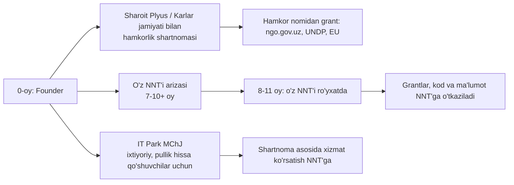
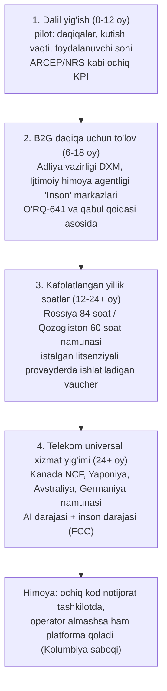

# 05. Huquq, moliya va notijorat model

> **Qisqacha**
> - Eng tez yo'l: mavjud NNT (Sharoit Plyus yoki Karlar jamiyati) bilan yozma hamkorlik shartnomasi asosida darhol boshlash, kerak bo'lsa pullik hissa qo'shuvchilar uchun IT Park MChJ. O'z NNT'ini parallel ro'yxatdan o'tkazish 7-10+ oy oladi ([anhor.uz](https://anhor.uz/society/pochemu-v-uzbekistane-slozhno-otkrity-npo)).
> - Yuz videosi (lug'at, dataset, qo'ng'iroq yozuvi) biometrik ma'lumot deb qaraladi: O'zbekistondagi serverda saqlanadi, Davlat reyestriga kiritiladi, yozma/elektron rozilik olinadi (ZRU-547, 26, 27-1, 20, 21-moddalar) ([lex.uz](https://lex.uz/docs/4396419)).
> - Talabni qonun yaratadi: O'RQ-641, PQ-407, fuqarolar qabulida majburiy surdotarjimon, 2027/2028 o'quv yilidan imtihonlarda surdotarjimon, nogironligi bor xodim uchun 50 mln so'mgacha subsidiya.
> - Pul manbalari mahalliy va kichik: davlat granti g'olibiga o'rtacha ~130 mln so'm ([UzA](https://uza.uz/ar/posts/fuqarolik-jamiyati-institutlari-tashabbuslarini-amalga-oshirishga-116-milliard-som-yonaltiriladi_925975)); NLnet yopiq, Microsoft AI for Accessibility ehtimol yopiq. Uzoq muddatda davlat yoki telekom yig'imi uchun advokatlik.
> - Kod Apache-2.0, ochiq imo-ishora videosi CC BY-SA 4.0 (yoki CC BY 4.0), qatlamli rozilik; boshqaruvda kar odamlar ko'pchilik.

---

## 1. Yuridik shakl: to'rt variant

### 1.1 Taqqoslash jadvali

| Mezon | (a) Hamkor NNT ostida (Sharoit Plyus / Karlar jamiyati) | (b) IT Park rezidenti MChJ | (c) O'z NNT'i (jamoat birlashmasi) | (d) Fond (jamoat fondi) |
|---|---|---|---|---|
| Boshlash vaqti | Darhol (memorandum/shartnoma imzolangach) | Tez (aniq muddat manbada yo'q, baho: haftalar) | **7 dan 10+ oygacha** ([anhor.uz](https://anhor.uz/society/pochemu-v-uzbekistane-slozhno-otkrity-npo)) | Manbada alohida muddat yo'q; NNT tartibi qo'llanadi deb taxmin (tasdiqlanmagan) |
| Davlat boji | Yo'q (hamkorning mavjud maqomi) | Manbada yo'q (TBD) | Respublika: 3 BHM (~1 320 000 so'm), viloyat: 1 BHM (~440 000), tuman/shahar: 0,5 BHM (~220 000) ([anhor.uz](https://anhor.uz/news/24364-2/); 2020 stavka x 2026 BHM, tekshirish kerak) | Manbada yo'q (TBD, lex.uz) |
| Nogironlar tashkiloti imtiyozi | Hamkorga tegishli | Yo'q | 2025-01-01 dan boj ikki baravar kamaygan ([Kun.uz](https://kun.uz/en/news/2024/08/26/uzbekistan-introduces-tax-benefits-and-new-platforms-for-civil-society-support)); 2025-avgust farmoni bilan ba'zi nogironlar jamoat birlashmalari uchun boj olinmaydi ([Tashkent Times](https://www.tashkenttimes.uz/national/6528-mirziyoyev-signs-decree-banning-government-interference-into-ngos-activities)) | Manbada aniq emas |
| Muassislar soni | - | Manbada yo'q | Eski qonunda jamoat birlashmasi 10 muassis (2026 uchun tasdiqlanmagan) ([uzbekistan_legal_costs](https://www.icnl.org/wp-content/uploads/Uzbekistan_charters.pdf)) | Eski qonunda 1 muassisli fond mumkin edi (2026 uchun tasdiqlanmagan) |
| Davlat grantlari (ngo.gov.uz, Jamoat fondi) | **Ha**, hamkor nomidan | **Yo'q** (tijorat tashkiloti) | Ha, ro'yxatdan o'tgandan keyin | Ha deb taxmin (tasdiqlanmagan) |
| UN/EU kichik grantlari | Ha (s-access.uz pretsedenti) | Odatda yo'q | Ha | Ehtimol ha |
| UNICEF Venture Fund | Yo'q | **Ha** (faqat tijorat kompaniyasi) ([VC4A](https://vc4a.com/unicef/unicef-venture-fund/)) | Yo'q | Yo'q |
| Soliq | Hamkorga bog'liq | 2028-01-01 gacha foyda, QQS, ijtimoiy va aylanma soliqdan ozod; xodim JShDS 7,5% ([it-park.uz](https://www.it-park.uz/uz/itpark/news/o-zbekiston-it-sohasidagi-startaplar-va-xorijiy-investorlar-uchun-soliq-imtiyozlari)) | 2026 holati topilmadi (TBD) | TBD |
| Xorijiy grant | Hamkorning Adliya vazirligi tartibi orqali | - | 527-son Nizom (2023), yiliga 100 BHM chegarasi ([ICNL](https://www.icnl.org/wp-content/uploads/Overview_Uzbekistan-Regulation-527-Oct-2023_FV.pdf)) | Xuddi shunday deb taxmin |
| Boshqaruv va IP nazorati | **Founder nazoratni yo'qotadi**; kod/ma'lumot egaligi yozma shartnomada belgilanishi shart | To'liq founderda | Ustav bo'yicha (kar ko'pchilikli kengash) | Ustav bo'yicha |
| Asosiy xavf | Hamkorning zaif boshqaruvi, qarzlar (Karlar jamiyati 2017 da WFD a'zoligini to'xtatgan) ([Yusupov 2020](https://dilmurad.me/expert/uzbek-sign-language-usl-to-be-or-not-to-be/)) | 2026 yangi qoidalar: PQ-388, direksiyaga daromadga qarab ajratma ([it-park.uz](https://it-park.uz/uz/itpark/news/it-park-uzbekistan-rezidentlari-uchun-yangi-qoidalar-joriy-etilmoqda)) | Uzoq ro'yxat, Adliya nazorati, xodimlar xorijga safari haqida xabardor qilish ([anhor.uz](https://anhor.uz/uzl/news/ozbekistondagi-nntlar-xodimlarining-chet-elga-safarlari/)) | Huquqiy farqi o'rganilmagan |
| **Tavsiya** | **Hozir boshlash uchun** | Pullik dasturchi va kar hissa qo'shuvchilar uchun (ixtiyoriy) | **Parallel ravishda darhol ariza** | Yuristdan keyin qaror |

Ro'yxatdan o'tmagan NNT faoliyati taqiqlangan, jarima 10-25 BHM ([UzDaily](https://uzdaily.ru/en/president-signs-law-regulating-ngos-and-introducing-new-fines); [ICNL](https://www.icnl.org/resources/civic-freedom-monitor/uzbekistan)). Shu sabab, o'z NNT'i ro'yxatdan o'tguncha loyiha faqat (a) yoki (b) nomidan ish yuritadi.

### 1.2 Tanlangan yo'l (strategik qaror 7)

### 1.3 Qadamlar

**(a) Hamkor NNT ostida boshlash**
1. Sharoit Plyus (info@sharoitplus.uz, +998 55 500-50-60, [t.me/sharoitplus](https://t.me/s/sharoitplus)) va Karlar jamiyati (STIR 200849599, [orginfo.uz](https://orginfo.uz/en/organization/97f86baf947b/)) bilan uchrashuv.
2. Memorandum + yozma loyiha shartnomasi. Majburiy bandlar: kod litsenziyasi (Apache-2.0, kod ochiq omborda founder/kelajakdagi NNT nomida), ma'lumot egaligi va litsenziyasi, imo-ishorachilarga to'lov tartibi, chiqish sharti (o'z NNT'iga o'tkazish). Sabab: hamkor ostida founder boshqaruv va IP nazoratini yo'qotadi ([uzbekistan_legal_costs, xulosa](https://anhor.uz/society/pochemu-v-uzbekistane-slozhno-otkrity-npo)).
3. Hamkor orqali ngo.gov.uz va UNDP/EU grantlariga ariza.

**(b) IT Park MChJ (ixtiyoriy)**
1. MChJ ochish va IT Park rezidentligi arizasi (tartib va bojlar manbada yo'q, TBD).
2. PQ-388 (26.12.2025) bo'yicha direksiyaga ajratma miqdorini aniqlash (tarixan daromadning 1%, tasdiqlanmagan).
3. MChJ NNT'ga yoki hamkorga shartnoma bo'yicha xizmat ko'rsatadi; kod Apache-2.0 bo'lgani uchun egalik muammosi kichik.

**(c) O'z NNT'i**
1. Ustav (ICNL inglizcha shablonlari: [ICNL charters](https://www.icnl.org/wp-content/uploads/Uzbekistan_charters.pdf)). Ustavga kiritiladi: kar a'zolar kengashda ko'pchilik; xizmat doirasini kengaytirish tartibi (Kanada CAV saboqi, 5-bo'lim).
2. Muassislar ichida kar odamlar bo'lsa, nogironlar jamoat birlashmasi sifatida boj imtiyozi olish mumkinligini yurist bilan tekshirish ([nonprofit_models_funding, xulosa](https://www.tashkenttimes.uz/national/6528-mirziyoyev-signs-decree-banning-government-interference-into-ngos-activities)).
3. Adliya vazirligiga ariza (my.gov.uz, tartib TBD). Kutish: 7-10+ oy.
4. Ro'yxatdan keyin: ngo.gov.uz profili, bank hisobi, xorijiy grant tartibi (527-son Nizom).

**(d) Fond** - jamoat birlashmasidan farqi, muassis soni va boj manbalarda tekshirilmagan. Yurist maslahatidan keyin (c) o'rniga tanlanishi mumkin.

---

## 2. Shaxsiy ma'lumotlar va biometrik lokalizatsiya

### 2.1 Qonun normalari (ZRU-547, birlamchi matn [lex.uz](https://lex.uz/docs/4396419))

| Modda | Mazmuni | Platforma uchun ma'nosi |
|---|---|---|
| **26-modda** | Biometrik ma'lumot: shaxsning anatomik va fiziologik xususiyatlari; identifikatsiya uchun subyekt roziligi kerak | Imo-ishorachi yuzi va tanasi videosi konservativ talqinda biometrik |
| **21-modda** | Rozilik isbotlanadigan istalgan shaklda; maxsus ma'lumot uchun **yozma** (elektron hujjat bo'lishi mumkin); voyaga yetmaganlar uchun vasiy; berilgan shaklda qaytarib olinadi | Elektron imzoli rozilik formasi; bolalar uchun ota-ona roziligi; qaytarib olish tartibi |
| **27-1-modda** (ZRU-1125, 26.03.2026, kuchga kirgan 27.03.2026) | 2-qism: **biometrik, genetik va telekom abonent ma'lumotlari O'zbekistonda saqlanadi**. 3-qism: boshqa ma'lumot chet elga, agar: teng himoyali davlat, tasdiqlangan standart shartlar/korporativ qoidalar yoki xalqaro standart | Video asosiy nusxasi O'zbekistondagi serverda; matn (subtitr, e-mail) chet elda bo'lishi mumkin |
| **20-modda** | O'zbekistonda saqlanishi shart bazalar **Shaxsiy ma'lumotlar bazalari davlat reyestri**ga kiritiladi; vakolatli organ - Davlat personallashtirish markazi; o'zgarish 10 kalendar kun ichida xabar qilinadi | Video bazani reyestrga kiritish |
| **15-modda** | Chegaradan o'tkazish teng himoyali davlatga; boshqa davlatga subyekt roziligi bilan ham | Chet el bulutiga faqat ro'yxatdagi davlat yoki rozilik bilan |

Keyingi o'zgarishlar ham sahifada ko'rsatilgan: 13.07.2026 konstitutsiyaviy qonun va 11.09.2026 dagi ZRU-1174 (25-modda) ([lex.uz](https://lex.uz/docs/4396419)).

### 2.2 Boshqa normalar

- **49 davlat ro'yxati:** Vazirlar Mahkamasi 29.07.2026 da teng himoyani ta'minlovchi 49 davlat va hududni tasdiqlagan; **Rossiya ro'yxatda** ([spot.uz](https://www.spot.uz/ru/2026/08/04/personal-data-abroad/)). Germaniya, Finlandiya, AQSh bor-yo'qligi aniqlanmagan (Hetzner/AWS tanlovidan oldin tekshirish shart).
- **ZRU-1115 (21.01.2026):** sun'iy intellekt yordamida shaxsiy ma'lumotlarni qonunga xilof qayta ishlash uchun javobgarlik ([anhor.uz](https://anhor.uz/ru/news/uzbekistan-criminalizes-illegal-ai-use-of-personal-data)). ASR, dataset va ML o'qitish shu qonun nuqtai nazaridan ko'rib chiqiladi.
- **Jarimalar (2022 miqdorlari, qayta tekshirilmagan):** JK 141-2: 100-150 BHM (~44-66 mln so'm) yoki 3 yilgacha huquqdan mahrum qilish; MJtK 46-2: fuqaroga 7 BHM (~3,1 mln), mansabdorga 50 BHM (~22 mln) ([anhor.uz](https://anhor.uz/news/social-media/)).
- **Iqtisodiy tanqid:** Kotib AI Research lokalizatsiya qonuni yiliga $4,5 mlrd gacha zarar deb baholagan (tahlilchi bahosi) ([kun.uz](https://jch.kun.uz/en/news/2025/07/16/uzbekistan-losing-up-to-45-billion-annually-due-to-data-localization-law-analysis)).

### 2.3 Rozilik: qatlamli model (strategik qaror 6)

| Qatlam | Nimaga rozilik | Qaytarib olish | Izoh |
|---|---|---|---|
| R0 | Xizmatdan foydalanish (qo'ng'iroq, subtitr) | Istalgan vaqtda | Qo'ng'iroq standart holatda yozilmaydi; subtitr xotirada qayta ishlanadi ([uzbekistan_legal_costs](https://lex.uz/docs/4396419)) |
| R1 | Video lug'atda ko'rsatish | Video lug'atdan olib tashlanadi | Imo-ishorachi ismi ko'rsatiladi (CC BY talabi) |
| R2 | Ochiq dataset sifatida dunyo bo'ylab tarqatish | **Faqat keyingi relizlardan** olib tashlanadi; tarqatilgan nusxani qaytarib bo'lmaydi | ASL Citizen ham "chiqarilgan ma'lumot o'chirilmaydi" deb yozgan ([Microsoft consent](https://www.microsoft.com/en-us/research/project/asl-citizen/consent-form/)) |
| R3 | ML model o'qitish | Keyingi o'qitishdan chiqariladi; o'qitilgan model qaytarilmaydi | ZRU-1115 sababli alohida belgilanadi |

Qoidalar:
- Rozilik matni o'zbek (lotin), rus va **imo-ishora videosi** shaklida ([nonprofit_models_funding, xulosa](https://www.microsoft.com/en-us/research/project/asl-citizen/dataset-license/)).
- Pose (skelet) ma'lumoti anonim deb va'da qilinmaydi: odamni pose orqali qayta aniqlash mumkin ([academic_research_synthesis](https://arxiv.org/html/2403.02563v1)).
- Voyaga yetmaganlar (maktab-internatlar): vasiy roziligi (21-modda) va Maktabgacha va maktab ta'limi vazirligi ruxsati.

### 2.4 Hosting qarori

| Ma'lumot turi | Joylashuv | Asos |
|---|---|---|
| Imo-ishorachi videolari, qo'ng'iroq yozuvi (agar bo'lsa) | O'zbekistondagi server (dicloud.uz, Pro-Data, Uztelecom VDS, Serverspace Toshkent) | 27-1-modda 2-qism; narxlar topilmadi ([dicloud.uz](https://dicloud.uz/en/services/cloud/vps/), [Pro-Data](https://pro-data.tech/en/virtual-server), [uztelecom](https://uztelecom.uz/en/for-business/cloud-services/virtual-dedicated-server-8-9), [Serverspace](https://serverspace.io/services/vps-server/vps-in-uzbekistnan/)) |
| Subtitr matni, akkaunt e-mail, kod | Chet elda ham bo'lishi mumkin, faqat 49 davlat ro'yxatidagi davlatda | 27-1-modda 3-qism, [spot.uz](https://www.spot.uz/ru/2026/08/04/personal-data-abroad/) |
| GPU (ASR) | O'zbekistonda GPU hosting narxi topilmadi; audio biometrik emas deb taxmin qilinadi (tasdiqlanmagan) | Bo'shliq |

---

## 3. Talabni yaratuvchi qonunlar

| Hujjat | Mazmun | Platforma uchun imkoniyat | Manba |
|---|---|---|---|
| **O'RQ-641** (15.10.2020) "Nogironligi bo'lgan shaxslarning huquqlari to'g'risida" | Davlat organlari kar odam bilan muloqot uchun zarurat bo'lganda surdotarjimonni shartnoma asosida jalb qiladi; 28-modda imo-ishora tilini faqat "muloqot vositasi" deb tan oladi | Davlat organlari - majburiy xaridor (B2G VRI) | [lex.uz](https://lex.uz/acts/-5049511); [Gazeta.uz 2025](https://www.gazeta.uz/oz/2025/09/30/sign-language/) |
| **PQ-407** (20.10.2022) "O'zbek imo-ishora tili va Brayl alifbosini rivojlantirish" | 2023-01-01 dan: maktab va "Ishga marhamat" monomarkazlarida bepul kurslar; davlat TV haftalik efirining kamida 5% surdotarjima/subtitr; OTM kirish imtihonida surdotarjimon; 2024/25 dan maktablarda faqat imo-ishora biladigan o'qituvchi; "Eng yaxshi surdotarjimon" tanlovi (100/65/50 BHM); lug'at muddati 1.06.2024 (bajarilmagan) | Ota-onalar moduli, o'qituvchi treningi, TV subtitr, lug'at | [norma.uz](https://www.norma.uz/oz/qonunchilikda_yangi/uzbek_imo-ishora_tili_va_brayl_alifbosini_rivojlantirish_buyicha_chora-tadbirlar_belgilandi); [Gazeta.uz 2025](https://www.gazeta.uz/oz/2025/09/30/sign-language/) |
| Fuqarolar qabuli va sayyor qabulda surdotarjimon **majburiy** | Davlat organlari qabulida tarjimon ishtiroki | "Murojaat yordamchisi" + qabulga VRI | [anhor.uz](https://anhor.uz/uzl/news/fuqarolar-qabuli-va-sayyor-qabullarni-otkazishda-surdotarjimon-ishtiroki/); [UzDaily](https://www.uzdaily.uz/ru/pri-provedenii-priema-grazhdan-v-obiazatelnom-poriadke-budet-obespechivatsia-uchastie-surdoperevodchika/) |
| Toshkent DXM'larida surdotarjima | 3 000+ eshitish va nutq nuqsoni bo'lgan odam | DXM'ga VRI | [anhor.uz](https://anhor.uz/news/23398-2/) |
| Nogironlar mansabdorlar qabuliga navbatsiz (2023) | Ustuvorlik | Qabul yordamchisi | [kun.uz](https://kun.uz/news/2023/02/27/nogironlar-mansabdor-shaxslar-qabuliga-navbatsiz-kiradi-prezident-qarori) |
| **2027/2028 o'quv yilidan** kirish va sertifikat imtihonlari | Qo'shimcha vaqt, Brayl, **surdotarjimon**, yordamchi | Imtihonlarga VRI/tarjimon bron qilish; 2027-yoz oldidan pilot | [infoedu.uz](https://infoedu.uz/nogironligi-bolgan-shaxslarga-imtihonlarda-qoshimcha-vaqt-beriladi) |
| Ish beruvchiga subsidiya (2025-06-01 dan) | I yoki II guruh nogironi ishga olinsa **50 mln so'mgacha**; surdotarjimon, psixolog, kuzatuvchi xarajatini qoplashi mumkin | Kar xodim/imo-ishorachi yollash xarajatini qoplash | [anhor.uz](https://anhor.uz/uzl/news/1-iyundan-nogironligi-bo-lgan-shaxslarni-ishga-qabul-qilgan-tadbirkor/) |
| Notarius yo'riqnomasi (04.01.2019, 3113-son) | Savodsiz kar odamga notariusda surdotarjimon | Huquqiy vaziyat kartalari | [nrm.uz](https://nrm.uz/contentf?doc=578912_&products=1_vse_zakonodatelstvo_uzbekistana) |
| FVV kar va nutqsizlar dispetcherligi (2019-07-01 dan) va 112 (2025-03-25 dan butun mamlakatda) | Video/SMS kanal (JusTalk ishonchsiz); 112 da kar kanal topilmadi | SOS pilot (keyingi bosqich) | [Yusupov 2020](https://dilmurad.me/expert/uzbek-sign-language-usl-to-be-or-not-to-be/); [kun.uz](https://kun.uz/en/news/2025/03/25/uzbekistans-unified-112-emergency-system-now-fully-operational-nationwide) |

Xulosa: davlat organlari tarjimon ta'minlashga majbur, lekin ta'minot zanjiri yo'q (Toshkentda 10 tacha malakali tarjimon) ([Gazeta.uz 2025](https://www.gazeta.uz/oz/2025/09/30/sign-language/)). Kar odamlar tarjima uchun to'lashni adolatsiz deb hisoblaydi, shuning uchun to'lovchi institut bo'lishi kerak.

---

## 4. Moliya manbalari

### 4.1 Manbalar jadvali

| # | Manba | Miqdor | Kim olishi mumkin | Holat (2026-11) | Mosligi | Manba |
|---|---|---|---|---|---|---|
| 1 | **Oliy Majlis huzuridagi NNTlarni qo'llab-quvvatlash Jamoat fondi** (fundngo.uz) | 2026 2-tur: 11,6 mlrd so'm, 700 ariza, 88 g'olib, **o'rtacha ~130 mln so'm (~$10k)** | Ro'yxatdan o'tgan NNT | 3-tur e'lon qilingan (mavzular: ayollar/bolalar huquqi, gender, ta'lim, sog'liqni saqlash, korrupsiya, ekologiya); nogironlik nomlanmagan | Yuqori (hamkor nomidan); lug'at/kartalar | [UzA 2-tur](https://uza.uz/ar/posts/fuqarolik-jamiyati-institutlari-tashabbuslarini-amalga-oshirishga-116-milliard-som-yonaltiriladi_925975); [UzA 3-tur](https://uza.uz/en/posts/davlat-granti-tanlovi-goliblari-aniqlandi_883953) |
| 2 | **ngo.gov.uz** davlat granti turlari | 1-tur 2026: 943 ariza | NNT | Yiliga bir necha tur | Yuqori | [UzA](https://uza.uz/en/posts/davlat-granti-tanlovi-goliblari-aniqlandi_883953) |
| 3 | **Namangan viloyati budjeti** nogironlarga xizmat qiluvchi NNTlar uchun | **4,5 mlrd so'm** | NNT, ngo.gov.uz orqali | Mavjud (muddat manbada yo'q) | O'rta-yuqori (viloyat pilot) | [UzA](https://uza.uz/ar/posts/namanganda-nodavlat-notijorat-tashkilotlariga-etibor-qanday_889173) |
| 4 | Korrupsiyaga qarshi NNT grantlari | Yiliga 10 mlrd so'm (2025) | NNT | Mavjud | O'rta ("murojaat yordamchisi", s-access.uz kabi) | [Kun.uz](https://kun.uz/news/2025/09/24/korrupsiyaga-qarshi-kurash-sohasidagi-nnt-loyihalariga-grant-ajratiladi) |
| 5 | **UNDP kichik grantlari** (ijtimoiy himoya) | Miqdor manbada yo'q | NNT | 07.07.2026 da 5 g'olib, jumladan Qoraqalpog'iston nogironlar assotsiatsiyasi | Yuqori | [undp.org](https://www.undp.org/uz/node/593281) |
| 6 | **EU/UNDP** korrupsiyaga qarshi loyiha; **s-access.uz pretsedenti** | 2024: 8 FJI (Buxoro, Farg'ona, Toshkent) | NNT | Pretsedent: Karlar jamiyati Buxoro bo'limi 48 atama, ~100 kar o'qitilgan, 5 000+ odam qamrab olingan | Yuqori (isbotlangan kanal) | [EEAS](https://eeas.europa.eu/delegations/uzbekistan/o%CA%BBzbekistonda-karlar-jamiyati-uchun-korrupsiyaga-qarshi-kurashish-bo%CA%BByicha-inklyuziv-onlayn_uz); [UNDP](https://www.undp.org/uz/node/537801) |
| 7 | EU delegatsiyasi FJI tanlovi | Manbada yo'q | FJI | Korrupsiya mavzusi | O'rta | [eeas.europa.eu](https://www.eeas.europa.eu/delegations/uzbekistan/fuqarolik-jamiyati-institutlari-o%E2%80%98rtasida-korrupsiyaga-qarshi-kurashishga-doir-tashabbuslarni-amalga_uz) |
| 8 | UNDP/Finlandiya **HuquqPlus** (Adliya vazirligi orqali) | Sharoit Plyus: 2025 da USD 9 000; 1.08-31.12.2026 da 238,25 mln so'm (imo-ishora tarjimali video-qo'ng'iroq markazi) | NNT | Davom etmoqda | Yuqori: **raqobat emas, integratsiya** | [Sharoit Plus](https://sharoitplus.uz/category/loyihalar/) |
| 9 | **The Stirling Foundation** (AQSh) | Sharoit Plyus lug'ati: USD 30 120 (14.05.2025-14.05.2026) | NNT | Grant 2026-05 da tugagan; yangi tur noma'lum | O'rta (hamkor orqali) | [Sharoit Plus](https://sharoitplus.uz/category/loyihalar/) |
| 10 | **UN UNPRPD** (UNICEF, UNDP, UNFPA, OHCHR) | Manbada yo'q | Davlat bilan dastur | Faol (erta aniqlash) | O'rta (ota-onalar moduli) | [Global Disability Fund](https://globaldisabilityfund.org/programme/uzbekistan/) |
| 11 | **UNICEF Venture Fund** | USD 100 000 gacha, ulushsiz | **Tijorat kompaniyasi**, ishlaydigan prototip, ochiq kod majburiyati | 2026: iqlim va bola salomatligi (muddat 17.05.2026, sahifada "rolling" - manbalar zid), blokcheyn (yopiq 10.03.2026); 2030 gacha fokus: blokcheyn, iqlim, femtech | Past (mavzu mos emas); faqat IT Park MChJ orqali | [UNICEF](https://www.unicef.org/innovation/call-for-application-climate-and-health-2026); [Nairametrics](https://nairametrics.com/2026/03/03/unicef-opens-applications-for-100000-equity-free-funding-for-early-stage-startups/) |
| 12 | Cboard pretsedenti (UNICEF Innovation Fund) | Kogortaga "USD 100 000 gacha" | - | 2017-2019, 2020 qayta | AAC uchun namuna | [UNICEF Venture Fund](https://www.unicefventurefund.org/story/cireha-augmentative-and-alternative-communication) |
| 13 | **DPGA** (Digital Public Goods) ro'yxati | Grant emas, bepul | Ochiq litsenziya, privatlik, do-no-harm (9 indikator) | Ochiq; 2026 boshida 241 DPG | Yuqori (ishonch, UNICEF/UNDP/hukumat oldida) | [DPGA](https://www.digitalpublicgoods.net/digital-public-goods); [arXiv](https://arxiv.org/pdf/2607.03427) |
| 14 | **NLnet / NGI Zero Commons Fund** | - | - | **YOPIQ**: 13-va oxirgi tur 01.06.2026 da yopilgan | Yo'q | [NLnet](https://www.nlnet.nl/commonsfund); [NLnet news](https://nlnet.nl/news/2026/20260612-NGIZero-stocktaking.html) |
| 15 | **Microsoft AI for Accessibility** | USD 25 mln, 5 yillik dastur (2018) | - | **Ehtimol yopiq**/faol emas; ai4aques@microsoft.com orqali tekshirish | Past | [Microsoft](https://microsoft.com/ai-for-accessibility); [Disability Scoop](https://www.disabilityscoop.com/?p=25062) |
| 16 | **GSMA Innovation Fund** (FCDO qo'llovi) | DeafTawk: $250 000 (2021); SignAble ham olgan | Odatda kompaniya | Joriy tur manbada yo'q | O'rta (operator bilan birga) | [GSMA DeafTawk](https://www.gsma.com/mobilefordevelopment/digital-grantees-portfolio/triac-deaftawk/); [GSMA SignAble](https://www.gsma.com/mobilefordevelopment/digital-grantees-portfolio/signable-communications/) |
| 17 | Prosus Social Impact Challenge, WISE (Qatar Foundation), Africa Prize | SignAble, Deaf Reach, Signvrse (GBP 50 000) olgan | - | O'zbekiston uchun muvofiqlik tekshirilmagan | Past-o'rta | [region_south_asia_mena_africa](https://wise-qatar.org/?p=13930) |
| 18 | **Operator CSR** (Beeline UZ, Ucell, Uzmobile, Mobiuz) | Topilmadi | - | O'zbekistonda kar uchun tarif/zero-rating **topilmadi**; Ucell "Ehtirom" (28.05.2025) sharti noaniq | Yuqori potensial (Claro, Nar, Turkcell, Beeline KG namunasi) | [beeline.uz](https://beeline.uz/en/products/packages); [ucell.uz](https://ucell.uz/en/news/new_tariffs); [pulse.bot](https://www.pulse.bot/telecom/blogs/beeline-kyrgyzstan-launches-mobile-plan-with-zero-rated-ai-apps-e490b846-0dc7-4ba1-b036-87798c89630a) |
| 19 | **Zamin fondi** | Implant dasturlari (122 operatsiya bir loyihada) | - | Faol | O'rta (implantli bolalar oilalari) | [uz.wikipedia](https://uz.wikipedia.org/wiki/Zamin_fondi) |
| 20 | Ish beruvchi subsidiyasi | Har bir I/II guruh xodimga 50 mln so'mgacha | Ish beruvchi (MChJ yoki NNT) | 2025-06-01 dan | Yuqori (xarajat qoplash) | [anhor.uz](https://anhor.uz/uzl/news/1-iyundan-nogironligi-bo-lgan-shaxslarni-ishga-qabul-qilgan-tadbirkor/) |
| 21 | USAID | - | - | **2025 da yopilgan** (O'zbekiston dasturlarining 100% i, tasdiqlanmagan) | Yo'q | [Kun.uz](https://kun.uz/en/news/2025/03/11/us-to-shut-down-majority-of-usaid-programs-after-review) |
| 22 | JICA | Tarixan Karlar madaniyat markazi va 2005 lug'at | - | Joriy dastur topilmadi | Past | [Wikipedia](https://en.wikipedia.org/wiki/Deafness_in_Uzbekistan) |
| 23 | Founder o'z mablag'i | 06e ga qarang | - | - | Boshlang'ich | Strategik qaror 9 |

Tekshirilmagan: Google.org, Mozilla, ITU AI for Good, UNDP Accelerator Lab, World Bank, ADB, KOICA, TIKA, IT Park grantlari, Raqamli texnologiyalar vazirligi dasturlari, Kapitalbank/Hamkorbank CSR ([nonprofit_models_funding, bo'shliqlar](https://uza.uz/ar/posts/fuqarolik-jamiyati-institutlari-tashabbuslarini-amalga-oshirishga-116-milliard-som-yonaltiriladi_925975)). GitHub Sponsors/Open Collective orqali O'zbekiston bank hisobiga to'lov olish imkoni tekshirilmagan.

### 4.2 Grant hajmi bilan nima qilish mumkin

- 130 mln so'm taxminan 1 000 belgili yozuv kampaniyasiga yetadi, lekin to'liq dasturchi jamoasiga yetmaydi (tadqiqotchi xulosasi) ([nonprofit_models_funding](https://uza.uz/ar/posts/fuqarolik-jamiyati-institutlari-tashabbuslarini-amalga-oshirishga-116-milliard-som-yonaltiriladi_925975)).
- K-RSL: bitta universitet granti 600 belgi, 28 250 video, 10 imo-ishorachi ([K-RSL](https://krslproject.github.io/krsl20); [LREC 2022](https://aclweb.org/anthology/2022.signlang-1.24.pdf)) - universitet bilan hamkorlik pul tejaydi.

---

## 5. Global moliyalash modellari va O'zbekiston uchun advokatlik yo'li

### 5.1 Modellar jadvali

| Davlat / xizmat | Kim to'laydi | Miqdor / ko'lam | Saboq | Manba |
|---|---|---|---|---|
| **AQSh FCC TRS Fund** | Telekom operatorlari badali | VRS ehtiyoji 2025-26: ~$660,7 mln; IP CTS 2026-27: AI (ASR) $0,95/daq, inson yordamida $1,45/daq | AI tarifi inson tarifining ~65% i; ikkala daraja ham moliyalanadi | [Rolka Loube](https://rolkaloube.com/programs/federal-itrs/news/fcc-releases-2025-26-trs-fund-compensation-rates-order); [FCC DA 26-646](https://docs.fcc.gov/public/attachments/DA-26-646A1.pdf) |
| **Kanada CAV / SRV Canada VRS** | CRTC National Contribution Fund (barcha telekom provayderlar) | $27,25 mln CAD (2021), $30 mln (2022); ~9 651 ro'yxatdagi foydalanuvchi (2023); boshida 32 daq/oy (prognoz 100) | Bitta notijorat administrator; foydalanish prognozdan past; xizmat doirasini kengaytirish regulyator ruxsatiga bog'liq (DHH Coalition nizosi 2025-2026) | [CRTC 2021-102](https://www.crtc.gc.ca/eng/archive/2021/2021-102.pdf); [CRTC 2017-437](https://crtc.gc.ca/eng/archive/2017/2017-437.htm); [CRTC 2025-54](https://crtc.gc.ca/eng/archive/2025/2025-54.htm) |
| **Kolumbiya Centro de Relevo** | MinTIC (vazirlik), FENASCOL bilan | 2024: 516 523 qo'ng'iroq, 4 500 benefitsiar; bepul; veb + WhatsApp; SIEL yuzma-yuz | Har yili operator tanlovi - uzluksizlik xavfi; Claro zero-rating | [MinTIC](https://mintic.gov.co/portal/inicio/Sala-de-prensa/Noticias/399452:Este-ano-el-Centro-de-Relevo-gestiono-516-523-llamadas-relevadas-para-la-poblacion-con-discapacidad-auditiva); [Xataka](https://www.xataka.com.co/aplicaciones/centro-relevo-plataforma-que-impulsa-conectividad-barreras-para-personas-sordas-colombia) |
| **Yaponiya** telefon relay (2021 qonuni) | Operatorlar orqali raqam boshiga yig'im (operator e'lonlaridan xulosa) | 2023 oxiri: 14 000+ foydalanuvchi, ~30 000 qo'ng'iroq/oy; 2026: 19 000 foydalanuvchi | Yig'im miqdori tasdiqlanmagan (dastlab yiliga 1 yen/raqam - tasdiqlanmagan) | [NFTRS](https://nftrs.or.jp/news/fy2024/files/NFTRSpapers_fy2024-001.pdf); [SoftBank](https://www.softbank.jp/corp/news/press/sbkk/2025/20250325_01/) |
| **Avstraliya NRS** | Telecommunications Industry Levy (operatorlar) | Oylik ochiq KPI (masalan, 93,88% qo'ng'iroq 30 s ichida) | Shaffof oylik hisobot | [legislation.gov.au](https://www.legislation.gov.au/F2025L01137/asmade/2025-09-23/es/original/pdf); [NRS report](https://www.accesshub.gov.au/sites/default/files/documents/2025-07-monthly-performance-report-july.pdf) |
| **Rossiya** | Davlat (SFR) | Yiliga 84 soatgacha (kar-ko'rlar 240); 2026-01 dan elektron sertifikat; Yaroslavl: 302 soat uchun 1,5 mln RUB+ (~5 000 RUB/soat, hisob) | Vaucher bozori xususiy platformalarga yo'l ochadi | [SFR Yaroslavl](https://sfr.gov.ru/branches/yaroslavl/news/~2026/09/25/285016); [ppt.ru](https://ppt.ru/amp/obzory/vstupaet-v-silu/postanovlenie-pravitelstva-rf-25-11-2025-1879) |
| **Qozog'iston** | Davlat (eGov) | Yiliga 60 soat; ijtimoiy xarajat moratoriysi 31.12.2028 gacha | Davlat soatiga tayanish xavfli: oshirish 2029 dan oldin emas | [TengriHealth](https://tengrihealth.kz/article//daze-zapis-vracu-kvest-kazaxstancy-naruseniem-sluxa-4136/); [economist.kg](https://economist.kg/society/2026/06/16/kazakhstan-zhestovyy-yazyk-status.md) |
| **Tailand TTRS** | NBTC USO (telekom daromadidan 2,5% yig'im) | ~40 000 obunachi, ~10 000 muntazam; ~40 tarjimon | **13.06.2025 da moliya kechikkani uchun to'xtatilgan** | [Prachatai](https://prachataienglish.com/node/11567); [Thai PBS](https://www.thaipbsworld.com/science-technology/the-impact-of-technology-on-the-hard-of-hearing) |
| **Islandiya SHH** | Davlat budjeti | - | **2025 I chorakda bepul tarjima budjeti tugagan, video relay 24-31.03.2025 yopilgan** | [SHH](https://island.is/s/shh/frett/lokad-fyrir-endurgjaldslausa-tulkathjonustu-ut-mars) |
| Germaniya, Fransiya, Niderlandiya, Shveytsariya | Operatorlar bozor ulushiga ko'ra | Tess: 2025 da 30 bepul daq/oy, 2028 gacha 60; Fransiya 2026-10-01 dan 24/7 | Operator yig'imi barqaror va o'sib boradi | [BNetzA](https://www.bundesnetzagentur.de/1052216); [ARCEP](https://www.arcep.fr/fileadmin/user_upload/observatoire/indicateurs-accessibilite/t4-2024/indicateurs-accessibilite-T4-2024_avril2025.pdf) |

**Manbalar ziddiyati (kafolatlangan soatlar):** Gazeta.uz 2025 Rossiya 40 soat, Qozog'iston 30 soat deydi ([Gazeta.uz 2025](https://www.gazeta.uz/oz/2025/09/30/sign-language/)); SFR 2026 sahifalari Rossiyada 84 soat, TengriHealth 2026 Qozog'istonda 60 soat deydi. 40 soat eski raqam deb ko'rsatilgan ([garant.ru](https://garant.ru/news/11083)). Ushbu hujjat yangiroq birlamchi manbalarni (84 / 60) asos qiladi.

### 5.2 O'zbekiston uchun advokatlik yo'li (bosqichma-bosqich)

Advokatlik qoidalari:
- **Bitta budjet manbaiga bog'lanmaslik.** Tailand TTRS (2025 to'xtash), Islandiya (budjet tugashi) va Qozog'iston (2029 gacha muzlatish) shuni ko'rsatadi ([Prachatai](https://prachataienglish.com/node/11567); [SHH](https://island.is/s/shh/frett/lokad-fyrir-endurgjaldslausa-tulkathjonustu-ut-mars); [economist.kg](https://economist.kg/society/2026/06/16/kazakhstan-zhestovyy-yazyk-status.md)).
- **Xizmat doirasini kengaytirish qoidasi ustavda** (CAV saboqi) ([CRTC 2025-54](https://crtc.gc.ca/eng/archive/2025/2025-54.htm)).
- **Platforma har bir foydalanuvchi uchun hisob-kitob qilinadigan tarjimon daqiqalarini qayd etadi** - kelajakdagi vaucher yoki donorga hisob berish uchun ([russia_cis_competitors, xulosa](https://sfr.gov.ru/branches/yaroslavl/news/~2026/09/25/285016)).
- **Talablar matni tayyor:** jamoatchilik talablari (Gazeta.uz 2025): imo-ishora tilini qonunda tan olish (O'RQ-641 28-modda), kafolatlangan soatlar, markaziy tarjimon bazasi va onlayn bron, milliy standart va sertifikat, kar tarjimonlar, TV subtitr, ishlaydigan surdo-online planshetlari, lug'atni tugatish ([Gazeta.uz RU 2025](https://www.gazeta.uz/ru/2025/09/28/sign-language/)).
- **Hamkor davlat organlari:** Ijtimoiy himoya milliy agentligi, Adliya vazirligi (surdo-online, HuquqPlus), FVV/112, Raqamli texnologiyalar vazirligi, Oliy Majlis komissiyasi (grant turlari).

---

## 6. Ochiq kod va ma'lumot litsenziyasi

### 6.1 Litsenziya siyosati (strategik qaror 6)

| Qism | Litsenziya | Asos |
|---|---|---|
| Platforma kodi (yangi) | **Apache-2.0** (patent granti); muqobil MIT | Asosiy ochiq komponentlar Apache/MIT/BSD bo'lgani uchun erkin birlashadi ([hands_on_repo_audit](https://github.com/jitsi/jitsi-meet)) |
| Fork qilinadigan asos | Jitsi Meet Apache-2.0; Global Signbank BSD-3; spoken-to-signed-translation va pose MIT; WhisperLive MIT; performs MIT | [hands_on_repo_audit](https://github.com/Signbank/Global-signbank/blob/master/LICENCE.txt) |
| AAC (Cboard fork) | **GPL-3.0** - alohida ilova, boshqa servislar bilan faqat HTTP orqali | [cboard](https://github.com/cboard-org/cboard) |
| Ochiq imo-ishora video ma'lumoti | **CC BY-SA 4.0** (Lingua Libre pretsedenti) yoki **CC BY 4.0** | [Lingua Libre](https://lingualibre.org); AUTSL va CASL-W60 kabi faqat akademik litsenziya tuzog'idan qochish ([Hamburg](https://www.sign-lang.uni-hamburg.de/lrec/data/autsl.html)) |
| Gloss qoidalari, pose fayllari | CC BY-SA 4.0 (yurist tekshiruvi kerak) | [hands_on_repo_audit](https://github.com/sign-language-processing/spoken-to-signed-translation) |

### 6.2 Ishlatib bo'lmaydigan yoki ehtiyot bo'lish kerak bo'lgan aktivlar

| Aktiv | Muammo | Manba |
|---|---|---|
| SignON HF checkpointlari, VLibras neyron og'irliklari, `sign-mt-poses` daktil ma'lumoti | Litsenziya ko'rsatilmagan - aniqlanmaguncha yaroqsiz | [hands_on_repo_audit](https://huggingface.co/signon-project) |
| ARASAAC simvollari | CC BY-NC-SA 4.0 (notijorat) | [cboard](https://github.com/cboard-org/cboard) |
| sign/translate (Rylo) | CC BY-NC-SA 4.0 | [open_source_clonable](https://github.com/sign-language-processing/spoken-to-signed-translation) |
| Slovo / Bukva (Sber) | "CC BY-SA 4.0 varianti" - tijorat bandi o'qilmagan | [ai-forever/slovo](https://github.com/ai-forever/slovo) |
| Logos ma'lumoti | Faqat akademik; og'irliklar yuklanadi, litsenziyasi noaniq | [ai-forever/logos](https://github.com/ai-forever/logos) |
| Sber bilan rasmiy hamkorlik | Sanksiya ta'siri o'rganilmagan | [russia_cis_ecosystem](https://github.com/ai-forever/logos) |
| YouTube darslari (IBRAT FARZANDLARI va boshqalar) | Mualliflik huquqi; dataset faqat egasi ruxsati bilan | [browser_youtube_google_findings](https://www.youtube.com/playlist?list=PLkREkayoYCyIbxC-s0cOABSwdhkdbcbgz) |

### 6.3 DPG talablariga moslik
DPG standartining 9 indikatori (ochiq litsenziya, ochiq standart, platformadan mustaqillik, privatlik va xavfsizlik, qonunga muvofiqlik, do-no-harm va boshqalar) ([DPGA](https://www.digitalpublicgoods.net/digital-public-goods)) loyihaning litsenziya va rozilik siyosati bilan mos keladi. Hozircha imo-ishora loyihasi DPG ro'yxatida tasdiqlanmagan; Cboard nomzodlar omborida bor ([DPG candidates](https://github.com/DPGAlliance/publicgoods-candidates/tree/main/digitalpublicgoods)).

---

## 7. Boshqaruv (qisqa; batafsil 06d)

| Tamoyil | Amaliyot | Asos |
|---|---|---|
| Kar odamlar boshqaradi | Kuzatuv kengashida ko'pchilik kar; til kontentiga kar hamraisning veto huquqi | WFD: kar odamlar milliy imo-ishora tilini rivojlantirishga rahbarlik qiladi, bu AI vositalariga ham taalluqli ([WFD](https://wfdeaf.org/?p=18327)); "Bizsiz biz haqimizda hech narsa" tanqidi ([Hook.report](https://old.hook.report/2020/11/bizsiz-biz-haqimizda-hech-narsa/)) |
| Viloyat maslahat kengashi | Karlar jamiyati viloyat bo'limlaridan, pullik o'rinlar | [nonprofit_models_funding, xulosa](https://wfdeaf.org/wp-content/uploads/WFD-and-WASLI-Statement-on-Avatar-FINAL-14032018-Updated-14042018.pdf) |
| Pullik hissa qo'shuvchilar | Har bir yozuv sessiyasi uchun to'lov, "ko'ngilli" emas | DGB alangu'ni haqsiz ma'lumot uchun tanqid qilgan ([DGB 01/2025](https://gehoerlosenbund.de/wp-content/uploads/2025/10/Pressemitteilung-01_2025-Gut-gebruellt-Loewen.docx.pdf)) |
| Ma'lumot sotilmaydi | NNT ochiq litsenziyada boshqaradi | [nonprofit_models_funding](https://lingualibre.org) |
| AI belgilanadi | Avatar/AI chiqishi yorliqlanadi, yuqori xavfli kontentda ishlatilmaydi | [WFD-WASLI 2018](https://wfdeaf.org/wp-content/uploads/WFD-and-WASLI-Statement-on-Avatar-FINAL-14032018-Updated-14042018.pdf) |
| Tashqi audit | CoSET toolkit va WFD 2025 checklist | [MultiLingual](https://multilingual.com/coset-safe-ai-task-force-risk-framework-automated-interpreting-slxai-summit/); [WFD](https://wfdeaf.org/?p=12027) |

---

## 8. Huquqiy tekshiruv ro'yxati

1. [ ] Hamkorlik shartnomasi (Sharoit Plyus / Karlar jamiyati): IP, litsenziya, ma'lumot egaligi, chiqish sharti.
2. [ ] lex.uz / my.gov.uz: NNT boji, muassislar soni, ustav shabloni, fond va jamoat birlashmasi farqi.
3. [ ] Xorijiy grant: 527-son Nizom va Adliya vazirligi tartibi; xodimlar safari haqida xabar qoidasi.
4. [ ] Video = biometrik; asosiy nusxa O'zbekistonda (27-1-modda 2-qism).
5. [ ] Davlat personallashtirish markazi: reyestrga kiritish; o'zgarish 10 kun ichida.
6. [ ] Qatlamli yozma/elektron rozilik (21-modda), vasiy roziligi, qaytarib olish siyosati.
7. [ ] Chet el hosting: faqat 49 davlat ro'yxati yoki tasdiqlangan shartlar.
8. [ ] ZRU-1115 bo'yicha AI qayta ishlash tahlili.
9. [ ] Qo'ng'iroqlar standart holatda yozilmaydi.
10. [ ] Kar xodim yollash: 50 mln so'mgacha subsidiya arizasi.
11. [ ] ngo.gov.uz ro'yxati; davlat granti turlari, viloyat budjetlari, UNDP.
12. [ ] FVV/112, DXM, fuqarolar qabuli uchun VRI pilot taklifi (Gruziya 112 namunasi).

---

## Manbalar

- ZRU-547 matni: https://lex.uz/docs/4396419
- 49 davlat ro'yxati: https://www.spot.uz/ru/2026/08/04/personal-data-abroad/
- ZRU-1115: https://anhor.uz/ru/news/uzbekistan-criminalizes-illegal-ai-use-of-personal-data
- Jarimalar: https://anhor.uz/news/social-media/
- Lokalizatsiya tanqidi: https://jch.kun.uz/en/news/2025/07/16/uzbekistan-losing-up-to-45-billion-annually-due-to-data-localization-law-analysis
- NNT ro'yxatga olish muddati: https://anhor.uz/society/pochemu-v-uzbekistane-slozhno-otkrity-npo
- NNT boji: https://anhor.uz/news/24364-2/
- NNT safar qoidasi: https://anhor.uz/uzl/news/ozbekistondagi-nntlar-xodimlarining-chet-elga-safarlari/
- NNT kodeksi loyihasi: https://anhor.uz/news/v-uzbekistane-razrabotayut-kodeks-o-negosudarstvennih-nekommercheskih-organizaciyah/
- ICNL: https://www.icnl.org/resources/civic-freedom-monitor/uzbekistan ; https://www.icnl.org/wp-content/uploads/Uzbekistan_charters.pdf ; https://www.icnl.org/wp-content/uploads/Overview_Uzbekistan-Regulation-527-Oct-2023_FV.pdf
- NNT imtiyozlari: https://kun.uz/en/news/2024/08/26/uzbekistan-introduces-tax-benefits-and-new-platforms-for-civil-society-support ; https://www.tashkenttimes.uz/national/6528-mirziyoyev-signs-decree-banning-government-interference-into-ngos-activities ; https://uzdaily.ru/en/president-signs-law-regulating-ngos-and-introducing-new-fines ; https://daryo.uz/en/2026/01/07/uzbekistan-sets-new-criteria-for-publicly-important-organizations-and-simplifies-financial-reporting/
- IT Park: https://www.it-park.uz/uz/itpark/news/o-zbekiston-it-sohasidagi-startaplar-va-xorijiy-investorlar-uchun-soliq-imtiyozlari ; https://buxgalter.uz/oz/publish/doc/text205244_sk-2025_it-park_rezidentlari_uchun_imtiezlar_uzaytirildi ; https://it-park.uz/uz/itpark/news/it-park-uzbekistan-rezidentlari-uchun-yangi-qoidalar-joriy-etilmoqda
- O'RQ-641: https://lex.uz/acts/-5049511
- PQ-407: https://www.norma.uz/oz/qonunchilikda_yangi/uzbek_imo-ishora_tili_va_brayl_alifbosini_rivojlantirish_buyicha_chora-tadbirlar_belgilandi
- Gazeta.uz 2025: https://www.gazeta.uz/oz/2025/09/30/sign-language/ ; https://www.gazeta.uz/ru/2025/09/28/sign-language/
- Qabulda surdotarjimon: https://anhor.uz/uzl/news/fuqarolar-qabuli-va-sayyor-qabullarni-otkazishda-surdotarjimon-ishtiroki/ ; https://www.uzdaily.uz/ru/pri-provedenii-priema-grazhdan-v-obiazatelnom-poriadke-budet-obespechivatsia-uchastie-surdoperevodchika/
- DXM: https://anhor.uz/news/23398-2/
- Imtihonlar 2027/28: https://infoedu.uz/nogironligi-bolgan-shaxslarga-imtihonlarda-qoshimcha-vaqt-beriladi
- Subsidiya: https://anhor.uz/uzl/news/1-iyundan-nogironligi-bo-lgan-shaxslarni-ishga-qabul-qilgan-tadbirkor/
- 112: https://kun.uz/en/news/2025/03/25/uzbekistans-unified-112-emergency-system-now-fully-operational-nationwide
- Grantlar: https://uza.uz/ar/posts/fuqarolik-jamiyati-institutlari-tashabbuslarini-amalga-oshirishga-116-milliard-som-yonaltiriladi_925975 ; https://uza.uz/en/posts/davlat-granti-tanlovi-goliblari-aniqlandi_883953 ; https://uza.uz/ar/posts/namanganda-nodavlat-notijorat-tashkilotlariga-etibor-qanday_889173 ; https://kun.uz/news/2025/09/24/korrupsiyaga-qarshi-kurash-sohasidagi-nnt-loyihalariga-grant-ajratiladi ; https://www.undp.org/uz/node/593281 ; https://eeas.europa.eu/delegations/uzbekistan/o%CA%BBzbekistonda-karlar-jamiyati-uchun-korrupsiyaga-qarshi-kurashish-bo%CA%BByicha-inklyuziv-onlayn_uz ; https://www.undp.org/uz/node/537801
- Sharoit Plyus loyihalari: https://sharoitplus.uz/category/loyihalar/
- UNICEF / DPGA / NLnet / Microsoft: https://www.unicef.org/innovation/call-for-application-climate-and-health-2026 ; https://vc4a.com/unicef/unicef-venture-fund/ ; https://www.digitalpublicgoods.net/digital-public-goods ; https://www.nlnet.nl/commonsfund ; https://microsoft.com/ai-for-accessibility
- GSMA: https://www.gsma.com/mobilefordevelopment/digital-grantees-portfolio/triac-deaftawk/ ; https://www.gsma.com/mobilefordevelopment/digital-grantees-portfolio/signable-communications/
- Global modellar: https://docs.fcc.gov/public/attachments/DA-26-646A1.pdf ; https://rolkaloube.com/programs/federal-itrs/news/fcc-releases-2025-26-trs-fund-compensation-rates-order ; https://www.crtc.gc.ca/eng/archive/2021/2021-102.pdf ; https://crtc.gc.ca/eng/archive/2025/2025-54.htm ; https://mintic.gov.co/portal/inicio/Sala-de-prensa/Noticias/399452:Este-ano-el-Centro-de-Relevo-gestiono-516-523-llamadas-relevadas-para-la-poblacion-con-discapacidad-auditiva ; https://nftrs.or.jp/news/fy2024/files/NFTRSpapers_fy2024-001.pdf ; https://www.legislation.gov.au/F2025L01137/asmade/2025-09-23/es/original/pdf ; https://sfr.gov.ru/branches/yaroslavl/news/~2026/09/25/285016 ; https://tengrihealth.kz/article//daze-zapis-vracu-kvest-kazaxstancy-naruseniem-sluxa-4136/ ; https://prachataienglish.com/node/11567 ; https://island.is/s/shh/frett/lokad-fyrir-endurgjaldslausa-tulkathjonustu-ut-mars
- Litsenziya: https://lingualibre.org ; https://www.microsoft.com/en-us/research/project/asl-citizen/dataset-license/ ; https://github.com/ai-forever/slovo ; https://github.com/ai-forever/logos
- WFD/WASLI: https://wfdeaf.org/wp-content/uploads/WFD-and-WASLI-Statement-on-Avatar-FINAL-14032018-Updated-14042018.pdf

## Tasdiqlanmagan / bo'shliqlar

- 2026 yil uchun NNT, jamoat birlashmasi va fond bojlari, muassislar soni, hujjatlar ro'yxati birlamchi manbada topilmadi (boj hisobi 2020 stavka x 2026 BHM).
- Xorijiy grantni Adliya vazirligida kelishish ("20 kunlik xabar") tartibi va 2024-2025 soddalashtirishlari topilmadi.
- NNT hisobot majburiyatlari va 2026 soliq holati (grant va a'zolik badallari) topilmadi.
- PQ-388 bo'yicha IT Park direksiyasiga ajratma foizi tasdiqlanmagan; imtiyozlar 2028 yoki 2040 gacha ekani bo'yicha manbalar zid.
- Oddiy video (yuz shabloni emas) "biometrik" hisoblanadimi - rasmiy tushuntirish yo'q; ushbu hujjat konservativ talqinni oladi.
- 49 davlat ro'yxatining to'liq matni (Germaniya, Finlandiya, AQSh) olinmagan.
- O'zbekistonda VPS, saqlash va GPU narxlari topilmadi.
- O'RQ-641 ning tarjimon va axborot ochiqligi moddalari to'liq o'qilmagan; O'zDSt veb-ochiqlik standarti topilmadi.
- Jamoat fondi 3-turining grant chegarasi va mavzulari to'liq topilmadi.
- Nogiron bo'lmagan founder nogironlar birlashmasini ro'yxatdan o'tkaza oladimi - tekshirilmagan.
- Yaponiya relay yig'imi miqdori tasdiqlanmagan; Kanada 2025/2026 moliya miqdori olinmagan (CRTC sahifalari 403).
- Kafolatlangan soatlar bo'yicha manbalar zid (Rossiya 40 yoki 84, Qozog'iston 30 yoki 60).
- Slovo/Bukva litsenziya PDF'i va Sber sanksiya masalasi yuridik o'qilmagan.
