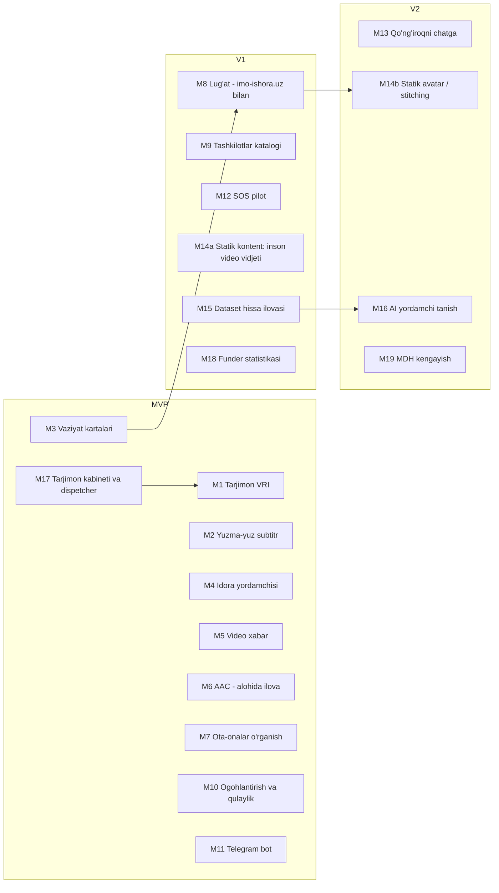

# 06a. Mahsulot konsepsiyasi va funksiyalar

> **Qisqacha**
> - Biz "AI tarjimon" qurmaymiz. Biz **kar odamni jonli inson tarjimoniga tezroq ulaydigan**, yuzma-yuz suhbatni subtitr bilan osonlashtiradigan va kundalik vaziyatlarga tayyor imo-ishora kontentini beradigan **bepul, ochiq kodli, kar odamlar boshqaradigan** platforma quramiz.
> - O'zbekistonda Surdo AI (davlat, avatar + kamera), imo-ishora.uz (Sharoit Plyus lug'ati), "surdo-online" planshetlari va Karlar jamiyatining bepul tarjimonlari allaqachon bor. Biz ular bilan **raqobat qilmaymiz, integratsiya qilamiz**.
> - MVP yadrosi 7 ta bo'sh joyni yopadi: jonli VRI (halol ish soatlari, ro'yxatdan o'tmasdan), yuzma-yuz subtitr rejimi, vaziyat kartalari, idora/murojaat yordamchisi, video xabar, AAC va ota-onalar uchun o'rganish.
> - Kanal: PWA + Android birinchi, Telegram bot yordamchi (eslatma, bron, kartalar), iOS keyin.
> - SOS, operator bilan "qo'ng'iroqni chatga", statik kontent uchun avatar, AI yordamchi tanish va MDH ga kengayish keyingi bosqichlarda.

---

## 1. Vizyon va missiya

| | Matn |
|---|---|
| **Vizyon** | O'zbekistonda (keyin MDH da) kar, zaif eshituvchi va gapira olmaydigan odam istalgan joyda, istalgan vaqtda o'z tilida tushunilishi va tushunishi. |
| **Missiya** | Kar jamoasi boshqaradigan, bepul va ochiq kodli platforma orqali (1) jonli tarjimonga yo'lni qisqartirish, (2) yuzma-yuz muloqotni subtitr va tayyor iboralar bilan yengillashtirish, (3) o'zbek imo-ishora tili (O'IIT, UzSL) uchun birinchi ochiq, rozilik asosidagi ma'lumot bazasini yaratish. |
| **Shior (ichki)** | "Sizni inson tarjimonga tezroq ulaymiz" - "tarjimonni almashtiramiz" emas. |

**Nega aynan shunday.** Ehtiyoj ta'minotda, texnologiyada emas: Toshkentda taxminan 10 malakali tarjimon taxminan 8 000 eshitish nogironligi bo'lgan odamga, ya'ni ~1:800 ([Gazeta.uz 2025-07](https://www.gazeta.uz/ru/2025/07/15/sign-language/); [Gazeta.uz 2025-09](https://www.gazeta.uz/ru/2025/09/28/sign-language/)). Karlar jamiyatida 22 000+ a'zo va ~8 000 bola ([Gazeta.uz 2025-09](https://www.gazeta.uz/ru/2025/09/28/sign-language/)); jamiyatning o'z videosida ~30 000 a'zo deyilgan ([YouTube, 2025-03-11](https://www.youtube.com/watch?v=zGfIHZnmmHw)) - manbalar zid, ikkalasi ham ko'rsatildi. Yuksalish so'rovida (n=102) 56% "doim/tez-tez" qiyinchilikka uchraydi ([Gazeta.uz 2025-09](https://www.gazeta.uz/ru/2025/09/28/sign-language/)).

## 2. Pozitsiya: kim bor va biz qayerda turamiz

| O'yinchi | Nima qiladi | Bizning munosabat |
|---|---|---|
| **Surdo AI** (Ijtimoiy himoya milliy agentligi IT markazi) | Kamera orqali imo-ishora -> matn, matn -> 3D avatar, 1000+ so'z, uz/ru, Chrome kengaytmasi; Google Play 1 ming+ yuklanma ([Google Play](https://play.google.com/store/apps/details?id=com.ihma.surdoai); [podrobno.uz](https://podrobno.uz/cat/tehnp/v-uzbekistane-razrabotali-ii-platformu-dlya-perevoda-rechi-i-teksta-na-yazyk-zhestov/)) | Avatar/kamera tarjimonida raqobat qilmaymiz. Lug'at va dataset bo'yicha hamkorlik taklif qilamiz. |
| **imo-ishora.uz** (Sharoit Plyus) | 2000+ so'z video lug'at, 20 kategoriya, so'z tavsiya formasi ([imo-ishora.uz](https://imo-ishora.uz/)); Stirling Foundation granti $30 120, 2025-05-14 dan 2026-05-14 gacha ([Sharoit Plus](https://sharoitplus.uz/category/loyihalar/)) | Lug'at bazasi bo'yicha asosiy hamkor; grant tugagan, ochiq kod va hosting bilan uzaytirishni taklif qilamiz. |
| **"surdo-online" planshetlari** (Adliya vazirligi DXM) | 2020-11 da 11 Toshkent markazida pilot, keyin 14 hududiy bo'linmada ([yuz.uz 2023](https://yuz.uz/ru/news/tsentr-gosuslug-otdela-yustitsii-goroda-navoi-vvel-novy-vid-servisa-dlya-lyudey-s-invalidnostyu-so-sluxom)); bir bankda xodim ulay olmagan ([Gazeta.uz 2025-09](https://www.gazeta.uz/oz/2025/09/30/sign-language/)) | Dispetcher tomoni uchun ochiq kodli backend sifatida taklif qilamiz, dublikat qilmaymiz. |
| **Karlar jamiyati bepul tarjimonlari** | A'zolarga notarius, sud, militsiya, shifoxona, davlat idoralarida bepul surdotarjima ([YouTube](https://www.youtube.com/watch?v=zGfIHZnmmHw)) | Ularning tarjimonlari va a'zolari - birinchi foydalanuvchilar; jamiyat boshqaruvda ishtirok etadi. |
| **Sharoit Plyus HuquqPlus video-qo'ng'iroq markazi** | Imo-ishora tarjimonli video-call markazi (2025, $9 000; 2026-08-01 dan 12-31 gacha 238,25 mln so'm) ([Sharoit Plus](https://sharoitplus.uz/category/loyihalar/)) | Bizning VRI dispetcher moduli ularning markazi uchun ochiq vosita bo'lishi mumkin. |

**Bo'sh joy (MVP yadrosi):** hech kim (a) halol e'lon qilingan soatli, login talab qilmaydigan VRI ni, (b) o'zbek/rus jonli subtitrli yuzma-yuz rejimni, (c) kar imo-ishorachi yozgan vaziyat kartalarini, (d) idora/murojaat yordamini, (e) to'g'ri ko'zgu effektli video xabarni, (f) o'zbekcha AAC ni, (g) ota-onalar uchun o'rganishni bitta ochiq platformada bermaydi.

## 3. Tamoyillar

| # | Tamoyil | Amaliy qoida | Dalil |
|---|---|---|---|
| T1 | **Kar odamlar boshqaradi** ("Nothing about us without us", "Bizsiz biz haqimizda hech narsa") | Kengashda kar ko'pchilik; kar hissa qo'shuvchilarga pul; viloyat maslahat kengashi; har AI funksiya kar kengash veto'sidan o'tadi | WFD: kar odamlar yangi AI vositalarini ham boshqarishi kerak ([WFD](https://wfdeaf.org/?p=18327)); Desai 2024: 43 datasetdan faqat 16 tasi to'liq kar imo-ishorachilardan ([arXiv 2403.02563](https://arxiv.org/html/2403.02563v1)); [Gazeta.uz 2022](https://www.gazeta.uz/oz/2022/04/22/sign-language/) |
| T2 | **Bepul** | Kar foydalanuvchidan hech qachon pul olinmaydi; sessiya limiti, pullik til yoki pullik TTS yo'q | Barcha kategoriyalarda eng ko'p shikoyat - pul (paywall, limit, billing) ([global_feature_matrix §9](https://www.hearingtracker.com/apps/ava)); SurdoRu 990 rubl/oy, reyting 2,5 ([RuStore](https://www.rustore.ru/catalog/app/com.SurdoRu.surdoru)) |
| T3 | **Ochiq** | Kod Apache-2.0; ochiq ma'lumot CC BY-SA 4.0 yoki CC BY 4.0; DPGA ro'yxatiga topshirish | MDH da birorta relay ilovasi ochiq kodli emas ([russia_cis_competitors §10](https://github.com/yandex/deaf)); DPG Standard 9 indikator, ro'yxat bepul ([DPGA](https://www.digitalpublicgoods.net/digital-public-goods)) |
| T4 | **Maxfiylik** | Qo'ng'iroq yozilmaydi (default); subtitr xotirada; yuz videosi O'zbekistonda; qatlamli rozilik; pose "anonim" deb va'da qilinmaydi | ZRU-547 27-1-modda: biometrik ma'lumot O'zbekistonda saqlanadi ([lex.uz](https://lex.uz/docs/4396419)); Ava'ning yordam sahifasi va maxfiylik siyosati zid - qilmaslik kerak bo'lgan namuna ([HearingTracker](https://www.hearingtracker.com/apps/ava)) |
| T5 | **Halol ish soatlari** | Tarjimon soatlari va taxminiy kutish vaqti ochiq ko'rsatiladi; 24/7 faqat xodim bo'lganda | Moi RZhYa: "24/7" va'dasi, favqulodda holatda 10 daqiqa javob yo'q ([RuStore](https://www.rustore.ru/catalog/app/com.interpreter_android.ru)); Azerbayjon Du-Sh 09:00-16:00 bilan ~1 000 foydalanuvchi ([sosial.gov.az](https://sosial.gov.az/en/media/news/nearly-1000-people-have-benefited-from-the-let-us-be-your-voice-online-sign-language-interpretation-service-9584)) |
| T6 | **Video birinchi, matn yordamchi, ikonka bilan** | Har ekranda ikonka; asosiy oqimlarda imo-ishora video yordami | AQSh kar bitiruvchilar o'qish darajasi ~4-sinf ([IES](https://ies.ed.gov/about/external-person/susan-easterbrooks)); imo-ishorachilar video yuklash uzoqligi sababli matnga o'tadi ([UW HCI](https://medium.com/hci-design-at-uw/social-app-accessibility-for-deaf-signers-9b3f84027c92)) |
| T7 | **Ishonchlilik funksiyadan oldin** | Kiruvchi qo'ng'iroq signali, video barqarorligi, navbat shaffofligi - har relizdan oldingi o'lchov | VRS shikoyatlari deyarli to'liq ishonchlilik haqida: o'tkazib yuborilgan qo'ng'iroq, qora ekran ([HearingTracker ntouch](https://www.hearingtracker.com/apps/sorenson-ntouch)) |
| T8 | **Integratsiya, yangi ijtimoiy tarmoq emas** | Telegram/WhatsApp dan kirish; mavjud davlat va NNT xizmatlariga ulanish | Kar odamlar mavjud messenjerlarda ([Frontiers 2023](https://www.frontiersin.org/journals/communication/articles/10.3389/fcomm.2023.1175461/epub)); Komek-103 boti foydalanuvchiga yetmadi - tarqatish jamiyat orqali bo'lishi kerak ([TengriHealth](https://tengrihealth.kz/article//daze-zapis-vracu-kvest-kazaxstancy-naruseniem-sluxa-4136/)) |
| T9 | **Yuqori xavfli joyda AI yo'q** | Tibbiyot, sud, politsiya, favqulodda holatda faqat inson tarjimon; ochiq va'da (pledge) e'lon qilinadi | WFD/WASLI 2018 bayonoti ([PDF](https://wfdeaf.org/wp-content/uploads/WFD-and-WASLI-Statement-on-Avatar-FINAL-14032018-Updated-14042018.pdf)); VRI shifoxonalarda kar nazoratisiz joriy qilingani "o'ta zararli" ([3Play 2024](https://www.3playmedia.com/access/2024-hub/deaf-safe-ai)) |

## 4. Personalar

| # | Persona | Tili | Asosiy og'riq | Asosiy modullar |
|---|---|---|---|---|
| P1 | **Dilshod, 34, kar imo-ishorachi**, Samarqand, bozorda savdo | O'IIT (kirill daktil), o'zbek yozuvi zaif | Idorada yo'l topa olmaydi, tarjimon kam, "bizni hech narsa bilmaydi deb o'ylashadi" | VRI, vaziyat kartalari, murojaat yordamchisi, video xabar |
| P2 | **Malika opa, 68, zaif eshituvchi (keksa)**, Toshkent | O'zbek/rus, imo-ishora bilmaydi | Shifokor va bank xodimini eshitmaydi, kichik matnni o'qiy olmaydi | Yuzma-yuz subtitr (katta shrift), kartalar |
| P3 | **Nodira, 31, koxlear implantli 4 yoshli bolaning onasi**, Namangan | O'zbek, imo-ishorani bilmaydi | Bola bilan til ko'prigi yo'q, implant reabilitatsiyasi haqida ma'lumot kam | Ota-onalar o'rganish moduli, lug'at, video xabar |
| P4 | **Jasur, 22, eshitadi, lekin gapira olmaydi** (BTsP / afaziya) | O'zbek | Ovoz bilan javob bera olmaydi, imo-ishora bilmaydi | AAC (Cboard fork), yozuv -> TTS |
| P5 | **Doktor Rustam / bank xodimi Gulnoza** (eshituvchi xizmat ko'rsatuvchi) | O'zbek/rus | Kar mijoz bilan qanday muloqot qilishni bilmaydi, ilova o'rnatishni xohlamaydi | QR orqali login'siz qo'shilish, subtitr, "tarjimon chaqirish" tugmasi |
| P6 | **Gulnora, 40, sertifikatli imo-ishora tarjimoni** | O'IIT, o'zbek, rus | Ortiqcha yuk, kam maosh, jadval tartibsiz | Tarjimon kabineti, navbat, bron, adolatli to'lov |

**Persona asoslari.** Bolalarning 90-95% eshituvchi ota-onalarda tug'iladi ([BU 2017](https://www.bu.edu/articles/2017/asl-language-acquisition)); davlat koxlear implantni faqat 5 yoshgacha bepul beradi ([Kun.uz 2018](https://kun.uz/news/2018/10/06/uzbekistonda-kohlear-implantat-muammosiga-ecim-topadimi-2-jillik-navbatda-turgan-horazmlik-ota-ona-tasvisi)); tarjimonlar asosan CODA, ortiqcha yuklangan ([Gazeta.uz 2025-09](https://www.gazeta.uz/ru/2025/09/28/sign-language/)); "kar, gapirmaydi, bilmaydi deb o'ylashadi" va byurokratiya bilan muloqot og'rig'i - ZAMONUZ transkripti ([YouTube](https://www.youtube.com/watch?v=Z0UcdGWCS8s)); gapira olmaydiganlar AAC ga muhtoj, bu alohida mahsulot ([UNICEF](https://www.unicef.org/innovation/stories/giving-every-child-voice-aac-technology)). Persona ismlari va yoshlari - tasvir uchun (baho).

## 5. Asosiy foydalanuvchi yo'llari

### 5.1 Shifoxona (P1 + P5)

```mermaid
sequenceDiagram
    participant K as Kar bemor (P1)
    participant T as Telefon (PWA)
    participant Q as Tarjimon navbati
    participant I as Tarjimon (P6)
    participant D as Shifokor (P5)
    K->>T: "Shifoxona" kartalari: og'riq joyi, darajasi
    T-->>D: Katta matn + ikonka (shifokor tomonga burilgan)
    D->>T: Gapiradi -> jonli subtitr
    Note over K,D: Murakkab gap yoki tashxis bo'lsa
    K->>T: "Tarjimon chaqirish" (doim ko'rinadi)
    T->>Q: Navbat, taxminiy kutish ko'rsatiladi
    Q->>I: Biriktirish
    I-->>K: Video (imo-ishora)
    I-->>D: Ovoz
    Note over K,D: Qo'ng'iroq yozilmaydi; boshlashdan oldin bemor roziligi
```

Qoidalar: VRI ni bemor roziligisiz boshlamaslik ([JMIR 2022](https://pmc.ncbi.nlm.nih.gov/articles/PMC9227653/)); og'ir tashxis, operatsiya, tug'ruq uchun yuzma-yuz tarjimonni bron qilishni taklif qilish (shu manba: VRI og'ir/stressli holatda afzal ko'rilmaydi); qabulxonada planshet yoki katta ekran (tavsiya: kamida 19,5 dyuym, shu manba).

### 5.2 Bank (P2 + P5)
1. Malika opa bank xodimiga QR kodni ko'rsatadi yoki xodim stoldagi QR ni skanerlaydi -> login'siz subtitr sessiyasi (Ava namunasi: [HearingTracker](https://www.hearingtracker.com/apps/ava)).
2. Ekran ikkiga bo'linadi: yuqori yarmi 180 gradus burilgan (xodim uchun), pastki yarmi mijoz uchun katta shriftli subtitr.
3. Mijoz "Karta bloklandi", "Qayta tiklash" kabi bank kartalaridan tanlaydi; TTS o'qiydi.
4. Xato so'zni bosib tuzatish; "ASR xato qilishi mumkin" belgisi.

### 5.3 Mahalla / davlat idorasi (P1)
1. "Idora yordamchisi" -> "Qaysi idora?" (mahalla, DXM, soliq, pensiya) -> kerakli hujjatlar ro'yxati ikonka va imo-ishora video bilan.
2. Ariza shablonini to'ldirish (oddiy savollar, imo-ishora video yordami) -> tayyor matnni xodimga ko'rsatish yoki chop etish.
3. Kerak bo'lsa VRI. Fuqarolar qabulida surdotarjimon ishtiroki majburiy ekanini eslatuvchi karta ([anhor.uz](https://anhor.uz/uzl/news/fuqarolar-qabuli-va-sayyor-qabullarni-otkazishda-surdotarjimon-ishtiroki/)).
Asos: byurokratiya bilan muloqot og'rig'i ([ZAMONUZ](https://www.youtube.com/watch?v=Z0UcdGWCS8s)).

### 5.4 Ish suhbati (P1 + ish beruvchi)
1. Kar nomzod oldindan tarjimonni bron qiladi (vaqt, davomiyligi, mavzu: "ish suhbati").
2. Ish beruvchiga havola yuboriladi (login'siz brauzerda ochiladi); tarjimon tile'i doim pinned.
3. Ish beruvchiga eslatma: I/II guruh nogironni ishga olsa 50 mln so'mgacha subsidiya, u tarjimon xarajatini ham qoplashi mumkin ([anhor.uz](https://anhor.uz/uzl/news/1-iyundan-nogironligi-bo-lgan-shaxslarni-ishga-qabul-qilgan-tadbirkor/)).
Asos: Perekladach ZhM ish suhbatlarini alohida holat sifatida qo'llab-quvvatlaydi ([App Store UA](https://apps.apple.com/ua/app/%D0%BF%D0%B5%D1%80%D0%B5%D0%B2%D0%BE%D0%B4%D1%87%D0%B8%D0%BA-%D0%B6%D1%8F/id1303476708?l=uk)); Yandex Lavka kar xodimlarni ishga olishi va Sharoit Plyus tarjimonlari ([Gazeta.uz 2026](https://www.gazeta.uz/oz/2026/06/03/yandex-lavka-disabled/)).

### 5.5 Favqulodda holat (v1/v2, MVP da faqat karta)
- **MVP:** "Men karman, matn yoki imo-ishora kerak" kartasi + 101/102/103/112 raqamlari + manzilni katta matnda ko'rsatish. Ilova 112 o'rnini bosadi deb va'da qilinmaydi ([EENA Irlandiya](https://eena.org/document/real-time-text-in-ireland)).
- **v1/v2:** to'liq SOS moduli (7-bo'lim, M12).

### 5.6 Oila (P3)
1. Ota-ona har kuni 5 daqiqalik dars: oila, salomlashish, sonlar, kundalik buyruqlar (kar o'qituvchi videosi, sekin rejim, takrorlash).
2. Faqat o'rgatilgan narsadan test ([HearingTracker Bloom](https://www.hearingtracker.com/apps/asl-bloom)).
3. Bola bilan video xabar almashish; implant reabilitatsiyasi bo'yicha hamkor ma'lumotlari (Zamin fondi).
Asos: erta imo-ishora nutqni to'smaydi ([JSLHR](https://pubs.asha.org/doi/pdf/10.1044/2022_JSLHR-22-00505?download=true)); PQ-407 ota-onalarga bepul O'IIT kurslarini beradi ([norma.uz](https://www.norma.uz/oz/qonunchilikda_yangi/uzbek_imo-ishora_tili_va_brayl_alifbosini_rivojlantirish_buyicha_chora-tadbirlar_belgilandi)).

## 6. Modullar xaritasi



| Modul | Bosqich | Qisqa mazmun |
|---|---|---|
| M1 Tarjimon (VRI) | MVP | Bir tugma, login'siz, navbat, halol soatlar |
| M2 Yuzma-yuz subtitr | MVP | Split-screen, uz/ru STT, yozish + TTS, tuzatish |
| M3 Vaziyat kartalari | MVP | Shifoxona, bank, taksi, politsiya, mahalla; kar yozgan video |
| M4 Idora/murojaat yordamchisi | MVP (asosiy) | Hujjat ro'yxati, ariza shablonlari, imo-ishora yordami |
| M5 Video xabar | MVP | Asinxron, ko'zgu to'g'ri, past bitreyt |
| M6 AAC | MVP (oxirgi to'lqin) | Cboard fork, alohida GPL ilova |
| M7 Ota-onalar o'rganish | MVP (yadro darslar) | Qisqa darslar, sekin video, paywall yo'q |
| M8 Lug'at | v1 | Global Signbank asosida, imo-ishora.uz bilan integratsiya |
| M9 Tashkilotlar katalogi | v1 | "Imo-ishorada qo'ng'iroq qilsa bo'ladigan" tashkilotlar |
| M10 Ogohlantirish va qulaylik | MVP (kesishgan) | Vibratsiya, chiroq, to'liq ekran signal, shrift, kontrast |
| M11 Telegram bot | MVP | Eslatma, bron, kartalar, ilovaga havola |
| M12 SOS | v1 pilot / v2 | EU 2023/444 6 talabi, FVV/112 bilan pilot |
| M13 Qo'ng'iroqni chatga | v2 | Operator bilan, MTS namunasi |
| M14a/b Statik kontent | v1 (inson video) / v2 (avatar) | Signly namunasi, keyin stitching / performs |
| M15 Dataset hissa ilovasi | v1 | Rozilik, yozish, to'lov, tekshiruv (06c) |
| M16 AI yordamchi tanish | v2 | Daktil va alohida belgi top-k, kar tasdiqlaydi |
| M17 Tarjimon kabineti | MVP | Navbat, jadval, bron, daqiqa hisobi |
| M18 Funder statistikasi | v1 | Daqiqalar, kutish vaqti, hududlar - donor/davlatga hisobot |
| M19 MDH kengayish | v2 | Qirg'iz, tojik, qozoq UI va lokal hamkorlar |

## 7. Modullar tafsiloti

### M1. Tarjimon (VRI) - MVP
- **Nima:** kar foydalanuvchi bir tugma bilan jonli imo-ishora tarjimoniga videoqo'ng'iroq qiladi; eshituvchi tomon shu xonaga brauzer/QR orqali login'siz qo'shiladi (uch tomonlama video). Ish soatlari va taxminiy kutish vaqti ekranda.
- **Nega:** eng ko'p so'ralgan narsa - yagona tarjimon bazasi va onlayn bron ([Gazeta.uz 2025-09](https://www.gazeta.uz/ru/2025/09/28/sign-language/)). Isbotlagan mahsulotlar: Contact Scotland BSL (login'siz qo'ng'iroq, [FAQ](https://contactscotland-bsl.org/faqs/)); ZP Sivo (eshituvchi tomon ham kar odamni ko'radi, [App Store](https://apps.apple.com/us/app/sivo/id1524340854)); Perekladach ZhM (4,8 / 71 baho, [App Store UA](https://apps.apple.com/ua/app/%D0%BF%D0%B5%D1%80%D0%B5%D0%B2%D0%BE%D0%B4%D1%87%D0%B8%D0%BA-%D0%B6%D1%8F/id1303476708?l=uk)); Surdo-pomosh sharhlarida maqtov faqat inson tarjimonlarga ([App Store](https://apps.apple.com/ru/app/%D1%81%D1%83%D1%80%D0%B4%D0%BE-%D0%BF%D0%BE%D0%BC%D0%BE%D1%89%D1%8C/id6445996571?l=en-GB)). Kutish vaqtini ko'rsatish hech bir mahsulotda topilmadi - farqlovchi ([global_feature_matrix #22](https://www.hearingtracker.com/apps/sorenson-ntouch)).
- **Qabul mezonlari:**
  1. Ro'yxatdan o'tmagan foydalanuvchi ilova/sayt ochilgandan keyin 2 ta bosishda navbatga tushadi.
  2. Ish soatlari tashqarisida tugma "yopiq, ertaga 09:00" va bron taklifini ko'rsatadi; hech qachon javobsiz kutish yo'q.
  3. Navbatdagi joy va taxminiy kutish (daqiqa) har 15 soniyada yangilanadi.
  4. Tarjimon tile'i har doim pinned, ekran ulashishda ham qoladi.
  5. Qo'ng'iroq default yozilmaydi; yozish faqat ikki tomon aniq roziligi bilan.
  6. 3G/past tarmoqda (baho: 300-500 kbit/s) imo-ishora o'qiladigan video saqlanadi (Deaf testerlar tasdiqlaydi).
  7. Har qo'ng'iroq uchun daqiqa, kutish vaqti va mavzu (shaxsiy ma'lumotsiz) M18 ga yoziladi.

### M2. Yuzma-yuz suhbat (split-screen subtitr) - MVP
- **Nima:** telefon stolga qo'yiladi; yuqori yarmi 180 gradus burilib eshituvchiga qaraydi; eshituvchi gapiradi -> o'zbek yoki rus jonli subtitr; kar tomon yozadi yoki tayyor iborani bosadi -> TTS ovoz chiqaradi. Har so'zni bosib tuzatish, "tarjimon chaqirish" tugmasi doim ko'rinadi.
- **Nega:** Live Transcribe foldable dual screen, yozilgan javobni TTS ([Google Support](https://support.google.com/accessibility/android/answer/9158064?hl=en); [HearingTracker](https://www.hearingtracker.com/apps/google-live-transcribe)); Yandex Razgovor "Dialog" rejimi, RuStore 200k+ yuklanma ([RuStore](https://www.rustore.ru/catalog/app/ru.yandex.subtitles)). Apple Live Captions rus va o'zbekni qo'llamaydi ([Apple](https://www.apple.com/ios/feature-availability/)) - iPhone'da bo'shliq. Eshituvchining talaffuzi kar odam qoniqishiga sezilarli ta'sir qiladi ([NSF PAR](https://par.nsf.gov/servlets/purl/10355406)); EvolveCaptions: eshituvchi tuzatishi bilan 1 soatda WER pasaygan ([arXiv 2510.02181](https://arxiv.org/html/2510.02181v1)). Asosiy shikoyatlar: so'z tushib qolishi, miltillash ([HearingTracker](https://www.hearingtracker.com/apps/google-live-transcribe)).
- **Qabul mezonlari:**
  1. Subtitr kechikishi (gap tugagandan to ekranga) median 1,5 s dan kam (baho, o'z test to'plamida o'lchanadi, 06b §9).
  2. Barqarorlashgan so'zlar qayta o'zgarmaydi (miltillash yo'q); faqat oxirgi "qoralama" qism kulrang.
  3. Eshituvchiga birinchi ochilishda "aniq gapiring, qarab turing, navbat bilan" eslatmasi.
  4. So'zni bosish -> tahrir; tuzatish faqat qurilmada qoladi (rozilik bo'lmasa serverga ketmaydi).
  5. Til: uz-Latn, uz-Cyrl (transliteratsiya), ru; aralash nutqda til almashish qo'lda tanlanadi.
  6. Tarix default 24 soat, foydalanuvchi 3 kungacha yoqishi yoki o'chirishi mumkin (Live Transcribe namunasi).
  7. Internet yo'q bo'lsa offlayn rejim (Vosk small-uz/ru) ogohlantirish bilan ishlaydi.

### M3. Vaziyat kartalari - MVP
- **Nima:** shifoxona, dorixona, bank, taksi, politsiya, mahalla, do'kon bo'yicha karta to'plamlari: ikonka + sodda matn (uz-Latn/uz-Cyrl/ru) + kar imo-ishorachi yozgan video + TTS. Offlayn ishlaydi.
- **Nega:** global yagona mahsulot topilmadi, nora piktogrammalardan foydalanadi ([global_feature_matrix #13](https://www.nora-notruf.de/google-play-store)); past savodxonlik ([IES](https://ies.ed.gov/about/external-person/susan-easterbrooks)); Yandex Razgovor tayyor iboralar ([yandex/deaf](https://github.com/yandex/deaf)); tibbiyot, huquq, transport, mahalla vaziyat lug'atlari allaqachon bor (imo-ishora.uz, Ijtimoiy inspeksiya kursi) - hamkorlik nuqtasi ([browser_youtube_google_findings](https://imo-ishora.uz/dictionary); [YouTube](https://www.youtube.com/playlist?list=PL2T-j53zsYyPK9PciDuM0hKTlEC2yC-YY)). Politsiya kartasi matni: "Men karman. Malakali imo-ishora tarjimoni kerak. Usiz so'roqqa rozi emasman" ([deaf_centered_product_ux §3](https://theconversation.com/when-dealing-with-the-police-deaf-people-are-at-a-major-disadvantage-62027)).
- **Qabul mezonlari:**
  1. MVP da kamida 7 vaziyat x 20-30 karta = 150-200 karta (baho).
  2. Har karta videosi kar imo-ishorachi tomonidan yozilgan va 2 ta kar ekspert tomonidan tasdiqlangan.
  3. Kartalar internetsiz ochiladi (PWA kesh); jami hajm 200 MB dan kam (baho).
  4. Kar foydalanuvchilar usability testida 80%+ kartani 10 soniyada topadi (baho mezon).
  5. Kartalar o'rni o'zgarmaydi (motor-plan barqaror grid, AAC dan saboq: [global_feature_matrix §6](https://ixd.prattsi.org/2024/09/assistive-technology-proloquo2go-ios/)).

### M4. Idora/murojaat yordamchisi - MVP (asosiy)
- **Nima:** davlat xizmatlari (DXM, mahalla, soliq, pensiya, ZAGS) uchun: qaysi hujjat kerak, qanday ariza yoziladi - imo-ishora video + oddiy matn + ariza shabloni; tayyor matnni ko'rsatish/chop etish/Telegram'ga yuborish; kerak bo'lsa VRI.
- **Nega:** Karlar jamiyati a'zolarga ariza/shikoyat yozishda yordam beradi ([YouTube](https://www.youtube.com/watch?v=zGfIHZnmmHw)); ZAMONUZ: idorada yo'l topa olmaslik, xatlar javobsiz ([YouTube](https://www.youtube.com/watch?v=Z0UcdGWCS8s)); Moi RZhYa "matnli hujjatni imo-ishora videoga moslash" xizmati ([RuStore](https://www.rustore.ru/catalog/app/com.interpreter_android.ru)); Sharoit Plyus 72+ huquqiy maqola imo-ishora, easy-read va audioda ([Sharoit Plus](https://sharoitplus.uz/category/loyihalar/)) - kontent hamkorligi.
- **Qabul mezonlari:**
  1. MVP da 10 ta eng ko'p uchraydigan murojaat turi (ro'yxat kar maslahat kengashi bilan tanlanadi).
  2. Har tur uchun imo-ishora video (Sharoit Plyus HuquqPlus kontentidan, ruxsat bilan yoki yangi yozuv).
  3. Ariza matni shablon asosida; LLM ishlatilsa faqat soddalashtirish uchun, foydalanuvchi har jumlani tasdiqlaydi; shaxsiy ma'lumot tashqi LLM ga yuborilmaydi (ZRU-1115 javobgarlik: [anhor.uz](https://anhor.uz/ru/news/uzbekistan-criminalizes-illegal-ai-use-of-personal-data)).
  4. Huquqiy maslahat bermaydi; "bu yuridik maslahat emas" belgisi.

### M5. Video xabar - MVP
- **Nima:** bir bosishda imo-ishora videosini yozish va yuborish (asinxron), past bitreytda siqish, ko'zgu effekti to'g'ri: preview ko'zguda, yuboriladigan video haqiqiy yo'nalishda. Telegram'ga ulashish mumkin.
- **Nega:** Glide va Marco Polo yuz minglab kar foydalanuvchiga ega bo'ldi; Marco Polo kar foydalanuvchilar "teskari imo-ishora" haqida xabar bergach kamerani o'zgartirdi ([Next Big Idea Club](https://cdn2.nextbigideaclub.com/magazine/nir-eyal-video-messaging-app-found-unexpected-success-thanks-deaf-community/3273/)); yozish va yuklash uzoqligi imo-ishorachilarni matnga itaradi ([UW HCI](https://medium.com/hci-design-at-uw/social-app-accessibility-for-deaf-signers-9b3f84027c92)); video trafik qimmat ([UWC](https://repository.uwc.ac.za/handle/10566/3705)).
- **Qabul mezonlari:**
  1. Yozishdan yuborishgacha 1 bosish (yozib bo'lgach avtomatik yuborish yoqilishi mumkin).
  2. Qabul qiluvchida chap va o'ng qo'l to'g'ri ko'rinadi (avtomatik test: asimmetrik belgi bilan).
  3. 30 soniyali xabar 1,5 MB dan kichik (baho), yuz va qo'llar o'qiladi (kar testerlar).
  4. Trafik indikatori va "faqat Wi-Fi" sozlamasi.

### M6. AAC (gapira olmaydiganlar uchun) - MVP, alohida ilova
- **Nima:** Cboard fork: o'zbekcha (lotin va kirill) belgi-taxtalar, o'zbek TTS, O'zbekiston vaziyatlari (klinika, idora, transport, oila) uchun tayyor taxtalar, imo-ishora video tile'i.
- **Nega:** Cboard GPL-3.0, faol (2026-11-11), ru-RU deyarli to'liq, uz yo'q; reklama/PayPal/telemetriyani olib tashlash kerak ([hands_on_repo_audit §7](https://github.com/cboard-org/cboard)); UNICEF moliyalashtirgan, ~44 til ([UNICEF](https://www.unicef.org/innovation/stories/giving-every-child-voice-aac-technology)); tijoriy AAC qimmat (Proloquo2Go ~$249,99, [Pratt IXD](https://ixd.prattsi.org/2024/09/assistive-technology-proloquo2go-ios/)); TD Snap nutqni obunaga qo'ygan - qilmaymiz ([AlternativeTo](https://alternativeto.net/software/td-snap)).
- **Qabul mezonlari:**
  1. uz-UZ va uz-Cyrl lokal fayllari (~4 000 qator) to'liq; `i18n.js` da alias (Serbiya kirill namunasi).
  2. Kamida bitta o'zbek TTS ovozi ishlaydi; ovoz bo'lmasa til yashirinmaydi (Cboard TTS-gate muammosi hal qilingan).
  3. Reklama, PayPal va uchinchi tomon analitikasi yo'q.
  4. ARASAAC (CC BY-NC-SA) ishlatilmaydi yoki alohida belgilanadi; Mulberry (CC BY-SA) default.
  5. Ilova GPL-3.0 bo'lib qoladi va asosiy platforma bilan faqat HTTP orqali gaplashadi.

### M7. Ota-onalar uchun o'rganish moduli - MVP (yadro darslar)
- **Nima:** kunlik 5 daqiqalik darslar (oila, salomlashish, sonlar, ovqat, his-tuyg'u), kar o'qituvchi videosi, sekin va takror rejim, ko'zgu ko'rinish, faqat o'rgatilganidan test, offlayn saqlash.
- **Nega:** eng yaxshi o'zbekcha dars 150K ko'rish, keyingi darslarda 4-7K ga tushadi - davom ettirish qiyin, interaktivlik kerak ([browser_youtube_google_findings §2](https://www.youtube.com/playlist?list=PLkREkayoYCyIbxC-s0cOABSwdhkdbcbgz)); ASL Bloom 4,9 (38K) - sekin video, takror, lug'at maqtovi; paywall va AI rasmlar shikoyati ([HearingTracker](https://www.hearingtracker.com/apps/asl-bloom)); Lingvano 2 bobdan keyin paywall ([marlvel](https://marlvel.ai/apps/com-lingvano-app)).
- **Qabul mezonlari:**
  1. MVP da 20 dars, har biri kar o'qituvchi yozgan; AI-generatsiya rasm yo'q.
  2. Testda faqat o'tilgan belgilar.
  3. Hech qanday paywall yoki kunlik limit.
  4. Daktil: lotin va kirill alifbolari alohida (06c §2), qaysi biri o'rgatilayotgani aniq yozilgan.

### M8. Lug'at - v1 (MVP da kartalar uchun ichki baza)
- **Nima:** Global Signbank asosidagi O'IIT leksik bazasi (gloss, video, dialekt, uz/ru kalit so'zlar); ommaviy ko'rinish imo-ishora.uz bilan birlashtiriladi (API yoki ma'lumot almashish), raqobatchi lug'at sayti ochilmaydi. Lotin so'rov kirill kalit so'zni topadi va aksincha.
- **Nega:** Global Signbank BSD-3, Django 6.1, faol, ko'p datasetli, JSON API ([hands_on_repo_audit §3](https://github.com/Signbank/Global-signbank)); Spreadthesign tillar orasida taqqoslash, sekin rejim, offlayn ([outilstice](https://outilstice.com/en/spreadthesign-dictionnaire-international-des-langues-de-signes/)); imo-ishora.uz da hududiy variant belgisi ko'rinmaydi ([imo-ishora.uz](https://imo-ishora.uz/)).
- **Qabul mezonlari:** har belgida dialekt/maktab va daktil tizimi maydoni; sekin (0,5x) va takror; offlayn sevimlilar; Signbank -> s2s eksport ishlaydi (06b §6).

### M9. Tashkilotlar katalogi - v1
- **Nima:** "Imo-ishorada murojaat qilsa bo'ladigan" tashkilotlar ro'yxati (bank, klinika, DXM, operator) - bosilganda o'sha tashkilot to'laydigan yoki hamkor tarjimon ulanadi; kar tadbirkorlar katalogi.
- **Nega:** SignVideo ilovasi 150+ xizmatlik SignDirectory bilan ochiladi, tashkilot obuna bo'lsa foydalanuvchiga bepul ([SignVideo](https://signvideo.co.uk/download/); [Bank of Scotland](https://www.bankofscotland.co.uk/contactus/signvideo)); B2B/B2G hamkorlarga ko'rinish beradi.
- **Qabul mezonlari:** har yozuvda ish soatlari; kamida 10 hamkor tashkilot bilan ishga tushadi (baho maqsad).

### M10. Ogohlantirish va qulaylik - MVP (barcha modullarda)
- **Nima:** kiruvchi qo'ng'iroq va xabar uchun vibratsiya naqshlari, kamera chirog'i, to'liq ekranli vizual signal; shrift o'lchami, kontrast, qorong'i rejim; tizim tovush tanish funksiyalariga havola.
- **Nega:** ntouch asosiy nosozligi - kiruvchi qo'ng'iroq signali ([HearingTracker](https://www.hearingtracker.com/apps/sorenson-ntouch)); tovush hech qachon yagona signal bo'lmasligi ([deaf_centered_product_ux §5](https://www.newswire.com/news/convo-launches-platform-for-the-deaf-integrating-visual)); tovush tanishni qayta qurmaymiz, OS beradi ([Apple FY25](https://www.apple.com/government/docs/resources/No_Introduction_FY25_Whats_New_in_Apple_Accessibility.pdf)).
- **Qabul mezonlari:** Android'da ekran qulflangan holatda ham to'liq ekranli qo'ng'iroq oynasi; WCAG 2.2 AA minimal; Yandex Razgovor sharhlaridagi "katta shrift" talabi bajarilgan ([RuStore](https://www.rustore.ru/catalog/app/ru.yandex.subtitles)).

### M11. Telegram bot - MVP
- **Nima:** eslatmalar, tarjimon broni, vaziyat kartalari, video xabarni Telegram'ga ulashish, ilova/PWA ga havola. Jonli video va subtitr Telegram ichida emas - PWA yoki Android'da.
- **Nega:** Telegram Mini Apps rasmiy hujjatlarida kamera, mikrofon yoki WebRTC API yo'q; Android'da kamera xatosi haqida bug report bor ([Telegram docs](https://core.telegram.org/bots/webapps); [bugs.telegram.org](https://bugs.telegram.org/c/44936)); Azerbayjon relay Telegram/WhatsApp orqali kiradi ([sosial.gov.az](https://sosial.gov.az/en/media/news/for-the-first-time-in-our-country-an-online-sign-language-interpretation-service-based-on-video-communication-has-been-launched-8300)).
- **Qabul mezonlari:** bot orqali bron 3 qadamda; real qurilmalarda (Android Telegram, iOS Telegram, Desktop) kamera testi o'tkazilmaguncha Mini App ichida video taklif qilinmaydi.

### M12. SOS - v1 pilot, v2 to'liq
- **Nima:** bir bosishli SOS, piktogramma bilan xizmat tanlash (101/102/103/112), avtomatik GPS, saqlangan profil ("Men karman, matn/imo-ishora"), jim rejim, mashq rejimi; FVV/112 bilan pilot.
- **Nega:** EU 2023/444 6 talabi: ikki tomonlama, ro'yxatdan o'tmasdan, bepul, darhol to'g'ri markazga, teng aniqlikdagi joylashuv, ommaga ma'lum ([EUD report](https://eud.eu/wp-content/uploads/2025/06/Report-on-the-implementation-of-the-European-Electronic-Communications-Code.pdf)); nora (jim chaqiruv), DEC112 (mashq rejimi) ([nora](https://www.nora-notruf.de/google-play-store); [NGI Navigator](https://ngi-navigator.demo.abilian.com/product/dec112)); Gruziya 2015 dan 112 ga SMS va video ([MIA](https://mia.police.ge/en/112-gkhedavt-sms-da-video-zaris-servisi-mkholod-kru-da-smenadaqveitebuli-pirebistvis/7938?print=1)); O'zbekistonda 112 2025-03-25 dan to'liq ishlaydi, karlar uchun SMS/video topilmadi ([kun.uz](https://kun.uz/en/news/2025/03/25/uzbekistans-unified-112-emergency-system-now-fully-operational-nationwide)).
- **Qabul mezonlari (pilotga chiqish sharti):** FVV/112 bilan yozma kelishuv; ro'yxatdan o'tmagan foydalanuvchi ham asosiy joylashuvli SOS yubora oladi; mashq rejimi haqiqiy dispetcherni chaqirmaydi; ilova "112 ning to'liq o'rnini bosadi" demaydi.

### M13. Qo'ng'iroqni chatga - v2
- **Nima:** operator bilan: kar abonentga kelgan qo'ng'iroqni AI qabul qiladi, gapni matnga, yozilgan javobni ovozga aylantiradi; zero-rating.
- **Nega:** MTS 2026-03-10 dan bepul, 6 oyda 496 000+ qo'ng'iroq ([iphones.ru](https://www.iphones.ru/iNotes/teper-pozvonit-smogut-dazhe-gluhie-mts-zapustil-zapustil-sekretarya-dlya-gluhih-i-slaboslyshashchih); [mobile-review](https://mobile-review.com/all/?p=259570)); T-Bank 2024-11-08 dan ([kod.ru](https://kod.ru/ii-sekretar-dlya-glukhikh-i-slaboslyshashchikh)); O'zbekiston operatorlarida karlar uchun tarif topilmadi ([beeline.uz](https://beeline.uz/en/products/packages)).
- **Qabul mezonlari:** kamida bitta operator bilan shartnoma; tarjimon kerak bo'lsa M1 ga uzatish.

### M14. Statik kontent - v1 (inson video), v2 (avatar)
- **Nima (v1):** banklar, davlat xizmatlari FAQ va yo'riqnomalari uchun kar imo-ishorachi yozgan video vidjet + QR/bosma -> imo-ishora havolasi. **v2:** sign stitching yoki performs avatar faqat statik, oldindan tekshirilgan kontent uchun.
- **Nega:** Signly: inson BSL videosi saytlarga bog'langan, sayt egasi to'laydi, "tarjimonni almashtirmaydi" ([Signly FAQ](https://preview.signly.co/faqs/)); VTB avatari oldindan tayyorlangan tarjima ishlatadi ([Habr](https://habr.com/p/733914)); mocap avatar sintetikdan yaxshiroq baholangan, n=191 ([Frontiers 2022](https://www.frontiersin.org/articles/10.3389/fpsyg.2022.730917)); sign stitching bazaviy usullardan afzal ([Surrey BMVC 2024](https://arxiv.org/abs/2405.07663v2)); Hand Talk ~3,8-3,9 ([SplitMetrics](https://splitmetrics.com/apps/hand-talk-asl-sign-language/id659816995)).
- **Qabul mezonlari (v2):** har avatar/stitching chiqishi kar ekspertlar tomonidan tushunarlilik testidan o'tadi (Appraise uslubidagi 0-100 baho, 06b §9); jonli suhbatga qo'llanilmaydi.

### M15. Dataset hissa ilovasi - v1
Batafsil: 06c. Qabul mezonlari: qatlamli rozilik imo-ishora videosi bilan tushuntirilgan; to'lov avtomatik hisoblanadi; kar ekspert QA navbati; birlamchi nusxa O'zbekistondagi serverda.

### M16. AI yordamchi tanish - v2
- **Nima:** daktil va alohida belgi tanish faqat yordamchi: top-3 taklif, kar foydalanuvchi tasdiqlaydi; o'rganish modulida mashq uchun.
- **Nega:** Ace ASL faqat daktil mashqida kamera fikr-mulohazasi ([BusinessWire](https://www.businesswire.com/news/home/20210401005516/en/SignAll-Launches-Ace-ASL-App-AI-Will-Help-to-Learn-Sign-Language)); umumiy multimodal LLM imo-ishorani tushunmaydi: FLEURS-ASL da GPT-4o 0,1 BLEU, inson 13,0 ([arXiv 2408.13585](https://arxiv.org/pdf/2408.13585)); Logos pretrain + ko'p datasetli co-training past resursli tilga eng yaxshi ([arXiv 2505.10481](https://arxiv.org/html/2505.10481v2)).
- **Qabul mezonlari:** imo-ishorachidan mustaqil test natijasi e'lon qilinadi; tibbiyot/huquq/SOS oqimlarida o'chirilgan.

### M17. Tarjimon kabineti va dispetcher - MVP
- **Nima:** tarjimon onlayn/oflayn holati, navbat, bron jadvali, qo'ng'iroq daqiqalari, adolatli to'lov hisobi, charchoq nazorati (ketma-ket soat chegarasi).
- **Nega:** MDH da eng arzon isbotlangan davlat modeli - messenjer + bir necha tarjimon + e'lon qilingan soat; ochiq dispetcher backend bo'shliq ([russia_cis_competitors §8](https://sosial.gov.az/en/media/news/nearly-1000-people-have-benefited-from-the-let-us-be-your-voice-online-sign-language-interpretation-service-9584)); TTRS ~40 tarjimon ~10 000 doimiy foydalanuvchi uchun - rejalash mezoni ([Thai PBS](https://www.thaipbsworld.com/science-technology/the-impact-of-technology-on-the-hard-of-hearing)).
- **Qabul mezonlari:** tarjimon 1 bosishda holatini o'zgartiradi; navbat FIFO + favqulodda belgi; daqiqalar eksporti (CSV) donor hisobotiga tayyor.

### M18. Funder statistikasi - v1
Daqiqalar, kutish vaqti taqsimoti, hududlar, vaziyat turlari - shaxsiy ma'lumotsiz agregat. Asos: kelajakdagi vaucher yoki donor hisobi uchun daqiqalarni log qilish ([russia_cis_competitors §10](https://sfr.gov.ru/branches/amur/news/~2026/09/24/284968)); EU da faqat 6 davlat relay sifat talablarini (javob vaqti, statistika) qo'ygan, ETSI ES 202 975 ([EUD report](https://eud.eu/wp-content/uploads/2025/06/Report-on-the-implementation-of-the-European-Electronic-Communications-Code.pdf)).

### M19. MDH kengayish - v2
Qirg'iziston UNDP prototipi eng tabiiy hamkor (RSL, donor moliyalashtiradi) ([UNDP](https://www.undp.org/ru/node/588326)); Tojikiston 2025-12-17 da imo-ishora tilini qonunda tan oldi, mahsulot yo'q ([WFD](https://wfdeaf.org/?p=19272)); Qozog'istonda yiliga 60 soat, moratoriy 2029 gacha ([TengriHealth](https://tengrihealth.kz/article//daze-zapis-vracu-kvest-kazaxstancy-naruseniem-sluxa-4136/); [economist.kg](https://economist.kg/society/2026/06/16/kazakhstan-zhestovyy-yazyk-status.md)).

## 8. Dunyodagi eng yaxshi g'oyalar -> bizning funksiya

| Manba mahsulot | G'oya | Bizdagi amalga oshirish | Manba |
|---|---|---|---|
| Contact Scotland BSL | Login'siz qo'ng'iroq | M1: ro'yxatdan o'tmasdan navbatga tushish | [FAQ](https://contactscotland-bsl.org/faqs/) |
| SignVideo (UK) | Tashkilotlar katalogi birinchi ekran, tashkilot to'laydi | M9 | [SignVideo](https://signvideo.co.uk/download/) |
| ZP Sivo | Uch tomonlama video, video pochtadan qayta qo'ng'iroq | M1 (eshituvchi QR bilan qo'shiladi), M5 dan "qayta qo'ng'iroq" | [App Store](https://apps.apple.com/us/app/sivo/id1524340854); [ZP](https://zpbettertogether.com/z5-p3/) |
| Perekladach ZhM (Ukraina) | Ish suhbati, tadbir, hujjat -> imo-ishora video holatlari | M1 holat teglari, M4 | [App Store UA](https://apps.apple.com/ua/app/%D0%BF%D0%B5%D1%80%D0%B5%D0%B2%D0%BE%D0%B4%D1%87%D0%B8%D0%BA-%D0%B6%D1%8F/id1303476708?l=uk); [dev.ua](https://dev.ua/news/zastosunok-perekladach-zhm-1701682817) |
| T-Bank RSL liniyasi | Faqat kar ona-tilli xodimlar | Kar operatorlar kar-tashkilot vazifalari uchun, eshituvchi tarjimon faqat ovozli relay uchun | [Habr](https://habr.com/ru/post/901868) |
| Google Live Transcribe | Dual screen, TTS javob, offlayn paketlar, 3 kunlik tarix | M2 | [Google Support](https://support.google.com/accessibility/android/answer/9158064?hl=en) |
| Ava | QR orqali hisobsiz qo'shilish, speaker label | M2 (QR), v1 speaker label | [HearingTracker](https://www.hearingtracker.com/apps/ava) |
| EvolveCaptions (tadqiqot) | Eshituvchi subtitrni tuzatadi | M2 tuzatish | [arXiv 2510.02181](https://arxiv.org/html/2510.02181v1) |
| Yandex Razgovor | Tayyor iboralar, katta shrift, dialog/monolog | M2, M3 | [RuStore](https://www.rustore.ru/catalog/app/ru.yandex.subtitles) |
| Marco Polo / Glide | Asinxron video, ko'zgu tuzatilgan | M5 | [Next Big Idea Club](https://cdn2.nextbigideaclub.com/magazine/nir-eyal-video-messaging-app-found-unexpected-success-thanks-deaf-community/3273/) |
| Teams Sign Language View / Zoom | Tarjimon tile'i doim pinned, ekran ulashishda ham | M1 | [Microsoft Support](https://support.microsoft.com/en-us/office/use-sign-language-view-in-microsoft-teams-c6c11f67-0747-4598-ac27-c90801b94434) |
| Signly | Statik kontentga inson imo-ishora videosi, QR/bosma | M14a | [Living Made Easy](https://livingmadeeasy.org.uk/product/signly-sign-text-to-bsl) |
| VTB / Adaptis | Avatar faqat oldindan tayyorlangan tarjima | M14b | [Habr](https://habr.com/p/733914) |
| nora, DEC112 | Piktogramma SOS, jim rejim, mashq rejimi | M12 | [nora](https://www.nora-notruf.de/google-play-store); [DEC112](https://apps.apple.com/us/app/-/id1494002697) |
| Gruziya 112 | Karlar uchun SMS + video 112, kar ittifoqi bilan co-design | M12 pilot | [GovInsider](https://govinsider.asia/intl-en/article/exclusive-georgia-using-video-chat-sign-language-inclusive-services-emergency-service-112) |
| MTS / T-Bank | Qo'ng'iroqni chatga | M13 | [mobile-review](https://mobile-review.com/all/?p=259570) |
| Spreadthesign | Tillar orasida taqqoslash, offlayn | M8 (O'IIT va RZhYa taqqoslash) | [outilstice](https://outilstice.com/en/spreadthesign-dictionnaire-international-des-langues-de-signes/) |
| ASL Bloom, The ASL App | Sekin video, takror, kar ona-tilli o'qituvchi | M7 | [HearingTracker](https://www.hearingtracker.com/apps/asl-bloom) |
| Ace ASL | Tanish faqat daktil mashqida | M16 | [BusinessWire](https://www.businesswire.com/news/home/20210401005516/en/SignAll-Launches-Ace-ASL-App-AI-Will-Help-to-Learn-Sign-Language) |
| Cboard | Ochiq, offlayn AAC | M6 | [GitHub](https://github.com/cboard-org/cboard) |
| Sber Logos | Ko'rinishi o'xshash belgilarni guruhlash, ko'p tilli pretrain | 06c annotatsiya, M16 | [arXiv 2505.10481](https://arxiv.org/html/2505.10481v2) |
| Minsk BelOG markazi | Messenjer + tarjimon-operator, shahar moliyalashtiradi | M17 avval oddiy dispetcher | [pravo.by](https://pravo.by/novosti/obshchestvenno-politicheskie-i-v-oblasti-prava/2016/september/21065/) |
| Convo | Kar egalik qiladigan kompaniya, vizual ogohlantirish + VRS | T1, M10 | [Newswire](https://www.newswire.com/news/convo-launches-platform-for-the-deaf-integrating-visual) |

## 9. Avval qurmaymiz va nega

| Qurmaymiz (MVP/v1 da) | Sabab | Manba |
|---|---|---|
| Jonli suhbat uchun avatar/kamera tarjimoni | Surdo AI bu joyni egallagan; WFD/WASLI jonli va muhim kontentda qarshi; Surdo-pomosh "Dasha" avatari "shunchaki turib qoladi" | [Google Play](https://play.google.com/store/apps/details?id=com.ihma.surdoai); [WFD/WASLI](https://wfdeaf.org/wp-content/uploads/WFD-and-WASLI-Statement-on-Avatar-FINAL-14032018-Updated-14042018.pdf); [App Store](https://apps.apple.com/ru/app/%D1%81%D1%83%D1%80%D0%B4%D0%BE-%D0%BF%D0%BE%D0%BC%D0%BE%D1%89%D1%8C/id6445996571?l=en-GB) |
| Uzluksiz imo-ishoradan matnga tarjima | O'IIT dataseti yo'q; 98% izolyatsiyalangan model gaplarda ishlamaydi | [Ovodov, Data Fest](https://www.youtube.com/watch?v=Z6jNuB4CBVY); [academic_research_synthesis §6](https://arxiv.org/pdf/2605.12096) |
| Kamera klipini GPT/Gemini ga yuborib tarjima | Umumiy MLLM imo-ishorani tushunmaydi (0,1-0,4 BLEU) | [arXiv 2408.13585](https://arxiv.org/pdf/2408.13585) |
| O'z lug'at sayti (imo-ishora.uz o'rniga) | Dublikat; hamkorlik va integratsiya kuchliroq | [imo-ishora.uz](https://imo-ishora.uz/) |
| "24/7" va'dasi | Xodimsiz 24/7 - eng yomon natija (Moi RZhYa 10 daqiqa) | [RuStore](https://www.rustore.ru/catalog/app/com.interpreter_android.ru) |
| "112 o'rnini bosamiz" | Ilova o'zi teng kirish emas; avval FVV bilan kelishuv | [EENA](https://eena.org/document/real-time-text-in-ireland) |
| Qo'lqop, wearable | Kar jamoasi rad etadi | [The Atlantic](https://everand.com/article/532432338/Why-Sign-Language-Gloves-Don-t-Help-Deaf-People) |
| Obuna, sessiya limiti, pullik til | Asosiy shikoyat - pul; SurdoRu 2,5 | [RuStore](https://www.rustore.ru/catalog/app/com.SurdoRu.surdoru) |
| Telegram Mini App ichida jonli video | Kamera/WebRTC API rasmiy emas, Android xatosi | [Telegram docs](https://core.telegram.org/bots/webapps) |
| iOS native ilova (birinchi bosqichda) | Resurs; PWA iOS Safari'da ishlaydi (sinov kerak); Apple Live Captions uz/ru yo'q - keyin qaytamiz | [Apple](https://www.apple.com/ios/feature-availability/) |
| Yangi ijtimoiy tarmoq | Karlar mavjud messenjerlarda | [Frontiers 2023](https://www.frontiersin.org/journals/communication/articles/10.3389/fcomm.2023.1175461/epub) |
| Ishlab chiqarishda Slovo/Bukva/Logos/WLASL da o'qitilgan model | Litsenziya noaniq yoki akademik; Sber sanksiya masalasi o'rganilmagan | [russia_cis_ecosystem](https://github.com/ai-forever/logos); [oldingi hisobot](https://github.com/hukenovs/slovo) |
| Tovush tanish funksiyasi | OS allaqachon beradi | [Apple FY25](https://www.apple.com/government/docs/resources/No_Introduction_FY25_Whats_New_in_Apple_Accessibility.pdf) |

## 10. UX tamoyillari

| # | Tamoyil | Aniq qoida | Manba |
|---|---|---|---|
| U1 | **Video birinchi** | Har asosiy oqimda imo-ishora video yordami; xatolar va onboarding ham videoda | [deaf_centered_product_ux §2](https://ies.ed.gov/about/external-person/susan-easterbrooks); [Contact Scotland](https://contactscotland-bsl.org/faqs/) |
| U2 | **Past savodxonlik** | Qisqa jumla, oddiy so'z, har tugmada ikonka; matn darajasini kar foydalanuvchilar bilan sinash | [PMC4280560](https://pmc.ncbi.nlm.nih.gov/articles/PMC4280560) |
| U3 | **Ko'zgu tuzatish** | Preview ko'zguda, yuboriladigan va qo'ng'iroqdagi video haqiqiy yo'nalishda | [Marco Polo](https://cdn2.nextbigideaclub.com/magazine/nir-eyal-video-messaging-app-found-unexpected-success-thanks-deaf-community/3273/) |
| U4 | **Pinned tarjimon** | Tarjimon tile'i katta va har doim ko'rinadi, ekran ulashishda ham | [Microsoft Support](https://support.microsoft.com/en-us/office/use-sign-language-view-in-microsoft-teams-c6c11f67-0747-4598-ac27-c90801b94434) |
| U5 | **Login'siz qo'ng'iroq** | Ro'yxatdan o'tish ixtiyoriy va bosqichma-bosqich; ovozli OTP yo'q (SMS yoki Telegram kodi) | [Contact Scotland](https://contactscotland-bsl.org/faqs/); [deaf_centered_product_ux §5](https://www.w3.org/WAI/WCAG22/Understanding/captions-live.html) |
| U6 | **Vizual va tebranma signal** | Tovush hech qachon yagona signal emas; chiroq, tebranish, to'liq ekran | [HearingTracker ntouch](https://www.hearingtracker.com/apps/sorenson-ntouch) |
| U7 | **Past tarmoq** | Past bitreyt rejimi, trafik indikatori, kartalar offlayn, offlayn ASR | [UWC](https://repository.uwc.ac.za/handle/10566/3705); [Kushalnagar 2019](https://www.ncbi.nlm.nih.gov/pmc/articles/PMC6431824/) |
| U8 | **Til: uz-Latn, uz-Cyrl, ru** | Interfeys uchala tilda; daktil lotin va kirill alohida; rasmiy kanal ham ikki tilli | [t.me/s/uzsduz](https://t.me/s/uzsduz); [Gazeta.uz 2022](https://www.gazeta.uz/oz/2022/04/22/sign-language/) |
| U9 | **Halollik signallari** | "ASR xato qilishi mumkin" belgisi, ishonch darajasi, kutish vaqti, ish soatlari | [CHI captioning](https://jennakangg.github.io/assets/pdfs/ChiCaptioning.pdf) |
| U10 | **Eshituvchiga ham UX** | Eshituvchi uchun qisqa ko'rsatma: "aniq gapiring, qarab turing" | [NSF PAR](https://par.nsf.gov/servlets/purl/10355406) |
| U11 | **WCAG 2.2 AA pol, imo-ishora - mahsulot talabi** | WCAG da imo-ishora faqat AAA; biz uni majburiy qilamiz | [W3C SC 1.2.6](https://www.w3.org/WAI/WCAG22/Understanding/sign-language-prerecorded.html) |
| U12 | **"Kar-soqov" so'zi ishlatilmaydi** | Matnda "kar", "zaif eshituvchi", "gapira olmaydigan" | Stigma kuzatuvi ([browser_youtube_google_findings §4.4](https://www.youtube.com/watch?v=Z0UcdGWCS8s)) - baho, kar kengash tasdiqlaydi |

## 11. Muvaffaqiyat o'lchovlari (MVP)

| O'lchov | Maqsad (baho) |
|---|---|
| VRI median kutish vaqti ish soatlarida | 3 daqiqadan kam |
| Javobsiz qolgan VRI chaqiruvlari ulushi | 5% dan kam |
| Kar foydalanuvchilar qoniqishi (imo-ishora so'rovnomasi) | 4/5 dan yuqori |
| Subtitr WER (o'z test to'plami, o'zbek) | Tanlangan provayder uchun e'lon qilinadi, har chorakda kamayadi |
| Haftalik faol foydalanuvchilar | Pilotdan keyin aniqlanadi (TBD) |
| Kar hissa qo'shuvchilarga to'langan soatlar | Har chorak hisobotda |

## Manbalar

Asosiy xom yozuvlar: `99_Ilovalar/xom_tadqiqot_yozuvlari/2_raqobat_va_ochiq_kod/global_feature_matrix.md`, `hands_on_repo_audit.md`, `russia_cis_competitors.md`, `uzsl_linguistics_education_community.md`, `uzbekistan_legal_costs.md`, `uzbek_speech_bigtech_support.md`, `academic_research_synthesis.md`, `region_europe.md`, `region_south_asia_mena_africa.md`; `1_birinchi_tadqiqot/deaf_centered_product_ux.md`, `browser_youtube_google_findings.md`; `oldingi_hisobot/Karlar uchun muloqot platformasi.md`. Matndagi har bir havola o'sha yozuvlardan olingan.

Eng muhim tashqi manbalar:
- Gazeta.uz 2025-09: https://www.gazeta.uz/ru/2025/09/28/sign-language/ ; https://www.gazeta.uz/oz/2025/09/30/sign-language/
- Gazeta.uz 2022: https://www.gazeta.uz/oz/2022/04/22/sign-language/
- Sharoit Plus loyihalari: https://sharoitplus.uz/category/loyihalar/ ; imo-ishora.uz: https://imo-ishora.uz/
- Surdo AI: https://play.google.com/store/apps/details?id=com.ihma.surdoai
- WFD/WASLI 2018: https://wfdeaf.org/wp-content/uploads/WFD-and-WASLI-Statement-on-Avatar-FINAL-14032018-Updated-14042018.pdf
- HearingTracker ilovalar katalogi: https://www.hearingtracker.com/apps/phone-video
- EUD EECC hisoboti (2023/444): https://eud.eu/wp-content/uploads/2025/06/Report-on-the-implementation-of-the-European-Electronic-Communications-Code.pdf
- ZRU-547: https://lex.uz/docs/4396419
- JMIR 2022 VRI sharhi: https://pmc.ncbi.nlm.nih.gov/articles/PMC9227653/

## Tasdiqlanmagan / bo'shliqlar

- Karlar jamiyati a'zolari soni: 22 000+ ([Gazeta.uz 2025](https://www.gazeta.uz/ru/2025/09/28/sign-language/)) va ~30 000 ([YouTube](https://www.youtube.com/watch?v=zGfIHZnmmHw)) - manbalar zid.
- Surdo AI sifati va kar jamoasi qabuli haqida mustaqil baho topilmadi; ilova amalda sinalmagan.
- imo-ishora.uz ilovasining yuklanma soni va grant tugagandan keyingi holati noma'lum.
- "surdo-online" relay operatori, soatlari va tarjimonlar soni o'rganilmagan.
- Tarjimon soati narxi: ochiq ma'lumot yo'q - **TBD, Karlar jamiyati / Sharoit Plyus bilan aniqlash**.
- O'zbekistonda kar odamlarning savodxonligi va texnologiya ishlatishi bo'yicha ma'lumot topilmadi; AQSh raqamlari qo'llanilgan.
- Telegram Mini App ichida kamera/WebRTC ishlashi real qurilmalarda sinalmagan.
- Persona ismlari, yoshlari va 11-bo'limdagi maqsad raqamlari - baho, pilotda o'lchanadi.
- Subtitr kechikishi, video hajmi, bitreyt chegaralari - baho, 06b dagi o'lchov rejasida tasdiqlanadi.
- "Kar-soqov" so'zining stigma ekanligi - kuzatuv, kar kengash tasdig'i kerak.
