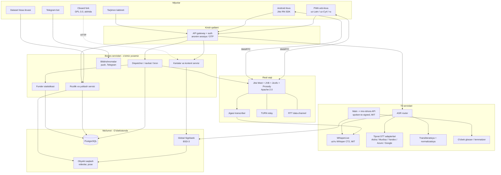
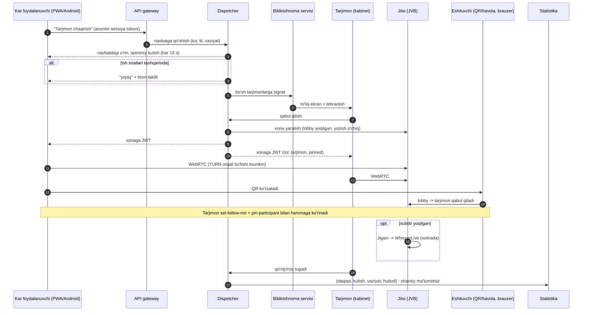
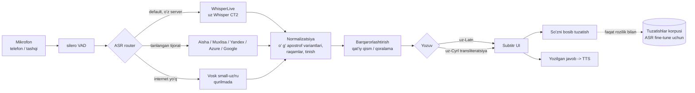
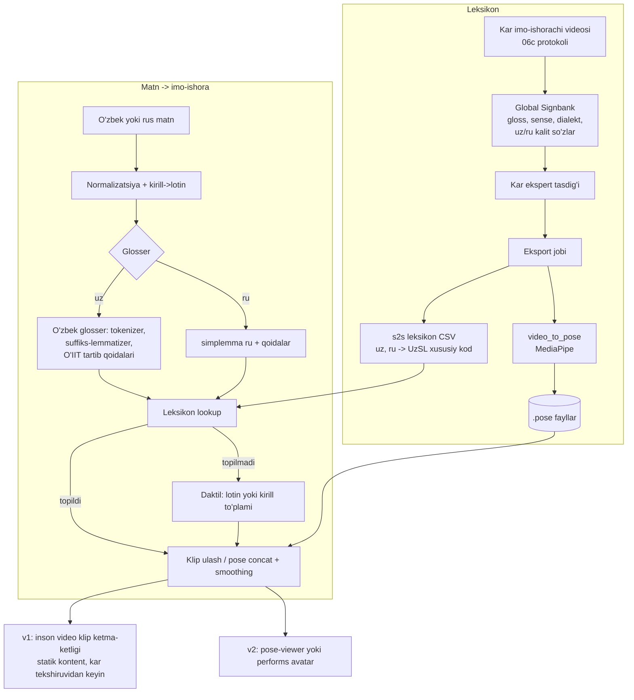
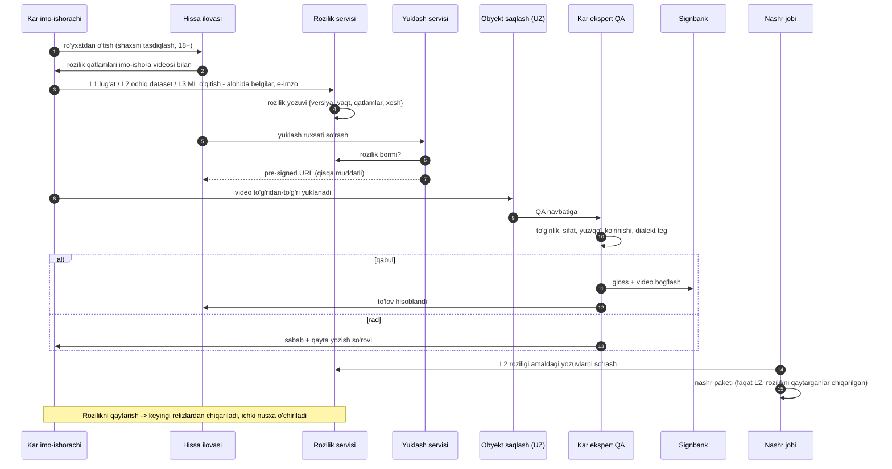
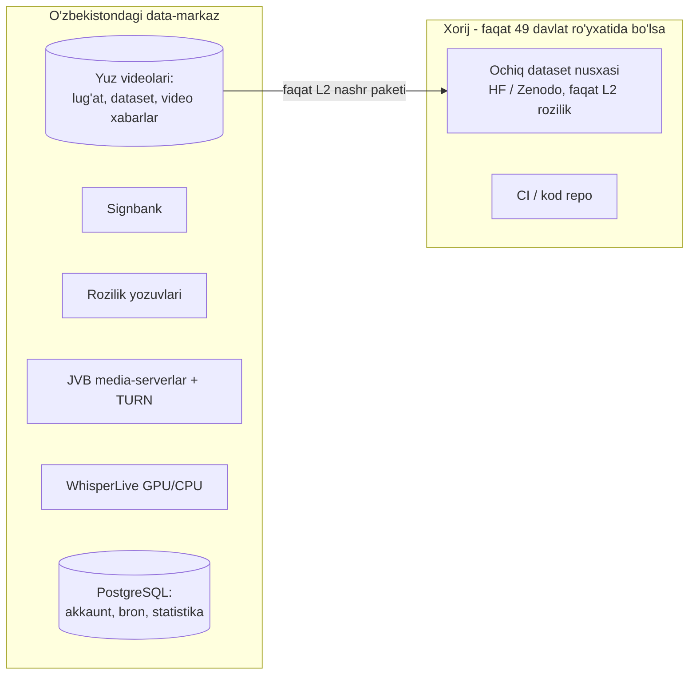

# 06b. Texnik arxitektura

> **Qisqacha**
> - Arxitektura 5 ta ochiq kodli "umurtqa" ustiga quriladi: **Jitsi Meet** (qo'ng'iroq; LiveKit muqobil), **Global Signbank** (O'IIT leksik bazasi), **spoken-to-signed-translation + pose** (matn -> imo-ishora), **WhisperLive** (o'zbek/rus jonli subtitr) va 2-fazada **performs** (avatar). **Cboard** alohida GPL ilova.
> - O'zimiz yozadigan qismlar: tarjimon dispetcheri/navbati, rozilik va yuklash servisi, yuzma-yuz suhbat ilovasi, o'zbek glosser/lemmatizer, lotin-kirill transliteratsiya, funder statistikasi.
> - Yuz videosi (biometrik) O'zbekistondagi serverda (ZRU-547 27-1-modda); qo'ng'iroqlar default yozilmaydi; subtitr xotirada qayta ishlanadi.
> - ASR provayderi o'z o'zbek test to'plamida tanlanadi: o'z serverimizdagi Whisper fine-tune va tijorat STT (Aisha, Muxlisa, Yandex, Azure, Google) bir xil o'lchovda solishtiriladi.
> - MVP muhandislik hajmi: taxminan 35-60 kishi-hafta (audit bahosi); asosiy xarajat muhandislik emas, kar imo-ishorachilar bilan kontent yozish.

---

## 1. Arxitektura tamoyillari

| # | Tamoyil | Nima uchun |
|---|---|---|
| A1 | **Yupqa fork, chuqur patch emas** | Jitsi upstream tez yuradi (2026-11-14 push, 30 238 yulduz), yiliga ikki marta rebase kerak ([hands_on_repo_audit §6](https://github.com/jitsi/jitsi-meet)) |
| A2 | **Ruxsat beruvchi litsenziya yadroda, copyleft alohida servisda** | MIT, BSD-3, Apache-2.0 erkin birlashadi; GPL (Cboard) va LGPL (VLibras) alohida ilova/servis ([hands_on_repo_audit §9](https://github.com/cboard-org/cboard)) |
| A3 | **Biometrik ma'lumot O'zbekistonda** | ZRU-547 27-1-modda 2-qism ([lex.uz](https://lex.uz/docs/4396419)) |
| A4 | **Provayder-agnostik ASR** | Vendor WER da'volari ziddiyatli (ElevenLabs bir sahifada 3,1% va 15,9%) - o'z o'lchovimiz kerak ([ElevenLabs](https://elevenlabs.io/speech-to-text/uzbek)) |
| A5 | **Har bosqich vaqt belgisi bilan** | SignON konverti (T0App...T5) kechikishni kuzatish uchun yaxshi naqsh ([hands_on_repo_audit §1](https://github.com/signon-project/wp2-orchestrator-api-shared-schemas)) |
| A6 | **Til kodlari yopiq enum emas, konfiguratsiya** | SignON da tillar yopiq enum va bir necha joyda qattiq kodlangan - qaytarmaymiz ([hands_on_repo_audit §1](https://github.com/signon-project)) |
| A7 | **Secret'lar repoga tushmaydi** | SignON da ASR va TTS login/parollari commit qilingan ([hands_on_repo_audit §1](https://github.com/signon-project)) |
| A8 | **Past tarmoq - mahsulot talabi** | VRI qoniqishining o'lchangan omili - video sifati va tarmoq ([PMC6431824](https://www.ncbi.nlm.nih.gov/pmc/articles/PMC6431824/)) |

## 2. Yuqori darajadagi komponentlar

## 3. Tanlangan ochiq kodli komponentlar va nega

| Komponent | Rol | Litsenziya | Nega (auditdan) | O'zbekcha/O'IIT ishi, kishi-hafta (baho) | Xavf |
|---|---|---|---|---|---|
| **Jitsi Meet + Jigasi** | VRI qo'ng'iroq, pinned tarjimon, RTT, mobil SDK | Apache-2.0 | `pin-participant`, `set-follow-me`, `send-endpoint-text-message`, lobby, `stageFilmstripParticipants` 1-6; Jigasi'da Whisper va Vosk servislari; React Native SDK ([hands_on_repo_audit §6](https://github.com/jitsi/jitsi-meet/blob/master/modules/API/API.js)) | 9-16 (i18n, subtitr, tarjimon funksiyalari, RTT) | O'rta |
| LiveKit (muqobil) | Agar Jitsi patchlari og'irlashsa | Apache-2.0 | Go, 22 215 yulduz, `agents` faol ([open_source_clonable §4](https://github.com/livekit/livekit)) | Baholanmagan | - |
| **Global Signbank** | O'IIT leksik master baza | BSD-3 | Django 6.1, ko'p dataset, JSON API (`api_create_gloss`, video yuklash), ELAN eksport, 4 321 qatorli test ([hands_on_repo_audit §3](https://github.com/Signbank/Global-signbank)) | 7-12 + kontent | O'rta |
| **spoken-to-signed-translation + pose** | Matn -> gloss -> pose/video | MIT | Tillar leksikon qatorlaridan olinadi; CI, Docker; `pose` tilga bog'liq emas ([hands_on_repo_audit §4](https://github.com/sign-language-processing/spoken-to-signed-translation)) | 9-18 | Yuqori (gloss qoidalari) |
| **WhisperLive** | Jonli uz/ru subtitr | MIT | Har qanday HF Whisper'ni CT2 ga o'giradi; bearer-token WebSocket; CPU/GPU/OpenVINO Docker; CI, 17 test fayli ([hands_on_repo_audit §8](https://github.com/collabora/WhisperLive)) | 2,5-4,5 | O'rta |
| Vosk small-uz / small-ru | Offlayn zaxira ASR | Apache-2.0 | `vosk-model-small-uz-0.22` ([Vosk models](https://alphacephei.com/vosk/models)) | 1 (baho) | O'rta (aniqlik o'lchanmagan) |
| **upf-gti/performs** (2-faza) | Statik kontent avatari | MIT | SignON vorisi, 2026-10-16 push, SiGML/BML va glTF/BVH ([hands_on_repo_audit §1](https://github.com/upf-gti/performs)) | 4-8 + animator | Juda yuqori (kar qabuli) |
| **Cboard** | AAC (alohida ilova) | GPL-3.0-only | Faol, 137 Jest test, Playwright, ru-RU bor, uz yo'q ([hands_on_repo_audit §7](https://github.com/cboard-org/cboard)) | 9-15 | Past-o'rta |
| silero-vad | Ovoz faolligi | MIT | WhisperLive ichida ([hands_on_repo_audit §8](https://github.com/collabora/WhisperLive)) | 0 | Past |

**Faqat g'oya olinadigan loyihalar** (strategik qaror 5): SignON (OpenAPI/AsyncAPI kontrakt, vaqt belgili konvert, rozilik va pre-signed yuklash naqshi), VLibras (queue-RPC + Redis kesh, `/review` crowd-baholash, emotsiya kontrakti), yandex/deaf (tayyor iboralar, dialog rejimi, katta shrift). Sabablari: SignON 2024 dan muzlagan, tillar yopiq enum; VLibras avatari faqat kompilyatsiya qilingan Unity binari; yandex/deaf 2016 snapshot, yopiq SpeechKit `.aar` ([hands_on_repo_audit §1, §2, §5](https://github.com/spbgovbr-vlibras/vlibras-player-webjs)).

**Ishlatilmaydi:** sign/translate (Rylo) CC BY-NC-SA ([LICENSE.md](https://github.com/sign/translate/blob/master/LICENSE.md)); SignON HF checkpointlari, VLibras neyron og'irliklari, `sign-mt-poses` daktil ma'lumoti - litsenziya ko'rsatilmagan ([hands_on_repo_audit §9](https://huggingface.co/signon-project)); ACE Direct - 2021 dan beri harakatsiz, litsenziyasiz ([FCC/ACEDirect](https://github.com/FCC/ACEDirect)).

## 4. Qo'ng'iroq oqimi (VRI, login'siz)

Asoslar: lobby `answer-knocking-participant`, `toggle-lobby`, `pin-participant`, `set-follow-me` buyruqlari Jitsi iframe API da bor ([API.js](https://github.com/jitsi/jitsi-meet/blob/master/modules/API/API.js)); Jitsi'da tarjimon roli yo'q ("sign language" kod qidiruvi 0 natija) - rolni o'zimiz qo'shamiz ([hands_on_repo_audit §6](https://github.com/jitsi/jitsi-meet)).

## 5. Subtitr quvuri (yuzma-yuz va qo'ng'iroq)

Muhim qoidalar:
- Audio va matn default saqlanmaydi; tarix qurilmada (24 soat default, 3 kungacha) - Live Transcribe namunasi ([HearingTracker](https://www.hearingtracker.com/apps/google-live-transcribe)).
- Tuzatishlar korpusi faqat alohida, aniq rozilik bilan - Ava'ning aralash siyosati takrorlanmaydi ([HearingTracker](https://www.hearingtracker.com/apps/ava)).
- Lotin -> kirill transliteratsiya deterministik kutubxona (0,5 kishi-hafta, baho; [hands_on_repo_audit §8](https://github.com/collabora/WhisperLive)).
- Jigasi Whisper servisi WhisperLive protokolida gaplashishi tekshirilmagan; kerak bo'lsa Skynet (Apache-2.0, `streaming_whisper`) yoki brauzer tomonidagi klient ishlatiladi ([jitsi/skynet](https://github.com/jitsi/skynet)).

## 6. Lug'at va matn -> imo-ishora quvuri

Asoslar va cheklovlar:
- s2s'da o'zbek glosser yo'q: simplemma'da `uz` yo'q, spaCy xaritalari faqat de/fr/it/en; `pose_to_video` `NotImplementedError` beradi; RSL va o'zbek daktil to'plami yo'q ([hands_on_repo_audit §4](https://github.com/sign-language-processing/spoken-to-signed-translation)).
- `languages.py` dagi zaxira xaritasi (`uzsl -> rsl` kabi) qayta ishlatiladi, lekin ishlab chiqarishda RSL klipi O'IIT o'rnida ko'rsatilmaydi (dialekt xavfi: Logos asosan Moskva dialekti, [Ovodov](https://www.youtube.com/watch?v=Z6jNuB4CBVY)).
- O'IIT uchun ISO 639-3 kodi tasdiqlanmagan - xususiy kod (masalan `x-uzsl`, baho) ([hands_on_repo_audit §1](https://github.com/signon-project/wp2-orchestrator)).
- SLRTP 2025 g'olibi retrieval + LM ishlatgan - MVP uchun ibora kutubxonasi/retrieval yo'li to'g'ri ([arXiv 2508.06951](https://arxiv.org/abs/2508.06951)).
- Chiqish faqat statik kontentga (06a M14), jonli suhbatga emas (WFD/WASLI).

## 7. Dataset yig'ish va rozilik oqimi

Asoslar: SignON `/dataset-storage-auth` va MinIO pre-signed naqshi ([hands_on_repo_audit §1](https://github.com/signon-project/wp2-framework-docker-compose)); yozma yoki elektron rozilik, qaytarib olish huquqi (ZRU-547 21-modda, [lex.uz](https://lex.uz/docs/4396419)); "qaytarish keyingi relizlardan chiqaradi" yechimi ([uzbekistan_legal_costs §2](https://lex.uz/docs/4396419)). Batafsil protokol: 06c.

## 8. O'zimiz quradigan qismlar

| Qism | Nima | Nega fork yo'q | Hajm, kishi-hafta (baho) |
|---|---|---|---|
| Dispetcher / navbat / bron | Tarjimon holati, FIFO + ustuvorlik, ish soatlari, kutish bahosi, daqiqa hisobi, bron | Jitsi'da tarjimon roli yo'q; ACE Direct harakatsiz ([open_source_clonable §4](https://github.com/FCC/ACEDirect)) | 6-10 ([hands_on_repo_audit §6](https://github.com/jitsi/jitsi-meet)) |
| Rozilik va yuklash servisi | Qatlamli rozilik, versiyalash, qaytarish, pre-signed yuklash, audit | SignON'da faqat naqsh, rozilik matnlari "Lorem ipsum" ([hands_on_repo_audit §1](https://github.com/signon-project/wp2-framework-docker-compose)) | 4-6 |
| Yuzma-yuz suhbat ilovasi | Split-screen, STT, TTS, kartalar, tuzatish | yandex/deaf faqat UX g'oyasi ([hands_on_repo_audit §2](https://github.com/yandex/deaf)) | 6-10 |
| O'zbek glosser / lemmatizer | Apostrof normalizatsiyasi (o', g', ' variantlari), kirill -> lotin, suffiks-lemmatizer yoki Apertium-uzb wrapper, O'IIT tartib qoidalari | simplemma/spaCy'da uz yo'q ([hands_on_repo_audit §4](https://github.com/adbar/simplemma/tree/main/simplemma/strategies/dictionaries/data)) | 4-8 + kar lingvist |
| Transliteratsiya kutubxonasi | uz-Latn <-> uz-Cyrl, UI va subtitr uchun | Barcha komponentlarda kerak | 0,5-1 |
| Signbank -> s2s eksport ko'prigi | API -> CSV + video_to_pose | Mavjud emas | 1-2 |
| Funder statistikasi | Agregat daqiqalar, kutish, hududlar | Mahsulotga xos | 1-2 (baho) |
| Kartalar va kontent servisi | Karta to'plamlari, versiyalar, offlayn paketlar | Mahsulotga xos | 2-3 (baho) |

## 9. ASR provayderini baholash rejasi

**Maqsad:** o'zbek (lotin chiqish) va rus subtitr uchun provayderni o'z ma'lumotimizda tanlash; vendor raqamlariga tayanmaslik.

**Nomzodlar va ma'lum faktlar:**

| Nomzod | Turi | Ma'lum fakt | Narx | Manba |
|---|---|---|---|---|
| BuzzASR/uzbek | Ochiq, Whisper-large-v3 fine-tune, MIT | CV25 WER 11,84; FLEURS WER 25,64; zero-shot Whisper CER ~28 | GPU hosting | [HF](https://huggingface.co/BuzzASR/uzbek) |
| navai-uz/whisper-medium-uzbek | Ochiq, Apache-2.0 | WhisperLive'ga to'g'ridan-to'g'ri ulanadi | GPU/CPU hosting | [HF API](https://huggingface.co/api/models/navai-uz/whisper-medium-uzbek) |
| hostmepanda/whisper-large-v3-turbo-uzbek-ct2 | Ochiq, MIT, CT2 tayyor | Turbo, past kechikish | GPU hosting | [hands_on_repo_audit §8](https://github.com/collabora/WhisperLive) |
| rustam1221/uzbek-asr-gigaam | Ochiq, CTC | Spontan nutqda 16,1% vs turbo-uzbek 39,6% (snippet) | Alohida CTC server | [HF](https://huggingface.co/rustam1221/uzbek-asr-gigaam) |
| sarahai/uzbek-stt-3 | Ochiq, wav2vec2 | 452 482 yuklanma, lekin Whisper emas - WhisperLive'da ishlamaydi | Alohida CTC server | [hands_on_repo_audit §8](https://github.com/collabora/WhisperLive) |
| Aisha | Tijorat (UZ) | uz/ru/en; on-prem Enterprise'da; aniqlik raqami e'lon qilinmagan | STT 425 so'm/daq (~$2/soat, kurs taxminiy) | [aisha.group](https://aisha.group/en/pricing) |
| Muxlisa (UZINFOCOM) | Tijorat (UZ) | O'zi e'lon qilgan WER 11,39% (call-center), 13,42% (YouTube); cloud yoki on-prem | Ochiq narx topilmadi (oldingi hisobot: 1 000 belgiga 350 so'm) | [UZINFOCOM](https://uzinfocom.uz/en/news/522); [muxlisa.uz](https://muxlisa.uz/en) |
| Yandex SpeechKit | Tijorat | uz-UZ (lotin) | Streaming ~$0,32/soat, async ~$0,30/soat (snippet) | [Yandex](https://yandex.cloud/en-ru/docs/speechkit/pricing) |
| Azure Speech | Tijorat | uz-UZ real vaqt va batch | Tasdiqlanmagan | [Microsoft Learn](https://learn.microsoft.com/en-us/azure/ai-services/speech-service/language-support?tabs=stt) |
| Google Cloud STT v2 | Tijorat | uz-UZ chirp, chirp_2, chirp_3 (EU/Osiyo regionlari) | Tasdiqlanmagan | [Google Cloud](https://docs.cloud.google.com/speech-to-text/v2/docs/speech-to-text-supported-languages) |
| Vosk small-uz | Ochiq, offlayn | Aniqlik o'lchanmagan | Bepul | [Vosk](https://alphacephei.com/vosk/models) |

**O'z test to'plami (baho tarkibi):**

| Qism | Hajm (baho) | Tarkib |
|---|---|---|
| Shifoxona dialoglari | 60 daq | Shifokor savollari, dori nomlari, raqamlar |
| Bank / DXM / mahalla | 60 daq | Xizmat iboralari, hujjat nomlari, sana va summa |
| Ko'cha / taksi / do'kon | 30 daq | Shovqinli muhit (bozor, ko'cha) |
| O'zbek-rus aralash nutq | 30 daq | Code-switching |
| Keksa so'zlovchilar, viloyat talaffuzi | 30 daq | Toshkent, Farg'ona, Xorazm, Samarqand, Qoraqalpog'iston |
| Rus tili | 30 daq | Rus tilidagi xizmat dialoglari |
| Kar odamlar nutqi (ixtiyoriy, rozilik bilan) | 15 daq | EvolveCaptions yo'nalishi ([arXiv 2510.02181](https://arxiv.org/html/2510.02181v1)) |

**O'lchovlar:** WER va CER (bir xil normalizator bilan, lotin), birinchi so'z kechikishi va oxirgi qat'iy so'z kechikishi (p50/p95), miltillash darajasi (qat'iy so'zning o'zgarish soni), soatlik narx, on-prem imkoniyati, ma'lumot qayerda qayta ishlanishi (ZRU-547 va 49 davlat ro'yxati, [spot.uz](https://www.spot.uz/ru/2026/08/04/personal-data-abroad/)).

**Qoidalar:** test audiosi rozilik bilan yozilgan aktyor dialoglari; test to'plami o'qitishga ishlatilmaydi; natijalar ochiq repoda e'lon qilinadi; har chorakda qayta o'lchanadi. Baholash ishi: 1-2 kishi-hafta ([hands_on_repo_audit §8](https://github.com/collabora/WhisperLive)).

## 10. Hosting va ma'lumot joylashuvi

| Ma'lumot turi | Joy | Asos |
|---|---|---|
| Yuz videosi (lug'at, dataset, video xabar) | Faqat O'zbekiston; Davlat personallashtirish markazi reyestri | ZRU-547 27-1, 20-modda ([lex.uz](https://lex.uz/docs/4396419)) |
| Qo'ng'iroq media | O'zbekistondagi JVB; yozilmaydi | Maxfiylik tamoyili; [uzbekistan_legal_costs §2](https://lex.uz/docs/4396419) |
| Akkaunt, bron, statistika (matn) | O'zbekiston (default); xorij faqat 49 davlat ro'yxati yoki tasdiqlangan shartlar bilan | 27-1-modda 3-qism; [spot.uz](https://www.spot.uz/ru/2026/08/04/personal-data-abroad/) |
| Ochiq dataset nashri | HF / Zenodo, faqat L2 rozilik bergan yozuvlar | 06c |
| Kod | GitHub/GitLab (ochiq) | Shaxsiy ma'lumot yo'q |

Mahalliy provayderlar (narxlar olinmagan, **TBD**): Uztelecom VDS ([uztelecom](https://uztelecom.uz/en/for-business/cloud-services/virtual-dedicated-server-8-9)), dicloud.uz ([dicloud](https://dicloud.uz/en/services/cloud/vps/)), Pro-Data ([pro-data](https://pro-data.tech/en/virtual-server)), Serverspace Toshkent ([serverspace](https://serverspace.io/services/vps-server/vps-in-uzbekistnan/)). O'zbekistonda GPU hosting narxi topilmadi. Boshlang'ich hajm (baho): 2 ta JVB tugun, 1 TURN, 1 GPU (ASR), 1 ilova serveri, 1-2 TB obyekt saqlash; 2 000 belgili lug'at bir necha GB ([nonprofit_models_funding](https://www.digitalpublicgoods.net/digital-public-goods) - xulosa, narx manbasiz).

## 11. Xavfsizlik va maxfiylik

| Soha | Choralar |
|---|---|
| Qo'ng'iroqlar | Default yozilmaydi; yozish faqat ikki tomon roziligi va aniq indikator bilan; JWT bilan xona kirishi; lobby yoqilgan |
| Subtitr | Xotirada qayta ishlash; serverda audio/matn saqlanmaydi; loglarda matn yo'q |
| Biometrik ma'lumot | O'zbekistonda; shifrlangan saqlash; rol asosidagi kirish; har kirish audit logida; reyestrga ro'yxat va 10 kunlik o'zgarish xabari ([lex.uz](https://lex.uz/docs/4396419)) |
| Rozilik | Versiyalangan, e-imzo yoki isbotlanadigan shakl; qaytarish - qatlam bo'yicha; 18 yoshgacha - faqat vasiy roziligi bilan va MVP da yig'ilmaydi |
| AI va shaxsiy ma'lumot | Shaxsiy ma'lumot tashqi LLM ga yuborilmaydi; ZRU-1115 (2026-01-21) javobgarligi ko'rib chiqiladi ([anhor.uz](https://anhor.uz/ru/news/uzbekistan-criminalizes-illegal-ai-use-of-personal-data)) |
| Pose ma'lumoti | Anonim deb hisoblanmaydi: pose'dan shaxsni aniqlash F1 0,31 ([UZH](https://iict.uzh.ch/dam/jcr:7ca446cb-8c7d-45e7-be31-76774803b91b/Abstract_Paper_Person%20Identification%20from%20Pose%20Estimates.pdf)) |
| Kod sifati | Secret scanning, SAST, dependency audit, SBOM; default parollar yo'q (SignON'dagi `minioadmin`/`guest` xatosi, [hands_on_repo_audit §1](https://github.com/signon-project/wp2-framework-docker-compose)); SQL f-string taqiqlangan (SignON `text2gloss` injection xavfi) |
| Tahdid modeli | Tarjimonni soxtalashtirish (tarjimon tasdiqlash), qo'ng'iroqqa begona kirish (lobby), dataset sizishi (kirish qatlamlari), tarjimonga tajovuz (bloklash, hisobot tugmasi) |
| Shaxsiy ma'lumot jarimalari (konteks) | Ma'muriy 7 BHM (fuqaro) / 50 BHM (mansabdor), jinoiy 100-150 BHM - 2022 miqdorlari, tasdiqlanmagan ([anhor.uz](https://anhor.uz/news/social-media/)) |

E2E shifrlash (Jitsi insertable streams va h.k.) imkoniyatlari bu tadqiqotda tekshirilmagan - **tasdiqlanmagan**, alohida baholanadi.

## 12. Masshtablash

- **Asosiy cheklov - tarjimon, server emas.** Rejalash mezoni: TTRS ~40 tarjimon ~10 000 doimiy foydalanuvchiga ([Thai PBS](https://www.thaipbsworld.com/science-technology/the-impact-of-technology-on-the-hard-of-hearing)). Dispetcher navbati va bron shu cheklovni boshqaradi.
- **Media:** JVB tugunlari gorizontal qo'shiladi (Jitsi arxitekturasi; aniq sig'im o'lchanmagan - baho). TURN alohida, chunki mobil NAT ortidagi foydalanuvchilar ko'p (baho).
- **ASR:** WhisperLive `--max_clients`, `--max_connection_time`, `--no_single_model` parametrlari bilan ([hands_on_repo_audit §8](https://github.com/collabora/WhisperLive)); tijorat provayder zaxira sifatida.
- **Statik kontent:** kartalar va lug'at klipi CDN/kesh orqali; asosiy xarajat egress (xulosa, narx manbasiz).
- **Yuk testi:** har relizdan oldin N parallel qo'ng'iroq + subtitr; SignON'ning vaqt belgili konverti bilan har bosqich kechikishi o'lchanadi.

## 13. Offlayn va past tarmoq

| Funksiya | Offlayn / past tarmoq yechimi |
|---|---|
| Vaziyat kartalari, darslar, sevimli lug'at | PWA kesh + Android'da yuklab olingan paketlar |
| Yuzma-yuz subtitr | Vosk small-uz/ru qurilmada; sifat pastligi haqida belgi |
| VRI | Past bitreyt profili (masalan 360p / 15 fps, baho), audio ustuvorligi emas, **video ustuvorligi** (imo-ishora uchun), trafik indikatori |
| Video xabar | Yuborishdan oldin siqish, "faqat Wi-Fi" navbati |
| Telegram | Kartalar va bron matn sifatida |
Asos: Uzbek hududlarida past tarmoq keng tarqalgan degan xulosa ([academic_research_synthesis §2](https://www.ncbi.nlm.nih.gov/pmc/articles/PMC6431824/)); Live Transcribe offlayn paketlari ([9to5Google](https://9to5google.com/2022/03/10/google-live-transcribe-feature-now-works-when-offline/)). Aniq bitreyt chegaralari kar testerlar bilan o'lchanadi.

## 14. Kanallar

| Kanal | Bosqich | Texnologiya | Izoh |
|---|---|---|---|
| PWA veb-ilova | MVP | Jitsi web fork + o'z React panellari | iOS Safari'da ham ishlashi sinov bilan tasdiqlanadi |
| Android | MVP | Jitsi React Native SDK + o'z ekranlar | To'liq ekranli qo'ng'iroq signali, offlayn ASR |
| Telegram bot | MVP | Bot API | Video yo'q; eslatma, bron, kartalar ([Telegram docs](https://core.telegram.org/bots/webapps)) |
| Cboard fork | MVP (oxirgi to'lqin) | React PWA / Cordova | Alohida GPL repo |
| iOS native | v1+ | Jitsi iOS SDK | Apple Live Captions uz/ru yo'q ([Apple](https://www.apple.com/ios/feature-availability/)) |
| Veb vidjet (statik kontent) | v1 | Embed skript | VLibras vidjeti UX g'oyasi, kod emas |

## 15. Ochiq kod tashkiloti: repozitoriyalar tuzilmasi

Tashkilot nomi hali tanlanmagan (`<org>`).

| Repo | Mazmun | Litsenziya |
|---|---|---|
| `<org>/platform` | Monorepo: `apps/pwa`, `apps/android`, `apps/interpreter-console`, `apps/contrib`, `services/dispatch`, `services/consent`, `services/content`, `services/stats`, `services/asr-router`, `packages/translit`, `packages/i18n`, `infra/` (compose, Helm) | Apache-2.0 |
| `<org>/jitsi-meet` | Yupqa fork: lang fayllari (`main-uz.json`, uz-Cyrl), config, tarjimon paneli | Apache-2.0 |
| `<org>/signbank` | Global Signbank fork: uz/ru sozlamalar, migratsiyalar, eksport ko'prigi | BSD-3 |
| `<org>/uz-glosser` | O'zbek glosser va s2s plagini, leksikon yuklovchi | MIT (upstream bilan mos) |
| `<org>/whisperlive-uz` | Docker profillar, model konfiguratsiyasi, benchmark skriptlari | MIT |
| `<org>/asr-benchmark-uz` | Test to'plami metama'lumoti, skriptlar, natijalar (audio alohida, rozilik bo'yicha) | Kod Apache-2.0, ma'lumot CC BY 4.0 (rozilik bo'lsa) |
| `<org>/cboard-uz` | Cboard fork | GPL-3.0-only |
| `<org>/cards-content` | Vaziyat kartalari matnlari va metama'lumoti | CC BY-SA 4.0 |
| `<org>/uzsl-dataset-tools` | Yozish protokoli, annotatsiya sxemasi, datasheet | Apache-2.0 |
| `<org>/governance` | Kengash nizomi, kar maslahat kengashi qarorlari, AI pledge, xavfsizlik siyosati | CC BY 4.0 |

Har repoda: `LICENSE`, `NOTICE` (upstream mualliflik), `CODE_OF_CONDUCT`, `CONTRIBUTING` (o'zbek va rus), `SECURITY.md`, CODEOWNERS (kar kengash vakili kontent repolarda reviewer).

## 16. Litsenziyalar

| Qatlam | Litsenziya | Izoh |
|---|---|---|
| O'z kodimiz | Apache-2.0 (yoki MIT) | Strategik qaror 6 |
| Upstream forklar | Har biri o'z litsenziyasida (Apache-2.0, BSD-3, MIT) | NOTICE saqlanadi; SignON kodi ko'chirilsa uning NOTICE'i ham ([hands_on_repo_audit §9](https://github.com/signon-project)) |
| Cboard fork | GPL-3.0-only | Alohida ilova, faqat HTTP orqali |
| Imo-ishora video (ochiq qism) | CC BY-SA 4.0 yoki CC BY 4.0 | Faqat L2 rozilik; NC litsenziya yo'q (hamkorlarni to'smaslik uchun) |
| Model og'irliklari (o'zimizniki) | Apache-2.0 yoki OpenRAIL (TBD) | O'qitish ma'lumotining litsenziyasiga bog'liq |
| Tashqi modellar | Har model kartasi tekshiriladi; HF teglari o'zi e'lon qilingan ([open_source_clonable §5](https://huggingface.co/models?pipeline_tag=automatic-speech-recognition&search=uzbek)) | Logos ma'lumoti akademik, Slovo/Bukva o'zgartirilgan CC BY-SA ([russia_cis_ecosystem](https://github.com/ai-forever/logos)) - ishlab chiqarish modeliga aralashtirilmaydi |
| Belgilar (AAC) | Mulberry CC BY-SA 4.0; ARASAAC CC BY-NC-SA 4.0 - ishlatilmaydi | [hands_on_repo_audit §7](https://github.com/cboard-org/cboard) |

## 17. CI/CD

| Bosqich | Tekshiruv |
|---|---|
| Lint va format | Har til uchun (TS, Python, Kotlin) |
| Unit va integratsiya testlari | Har PR'da (Signbank'da test CI yo'q edi - biz qo'shamiz, [hands_on_repo_audit §3](https://github.com/Signbank/Global-signbank/blob/master/deploy.sh)) |
| E2E | Playwright: VRI oqimi, QR qo'shilish, ko'zgu testi (asimmetrik belgi), subtitr UI |
| i18n to'liqligi | uz-Latn, uz-Cyrl, ru kalitlari to'liq; uz-Cyrl transliteratsiya skripti bilan generatsiya + native tekshiruv |
| Kirish imkoniyati | axe-core, WCAG 2.2 AA |
| Xavfsizlik | Secret scanning, SAST, dependency audit, konteyner skan, SBOM |
| Litsenziya | SPDX/REUSE tekshiruvi; GPL/NC kodi Apache repolarga tushmasligi |
| ASR regressiya | Har model o'zgarishida `asr-benchmark-uz` WER/CER/kechikish hisoboti |
| Konteyner build va nashr | Teglangan relizlar, imzolangan image'lar |
| Deploy | Staging -> prod, migratsiyalar avtomatik; `git stash` + reboot uslubi yo'q (Signbank deploy.sh saboq) |

## 18. Texnik bosqichlar

| Bosqich | Texnik natija |
|---|---|
| MVP | Jitsi fork + dispetcher + login'siz VRI; PWA + Android; WhisperLive + 1 tijorat STT adapteri; kartalar servisi; Telegram bot; ASR benchmark v1; Signbank ichki instansiya |
| v1 | Signbank -> s2s eksport; rozilik va hissa ilovasi; funder statistikasi; veb vidjet; SOS pilot backend; iOS |
| v2 | O'zbek glosser ishlab chiqarishda (statik kontent); performs avatar pilot; ISLR yordamchi (Logos pretrain + co-training, 06c); operator integratsiyasi; MDH tillari |

## Manbalar

Xom yozuvlar: `2_raqobat_va_ochiq_kod/hands_on_repo_audit.md` (asosiy), `open_source_clonable.md`, `uzbek_speech_bigtech_support.md`, `uzbekistan_legal_costs.md`, `academic_research_synthesis.md`, `global_feature_matrix.md`, `russia_cis_competitors.md`, `region_south_asia_mena_africa.md`, `nonprofit_models_funding.md`; `1_birinchi_tadqiqot/russia_cis_ecosystem.md`, `open_source_tech_stack.md`, `deaf_centered_product_ux.md`.

Asosiy repo va hujjatlar:
- Jitsi Meet: https://github.com/jitsi/jitsi-meet ; Jigasi: https://github.com/jitsi/jigasi ; Skynet: https://github.com/jitsi/skynet
- Global Signbank: https://github.com/Signbank/Global-signbank
- spoken-to-signed-translation: https://github.com/sign-language-processing/spoken-to-signed-translation ; pose: https://github.com/sign-language-processing/pose
- WhisperLive: https://github.com/collabora/WhisperLive
- performs: https://github.com/upf-gti/performs ; Cboard: https://github.com/cboard-org/cboard
- SignON: https://github.com/signon-project ; VLibras: https://github.com/spbgovbr-vlibras
- ZRU-547: https://lex.uz/docs/4396419 ; 49 davlat ro'yxati: https://www.spot.uz/ru/2026/08/04/personal-data-abroad/
- BuzzASR/uzbek: https://huggingface.co/BuzzASR/uzbek ; Aisha narxlari: https://aisha.group/en/pricing ; Yandex narxlari: https://yandex.cloud/en-ru/docs/speechkit/pricing

## Tasdiqlanmagan / bo'shliqlar

- Barcha kishi-hafta raqamlari - baho (audit muallifi va bizning baholarimiz), manbali emas.
- Jigasi Whisper servisi WhisperLive protokoliga mosligi tekshirilmagan.
- Jitsi til detektori `uz-Cyrl` subteg'ini qabul qilishi tekshirilmagan.
- performs avatarini `.pose` kalit nuqtalaridan boshqarish mumkinligi tekshirilmagan.
- O'IIT uchun ISO 639-3 kodi tasdiqlanmagan.
- Signbank `migrate` bo'sh bazada muvaffaqiyatli o'tishi sinalmagan (til bilan bog'liq migratsiya xavfi bor).
- Telegram Mini App ichida WebRTC real qurilmada sinalmagan.
- Azure va Google STT narxlari, Muxlisa API narxi va hujjatlari, Aisha streaming qo'llovi tasdiqlanmagan.
- Mustaqil o'zbek ASR WER taqqoslovi topilmadi - o'z benchmarkimiz shart.
- Mahalliy VPS, GPU va saqlash narxlari - **TBD**.
- 49 davlat ro'yxatining matni olinmagan (Germaniya, Finlandiya, AQSh bormi - noma'lum).
- Oddiy video (yuz shabloni emas) "biometrik" deb hisoblanishi bo'yicha rasmiy tushuntirish topilmadi - konservativ talqin qo'llanildi.
- Jitsi E2E shifrlash imkoniyatlari va JVB sig'imi bu tadqiqotda o'lchanmagan.
- Bitreyt, kechikish va saqlash hajmi raqamlari - baho.
