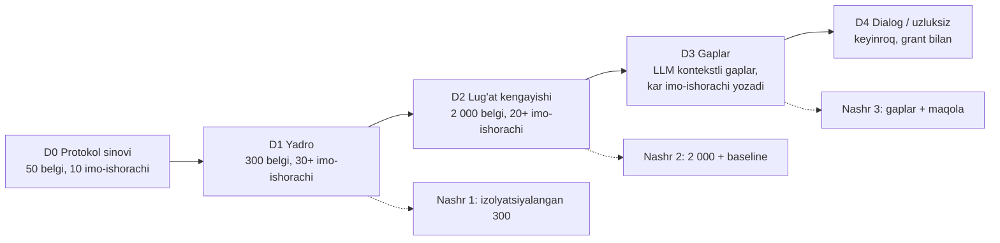
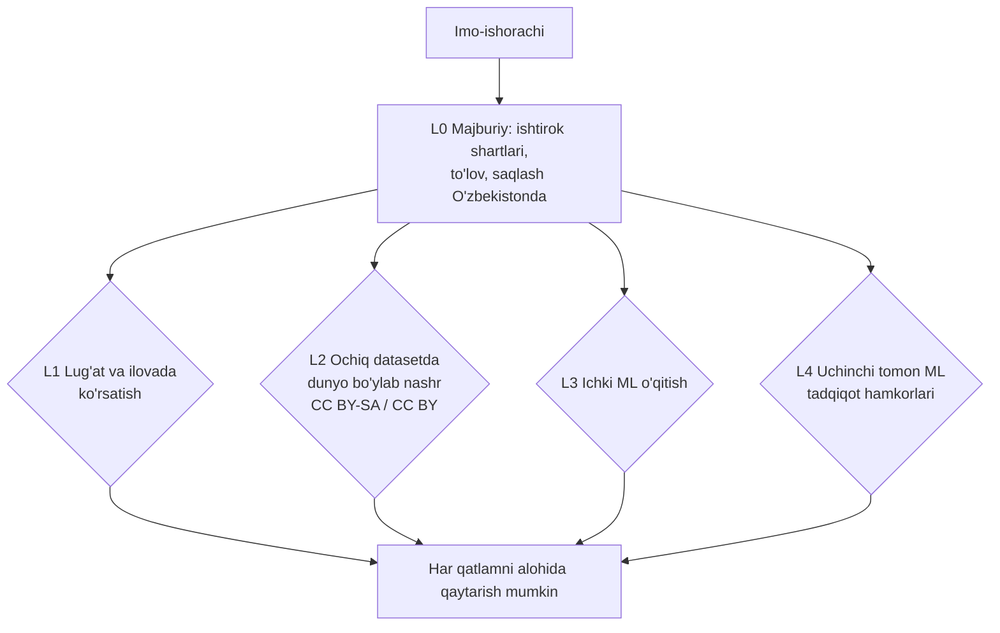

# 06c. O'zbek imo-ishora tili (O'IIT) dataset strategiyasi

> **Qisqacha**
> - Maqsad: **birinchi ochiq, rozilik asosida yig'ilgan O'IIT dataseti** - kar imo-ishorachilar yozgan, kar ekspertlar tekshirgan, imo-ishorachidan mustaqil bo'linishli. Hozir peer-review'dan o'tgan ochiq O'IIT dataseti yo'q.
> - Bosqichlar: 50 belgilik protokol sinovi -> **300 yadro belgi** -> **2 000 belgi** -> **gaplar** (Sber retsepti: kerakli lemmalardan LLM bilan ko'p kontekstli gaplar, kar imo-ishorachilar yozadi, kar ekspert tekshiradi).
> - Faqat kar imo-ishorachilar, pullik, hududiy va avlod variantlari, kirill va lotin daktil alohida belgilanadi.
> - Rozilik qatlamli: lug'atda ko'rsatish / ochiq dataset / ML o'qitish - alohida. Pose ma'lumoti anonim deb va'da qilinmaydi. Birlamchi nusxa O'zbekistonda.
> - Nashr: Hugging Face va Zenodo, datasheet bilan; maqola LREC Sign Language workshop yoki CVPR SLRTP ga. Hamkorlar: Sharoit Plyus, Karlar jamiyati, ISSAI / Nazarbayev universiteti K-RSL jamoasi, Sber Logos (pretrain).

---

## 1. Maqsad va nega

| Savol | Javob | Manba |
|---|---|---|
| O'IIT ochiq dataseti bormi? | Yo'q. Mahalliy jurnal maqolalari bor, hajmi va ochiqligi ko'rsatilmagan; GitHub'da kichik prototiplar | [academic_research_synthesis §6](https://inlibrary.uz/index.php/eijmrms/article/view/34006); [akkomron/uzslr-isolated-dynamic](https://github.com/akkomron/uzslr-isolated-dynamic) |
| Nega kerak? | Lug'at, vaziyat kartalari, matn -> imo-ishora (statik kontent) va keyingi yordamchi tanish (06a M16) uchun asos; ochiq, imo-ishorachidan mustaqil O'IIT dataseti til uchun birinchi bo'ladi va nashr qilinadi | [academic_research_synthesis §6](https://arxiv.org/pdf/2605.12096) |
| Nega "kar tomonidan"? | 43 datasetdan faqat 16 tasi to'liq kar imo-ishorachilardan; 60 uzluksiz tanish ishidan 41 tasi 3 ta tarjimon-faqat datasetga tayanadi - til buziladi | [Desai 2024](https://arxiv.org/html/2403.02563v1) |
| Nega Rossiya modeli yetmaydi? | Logos asosan Moskva ekspertlari tekshirgan Moskva dialekti; O'IIT uchun to'g'ridan-to'g'ri ishlatish xavfli | [Ovodov, Data Fest 2025](https://www.youtube.com/watch?v=Z6jNuB4CBVY) |
| Davlat maqsadi bilan bog'liqlik | PQ-407 O'IIT lingvistik lug'ati va o'quv materiallari uchun 2024-06-01 muddat qo'ygan; muddat o'tib ketgan | [Gazeta.uz 2025-09](https://www.gazeta.uz/ru/2025/09/28/sign-language/) |

**Natija ko'rsatkichlari (baho):** 2 000 belgi, har belgi uchun kamida 20 imo-ishorachi (yadro 300 uchun 30+), 6 ta hudud/maktab guruhi, imo-ishorachidan mustaqil test bo'linishi, ochiq datasheet, bitta peer-review maqola.

## 2. Lingvistik kontekst (protokolga ta'siri)

| Fakt | Protokolga ta'siri | Manba |
|---|---|---|
| O'IIT RZhYa (RSL) varianti/shevasi, mahalliy o'zbekcha belgilar bilan; ISO 639-3 da alohida kod topilmadi (`rsl` ostida) | Gloss ID'lar O'IIT uchun alohida; RSL bilan bog'lanish maydoni (`rsl_equivalent`) - transfer o'qitish uchun | [Wikipedia RSL](https://en.wikipedia.org/wiki/Russian_Sign_Language); [Gazeta.uz 2022](https://www.gazeta.uz/oz/2022/04/22/sign-language/) |
| Leksikon ulushi (O'IIT vs RSL) bo'yicha raqam yo'q | Datasetning o'zi bu savolga javob beradigan birinchi manba bo'lishi mumkin | [uzsl_linguistics §1](https://www.gazeta.uz/ru/2020/09/23/sign-language/) |
| Jizzax, Surxondaryo, Buxoro, Samarqand, Olmaliq maktablarida **turli daktil alifbolar**; keksa va yosh avlod tushunishmay qolishi mumkin | Har klipga `schooling_region`, `age_cohort`, `dactyl_system` teglari; maktab kelib chiqishi geografiyadan ko'ra muhimroq | [Gazeta.uz 2022](https://www.gazeta.uz/oz/2022/04/22/sign-language/) |
| Kirill daktil keng ishlatiladi, lotin daktil notekis o'rgatiladi; "L" va "D" ikki tizimda katta farq qiladi; rasmiy lotin daktil tasdiqlanganiga dalil topilmadi | Daktil alohida modul: ikkala alifbo to'liq, alohida tegli | [Gazeta.uz 2022](https://www.gazeta.uz/oz/2022/04/22/sign-language/); [CyberLeninka](https://cyberleninka.ru/article/n/o-zbek-ishora-tili-harflarini-tanib-olish-algoritmi/pdf) |
| "Ko'cha imo-ishora tili" kam ma'lumotli karlar orasida | Registr tegi (`register: standart / ko'cha / maktab`) - kar lingvist belgilaydi | [Gazeta.uz 2022](https://www.gazeta.uz/oz/2022/04/22/sign-language/) |
| Mouthing (o'zbek yoki rus) haqida manba yo'q | `mouthing_language` maydoni (uz / ru / yo'q / aralash) - birinchi o'lchov | Bo'shliq ([uzsl_linguistics §1](https://www.gazeta.uz/oz/2022/04/22/sign-language/)) |
| imo-ishora.uz 2000+ so'z (lotin daktil), hududiy variant belgisi ko'rinmaydi | Lemma ro'yxati uchun boshlang'ich nuqta va hamkorlik; dublikat qilinmaydi | [imo-ishora.uz](https://imo-ishora.uz/) |
| 2005 yilgi birinchi lug'at (Karlar jamiyati, JICA) | Tarixiy taqqoslash manbasi (ruxsat bilan) | [Gazeta.uz 2022](https://www.gazeta.uz/oz/2022/04/22/sign-language/) |

## 3. Bosqichlar



| Bosqich | Hajm (baho) | Davomiylik (baho) | Chiqish | Qiyoslash nuqtasi |
|---|---|---|---|---|
| **D0** | 50 belgi x 10 imo-ishorachi x 3 takror = ~1 500 klip | 1-2 oy | Protokol, rozilik matnlari, QA tartibi, ilova v0 tekshirilgan | - |
| **D1** | 300 belgi x 30-50 imo-ishorachi x 2-3 takror = ~18 000-45 000 klip | 3-4 oy | Nashr 1 (L2 roziligi bor qism) | Sber 1-bosqich: 300 lemma / 15 000 video ([Ovodov](https://www.youtube.com/watch?v=Z6jNuB4CBVY)); PopSign 250 belgi, 47 imo-ishorachi ([NeurIPS 2023](https://proceedings.neurips.cc/paper_files/paper/2023/hash/00dada608b8db212ea7d9d92b24c68de-Abstract.html)) |
| **D2** | 2 000 belgi x 20+ imo-ishorachi x 2 takror = ~80 000+ klip | 6-9 oy | Nashr 2 + baseline model | Sber 2-bosqich: 2 000 lemma / 115 000 video ([Ovodov](https://www.youtube.com/watch?v=Z6jNuB4CBVY)); Slovo 1 000 belgi, 194 imo-ishorachi, 20 400 video ([arXiv 2305.14527](https://arxiv.org/abs/2305.14527)) |
| **D3** | 300-1 000 gap x 30-50 imo-ishorachi | 6+ oy | Nashr 3 + maqola | FluentSigners-50: 173 gap x 50 imo-ishorachi = 43 250 video ([PLOS ONE](https://bora.uib.no/bora-xmlui/bitstream/11250/3037546/1/journal.pone.0273649.pdf)) |
| **D4** | Kichik dialog korpusi | Grantga bog'liq | Tadqiqot uchun | DGS-Korpus: 1 daqiqa imo-ishora uchun 1 dan bir necha yuz daqiqagacha transkripsiya ([WMT-SLT FAQ](https://sites.google.com/view/wmt-slt-v2022/faq)) |

### 3.1 Lemma tanlash (D1 300 yadro)
1. **Mahsulot ehtiyoji birinchi:** vaziyat kartalari (shifoxona, bank, taksi, politsiya, mahalla, dorixona, do'kon) va idora yordamchisidagi so'zlar (06a M3, M4).
2. **Ota-onalar moduli:** oila, salomlashish, sonlar, ovqat, his-tuyg'u (06a M7).
3. **Daktil:** lotin (o', g', sh, ch, ng bilan) va kirill alifbolar to'liq; raqamlar ([hands_on_repo_audit §4](https://github.com/sign-language-processing/spoken-to-signed-translation)).
4. **Mavjud manbalar bilan kesishma:** imo-ishora.uz kategoriyalari (alifbo, sonlar, oila, shifoxona, mahalla, bozor, huquq, transport) ([browser_youtube_google_findings §1](https://imo-ishora.uz/dictionary)); Ijtimoiy inspeksiya kursi mavzulari ([YouTube](https://www.youtube.com/playlist?list=PL2T-j53zsYyPK9PciDuM0hKTlEC2yC-YY)).
5. **Ko'rinishi o'xshash belgilar guruhi** oldindan belgilanadi - Logos'da bu pretrain sifatini oshirgan ([arXiv 2505.10481](https://arxiv.org/html/2505.10481v2)).
6. Ro'yxat kar maslahat kengashi tomonidan tasdiqlanadi.

### 3.2 Gaplar (D3) - Sber retsepti
- **Muammo:** Sber'ning birinchi urinishi "to'liq fiasko" - lug'at katta, kontekst kam ([Ovodov](https://www.youtube.com/watch?v=Z6jNuB4CBVY)).
- **Yechim:** lug'atni minimal o'stirib, har so'zni ko'p kontekstda takrorlaydigan korpus (~50% optimum); kerakli lemmalardan LLM bilan gap generatsiyasi; crowdsourcing orqali kar imo-ishorachilarga yozdirish (shu manba).
- **Bizning tartib:**
  1. D2 dagi 2 000 lemmadan har gapda 1-2 ta yangi va 3-5 ta oldingi lemma bo'lgan o'zbek va rus gaplar LLM bilan generatsiya qilinadi.
  2. Kar lingvist va tarjimon gapni tabiiylik bo'yicha filtrlaydi (O'IIT tartibiga mosligi emas - gap o'zbekcha manba matn).
  3. Kar imo-ishorachi gapni **o'z tabiiy O'IIT'ida** yozadi (so'zma-so'z emas).
  4. Kar ekspert QA; ixtiyoriy gloss annotatsiyasi.
- **Eslatma:** glosslar kar odamlar o'qiydigan/yozadigan yozuv emas, faqat annotatsiya vositasi ([Muller va boshq. ACL 2023](https://arxiv.org/abs/2211.15464)).

## 4. Yozish protokoli

| Parametr | Talab (baho, D0 da tasdiqlanadi) | Asos |
|---|---|---|
| Qurilma | Smartfon old kamerasi (maqsadli foydalanish sharoitiga yaqin) + D1 da bir qism studiyada (sifat etaloni) | PopSign Pixel 4A selfie kamerada yig'ilgan ([NeurIPS 2023](https://proceedings.neurips.cc/paper_files/paper/2023/hash/00dada608b8db212ea7d9d92b24c68de-Abstract.html)) |
| Kadr | Bosh tepasidan bel ostigacha, ikki qo'l to'liq, yuz aniq; yon tomonda bo'sh joy | Yuz ifodasi avatar va imo-ishora sifatining eng muhim omili ([Nafath](https://nafath.mada.org.qa/wp-content/uploads/2022/05/5-Toward-an-evaluation-model-for-signing-avatars.pdf)); pose estimatorlar yuz grammatikasini tushirib qoldirishi mumkin ([Desai 2024](https://arxiv.org/html/2403.02563v1)) |
| Ruxsat / kadr tezligi | Kamida 720p, 30 fps (tez daktil uchun 60 fps tavsiya) | Tez daktilda skelet nuqtalari xato beradi - Sber RGB ni tanlagan ([Ovodov](https://www.youtube.com/watch?v=Z6jNuB4CBVY)) |
| Ko'zgu | Saqlanadigan video haqiqiy yo'nalishda (ko'zgusiz); preview ko'zguda bo'lishi mumkin | Marco Polo saboq ([Next Big Idea Club](https://cdn2.nextbigideaclub.com/magazine/nir-eyal-video-messaging-app-found-unexpected-success-thanks-deaf-community/3273/)) |
| Fon va yorug'lik | Har xil real sharoit (uy, ofis, ko'cha) - D1 da kamida 3 xil; studiyada bir xil neytral fon | Real sharoit xilma-xilligi (PopSign) |
| Kiyim | Qo'l bilan kontrastli, bezaksiz yeng (tavsiya) | Baho |
| Takror | Har belgi 2-3 marta, orada neytral holat (qo'llar pastda) | Segmentatsiyani soddalashtiradi (baho) |
| Ko'rsatma | Imo-ishorachiga **matn emas, kar ko'rsatuvchi videosi + so'z** beriladi; lekin "nusxa ko'chirma, o'z variantingni ko'rsat" ko'rsatmasi | Hududiy variantni saqlash; savodxonlik ([IES](https://ies.ed.gov/about/external-person/susan-easterbrooks)) |
| Variant qayd | Imo-ishorachi o'z variantini ko'rsatadi; boshqa variantni bilsa, alohida klip | `variant_of` maydoni |
| Seans uzunligi | 45-60 daqiqa, tanaffus bilan (baho) | Charchoq sifatni tushiradi (baho) |
| Ilova | Hissa ilovasi (06b §7): rozilik -> ko'rsatma -> yozish -> avto sifat tekshiruvi (yuz/qo'l ko'rinishi, yorug'lik) -> yuklash | SignON pre-signed yuklash naqshi ([hands_on_repo_audit §1](https://github.com/signon-project/wp2-framework-docker-compose)) |
| Qurilmasi yo'q imo-ishorachilar | Telefonni Karlar jamiyati orqali qarzga berish | PopSign: DPAN telefonlarni jo'natgan ([NeurIPS supplement](https://papers.neurips.cc/paper_files/paper/2023/file/00dada608b8db212ea7d9d92b24c68de-Supplemental-Datasets_and_Benchmarks.pdf)) |

## 5. Imo-ishorachilarni jalb qilish

| Qoida | Tafsilot | Asos |
|---|---|---|
| **Faqat kar imo-ishorachilar** | Ona tili O'IIT bo'lgan kar va zaif eshituvchi kattalar; tarjimonlar faqat QA yordamchisi yoki alohida tegli "tarjimon" guruhida (asosiy datasetga kirmaydi) | [Desai 2024](https://arxiv.org/html/2403.02563v1); PopSign 47 kar ona-tilli kattalar ([NeurIPS 2023](https://proceedings.neurips.cc/paper_files/paper/2023/hash/00dada608b8db212ea7d9d92b24c68de-Abstract.html)) |
| **Pullik** | Har seans/klip uchun to'lov, professional stavka; narx Karlar jamiyati va Sharoit Plyus bilan kelishiladi (**TBD**) | [deaf_centered_product_ux §6](https://microsoft.com/en-us/research/uploads/prod/2021/09/3436996.pdf) |
| **Hududlar** | Kamida 6 guruh: Toshkent, Samarqand, Buxoro, Farg'ona vodiysi, Surxondaryo, Xorazm/Qoraqalpog'iston; maktab kelib chiqishi bo'yicha (Jizzax, Surxondaryo, Buxoro, Samarqand, Olmaliq) | [Gazeta.uz 2022](https://www.gazeta.uz/oz/2022/04/22/sign-language/) |
| **Avlodlar** | 18-29, 30-49, 50+ kogortalar; keksalar ko'pincha kirill daktil, yangi tarjimon bitiruvchilari lotin-birinchi (xulosa) | [uzsl_linguistics §2](https://www.gazeta.uz/ru/2025/09/28/sign-language/) |
| **Gender muvozanati** | Taxminan teng (maqsad) | Baho |
| **Daktil tizimi** | Har imo-ishorachida asosiy daktil tizimi qayd etiladi; D1 da ikkala tizim vakillari | [Gazeta.uz 2022](https://www.gazeta.uz/oz/2022/04/22/sign-language/) |
| **Voyaga yetmaganlar** | D0-D2 da **yig'ilmaydi**; keyin faqat vasiy roziligi, vazirlik ruxsati va alohida axloqiy ko'rib chiqish bilan | ZRU-547 21-modda ([lex.uz](https://lex.uz/docs/4396419)); [uzsl_linguistics §2](https://www.researchgate.net/publication/391882672_ESHITISHIDA_NUQSONI_BO'LGAN_BOLALAR_TA'LIMINING_RIVOJLANISH_TARIXI) |
| **Kanallar** | Karlar jamiyati viloyat bo'limlari, Sharoit Plyus, kar sport federatsiyasi, @uzsduz blog | Telegram auditoriyasi kichik (@uzsduz ~854-981 obunachi) - tashkilotlar orqali ([t.me/s/uzsduz](https://t.me/s/uzsduz)) |
| **Ishga olish imtiyozi** | Kar xodimlarni (I/II guruh) shtatga olsa ish beruvchiga 50 mln so'mgacha subsidiya | [anhor.uz](https://anhor.uz/uzl/news/1-iyundan-nogironligi-bo-lgan-shaxslarni-ishga-qabul-qilgan-tadbirkor/) |
| **Mavjud video mualliflari** | YouTube o'qituvchilari (IBRAT FARZANDLARI va b.) - nomzodlar ro'yxati sifatida; ularning videolari faqat ruxsat bilan | [browser_youtube_google_findings §2](https://www.youtube.com/playlist?list=PLkREkayoYCyIbxC-s0cOABSwdhkdbcbgz) |

## 6. Rozilik qatlamlari



| Qatlam | Nima | Qaytarish oqibati |
|---|---|---|
| L0 | Ishtirok, to'lov, saqlash joyi, kim ko'radi | Ishtirokni to'xtatadi; ichki nusxalar o'chiriladi |
| L1 | Video lug'at, kartalar, darslarda ko'rinadi | Keyingi relizda ilovadan olinadi |
| L2 | Ochiq dataset (HF/Zenodo), qaytarib bo'lmaydigan ochiq litsenziya | Keyingi nashrlardan chiqariladi; oldingi nusxalarni qaytarib bo'lmasligi oldindan aniq aytiladi |
| L3 | Faqat bizning modellarimizni o'qitish | Keyingi o'qitishdan chiqariladi |
| L4 | Nomlangan tadqiqot hamkorlari bilan ulashish | Kelajakdagi ulashishdan chiqariladi |

Qoidalar:
- Rozilik **imo-ishora videosi + oddiy matn** bilan tushuntiriladi; yozma yoki elektron hujjat shaklida, isbotlanadigan (ZRU-547 21-modda: maxsus ma'lumot uchun yozma rozilik, qaytarish berilgan shaklda) ([lex.uz](https://lex.uz/docs/4396419)).
- Biometrik ma'lumotni shaxsni aniqlash uchun ishlatish rozilikni talab qiladi (26-modda) - dataset shaxsni aniqlash uchun ishlatilmasligi litsenziya shartlarida yoziladi.
- Rozilik matnida **"pose yoki skelet ma'lumoti anonim emas"** deb aniq yoziladi ([UZH](https://iict.uzh.ch/dam/jcr:7ca446cb-8c7d-45e7-be31-76774803b91b/Abstract_Paper_Person%20Identification%20from%20Pose%20Estimates.pdf)).
- Filtrlar (blur, avatar) ishtirok istagiga ta'sir qiladi - ixtiyoriy "faqat pose nashr" varianti taklif qilinadi, lekin anonimlik va'dasisiz ([Bragg ASSETS 2020](https://microsoft.com/en-us/research/uploads/prod/2020/10/Exploring_Collection_of_Sign_Language_Datasets.pdf)).
- Rozilik matni yurist tomonidan tekshiriladi (tekshirilmagan - bo'shliq).

## 7. Annotatsiya va sifat nazorati

| Bosqich | Kim | Vosita | Mezon |
|---|---|---|---|
| Avto tekshiruv | Ilova | Yuz/qo'l detektori, yorug'lik, davomiylik | Kadrdan chiqqan qo'l, qorong'i video rad |
| Belgi to'g'riligi (QA1) | Kar ekspert 1 | QA paneli (Signbank bilan bog'langan) | To'g'ri belgi, tushunarli, variant to'g'ri teglangan |
| Ikkinchi ko'rish (QA2) | Kar ekspert 2 (tasodifiy 20%, baho) | Shu panel | Kelishmovchilikda uchinchi ekspert |
| Gloss va metama'lumot | Kar lingvist + tarjimon | Global Signbank (gloss, sense, dialekt, handshape) | Signbank modellari: Gloss, Lemma, Dataset, Dialect, Handshape ([hands_on_repo_audit §3](https://github.com/Signbank/Global-signbank)) |
| O'xshash belgilar guruhi | Kar lingvist | Signbank maydoni | Logos naqshi ([arXiv 2505.10481](https://arxiv.org/html/2505.10481v2)) |
| Gap annotatsiyasi (D3) | Kar annotator + tarjimon | ELAN (Signbank ELAN/ECV eksporti) | Tarjima (uz/ru) majburiy; gloss ixtiyoriy |
| Kelishuv o'lchovi | QA jamoasi | Cohen kappa (QA1 vs QA2) | Har oy hisobot |

**Annotatsiya xarajati mezonlari (manbali nisbatlar):** segmentatsiya ~60x real vaqt, ID-gloss 3-4 soat / 1 daqiqa video (Polsha SL, [SignLang 2022](https://aclweb.org/anthology/2022.signlang-1.31.pdf)); uzluksiz glosslash ~40-80 daqiqa / 1 daqiqa (preprint bahosi, [arXiv 2609.06843](https://arxiv.org/pdf/2609.06843)); 10 soat uzluksiz O'IIT ~400-3 000 annotator-soat ([academic_research_synthesis §3](https://sites.google.com/view/wmt-slt-v2022/faq), arifmetik xulosa). Shuning uchun D1-D2 izolyatsiyalangan klip (segmentatsiyasiz) birinchi.

**Annotatorlar manbasi:** 2026 da birinchi surdotarjimonlik bitiruvchilari ([Gazeta.uz 2025-09](https://www.gazeta.uz/ru/2025/09/28/sign-language/)); kar ekspertlar - Karlar jamiyati va Sharoit Plyus orqali.

## 8. Metama'lumot sxemasi

```yaml
# Bitta klip yozuvi (JSON/YAML), datasheet bilan birga nashr qilinadi
clip_id: uzsl-d1-000123
dataset_version: 1.0.0
gloss_id: UZSL:SHIFOKOR-1          # Signbank gloss ID
lemma_uz_latn: shifokor
lemma_uz_cyrl: null                 # transliteratsiya skriptidan generatsiya qilinadi
lemma_ru: vrach                     # rus kalit so'z (lotin transliteratsiyada saqlash ixtiyoriy)
rsl_equivalent: null                # RSL gloss bog'lanishi, ma'lum bo'lsa
variant_of: null                    # boshqa variantga ishora
similar_sign_group: SG-0042         # ko'rinishi o'xshash belgilar guruhi
category: [shifoxona]
type: isolated                      # isolated | fingerspelling | number | sentence
dactyl_system: null                 # cyrillic | latin (daktil kliplari uchun)
sentence_text_uz: null              # D3 uchun
sentence_text_ru: null
signer:
  signer_id: S-0187                 # psevdonim, ochiq nashrda ham shu
  hearing_status: deaf              # deaf | hard_of_hearing
  age_cohort: 30-49
  gender: f
  schooling_region: surxondaryo     # maktab kelib chiqishi
  residence_region: toshkent
  primary_dactyl: cyrillic
  native_signer: true
  handedness: right
recording:
  device_class: smartphone_front    # smartphone_front | studio
  resolution: 1280x720
  fps: 30
  mirrored: false
  setting: home                     # home | office | outdoor | studio
  take: 2
  date: 2027-03-14                  # misol
annotation:
  qa1: accepted
  qa2: accepted
  register: standard                # standard | street | school
  mouthing_language: uz             # uz | ru | none | mixed
  annotator_ids: [A-03, A-07]
consent:
  consent_version: 1.2
  layers: {L1: true, L2: true, L3: true, L4: false}
  withdrawn: false
derived:
  pose_file: pose/uzsl-d1-000123.pose   # MediaPipe, 'pose' formati
license: CC-BY-SA-4.0                   # faqat L2 bo'lsa
split: test                             # train | dev | test, imo-ishorachi bo'yicha
```

Qoidalar: `signer_id` psevdonim, lekin yuz ko'rinadi - anonimlik da'vo qilinmaydi; ism, telefon, aniq manzil hech qachon nashr metama'lumotida emas; bo'linish **imo-ishorachi bo'yicha** (bir imo-ishorachi faqat bitta bo'linishda) - YouTube-SL-25 train/test imo-ishorachi kesishmasini chalg'ituvchi deb belgilaydi ([arXiv 2407.11144](https://arxiv.org/html/2407.11144v1)).

## 9. Litsenziya

| Qism | Litsenziya | Izoh |
|---|---|---|
| Ochiq video va pose (L2) | **CC BY-SA 4.0** (tavsiya) yoki CC BY 4.0 | BY-SA hosilalarni ochiq qoldiradi; BY tijorat hamkorlar bilan oson. Qaror kar kengash va yurist bilan (strategik qaror 6). NC ishlatilmaydi |
| Metama'lumot, gloss ro'yxati | CC BY 4.0 | |
| Asboblar (yozish ilovasi, skriptlar) | Apache-2.0 | |
| Baseline modellar | Apache-2.0 yoki OpenRAIL (TBD) | Faqat o'z ma'lumotimizda o'qitilgan bo'lsa ochiq; Logos pretrain og'irliklari ishlatilsa ularning shartlari tekshiriladi |
| Qo'shimcha foydalanish shartlari | Shaxsni aniqlash, kuzatuv, deepfake uchun ishlatmaslik so'rovi (datasheet'da) | CC litsenziya bunday cheklovni majburiy qila olmaydi - shuning uchun ehtimoliy "gated" kirish (10-bo'lim) |

**Aralashtirilmaydi:** Slovo/Bukva (o'zgartirilgan CC BY-SA, tijorat bandi o'qilmagan), Logos ma'lumoti (faqat akademik), FluentSigners-50 (Zenodo'da "Restricted"), WLASL (C-UDA), How2Sign (CC BY-NC), ASL Citizen (Microsoft Research shartlari) ([oldingi hisobot](https://github.com/hukenovs/slovo); [russia_cis_ecosystem](https://github.com/ai-forever/logos); [open_source_tech_stack](https://github.com/ai-forever/slovo)). Ular faqat ichki tajriba va pretrain uchun, ochiq datasetga kirmaydi. Sber sanksiya masalasi o'rganilmagan (oldingi hisobot).

## 10. Maxfiylik va xavfsizlik

| Xavf | Chora |
|---|---|
| Yuz videosi biometrik | Birlamchi nusxa O'zbekistonda; Davlat personallashtirish markazi reyestri; shifrlangan saqlash ([lex.uz](https://lex.uz/docs/4396419)) |
| Pose "anonim" degan noto'g'ri tasavvur | Rozilik va datasheet'da aniq yozuv ([UZH](https://iict.uzh.ch/dam/jcr:7ca446cb-8c7d-45e7-be31-76774803b91b/Abstract_Paper_Person%20Identification%20from%20Pose%20Estimates.pdf)) |
| Ochiq nashrdan keyin rozilikni qaytarish | Keyingi relizlardan chiqarish; eski nusxalar haqida oldindan ogohlantirish ([uzbekistan_legal_costs §2](https://lex.uz/docs/4396419)) |
| Kichik jamoada qayta identifikatsiya (jamiyat kichik) | Nozik metama'lumot (aniq shahar, ish joyi) nashr qilinmaydi; hudud faqat guruh darajasida |
| Ikki darajali kirish | **Ochiq** (L2, CC) va **gated** (HF "request access", foydalanish shartlariga rozilik) - qaysi biri kar kengash qarori (baho) |
| AI bilan shaxsiy ma'lumot | ZRU-1115 javobgarligi ko'rib chiqiladi ([anhor.uz](https://anhor.uz/ru/news/uzbekistan-criminalizes-illegal-ai-use-of-personal-data)) |
| Ichki kirish | Rol asosida, audit log, eksport faqat nashr jobi orqali |

## 11. Nashr rejasi

| Nashr | Tarkib | Joy | Hamroh hujjat |
|---|---|---|---|
| N1 (D1 dan keyin) | 300 belgi, izolyatsiyalangan, L2 qism | Hugging Face (dataset) + Zenodo (DOI, arxiv nusxa) | Datasheet, rozilik tartibi, imo-ishorachi bo'yicha bo'linish |
| N2 (D2 dan keyin) | 2 000 belgi + baseline | HF + Zenodo; kod repo | Baseline: Logos pretrain + ko'p datasetli co-training (alohida boshlar) - past resursli tilga eng yaxshi natija ([arXiv 2505.10481](https://arxiv.org/html/2505.10481v2)); natijalar imo-ishorachidan mustaqil |
| N3 (D3 dan keyin) | Gaplar korpusi | HF + Zenodo | Kar baholovchilar bilan inson baholash (Appraise uslubi) - BLEU ikkinchi darajali ([WMT-SLT23](https://aclanthology.org/2023.wmt-1.4)); BLEU inson tarjimonlarni ham ~13 ga baholaydi ([arXiv 2408.13585](https://arxiv.org/pdf/2408.13585)) |
| Maqola 1 | Dataset va metodologiya (rozilik, kar boshqaruvi, hududiy variantlar) | LREC Sign Language workshop ([sign-lang.uni-hamburg.de](https://www.sign-lang.uni-hamburg.de/lr/compendium/corpus/dgscorpus.html)) | Positionality bayonoti ([Desai 2024](https://arxiv.org/html/2403.02563v1)) |
| Maqola 2 | Tanish baseline va transfer (RSL/K-RSL dan O'IIT ga) | CVPR SLRTP workshop ([CVPR 2025](https://cvpr.thecvf.com/virtual/2025/workshop/32296)) | 2026+ sanalari tasdiqlanmagan |

Har nashr kar kengash tasdig'idan keyin; mualliflar ro'yxatida kar hissa qo'shuvchilar va ekspertlar (roziligi bilan).

## 12. Hamkorliklar

| Hamkor | Roli | Biz beradigan qiymat | Manba |
|---|---|---|---|
| **Sharoit Plyus** (imo-ishora.uz) | Lemma ro'yxati, kar ekspertlar va tarjimonlar, mavjud 2000+ so'z, huquqiy kontent | Ochiq kod, hosting, dataset va ilova integratsiyasi; grant tugaganidan keyin davomiylik | [Sharoit Plus](https://sharoitplus.uz/category/loyihalar/); [imo-ishora.uz](https://imo-ishora.uz/) |
| **O'zbekiston Karlar jamiyati** | Imo-ishorachilar jalbi (viloyat bo'limlari), qonuniylik, telefon qarzga berish | Pullik ish, o'z a'zolari uchun ochiq resurs | [YouTube](https://www.youtube.com/watch?v=zGfIHZnmmHw) |
| **ISSAI / Nazarbayev universiteti (K-RSL)** | Eng yaqin Markaziy Osiyo, rus asosidagi imo-ishora tadqiqoti; FluentSigners-50, K-RSL; baholash metodikasi | O'IIT ma'lumoti bilan oila-ichidagi transfer tadqiqoti | [PLOS ONE](https://bora.uib.no/bora-xmlui/bitstream/11250/3037546/1/journal.pone.0273649.pdf); [CoNLL 2020](https://preview.aclanthology.org/moar-dois/2020.conll-1.51.pdf); [ACL Anthology 2026](https://aclanthology.org/2026.signlang-1.23/) |
| **Sber / SaluteDevices (Logos)** | Pretrain enkoder (RSL), o'xshash belgilar metodikasi | O'IIT bo'yicha past resursli baholash | [arXiv 2505.10481](https://arxiv.org/html/2505.10481v2); [ai-forever/logos](https://github.com/ai-forever/logos) - litsenziya va sanksiya masalasi tekshirilmagan |
| Surdo AI jamoasi (Ijtimoiy himoya agentligi) | Ularning 1000+ so'z bazasi, maxsus maktablar bilan aloqa | Ochiq dataset ularning modeli uchun ham manba | [browser_youtube_google_findings §1](https://t.me/s/ijtimoiyhimoya_agentligi/9540) |
| TDPU (surdopedagogika, surdotarjimonlik) | Annotatorlar, Mamarajabova o'quv materiallari | Talabalar uchun amaliyot | [devedu.uz](https://devedu.uz/wp-content/uploads/2024/05/3-Daktilologiya-va-imo-ishora-nutqi.pdf) |
| Qirg'iziston UNDP loyihasi | RSL oilasida qo'shni ma'lumot | Ochiq asboblar | [UNDP](https://www.undp.org/ru/node/588326) |

**Oila guruhi:** O'IIT ni turk imo-ishora tili bilan emas, RSL va K-RSL bilan guruhlash tavsiya qilinadi (oila-bo'yicha o'qitish salbiy transferni kamaytiradi, [WSLP 2025](https://preview.aclanthology.org/ingest-ijcnlp-aacl/2025.wslp-main.5.pdf)); bu O'IIT uchun sinalmagan xulosa.

## 13. Xarajatlar (baho va TBD)

Bozor narxlari topilmadi: imo-ishorachi kunlik stavkasi, studiya ijarasi, videograf narxi - **TBD, Karlar jamiyati / Sharoit Plyus bilan aniqlash** ([uzbekistan_legal_costs §5](https://buxgalter.uz/oz/publish/doc/text216780_1_sentyabrdan_boshlab_mhekm_va_bhmning_uzgarishi_ish_haqini_hisoblashga_qanday_tasir_kursatadi)).

**Manbali tayanch nuqtalar:**

| Tayanch | Qiymat | Manba |
|---|---|---|
| MHEKM (eng kam ish haqi), 2026 | 1 360 000 so'm/oy; /22 kun = ~62 000 so'm/kun - faqat qonuniy pol, bozor stavkasi emas | [buxgalter.uz](https://buxgalter.uz/oz/publish/doc/text216780_1_sentyabrdan_boshlab_mhekm_va_bhmning_uzgarishi_ish_haqini_hisoblashga_qanday_tasir_kursatadi) |
| O'rtacha nominal ish haqi (tarjimon proksisi) | ~7 300 000 so'm/oy | [anhor.uz](https://anhor.uz/uzl/news/uzbekistonda-ortacha-ish-haqi-7-3-million) |
| Kar xodimni ishga olish subsidiyasi | 50 mln so'mgacha / har ishga olish | [anhor.uz](https://anhor.uz/uzl/news/1-iyundan-nogironligi-bo-lgan-shaxslarni-ishga-qabul-qilgan-tadbirkor/) |
| Qiyoslash: imo-ishora.uz lug'at loyihasi (2000+ so'z, veb + ilova) | $30 120, 12 oy | [Sharoit Plus](https://sharoitplus.uz/category/loyihalar/) |
| Annotatsiya nisbatlari | 7-bo'lim | [SignLang 2022](https://aclweb.org/anthology/2022.signlang-1.31.pdf) |

**Baho modeli (barcha raqamlar baho, pilotda tekshiriladi):**

| Modda | D1 (300 belgi) | D2 (2 000 belgi) | Hisob mantiqi |
|---|---|---|---|
| Imo-ishorachi vaqti | 30-50 kishi x 3-5 soat = 90-250 soat | 20-40 kishi x 15-25 soat = 300-1 000 soat | 1 klip ~15-25 s seans ichida (ko'rsatma + 2-3 takror) |
| Imo-ishorachiga to'lov | Soatlik stavka x soat; stavka **TBD** (qonuniy pol ~8 000 so'm/soat; adolatli stavka undan ancha yuqori bo'lishi kerak) | Shu formula | MHEKM / 22 / 8 |
| Kar ekspert QA | 18 000-45 000 klip x 6-10 s = 30-125 soat (+20% QA2) | 80 000+ klip x 6-10 s = 130-220+ soat | Klipni ko'rish va belgilash |
| Kar lingvist (gloss, variant, guruh) | 0,5 shtat x 4 oy | 1 shtat x 9 oy | Signbank kiritish |
| Koordinator / hududiy tashkilotchilar | 1 + 3 qisman | 1 + 6 qisman | Jalb qilish, logistika |
| Telefon/qurilma qarzi | 5-10 ta | 10-20 ta | Qurilmasi yo'qlar uchun |
| Hosting va saqlash | Kichik (bir necha yuz GB) | 1-2 TB (baho) | 06b §10 |
| Muhandislik (hissa ilovasi, rozilik servisi) | 4-6 kishi-hafta | Qo'llab-quvvatlash | [hands_on_repo_audit §9](https://github.com/signon-project) |
| Yuridik tekshiruv (rozilik, litsenziya) | Bir martalik **TBD** | Yangilash | |

**Umumiy oraliq (baho, tasdiqlanmagan):** D0+D1 uchun taxminan $15 000-40 000, D2 uchun $40 000-120 000 ekvivalenti - asosan imo-ishorachi, kar ekspert va lingvist mehnati; Sharoit Plyus'ning 2000+ so'zlik lug'at loyihasi ($30 120) quyi chegarani anglatadi, lekin u ko'p imo-ishorachili dataset emas. Aniq budjet stavkalar kelishilgandan keyin.

## 14. Xavflar

| Xavf | Ehtimol / ta'sir (baho) | Yumshatish |
|---|---|---|
| Kar jamoasi ishonchsizligi ("ma'lumotimiz olib ketiladi") | O'rta / yuqori | Kar boshqaruvi, ochiq to'lov, qatlamli rozilik, nashr kar kengash tasdig'ida |
| Hududiy variantlar ziddiyati ("qaysi biri to'g'ri?") | Yuqori / o'rta | "Standart" emas, hammasi variant sifatida yoziladi; standartlashtirish bizning vazifamiz emas |
| Lotin daktil rasmiy tasdiqlanmagan | O'rta / o'rta | Ikkala tizim ham yoziladi va teglanadi |
| Biometrik va ochiq nashr huquqiy noaniqligi | O'rta / yuqori | Konservativ talqin, yurist, gated variant |
| Imo-ishorachilar yetishmasligi (hududlarda) | O'rta / o'rta | Telefon qarzi, masofaviy yozish, tashkilotlar orqali |
| Sber hamkorligining siyosiy/sanksiya xavfi | Noma'lum | Pretrain ixtiyoriy; o'z ma'lumotimiz asosiy |
| Sifatsiz crowdsourcing | O'rta / o'rta | Ikki bosqichli kar QA, kappa monitoringi |

## 15. KPI

| KPI | D1 maqsadi (baho) | D2 maqsadi (baho) |
|---|---|---|
| Qabul qilingan kliplar | 15 000+ | 80 000+ |
| Faol kar imo-ishorachilar | 30+ | 60+ (jami) |
| Hududiy guruhlar | 4+ | 6+ |
| QA1-QA2 kelishuvi (kappa) | 0,7+ | 0,7+ |
| L2 rozilik ulushi | Kuzatiladi (maqsad qo'yilmaydi - bosim yo'q) | Kuzatiladi |
| Imo-ishorachilarga o'z vaqtida to'lov | 100% | 100% |
| Nashr | N1 | N2 + maqola taqdimoti |

## Manbalar

Xom yozuvlar: `2_raqobat_va_ochiq_kod/academic_research_synthesis.md`, `uzsl_linguistics_education_community.md`, `uzbekistan_legal_costs.md`, `hands_on_repo_audit.md`, `open_source_clonable.md`; `1_birinchi_tadqiqot/browser_youtube_google_findings.md` (Ovodov transkripti), `deaf_centered_product_ux.md`, `russia_cis_ecosystem.md`, `open_source_tech_stack.md`; `oldingi_hisobot/Karlar uchun muloqot platformasi.md`.

Asosiy tashqi manbalar:
- Ovodov, "Ponyat bez slov" (Data Fest 2025): https://www.youtube.com/watch?v=Z6jNuB4CBVY
- Logos (EMNLP 2025): https://arxiv.org/html/2505.10481v2
- PopSign (NeurIPS 2023): https://proceedings.neurips.cc/paper_files/paper/2023/hash/00dada608b8db212ea7d9d92b24c68de-Abstract.html
- FluentSigners-50: https://bora.uib.no/bora-xmlui/bitstream/11250/3037546/1/journal.pone.0273649.pdf ; Zenodo: https://zenodo.org/record/6043738
- Desai va boshq. 2024: https://arxiv.org/html/2403.02563v1
- Pose'dan shaxsni aniqlash (UZH): https://iict.uzh.ch/dam/jcr:7ca446cb-8c7d-45e7-be31-76774803b91b/Abstract_Paper_Person%20Identification%20from%20Pose%20Estimates.pdf
- Gazeta.uz 2022 (daktil va variantlar): https://www.gazeta.uz/oz/2022/04/22/sign-language/
- ZRU-547: https://lex.uz/docs/4396419
- Sharoit Plus loyihalari: https://sharoitplus.uz/category/loyihalar/
- Global Signbank: https://github.com/Signbank/Global-signbank

## Tasdiqlanmagan / bo'shliqlar

- Imo-ishorachi kunlik/soatlik stavkasi, studiya va videograf narxlari - **TBD**; 13-bo'limdagi barcha xarajat oraliqlari baho.
- Har belgi uchun nechta imo-ishorachi va takror kerakligi bo'yicha dalilga asoslangan qoida topilmadi (datasetlar 43 dan 381 gacha imo-ishorachi); bizning maqsadlar baho.
- Logos ma'lumoti va og'irliklarining litsenziyasi aniq emas (repo Apache-2.0, ma'lumot akademik); Sber bilan rasmiy hamkorlikka sanksiyalar ta'siri o'rganilmagan.
- FluentSigners-50 va K-RSL litsenziyalari tekshirilmagan (oldingi hisobot: Zenodo'da "Restricted").
- O'IIT va RSL leksikon ulushi, mouthing tili, Toshkent / Farg'ona / Xorazm / Qoraqalpog'iston variantlari bo'yicha manba yo'q.
- Rasmiy tasdiqlangan lotin daktil alifbosi topilmadi.
- Oddiy video "biometrik" deb hisoblanishi bo'yicha rasmiy tushuntirish yo'q; rozilik matni yurist tomonidan tekshirilmagan.
- O'IIT uchun ISO 639-3 kodi tasdiqlanmagan.
- SLRTP va WMT-SLT ning 2026+ sanalari tasdiqlanmagan.
- Surdo AI bazasini ulashish imkoniyati va uning litsenziyasi noma'lum.
- Maktablar ro'yxati va har maktabdagi o'quvchilar soni topilmadi (~19 maktab, ~5 000 o'quvchi 2019).
