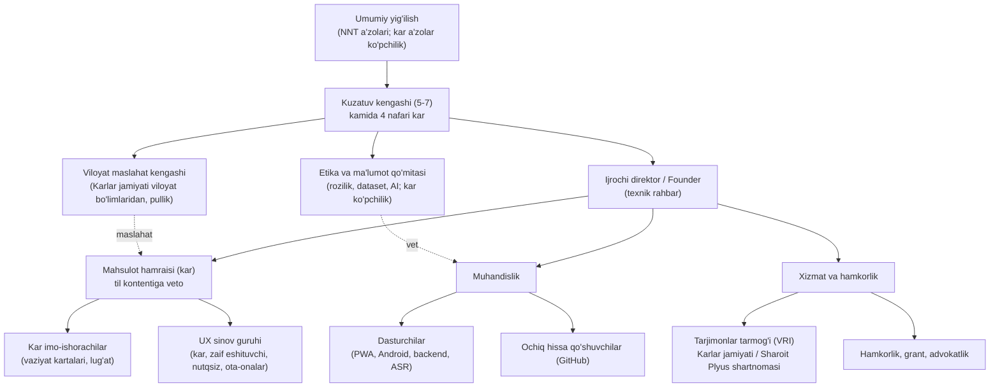
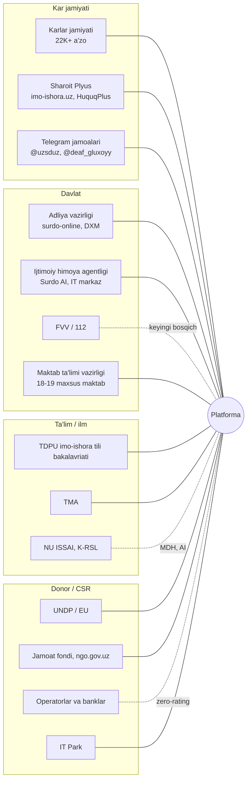

# 06d. Boshqaruv, jamoa va hamkorlar

> **Qisqacha**
> - Platformani kar odamlar boshqaradi: kuzatuv kengashida ko'pchilik kar, til kontentiga kar hamraisning veto huquqi, viloyat maslahat kengashi ("Nothing about us without us") ([WFD](https://wfdeaf.org/?p=18327); [Hook.report](https://old.hook.report/2020/11/bizsiz-biz-haqimizda-hech-narsa/)).
> - Jamoa kichik boshlanadi: founder (texnik rahbar) + 1-2 dasturchi + yarim stavka kar mahsulot hamraisi + pullik kar imo-ishorachilar va tarjimonlar (shartnoma). 6-12 oyda 5-8 kishi (baho).
> - Imo-ishora yozuvi, sinov va konsultatsiya uchun har sessiyaga haq to'lanadi; kod uchun ochiq hissa qo'shuvchilar (GitHub) ko'ngilli bo'lishi mumkin.
> - Asosiy hamkorlar: Sharoit Plyus (imo-ishora.uz, HuquqPlus video markazi), Karlar jamiyati, Adliya vazirligi surdo-online, Agentlik IT markazi (Surdo AI), TDPU / TMA, UNDP, IT Park. Raqobat emas, integratsiya.

---

## 1. Boshqaruv tuzilmasi

Qoidalar:

| Qoida | Tafsilot | Asos |
|---|---|---|
| Kar ko'pchilik | Kengashda kamida 4/7 kar; hamraislardan biri kar | WFD: kar odamlar milliy imo-ishora tili va AI vositalarini rivojlantirishga rahbarlik qiladi ([WFD](https://wfdeaf.org/?p=18327)) |
| Til kontentiga veto | Imo-ishora videolari, gloss qoidalari, avatar chiqishi kar hamrais tasdig'isiz chiqmaydi | WFD-WASLI 2018 avatar bayonoti ([WFD-WASLI](https://wfdeaf.org/wp-content/uploads/WFD-and-WASLI-Statement-on-Avatar-FINAL-14032018-Updated-14042018.pdf)) |
| Pullik ishtirok | Imo-ishorachi, sinovchi, maslahatchi - har sessiyaga to'lov | DGB haqsiz ma'lumot to'plashni tanqid qilgan ([DGB 01/2025](https://gehoerlosenbund.de/wp-content/uploads/2025/10/Pressemitteilung-01_2025-Gut-gebruellt-Loewen.docx.pdf)); etika siyosatlari namunasi ([deaf_centered_product_ux](https://wfdeaf.org/?p=12027)) |
| "AI tarjimonni almashtirmaydi" majburiyati | Ochiq e'lon qilinadi | [deaf_centered_product_ux](https://multilingual.com/coset-safe-ai-task-force-risk-framework-automated-interpreting-slxai-summit/) |
| Viloyat ovozi | Daktil va belgilar maktabga qarab farq qiladi, shuning uchun viloyat vakillari kerak | [Gazeta.uz 2022](https://www.gazeta.uz/oz/2022/04/22/sign-language/) |
| Shaffoflik | Ish soatlari, kutish vaqti, foydalanish statistikasi har oy ochiq (Avstraliya NRS namunasi) | [NRS report](https://www.accesshub.gov.au/sites/default/files/documents/2025-07-monthly-performance-report-july.pdf) |
| Mustaqil audit | Yiliga 1 marta CoSET toolkit + WFD 2025 checklist | [WFD](https://wfdeaf.org/?p=12027) |

Saboq: Karlar jamiyatining "Bizsiz biz haqimizda hech narsa" tanqidi (kar bo'lmagan rahbariyat) ([Hook.report](https://old.hook.report/2020/11/bizsiz-biz-haqimizda-hech-narsa/)) va 2017 da WFD a'zoligining to'xtatilishi ([Yusupov 2020](https://dilmurad.me/expert/uzbek-sign-language-usl-to-be-or-not-to-be/)) boshqaruvni boshidan kar odamlar qo'liga berish zarurligini ko'rsatadi.

---

## 2. Rollar va jamoa (bosqichlar bo'yicha)

Bosqich raqamlari 06f bilan bir xil. Barcha FTE soni va to'lov - **baho**; tarjimon va imo-ishorachi stavkasi **TBD, Karlar jamiyati/Sharoit Plyus bilan aniqlash**.

| Rol | 0-bosqich (0-1 oy) | 1-bosqich (1-3) | 2-bosqich (3-6) | 3-bosqich (6-12) | 4-bosqich (12-24) |
|---|---|---|---|---|---|
| Founder / texnik rahbar | 1 | 1 | 1 | 1 | 1 (ijrochi direktor) |
| Full-stack dasturchi (PWA, WebRTC) | 0 | 1 | 1-2 | 2 | 2-3 |
| Android dasturchi | 0 | 0-0,5 | 1 | 1 | 1 |
| ML / ASR muhandisi | 0 | 0,25 | 0,5 | 1 | 1-2 |
| Kar mahsulot hamraisi | 0,25 | 0,5 | 0,5-1 | 1 | 1 |
| Kar imo-ishorachilar (kartalar, lug'at) | 0 | 2-3 sessiya bo'yicha | 3-5 | 5-10 | 10+ (dataset) |
| VRI tarjimonlari | 0 | Pilot: 1-2 hamkor tarjimon | 2-4 (smena) | 4-8 | 15-30 FTE kerak bo'lishi mumkin (milliy ko'lam, baho) ([region_europe](https://eud.eu/wp-content/uploads/2025/06/Report-on-the-implementation-of-the-European-Electronic-Communications-Code.pdf)) |
| UX sinov guruhi (pullik) | 5 kishi intervyu | 10-15 | 20-30 | 50+ | Viloyatlar |
| Hamkorlik / grant menejeri | Founder | Founder | 0,5 | 1 | 1 |
| Yurist (shartnoma, ZRU-547) | Konsultatsiya | Konsultatsiya | Konsultatsiya | Shartnoma | Shartnoma |
| Animator (avatar, 4-bosqich) | - | - | - | - | 1 ([hands_on_repo_audit](https://github.com/sign-language-processing/spoken-to-signed-translation)) |
| **Jami asosiy jamoa (FTE)** | **~1,3** | **~3** | **~5** | **~7-8** | **~10-14** |

Kod hajmi tekshiruvi: MVP uchun 35-60 kishi-hafta (pw) baholangan ([hands_on_repo_audit](https://github.com/jitsi/jitsi-meet)); 1-2 dasturchi bilan bu 4-7 oyga to'g'ri keladi (baho).

### 2.1 Asosiy rollar tavsifi

| Rol | Vazifa | Talab |
|---|---|---|
| Kar mahsulot hamraisi | Funksiyalar ustuvorligi, til kontentini tasdiqlash, UX sinovlarni olib borish | UzSL ona tili, jamiyatda tanilgan |
| Kar imo-ishorachi | Vaziyat kartalari va lug'at videolari; yozuv sessiyalari | Turli viloyatlardan; yozma rozilik (05, 2.3) |
| VRI tarjimoni | Jonli qo'ng'iroqlar, e'lon qilingan smenalar | Toshkentda 10 tacha malakali tarjimon bor, kasb standarti yo'q ([Gazeta.uz 2025](https://www.gazeta.uz/oz/2025/09/30/sign-language/)); TDPU birinchi bitiruvchilari 2026 ([uzbekistan_landscape](https://www.gazeta.uz/oz/2025/09/30/sign-language/)) |
| ML muhandisi | O'zbek/rus ASR tanlash (Whisper, Aisha, Muxlisa, Yandex), test to'plami | [uzbek_speech_bigtech_support](https://aisha.group/en/pricing) |

---

## 3. Ko'ngilli va hissa qo'shuvchi modeli

| Hissa turi | Kim | To'lov | Huquq / litsenziya | Izoh |
|---|---|---|---|---|
| Kod | Dasturchilar (GitHub) | Ko'ngilli; grant bo'lsa bounty | Apache-2.0, DCO imzosi (baho) | "good first issue", o'zbek tilida hujjat |
| Imo-ishora videosi | Kar imo-ishorachilar | **Har sessiyaga to'lov**, ko'ngilli emas | Qatlamli rozilik R1-R3 (05, 2.3) | Sber/Ovodov tajribasi: 300 so'z / 15 000 video dan 2 000 so'z / 115 000 video gacha kraudsorsing (Toloka) ([browser_youtube_google_findings](https://www.youtube.com/watch?v=zGfIHZnmmHw)) |
| Sinov (UX) | Kar, zaif eshituvchi, nutqsiz foydalanuvchilar, ota-onalar | Har sessiyaga to'lov yoki aloqa krediti (baho) | Rozilik R0 | Viloyatlardan |
| Tarjima / subtitr | Tarjimonlar, talabalar (TDPU, TMA) | Amaliyot krediti yoki to'lov | CC BY-SA | TMA "Inson qalbiga yo'l" dasturi ([TMA](https://admissions.tma.uz/2026/06/inson-qalbiga-yol-imo-ishora-tili-orqali-%F0%9F%91%90/)) |
| Lokalizatsiya (rus, qoraqalpoq, MDH) | Ko'ngillilar | Ko'ngilli | Apache-2.0 / CC BY-SA | 4-bosqich |
| Kontent (ota-onalar moduli) | Pedagoglar, kar o'qituvchilar | Shartnoma | CC BY-SA | IBRAT FARZANDLARI, Ijtimoiy inspeksiya darslari bilan hamkorlik (mualliflik ruxsati bilan) ([YouTube](https://www.youtube.com/playlist?list=PLkREkayoYCyIbxC-s0cOABSwdhkdbcbgz); [YouTube](https://www.youtube.com/playlist?list=PL2T-j53zsYyPK9PciDuM0hKTlEC2yC-YY)) |

Be My Eyes namunasi (2026-mart: 1 mln foydalanuvchi, 10 mln ko'ngilli) ko'ngilli tarmog'i katta bo'lishi mumkinligini ko'rsatadi ([Be My Eyes](https://www.bemyeyes.com/?p=1003); [DoubleTap](https://doubletaponair.com/be-my-eyes-surpasses-1-million-users-and-launches-foundation-to-keep-ai-tools-free/)), lekin malakali tarjimonlar kam, shuning uchun bu model kar odamlar uchun to'g'ridan-to'g'ri ko'chmaydi; ko'ngillilar faqat past xavfli ishlarga (yozuvlarni tekshirish, o'zaro savol-javob) ([nonprofit_models_funding](https://www.bemyeyes.com/?p=1003)). Kar odamlar uchun ko'ngilli tarjimon tarmog'i dunyoda topilmagan ([global_feature_matrix](https://www.bemyeyes.com/?p=1003)). VRI faqat malakali tarjimonlar bilan.

---

## 4. Hamkorlar xaritasi

| Hamkor | Nima beradi | Biz nima beramiz | Manba |
|---|---|---|---|
| **Karlar jamiyati** (STIR 200849599; 22 000+ a'zo, 8 000 bola; kanali ~30 000 deydi) | A'zolar, viloyat bo'limlari, a'zolarga bepul tarjimonlar, ishonch | Bepul VRI platformasi, bron, statistika | [Gazeta.uz 2025](https://www.gazeta.uz/oz/2025/09/30/sign-language/); [orginfo.uz](https://orginfo.uz/en/organization/97f86baf947b/); [YouTube](https://www.youtube.com/watch?v=zGfIHZnmmHw) |
| **Sharoit Plyus** | imo-ishora.uz lug'ati (2 000+ belgi), HuquqPlus video-qo'ng'iroq markazi, yuridik ramka | Lug'atni Signbank asosida kengaytirish va API, VRI texnologiyasi | [imo-ishora.uz](https://imo-ishora.uz/); [Sharoit Plus](https://sharoitplus.uz/category/loyihalar/) |
| **Adliya vazirligi** (surdo-online, 14 hududiy bo'linma; DXM) | B2G kanal, qabul va DXM | Ishonchli video yechim, murojaat yordamchisi | [yuz.uz](https://yuz.uz/ru/news/tsentr-gosuslug-otdela-yustitsii-goroda-navoi-vvel-novy-vid-servisa-dlya-lyudey-s-invalidnostyu-so-sluxom); [anhor.uz](https://anhor.uz/news/23398-2/) |
| **Ijtimoiy himoya milliy agentligi** (IT markazi - Surdo AI) | Rasmiy maqom, foydalanuvchilarga yetib borish | Surdo AI lug'atiga havola, integratsiya, raqobat yo'q | [Google Play](https://play.google.com/store/apps/details?id=com.ihma.surdoai); [gov.uz](https://gov.uz/oz/advice/720/document/3119) |
| **FVV / 112** | SOS pilot (3-4 bosqich) | EU 2023/444 talablari asosidagi kanal | [kun.uz](https://kun.uz/en/news/2025/03/25/uzbekistans-unified-112-emergency-system-now-fully-operational-nationwide); [Gruziya 112](https://mia.police.ge/en/112-gkhedavt-sms-da-video-zaris-servisi-mkholod-kru-da-smenadaqveitebuli-pirebistvis/7938?print=1) |
| **TDPU, TMA** | Tarjimon talabalar, tadqiqot | Amaliyot, real foydalanish | [TMA](https://admissions.tma.uz/2026/06/inson-qalbiga-yol-imo-ishora-tili-orqali-%F0%9F%91%90/) |
| **NU ISSAI / K-RSL**, ENU SignBridge | MDH tajribasi, AI tadqiqot | Ochiq o'zbek ma'lumoti | [ISSAI](https://issai.nu.edu.kz/?p=62139); [K-RSL](https://krslproject.github.io/krsl20) |
| **UNDP, EU** | Kichik grantlar, s-access.uz pretsedenti | Natija, hisobot | [UNDP](https://www.undp.org/uz/node/537801) |
| **IT Park** (UNDP bilan "Voice AI Challenge" xakatoni) | Rezidentlik, xakaton, tarmoq | Ijtimoiy IT loyiha | [it-park.uz](https://www.it-park.uz/en/itpark/news/in-uzbekistan-mitc-it-park-and-undp-organize-hackathon-called-voice-ai-challenge-uzbekistan) |
| **Zamin fondi** | Implantli bolalar oilalari (4 626 skrining, 122 operatsiya) | Ota-onalar moduli | [uzsl_linguistics](https://uz.wikipedia.org/wiki/Zamin_fondi) |
| **Operatorlar** (Beeline UZ, Ucell, Uzmobile, Mobiuz) | Zero-rating, CSR | Beeline KG, Claro, MTS namunalari | [pulse.bot](https://www.pulse.bot/telecom/blogs/beeline-kyrgyzstan-launches-mobile-plan-with-zero-rated-ai-apps-e490b846-0dc7-4ba1-b036-87798c89630a); [mobile-review](https://mobile-review.com/all/?p=259570) |
| **Ish beruvchilar** (Yandex Lavka kar xodim yollaydi) | Xodimlar bilan muloqot B2B | Ish joyi kartalari, VRI | [Gazeta.uz](https://www.gazeta.uz/oz/2026/06/03/yandex-lavka-disabled/) |
| **Kar teatri, Deaflympics sportchilari** | Ommaviy tanilish | Kontent | [Gazeta.uz](https://www.gazeta.uz/oz/2026/09/29/theater-of-mimicry-and-gesture/) |

---

## 5. Maslahat kengashi uchun nomzodlar (faqat ommaviy rollari)

Barcha nomlar ommaviy manbalardan olingan. Kar yoki eshituvchi ekani **tasdiqlanmagan**; kar ko'pchilik talabi har bir odamning roziligi va o'z ma'lumoti asosida tekshiriladi.

| Ism | Ommaviy roli | Nega | Manba |
|---|---|---|---|
| Dilmurod Yusupov | PhD (IDS Sussex), Sharoit Plyus lug'ati va HuquqPlus loyihasi rahbari, UzSL bo'yicha maqolalar muallifi | Til siyosati, grantlar, huquq | [dilmurad.me](https://dilmurad.me/expert/uzbek-sign-language-usl-to-be-or-not-to-be/); [Sharoit Plus](https://sharoitplus.uz/category/loyihalar/) |
| Mamur Axlidinov | Kar bloger | Jamiyat ovozi, auditoriya | [uzsl_linguistics_education_community](https://www.gazeta.uz/oz/2025/09/30/sign-language/) |
| Gulnora Mahkamova | Surdotarjimon | Tarjimon tarmog'i, VRI standartlari | [uzsl_linguistics_education_community](https://www.gazeta.uz/oz/2025/09/30/sign-language/) |
| E'zoza Axmedova | Surdotarjimon | VRI | [uzsl_linguistics_education_community](https://www.gazeta.uz/oz/2025/09/30/sign-language/) |
| Go'zal Rahmatullayeva | Surdotarjimon | VRI | [uzsl_linguistics_education_community](https://www.gazeta.uz/oz/2025/09/30/sign-language/) |
| Davron Xidirov | Kar sport federatsiyasi raisi (tasdiqlanmagan) | Yoshlar va sport jamoasi | [uzsl_linguistics_education_community](https://www.gazeta.uz/oz/2025/09/30/sign-language/) |
| Tatyana An | International Inclusive Hub; Agentlik bilan aloqador | Inklyuziya, davlat aloqasi | [uzsl_linguistics_education_community](https://www.gazeta.uz/oz/2025/09/30/sign-language/) |
| Oybek Isoqov | Nogironlar assotsiatsiyasi rahbari (30+ NNT) | Koalitsiya, advokatlik | [uzsl_linguistics_education_community](https://www.gazeta.uz/oz/2025/09/30/sign-language/) |
| Z.N. Mamarajabova | TDPU (surdopedagogika) | Ta'lim, tarjimon tayyorlash | [uzsl_linguistics_education_community](https://www.gazeta.uz/oz/2025/09/30/sign-language/) |
| Ismigul Sayfullayeva | Imo-ishora tili darslari muallifi (YouTube) | Ota-onalar moduli | [browser_youtube_google_findings](https://www.youtube.com/playlist?list=PL2T-j53zsYyPK9PciDuM0hKTlEC2yC-YY) |
| Karlar jamiyati raisi | Hozirgi rais noma'lum | Institutsional hamkorlik | Bo'shliq |

Eslatma: odamlar bilan bog'lanish faqat ommaviy kanallar orqali (tashkilot e-mail, Telegram kanali); shaxsiy ma'lumot yig'ilmaydi.

---

## 6. Aloqa (outreach) rejasi

| Hafta / oy | Kimga | Kanal | Maqsad | Natija o'lchovi |
|---|---|---|---|---|
| 1-2 hafta | Sharoit Plyus | info@sharoitplus.uz, +998 55 500-50-60, [t.me/sharoitplus](https://t.me/s/sharoitplus) | Hamkorlik, HuquqPlus integratsiyasi, imo-ishorachi stavkalari | Uchrashuv o'tkazildi, memorandum loyihasi |
| 1-3 hafta | Karlar jamiyati (markaziy + Toshkent) | Rasmiy xat, uchrashuv | Hamkorlik, tarjimon tarmog'i, viloyat bo'limlari | Memorandum, 2 viloyat kontakti |
| 2-4 hafta | Kar jamoalari | @uzsduz (854-981 obunachi), @deaf_gluxoyy (2,1K) | Muammo intervyulari, 15-20 ishtirokchi | 15+ intervyu (UzSL video so'rovnoma) ([uzsl_linguistics](https://imo-ishora.uz/)) |
| 1-2 oy | Adliya vazirligi (surdo-online, HuquqPlus) | Sharoit Plyus orqali | DXM'da VRI pilot | Pilot xati |
| 1-2 oy | Agentlik IT markazi (Surdo AI) | Rasmiy xat | Raqobat emas: o'zaro havola, ma'lumot almashish | Javob |
| 2-3 oy | TDPU, TMA | Kafedra | Talaba tarjimonlar, tadqiqot | Kelishuv |
| 2-4 oy | UNDP, EU delegatsiyasi, Jamoat fondi | Ariza (hamkor NNT nomidan) | Grant | 1-2 ariza topshirildi |
| 3-6 oy | IT Park | Rezidentlik / xakaton | Tarmoq, ehtimoliy MChJ | - |
| 6-12 oy | Operatorlar, banklar | CSR bo'limlari | Zero-rating pilot, bank kartalari | 1 xat-niyat |
| 6-12 oy | FVV / 112 | Agentlik va Adliya orqali | SOS pilot muhokamasi | Uchrashuv |
| 12+ oy | NU ISSAI, Qirg'iziston UNDP, Tojikiston jamiyatlari | E-mail, konferensiya | MDH kengayishi | Hamkorlik memorandumi |

Xabar tamoyillari: o'zbek (lotin), rus va UzSL videosi; "biz raqobatchi emasmiz, mavjud xizmatlarni ulaymiz"; birinchi uchrashuvdayoq to'lov va ma'lumot egaligi aniq aytiladi.

---

## Manbalar

- WFD AI bayonoti: https://wfdeaf.org/?p=18327 ; WFD 2025 checklist: https://wfdeaf.org/?p=12027
- WFD-WASLI 2018: https://wfdeaf.org/wp-content/uploads/WFD-and-WASLI-Statement-on-Avatar-FINAL-14032018-Updated-14042018.pdf
- Hook.report: https://old.hook.report/2020/11/bizsiz-biz-haqimizda-hech-narsa/
- Yusupov 2020: https://dilmurad.me/expert/uzbek-sign-language-usl-to-be-or-not-to-be/
- DGB: https://gehoerlosenbund.de/wp-content/uploads/2025/10/Pressemitteilung-01_2025-Gut-gebruellt-Loewen.docx.pdf
- CoSET: https://multilingual.com/coset-safe-ai-task-force-risk-framework-automated-interpreting-slxai-summit/
- NRS KPI: https://www.accesshub.gov.au/sites/default/files/documents/2025-07-monthly-performance-report-july.pdf
- Gazeta.uz: https://www.gazeta.uz/oz/2025/09/30/sign-language/ ; https://www.gazeta.uz/oz/2022/04/22/sign-language/ ; https://www.gazeta.uz/oz/2026/06/03/yandex-lavka-disabled/ ; https://www.gazeta.uz/oz/2026/09/29/theater-of-mimicry-and-gesture/
- Karlar jamiyati: https://orginfo.uz/en/organization/97f86baf947b/ ; https://www.youtube.com/watch?v=zGfIHZnmmHw
- Sharoit Plyus: https://sharoitplus.uz/category/loyihalar/ ; https://imo-ishora.uz/ ; https://t.me/s/sharoitplus
- Surdo AI: https://play.google.com/store/apps/details?id=com.ihma.surdoai
- Surdo-online: https://yuz.uz/ru/news/tsentr-gosuslug-otdela-yustitsii-goroda-navoi-vvel-novy-vid-servisa-dlya-lyudey-s-invalidnostyu-so-sluxom ; DXM: https://anhor.uz/news/23398-2/
- Agentlik: https://gov.uz/oz/advice/720/document/3119
- 112: https://kun.uz/en/news/2025/03/25/uzbekistans-unified-112-emergency-system-now-fully-operational-nationwide ; Gruziya: https://mia.police.ge/en/112-gkhedavt-sms-da-video-zaris-servisi-mkholod-kru-da-smenadaqveitebuli-pirebistvis/7938?print=1
- TMA: https://admissions.tma.uz/2026/06/inson-qalbiga-yol-imo-ishora-tili-orqali-%F0%9F%91%90/
- ISSAI: https://issai.nu.edu.kz/?p=62139 ; K-RSL: https://krslproject.github.io/krsl20
- UNDP: https://www.undp.org/uz/node/537801 ; IT Park xakaton: https://www.it-park.uz/en/itpark/news/in-uzbekistan-mitc-it-park-and-undp-organize-hackathon-called-voice-ai-challenge-uzbekistan
- Zamin: https://uz.wikipedia.org/wiki/Zamin_fondi
- Operatorlar: https://www.pulse.bot/telecom/blogs/beeline-kyrgyzstan-launches-mobile-plan-with-zero-rated-ai-apps-e490b846-0dc7-4ba1-b036-87798c89630a ; https://mobile-review.com/all/?p=259570
- YouTube darslari: https://www.youtube.com/playlist?list=PLkREkayoYCyIbxC-s0cOABSwdhkdbcbgz ; https://www.youtube.com/playlist?list=PL2T-j53zsYyPK9PciDuM0hKTlEC2yC-YY
- Kod hajmi: https://github.com/jitsi/jitsi-meet (hands_on_repo_audit bahosi)
- EU relay hajmi: https://eud.eu/wp-content/uploads/2025/06/Report-on-the-implementation-of-the-European-Electronic-Communications-Code.pdf

## Tasdiqlanmagan / bo'shliqlar

- Karlar jamiyatining hozirgi raisi va boshqaruv tarkibi noma'lum.
- Nomzodlarning kar yoki eshituvchi ekani, ularning qiziqishi va mavjudligi tasdiqlanmagan.
- Davron Xidirovning roli tasdiqlanmagan.
- Imo-ishorachi, tarjimon va UX sinovchilar uchun stavkalar: TBD, Karlar jamiyati/Sharoit Plyus bilan aniqlash.
- Jamoa FTE soni va bosqichlar bo'yicha taqsimot - baho.
- Karlar jamiyati a'zolari soni bo'yicha manbalar farq qiladi: 22 000+ (Gazeta.uz 2025), 21 212 (2019, Yusupov), ~30 000 (jamiyat kanali), OHCHR 18 303 + 3 875.
- Viloyat bo'limlari soni va faolligi tekshirilmagan.
- Agentlik IT markazi Surdo AI bo'yicha hamkorlikka ochiqligi noma'lum.
