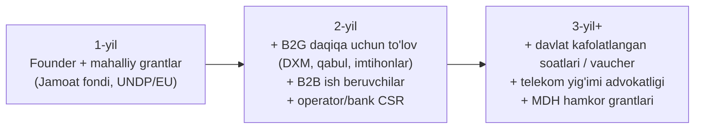

# 06e. Budjet va moliya rejasi

> **Qisqacha**
> - Uch ssenariy: **A** - founder o'z mablag'i, 6 oy, minimal MVP: **~$1,6k-11,5k** (baho); **B** - grant bilan, 12 oy, MVP + pilotlar: **~$28k-100k** (baho); **C** - to'liq ko'lam, 24 oy, milliy VRI: **~$355k-990k** (baho).
> - Eng katta va eng noma'lum xarajat - tarjimon soati va imo-ishora yozuvi: **TBD, Karlar jamiyati/Sharoit Plyus bilan aniqlash**. Dasturiy ta'minot ochiq koddan, STT arzon (Yandex ~$0,30/soat) ([Yandex](https://yandex.cloud/en-ru/docs/speechkit/pricing)).
> - Mahalliy grant hajmi kichik (o'rtacha ~130 mln so'm, ~$10k) ([UzA](https://uza.uz/ar/posts/fuqarolik-jamiyati-institutlari-tashabbuslarini-amalga-oshirishga-116-milliard-som-yonaltiriladi_925975)), shuning uchun B va C bir nechta manbani birlashtiradi.
> - Barqarorlik: bitta budjet manbaiga bog'lanmaslik (Tailand TTRS 2025 da to'xtagan, Islandiya relay budjeti tugagan) ([Prachatai](https://prachataienglish.com/node/11567); [SHH](https://island.is/s/shh/frett/lokad-fyrir-endurgjaldslausa-tulkathjonustu-ut-mars)).

---

## 1. Asosiy ko'rsatkichlar (hisob uchun)

| Ko'rsatkich | Qiymat | Manba / holat |
|---|---|---|
| Valyuta kursi | 1 USD ≈ 12 500-13 000 so'm | **baho** (130 mln so'm ≈ $10k nisbati, [nonprofit_models_funding](https://uza.uz/ar/posts/fuqarolik-jamiyati-institutlari-tashabbuslarini-amalga-oshirishga-116-milliard-som-yonaltiriladi_925975)) |
| O'rtacha ish haqi | 7,3 mln so'm/oy (~$560-585) | [anhor.uz](https://anhor.uz/uzl/news/uzbekistonda-ortacha-ish-haqi-7-3-million) |
| MHEKM (eng kam ish haqi) | 1 360 000 so'm | [gov.uz](https://gov.uz/oz/bv/news/view/182984) (01.07.2026) yoki [buxgalter.uz](https://buxgalter.uz/oz/publish/doc/text216780_1_sentyabrdan_boshlab_mhekm_va_bhmning_uzgarishi_ish_haqini_hisoblashga_qanday_tasir_kursatadi) (01.09.2026) - kuchga kirish sanasi manbalarda zid |
| BHM | 440 000 so'm | Xuddi shu manbalar |
| STT: Yandex SpeechKit | ~$0,30-0,32 / soat audio | [Yandex](https://yandex.cloud/en-ru/docs/speechkit/pricing) |
| STT: Aisha | 425 so'm/daqiqa (~$2/soat); TTS 1 so'm/belgi | [Aisha](https://aisha.group/en/pricing) |
| STT: Muxlisa | 350 so'm / 1 000 belgi; WER 11,39-13,42% (o'zi e'lon qilgan) | [Muxlisa](https://muxlisa.uz/en) |
| STT: ElevenLabs | ~$0,40/soat | [uzbek_speech_bigtech_support](https://yandex.cloud/en-ru/docs/speechkit/pricing) |
| STT: o'z serverida Whisper (navai-uz/whisper-medium-uzbek, Apache) | Faqat GPU xarajati; O'zbekistonda GPU narxi topilmadi | [hands_on_repo_audit](https://huggingface.co/api/models/navai-uz/whisper-medium-uzbek) |
| Mahalliy VPS | Narxlar topilmadi (dicloud.uz, Pro-Data, Uztelecom); Serverspace VPS-1 ~438 RUB/oy | [Serverspace](https://serverspace.io/services/vps-server/vps-in-uzbekistnan/) |
| Tarjimon soati (O'zbekiston) | **TBD, Karlar jamiyati/Sharoit Plyus bilan aniqlash** | Taqqoslash: Rossiya, Yaroslavl ~5 000 RUB/soat (2026) ([SFR](https://sfr.gov.ru/branches/yaroslavl/news/~2026/09/25/285016)); Rossiya 2017 davlat stavkasi 700 RUB/soat ([russia_cis_competitors](https://sfr.gov.ru/branches/yaroslavl/news/~2026/09/25/285016)) |
| MVP kod hajmi | 35-60 kishi-hafta | [hands_on_repo_audit](https://github.com/jitsi/jitsi-meet) (baho) |
| NNT davlat boji | 0,5-3 BHM (~220 000-1 320 000 so'm); ba'zi nogironlar birlashmalari uchun boj yo'q | [anhor.uz](https://anhor.uz/news/24364-2/); [Tashkent Times](https://www.tashkenttimes.uz/national/6528-mirziyoyev-signs-decree-banning-government-interference-into-ngos-activities) |
| Ish beruvchi subsidiyasi | I/II guruh xodimga 50 mln so'mgacha | [anhor.uz](https://anhor.uz/uzl/news/1-iyundan-nogironligi-bo-lgan-shaxslarni-ishga-qabul-qilgan-tadbirkor/) |

Dasturchi oyligi O'zbekiston uchun manbada yo'q. Hisobda **$1 000-2 500/oy (baho / tasdiqlanmagan)** ishlatildi. Tarjimon va imo-ishorachi uchun **$5-20/soat (baho, faqat diapazon)** ishlatildi va TBD qoladi.

---

## 2. Uchta ssenariy

### 2.1 Umumiy jadval (USD, baho)

| Xarajat moddasi | A: Founder, 6 oy | B: Grant bilan, 12 oy | C: To'liq ko'lam, 24 oy |
|---|---|---|---|
| Muhandislik (dasturchilar) | $0-6 000 (founder bepul, 0-0,5 frilanser) | $15 000-40 000 (1 full-stack + 0,5 Android) | $100 000-300 000 (4-6 FTE) |
| Hosting O'zbekistonda (video, Signbank, TURN) | $200-600 | $1 000-3 000 | $10 000-40 000 (GPU bilan) |
| STT foydalanish | $50-500 (200-250 soat; Yandex yoki Aisha) | $500-3 000 | $5 000-20 000 |
| Tarjimon soatlari (VRI) | $500-2 000 (100 soat pilot) | $2 500-30 000 (500-1 500 soat) | $170 000-460 000 (15-30 FTE, 2 yil) |
| Dataset / kartalar yozuvi (kar imo-ishorachilar) | $500-1 500 (50 vaziyat kartasi) | $3 000-10 000 (100+ karta, 300-500 belgi) | $30 000-80 000 (~2 000 belgi, 50+ imo-ishorachi) |
| Kar mahsulot hamraisi | Hamkorlik asosida | $3 000-9 000 (0,5 FTE) | $15 000-30 000 |
| Yuridik / ro'yxat | $200-600 (konsultatsiya + boj) | $1 000-3 000 (shartnomalar, reyestr) | $5 000-10 000 |
| Jamiyat / aloqa / UX sinov | $150-300 (15 intervyu) | $2 000-5 000 | $20 000-50 000 (viloyatlar) |
| **Jami** | **~$1 600-11 500** | **~$28 000-103 000** | **~$355 000-990 000** |
| **so'mda (taxminan)** | ~20-150 mln so'm | ~0,35-1,3 mlrd so'm | ~4,5-12,5 mlrd so'm |

C ssenariy uchun taqqoslash: Contact Scotland (Shotlandiya, BSL video relay) 2024/25 da GBP 796 369 ([gov.scot](https://www.gov.scot/publications/foi-202500459975/)); Kanada CAV yiliga $27-30 mln CAD ([CRTC](https://www.crtc.gc.ca/eng/archive/2021/2021-102.pdf)). Milliy relay hajmi O'zbekiston uchun 50-150 ming qo'ng'iroq/yil, 15-30 tarjimon FTE (baho) ([region_europe](https://eud.eu/wp-content/uploads/2025/06/Report-on-the-implementation-of-the-European-Electronic-Communications-Code.pdf)).

### 2.2 Ssenariy A: founder o'z mablag'i (0-6 oy)

| Nima qilinadi | Nima qilinmaydi |
|---|---|
| Yuzma-yuz subtitr rejimi (Yandex/Aisha STT, PWA) | Milliy 24/7 VRI |
| 50 vaziyat kartasi, kar imo-ishorachi videosi bilan | Avatar, AI tanish |
| VRI pilot: hamkor tarjimon bilan e'lon qilingan 2-4 soat/kun (Jitsi) | O'z NNT'i ro'yxati tugashi (7-10+ oy) |
| Video xabar (ko'zgu to'g'ri) | Android native (faqat PWA) |
| Hamkor NNT memorandumi, 1-2 grant arizasi | Pullik dasturchi jamoasi |

Tarjimon soati uchun tarjimon tanqisligini hisobga olish kerak: Toshkentda 5 000 kishiga 10 tacha malakali tarjimon ([Gazeta.uz 2025](https://www.gazeta.uz/oz/2025/09/30/sign-language/)).

### 2.3 Ssenariy B: grant bilan (12 oy)

Moliya tarkibi (maqsad, baho):

| Manba | Miqdor | Manba havolasi |
|---|---|---|
| Founder | $5 000-15 000 | Strategik qaror 9 |
| Jamoat fondi / ngo.gov.uz (hamkor NNT orqali) | ~130 mln so'm (~$10k) | [UzA](https://uza.uz/ar/posts/fuqarolik-jamiyati-institutlari-tashabbuslarini-amalga-oshirishga-116-milliard-som-yonaltiriladi_925975) |
| Viloyat budjeti (masalan, Namangan 4,5 mlrd so'm fondi) | 50-200 mln so'm (baho) | [UzA](https://uza.uz/ar/posts/namanganda-nodavlat-notijorat-tashkilotlariga-etibor-qanday_889173) |
| UNDP / EU kichik grant | Miqdor topilmadi (TBD) | [undp.org](https://www.undp.org/uz/node/593281) |
| Korrupsiyaga qarshi NNT grantlari (murojaat yordamchisi) | Fond yiliga 10 mlrd so'm | [Kun.uz](https://kun.uz/news/2025/09/24/korrupsiyaga-qarshi-kurash-sohasidagi-nnt-loyihalariga-grant-ajratiladi) |
| Ish beruvchi subsidiyasi (kar xodim) | 50 mln so'mgacha / xodim | [anhor.uz](https://anhor.uz/uzl/news/1-iyundan-nogironligi-bo-lgan-shaxslarni-ishga-qabul-qilgan-tadbirkor/) |

Natija: MVP yadrosi (a-g), Android, 2 viloyat pilot, DPGA arizasi, B2G birinchi shartnomasi (DXM yoki qabul).

### 2.4 Ssenariy C: to'liq ko'lam (24 oy)

- Milliy VRI smenalari (kuniga 12-16 soat, keyin 24/7 - 06f 4-bosqich).
- ~2 000 belgili lug'at/dataset (Sber tajribasi: 2 000 so'z / 115 000 video kraudsorsing bilan) ([YouTube, Ovodov](https://www.youtube.com/watch?v=zGfIHZnmmHw)); UzSL SiGML lug'ati: 1 animator + 1 kar imo-ishorachi, ~2 000 belgi uchun 6-12 oy ([hands_on_repo_audit](https://github.com/sign-language-processing/spoken-to-signed-translation)).
- Moliya: B2G daqiqa uchun to'lov + operator CSR + xalqaro donor + davlat kafolatlangan soatlari advokatligi (05, 5.2). Bitta grant bilan C ni qoplab bo'lmaydi.

---

## 3. Xarajat moddalari bo'yicha izohlar

| Modda | Asos | Tejash yo'li |
|---|---|---|
| Muhandislik | MVP 35-60 pw; Jitsi 9-16, Signbank 7-12, WhisperLive 2,5-4,5, Cboard 9-15 pw ([hands_on_repo_audit](https://github.com/jitsi/jitsi-meet)) | Fork qilish, noldan yozmaslik; Cboard'ni alohida ilova sifatida o'z holicha |
| Hosting | Video asosiy nusxasi O'zbekistonda (27-1-modda) ([lex.uz](https://lex.uz/docs/4396419)) | Qo'ng'iroqlarni yozmaslik; P2P WebRTC; faqat TURN va lug'at videolari serverda |
| STT | Yandex $0,30/soat eng arzon, Aisha ~$2/soat ([Yandex](https://yandex.cloud/en-ru/docs/speechkit/pricing); [Aisha](https://aisha.group/en/pricing)) | O'z test to'plamida WER o'lchab tanlash; ko'p foydalanishda o'z Whisper serveri |
| Tarjimon | Narx TBD; Rossiya ~5 000 RUB/soat ([SFR](https://sfr.gov.ru/branches/yaroslavl/news/~2026/09/25/285016)) | Hamkor NNT tarjimonlari, TDPU talabalari amaliyoti, e'lon qilingan smenalar (24/7 emas) |
| Dataset | 130 mln so'm ~1 000 belgili yozuv kampaniyasiga yetadi (tadqiqotchi bahosi) ([nonprofit_models_funding](https://uza.uz/ar/posts/fuqarolik-jamiyati-institutlari-tashabbuslarini-amalga-oshirishga-116-milliard-som-yonaltiriladi_925975)) | Avval vaziyat kartalari (50-100), keyin lug'at; imo-ishora.uz bilan almashish; universitet hamkorligi (K-RSL namunasi: 600 belgi, 28 250 video) ([K-RSL](https://krslproject.github.io/krsl20)) |
| Yuridik | NNT boji 0,5-3 BHM ([anhor.uz](https://anhor.uz/news/24364-2/)) | Hamkor NNT ostida boshlash; nogironlar birlashmasi imtiyozi |
| Jamiyat | Pullik sinov (etika talabi) | Telegram kanallari orqali, viloyat bo'limlari bilan |

---

## 4. Xarajatni kamaytirish taktikalari

1. **Ochiq kodni fork qilish**: Jitsi (Apache), Signbank (BSD-3), WhisperLive (MIT), Cboard (GPL) - litsenziya to'lovi yo'q ([hands_on_repo_audit](https://github.com/Signbank/Global-signbank/blob/master/LICENCE.txt)).
2. **Qo'ng'iroqlarni yozmaslik**: saqlash va biometrik reyestr hajmi kamayadi.
3. **Arzon STT**: Yandex ~$0,30/soat; tijorat API'lar orasidan WER/narx bo'yicha tanlash.
4. **Smenali VRI**: halol e'lon qilingan soatlar, 24/7 emas (strategik qaror 2a).
5. **Hamkor tarjimonlar**: Karlar jamiyati a'zolarga bepul tarjimon beradi ([YouTube](https://www.youtube.com/watch?v=zGfIHZnmmHw)) - platforma ularning ishini osonlashtiradi, yangi shtat ochmaydi.
6. **Ish beruvchi subsidiyasi**: kar xodim (mahsulot hamraisi, imo-ishorachi) yollanganda 50 mln so'mgacha ([anhor.uz](https://anhor.uz/uzl/news/1-iyundan-nogironligi-bo-lgan-shaxslarni-ishga-qabul-qilgan-tadbirkor/)).
7. **IT Park imtiyozlari** (agar MChJ bo'lsa): JShDS 7,5%, 2028 gacha soliq imtiyozlari ([it-park.uz](https://www.it-park.uz/uz/itpark/news/o-zbekiston-it-sohasidagi-startaplar-va-xorijiy-investorlar-uchun-soliq-imtiyozlari)).
8. **Universitetlar**: TDPU, TMA talabalari (tarjimon), NU ISSAI (AI) ([ISSAI](https://issai.nu.edu.kz/?p=62139)).
9. **Mavjud kontentni ulash**: imo-ishora.uz, Surdo AI lug'atiga havola, YouTube darslari (ruxsat bilan).
10. **Operator zero-rating**: foydalanuvchi trafik xarajati kamayadi (Beeline KG, Claro namunasi) ([pulse.bot](https://www.pulse.bot/telecom/blogs/beeline-kyrgyzstan-launches-mobile-plan-with-zero-rated-ai-apps-e490b846-0dc7-4ba1-b036-87798c89630a)).
11. **PWA birinchi**: iOS va native ilova xarajati keyinga.

---

## 5. Barqarorlik rejasi

| Daromad oqimi | Kim to'laydi | Qachon | Asos |
|---|---|---|---|
| Grantlar | Jamoat fondi, viloyat, UNDP/EU | 0-24 oy | [UzA](https://uza.uz/ar/posts/fuqarolik-jamiyati-institutlari-tashabbuslarini-amalga-oshirishga-116-milliard-som-yonaltiriladi_925975) |
| B2G VRI daqiqa | Davlat organlari (O'RQ-641, qabul qoidasi) | 6-24 oy | [lex.uz](https://lex.uz/acts/-5049511); [anhor.uz](https://anhor.uz/uzl/news/fuqarolar-qabuli-va-sayyor-qabullarni-otkazishda-surdotarjimon-ishtiroki/) |
| Imtihon xizmati | Imtihon tashkilotchilari (2027/2028 dan) | 2027-yoz oldidan | [infoedu.uz](https://infoedu.uz/nogironligi-bolgan-shaxslarga-imtihonlarda-qoshimcha-vaqt-beriladi) |
| B2B | Kar xodim yollagan kompaniyalar (Yandex Lavka namunasi), banklar (T-Bank namunasi) | 12+ oy | [Gazeta.uz](https://www.gazeta.uz/oz/2026/06/03/yandex-lavka-disabled/); [Habr](https://habr.com/ru/post/901868) |
| Operator CSR | Beeline UZ, Ucell, Uzmobile, Mobiuz | 12+ oy | [mobile-review](https://mobile-review.com/all/?p=259570) |
| Davlat / telekom yig'imi | Advokatlik natijasi | 24+ oy | 05, 5-bo'lim |

Qoidalar:
- **Foydalanuvchi to'lamaydi**: kar odamlar tarjima uchun to'lashni adolatsiz deb hisoblaydi ([uzbekistan_landscape](https://www.gazeta.uz/oz/2025/09/30/sign-language/)).
- **Bitta manba 50% dan oshmasin** (baho, ichki qoida) - Tailand TTRS va Islandiya saboqlari ([Prachatai](https://prachataienglish.com/node/11567); [SHH](https://island.is/s/shh/frett/lokad-fyrir-endurgjaldslausa-tulkathjonustu-ut-mars)).
- **3-yildan keyin operatsion xarajat budjetda**: EU loyihalari moliya tugaganda to'xtagan ([region_europe](https://eud.eu/wp-content/uploads/2025/06/Report-on-the-implementation-of-the-European-Electronic-Communications-Code.pdf)).
- **VLibras saboqi**: davlat platformasi ham barqarorlik tanqidiga uchragan (TCU auditi) ([nonprofit_models_funding](https://transforma.fbb.org.br/storage/socialtecnologies/482/files/Avaliacao_Vlibras_TCU.pdf)) - ochiq kod va hamjamiyat mustaqillikni saqlaydi.
- **Zaxira fondi**: 3-6 oylik operatsion xarajat (baho).

---

## Manbalar

- Yandex SpeechKit: https://yandex.cloud/en-ru/docs/speechkit/pricing
- Aisha: https://aisha.group/en/pricing ; Muxlisa: https://muxlisa.uz/en
- O'zbek Whisper: https://huggingface.co/api/models/navai-uz/whisper-medium-uzbek
- Serverspace: https://serverspace.io/services/vps-server/vps-in-uzbekistnan/
- O'rtacha ish haqi: https://anhor.uz/uzl/news/uzbekistonda-ortacha-ish-haqi-7-3-million
- MHEKM/BHM: https://gov.uz/oz/bv/news/view/182984 ; https://buxgalter.uz/oz/publish/doc/text216780_1_sentyabrdan_boshlab_mhekm_va_bhmning_uzgarishi_ish_haqini_hisoblashga_qanday_tasir_kursatadi
- NNT boji: https://anhor.uz/news/24364-2/ ; https://www.tashkenttimes.uz/national/6528-mirziyoyev-signs-decree-banning-government-interference-into-ngos-activities
- Subsidiya: https://anhor.uz/uzl/news/1-iyundan-nogironligi-bo-lgan-shaxslarni-ishga-qabul-qilgan-tadbirkor/
- Grantlar: https://uza.uz/ar/posts/fuqarolik-jamiyati-institutlari-tashabbuslarini-amalga-oshirishga-116-milliard-som-yonaltiriladi_925975 ; https://uza.uz/ar/posts/namanganda-nodavlat-notijorat-tashkilotlariga-etibor-qanday_889173 ; https://www.undp.org/uz/node/593281 ; https://kun.uz/news/2025/09/24/korrupsiyaga-qarshi-kurash-sohasidagi-nnt-loyihalariga-grant-ajratiladi
- Rossiya tarjimon narxi: https://sfr.gov.ru/branches/yaroslavl/news/~2026/09/25/285016
- Contact Scotland: https://www.gov.scot/publications/foi-202500459975/ ; Kanada: https://www.crtc.gc.ca/eng/archive/2021/2021-102.pdf
- EU relay hajmi va saboqlar: https://eud.eu/wp-content/uploads/2025/06/Report-on-the-implementation-of-the-European-Electronic-Communications-Code.pdf
- Tailand: https://prachataienglish.com/node/11567 ; Islandiya: https://island.is/s/shh/frett/lokad-fyrir-endurgjaldslausa-tulkathjonustu-ut-mars
- Kod hajmi: https://github.com/jitsi/jitsi-meet ; https://github.com/Signbank/Global-signbank/blob/master/LICENCE.txt ; https://github.com/sign-language-processing/spoken-to-signed-translation
- K-RSL: https://krslproject.github.io/krsl20 ; Sber/Ovodov: https://www.youtube.com/watch?v=zGfIHZnmmHw
- IT Park: https://www.it-park.uz/uz/itpark/news/o-zbekiston-it-sohasidagi-startaplar-va-xorijiy-investorlar-uchun-soliq-imtiyozlari
- B2B: https://www.gazeta.uz/oz/2026/06/03/yandex-lavka-disabled/ ; https://habr.com/ru/post/901868 ; https://mobile-review.com/all/?p=259570
- Imtihonlar: https://infoedu.uz/nogironligi-bolgan-shaxslarga-imtihonlarda-qoshimcha-vaqt-beriladi

## Tasdiqlanmagan / bo'shliqlar

- O'zbekistonda surdotarjimon soati, kunlik stavkasi va oyligi topilmadi (yagona qonuniy pastki chegara MHEKM asosida ~62 000 so'm/kun) - **TBD, Karlar jamiyati/Sharoit Plyus bilan aniqlash**.
- Imo-ishorachi yozuv sessiyasi va studiya narxi - TBD.
- O'zbekistonda dasturchi oyligi manbada yo'q; $1 000-2 500/oy - baho.
- Mahalliy VPS, saqlash va GPU narxlari topilmadi.
- Valyuta kursi - baho.
- UNDP/EU kichik grant miqdorlari topilmadi.
- Barcha ssenariy jami summalari - baho; real takliflar (tarjimon, hosting) olingach qayta hisoblanadi.
- Tarjimon birligi iqtisodi (daqiqa narxi) dunyo bo'yicha ham to'liq topilmagan; FCC TRS 2026-27 stavkalari ($9,1713/daq TRS, $2,2710/daq IP Relay) AQSh bozoriga xos ([global_apps](https://docs.fcc.gov/public/attachments/DA-26-646A1.pdf)).
