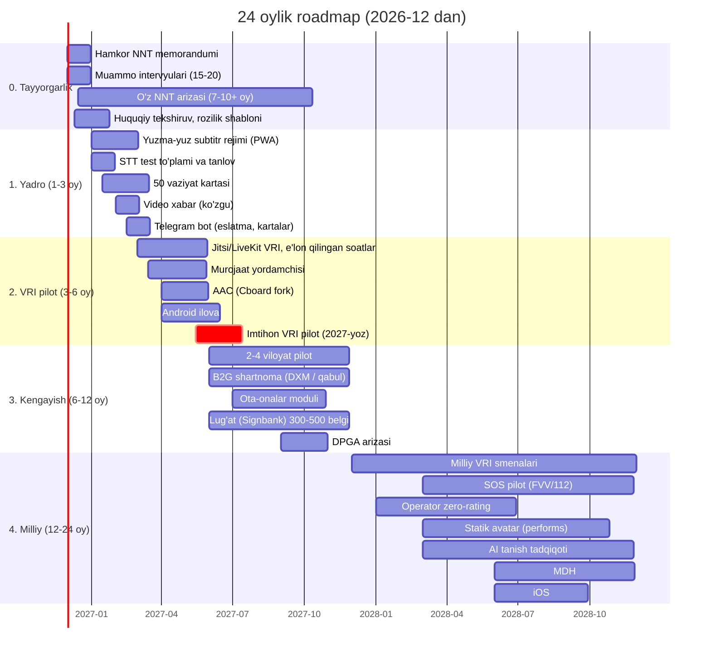

# 06f. Roadmap: 24 oy

> **Qisqacha**
> - 5 bosqich: 0 (0-1 oy) tayyorgarlik va hamkorlar; 1 (1-3) yuzma-yuz subtitr + kartalar + video xabar; 2 (3-6) VRI pilot + murojaat yordamchisi + AAC + Android; 3 (6-12) viloyatlar, B2G, ota-onalar moduli, o'z NNT'i; 4 (12-24) milliy VRI, SOS pilot, avatar (statik), AI tadqiqot, MDH.
> - Har bosqich oxirida go/no-go darvozasi: kar foydalanuvchilar baholashi va hamkor tasdig'i bo'lmasa keyingi bosqichga o'tilmaydi.
> - Muhim tashqi sanalar: o'z NNT'i ro'yxati 7-10+ oy ([anhor.uz](https://anhor.uz/society/pochemu-v-uzbekistane-slozhno-otkrity-npo)); 2027/2028 o'quv yilidan imtihonlarda surdotarjimon ([infoedu.uz](https://infoedu.uz/nogironligi-bolgan-shaxslarga-imtihonlarda-qoshimcha-vaqt-beriladi)); IT Park imtiyozlari 01.01.2028 gacha ([it-park.uz](https://www.it-park.uz/uz/itpark/news/o-zbekiston-it-sohasidagi-startaplar-va-xorijiy-investorlar-uchun-soliq-imtiyozlari)).
> - Avatar va kamera tarjimoni bilan boshlanmaydi; Surdo AI, imo-ishora.uz, surdo-online va Karlar jamiyati tarjimonlari bilan integratsiya.
> - Barcha KPI qiymatlari - maqsad (baho), pilot natijasiga qarab qayta belgilanadi.

---

## 1. Gantt diagramma

Boshlanish: 2026-12-01 (baho).

---

## 2. Bosqichlar

### 0-bosqich (0-1 oy): tayyorgarlik va hamkorlar

| Bo'lim | Mazmun |
|---|---|
| Maqsad | Huquqiy asos, hamkorlar va real ehtiyojni tasdiqlash |
| Natijalar | Sharoit Plyus va/yoki Karlar jamiyati bilan memorandum (IP, litsenziya, to'lov bandlari); 15-20 muammo intervyusi (UzSL video bilan); qatlamli rozilik shabloni (05, 2.3); O'z NNT arizasi topshirilgan; ochiq GitHub ombori (Apache-2.0); STT test to'plami rejasi |
| KPI | Memorandum: 1; intervyular: 15+ (kamida 50% kar, 20% nutqsiz/AAC, 20% ota-ona - baho); kar mahsulot hamraisi tanlangan |
| Bog'liqlik | Hamkor NNT javobi; yurist konsultatsiyasi |
| Go/no-go | **Go**: kamida bitta NNT hamkorligi + intervyularda eng og'riqli 3 vaziyat aniq. **No-go**: hamkor yo'q bo'lsa IT Park MChJ yo'liga o'tish va hamkorni qayta qidirish |

### 1-bosqich (1-3 oy): muloqot yadrosi

| Bo'lim | Mazmun |
|---|---|
| Maqsad | Tarjimonsiz ishlaydigan funksiyalar: yuzma-yuz suhbat, vaziyat kartalari, video xabar |
| Natijalar | PWA: o'zbek/rus jonli subtitr + yozish, split-screen, xatoni tuzatish (WhisperLive yoki tijorat STT); 50 vaziyat kartasi (shifoxona, bank, taksi, politsiya, mahalla) kar imo-ishorachi videosi bilan; video xabar (ko'zgu to'g'ri); Telegram bot (kartalar, eslatma); imo-ishora.uz va Surdo AI'ga havolalar |
| KPI | STT WER o'z test to'plamida <= 15% (baho; Muxlisa o'zi 11,39-13,42% e'lon qilgan ([Muxlisa](https://muxlisa.uz/en)), BuzzASR CV'da 11,84 ([uzbek_speech_bigtech_support](https://muxlisa.uz/en))); 50 karta kar hamrais tasdig'idan o'tgan; 50+ faol sinovchi; SUS yoki shunga o'xshash baho >= 70 (baho); subtitr kechikishi < 2 s (baho) |
| Bog'liqlik | STT provayder tanlovi (Yandex ~$0,30/soat, Aisha ~$2/soat) ([Yandex](https://yandex.cloud/en-ru/docs/speechkit/pricing); [Aisha](https://aisha.group/en/pricing)); imo-ishorachi stavkasi (TBD); O'zbekistonda server (27-1-modda) ([lex.uz](https://lex.uz/docs/4396419)) |
| Go/no-go | **Go**: kar sinovchilarning ko'pchiligi yuzma-yuz rejim va kartalarni foydali deb baholaydi; video O'zbekiston serverida. **No-go**: STT sifati past bo'lsa - boshqa provayder yoki "faqat yozish" rejimini ustuvor qilish |

Eslatma: Telegram Mini App kamera API bermaydi ([Telegram](https://core.telegram.org/bots/webapps)), shuning uchun video funksiyalar PWA'da.

### 2-bosqich (3-6 oy): VRI pilot va kengaytirilgan MVP

| Bo'lim | Mazmun |
|---|---|
| Maqsad | Jonli inson tarjimoniga videoqo'ng'iroq, murojaat yordamchisi, AAC, Android |
| Natijalar | VRI (Jitsi Meet yoki LiveKit): halol e'lon qilingan ish soatlari, ro'yxatdan o'tmasdan chaqirish, navbat holati; murojaat yordamchisi (ariza shablonlari, qabulga bron, surdo-online/HuquqPlus bilan ulanish); AAC (Cboard fork, alohida GPL ilova, o'zbek/rus simvollari); Android ilova; imtihon VRI pilot (2027-yoz) |
| KPI | VRI: e'lon qilingan soatlarda 80%+ qo'ng'iroq 60 s ichida javob (baho; Avstraliya NRS 93,88% 30 s ichida ([NRS](https://www.accesshub.gov.au/sites/default/files/documents/2025-07-monthly-performance-report-july.pdf))); qo'ng'iroq uzilishi < 5% (baho); 200+ VRI qo'ng'iroq; 100+ murojaat; AAC 20+ faol foydalanuvchi; har oy ochiq KPI hisoboti |
| Bog'liqlik | Hamkor tarjimonlar (Toshkentda ~10 malakali tarjimon ([Gazeta.uz 2025](https://www.gazeta.uz/oz/2025/09/30/sign-language/))); grant (06e B ssenariy); Adliya vazirligi/HuquqPlus roziligi |
| Go/no-go | **Go**: qo'ng'iroq ishonchliligi va kutish KPI bajarildi; kar foydalanuvchilar baholashi ijobiy; kamida 1 grant yoki B2G niyat xati. **No-go**: ishonchlilik past bo'lsa kengaymaslik, faqat infratuzilmani tuzatish (VRS ilovalari deyarli faqat qo'ng'iroq ishonchliligi bilan baholanadi ([global_feature_matrix](https://pmc.ncbi.nlm.nih.gov/articles/PMC9227653/))) |

VRI tadqiqoti: kar foydalanuvchilarning 59% i VRI'dan norozi ([PMC](https://pmc.ncbi.nlm.nih.gov/articles/PMC9227653/)) - sifat KPI shu sababli qattiq.

### 3-bosqich (6-12 oy): viloyatlar, B2G va o'z NNT'i

| Bo'lim | Mazmun |
|---|---|
| Maqsad | Toshkentdan tashqariga chiqish, birinchi to'lovchi institut, mustaqil yuridik shaxs |
| Natijalar | 2-4 viloyat pilot (Karlar jamiyati bo'limlari bilan); B2G shartnoma (DXM yoki fuqarolar qabuli, O'RQ-641 asosida) ([lex.uz](https://lex.uz/acts/-5049511)); ota-onalar moduli (PQ-407 maqsadlari bilan) ([norma.uz](https://www.norma.uz/oz/qonunchilikda_yangi/uzbek_imo-ishora_tili_va_brayl_alifbosini_rivojlantirish_buyicha_chora-tadbirlar_belgilandi)); Global Signbank asosidagi lug'at 300-500 belgi (imo-ishora.uz bilan); o'z NNT'i ro'yxatdan o'tgan; DPGA arizasi; viloyat maslahat kengashi |
| KPI | 1 000+ ro'yxatdan o'tgan yoki takroriy foydalanuvchi (baho; Karlar jamiyati 22 000+ a'zo ([Gazeta.uz 2025](https://www.gazeta.uz/oz/2025/09/30/sign-language/))); oyiga 500+ VRI daqiqa yoki qo'ng'iroq (baho); 1 B2G shartnoma; 2+ moliya manbai; kengashda kar ko'pchilik |
| Bog'liqlik | NNT ro'yxati (7-10+ oy); biometrik reyestr (20-modda); tarjimon tarmog'i |
| Go/no-go | **Go**: kamida 2 mustaqil moliya manbai, 1 to'lovchi institut, viloyat foydalanuvchilarining o'sishi. **No-go**: moliya bitta manbaga bog'liq bo'lsa - milliy smenalarni boshlamaslik |

### 4-bosqich (12-24 oy): milliy ko'lam va keyingi funksiyalar

| Bo'lim | Mazmun |
|---|---|
| Maqsad | Milliy VRI, favqulodda aloqa pilot, avatar (faqat statik), AI tadqiqot, MDH |
| Natijalar | Milliy VRI smenalari (kuniga 12-16 soat, keyin 24/7 - moliyaga qarab); SOS pilot FVV/112 bilan, EU 2023/444 6 talabi asosida (ikki tomonlama, oldindan ro'yxatsiz, bepul, yo'naltirish, joylashuv, e'lon qilingan) ([EUD](https://eud.eu/wp-content/uploads/2025/06/Report-on-the-implementation-of-the-European-Electronic-Communications-Code.pdf)), Gruziya 112 SMS/video namunasi ([MIA Georgia](https://mia.police.ge/en/112-gkhedavt-sms-da-video-zaris-servisi-mkholod-kru-da-smenadaqveitebuli-pirebistvis/7938?print=1)); operator zero-rating va "qo'ng'iroqni chatga" (MTS: 6 oyda 496 ming qo'ng'iroq ([mobile-review](https://mobile-review.com/all/?p=259570))); statik kontent uchun avatar (performs / sign stitching, kar hamrais tasdig'i bilan, yorliqlangan); AI tanish tadqiqoti (Logos pretrain + o'zbek fine-tune, litsenziya va sanksiya tekshiruvidan keyin) ([ai-forever/logos](https://github.com/ai-forever/logos)); iOS; MDH pilot |
| KPI | VRI: oyiga 5 000+ daqiqa (baho); SOS pilot: 1 viloyatda ishlaydigan kanal, sinov qo'ng'iroqlari 100% yo'naltirildi; 1 operator zero-rating; avatar: 100+ statik matn kar baholovchilar tasdig'i bilan; dataset 1 000-2 000 belgi, 50+ imo-ishorachi (baho, oldingi hisobot: 500-2 000 belgi, har biriga 20-30 klip; Sber/Ovodov tajribasi ([YouTube](https://www.youtube.com/watch?v=zGfIHZnmmHw))); 1 MDH hamkor |
| Bog'liqlik | Davlat/operator roziligi; tarjimon FTE (15-30, baho) ([region_europe](https://eud.eu/wp-content/uploads/2025/06/Report-on-the-implementation-of-the-European-Electronic-Communications-Code.pdf)); animator; ma'lumot litsenziyasi |
| Go/no-go | **SOS**: faqat FVV/112 rasmiy hamkorligi bilan (oldindan ro'yxat talab qiladigan ilovalarni EENA va Irlandiya teng huquqli kirish emas deb tanqid qiladi; Irlandiyada ilovasiz RTT 112 ([Irish Deaf Society](https://www.irishdeafsociety.ie/vodafone-ireland-has-launched-a-new-emergency-real-time-text-rtt-service/); [112.ie](https://112.ie/realtimetext/))). **Avatar**: kar baholovchilar ko'pchiligi qabul qilmasa chiqarilmaydi (Xitoy AI avatar tarjimonlari tanqidi ([Sixth Tone](https://www.sixthtone.com/news/1017316/The%20Promise%20and%20Pitfalls%20of%20China%E2%80%99s%20AI%20Sign%20Language%20Interpreters))). **AI**: litsenziya/sanksiya aniq bo'lmasa to'xtatiladi |

---

## 3. Founder uchun 30/60/90 kunlik ro'yxat

### 30 kun
- [ ] Sharoit Plyus bilan uchrashuv (info@sharoitplus.uz, +998 55 500-50-60) va Karlar jamiyatiga rasmiy xat.
- [ ] Memorandum loyihasi: IP, Apache-2.0, ma'lumot egaligi, to'lov, chiqish sharti.
- [ ] Kar mahsulot hamraisini topish (pullik, yarim stavka).
- [ ] 15-20 muammo intervyusi (@uzsduz, @deaf_gluxoyy orqali), har biriga to'lov.
- [ ] Yurist konsultatsiyasi: ZRU-547 (26, 21, 27-1, 20-moddalar), ZRU-1115, NNT ustavi.
- [ ] O'z NNT ustavi loyihasi (kar ko'pchilikli kengash) va ariza.
- [ ] GitHub ombori, litsenziya, CONTRIBUTING (o'zbek tilida).
- [ ] O'zbekistonda server provayderlaridan narx so'rash (dicloud.uz, Pro-Data, Uztelecom).

### 60 kun
- [ ] STT test to'plami (o'zbek/rus, shovqinli audio, 2-3 soat) va 3-4 provayder WER o'lchovi.
- [ ] Yuzma-yuz subtitr rejimi prototipi (PWA), 10 kar sinovchi bilan sinov.
- [ ] Birinchi 20 vaziyat kartasi ssenariysi kar hamrais bilan; 2-3 imo-ishorachi bilan yozuv sessiyasi.
- [ ] Rozilik formasi (o'zbek, rus, UzSL video), elektron imzo.
- [ ] Tarjimon soati narxini Karlar jamiyati/Sharoit Plyus bilan aniqlash.
- [ ] 1-2 grant arizasi (hamkor NNT nomidan): Jamoat fondi / ngo.gov.uz, UNDP.

### 90 kun
- [ ] 50 vaziyat kartasi, video xabar, Telegram bot - ochiq beta.
- [ ] 50+ faol sinovchi, birinchi KPI hisoboti (ochiq).
- [ ] VRI pilot uchun 1-2 tarjimon bilan smena jadvali; Jitsi/LiveKit tanlovi.
- [ ] Adliya vazirligi (HuquqPlus, surdo-online) bilan integratsiya muhokamasi.
- [ ] Agentlik IT markazi (Surdo AI) bilan o'zaro havola kelishuvi.
- [ ] 1-bosqich go/no-go yig'ilishi (kar hamrais va hamkor NNT bilan).

---

## 4. MDH ga kengayish

| Mamlakat | Holat | Kirish yo'li | Xavf | Manba |
|---|---|---|---|---|
| **Qirg'iziston** | UNDP prototipi (2026-iyun); Beeline KG AI ilovalari uchun zero-rating tarifi | UNDP Qirg'iziston bilan hamkorlik, Beeline KG | Kichik bozor | [UNDP](https://www.undp.org/ru/node/588326); [pulse.bot](https://www.pulse.bot/telecom/blogs/beeline-kyrgyzstan-launches-mobile-plan-with-zero-rated-ai-apps-e490b846-0dc7-4ba1-b036-87798c89630a) |
| **Tojikiston** | Imo-ishora tili to'g'risidagi qonun (17.12.2025) | Kar jamiyati bilan, qonun asosida B2G | Ma'lumot kam | [WFD](https://wfdeaf.org/?p=19272) |
| **Qozog'iston** | Yiliga 60 soat davlat tarjimasi; ijtimoiy xarajat 2029 gacha muzlatilgan; NU ISSAI TilSync, K-RSL | NU ISSAI va K-RSL bilan ilmiy hamkorlik; mavjud ishlanmalarni ulash | Davlat soatlari o'smaydi | [TengriHealth](https://tengrihealth.kz/article//daze-zapis-vracu-kvest-kazaxstancy-naruseniem-sluxa-4136/); [economist.kg](https://economist.kg/society/2026/06/16/kazakhstan-zhestovyy-yazyk-status.md); [ISSAI](https://issai.nu.edu.kz/?p=62139) |
| **Ozarbayjon** | "Let Us Be Your Voice" (Du-Sh 09:00-16:00, WhatsApp/Telegram, ~1 000 foydalanuvchi, WHO yaxshi amaliyot); Birbank ichida imo-ishora video qo'ng'irog'i; Nar operatori jestdili.az ni qo'llaydi | Tajriba almashish, operator CSR namunasi | Sana tasdiqlanmagan | [sosial.gov.az](https://sosial.gov.az/en/media/news/nearly-1000-people-have-benefited-from-the-let-us-be-your-voice-online-sign-language-interpretation-service-9584); [AZERTAG](https://azertag.az/en/xeber/__birbank_revolutionizes_barrier_free_banking_launching_sign_language_video_call_service-3763259); [nar.az](https://www.nar.az/en/news/jest-dili-mobil-tetbiqi/) |
| **Rossiya, Belarus** | Kuchli mahalliy raqobatchilar (Surdo-pomosh, Moi RZhYa, MTS); Minsk 24/7 markazi | Kirmaslik; faqat ochiq kod va tajriba almashish | Sanksiya, raqobat | [russia_cis_competitors](https://mobile-review.com/all/?p=259570) |

Kengayish qadamlari:
1. **Lokalizatsiya qatlami**: interfeys tillari (rus, qirg'iz, tojik, qozoq), har bir mamlakat uchun alohida imo-ishora lug'ati (Signbank ko'p tilli).
2. **Mahalliy kar tashkiloti egalik qiladi**: platforma kodi umumiy, kontent va boshqaruv mahalliy (Deaf-led tamoyili).
3. **Ma'lumot lokalizatsiyasi**: har mamlakatning shaxsiy ma'lumot qonuni alohida tekshiriladi; O'zbekiston video ma'lumoti O'zbekistonda qoladi ([lex.uz](https://lex.uz/docs/4396419)).
4. **Moliya**: mahalliy UNDP ofislari, operatorlar (Beeline KG).
5. **Go/no-go**: O'zbekistonda 3-bosqich KPI bajarilgan va mahalliy hamkor tayyor bo'lsa.

---

## Manbalar

- NNT muddati: https://anhor.uz/society/pochemu-v-uzbekistane-slozhno-otkrity-npo
- Imtihonlar: https://infoedu.uz/nogironligi-bolgan-shaxslarga-imtihonlarda-qoshimcha-vaqt-beriladi
- IT Park: https://www.it-park.uz/uz/itpark/news/o-zbekiston-it-sohasidagi-startaplar-va-xorijiy-investorlar-uchun-soliq-imtiyozlari
- ZRU-547: https://lex.uz/docs/4396419 ; O'RQ-641: https://lex.uz/acts/-5049511 ; PQ-407: https://www.norma.uz/oz/qonunchilikda_yangi/uzbek_imo-ishora_tili_va_brayl_alifbosini_rivojlantirish_buyicha_chora-tadbirlar_belgilandi
- STT: https://muxlisa.uz/en ; https://yandex.cloud/en-ru/docs/speechkit/pricing ; https://aisha.group/en/pricing
- Telegram Mini App: https://core.telegram.org/bots/webapps
- NRS KPI: https://www.accesshub.gov.au/sites/default/files/documents/2025-07-monthly-performance-report-july.pdf
- VRI tadqiqoti: https://pmc.ncbi.nlm.nih.gov/articles/PMC9227653/
- Gazeta.uz 2025: https://www.gazeta.uz/oz/2025/09/30/sign-language/
- EU 2023/444: https://eud.eu/wp-content/uploads/2025/06/Report-on-the-implementation-of-the-European-Electronic-Communications-Code.pdf
- Gruziya 112: https://mia.police.ge/en/112-gkhedavt-sms-da-video-zaris-servisi-mkholod-kru-da-smenadaqveitebuli-pirebistvis/7938?print=1
- MTS: https://mobile-review.com/all/?p=259570
- Logos: https://github.com/ai-forever/logos
- WFD checklist: https://wfdeaf.org/?p=12027
- MDH: https://www.undp.org/ru/node/588326 ; https://www.pulse.bot/telecom/blogs/beeline-kyrgyzstan-launches-mobile-plan-with-zero-rated-ai-apps-e490b846-0dc7-4ba1-b036-87798c89630a ; https://wfdeaf.org/?p=19272 ; https://tengrihealth.kz/article//daze-zapis-vracu-kvest-kazaxstancy-naruseniem-sluxa-4136/ ; https://economist.kg/society/2026/06/16/kazakhstan-zhestovyy-yazyk-status.md ; https://issai.nu.edu.kz/?p=62139

## Tasdiqlanmagan / bo'shliqlar

- Barcha KPI maqsadlari va muddatlar - baho; boshlanish sanasi 2026-12-01 taxminiy.
- Tarjimonlar soni va mavjudligi (smena jadvali uchun) tasdiqlanmagan.
- FVV/112 da kar kanalining 2026 holati noma'lum (2019 dispetcherlik JusTalk orqali ishonchsiz edi).
- Logos va Slovo litsenziyasi, Sber bilan ishlash sanksiya ta'siri yuridik tekshirilmagan.
- SignGemma holati noma'lum.
- MDH mamlakatlarining shaxsiy ma'lumot qonunlari o'rganilmagan.
- Imtihon VRI piloti uchun imtihon tashkilotchisi (Bilim va malakalarni baholash agentligi) roziligi tekshirilmagan.
