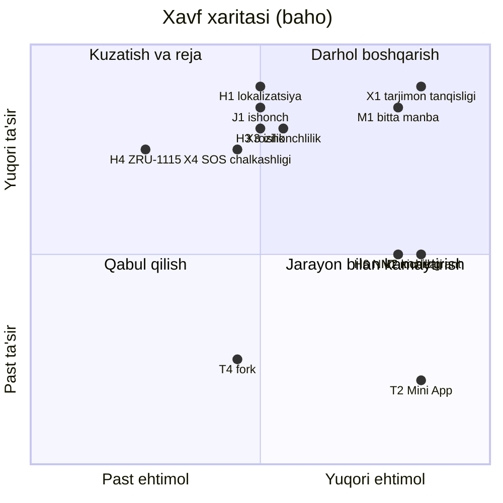

# 06g. Xavflar va ochiq savollar

> **Qisqacha**
> - 24 ta xavf 6 guruhda: jamiyat va ishonch, huquq va ma'lumot, moliya, xizmat sifati va tarjimonlar, texnologiya, hamkorlar va raqobat.
> - Eng yuqori xavflar: tarjimon tanqisligi (Toshkentda ~10 malakali tarjimon) ([Gazeta.uz 2025](https://www.gazeta.uz/oz/2025/09/30/sign-language/)), bitta moliya manbaiga bog'lanish (Tailand TTRS, Islandiya) ([Prachatai](https://prachataienglish.com/node/11567)), biometrik lokalizatsiya talablarini buzish (27-1-modda) ([lex.uz](https://lex.uz/docs/4396419)), kar jamiyati ishonchini yo'qotish.
> - Ochiq savollar takrorlardan tozalanib 8 guruhga birlashtirildi; har biri uchun "qanday aniqlash" va mas'ul ko'rsatilgan.
> - Ehtimol va ta'sir: Y (yuqori) / O (o'rta) / P (past) - baho.

---

## 1. Xavflar reestri

### 1.1 Jamiyat va ishonch

| # | Xavf | Ehtimol | Ta'sir | Kamaytirish | Egasi |
|---|---|---|---|---|---|
| J1 | Kar jamiyati platformani "biz haqimizda, bizsiz" deb qabul qiladi | O | Y | Kar ko'pchilikli kengash, kar hamrais veto huquqi, pullik ishtirok ([Hook.report](https://old.hook.report/2020/11/bizsiz-biz-haqimizda-hech-narsa/); [WFD](https://wfdeaf.org/?p=18327)) | Kuzatuv kengashi |
| J2 | Avatar/AI chiqishi jamiyat tomonidan rad etiladi (Xitoy, DGB tajribasi) | O | O | Avatar faqat 4-bosqichda, faqat statik kontent, yorliqlangan, kar baholovchilar tasdig'i ([Sixth Tone](https://www.sixthtone.com/news/1017316/The%20Promise%20and%20Pitfalls%20of%20China%E2%80%99s%20AI%20Sign%20Language%20Interpreters); [WFD-WASLI](https://wfdeaf.org/wp-content/uploads/WFD-and-WASLI-Statement-on-Avatar-FINAL-14032018-Updated-14042018.pdf)) | Kar hamrais |
| J3 | Viloyat dialektlari va daktil farqlari kartalarni tushunarsiz qiladi | O | O | Turli viloyat imo-ishorachilari, variantlarni ko'rsatish, viloyat maslahat kengashi ([Gazeta.uz 2022](https://www.gazeta.uz/oz/2022/04/22/sign-language/)) | Kar hamrais |
| J4 | Foydalanuvchilar raqamli ko'nikma yoki qurilma yo'qligi sababli foydalana olmaydi | O | O | PWA, kichik trafik, Telegram bot, Karlar jamiyati bo'limlarida o'qitish (raqamli ko'nikma darajasi bo'yicha ma'lumot topilmadi - bo'shliq; Yuksalish 2024 so'rovida (n=102) 56% imo-ishora tilidan foydalanishda doim/tez-tez qiyinchilik ko'radi ([Gazeta.uz RU 2025](https://www.gazeta.uz/ru/2025/09/28/sign-language/))) | Hamkorlik menejeri |

### 1.2 Huquq va ma'lumot

| # | Xavf | Ehtimol | Ta'sir | Kamaytirish | Egasi |
|---|---|---|---|---|---|
| H1 | Yuz videosi chet el serverida saqlanib 27-1-modda buziladi | O | Y | Asosiy nusxa O'zbekistonda; arxitektura tekshiruvi; qo'ng'iroqlar yozilmaydi ([lex.uz](https://lex.uz/docs/4396419)) | Founder |
| H2 | Shaxsiy ma'lumotlar bazasi reyestrga kiritilmaydi yoki o'zgarish 10 kunda xabar qilinmaydi | O | O | Yurist bilan reyestr arizasi; o'zgarishlar jurnali ([lex.uz](https://lex.uz/docs/4396419)) | Founder / yurist |
| H3 | Rozilik yetarli emas (yozma bo'lmagan, voyaga yetmaganlar, qaytarib olish) | O | Y | Qatlamli elektron rozilik, vasiy roziligi, UzSL video tushuntirish (05, 2.3) | Etika qo'mitasi |
| H4 | ZRU-1115 bo'yicha AI qayta ishlash uchun javobgarlik | P | Y | ML o'qitish alohida rozilik (R3), yuridik tahlil ([anhor.uz](https://anhor.uz/ru/news/uzbekistan-criminalizes-illegal-ai-use-of-personal-data)) | Founder / yurist |
| H5 | Ro'yxatdan o'tmagan NNT faoliyati jarimasi (10-25 BHM) | O | O | Ro'yxatgacha faqat hamkor NNT yoki MChJ nomidan ([UzDaily](https://uzdaily.ru/en/president-signs-law-regulating-ngos-and-introducing-new-fines)) | Founder |
| H6 | O'z NNT'i ro'yxati 10 oydan ko'p cho'ziladi | Y | O | Hamkor NNT ostida ishlashni davom ettirish; nogironlar birlashmasi imtiyozi ([anhor.uz](https://anhor.uz/society/pochemu-v-uzbekistane-slozhno-otkrity-npo)) | Founder |
| H7 | Litsenziyasi noaniq yoki NC aktivlar (SignON og'irliklari, ARASAAC, Logos) loyihaga kirib qoladi | O | O | Litsenziya ro'yxati, CI'da tekshiruv, faqat Apache/MIT/BSD/CC BY(-SA) ([hands_on_repo_audit](https://github.com/cboard-org/cboard)) | Texnik rahbar |
| H8 | Sber (Logos, Slovo) bilan ishlash sanksiya muammosi | O | O | Hamkorlik qilmaslik; faqat ochiq ma'lumot, yuridik tekshiruvdan keyin ([ai-forever/logos](https://github.com/ai-forever/logos)) | Founder / yurist |

### 1.3 Moliya

| # | Xavf | Ehtimol | Ta'sir | Kamaytirish | Egasi |
|---|---|---|---|---|---|
| M1 | Bitta grant yoki budjet manbaiga bog'lanish | Y | Y | Bitta manba 50% dan oshmasin (ichki qoida, baho); 06e barqarorlik rejasi ([Prachatai](https://prachataienglish.com/node/11567); [SHH](https://island.is/s/shh/frett/lokad-fyrir-endurgjaldslausa-tulkathjonustu-ut-mars)) | Ijrochi direktor |
| M2 | Mahalliy grantlar kichik (~130 mln so'm) va mavzu mos emas | Y | O | Bir nechta tur va viloyat fondlari; korrupsiyaga qarshi va ijtimoiy himoya yo'nalishlariga moslash ([UzA](https://uza.uz/ar/posts/fuqarolik-jamiyati-institutlari-tashabbuslarini-amalga-oshirishga-116-milliard-som-yonaltiriladi_925975)) | Grant menejeri |
| M3 | Xalqaro donorlar yopiladi (USAID 2025, NLnet 2026) | Y | O | Mahalliy va CSR manbalariga ustuvorlik ([Kun.uz](https://kun.uz/en/news/2025/03/11/us-to-shut-down-majority-of-usaid-programs-after-review); [NLnet](https://www.nlnet.nl/commonsfund)) | Grant menejeri |
| M4 | Founder mablag'i 3-bosqichdan oldin tugaydi | O | Y | A ssenariy chegarasi; 2-bosqich go/no-go'da moliya sharti | Founder |
| M5 | Xorijiy grant olish tartibi (527-son Nizom) kechiktiradi | O | O | Hamkor NNT tajribasidan foydalanish ([ICNL](https://www.icnl.org/wp-content/uploads/Overview_Uzbekistan-Regulation-527-Oct-2023_FV.pdf)) | Grant menejeri |

### 1.4 Xizmat sifati va tarjimonlar

| # | Xavf | Ehtimol | Ta'sir | Kamaytirish | Egasi |
|---|---|---|---|---|---|
| X1 | Tarjimon tanqisligi: e'lon qilingan soatlarni ta'minlab bo'lmaydi | Y | Y | Halol, kam soatlar bilan boshlash; hamkor NNT tarjimonlari; TDPU/TMA talabalari ([Gazeta.uz 2025](https://www.gazeta.uz/oz/2025/09/30/sign-language/); [TMA](https://admissions.tma.uz/2026/06/inson-qalbiga-yol-imo-ishora-tili-orqali-%F0%9F%91%90/)) | Xizmat rahbari |
| X2 | Tarjimon sifati notekis (kasb standarti va sertifikat yo'q) | Y | O | Ichki baholash, kar foydalanuvchi reytingi, WASLI tamoyillari | Kar hamrais |
| X3 | VRI qo'ng'iroq ishonchliligi past (uzilish, qora ekran) | O | Y | TURN serverlar, past tarmoq rejimi, KPI monitoring; VRI'dan 59% norozilik saboqi ([PMC](https://pmc.ncbi.nlm.nih.gov/articles/PMC9227653/)) | Texnik rahbar |
| X4 | Foydalanuvchilar platformani favqulodda xizmat deb o'ylaydi | O | Y | Ilovada aniq ogohlantirish: 4-bosqichgacha SOS yo'q, 112 / FVV raqamlari ko'rsatiladi; EU 2023/444 talablari bajarilmaguncha "SOS" deb atalmaydi ([EUD](https://eud.eu/wp-content/uploads/2025/06/Report-on-the-implementation-of-the-European-Electronic-Communications-Code.pdf)) | Founder |

### 1.5 Texnologiya

| # | Xavf | Ehtimol | Ta'sir | Kamaytirish | Egasi |
|---|---|---|---|---|---|
| T1 | O'zbek STT sifati shovqinli muhitda past | O | O | O'z test to'plami, bir nechta provayder, xatoni tuzatish va yozish rejimi ([Muxlisa](https://muxlisa.uz/en); [Yandex](https://yandex.cloud/en-ru/docs/speechkit/pricing)) | ML muhandisi |
| T2 | Telegram Mini App'da kamera/WebRTC ishlamaydi | Y | P | Video funksiyalar PWA'da; bot faqat eslatma, bron, kartalar ([Telegram](https://core.telegram.org/bots/webapps)) | Texnik rahbar |
| T3 | Mahalliy hosting ishonchliligi va narxi noma'lum | O | O | 2 provayderdan taklif, zaxira nusxa O'zbekistonda | Texnik rahbar |
| T4 | Fork qilingan loyihalar (Jitsi, Cboard) bilan sinxronlik qiyin | O | P | Minimal o'zgarish, upstream'ga hissa | Texnik rahbar |

### 1.6 Hamkorlar va raqobat

| # | Xavf | Ehtimol | Ta'sir | Kamaytirish | Egasi |
|---|---|---|---|---|---|
| R1 | Davlat loyihalari (Surdo AI, surdo-online) bizni raqobatchi deb ko'radi | O | O | Integratsiya, o'zaro havola, ma'lumot almashish; avatar/kamera tarjimoni bilan boshlamaslik ([Google Play](https://play.google.com/store/apps/details?id=com.ihma.surdoai)) | Founder |
| R2 | Hamkor NNT boshqaruvi zaif yoki IP bo'yicha kelishmovchilik | O | Y | Yozma shartnoma, chiqish sharti, o'z NNT'ini parallel ochish (05, 1.3) | Founder |
| R3 | Hamkor grantlari tugashi (imo-ishora.uz granti 2026-05 da tugagan) lug'atni to'xtatadi | O | O | Lug'atni Signbank'da birgalikda yuritish, ochiq litsenziya ([Sharoit Plus](https://sharoitplus.uz/category/loyihalar/)) | Kar hamrais |

---

## 2. Xavf xaritasi

---

## 3. Ochiq savollar (birlashtirilgan)

### 3.1 Jamiyat va statistika

| # | Savol | Qanday aniqlash | Mas'ul |
|---|---|---|---|
| S1 | Kar va zaif eshituvchilar soni qancha? Manbalar zid: Karlar jamiyati 22 000+ (2025), 21 212 (2019), ~30 000 (kanal), OHCHR 18 303 + 3 875 | Ijtimoiy himoya agentligi va Karlar jamiyatiga rasmiy so'rov; OHCHR hisobotini o'qish ([Gazeta.uz 2025](https://www.gazeta.uz/oz/2025/09/30/sign-language/)) | Hamkorlik menejeri |
| S2 | Karlar jamiyatining hozirgi raisi, boshqaruvi, viloyat bo'limlari soni va faolligi | Uchrashuv, orginfo.uz, jamiyat kanali ([orginfo.uz](https://orginfo.uz/en/organization/97f86baf947b/)) | Founder |
| S3 | Maslahat kengashi nomzodlarining kar/eshituvchi maqomi va qiziqishi | Shaxsan so'rash, rozilik bilan | Founder |
| S4 | Nutqsiz (AAC) foydalanuvchilar va ota-onalar soni, ehtiyojlari | Intervyular, maxsus maktablar (18-19), Zamin fondi | Kar hamrais |

### 3.2 Til va kontent

| # | Savol | Qanday aniqlash | Mas'ul |
|---|---|---|---|
| L1 | Imo-ishora tilining rasmiy maqomi: PQ-407 ijrosi, lug'at muddati (1.06.2024) bajarilmagani, yangi qaror bormi | lex.uz qidiruvi, Agentlik bilan suhbat ([norma.uz](https://www.norma.uz/oz/qonunchilikda_yangi/uzbek_imo-ishora_tili_va_brayl_alifbosini_rivojlantirish_buyicha_chora-tadbirlar_belgilandi)) | Yurist |
| L2 | Daktil standarti (kirill asosida; lotin daktili qabul qilinmagan) va maktablar orasidagi farq | Kar hamrais, TDPU, maktab o'qituvchilari ([Gazeta.uz 2022](https://www.gazeta.uz/oz/2022/04/22/sign-language/)) | Kar hamrais |
| L3 | UzSL uchun ISO 639-3 kodi yo'q - ro'yxatdan o'tkazish kerakmi | Hozircha private-use kod ishlatish ([hands_on_repo_audit](https://en.wikipedia.org/wiki/Russian_Sign_Language)); Wikipedia UzSL ni RSL (`rsl`) dialekti deb ko'rsatadi ([Wikipedia](https://en.wikipedia.org/wiki/Russian_Sign_Language)); SIL ISO 639-3 tartibini o'qish | Texnik rahbar |
| L4 | imo-ishora.uz, Surdo AI va IBRAT FARZANDLARI kontentidan foydalanish huquqi | Egalaridan yozma ruxsat ([imo-ishora.uz](https://imo-ishora.uz/); [YouTube](https://www.youtube.com/playlist?list=PLkREkayoYCyIbxC-s0cOABSwdhkdbcbgz)) | Founder |
| L5 | Ochiq dataset uchun kerakli imo-ishorachilar soni (signer-count qoidasi) | Ilmiy adabiyot, K-RSL tajribasi ([K-RSL](https://krslproject.github.io/krsl20)) | ML muhandisi |

### 3.3 Huquq

| # | Savol | Qanday aniqlash | Mas'ul |
|---|---|---|---|
| Q1 | Oddiy video "biometrik ma'lumot"mi (26-modda)? | Davlat personallashtirish markaziga yozma so'rov; yurist ([lex.uz](https://lex.uz/docs/4396419)) | Yurist |
| Q2 | 49 davlat ro'yxatining to'liq matni (Germaniya, Finlandiya, AQSh bormi) | Vazirlar Mahkamasi qarori matni, lex.uz ([spot.uz](https://www.spot.uz/ru/2026/08/04/personal-data-abroad/)) | Yurist |
| Q3 | 2026 NNT/fond bojlari, muassislar soni, nogiron bo'lmagan founder nogironlar birlashmasini ochishi mumkinmi | Adliya vazirligi, my.gov.uz, yurist | Yurist |
| Q4 | Xorijiy grantni kelishish tartibi (527-son Nizom) 2024-2025 o'zgarishlari | ICNL, Adliya vazirligi ([ICNL](https://www.icnl.org/wp-content/uploads/Overview_Uzbekistan-Regulation-527-Oct-2023_FV.pdf)) | Yurist |
| Q5 | IT Park PQ-388 ajratma foizi; imtiyozlar 2028 yoki 2040 gacha | IT Park bilan to'g'ridan-to'g'ri ([it-park.uz](https://it-park.uz/uz/itpark/news/it-park-uzbekistan-rezidentlari-uchun-yangi-qoidalar-joriy-etilmoqda)) | Founder |
| Q6 | Slovo/Bukva tijorat bandi, Logos og'irliklar litsenziyasi, sanksiya ta'siri | Litsenziya PDF'ini o'qish, yurist ([ai-forever/slovo](https://github.com/ai-forever/slovo)) | Yurist |

### 3.4 Davlat xizmatlari va integratsiya

| # | Savol | Qanday aniqlash | Mas'ul |
|---|---|---|---|
| D1 | FVV kar dispetcherligi va 112 da kar kanalining 2026 holati | FVV/112 ga so'rov, sinov xabari ([kun.uz](https://kun.uz/en/news/2025/03/25/uzbekistans-unified-112-emergency-system-now-fully-operational-nationwide)) | Founder |
| D2 | Surdo-online operatori kim, planshetlar ishlayaptimi, statistikasi | Adliya vazirligi, DXM'ga tashrif ([yuz.uz](https://yuz.uz/ru/news/tsentr-gosuslug-otdela-yustitsii-goroda-navoi-vvel-novy-vid-servisa-dlya-lyudey-s-invalidnostyu-so-sluxom)) | Hamkorlik menejeri |
| D3 | HuquqPlus video-qo'ng'iroq markazining texnologiyasi va 2027 rejasi | Sharoit Plyus bilan uchrashuv ([Sharoit Plus](https://sharoitplus.uz/category/loyihalar/)) | Founder |
| D4 | Agentlik IT markazi Surdo AI bo'yicha hamkorlikka ochiqmi | Rasmiy xat ([Google Play](https://play.google.com/store/apps/details?id=com.ihma.surdoai)) | Founder |
| D5 | 2027/2028 imtihonlarida tarjimonni kim ta'minlaydi va qanday buyurtma qiladi | Bilim va malakalarni baholash agentligiga so'rov ([infoedu.uz](https://infoedu.uz/nogironligi-bolgan-shaxslarga-imtihonlarda-qoshimcha-vaqt-beriladi)) | Hamkorlik menejeri |

### 3.5 Moliya va narxlar

| # | Savol | Qanday aniqlash | Mas'ul |
|---|---|---|---|
| F1 | Surdotarjimon soati/kuni narxi O'zbekistonda | **TBD, Karlar jamiyati/Sharoit Plyus bilan aniqlash**; 3-5 tarjimondan taklif | Founder |
| F2 | Imo-ishorachi yozuv sessiyasi va studiya narxi | Sharoit Plyus (lug'at loyihasi tajribasi), studiyalardan taklif | Kar hamrais |
| F3 | Mahalliy VPS, saqlash, GPU narxlari | dicloud.uz, Pro-Data, Uztelecom, Serverspace'dan taklif | Texnik rahbar |
| F4 | Jamoat fondi 3-turi chegarasi va mavzulari; UNDP/EU kichik grant miqdorlari | fundngo.uz, ngo.gov.uz, UNDP ofisi ([UzA](https://uza.uz/en/posts/davlat-granti-tanlovi-goliblari-aniqlandi_883953)) | Grant menejeri |
| F5 | Tekshirilmagan donorlar: Google.org, Mozilla, ITU, World Bank, ADB, KOICA, TIKA, IT Park grantlari, bank CSR | Har birining sayti, joriy tanlovlar | Grant menejeri |
| F6 | GitHub Sponsors / Open Collective orqali O'zbekistonga to'lov olish mumkinmi | Platforma qoidalari, bank | Founder |
| F7 | Ucell "Ehtirom" tarifi sharti; operatorlarda kar uchun tarif bormi | Operatorlarga so'rov ([ucell.uz](https://ucell.uz/en/news/new_tariffs)) | Hamkorlik menejeri |

### 3.6 Texnologiya

| # | Savol | Qanday aniqlash | Mas'ul |
|---|---|---|---|
| E1 | Qaysi STT o'zbek/rus aralash nutqda eng yaxshi (Yandex, Aisha, Muxlisa, Whisper fine-tune, Azure) | O'z test to'plamida WER va kechikish o'lchovi | ML muhandisi |
| E2 | Telegram Mini App'da kamera/WebRTC real qurilmalarda | Android va iOS'da sinov ([Telegram](https://core.telegram.org/bots/webapps)) | Texnik rahbar |
| E3 | Jitsi yoki LiveKit: past tarmoqli viloyatlarda qaysi biri barqaror | Ikki viloyatda A/B sinov | Texnik rahbar |
| E4 | SignGemma holati va litsenziyasi; big-tech o'zbek qo'llovi (Apple Live Captions uz/ru yo'q) | Rasmiy sahifalar ([uzbek_speech_bigtech_support](https://core.telegram.org/bots/webapps)) | ML muhandisi |
| E5 | Spreadthesign'da uz/ru bor-yo'qligi; Google Meet tarjimon ko'rinishi | Saytlarni tekshirish | Texnik rahbar |

### 3.7 Raqobatchilar va MDH

| # | Savol | Qanday aniqlash | Mas'ul |
|---|---|---|---|
| C1 | Rossiya raqobatchilari (Surdo-pomosh, Moi RZhYa) narxlari va O'zbekistonda foydalanilishi | Ilova do'konlari, so'rovnoma | Founder |
| C2 | MDH mamlakatlarining shaxsiy ma'lumot qonunlari | Har mamlakat uchun yurist | Yurist |
| C3 | Qirg'iziston UNDP prototipi holati va hamkorlik imkoni | UNDP Qirg'iziston ([UNDP](https://www.undp.org/ru/node/588326)) | Founder |

### 3.8 Rozilik va etika

| # | Savol | Qanday aniqlash | Mas'ul |
|---|---|---|---|
| K1 | Rozilik shabloni va imo-ishorachilarga to'lov stavkasi namunalari | ASL Citizen, Lingua Libre namunalari + Sharoit Plyus ([Microsoft](https://www.microsoft.com/en-us/research/project/asl-citizen/dataset-license/)) | Etika qo'mitasi |
| K2 | Pose ma'lumotidan qayta identifikatsiya xavfi qanchalik real | Ilmiy adabiyot ([arXiv](https://arxiv.org/html/2403.02563v1)) | ML muhandisi |

---

## Manbalar

- Gazeta.uz: https://www.gazeta.uz/oz/2025/09/30/sign-language/ ; https://www.gazeta.uz/oz/2022/04/22/sign-language/
- Hook.report: https://old.hook.report/2020/11/bizsiz-biz-haqimizda-hech-narsa/
- WFD: https://wfdeaf.org/?p=18327 ; WFD-WASLI: https://wfdeaf.org/wp-content/uploads/WFD-and-WASLI-Statement-on-Avatar-FINAL-14032018-Updated-14042018.pdf
- Sixth Tone: https://www.sixthtone.com/news/1017316/The%20Promise%20and%20Pitfalls%20of%20China%E2%80%99s%20AI%20Sign%20Language%20Interpreters
- ZRU-547: https://lex.uz/docs/4396419 ; ZRU-1115: https://anhor.uz/ru/news/uzbekistan-criminalizes-illegal-ai-use-of-personal-data ; 49 davlat: https://www.spot.uz/ru/2026/08/04/personal-data-abroad/
- NNT: https://uzdaily.ru/en/president-signs-law-regulating-ngos-and-introducing-new-fines ; https://anhor.uz/society/pochemu-v-uzbekistane-slozhno-otkrity-npo ; https://www.icnl.org/wp-content/uploads/Overview_Uzbekistan-Regulation-527-Oct-2023_FV.pdf
- Litsenziya: https://github.com/cboard-org/cboard ; https://github.com/ai-forever/logos ; https://github.com/ai-forever/slovo
- Moliya: https://prachataienglish.com/node/11567 ; https://island.is/s/shh/frett/lokad-fyrir-endurgjaldslausa-tulkathjonustu-ut-mars ; https://uza.uz/ar/posts/fuqarolik-jamiyati-institutlari-tashabbuslarini-amalga-oshirishga-116-milliard-som-yonaltiriladi_925975 ; https://uza.uz/en/posts/davlat-granti-tanlovi-goliblari-aniqlandi_883953 ; https://kun.uz/en/news/2025/03/11/us-to-shut-down-majority-of-usaid-programs-after-review ; https://www.nlnet.nl/commonsfund
- Tarjimonlar: https://admissions.tma.uz/2026/06/inson-qalbiga-yol-imo-ishora-tili-orqali-%F0%9F%91%90/ ; VRI tadqiqoti: https://pmc.ncbi.nlm.nih.gov/articles/PMC9227653/
- EU 2023/444: https://eud.eu/wp-content/uploads/2025/06/Report-on-the-implementation-of-the-European-Electronic-Communications-Code.pdf
- STT: https://muxlisa.uz/en ; https://yandex.cloud/en-ru/docs/speechkit/pricing ; Telegram: https://core.telegram.org/bots/webapps
- Hamkorlar: https://play.google.com/store/apps/details?id=com.ihma.surdoai ; https://sharoitplus.uz/category/loyihalar/ ; https://imo-ishora.uz/ ; https://orginfo.uz/en/organization/97f86baf947b/ ; https://yuz.uz/ru/news/tsentr-gosuslug-otdela-yustitsii-goroda-navoi-vvel-novy-vid-servisa-dlya-lyudey-s-invalidnostyu-so-sluxom
- Davlat: https://kun.uz/en/news/2025/03/25/uzbekistans-unified-112-emergency-system-now-fully-operational-nationwide ; https://infoedu.uz/nogironligi-bolgan-shaxslarga-imtihonlarda-qoshimcha-vaqt-beriladi ; https://www.norma.uz/oz/qonunchilikda_yangi/uzbek_imo-ishora_tili_va_brayl_alifbosini_rivojlantirish_buyicha_chora-tadbirlar_belgilandi ; https://it-park.uz/uz/itpark/news/it-park-uzbekistan-rezidentlari-uchun-yangi-qoidalar-joriy-etilmoqda
- Boshqa: https://krslproject.github.io/krsl20 ; https://www.youtube.com/playlist?list=PLkREkayoYCyIbxC-s0cOABSwdhkdbcbgz ; https://ucell.uz/en/news/new_tariffs ; https://www.undp.org/ru/node/588326 ; https://www.microsoft.com/en-us/research/project/asl-citizen/dataset-license/ ; https://arxiv.org/html/2403.02563v1

## Tasdiqlanmagan / bo'shliqlar

- Ehtimol va ta'sir baholari, xavf xaritasi koordinatalari - baho (ichki tahlil).
- "Bitta manba 50% dan oshmasin" - ichki qoida, manbaga asoslangan raqam emas.
- Kar foydalanuvchilarning raqamli ko'nikmasi va smartfon egaligi bo'yicha ma'lumot topilmadi.
- Ochiq savollarning barchasi hali javobsiz; ular 06f dagi 30/60/90 kunlik ro'yxatga ulangan.
